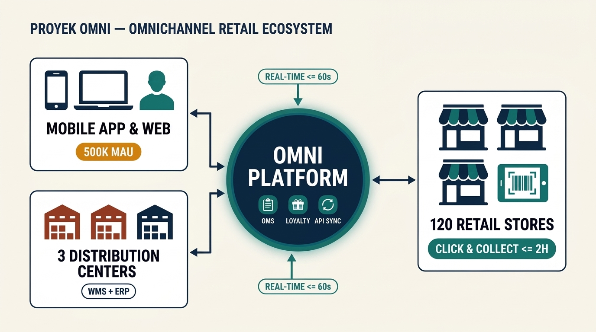
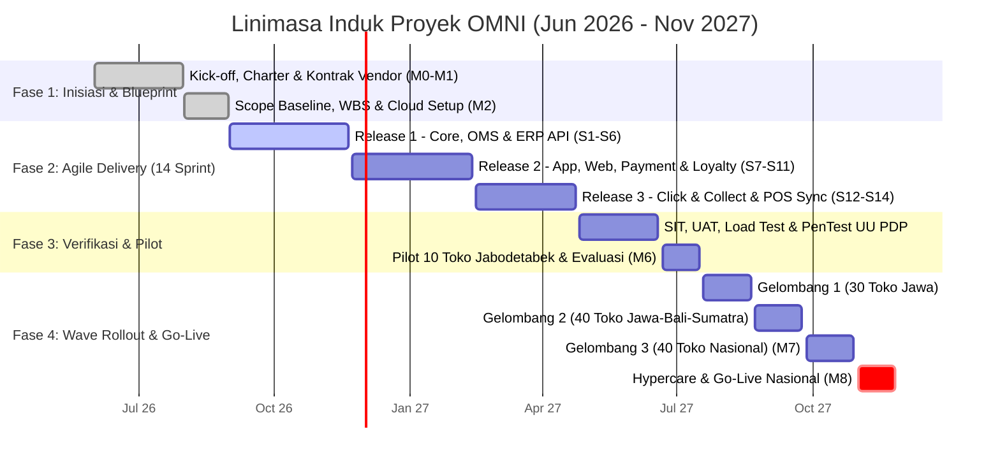
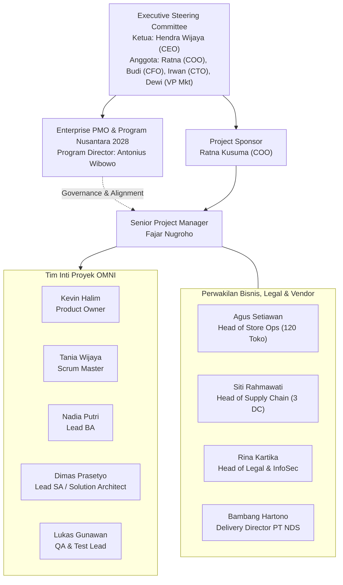

# Studi Kasus Utama: PT Sinar Nusantara Retail (SNR) — Proyek OMNI

> **Catatan Penggunaan:** Dokumen ini adalah rujukan tunggal (*single source of truth*) yang dipakai secara berkelanjutan di seluruh modul (Modul 01–12). Seluruh angka anggaran, tanggal milestone, daftar pemangku kepentingan, struktur organisasi, dan daftar risiko awal dalam dokumen ini bersifat konsisten antarbab agar hasil latihan Anda di satu modul menjadi masukan bagi modul berikutnya. Seluruh nama perusahaan, tokoh, dan angka bersifat fiktif.

---

## 1. Profil Perusahaan: PT Sinar Nusantara Retail Tbk (SNR)

**PT Sinar Nusantara Retail Tbk (SNR)** adalah jaringan ritel modern nasional di segmen *home living, lifestyle*, dan kebutuhan rumah tangga menengah–atas yang berdiri sejak tahun 2008 dengan kantor pusat di Jakarta Selatan. Selama lebih dari satu dekade, keunggulan kompetitif SNR bertumpu pada lokasi toko strategis di pusat perbelanjaan, kurasi produk berkualitas, serta layanan pramuniaga tatap muka yang ramah.

| Dimensi | Kondisi Baseline (Awal 2026) |
|---------|------------------------------|
| **Jaringan Toko Fisik** | **120 toko** di 24 kota (Jawa: 68 toko; Sumatra: 22 toko; Kalimantan: 12 toko; Sulawesi: 10 toko; Bali & Nusa Tenggara: 8 toko) |
| **Pusat Distribusi (*Distribution Center* / DC)** | **3 DC**: DC Cikarang (55% volume nasional), DC Surabaya (30%), DC Medan (15%) |
| **Jumlah Karyawan** | ±3.400 orang (Kantor Pusat: 380; DC & Logistik: 420; Operasional 120 Toko: 2.600) |
| **Pendapatan Tahunan (FY 2025)** | **Rp 1,85 triliun** (Rp 1.850 M), dengan margin laba bersih 6,2% (Rp 114,7 M) |
| **Katalog Produk** | ±18.500 *Stock Keeping Unit* (SKU) aktif pada 8 kategori utama |
| **Basis Pelanggan Loyalty** | 1,2 juta pemegang kartu fisik *Sinar Member Card* (namun ±62% data kontak usang/duplikat lintas toko) |
| **Kontribusi Kanal Digital** | **3,5% dari total omzet** (±Rp 64,75 M/tahun) melalui situs e-commerce lama (dibangun 2019) |

---

## 2. Latar Belakang & Permasalahan Bisnis (*Burning Platform*)

Dalam dua tahun terakhir (2024–2025), perilaku belanja konsumen Indonesia bergeser drastis ke pola **omnichannel** (*research online, purchase offline* maupun *buy online, pick up in store*). Dua pesaing utama SNR telah mengoperasikan aplikasi mobile terintegrasi dengan stok toko real-time dan program loyalty digital. Dampaknya mulai terasa langsung pada kinerja SNR:

1. **Erosi Pangsa Pasar Segmen Muda:** Pangsa pasar SNR pada segmen usia 25–40 tahun menyusut rata-rata **4% per tahun** sejak 2024.
2. **Fragmentasi Stok & Tingkat Pembatalan Tinggi (*Overselling*):** Sistem *Point of Sale* (POS) di 120 toko hanya melakukan sinkronisasi data secara *batch* (berkelompok) satu kali setiap pukul 00.00 WIB ke *Enterprise Resource Planning* (ERP) pusat. Akibatnya, situs web sering menjual barang yang sebenarnya sudah habis di rak toko pada siang hari. Tingkat pembatalan pesanan online akibat kehabisan stok (*stockout cancellation*) mencapai **11,4%**, dan akurasi stok lintas kanal hanya **88,6%**.
3. **Ketiadaan Layanan *Click & Collect* (BOPIS):** Pelanggan tidak dapat memeriksa ketersediaan barang di toko terdekat maupun memesan secara daring untuk langsung diambil di toko tanpa ongkos kirim.
4. **Program Loyalty Terputus & Rawan Kebocoran:** Poin *Sinar Member Card* tidak tersinkronisasi antara transaksi web dan 120 toko fisik. Promosi voucher masih bergantung pada input manual kasir, memperlambat antrean hingga 45 detik per transaksi dan menimbulkan kebocoran kupon tak terkendali.
5. **Pengalaman Web Usang:** Situs e-commerce 2019 tidak ramah perangkat seluler (*mobile-unfriendly*), tingkat *cart abandonment* mencapai 74%, dan tidak memiliki aplikasi mobile resmi.

Menanggapi kondisi ini, Direksi SNR menyetujui **Program Nusantara 2028** — program transformasi digital 3 tahun senilai **Rp 18,50 M** — dengan **Proyek OMNI** sebagai proyek unggulan (*flagship project*) utamanya.

---

## 3. Gambaran Umum Proyek OMNI

| Parameter | Ketetapan Baseline Proyek OMNI |
|-----------|-------------------------------|
| **Nama Proyek** | **Proyek OMNI** (*Omnichannel Commerce, Click & Collect, & Digital Loyalty Platform*) |
| **Sponsor Proyek** | **Ratna Kusuma** — Direktur Operasional & Ritel (COO) |
| **Senior Project Manager** | **Fajar Nugroho** *(peran yang diemban pembaca/peserta dalam seluruh latihan dan tugas)* |
| **Tanggal Mulai (*Kick-off*)** | **1 Juni 2026** |
| **Tenggat Mutlak (*Hard Deadline*)** | **26 November 2027** (78 minggu / 18 bulan — harus *live* penuh sebelum puncak belanja Harbolnas 12.12 & Natal–Tahun Baru) |
| **Anggaran Baseline (*Budget at Completion* / BAC)** | **Rp 9,20 M** (Rp 9.200 jt), sudah termasuk *Contingency Reserve* Rp 0,70 M |
| **Management Reserve** | **Rp 0,60 M** (Rp 600 jt) — dipegang CFO & Steering Committee (total *Project Funding Requirement* = Rp 9,80 M) |
| **Pendekatan Delivery** | **Hybrid Delivery** (Predictive Stage-Gate untuk tata kelola, kontrak, arsitektur, UAT, dan *wave rollout* 120 toko; Agile Scrum 14 Sprint × 2 minggu untuk pembangunan perangkat lunak dan integrasi API) |
| **Vendor Implementasi Utama** | **PT Nusantara Digital Solusi (NDS)** — kontrak *Fixed Price with Milestone & Change Control* senilai Rp 4,40 M |

### 3.1 Ruang Lingkup Inti (*In-Scope*)

1. **Aplikasi Mobile Pelanggan (iOS & Android):** Katalog produk real-time, pencarian stok berbasis lokasi toko terdekat, keranjang belanja, *checkout* multi-metode pembayaran, pelacakan pesanan, notifikasi promosi, dan kartu loyalty digital berbasis QR.
2. **Web E-Commerce Responsif:** Paritas fitur inti dengan aplikasi mobile, dioptimalkan untuk SEO dan kecepatan muat halaman.
3. **Fitur *Click & Collect* (BOPIS — *Buy Online, Pick Up in Store*):** Implementasi di seluruh **120 toko** lengkap dengan aplikasi pendamping berbasis tablet/scanner (*Store Fulfillment App*) bagi petugas toko dan *Service Level Agreement* (SLA) persiapan barang **≤ 2 jam**.
4. **Digital Loyalty Engine:** Pembersihan (*data cleansing*) dan migrasi 1,2 juta data anggota lama, mesin poin terpadu online–offline, 3 tingkatan keanggotaan (*Silver, Gold, Platinum*), serta penebusan voucher otomatis.
5. **Order Management System (OMS) & Inventory Sync Layer:** Lapisan middleware berbasis *Application Programming Interface* (API) yang menjaga sinkronisasi stok *near-real-time* (jeda maksimal **≤ 60 detik**) antara ERP pusat, *Warehouse Management System* (WMS) di 3 DC, dan POS di 120 toko.
6. **Integrasi Payment Gateway & Logistik:** Integrasi *Payment Gateway* (PT FinPay Nusantara — QRIS, Virtual Account, Kartu Kredit/Debit, e-Wallet) sesuai standar PCI-DSS, serta integrasi API agregator kurir reguler & instan.
7. **Kepatuhan Keamanan & Data:** Kepatuhan penuh terhadap **UU No. 27 Tahun 2022 tentang Pelindungan Data Pribadi (UU PDP)**, enkripsi data pelanggan, manajemen persetujuan (*consent management*), dan *Penetration Testing* independen.
8. **Manajemen Perubahan & Pelatihan Operasional:** Penyusunan SOP omnichannel toko, *training-of-trainers* untuk 6 Regional Manager & 120 Store Manager, serta pelatihan operasional 1.440 kasir dan staf gudang toko.

### 3.2 Di Luar Ruang Lingkup (*Out-of-Scope* Proyek OMNI)

- Penggantian sistem ERP inti perusahaan *(dikerjakan paralel pada Proyek ERP-Refresh)*.
- Penggantian perangkat keras terminal kasir POS di 120 toko *(dikerjakan pada Proyek POS-Modern; Proyek OMNI hanya menyediakan adaptor/API integrasi)*.
- Integrasi langsung ke *marketplace* pihak ketiga (Shopee, Tokopedia, TikTok Shop) *(ditunda ke Fase 2 tahun 2028)*.
- Pembangunan *Enterprise Data Warehouse* dan mesin rekomendasi berbasis AI lanjutan *(cakupan Proyek DataHub)*.
- Penjualan dan pengiriman lintas negara (ekspor).

---

## 4. Target Bisnis & Kriteria Keberhasilan (*Success Criteria*)

| Kategori | Metrik Keberhasilan | Baseline 2026 | Target Proyek OMNI |
|----------|---------------------|---------------|--------------------|
| **Pertumbuhan Bisnis** | Kontribusi omzet kanal digital | 3,5% (~Rp 64,75 M) | **15% total omzet** dalam 18 bulan pasca-go-live (~Rp 300 M/tahun) |
| **Efisiensi Inventori** | Akurasi stok lintas kanal (online–toko) | 88,6% | **≥ 98,0%** |
| **Pengalaman Pelanggan** | Pembatalan pesanan akibat *stockout* | 11,4% | **< 1,5%** |
| **Adopsi Digital** | Pengguna aktif bulanan aplikasi (*MAU*) | 0 | **500.000 MAU** di tahun pertama pasca-go-live |
| **Loyalty** | Anggota loyalty digital terverifikasi & *repeat purchase* | 1,2 jt kartu fisik (62% usang) | **800.000 anggota terverifikasi**; *repeat purchase* naik **+25%** |
| **Operasional Toko** | Cakupan & SLA *Click & Collect* | 0 toko | **120 toko aktif (100%)**; SLA siap ambil **≤ 2 jam** pada ≥ 95% pesanan |
| **Keandalan Teknis** | *System uptime* & beban puncak | ~96% / 150 TPM | **≥ 99,5% uptime**; lulus uji beban **2.500 transaksi/menit (TPM)** |
| **Kepatuhan & Keamanan** | Audit UU PDP & *Penetration Testing* | Belum teraudit | **100% patuh UU PDP**; **0 temuan Critical/High** saat Go-Live |
| **Kinerja Proyek** | Ketepatan jadwal & anggaran | — | Go-Live **≤ 26 Nov 2027**; deviasi biaya akhir **≤ ±5%** dari BAC Rp 9,20 M |

---

## 5. Rincian Anggaran Induk (*Cost Baseline*) & Data Kinerja EVM

### 5.1 Struktur Anggaran Proyek OMNI (BAC = Rp 9,20 M)

| Kode Biaya | Komponen Anggaran | Nilai (Rp jt) | Nilai (Rp M) | Porsi dari BAC |
|------------|-------------------|---------------|--------------|----------------|
| **CB-01** | Pengembangan Platform Inti (Mobile App, Web, OMS, Loyalty Engine — Kontrak Vendor NDS & lisensi perangkat lunak) | 4.400 | 4,40 | 47,8% |
| **CB-02** | Integrasi Sistem *Legacy* (ERP, WMS 3 DC, Adaptor POS 120 toko, API Middleware, Payment & Kurir) | 1.650 | 1,65 | 17,9% |
| **CB-03** | Infrastruktur Cloud (AWS/GCP Region Jakarta), Keamanan (PenTest, UU PDP) & Perangkat Tablet/Scanner 120 Toko | 1.150 | 1,15 | 12,5% |
| **CB-04** | Alokasi Tim Internal Khusus, *Change Management*, & Pelatihan 120 Toko | 850 | 0,85 | 9,2% |
| **CB-05** | Quality Assurance (QA), SIT, UAT, Load Testing, & Pilot 10 Toko | 450 | 0,45 | 4,9% |
| **CB-06** | **Contingency Reserve** *(cadangan untuk risiko teridentifikasi / known-unknowns, ~7,6% dari BAC)* | 700 | 0,70 | 7,6% |
| **TOTAL** | **Cost Baseline / Budget at Completion (BAC)** | **9.200** | **9,20** | **100,0%** |
| *Di luar BAC* | **Management Reserve** *(cadangan untuk risiko tak terduga / unknown-unknowns — otoritas CFO/SteerCo)* | *600* | *0,60* | — |
| **FUNDING** | **Total Project Funding Requirement** | **9.800** | **9,80** | — |

### 5.2 Snapshot Kinerja EVM Resmi — Akhir Bulan ke-9 (28 Februari 2027)

Untuk menjaga konsistensi latihan analisis kinerja (*Earned Value Management* / EVM) di Modul 01, Modul 02, dan pelaporan eksekutif di Modul 05, ditetapkan titik tinjauan resmi pada **akhir Bulan ke-9 (28 Februari 2027 — setelah Sprint 10 selesai)**:

- **BAC** (*Budget at Completion*) = **Rp 9,20 M** (Rp 9.200 jt)
- **PV** (*Planned Value*) = **Rp 4,80 M** (Rp 4.800 jt)
- **EV** (*Earned Value*) = **Rp 4,32 M** (Rp 4.320 jt)
- **AC** (*Actual Cost*) = **Rp 4,60 M** (Rp 4.600 jt)

**Ringkasan Indikator Terhitung (Referensi Silang):**
- **SV** (*Schedule Variance*) = EV − PV = Rp 4,32 M − Rp 4,80 M = **−Rp 0,48 M** *(terlambat dari jadwal)*
- **CV** (*Cost Variance*) = EV − AC = Rp 4,32 M − Rp 4,60 M = **−Rp 0,28 M** *(melebihi anggaran)*
- **SPI** (*Schedule Performance Index*) = EV / PV = 4,32 / 4,80 = **0,90** *(baru menghasilkan 90% progres dari rencana)*
- **CPI** (*Cost Performance Index*) = EV / AC = 4,32 / 4,60 = **0,94** *(0,9391 — setiap Rp 1 dibelanjakan baru menghasilkan nilai Rp 0,94)*
- **EAC** (*Estimate at Completion* — asumsi tren CPI berlanjut) = BAC / CPI = 9,20 / 0,93913 = **Rp 9,80 M** *(potensi defisit Rp 0,60 M terhadap BAC)*
- **TCPI** (*To-Complete Performance Index* untuk memenuhi BAC) = (BAC − EV) / (BAC − AC) = (9,20 − 4,32) / (9,20 − 4,60) = **1,06** *(efisiensi sisa proyek harus naik menjadi 1,06)*

*Penyebab utama keterlambatan Bulan ke-9:* Migrasi data 1,2 juta anggota loyalty lama ternyata 2 kali lebih kotor dari asumsi awal, dan antarmuka API dari proyek paralel **POS-Modern** mundur 3 minggu.

---

## 6. Linimasa Induk & Milestone Utama (18 Bulan)

| ID | Milestone | Tanggal Target | Kriteria Kelulusan / *Stage-Gate* |
|----|-----------|----------------|-----------------------------------|
| **M0** | Project Kick-off | 1 Jun 2026 | Tim inti ditunjuk; komitmen awal Direksi diumumkan |
| **M1** | **Gate 1:** Charter & Kontrak | 31 Jul 2026 | Project Charter ditandatangani Sponsor; Arsitektur High-Level disetujui CTO; kontrak PT NDS efektif |
| **M2** | Baseline & Readiness | 31 Agu 2026 | Scope Baseline, WBS, Jadwal Induk, Product Backlog awal, dan lingkungan Cloud Dev/Staging siap |
| **M3** | Release 1 (Sprint 1–6) | 20 Nov 2026 | Katalog dasar, OMS MVP, dan sandbox integrasi ERP/WMS berjalan |
| **M4** | Release 2 (Sprint 7–11) | 12 Feb 2027 | Mobile App & Web Beta, Payment Gateway, dan Digital Loyalty Engine (data migrasi) terverifikasi |
| **M5** | **Gate 2:** Release 3 / Feature Freeze | 23 Apr 2027 | Fitur Click & Collect end-to-end dan adaptor POS selesai; tidak ada fitur baru tanpa persetujuan CCB |
| **M6** | **Gate 3:** UAT & Pilot 10 Toko | 16 Jul 2027 | Lulus SIT/UAT, uji beban 2.500 TPM, PenTest UU PDP bersih, dan Pilot 10 toko mencapai SLA ≤ 2 jam |
| **M7** | Rollout 120 Toko Lengkap | 29 Okt 2027 | Seluruh 120 toko (Pilot + Gelombang 1–3) aktif di produksi dan staf terlatih |
| **M8** | **Gate 4:** Go-Live Nasional & Closure | **26 Nov 2027** | Sistem stabil ≥ 99,5%, serah terima ke IT Operations & Store Ops, pelajaran terdokumentasi |

---

## 7. Struktur Tata Kelola & Daftar Pemangku Kepentingan (*Stakeholders*)

| Kode | Nama | Jabatan / Organisasi | Peran di Proyek OMNI | Kepentingan Utama & Dinamika Lapangan |
|------|------|----------------------|----------------------|---------------------------------------|
| **SH-01** | **Hendra Wijaya** | Direktur Utama (CEO) | Ketua Steering Committee | Menjadikan Proyek OMNI simbol transformasi digital menjelang RUPS 2027; menuntut tenggat 26 Nov 2027 tidak meleset |
| **SH-02** | **Ratna Kusuma** | Direktur Operasional & Ritel (COO) | **Project Sponsor** | Pemilik manfaat bisnis & otoritas keputusan strategis harian; fokus pada kelancaran operasional 120 toko dan target omzet digital |
| **SH-03** | **Budi Santoso** | Direktur Keuangan (CFO) | Anggota SteerCo & Otoritas Dana | Sangat ketat terhadap disiplin anggaran Rp 9,20 M, pencairan *Management Reserve*, dan realisasi ROI |
| **SH-04** | **Irwan Pratama** | CTO / VP IT | Anggota SteerCo & Pemilik Arsitektur | Menjaga stabilitas ERP/POS eksisting, arsitektur cloud, keamanan, dan pembagian beban kerja tim IT lintas program |
| **SH-05** | **Dewi Lestari** | VP Marketing & CX | Anggota SteerCo & Pemilik Loyalty | Ingin pengalaman aplikasi sekelas *e-commerce* besar; kerap mendorong tambahan fitur promosi/gamifikasi baru (*sumber utama potensi scope creep*) |
| **SH-06** | **Agus Setiawan** | Head of Store Operations | Pemilik Operasional 120 Toko | Khawatir fitur *Click & Collect* menambah beban staf toko tanpa insentif jelas serta menggerus target penjualan cabang fisik (*potensi resistensi tinggi*) |
| **SH-07** | **Siti Rahmawati** | Head of Supply Chain & Warehouse | Pemilik Integrasi WMS 3 DC | Memastikan sinkronisasi stok DC Cikarang, Surabaya, dan Medan akurat tanpa mengganggu distribusi rutin ke toko |
| **SH-08** | **Rina Kartika** | Head of Legal, Compliance & InfoSec | Penjaga Kepatuhan & Kontrak | Berwenang menahan *Go-Live* (*veto power*) jika kepatuhan UU PDP, PCI-DSS, atau klausul kontrak vendor belum tuntas |
| **SH-09** | **Antonius Wibowo** | Program Director / Head of PMO | Pimpinan Program Nusantara 2028 | Mengelola ketergantungan Proyek OMNI terhadap ERP-Refresh, POS-Modern, dan DataHub serta pelaporan portofolio |
| **SH-10** | **Fajar Nugroho** | **Senior Project Manager** | Pemimpin Delivery Proyek OMNI | Bertanggung jawab penuh atas integrasi lingkup, jadwal, biaya, mutu, risiko, vendor, dan tata kelola *hybrid* |
| **SH-11** | **Kevin Halim & Tania Wijaya** | Product Owner & Scrum Master | Kepemimpinan Tim Agile | Kevin mengelola prioritas *Product Backlog* bersama Dewi; Tania menjaga ritme Scrum, menghilangkan hambatan, dan memantau *velocity* |
| **SH-12** | **Nadia Putri & Dimas Prasetyo** | Lead BA & Lead SA/Solution Architect | Desain Kebutuhan & Solusi | Nadia menjembatani kebutuhan bisnis ke BRD/User Stories; Dimas merancang arsitektur OMS, API, dan integrasi *legacy* |
| **SH-13** | **Bambang Hartono** | Delivery Director — PT NDS (Vendor) | Mitra Implementasi Utama | Memimpin 18 personel vendor (developer, QA, DevOps); sensitif terhadap perubahan lingkup di luar kontrak *Fixed Price* Rp 4,40 M |

---

## 8. Daftar Risiko Awal Proyek OMNI (Baseline Identifikasi)

Daftar risiko awal ini menjadi titik pijak analisis risiko mendalam di Modul 03 dan pengelolaan ketergantungan di Modul 02, 04, dan 05:

| ID | Ringkasan Risiko (*Risk Event*) | Kategori | Dampak Utama |
|----|--------------------------------|----------|--------------|
| **R-01** | Keterlambatan rilis API dari proyek paralel **POS-Modern** menunda integrasi stok real-time 120 toko | Eksternal / Program | Jadwal (jalur kritis) |
| **R-02** | Kualitas data 1,2 juta anggota *Sinar Member Card* lama (62% duplikat/usang) gagal dimigrasi bersih | Teknis / Data | Jadwal, Mutu, CX |
| **R-03** | Resistensi 120 Store Manager & kasir terhadap SOP *Click & Collect* karena khawatir beban kerja & target omzet toko | Organisasi / Stakeholder | Adopsi & Manfaat |
| **R-04** | *Scope creep* berulang dari tim Marketing (fitur gamifikasi, live-shopping, flash sale kompleks) di tengah sprint | Lingkup / Tata Kelola | Biaya & Jadwal |
| **R-05** | Ketidakpatuhan terhadap UU PDP (manajemen persetujuan, enkripsi PII) atau kegagalan *Penetration Testing* | Legal / Keamanan | Penundaan *Go-Live* |
| **R-06** | Gangguan performa (*downtime* / *latency* tinggi) saat simulasi beban puncak 2.500 TPM menjelang Harbolnas | Teknis / Arsitektur | Mutu & Reputasi |
| **R-07** | *Turnover* insinyur kunci vendor PT NDS atau tim IT internal SNR yang terbagi ke 4 proyek bersamaan | Sumber Daya | Jadwal & Mutu |
| **R-08** | Sengketa interpretasi lingkup pada kontrak *Fixed Price* Rp 4,40 M dengan PT NDS memicu lonjakan biaya *Change Request* | Komersial / Vendor | Biaya |
| **R-09** | Keterlambatan pengadaan & pengiriman 240 unit tablet/scanner toko ke luar Jawa (Sumatra, Kalimantan, Sulawesi) | Pengadaan / Logistik | Jadwal Rollout |
| **R-10** | Peluang (*Opportunity*): Keberhasilan pilot 10 toko lebih awal memungkinkan pembukaan kanal *pre-order* anggota Platinum sebelum Harbolnas | Bisnis / Peluang | Manfaat Tambahan |

---

## 9. Konteks Program Strategis: Program Nusantara 2028

Proyek OMNI tidak berdiri sendiri. Di bawah koordinasi **Enterprise PMO SNR** yang dipimpin **Antonius Wibowo**, Proyek OMNI merupakan salah satu dari empat proyek dalam **Program Nusantara 2028** (periode 2026–2028, total investasi **Rp 18,50 M**):

| Kode Proyek | Nama Proyek | Anggaran | Periode | Ketergantungan dengan Proyek OMNI |
|-------------|-------------|----------|---------|-----------------------------------|
| **PRJ-01** | **Proyek OMNI** *(Flagship)* | **Rp 9,20 M** | Jun 2026 – Nov 2027 | Mengonsumsi API inventori ERP & POS; mengirim data transaksi ke DataHub |
| **PRJ-02** | **Proyek ERP-Refresh** | **Rp 4,10 M** | Mar 2026 – Agu 2027 | Menyediakan *Master Data* SKU & API inventori pusat ke OMS Proyek OMNI; berbagi 3 *senior architect* IT |
| **PRJ-03** | **Proyek POS-Modern** | **Rp 3,20 M** | Mei 2026 – Okt 2027 | Menyediakan adaptor API sinkronisasi stok toko & pemindai QR voucher loyalty di 120 toko *(ketergantungan kritis)* |
| **PRJ-04** | **Proyek DataHub** | **Rp 2,00 M** | Jan 2027 – Jun 2028 | Membangun *Data Warehouse* & analitik perilaku omnichannel dari data transaksi Proyek OMNI |
| **TOTAL** | **Program Nusantara 2028** | **Rp 18,50 M** | **2026 – 2028** | Target total: pertumbuhan omzet digital 15% & efisiensi biaya rantai pasok 8% |

---

## 10. Peta Keterhubungan Studi Kasus Antar-Modul

| Modul | Fokus Penerapan pada Proyek OMNI | Artefak Utama yang Dihasilkan |
|-------|----------------------------------|-------------------------------|
| **Modul 01** | Menetapkan batas proyek, tata kelola perubahan, dan baseline kinerja | Project Charter, Scope Statement, EVM Snapshot Bulan ke-9, Quality & Change Control Plan |
| **Modul 02** | Memecah pekerjaan ke WBS, menghitung jalur kritis 78 minggu, dan mengatasi bottleneck resource | WBS 4-Level, PDM/Critical Path, PERT, RACI Matrix, Rencana Crashing/Fast Tracking |
| **Modul 03** | Mengelola risiko R-01 s.d. R-10, eskalasi isu POS/Data, dan mengatasi resistensi Store Ops & Marketing | Risk Register + EMV, Issue Log, Escalation Matrix, Power-Interest Grid & Communication Plan |
| **Modul 04** | Menjalankan 14 Sprint pengembangan produk dalam kerangka *Hybrid Governance* & kontrak vendor | Product Backlog Prioritas, Release Plan, Velocity & Burndown, Hybrid Operating Model |
| **Modul 05** | Menyelaraskan Proyek OMNI di dalam Program Nusantara 2028, mengelola dependensi lintas proyek & KPI PMO | Program Benefits Map, Cross-Project Dependency Matrix, PMO Executive RAG Dashboard, Portfolio Scoring |
| **Modul 06–09** *(Jilid II)* | Merinci BRD/FRD, UML/ERD OMS & Loyalty, arsitektur API/Cloud, dan roadmap produk pasca-Go-Live | BRD/FRD, Sequence/Activity/ERD, API & Cloud Spec, Product Roadmap |
| **Modul 10–12** *(Jilid III)* | Menyusun Business Case & ROI, negosiasi eksekutif, serta portofolio wawancara Senior PM/BA/SA | Financial Model (NPV/IRR/Payback), Executive Deck C-Level, Case Study Portfolio |
