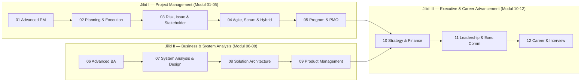

# Buku Ajar & Panduan Praktik Lengkap: Senior Project Management, Business & System Analysis

## Edisi Lengkap 12 Modul (Jilid I, II, dan III)

Selamat datang di edisi lengkap buku **Program Pembelajaran Senior Project Management, Business & System Analysis** yang dikembangkan berdasarkan dokumen **"Rancangan 12 modul pembelajaran – PM"**. Seluruh 12 modul dari ketiga jalur telah tersusun penuh, saling terhubung melalui satu studi kasus berkelanjutan **PT Sinar Nusantara Retail (SNR) — Proyek OMNI & Program Nusantara 2028**, diperkaya dengan **13 ilustrasi visual kustom** dan **70+ diagram Mermaid**, serta dilengkapi **kuis pilihan ganda interaktif 120 soal yang dapat dikoreksi otomatis** pada edisi HTML E-Book.

---

## 1. Tujuan Program

Setelah menyelesaikan program ini, pembaca dan peserta mampu:

1. Memimpin proyek dan program berskala menengah–besar dengan pendekatan *predictive*, *agile*, maupun *hybrid*.
2. Menganalisis kebutuhan bisnis lalu menerjemahkannya menjadi desain sistem, arsitektur solusi, dan produk digital yang dapat dibangun.
3. Mengaitkan pekerjaan proyek dengan strategi bisnis, analisis finansial (NPV, IRR, ROI, TCO), dan keputusan eksekutif.
4. Memosisikan diri untuk peran **Senior PM**, **Senior BA**, atau **SA (System Analyst / Solution Architect)** dan siap menghadapi proses wawancara tingkat senior.

## 2. Sasaran Pembaca & Peserta

- Project Manager / Project Coordinator, Business Analyst, System Analyst, Product Owner, Scrum Master, dan Team Lead dengan pengalaman kerja ±3 tahun atau lebih.
- Profesional yang ingin naik ke peran senior, memimpin proyek lintas fungsi strategis, atau berpindah ke jalur BA/SA/Solution Architect.
- Fasilitator pelatihan korporat maupun pembelajar mandiri (*self-paced learner*).

---

## 3. Daftar Isi Lengkap (Modul 00–12)

### Pendahuluan & Studi Kasus Induk

| Bagian | Judul | Cakupan Utama | File |
|--------|-------|---------------|------|
| **00** | **Studi Kasus Utama: PT Sinar Nusantara Retail (SNR) — Proyek OMNI** | Profil 120 toko & 3 DC, baseline BAC Rp 9,20 M, tenggat 26 Nov 2027, 13 stakeholder kunci, snapshot EVM Bulan ke-9, risiko R-01–R-10, Program Nusantara 2028 (Rp 18,50 M) | [00-studi-kasus-utama.md](00-studi-kasus-utama.md) |

### Jilid I — Jalur Utama: Project Management (Modul 01–05: Leadership & Project Delivery)

| No | Modul / Bab | Topik Inti | Status | File |
|----|-------------|------------|--------|------|
| **01** | **Advanced Project Management** | Project lifecycle, tailoring, project charter, scope, schedule, cost, EVM, quality, CCB | Selesai | [modul-01-advanced-project-management.md](modul-01-advanced-project-management.md) |
| **02** | **Project Planning & Execution** | WBS, WBS dictionary, timeline, CPM, PERT, float, resource allocation, RACI, crashing & fast tracking | Selesai | [modul-02-project-planning-execution.md](modul-02-project-planning-execution.md) |
| **03** | **Risk, Issue & Stakeholder Management** | Risk register, P×I matrix, EMV & decision tree, mitigation, issue log, escalation, stakeholder mapping | Selesai | [modul-03-risk-issue-stakeholder-management.md](modul-03-risk-issue-stakeholder-management.md) |
| **04** | **Agile, Scrum & Hybrid Project Management** | Agile mindset, Stacey/Cynefin, Scrum ceremonies, backlog INVEST, velocity, Kanban/Little's Law, hybrid delivery | Selesai | [modul-04-agile-scrum-hybrid-pm.md](modul-04-agile-scrum-hybrid-pm.md) |
| **05** | **Program Management & PMO** | Multi-proyek, benefits realization, cross-project dependencies, governance, tipe PMO, KPI/RAG, portfolio scoring | Selesai | [modul-05-program-management-pmo.md](modul-05-program-management-pmo.md) |

### Jilid II — Jalur Alternatif: Business & System Analysis (Modul 06–09: Business & Solution Design)

| No | Modul / Bab | Topik Inti | Status | File |
|----|-------------|------------|--------|------|
| **06** | **Advanced Business Analysis** | BABOK v3, BRD, FRD, NFR, requirement elicitation, BPMN AS-IS vs TO-BE, gap analysis, RTM | Selesai | [modul-06-advanced-business-analysis.md](modul-06-advanced-business-analysis.md) |
| **07** | **System Analysis & Design** | C4 Model, UML (Use Case, Activity, Sequence, State Machine, Class), ERD & normalisasi 3NF, system architecture | Selesai | [modul-07-system-analysis-design.md](modul-07-system-analysis-design.md) |
| **08** | **Solution Architecture & Integration** | REST/GraphQL/gRPC/Webhook API, SQL/NoSQL/Cache, microservices vs modular monolith, Event-Driven/Saga/Circuit Breaker, Cloud HA/DR, ADR | Selesai | [modul-08-solution-architecture-integration.md](modul-08-solution-architecture-integration.md) |
| **09** | **Product Management & Product Ownership** | Product vision, Opportunity Solution Tree, Now–Next–Later roadmap, RICE & Kano prioritization, Story Mapping, North Star & AARRR KPI | Selesai | [modul-09-product-management-ownership.md](modul-09-product-management-ownership.md) |

### Jilid III — Executive & Career Advancement (Modul 10–12: Semua Jalur)

| No | Modul / Bab | Topik Inti | Status | File |
|----|-------------|------------|--------|------|
| **10** | **Business Strategy & Financial Management** | Executive business case, CapEx vs OpEx, TCO, CBA, ROI, Payback, NPV, IRR, budgeting & sensitivity analysis | Selesai | [modul-10-business-strategy-financial-management.md](modul-10-business-strategy-financial-management.md) |
| **11** | **Leadership, Negotiation & Executive Communication** | Situational/Servant leadership, Tuckman & Lencioni, konflik TKI, negosiasi Harvard (BATNA/ZOPA), Minto Pyramid & SCQA ke C-level, ADKAR | Selesai | [modul-11-leadership-negotiation-executive-communication.md](modul-11-leadership-negotiation-executive-communication.md) |
| **12** | **Career Positioning & Interview Simulation** | CV Google XYZ, Capstone Portfolio proyek OMNI tersanitasi NDA, STAR+L story bank, *mock interview* Senior PM/BA/SA, negosiasi kompensasi & rencana 30–60–90 hari | Selesai | [modul-12-career-positioning-interview-simulation.md](modul-12-career-positioning-interview-simulation.md) |

### Edisi Gabungan & E-Book Interaktif Siap Cetak

| Format | Keterangan | File |
|--------|------------|------|
| **HTML E-Book Lengkap (12 Modul — Rekomendasi Utama)** | E-book interaktif dengan **120 soal kuis pilihan ganda auto-koreksi & dasbor skor**, **13 ilustrasi gambar kustom (klik untuk perbesar)**, **70+ diagram Mermaid**, rumus KaTeX, daftar isi + pencarian, mode Sistem/Terang/Gelap, dan tata letak cetak A4 PDF | [buku-senior-pm-modul-01-12.html](buku-senior-pm-modul-01-12.html) |
| **Markdown Gabungan Lengkap (12 Modul)** | Seluruh isi buku (00–12) ditambah **Indeks Glosarium Gabungan A–Z** dalam satu berkas Markdown | [buku-lengkap-modul-01-12.md](buku-lengkap-modul-01-12.md) |
| **Edisi Jilid I Terpisah (Modul 01–05)** | Arsip kompilasi khusus Jilid I (PM Delivery) | [buku-senior-pm-modul-01-05.html](buku-senior-pm-modul-01-05.html) • [buku-lengkap-modul-01-05.md](buku-lengkap-modul-01-05.md) |

---

## 4. Peta Jalur Belajar



| Jalur | Urutan Wajib | Penekanan / Pengayaan yang Disarankan |
|-------|--------------|---------------------------------------|
| **Jalur Utama — Senior Project Manager** | 01 → 02 → 03 → 04 → 05 → 10 → 11 → 12 | Pengayaan: 06 (memahami kerja BA) dan 09 (kolaborasi dengan Product Owner) |
| **Jalur Alternatif — Senior Business Analyst** | 06 → 07 → 08 → 09 → 10 → 11 → 12 | Penekanan pada 06 dan 09; pengayaan: 03 (stakeholder) |
| **Jalur Alternatif — System Analyst / Solution Architect** | 06 → 07 → 08 → 09 → 10 → 11 → 12 | Penekanan pada 07 dan 08; pengayaan: 04 (delivery agile) |
| **Program Penuh** | 01 → 12 berurutan | 144 jam sesi + ±72 jam tugas mandiri |

---

## 5. Sistem Penilaian & Status Penyusunan

| Komponen Per Modul | Bobot | Ambang Lulus |
|--------------------|-------|--------------|
| Kuis Pilihan Ganda (10 soal — auto-koreksi di E-Book) | 20% | Nilai lulus modul: **≥ 70** |
| Latihan dan partisipasi | 20% | Kelulusan jalur: lulus seluruh modul wajib |
| Tugas modul (rubrik 4 skala) | 60% | Capstone Modul 12: **≥ 75** |

| Batch | Isi | Status |
|-------|-----|--------|
| **Batch 1** | README, Studi Kasus Utama (00), Modul 01–03 | **Selesai** |
| **Batch 2** | Modul 04–06 | **Selesai** |
| **Batch 3** | Modul 07–09 | **Selesai** |
| **Batch 4** | Modul 10–12, 13 Ilustrasi Visual, & E-Book Kuis Interaktif 120 Soal | **Selesai** |

---

## 6. Membangun Ulang Buku (Opsional)

Jika Anda menyunting salah satu bab Markdown, jalankan perintah berikut untuk memperbarui berkas gabungan Markdown dan HTML E-Book secara otomatis:

```bash
python scripts/build_book.py
```
