# Buku Ajar & Panduan Praktik: Senior Project Management, Business & System Analysis

## Jilid I — Leadership & Project Delivery (Modul 01–05)

**Edisi Lengkap Jalur Utama — Project Management**
Berdasarkan dokumen *"Rancangan 12 modul pembelajaran – PM"*
Studi Kasus Berkelanjutan: **PT Sinar Nusantara Retail (SNR) — Proyek OMNI**

| Keterangan | Detail |
|------------|--------|
| **Cakupan Jilid I** | Studi Kasus Utama (00) + Modul 01 sampai Modul 05 |
| **Total Durasi Pembelajaran** | 60 jam sesi interaktif (20 sesi × 3 jam) + ±30 jam tugas mandiri |
| **Sasaran Pembaca** | Project Manager, Project Coordinator, Business Analyst, System Analyst, Product Owner, Scrum Master, Team Lead (±3 tahun pengalaman ke atas) |
| **Konvensi Mata Uang & Angka** | `Rp 1 M` = Rp 1 miliar; `Rp 1 jt` = Rp 1 juta; desimal memakai koma (contoh: `0,94`) |
| **Status Edisi** | Jilid I Lengkap (Modul 01–05) |

---

## Kata Pengantar & Cara Menggunakan Buku Ini

Transisi dari *Project Manager* tingkat menengah menuju **Senior Project Manager** bukan sekadar soal menguasai lebih banyak fitur perangkat lunak penjadwalan. Perbedaan utamanya terletak pada **cara berpikir**: dari sekadar mengelola daftar tugas menuju menjaga **nilai bisnis, tata kelola perubahan, ketahanan risiko, kolaborasi lintas metode (*predictive*, *agile*, dan *hybrid*), serta keselarasan program dengan strategi eksekutif**.

Buku Jilid I ini dirancang dengan prinsip **belajar melalui praktik berkelanjutan**. Alih-alih berpindah-pindah kasus fiktif yang terputus di tiap bab, seluruh Modul 01 hingga Modul 05 mengikuti satu proyek nyata yang hidup dari awal hingga akhir: **Proyek OMNI di PT Sinar Nusantara Retail Tbk (SNR)** — transformasi omnichannel bagi 120 toko fisik dengan anggaran **Rp 9,20 M** dan tenggat mutlak **26 November 2027**, sebagai proyek unggulan dari **Program Nusantara 2028** senilai **Rp 18,50 M**.

### Panduan Penggunaan
1. **Pelajari Bagian 00 (Studi Kasus Utama) terlebih dahulu** sebelum masuk ke Modul 01 agar Anda mengenal konteks perusahaan, 13 pemangku kepentingan kunci, struktur anggaran, linimasa, dan daftar risiko awal.
2. **Kerjakan Bagian 7.1 (Soal Latihan) dan Bagian 9.1 (Kuis)** secara mandiri sebelum membuka kunci jawaban dan pembahasannya.
3. **Gunakan Bagian 8 (Tugas Modul & Rubrik)** untuk menyusun portofolio nyata — artefak dari Modul 01–05 nantinya akan menjadi bahan baku langsung bagi Capstone Portofolio & Simulasi Wawancara pada Modul 12.
4. **Salin dan adaptasi Bagian 11 (Lampiran Template)** untuk langsung dipakai pada proyek Anda di tempat kerja.

---

## Peta Jalur Belajar Program

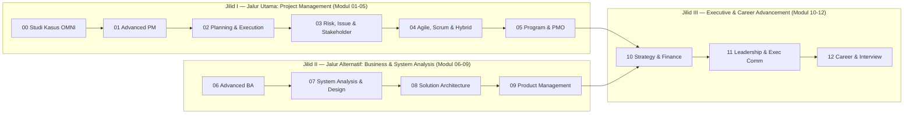

---

# Studi Kasus Utama: PT Sinar Nusantara Retail (SNR) — Proyek OMNI

> **Catatan Penggunaan:** Dokumen ini adalah rujukan tunggal (*single source of truth*) yang dipakai secara berkelanjutan di seluruh modul (Modul 01–12). Seluruh angka anggaran, tanggal milestone, daftar pemangku kepentingan, struktur organisasi, dan daftar risiko awal dalam dokumen ini bersifat konsisten antarbab agar hasil latihan Anda di satu modul menjadi masukan bagi modul berikutnya. Seluruh nama perusahaan, tokoh, dan angka bersifat fiktif.

---

## 1. Profil Perusahaan: PT Sinar Nusantara Retail Tbk (SNR)

**PT Sinar Nusantara Retail Tbk (SNR)** adalah jaringan ritel modern nasional di segmen *home living, lifestyle*, dan kebutuhan rumah tangga menengah–atas yang berdiri sejak tahun 2008 dengan kantor pusat di Jakarta Selatan. Selama lebih dari satu dekade, keunggulan kompetitif SNR bertumpu pada lokasi toko strategis di pusat perbelanjaan, kurasi produk berkualitas, serta layanan pramuniaga tatap muka yang ramah.

| Dimensi | Kondisi Baseline (Awal 2026) |
|---------|------------------------------|
| **Jaringan Toko Fisik** | **120 toko** di 24 kota (Jawa: 68 toko; Sumatra: 22 toko; Kalimantan: 12 toko; Sulawesi: 10 toko; Bali & Nusa Tenggara: 8 toko) |
| **Pusat Distribusi (*Distribution Center* / DC)** | **3 DC**: DC Cikarang (55% volume nasional), DC Surabaya (30%), DC Medan (15%) |
| **Jumlah Karyawan** | ±3.400 orang (Kantor Pusat: 380; DC & Logistik: 420; Operasional 120 Toko: 2.600) |
| **Pendapatan Tahunan (FY 2025)** | **Rp 1,85 triliun** (Rp 1.850 M), dengan margin laba bersih 6,2% (Rp 114,7 M) |
| **Katalog Produk** | ±18.500 *Stock Keeping Unit* (SKU) aktif pada 8 kategori utama |
| **Basis Pelanggan Loyalty** | 1,2 juta pemegang kartu fisik *Sinar Member Card* (namun ±62% data kontak usang/duplikat lintas toko) |
| **Kontribusi Kanal Digital** | **3,5% dari total omzet** (±Rp 64,75 M/tahun) melalui situs e-commerce lama (dibangun 2019) |

---

## 2. Latar Belakang & Permasalahan Bisnis (*Burning Platform*)

Dalam dua tahun terakhir (2024–2025), perilaku belanja konsumen Indonesia bergeser drastis ke pola **omnichannel** (*research online, purchase offline* maupun *buy online, pick up in store*). Dua pesaing utama SNR telah mengoperasikan aplikasi mobile terintegrasi dengan stok toko real-time dan program loyalty digital. Dampaknya mulai terasa langsung pada kinerja SNR:

1. **Erosi Pangsa Pasar Segmen Muda:** Pangsa pasar SNR pada segmen usia 25–40 tahun menyusut rata-rata **4% per tahun** sejak 2024.
2. **Fragmentasi Stok & Tingkat Pembatalan Tinggi (*Overselling*):** Sistem *Point of Sale* (POS) di 120 toko hanya melakukan sinkronisasi data secara *batch* (berkelompok) satu kali setiap pukul 00.00 WIB ke *Enterprise Resource Planning* (ERP) pusat. Akibatnya, situs web sering menjual barang yang sebenarnya sudah habis di rak toko pada siang hari. Tingkat pembatalan pesanan online akibat kehabisan stok (*stockout cancellation*) mencapai **11,4%**, dan akurasi stok lintas kanal hanya **88,6%**.
3. **Ketiadaan Layanan *Click & Collect* (BOPIS):** Pelanggan tidak dapat memeriksa ketersediaan barang di toko terdekat maupun memesan secara daring untuk langsung diambil di toko tanpa ongkos kirim.
4. **Program Loyalty Terputus & Rawan Kebocoran:** Poin *Sinar Member Card* tidak tersinkronisasi antara transaksi web dan 120 toko fisik. Promosi voucher masih bergantung pada input manual kasir, memperlambat antrean hingga 45 detik per transaksi dan menimbulkan kebocoran kupon tak terkendali.
5. **Pengalaman Web Usang:** Situs e-commerce 2019 tidak ramah perangkat seluler (*mobile-unfriendly*), tingkat *cart abandonment* mencapai 74%, dan tidak memiliki aplikasi mobile resmi.

Menanggapi kondisi ini, Direksi SNR menyetujui **Program Nusantara 2028** — program transformasi digital 3 tahun senilai **Rp 18,50 M** — dengan **Proyek OMNI** sebagai proyek unggulan (*flagship project*) utamanya.

---

## 3. Gambaran Umum Proyek OMNI

| Parameter | Ketetapan Baseline Proyek OMNI |
|-----------|-------------------------------|
| **Nama Proyek** | **Proyek OMNI** (*Omnichannel Commerce, Click & Collect, & Digital Loyalty Platform*) |
| **Sponsor Proyek** | **Ratna Kusuma** — Direktur Operasional & Ritel (COO) |
| **Senior Project Manager** | **Fajar Nugroho** *(peran yang diemban pembaca/peserta dalam seluruh latihan dan tugas)* |
| **Tanggal Mulai (*Kick-off*)** | **1 Juni 2026** |
| **Tenggat Mutlak (*Hard Deadline*)** | **26 November 2027** (78 minggu / 18 bulan — harus *live* penuh sebelum puncak belanja Harbolnas 12.12 & Natal–Tahun Baru) |
| **Anggaran Baseline (*Budget at Completion* / BAC)** | **Rp 9,20 M** (Rp 9.200 jt), sudah termasuk *Contingency Reserve* Rp 0,70 M |
| **Management Reserve** | **Rp 0,60 M** (Rp 600 jt) — dipegang CFO & Steering Committee (total *Project Funding Requirement* = Rp 9,80 M) |
| **Pendekatan Delivery** | **Hybrid Delivery** (Predictive Stage-Gate untuk tata kelola, kontrak, arsitektur, UAT, dan *wave rollout* 120 toko; Agile Scrum 14 Sprint × 2 minggu untuk pembangunan perangkat lunak dan integrasi API) |
| **Vendor Implementasi Utama** | **PT Nusantara Digital Solusi (NDS)** — kontrak *Fixed Price with Milestone & Change Control* senilai Rp 4,40 M |

### 3.1 Ruang Lingkup Inti (*In-Scope*)

1. **Aplikasi Mobile Pelanggan (iOS & Android):** Katalog produk real-time, pencarian stok berbasis lokasi toko terdekat, keranjang belanja, *checkout* multi-metode pembayaran, pelacakan pesanan, notifikasi promosi, dan kartu loyalty digital berbasis QR.
2. **Web E-Commerce Responsif:** Paritas fitur inti dengan aplikasi mobile, dioptimalkan untuk SEO dan kecepatan muat halaman.
3. **Fitur *Click & Collect* (BOPIS — *Buy Online, Pick Up in Store*):** Implementasi di seluruh **120 toko** lengkap dengan aplikasi pendamping berbasis tablet/scanner (*Store Fulfillment App*) bagi petugas toko dan *Service Level Agreement* (SLA) persiapan barang **≤ 2 jam**.
4. **Digital Loyalty Engine:** Pembersihan (*data cleansing*) dan migrasi 1,2 juta data anggota lama, mesin poin terpadu online–offline, 3 tingkatan keanggotaan (*Silver, Gold, Platinum*), serta penebusan voucher otomatis.
5. **Order Management System (OMS) & Inventory Sync Layer:** Lapisan middleware berbasis *Application Programming Interface* (API) yang menjaga sinkronisasi stok *near-real-time* (jeda maksimal **≤ 60 detik**) antara ERP pusat, *Warehouse Management System* (WMS) di 3 DC, dan POS di 120 toko.
6. **Integrasi Payment Gateway & Logistik:** Integrasi *Payment Gateway* (PT FinPay Nusantara — QRIS, Virtual Account, Kartu Kredit/Debit, e-Wallet) sesuai standar PCI-DSS, serta integrasi API agregator kurir reguler & instan.
7. **Kepatuhan Keamanan & Data:** Kepatuhan penuh terhadap **UU No. 27 Tahun 2022 tentang Pelindungan Data Pribadi (UU PDP)**, enkripsi data pelanggan, manajemen persetujuan (*consent management*), dan *Penetration Testing* independen.
8. **Manajemen Perubahan & Pelatihan Operasional:** Penyusunan SOP omnichannel toko, *training-of-trainers* untuk 6 Regional Manager & 120 Store Manager, serta pelatihan operasional 1.440 kasir dan staf gudang toko.

### 3.2 Di Luar Ruang Lingkup (*Out-of-Scope* Proyek OMNI)

- Penggantian sistem ERP inti perusahaan *(dikerjakan paralel pada Proyek ERP-Refresh)*.
- Penggantian perangkat keras terminal kasir POS di 120 toko *(dikerjakan pada Proyek POS-Modern; Proyek OMNI hanya menyediakan adaptor/API integrasi)*.
- Integrasi langsung ke *marketplace* pihak ketiga (Shopee, Tokopedia, TikTok Shop) *(ditunda ke Fase 2 tahun 2028)*.
- Pembangunan *Enterprise Data Warehouse* dan mesin rekomendasi berbasis AI lanjutan *(cakupan Proyek DataHub)*.
- Penjualan dan pengiriman lintas negara (ekspor).

---

## 4. Target Bisnis & Kriteria Keberhasilan (*Success Criteria*)

| Kategori | Metrik Keberhasilan | Baseline 2026 | Target Proyek OMNI |
|----------|---------------------|---------------|--------------------|
| **Pertumbuhan Bisnis** | Kontribusi omzet kanal digital | 3,5% (~Rp 64,75 M) | **15% total omzet** dalam 18 bulan pasca-go-live (~Rp 300 M/tahun) |
| **Efisiensi Inventori** | Akurasi stok lintas kanal (online–toko) | 88,6% | **≥ 98,0%** |
| **Pengalaman Pelanggan** | Pembatalan pesanan akibat *stockout* | 11,4% | **< 1,5%** |
| **Adopsi Digital** | Pengguna aktif bulanan aplikasi (*MAU*) | 0 | **500.000 MAU** di tahun pertama pasca-go-live |
| **Loyalty** | Anggota loyalty digital terverifikasi & *repeat purchase* | 1,2 jt kartu fisik (62% usang) | **800.000 anggota terverifikasi**; *repeat purchase* naik **+25%** |
| **Operasional Toko** | Cakupan & SLA *Click & Collect* | 0 toko | **120 toko aktif (100%)**; SLA siap ambil **≤ 2 jam** pada ≥ 95% pesanan |
| **Keandalan Teknis** | *System uptime* & beban puncak | ~96% / 150 TPM | **≥ 99,5% uptime**; lulus uji beban **2.500 transaksi/menit (TPM)** |
| **Kepatuhan & Keamanan** | Audit UU PDP & *Penetration Testing* | Belum teraudit | **100% patuh UU PDP**; **0 temuan Critical/High** saat Go-Live |
| **Kinerja Proyek** | Ketepatan jadwal & anggaran | — | Go-Live **≤ 26 Nov 2027**; deviasi biaya akhir **≤ ±5%** dari BAC Rp 9,20 M |

---

## 5. Rincian Anggaran Induk (*Cost Baseline*) & Data Kinerja EVM

### 5.1 Struktur Anggaran Proyek OMNI (BAC = Rp 9,20 M)

| Kode Biaya | Komponen Anggaran | Nilai (Rp jt) | Nilai (Rp M) | Porsi dari BAC |
|------------|-------------------|---------------|--------------|----------------|
| **CB-01** | Pengembangan Platform Inti (Mobile App, Web, OMS, Loyalty Engine — Kontrak Vendor NDS & lisensi perangkat lunak) | 4.400 | 4,40 | 47,8% |
| **CB-02** | Integrasi Sistem *Legacy* (ERP, WMS 3 DC, Adaptor POS 120 toko, API Middleware, Payment & Kurir) | 1.650 | 1,65 | 17,9% |
| **CB-03** | Infrastruktur Cloud (AWS/GCP Region Jakarta), Keamanan (PenTest, UU PDP) & Perangkat Tablet/Scanner 120 Toko | 1.150 | 1,15 | 12,5% |
| **CB-04** | Alokasi Tim Internal Khusus, *Change Management*, & Pelatihan 120 Toko | 850 | 0,85 | 9,2% |
| **CB-05** | Quality Assurance (QA), SIT, UAT, Load Testing, & Pilot 10 Toko | 450 | 0,45 | 4,9% |
| **CB-06** | **Contingency Reserve** *(cadangan untuk risiko teridentifikasi / known-unknowns, ~7,6% dari BAC)* | 700 | 0,70 | 7,6% |
| **TOTAL** | **Cost Baseline / Budget at Completion (BAC)** | **9.200** | **9,20** | **100,0%** |
| *Di luar BAC* | **Management Reserve** *(cadangan untuk risiko tak terduga / unknown-unknowns — otoritas CFO/SteerCo)* | *600* | *0,60* | — |
| **FUNDING** | **Total Project Funding Requirement** | **9.800** | **9,80** | — |

### 5.2 Snapshot Kinerja EVM Resmi — Akhir Bulan ke-9 (28 Februari 2027)

Untuk menjaga konsistensi latihan analisis kinerja (*Earned Value Management* / EVM) di Modul 01, Modul 02, dan pelaporan eksekutif di Modul 05, ditetapkan titik tinjauan resmi pada **akhir Bulan ke-9 (28 Februari 2027 — setelah Sprint 10 selesai)**:

- **BAC** (*Budget at Completion*) = **Rp 9,20 M** (Rp 9.200 jt)
- **PV** (*Planned Value*) = **Rp 4,80 M** (Rp 4.800 jt)
- **EV** (*Earned Value*) = **Rp 4,32 M** (Rp 4.320 jt)
- **AC** (*Actual Cost*) = **Rp 4,60 M** (Rp 4.600 jt)

**Ringkasan Indikator Terhitung (Referensi Silang):**
- **SV** (*Schedule Variance*) = EV − PV = Rp 4,32 M − Rp 4,80 M = **−Rp 0,48 M** *(terlambat dari jadwal)*
- **CV** (*Cost Variance*) = EV − AC = Rp 4,32 M − Rp 4,60 M = **−Rp 0,28 M** *(melebihi anggaran)*
- **SPI** (*Schedule Performance Index*) = EV / PV = 4,32 / 4,80 = **0,90** *(baru menghasilkan 90% progres dari rencana)*
- **CPI** (*Cost Performance Index*) = EV / AC = 4,32 / 4,60 = **0,94** *(0,9391 — setiap Rp 1 dibelanjakan baru menghasilkan nilai Rp 0,94)*
- **EAC** (*Estimate at Completion* — asumsi tren CPI berlanjut) = BAC / CPI = 9,20 / 0,93913 = **Rp 9,80 M** *(potensi defisit Rp 0,60 M terhadap BAC)*
- **TCPI** (*To-Complete Performance Index* untuk memenuhi BAC) = (BAC − EV) / (BAC − AC) = (9,20 − 4,32) / (9,20 − 4,60) = **1,06** *(efisiensi sisa proyek harus naik menjadi 1,06)*

*Penyebab utama keterlambatan Bulan ke-9:* Migrasi data 1,2 juta anggota loyalty lama ternyata 2 kali lebih kotor dari asumsi awal, dan antarmuka API dari proyek paralel **POS-Modern** mundur 3 minggu.

---

## 6. Linimasa Induk & Milestone Utama (18 Bulan)

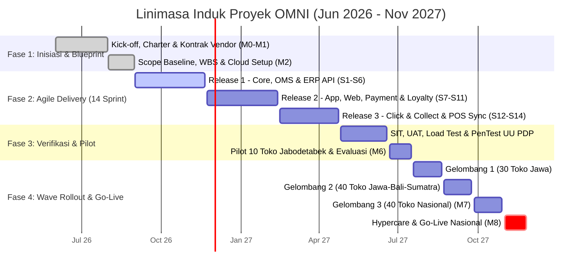

| ID | Milestone | Tanggal Target | Kriteria Kelulusan / *Stage-Gate* |
|----|-----------|----------------|-----------------------------------|
| **M0** | Project Kick-off | 1 Jun 2026 | Tim inti ditunjuk; komitmen awal Direksi diumumkan |
| **M1** | **Gate 1:** Charter & Kontrak | 31 Jul 2026 | Project Charter ditandatangani Sponsor; Arsitektur High-Level disetujui CTO; kontrak PT NDS efektif |
| **M2** | Baseline & Readiness | 31 Agu 2026 | Scope Baseline, WBS, Jadwal Induk, Product Backlog awal, dan lingkungan Cloud Dev/Staging siap |
| **M3** | Release 1 (Sprint 1–6) | 20 Nov 2026 | Katalog dasar, OMS MVP, dan sandbox integrasi ERP/WMS berjalan |
| **M4** | Release 2 (Sprint 7–11) | 12 Feb 2027 | Mobile App & Web Beta, Payment Gateway, dan Digital Loyalty Engine (data migrasi) terverifikasi |
| **M5** | **Gate 2:** Release 3 / Feature Freeze | 23 Apr 2027 | Fitur Click & Collect end-to-end dan adaptor POS selesai; tidak ada fitur baru tanpa persetujuan CCB |
| **M6** | **Gate 3:** UAT & Pilot 10 Toko | 16 Jul 2027 | Lulus SIT/UAT, uji beban 2.500 TPM, PenTest UU PDP bersih, dan Pilot 10 toko mencapai SLA ≤ 2 jam |
| **M7** | Rollout 120 Toko Lengkap | 29 Okt 2027 | Seluruh 120 toko (Pilot + Gelombang 1–3) aktif di produksi dan staf terlatih |
| **M8** | **Gate 4:** Go-Live Nasional & Closure | **26 Nov 2027** | Sistem stabil ≥ 99,5%, serah terima ke IT Operations & Store Ops, pelajaran terdokumentasi |

---

## 7. Struktur Tata Kelola & Daftar Pemangku Kepentingan (*Stakeholders*)

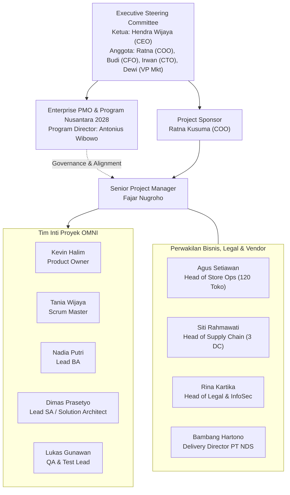

| Kode | Nama | Jabatan / Organisasi | Peran di Proyek OMNI | Kepentingan Utama & Dinamika Lapangan |
|------|------|----------------------|----------------------|---------------------------------------|
| **SH-01** | **Hendra Wijaya** | Direktur Utama (CEO) | Ketua Steering Committee | Menjadikan Proyek OMNI simbol transformasi digital menjelang RUPS 2027; menuntut tenggat 26 Nov 2027 tidak meleset |
| **SH-02** | **Ratna Kusuma** | Direktur Operasional & Ritel (COO) | **Project Sponsor** | Pemilik manfaat bisnis & otoritas keputusan strategis harian; fokus pada kelancaran operasional 120 toko dan target omzet digital |
| **SH-03** | **Budi Santoso** | Direktur Keuangan (CFO) | Anggota SteerCo & Otoritas Dana | Sangat ketat terhadap disiplin anggaran Rp 9,20 M, pencairan *Management Reserve*, dan realisasi ROI |
| **SH-04** | **Irwan Pratama** | CTO / VP IT | Anggota SteerCo & Pemilik Arsitektur | Menjaga stabilitas ERP/POS eksisting, arsitektur cloud, keamanan, dan pembagian beban kerja tim IT lintas program |
| **SH-05** | **Dewi Lestari** | VP Marketing & CX | Anggota SteerCo & Pemilik Loyalty | Ingin pengalaman aplikasi sekelas *e-commerce* besar; kerap mendorong tambahan fitur promosi/gamifikasi baru (*sumber utama potensi scope creep*) |
| **SH-06** | **Agus Setiawan** | Head of Store Operations | Pemilik Operasional 120 Toko | Khawatir fitur *Click & Collect* menambah beban staf toko tanpa insentif jelas serta menggerus target penjualan cabang fisik (*potensi resistensi tinggi*) |
| **SH-07** | **Siti Rahmawati** | Head of Supply Chain & Warehouse | Pemilik Integrasi WMS 3 DC | Memastikan sinkronisasi stok DC Cikarang, Surabaya, dan Medan akurat tanpa mengganggu distribusi rutin ke toko |
| **SH-08** | **Rina Kartika** | Head of Legal, Compliance & InfoSec | Penjaga Kepatuhan & Kontrak | Berwenang menahan *Go-Live* (*veto power*) jika kepatuhan UU PDP, PCI-DSS, atau klausul kontrak vendor belum tuntas |
| **SH-09** | **Antonius Wibowo** | Program Director / Head of PMO | Pimpinan Program Nusantara 2028 | Mengelola ketergantungan Proyek OMNI terhadap ERP-Refresh, POS-Modern, dan DataHub serta pelaporan portofolio |
| **SH-10** | **Fajar Nugroho** | **Senior Project Manager** | Pemimpin Delivery Proyek OMNI | Bertanggung jawab penuh atas integrasi lingkup, jadwal, biaya, mutu, risiko, vendor, dan tata kelola *hybrid* |
| **SH-11** | **Kevin Halim & Tania Wijaya** | Product Owner & Scrum Master | Kepemimpinan Tim Agile | Kevin mengelola prioritas *Product Backlog* bersama Dewi; Tania menjaga ritme Scrum, menghilangkan hambatan, dan memantau *velocity* |
| **SH-12** | **Nadia Putri & Dimas Prasetyo** | Lead BA & Lead SA/Solution Architect | Desain Kebutuhan & Solusi | Nadia menjembatani kebutuhan bisnis ke BRD/User Stories; Dimas merancang arsitektur OMS, API, dan integrasi *legacy* |
| **SH-13** | **Bambang Hartono** | Delivery Director — PT NDS (Vendor) | Mitra Implementasi Utama | Memimpin 18 personel vendor (developer, QA, DevOps); sensitif terhadap perubahan lingkup di luar kontrak *Fixed Price* Rp 4,40 M |

---

## 8. Daftar Risiko Awal Proyek OMNI (Baseline Identifikasi)

Daftar risiko awal ini menjadi titik pijak analisis risiko mendalam di Modul 03 dan pengelolaan ketergantungan di Modul 02, 04, dan 05:

| ID | Ringkasan Risiko (*Risk Event*) | Kategori | Dampak Utama |
|----|--------------------------------|----------|--------------|
| **R-01** | Keterlambatan rilis API dari proyek paralel **POS-Modern** menunda integrasi stok real-time 120 toko | Eksternal / Program | Jadwal (jalur kritis) |
| **R-02** | Kualitas data 1,2 juta anggota *Sinar Member Card* lama (62% duplikat/usang) gagal dimigrasi bersih | Teknis / Data | Jadwal, Mutu, CX |
| **R-03** | Resistensi 120 Store Manager & kasir terhadap SOP *Click & Collect* karena khawatir beban kerja & target omzet toko | Organisasi / Stakeholder | Adopsi & Manfaat |
| **R-04** | *Scope creep* berulang dari tim Marketing (fitur gamifikasi, live-shopping, flash sale kompleks) di tengah sprint | Lingkup / Tata Kelola | Biaya & Jadwal |
| **R-05** | Ketidakpatuhan terhadap UU PDP (manajemen persetujuan, enkripsi PII) atau kegagalan *Penetration Testing* | Legal / Keamanan | Penundaan *Go-Live* |
| **R-06** | Gangguan performa (*downtime* / *latency* tinggi) saat simulasi beban puncak 2.500 TPM menjelang Harbolnas | Teknis / Arsitektur | Mutu & Reputasi |
| **R-07** | *Turnover* insinyur kunci vendor PT NDS atau tim IT internal SNR yang terbagi ke 4 proyek bersamaan | Sumber Daya | Jadwal & Mutu |
| **R-08** | Sengketa interpretasi lingkup pada kontrak *Fixed Price* Rp 4,40 M dengan PT NDS memicu lonjakan biaya *Change Request* | Komersial / Vendor | Biaya |
| **R-09** | Keterlambatan pengadaan & pengiriman 240 unit tablet/scanner toko ke luar Jawa (Sumatra, Kalimantan, Sulawesi) | Pengadaan / Logistik | Jadwal Rollout |
| **R-10** | Peluang (*Opportunity*): Keberhasilan pilot 10 toko lebih awal memungkinkan pembukaan kanal *pre-order* anggota Platinum sebelum Harbolnas | Bisnis / Peluang | Manfaat Tambahan |

---

## 9. Konteks Program Strategis: Program Nusantara 2028

Proyek OMNI tidak berdiri sendiri. Di bawah koordinasi **Enterprise PMO SNR** yang dipimpin **Antonius Wibowo**, Proyek OMNI merupakan salah satu dari empat proyek dalam **Program Nusantara 2028** (periode 2026–2028, total investasi **Rp 18,50 M**):

| Kode Proyek | Nama Proyek | Anggaran | Periode | Ketergantungan dengan Proyek OMNI |
|-------------|-------------|----------|---------|-----------------------------------|
| **PRJ-01** | **Proyek OMNI** *(Flagship)* | **Rp 9,20 M** | Jun 2026 – Nov 2027 | Mengonsumsi API inventori ERP & POS; mengirim data transaksi ke DataHub |
| **PRJ-02** | **Proyek ERP-Refresh** | **Rp 4,10 M** | Mar 2026 – Agu 2027 | Menyediakan *Master Data* SKU & API inventori pusat ke OMS Proyek OMNI; berbagi 3 *senior architect* IT |
| **PRJ-03** | **Proyek POS-Modern** | **Rp 3,20 M** | Mei 2026 – Okt 2027 | Menyediakan adaptor API sinkronisasi stok toko & pemindai QR voucher loyalty di 120 toko *(ketergantungan kritis)* |
| **PRJ-04** | **Proyek DataHub** | **Rp 2,00 M** | Jan 2027 – Jun 2028 | Membangun *Data Warehouse* & analitik perilaku omnichannel dari data transaksi Proyek OMNI |
| **TOTAL** | **Program Nusantara 2028** | **Rp 18,50 M** | **2026 – 2028** | Target total: pertumbuhan omzet digital 15% & efisiensi biaya rantai pasok 8% |

---

## 10. Peta Keterhubungan Studi Kasus Antar-Modul

| Modul | Fokus Penerapan pada Proyek OMNI | Artefak Utama yang Dihasilkan |
|-------|----------------------------------|-------------------------------|
| **Modul 01** | Menetapkan batas proyek, tata kelola perubahan, dan baseline kinerja | Project Charter, Scope Statement, EVM Snapshot Bulan ke-9, Quality & Change Control Plan |
| **Modul 02** | Memecah pekerjaan ke WBS, menghitung jalur kritis 78 minggu, dan mengatasi bottleneck resource | WBS 4-Level, PDM/Critical Path, PERT, RACI Matrix, Rencana Crashing/Fast Tracking |
| **Modul 03** | Mengelola risiko R-01 s.d. R-10, eskalasi isu POS/Data, dan mengatasi resistensi Store Ops & Marketing | Risk Register + EMV, Issue Log, Escalation Matrix, Power-Interest Grid & Communication Plan |
| **Modul 04** | Menjalankan 14 Sprint pengembangan produk dalam kerangka *Hybrid Governance* & kontrak vendor | Product Backlog Prioritas, Release Plan, Velocity & Burndown, Hybrid Operating Model |
| **Modul 05** | Menyelaraskan Proyek OMNI di dalam Program Nusantara 2028, mengelola dependensi lintas proyek & KPI PMO | Program Benefits Map, Cross-Project Dependency Matrix, PMO Executive RAG Dashboard, Portfolio Scoring |
| **Modul 06–09** *(Jilid II)* | Merinci BRD/FRD, UML/ERD OMS & Loyalty, arsitektur API/Cloud, dan roadmap produk pasca-Go-Live | BRD/FRD, Sequence/Activity/ERD, API & Cloud Spec, Product Roadmap |
| **Modul 10–12** *(Jilid III)* | Menyusun Business Case & ROI, negosiasi eksekutif, serta portofolio wawancara Senior PM/BA/SA | Financial Model (NPV/IRR/Payback), Executive Deck C-Level, Case Study Portfolio |


---


# Modul 01: Advanced Project Management

## 1. Identitas Modul

| Atribut | Keterangan |
|---------|------------|
| **Kelompok Program** | Jalur Utama — Project Management (Jilid I: *Leadership & Project Delivery*) |
| **Level Kompetensi** | Senior (berorientasi tata kelola strategis, integrasi lintas fungsi, dan pengambilan keputusan eksekutif) |
| **Durasi Pembelajaran** | **12 jam sesi tatap muka/sinkron** (4 sesi × 3 jam) + **±6 jam tugas mandiri** |
| **Prasyarat** | Pengalaman kerja minimal ±3 tahun sebagai Project Manager, Project Coordinator, Business Analyst, Scrum Master, atau Team Lead; memahami dasar siklus hidup proyek dan penjadwalan dasar |
| **Peran Sasaran** | Calon & praktisi **Senior Project Manager**, *Delivery Manager*, *IT Project Lead*, serta profesional BA/SA yang ingin menguasai tata kelola pengiriman proyek skala menengah–besar |
| **Keluaran Utama** | Paket Fondasi Tata Kelola Proyek OMNI: *Project Charter*, *Project Scope Statement* beserta *Acceptance Criteria* & *Requirements Traceability Matrix* (RTM), Analisis *Earned Value Management* (EVM) Bulan ke-9 dengan rekomendasi eksekutif, *Quality Assurance & Control Plan*, serta *Integrated Change Control & CCB Log* |

---

## 2. Gambaran Modul

Mengapa sebuah organisasi membayar **Senior Project Manager** jauh lebih mahal dibandingkan Junior atau Mid-level Project Manager, padahal keduanya sama-sama mengelola jadwal, anggaran, dan daftar tugas? Jawabannya terletak pada pergeseran pusat gravitasi tanggung jawab: dari **administrasi tugas** (*task administration*) menuju **orkestrasi nilai, tata kelola, dan integrasi keputusan** (*value orchestration, governance, and decision integration*).

Pada level junior dan menengah, seorang Project Manager sering kali berfokus pada kepatuhan mekanis terhadap rencana yang sudah dibuat orang lain — memperbarui *Gantt chart*, mencatat notulen rapat, menagih progres mingguan, dan meneruskan masalah ke atasan. Ketika lingkungan proyek stabil dan lingkupnya sempit, pendekatan tersebut masih memadai. Namun, pada proyek strategis berskala menengah–besar seperti **Proyek OMNI di PT Sinar Nusantara Retail Tbk (SNR)** — bernilai **Rp 9,20 M**, berdurasi **18 bulan** menuju tenggat mutlak **26 November 2027**, melibatkan **120 toko fisik**, **3 pusat distribusi (DC)**, kontrak vendor *Fixed Price* **Rp 4,40 M**, serta bergantung pada tiga proyek paralel lain dalam **Program Nusantara 2028** — pendekatan mekanis akan runtuh pada kuartal pertama.

Di level senior, Anda tidak sekadar "menjalankan metodologi", melainkan **merancang pendekatan pengiriman yang paling tepat (*tailoring*)** bagi konteks bisnis, kultur organisasi, dan struktur kontrak yang ada. Anda bukan sekadar pencatat anggaran, melainkan penjaga **Performance Measurement Baseline (PMB)** yang mampu membaca sinyal dini penyimpangan biaya dan jadwal melalui **Earned Value Management (EVM)** sebelum proyek terjerumus ke jurang defisit. Anda juga bukan sekadar penerima permintaan fitur dari eksekutif, melainkan pemimpin tata kelola yang melindungi integritas ruang lingkup (*scope*), mutu (*quality*), dan kepatuhan regulasi melalui **Integrated Change Control** yang objektif dan terukur.

Modul 01 ini membangun fondasi intelektual dan operasional tersebut. Seluruh konsep standar global — **PMBOK 7th & 6th Edition**, **PRINCE2**, dan **ISO 21502** — dibedah secara kritis dan langsung diterapkan pada **Proyek OMNI** dari sudut pandang **Fajar Nugroho** (Senior Project Manager). Penguasaan modul ini menjadi pijakan mutlak sebelum Anda melangkah ke perencanaan detail dan jalur kritis di Modul 02, pengelolaan risiko dan pemangku kepentingan di Modul 03, eksekusi *Agile/Hybrid* di Modul 04, serta tata kelola Program dan PMO di Modul 05.

---

## 3. Capaian Pembelajaran

Setelah menyelesaikan Modul 01 ini, peserta mampu:

1. **Merancang** arsitektur siklus hidup proyek dan pendekatan *tailoring* (*predictive*, *iterative*, *incremental*, *adaptive/agile*, atau *hybrid*) yang selaras dengan tingkat ketidakpastian bisnis, profil risiko, dan struktur kontrak organisasi.
2. **Menyusun** *Project Charter* berstandar eksekutif yang memisahkan secara tegas *Business Case*, mandat otoritas Senior PM, kriteria keberhasilan bisnis, batas pendanaan, dan mekanisme eskalasi tata kelola.
3. **Merumuskan** *Scope Baseline* yang ketat — mencakup *Project Scope Statement*, pemisahan eksplisit *In-Scope* vs *Out-of-Scope*, *Acceptance Criteria* terukur, dan *Requirements Traceability Matrix* (RTM) — guna mencegah *scope creep* maupun *gold plating*.
4. **Mengevaluasi** kinerja jadwal dan biaya proyek secara kuantitatif menggunakan struktur *Cost Baseline*, *Reserve Analysis* (*Contingency* vs *Management Reserve*), dan indikator lengkap *Earned Value Management* (PV, EV, AC, SV, CV, SPI, CPI, tiga skenario EAC, ETC, VAC, dan TCPI) untuk menghasilkan rekomendasi keputusan eksekutif.
5. **Mengembangkan** sistem pengendalian mutu proyek berbasis keseimbangan *Cost of Quality* (*Prevention*, *Appraisal*, *Internal Failure*, dan *External Failure*), pembedaan fungsional QA vs QC, serta gerbang mutu (*Stage-Gate Quality Reviews*).
6. **Mengoperasikan** proses *Integrated Change Control* dan *Configuration Management* melalui *Change Control Board* (CCB) dengan mengevaluasi dampak perubahan secara menyeluruh terhadap seluruh dimensi kendala proyek (*Hexagon Constraint*).

---

## 4. Rencana Sesi

Modul ini dirancang untuk **12 jam pembelajaran terstruktur** (4 sesi × 3 jam = 720 menit) dengan proporsi pedagogis **±30% paparan konsep** (220 menit), **±50% workshop studi kasus Proyek OMNI** (360 menit), dan **±20% diskusi/refleksi senior** (140 menit).

| Sesi | Tema & Sub-Topik Utama | Paparan Konsep (±30%) | Workshop Kasus Proyek OMNI (±50%) | Diskusi & Refleksi (±20%) | Total |
|------|------------------------|-----------------------|-----------------------------------|---------------------------|-------|
| **Sesi 1** | **Lifecycle, Tailoring, & Otoritas Charter**<br/>PMBOK 7th/6th, PRINCE2, ISO 21502; spektrum *lifecycle*; *tailoring*; *Business Case* vs *Charter* vs *PM Plan*; otoritas Senior PM | 55 mnt | **90 mnt:** Merancang model *Hybrid Delivery* Proyek OMNI (4 Fase *Stage-Gate* + 14 Sprint) & menyusun *Project Charter* untuk disetujui Ratna Kusuma | 35 mnt | 180 mnt (3 jam) |
| **Sesi 2** | **Scope Management & Integritas Baseline**<br/>RTM, *Scope Statement*, *In/Out-of-Scope*, *Acceptance Criteria*, pencegahan *Scope Creep* vs *Gold Plating*, *Validate vs Control Scope* | 55 mnt | **90 mnt:** Menyusun *Scope Statement*, *Acceptance Criteria* terukur (BOPIS ≤ 2 jam, sinkronisasi ≤ 60 detik), dan cuplikan RTM Proyek OMNI | 35 mnt | 180 mnt (3 jam) |
| **Sesi 3** | **Schedule, Cost, Reserves, & EVM Senior**<br/>PMB, *Cost Baseline* vs *Funding Requirement*, *Contingency* vs *Management Reserve*, *S-Curve*, EVM lengkap (SV, CV, SPI, CPI, 3 EAC, TCPI) | 55 mnt | **90 mnt:** Audit EVM resmi Proyek OMNI Bulan ke-9 (28 Feb 2027) & simulasi opsi keputusan eksekutif untuk rapat Steering Committee | 35 mnt | 180 mnt (3 jam) |
| **Sesi 4** | **Quality, CoQ, & Integrated Change Control**<br/>QA vs QC, *Cost of Quality*, *Stage-Gate Reviews*, CCB, evaluasi *Hexagon Constraint*, *Configuration Management*, & *Anti-Patterns* | 55 mnt | **90 mnt:** Menyusun *Quality Plan* (CB-05 Rp 450 jt) & simulasi sidang CCB menghadapi permintaan fitur tambahan Dewi Lestari | 35 mnt | 180 mnt (3 jam) |
| **Total** | **4 Sesi Lengkap Modul 01** | **220 mnt (30,6%)** | **360 mnt (50,0%)** | **140 mnt (19,4%)** | **720 mnt (12 jam)** |

> **Catatan Fasilitator & Pembelajar Mandiri:** Jika modul ini dipelajari secara mandiri (*self-paced*), alokasikan waktu sesuai proporsi di atas: baca narasi Bab 5 terlebih dahulu, bedah artefak Proyek OMNI di Bab 6, kerjakan Latihan di Bab 7 tanpa melihat pembahasan, lalu tuntaskan Tugas Modul di Bab 8 dan Kuis di Bab 9.

---

## 5. Materi

### 5.1 Project Lifecycle, Standar Global, dan Tailoring

Salah satu kekeliruan terbesar yang membedakan praktisi menengah dan senior adalah memperlakukan metodologi manajemen proyek sebagai dogma. Di lapangan, kita kerap menjumpai kubu "puritan *Waterfall*" yang memaksakan spesifikasi beku 400 halaman untuk aplikasi seluler yang pasarnya berubah tiap kuartal, berhadapan dengan kubu "puritan *Agile*" yang menolak menyusun *baseline* anggaran dan gerbang kepatuhan regulasi pada proyek bernilai miliaran rupiah. Senior Project Manager berdiri di atas polarisasi tersebut: memahami lanskap standar global dan melakukan **tailoring** — penyesuaian sadar atas siklus hidup, tata kelola, artefak, dan ritme kerja agar sesuai dengan konteks nyata proyek.

#### A. Sintesis Tiga Standar Global Utama

Senior PM modern perlu memadukan keunggulan komplementer dari tiga rujukan standar internasional:

1. **PMBOK Guide (6th Edition & 7th Edition — PMI):**
   - **PMBOK 6th Edition** berfokus pada *process-based framework* melalui **5 Process Groups** (*Initiating, Planning, Executing, Monitoring & Controlling, Closing*) dan **10 Knowledge Areas** (*Integration, Scope, Schedule, Cost, Quality, Resource, Communications, Risk, Procurement, Stakeholder*). Kekuatan utamanya adalah kedisiplinan input–teknik–output (*ITTO*) dan ketajaman pengendalian baseline seperti WBS, CPM, dan EVM.
   - **PMBOK 7th Edition** menggeser perspektif dari sekadar kepatuhan proses menuju **penciptaan nilai (*value delivery system*)** yang dipandu **12 Project Management Principles** (seperti *Stewardship, Team, Stakeholders, Value, Systems Thinking, Tailoring, Quality, Complexity, Risk, Adaptability & Resilience, Change*) dan **8 Project Performance Domains** (*Stakeholders, Team, Development Approach & Life Cycle, Planning, Project Work, Delivery, Measurement, Uncertainty*). Kedua edisi tidak saling meniadakan: PMBOK 7th memberikan kompas strategis dan prinsip adaptif, sementara PMBOK 6th menyediakan peralatan taktis yang teruji untuk eksekusi terkendali.
2. **PRINCE2 (*Projects IN Controlled Environments* — edisi ke-7):**
   - Menonjol dalam **tata kelola bisnis (*governance*)** dan pengendalian berjenjang. Tiga kontribusi terpenting PRINCE2 bagi Senior PM adalah: (a) **Continued Business Justification** — proyek wajib dihentikan atau direstrukturisasi jika justifikasi bisnisnya runtuh; (b) **Manage by Stages** — membagi proyek ke dalam gerbang keputusan (*Stage-Gate*) di mana *Project Board / Steering Committee* mengotorisasi dana tahap berikutnya; serta (c) **Manage by Exception** — menetapkan batas toleransi (*tolerance*) pada waktu, biaya, mutu, lingkup, manfaat, dan risiko. Selama proyek berada dalam toleransi, Senior PM berwenang penuh mengambil keputusan operasional tanpa mengganggu eksekutif; eskalasi dilakukan *hanya* saat proyek diprediksi melampaui toleransi.
3. **ISO 21502:2020 (*Project, Programme and Portfolio Management — Guidance on Project Management*):**
   - Memberikan jembatan harmonisasi korporat lintas industri yang menempatkan proyek sebagai bagian dari ekosistem *governance*, *benefits realization*, dan *organizational enablement*. ISO 21502 menegaskan bahwa tanggung jawab proyek tidak berakhir ketika sistem selesai dibangun (*output*), melainkan terhubung dengan kesiapan organisasi mengadopsi perubahan (*outcome*) dan mewujudkan nilai ekonomi (*benefit*).

#### B. Spektrum Project Lifecycle (Development Approaches)

Pemilihan *development approach* (pendekatan pengembangan) ditentukan oleh dua sumbu utama: **seberapa stabil kebutuhan (*requirements certainty*)** dan **seberapa tinggi tuntutan pengiriman bertahap untuk mempercepat nilai (*frequency of delivery*)**.

| Pendekatan (*Lifecycle*) | Karakteristik Utama | Kapan Tepat Dipakai | Kelebihan & Risiko Utama |
|--------------------------|---------------------|---------------------|--------------------------|
| **Predictive (*Waterfall* / Plan-Driven)** | Lingkup, jadwal, dan biaya didefinisikan detail di awal; perubahan dikendalikan ketat lewat CCB; pengiriman besar di akhir | Kebutuhan sangat jelas, regulasi ketat, proyek konstruksi/infrastruktur fisik, atau kontrak *Fixed Price* baku | **Kelebihan:** Prediktabilitas biaya & tata kelola tinggi.<br/>**Risiko:** Lambat beradaptasi; kegagalan asumsi baru terdeteksi terlambat |
| **Iterative** | Lingkup ditentukan di awal, namun solusi disempurnakan melalui serangkaian prototipe dan umpan balik berulang sebelum rilis penuh | Desain antarmuka kompleks, arsitektur sistem baru, atau riset teknologi dengan risiko teknis tinggi | **Kelebihan:** Mengurangi risiko salah desain sejak dini.<br/>**Risiko:** Rilis nilai ke pengguna akhir masih menunggu iterasi selesai |
| **Incremental** | Produk dipecah menjadi potongan fungsional yang dirilis bertahap (*waves/releases*), tiap rilis langsung memberi nilai operasional | Migrasi bertahap multi-cabang (misalnya *wave rollout* 120 toko), modernisasi sistem bertahap | **Kelebihan:** Realisasi manfaat lebih cepat & mengurangi risiko *big-bang cutover*.<br/>**Risiko:** Membutuhkan arsitektur modular agar inkremen saling kompatibel |
| **Adaptive (*Agile*)** | Menggabungkan iteratif & inkremental dalam siklus pendek (*Sprint* 1–4 minggu); *backlog* berevolusi mengikuti umpan balik pelanggan | Pengembangan produk digital berketidakpastian tinggi, kebutuhan bisnis dinamis, tim *dedicated* lintas fungsi | **Kelebihan:** Responsif terhadap pasar, transparansi progres tinggi.<br/>**Risiko:** Sulit dipadukan dengan *hard deadline*, ketergantungan lintas program, dan anggaran korporat kaku |
| **Hybrid** | Memadukan elemen *Predictive* pada lapisan tata kelola, kontrak, kepatuhan, dan *rollout* dengan *Agile/Iterative* pada lapisan pengembangan solusi | Transformasi digital korporat berskala menengah–besar (seperti **Proyek OMNI** SNR) | **Kelebihan:** Menyeimbangkan kepastian eksekutif dengan kelincahan teknis.<br/>**Risiko:** Menjadi birokratis ganda jika batas peran *Predictive* dan *Agile* tidak tegas |

#### C. Kerangka Tailoring 4 Langkah bagi Senior PM

Mengacu pada *PMBOK 7th Edition*, *tailoring* bukan berarti membuang prosedur sesuka hati, melainkan proses disiplin dalam empat langkah:

1. **Select Initial Development Approach:** Pilih pendekatan dasar berdasarkan sifat produk, tingkat inovasi, dan ketergantungan teknis (misalnya *Hybrid* untuk Proyek OMNI).
2. **Tailor for the Organization:** Sesuaikan dengan maturitas PMO, struktur persetujuan anggaran CFO, aturan pengadaan/kontrak vendor, dan regulasi (UU PDP No. 27 Tahun 2022 & PCI-DSS).
3. **Tailor for the Project:** Sesuaikan ukuran artefak, frekuensi pelaporan, ambang batas CCB, dan komposisi tim terhadap skala proyek (Rp 9,20 M, 18 bulan, 120 toko).
4. **Implement Ongoing Improvement:** Lakukan inspeksi dan adaptasi berkala melalui retrospektif sprint dan tinjauan gerbang fase (*Stage-Gate Review*).

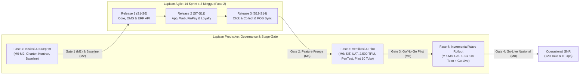

Diagram di atas memperlihatkan arsitektur *Hybrid Delivery* Proyek OMNI secara jernih: tata kelola investasi, kontrak *Fixed Price* PT NDS, verifikasi kepatuhan, dan *rollout* fisik ke 120 toko dikendalikan dengan ketegasan *Predictive/Incremental Stage-Gate*, sementara pembangunan perangkat lunak dan integrasi API yang kompleks dijalankan dalam 14 *Sprint Agile* agar umpan balik bisnis dari Product Owner (Kevin Halim) dan pengguna toko dapat diserap lebih awal.

---

### 5.2 Project Charter dan Otoritas Senior Project Manager

Banyak proyek gagal bukan pada bulan ke-12, melainkan pada hari ke-1 karena lahir tanpa mandat yang jelas. Tanpa **Project Charter** yang ditandatangani oleh Sponsor berwenang, seorang Project Manager hanyalah "koordinator sukarela" yang memohon bantuan antar-departemen tanpa daya ikat organisasi.

#### A. Membedakan Empat Dokumen Fondasi Proyek

Pada level senior, Anda wajib membedakan fungsi, pemilik, dan waktu lahirnya empat dokumen kunci yang sering dicampuradukkan di lapangan:

| Dimensi | Business Case | Benefits Management Plan | Project Charter | Project Management Plan (PMP) |
|---------|---------------|--------------------------|-----------------|-------------------------------|
| **Pertanyaan Inti yang Dijawab** | *Mengapa* investasi ini layak secara ekonomi dan strategis? | *Bagaimana dan kapan* manfaat bisnis diukur dan diwujudkan? | *Siapa* yang diberi mandat, *apa* batas proyek, dan *berapa* dana awal? | *Bagaimana* proyek dieksekusi, dipantau, dikendalikan, dan ditutup secara detail? |
| **Pemilik / Penyusun** | Business Sponsor, Finance, & Business Analyst (pra-proyek) | Business Sponsor & Program Manager / PMO | Diterbitkan & ditandatangani **Project Sponsor** (draf dapat dibantu Senior PM) | Disusun & dikelola **Senior Project Manager** bersama tim inti, disetujui Sponsor/SteerCo |
| **Kapan Dibuat** | Sebelum proyek diinisiasi (*Pre-Project*) | Bersamaan dengan *Business Case*, diperbarui sepanjang siklus | Awal Fase Inisiasi (M1 — **akta kelahiran resmi proyek**) | Akhir Fase Perencanaan (M2 — menetapkan **Baseline** resmi) |
| **Tingkat Detail** | Analisis finansial (NPV, IRR, Payback), opsi strategis, *burning platform* | Metrik KPI manfaat, pemilik manfaat, jadwal realisasi pasca-Go-Live | Ringkas-strategis (3–6 halaman): tujuan, lingkup tingkat tinggi, milestone, anggaran induk, otoritas PM | Sangat detail dan komprehensif: 10+ rencana turunan (*Scope, Schedule, Cost, Quality, Risk, Change, dll.*) |
| **Otoritas Perubahan** | Steering Committee / Direksi | Sponsor & Program Director | Hanya **Project Sponsor / Steering Committee** | Melalui proses **Integrated Change Control (CCB)** |

#### B. Anatomi Otoritas Senior Project Manager

Project Charter memberikan dua hal sekaligus: **legitimasi keberadaan proyek** dan **mandat otoritas Senior Project Manager** untuk mengalokasikan sumber daya organisasi. Pada proyek strategis, seorang Senior PM harus memastikan Charter secara eksplisit menuliskan **batas otoritas (*Authority Thresholds*)** berdasarkan prinsip *Manage by Exception* (PRINCE2):

1. **Otoritas Operasional & Sumber Daya:** Kewenangan mengarahkan tim inti lintas departemen (BA, SA, QA, PO, SM), memantau kinerja vendor utama (PT NDS) sesuai klausul kontrak, serta memanggil rapat eskalasi lintas divisi.
2. **Otoritas Finansial Berjenjang:** Misalnya, Senior PM berwenang mengalokasikan *Contingency Reserve* hingga batas tertentu per kejadian risiko teridentifikasi (contoh: ≤ Rp 100 jt per insiden dengan pelaporan bulanan kepada Sponsor), sementara penggunaan di atas ambang batas memerlukan persetujuan Sponsor (Ratna Kusuma), dan pencairan *Management Reserve* sepenuhnya menjadi hak CFO (Budi Santoso) bersama Steering Committee.
3. **Otoritas Perubahan (*Change Threshold*):** Perubahan teknis minor tanpa dampak terhadap *Scope Baseline*, *Cost Baseline*, atau *Critical Path* dapat diputuskan pada level tim/PM; segala perubahan yang memengaruhi baseline wajib masuk sidang CCB.
4. **Otoritas Eskalasi & Veto Kepatuhan:** Memetakan hak veto independen — misalnya pada Proyek OMNI, **Rina Kartika** (Head of Legal, Compliance & InfoSec) memegang hak veto Go-Live apabila audit UU PDP atau *Penetration Testing* belum bersih dari temuan *Critical/High*. Mencantumkan realitas tata kelola ini sejak Charter mencegah konflik politis menjelang Go-Live.

---

### 5.3 Scope Management Tingkat Senior

Dalam studi kegagalan proyek teknologi informasi global (*PMI Pulse of the Profession*), ketidakjelasan ruang lingkup dan perubahan lingkup yang tidak terkendali (*scope creep*) secara konsisten menempati tiga besar penyebab pembengkakan biaya dan keterlambatan. Pada level senior, manajemen ruang lingkup bukan sekadar membuat daftar fitur, melainkan membangun **garis pertahanan kontraktual, teknis, dan bisnis** yang menjaga agar setiap rupiah yang dibelanjakan berjejak langsung ke tujuan strategis.

#### A. Product Scope vs Project Scope dan Scope Baseline

Seorang Senior PM membedakan secara presisi:
- **Product Scope:** Fitur, fungsi, dan karakteristik teknis/non-teknis yang melekat pada produk atau layanan yang dihasilkan (misalnya: aplikasi iOS/Android dengan kartu loyalty QR, API sinkronisasi stok ≤ 60 detik, dan uji beban 2.500 TPM). Kelengkapannya diukur terhadap **persyaratan produk (*Requirements*)**.
- **Project Scope:** Seluruh pekerjaan yang harus dilakukan untuk menghasilkan produk tersebut beserta layanan pendukungnya — termasuk penyusunan dokumentasi kepatuhan UU PDP, manajemen perubahan organisasi, penyusunan SOP omnichannel, dan pelatihan 1.440 kasir serta staf gudang di 120 toko. Kelengkapannya diukur terhadap **Project Management Plan**.

Keduanya dikunci secara resmi dalam **Scope Baseline** yang terdiri atas tiga komponen tak terpisahkan:
1. **Project Scope Statement:** Deskripsi naratif terperinci mengenai lingkup produk, *deliverables* utama, **Acceptance Criteria**, serta daftar **Exclusions (*Out-of-Scope*)**, kendala (*constraints*), dan asumsi (*assumptions*).
2. **Work Breakdown Structure (WBS):** Dekomposisi hierarkis 100% pekerjaan proyek berorientasi *deliverable* (akan dibedah mendalam di Modul 02).
3. **WBS Dictionary:** Kamus spesifikasi setiap paket kerja (*Work Package*) termasuk pemilik, kriteria penerimaan, dan estimasi sumber daya.

#### B. Kekuatan Eksplisit Out-of-Scope dan Acceptance Criteria Terukur

Di tingkat senior, kalimat paling mahal di dalam *Scope Statement* sering kali bukan apa yang Anda masukkan ke *In-Scope*, melainkan apa yang Anda tuliskan tegas di bagian **Out-of-Scope (Exclusions)**. Mengapa? Karena pemangku kepentingan cenderung mengisi ruang abu-abu dengan asumsi masing-masing. Pada Proyek OMNI, tanpa penegasan bahwa *integrasi marketplace pihak ketiga (Shopee, Tokopedia, TikTok Shop)* dan *penggantian perangkat keras mesin kasir POS* adalah **Out-of-Scope**, tim Marketing dan Store Ops dapat menganggap keduanya termasuk dalam paket Rp 9,20 M — sebuah resep pasti bagi sengketa kontrak dengan PT NDS (Risiko **R-08**).

Demikian pula, **Acceptance Criteria** (kriteria penerimaan) harus dirumuskan secara kuantitatif, objektif, dan dapat diuji (*testable*), bukan normatif:
- *Lemah (Junior):* "Aplikasi harus cepat, stok akurat, dan petugas toko mudah menggunakan fitur Click & Collect."
- *Kuat (Senior):* "Sinkronisasi stok antara POS 120 toko, WMS 3 DC, dan OMS memiliki latensi **≤ 60 detik** pada persentil ke-95 (p95); akurasi stok lintas kanal **≥ 98,0%** selama Pilot 10 toko; SLA persiapan pesanan *Click & Collect* **≤ 2 jam** tercapai pada **≥ 95%** pesanan; dan sistem stabil pada uji beban **2.500 transaksi/menit (TPM)** dengan *error rate* < 0,5%."

#### C. Requirements Traceability Matrix (RTM)

**Requirements Traceability Matrix (RTM)** adalah tabel penelusuran dua arah yang menghubungkan setiap kebutuhan bisnis (*Business Objective*) → kebutuhan pemangku kepentingan (*Stakeholder Requirement*) → nomor WBS / *User Story* → spesifikasi desain sistem → kasus uji (*Test Case* SIT/UAT) → hingga status verifikasi penerimaan.

Manfaat strategis RTM bagi Senior PM meliputi:
- **Mencegah "fitur yatim piatu":** Setiap fitur yang diusulkan harus dapat ditelusuri balik ke target bisnis di Charter; jika tidak mendukung satupun target bisnis, fitur tersebut layak ditolak atau ditunda.
- **Mempercepat analisis dampak perubahan:** Ketika sebuah regulasi berubah atau *Change Request* masuk, RTM menunjukkan secara instan modul kode, API, dan skenario UAT mana saja yang ikut terdampak.
- **Bukti audit serah terima:** Memudahkan Sponsor dan auditor (seperti Rina Kartika untuk UU PDP) memverifikasi bahwa 100% persyaratan wajib telah diuji dan lulus sebelum *Gate Sign-off*.

#### D. Mencegah Scope Creep vs Gold Plating

Kedua fenomena ini sama-sama menggerogoti jadwal, anggaran, dan mutu, tetapi sumbernya berbeda:

| Dimensi | Scope Creep | Gold Plating |
|---------|-------------|--------------|
| **Definisi** | Penambahan lingkup atau fitur secara bertahap dan tidak terkendali **tanpa melalui evaluasi dampak dan persetujuan CCB** | Penambahan fitur, optimasi, atau "sentuhan ekstra" di luar spesifikasi yang diminta **oleh tim proyek sendiri** tanpa permintaan maupun persetujuan pelanggan/Sponsor |
| **Pemicu Umum** | Permintaan informal pemangku kepentingan di koridor/chat (contoh: tim Marketing langsung meminta developer menambah animasi kupon) | Niat baik berlebihan dari insinyur/desainer untuk "memberi kejutan" atau perfeksionisme teknis tanpa mempertimbangkan risiko |
| **Bahaya Tersembunyi** | Menambah beban kerja tersembunyi, merusak jadwal jalur kritis, dan memicu sengketa biaya vendor | Menambah kompleksitas kode, membuka celah keamanan/bug baru yang belum diuji, memakan waktu pengujian, dan meningkatkan biaya pemeliharaan jangka panjang |
| **Strategi Pencegahan Senior PM** | Kontrak & *Scope Statement* tegas, disiplin jalur *Product Backlog* satu pintu melalui PO, dan aturan tegas "no ticket/CR, no build" | *Peer code review* & *Definition of Done* ketat, budaya fokus nilai bisnis, dan transparansi bahwa fitur ekstra pun wajib melalui evaluasi *Product Owner* / CCB |

Sebagai penutup pengendalian lingkup, bedakan dua proses penting di PMBOK: **Validate Scope** (mendapatkan penerimaan formal dari pelanggan/Sponsor atas *deliverable* yang telah lulus pemeriksaan mutu — contohnya penandatanganan *UAT Sign-off* oleh Agus Setiawan & Dewi Lestari pada Gate 3) dan **Control Scope** (memantau status lingkup produk/proyek serta mengelola perubahan atas *Scope Baseline* melalui CCB).

---

### 5.4 Schedule & Cost Management Fundamentals, Reserve Analysis, dan Earned Value Management (EVM)

Pada proyek bernilai miliaran rupiah, laporan status berbunyi *"secara umum proyek berjalan lancar, tinggal sedikit perbaikan"* adalah bentuk kelalaian profesional. Senior PM harus mampu menerjemahkan realitas jadwal, biaya, dan progres kerja ke dalam bahasa kuantitatif yang jujur, terintegrasi, dan dapat dipertanggungjawabkan di hadapan CFO dan Direksi.

#### A. Performance Measurement Baseline (PMB) dan Anatomi Anggaran Proyek

**Performance Measurement Baseline (PMB)** adalah baseline terpadu yang menggabungkan **Scope Baseline**, **Schedule Baseline**, dan **Cost Baseline** menjadi satu kurva rujukan kinerja berbasis waktu (**S-Curve**). Setiap titik pada S-Curve menunjukkan berapa nilai pekerjaan (*Planned Value*) yang seharusnya telah selesai secara kumulatif hingga tanggal tertentu.

Pada struktur penganggaran profesional (PMBOK), biaya proyek dibangun berlapis dari bawah ke atas (*bottom-up aggregation*):

1. **Activity & Work Package Estimates:** Estimasi biaya langsung tenaga kerja, vendor, perangkat lunak, perangkat keras, dan operasional per paket kerja.
2. **Control Accounts (Base Cost Estimate):** Agregasi paket kerja ke titik kendali manajemen tempat EVM diukur (pada Proyek OMNI: CB-01 hingga CB-05 = **Rp 8,50 M**).
3. **Contingency Reserve (Cadangan Kontinjensi):** Dana cadangan untuk **risiko yang telah teridentifikasi (*known-unknowns*)** dalam *Risk Register* — biasanya dihitung melalui *Expected Monetary Value* (EMV) atau simulasi Monte Carlo (pada Proyek OMNI: CB-06 = **Rp 0,70 M**). **Contingency Reserve termasuk di dalam Cost Baseline / BAC** dan dikelola dalam otoritas Senior PM (sesuai ambang batas Charter).
4. **Cost Baseline / Budget at Completion (BAC):** Penjumlahan *Base Cost Estimate* + *Contingency Reserve* (**Rp 8,50 M + Rp 0,70 M = Rp 9,20 M**). Angka inilah yang menjadi tolok ukur penilaian kinerja biaya proyek (EVM).
5. **Management Reserve (Cadangan Manajemen):** Dana cadangan untuk **risiko tak terduga yang belum teridentifikasi (*unknown-unknowns*)** di luar daftar risiko baseline (pada Proyek OMNI = **Rp 0,60 M**). **Management Reserve TIDAK termasuk dalam Cost Baseline (BAC)** dan tidak muncul dalam perhitungan EVM rutin. Penggunaannya hanya dapat disetujui oleh **CFO / Sponsor / Steering Committee**; ketika dicairkan, barulah nilainya ditambahkan ke *Cost Baseline* melalui prosedur perubahan resmi (*re-baseline*).
6. **Total Project Funding Requirement:** Penjumlahan *Cost Baseline* + *Management Reserve* (**Rp 9,20 M + Rp 0,60 M = Rp 9,80 M**), yaitu total arus kas maksimal yang disiapkan korporasi bagi proyek.

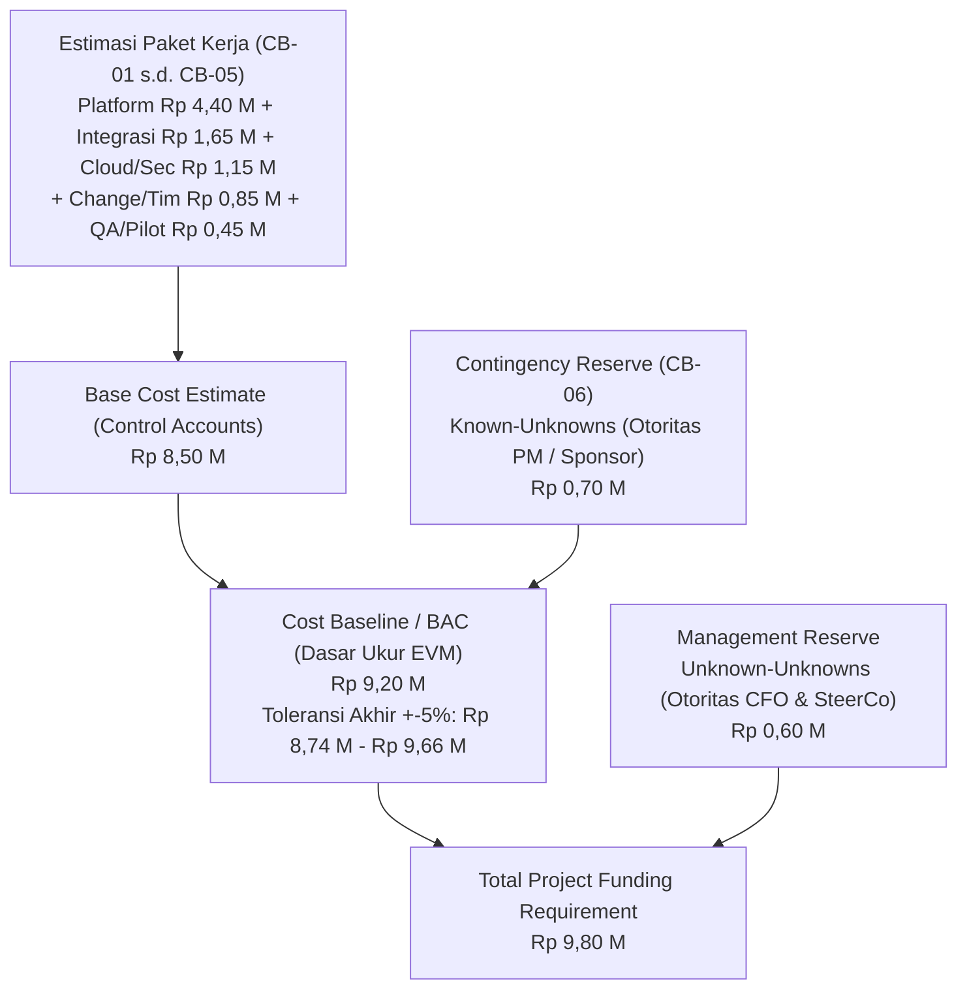

#### B. Earned Value Management (EVM) Lengkap

**Earned Value Management (EVM)** adalah standar emas pengendalian proyek yang menyatukan dimensi **lingkup, jadwal, dan biaya** ke dalam satu sistem ukuran objektif. Kekuatan EVM terletak pada kemampuannya membongkar ilusi "anggaran masih tersisa" (*budget underrun illusion*). Jika Anda menganggarkan Rp 4,80 M pada Bulan ke-9 dan baru membelanjakan Rp 4,60 M, laporan akuntansi biasa akan menilainya "hemat Rp 0,20 M". Namun jika nilai pekerjaan yang benar-benar selesai (*Earned Value*) baru Rp 4,32 M, fakta sebenarnya adalah proyek sedang **terlambat DAN boros**!

##### 1. Tiga Variabel Dasar EVM
- **PV (*Planned Value*):** Nilai anggaran resmi (*authorized budget*) yang dialokasikan untuk pekerjaan yang **direncanakan selesai** hingga titik pelaporan (*status date*).
- **EV (*Earned Value*):** Nilai anggaran resmi dari pekerjaan yang **benar-benar telah selesai dan terverifikasi** hingga titik pelaporan (`EV = % Pekerjaan Selesai × BAC` pada tingkat paket kerja yang diagregasikan).
- **AC (*Actual Cost*):** Total biaya aktual yang **benar-benar telah dikeluarkan/diakui** untuk menyelesaikan pekerjaan EV tersebut hingga titik pelaporan.

##### 2. Analisis Variansi dan Indeks Kinerja (*Current Status*)

| Metrik | Rumus | Makna Angka | Interpretasi Manajerial |
|--------|-------|-------------|-------------------------|
| **SV** (*Schedule Variance*) | `SV = EV − PV` | `> 0`: Lebih cepat<br/>`= 0`: Sesuai jadwal<br/>`< 0`: Terlambat | Mengukur deviasi progres jadwal dalam satuan uang; pada akhir proyek SV selalu kembali ke 0 (karena seluruh EV akhirnya = BAC) |
| **CV** (*Cost Variance*) | `CV = EV − AC` | `> 0`: Hemat (*under budget*)<br/>`= 0`: Sesuai anggaran<br/>`< 0`: Boros (*over budget*) | Mengukur selisih nilai hasil kerja terhadap biaya aktual; CV negatif di fase tengah cenderung sulit pulih tanpa tindakan struktural |
| **SPI** (*Schedule Performance Index*) | `SPI = EV ÷ PV` | `> 1,00`: Efisien jadwal<br/>`< 1,00`: Tertinggal jadwal | Rasio progres aktual dibanding rencana. `SPI = 0,90` berarti tim baru menghasilkan 90% progres dari yang direncanakan |
| **CPI** (*Cost Performance Index*) | `CPI = EV ÷ AC` | `> 1,00`: Efisien biaya<br/>`< 1,00`: Inefisien biaya | Rasio nilai yang diperoleh per rupiah pengeluaran. `CPI = 0,94` berarti tiap Rp 1,00 dibelanjakan baru menghasilkan nilai Rp 0,94 |

> **Wawasan Senior (Kestabilan CPI):** Riset historis atas ratusan proyek kompleks (Christensen & Payne; Fleming & Koppelman) menunjukkan bahwa ketika proyek telah melewati **20% penyelesaian**, indeks **CPI kumulatif cenderung stabil dan jarang membaik lebih dari 10%** tanpa intervensi drastis pada lingkup, metode kerja, atau struktur kontrak. Oleh sebab itu, memantau CPI sejak dini adalah peringatan dini (*early warning system*) paling andal bagi Senior PM.

##### 3. Peramalan Biaya Akhir (*Forecasting*: EAC, ETC, VAC) dan Target Efisiensi (TCPI)

Eksekutif tidak cukup diberi tahu kondisi hari ini; mereka menuntut proyeksi ke mana proyek akan berakhir (**Estimate at Completion / EAC**), berapa sisa uang yang masih dibutuhkan (**Estimate to Complete / ETC**), dan seberapa besar selisih akhir terhadap anggaran (**Variance at Completion / VAC**).

Terdapat **tiga skenario peramalan EAC standar berbasis EVM** (plus satu skenario re-estimasi manual):

1. **Skenario 1 — Atypical Variance (Penyimpangan Bersifat Satu Kali / Tidak Berulang):**
   Digunakan apabila pembengkakan biaya sejauh ini disebabkan kejadian insidental yang sudah tertangani tuntas, sehingga sisa pekerjaan diyakini berjalan sesuai tarif anggaran semula (`CPI masa depan = 1,00`):
   > `EAC₁ = AC + (BAC − EV)`
2. **Skenario 2 — Typical Variance (Tren Efisiensi Biaya Saat Ini Berlanjut — Paling Umum):**
   Digunakan apabila faktor penyebab inefisiensi bersifat sistemik (misalnya produktivitas tim atau tarif perubahan vendor) sehingga CPI kumulatif saat ini adalah prediktor terbaik bagi sisa proyek:
   > `EAC₂ = BAC ÷ CPI` *(secara aljabar setara dengan `AC + [(BAC − EV) ÷ CPI]`)*
3. **Skenario 3 — Composite Cost & Schedule Factor (Biaya & Jadwal Sama-Sama Memengaruhi Biaya Sisa):**
   Digunakan ketika proyek tertinggal jadwal sekaligus terikat *hard deadline*, sehingga tim terpaksa melakukan percepatan (*crashing*/lembur) yang menggerus efisiensi biaya secara berlipat:
   > `EAC₃ = AC + [(BAC − EV) ÷ (CPI × SPI)]`
4. **Skenario 4 — Bottom-Up Re-estimate (Re-estimasi Ulang dari Bawah):**
   Digunakan apabila asumsi estimasi awal terbukti cacat secara fundamental sehingga data historis tidak lagi relevan:
   > `EAC₄ = AC + Bottom-up ETC`

Dari EAC yang dipilih, diturunkan metrik kelanjutannya:
- **ETC (*Estimate to Complete*):** Sisa dana yang dibutuhkan sejak tanggal pelaporan hingga proyek selesai → `ETC = EAC − AC`.
- **VAC (*Variance at Completion*):** Proyeksi surplus atau defisit akhir dibanding BAC → `VAC = BAC − EAC` *(nilai negatif berarti proyeksi defisit/overrun)*.
- **TCPI (*To-Complete Performance Index*):** Rasio efisiensi biaya yang **wajib dicapai** pada sisa pekerjaan agar target anggaran tercapai:
  - Target tetap sesuai **BAC**: `TCPI(BAC) = (BAC − EV) ÷ (BAC − AC)`
  - Target sesuai **EAC baru yang disetujui** (bila BAC tidak lagi realistis): `TCPI(EAC) = (BAC − EV) ÷ (EAC − AC)`

##### 4. Keterbatasan SPI dan Pengenalan Earned Schedule (ES)

Senior PM perlu menyadari satu kelemahan klasik **SPI berbasis uang**: menjelang akhir proyek (misalnya 90% selesai), meskipun proyek terlambat 2 bulan, EV akan makin mendekati BAC sehingga SPI secara artifisial merangkak naik kembali menuju `1,00`. Untuk mengatasi distorsi ini, praktik senior memadukan EVM dengan **Earned Schedule (ES)** (diperkenalkan Walter Lipke): menerjemahkan EV ke sumbu **waktu** (bulan/minggu ke berapa seharusnya nilai EV tersebut tercapai pada kurva PV), lalu menghitung:
- `SV(t) = ES − AT` *(AT = Actual Time yang telah berlalu)*
- `SPI(t) = ES ÷ AT`
- Estimasi durasi akhir sederhana: `EAC(t) = Durasi Rencana ÷ SPI` (atau lebih akurat menggunakan `SPI(t)`).

Sebagai contoh cepat pada Proyek OMNI Bulan ke-9 (dari durasi 18 bulan) dengan `SPI = 0,90`: proyeksi durasi linier tanpa percepatan adalah `18 ÷ 0,90 = 20 bulan` (mundur **2 bulan** melampaui tenggat mutlak 26 November 2027!). Angka sederhana ini langsung membuka mata Steering Committee bahwa intervensi jadwal bukan pilihan, melainkan keharusan.

---

### 5.5 Quality Management Tingkat Senior

Dalam percakapan sehari-hari, mutu sering disalahartikan sebagai "kemewahan". Senior PM membedakan secara tegas antara **Quality (Mutu)** dan **Grade (Tingkatan/Kelas)**:
- **Quality:** Sejauh mana serangkaian karakteristik inheren memenuhi persyaratan (*degree to which a set of inherent characteristics fulfills requirements* — ISO 9000).
- **Grade:** Kategori yang diberikan kepada produk dengan fungsi serupa tetapi karakteristik teknis berbeda.

Sebuah fitur web sederhana tanpa animasi mewah tetapi bebas *bug*, cepat dimuat, dan memenuhi 100% spesifikasi bisnis adalah **Low Grade, High Quality** — hal ini sepenuhnya dapat diterima. Sebaliknya, aplikasi penuh fitur gamifikasi canggih tetapi kerap *crash* saat beban puncak 2.500 TPM dan bocor data pelanggan adalah **High Grade, Low Quality** — sebuah bencana bisnis dan reputasi!

#### A. Quality Assurance (QA) vs Quality Control (QC)

| Dimensi | Quality Assurance (QA — *Manage Quality*) | Quality Control (QC — *Control Quality*) |
|---------|-------------------------------------------|------------------------------------------|
| **Fokus Utama** | **Proses** — memastikan cara kerja tim mampu menghasilkan mutu secara konsisten | **Produk / Deliverable** — memeriksa hasil kerja untuk menemukan dan memperbaiki cacat |
| **Sifat Pendekatan** | **Proaktif & Preventif** (mencegah cacat terjadi) | **Reaktif & Detektif** (mendeteksi cacat sebelum sampai ke pengguna akhir) |
| **Contoh Aktivitas di Proyek OMNI** | Standar *coding* & *peer code review*, arsitektur CI/CD, *Definition of Done* sprint, audit kepatuhan proses UU PDP, tinjauan *Stage-Gate* | Pengujian fungsional (SIT & UAT), *automated regression test*, uji beban 2.500 TPM, *Penetration Testing*, verifikasi akurasi stok Pilot 10 toko |
| **Tanggung Jawab** | Seluruh tim proyek, difasilitasi Senior PM, Scrum Master, dan QA Lead | Tim QA & Test Lead (Lukas Gunawan), *Security Tester*, serta *Business Users* (saat UAT) |

#### B. Cost of Quality (CoQ): Bahasa Finansial Mutu di Hadapan CFO

Ketika tekanan anggaran meningkat, biaya pengujian (*QA/Testing*) kerap menjadi pos pertama yang diincar untuk dipangkas. Di sinilah Senior PM menggunakan kerangka **Cost of Quality (CoQ)** (Philip Crosby & Joseph Juran) untuk berbicara dalam bahasa CFO: **total biaya yang dikeluarkan organisasi bukan hanya biaya memastikan mutu, melainkan juga seluruh biaya akibat kegagalan mutu.**

```
Total Cost of Quality (CoQ) = Cost of Conformance + Cost of Non-Conformance
```

1. **Cost of Conformance (Biaya Kepatuhan — Investasi Mencegah Kegagalan):**
   - **Prevention Costs (Biaya Pencegahan):** Pelatihan tim pengembang terhadap standar keamanan OWASP/UU PDP, penyusunan SOP toko & pelatihan 1.440 staf, desain arsitektur *high-availability*, otomatisasi *CI/CD pipeline*, dan tinjauan kebutuhan (*requirements review*).
   - **Appraisal Costs (Biaya Penilaian/Pengujian):** Pengujian integrasi (SIT), *User Acceptance Testing* (UAT), *Load Testing* 2.500 TPM, *Penetration Testing* independen, dan inspeksi Pilot 10 toko.
2. **Cost of Non-Conformance (Biaya Ketidakpatuhan — Kerugian Akibat Kegagalan):**
   - **Internal Failure Costs (Kegagalan Internal — ditemukan sebelum Go-Live):** Pengerjaan ulang kode (*rework*), pembersihan ulang migrasi data loyalty yang rusak, pemborosan waktu lembur tim, dan pengulangan siklus UAT.
   - **External Failure Costs (Kegagalan Eksternal — ditemukan pelanggan setelah Go-Live):** *Downtime* saat Harbolnas 12.12 (kehilangan omzet langsung), lonjakan pembatalan *overselling* dan kompensasi voucher, denda administratif pelanggaran UU PDP (hingga 2% pendapatan tahunan sesuai UU No. 27 Tahun 2022), beban *call center*, serta erosi kepercayaan merek SNR.

Hukum empiris rekayasa perangkat lunak (*Rule of Ten*) menyatakan bahwa biaya memperbaiki cacat kebutuhan yang lolos hingga tahap produksi bisa mencapai **10 hingga 100 kali lipat** dibandingkan biaya mencegahnya pada tahap desain. Bagi Senior PM, mempertahankan anggaran **Prevention & Appraisal** (seperti CB-05 Rp 450 jt pada Proyek OMNI) bukanlah pemborosan, melainkan **asuransi finansial berimbal hasil tinggi**.

#### C. Quality Metrics dan Stage-Gate Quality Reviews

Mutu tidak dapat dikendalikan tanpa ukuran operasional (**Quality Metrics**). Pada model *Hybrid*, mutu ditegakkan pada dua tingkat:
1. **Tingkat Sprint (*Definition of Done* / DoD):** Setiap *User Story* dianggap "selesai" (dan boleh dihitung sebagai EV!) hanya jika kode telah melewati *peer review*, *unit test coverage* ≥ 80%, lulus uji keamanan statis (*SAST*), dan didemonstrasikan ke Product Owner tanpa cacat *Severity 1/2*.
2. **Tingkat Fase (*Stage-Gate Quality Reviews*):** Gerbang keputusan formal (*Gate 1 s.d. Gate 4*) di mana proyek dilarang berpindah fase apabila *Exit Criteria* mutu belum terpenuhi. Pada proyek berisiko tinggi, pendekatan *conditional pass* hanya diperbolehkan untuk cacat minor (*Low/Cosmetic*) dengan rencana remediasi bertenggat jelas — **tidak pernah** untuk cacat keamanan kritis atau kepatuhan hukum.

---

### 5.6 Integrated Change Control dan Configuration Management

Perubahan pada proyek berdurasi 18 bulan adalah keniscayaan; **perubahan yang tidak terkendali** adalah kelalaian. **Perform Integrated Change Control** adalah proses meninjau setiap permintaan perubahan (*Change Request* / CR), mengevaluasi dampak terpadunya lintas dimensi proyek, menyetujui/menolak/menunda perubahan secara terdokumentasi, serta menyelaraskan kembali seluruh *baseline* yang terdampak.

#### A. Dari Triple Constraint Menuju Hexagon Constraint

Pada level dasar, PM diajarkan *Triple Constraint* (Lingkup–Jadwal–Biaya). Pada level senior, setiap permintaan perubahan dievaluasi terhadap **6 dimensi saling terhubung (*Hexagon Constraint*)**:
1. **Scope (Lingkup):** Perubahan fitur, arsitektur, kontrak vendor, dan batas *In/Out-of-Scope*.
2. **Schedule (Jadwal):** Dampak terhadap *Critical Path*, *float/slack*, dan milestone *hard deadline* (26 Nov 2027).
3. **Cost (Biaya):** Dampak terhadap biaya langsung, *Change Order* vendor *Fixed Price*, serta sumber pendanaan (bukan sembarangan mengambil *Contingency Reserve*).
4. **Quality (Mutu):** Tambahan skenario SIT/UAT, risiko *regression defect*, dampak performa 2.500 TPM, dan kepatuhan UU PDP/PCI-DSS.
5. **Risk (Risiko):** Apakah perubahan memicu risiko baru atau memperbesar probabilitas risiko eksisting (misalnya kelelahan tim R-07 atau sengketa kontrak R-08).
6. **Resources & Business Benefits (Sumber Daya & Manfaat):** Ketersediaan talenta langka (*senior architect* yang terbagi ke ERP-Refresh) dan perbandingan rasio biaya perubahan terhadap tambahan manfaat bisnis (*ROI* perubahan).

#### B. Arsitektur Change Control Board (CCB) dan Ambang Batas Berjenjang

**Change Control Board (CCB)** adalah badan tata kelola resmi yang diberi mandat dalam *Project Management Plan* untuk mengambil keputusan atas permintaan perubahan. Agar tidak menjadi birokrasi lambat yang melumpuhkan *Sprint Agile*, Senior PM menerapkan **Tiered Authority (Otoritas Berjenjang)**:

| Tingkat (*Tier*) | Karakteristik Perubahan | Pengambil Keputusan | SLA Keputusan |
|------------------|-------------------------|---------------------|---------------|
| **Tier 1 (Operasional / Sprint)** | Penyesuaian prioritas *Product Backlog* dalam batas lingkup kontrak, penyesuaian UI minor; **dampak biaya = Rp 0**, **dampak jadwal = 0 hari**, tanpa dampak arsitektur/regulasi | **Product Owner** (Kevin Halim) & **Senior PM** (Fajar Nugroho) | ≤ 2 hari kerja |
| **Tier 2 (Takti­kal / Proyek)** | Perubahan lingkup moderat atau realokasi anggaran antar pos biaya; dampak biaya **≤ Rp 150 jt** (di dalam batas BAC/Contingency yang relevan) dan **tidak menggeser Gate/Hard Deadline** | **CCB Proyek** (Sponsor Ratna Kusuma, Senior PM, Lead SA, QA Lead, Legal, Vendor PM) | ≤ 5 hari kerja |
| **Tier 3 (Strategis / Baseline)** | Perubahan yang **mengubah Scope Baseline besar**, **melampaui BAC Rp 9,20 M** (meminta *Management Reserve*), **menggeser Hard Deadline 26 Nov 2027**, atau berdampak lintas proyek Program Nusantara 2028 | **Executive Steering Committee** (CEO, COO, CFO, CTO, VP Mkt) & **Program Director** (Antonius Wibowo) | ≤ 10 hari kerja (Sidang SteerCo) |

#### C. Alur Kerja Integrated Change Control dan Configuration Management

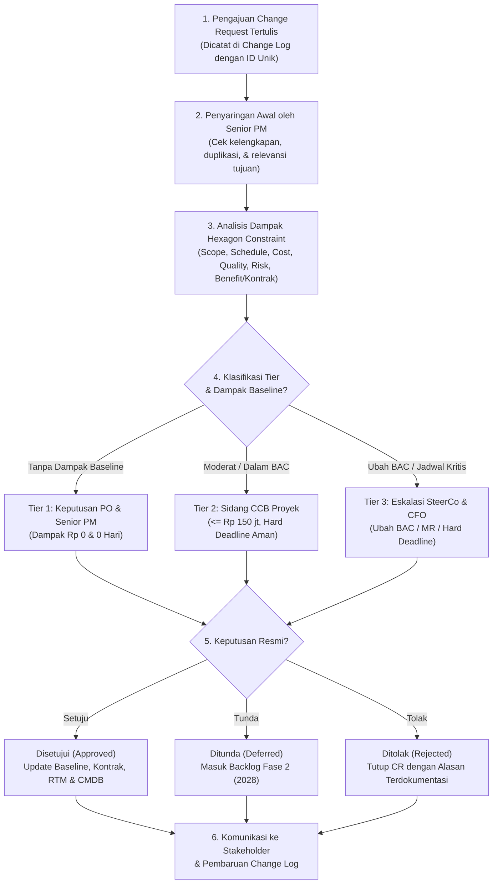

Perubahan yang disetujui tidak berhenti di notulen rapat. Di sinilah **Configuration Management (Manajemen Konfigurasi)** bekerja sebagai tulang punggung pengendalian versi agar seluruh tim — baik internal SNR maupun 18 personel vendor PT NDS — selalu bekerja di atas "sumber kebenaran tunggal" (*single source of truth*). Tiga pilar utamanya adalah:
1. **Configuration Identification:** Menetapkan artefak apa saja yang dikendalikan versinya (*Configuration Items* — misalnya spesifikasi API OMS v2.1, dokumen Scope Statement v1.2, skema migrasi database loyalty, dan *source code release tag*).
2. **Configuration Status Accounting:** Mencatat riwayat revisi, status persetujuan CR, siapa mengubah apa, dan kapan perubahan diterapkan.
3. **Configuration Verification & Audit:** Memastikan *build* perangkat lunak yang dipasang di lingkungan produksi (120 toko dan Cloud Jakarta) 100% identik dengan konfigurasi yang telah lulus SIT, UAT, dan PenTest.

---

### 5.7 Kesalahan Umum di Lapangan (*Anti-Patterns*)

Pengalaman puluhan proyek transformasi digital menunjukkan bahwa kegagalan jarang disebabkan ketidaktahuan terhadap definisi teori, melainkan oleh jebakan praktik (*anti-patterns*) berikut ini:

1. **Water-Scrum-Fall Palsu (*Dysfunctional Hybrid*):**
   *Gejala:* Manajemen mengklaim menjalankan *Hybrid*, tetapi di awal memaksakan spesifikasi kaku yang tak boleh disentuh sambil di tengah jalan menyuruh tim *Agile* mengerjakan seluruh fitur sekaligus tanpa prioritas *backlog*, lalu menumpuk seluruh pengujian di akhir.
   *Koreksi Senior PM:* Tetapkan batas tegas: *Predictive* hanya mengunci *outcome*, batas dana, *milestone* integrasi lintas proyek, dan gerbang kepatuhan; di dalam batas itu, *Product Owner* dan tim *Scrum* memiliki otonomi penuh memprioritaskan *user stories* dan menjalankan *testing* di setiap sprint.

2. **Vanity Charter (Charter Sekadar Formalitas Administrasi):**
   *Gejala:* Project Charter disusun setelah proyek berjalan 4 bulan hanya untuk melengkapi audit PMO, isinya kalimat klise tanpa angka target, tanpa *Out-of-Scope*, dan tanpa batas otoritas PM.
   *Koreksi Senior PM:* Perlakukan penandatanganan Charter (Gate 1) sebagai kontrak penyelarasan eksekutif. Jangan pernah mengizinkan eksekusi skala penuh atau penandatanganan kontrak vendor sebelum Sponsor mengesahkan Charter.

3. **Sindrom 90% (*The 90% Syndrome*) & Ilusi EVM Berbasis Waktu:**
   *Gejala:* Tim melapor "modul integrasi sudah 90% selesai" selama enam minggu berturut-turut, atau PM menghitung EV berdasarkan persentase waktu yang berlalu (`9 bulan ÷ 18 bulan = 50%`) alih-alih *deliverable* terverifikasi.
   *Koreksi Senior PM:* Terapkan aturan pengukuran EV objektif (*0/100* untuk paket kerja pendek, *50/50* atau *weighted milestones* berbasis *Definition of Done* untuk paket kerja menengah). Pekerjaan yang belum lulus *QA/UAT* tidak boleh diklaim 100% EV!

4. **Menjadikan Contingency Reserve sebagai "Dana Tambahan Bebas" (*Slush Fund*):**
   *Gejala:* PM mencairkan *Contingency Reserve* untuk mendanai fitur baru titipan departemen lain atau menutupi ketidakefisienan vendor *Fixed Price* tanpa berita acara risiko.
   *Koreksi Senior PM:* *Contingency Reserve* hanya boleh ditarik saat **risiko teridentifikasi (*known-unknown*) benar-benar terjadi** dan tercatat pada *Risk Register*. Penambahan fitur baru (*scope addition*) wajib didanai melalui persetujuan anggaran baru atau *Management Reserve* atas otoritas CFO/SteerCo.

5. **Executive Bypass (Memotong Jalur CCB Lewat Jalur Informal):**
   *Gejala:* Seorang VP menelepon langsung *Lead Developer* atau vendor untuk "menyelipkan fitur kecil 2 hari saja" tanpa sepengetahuan PM dan PO. Akumulasi "2 hari saja" sebanyak sepuluh kali menghancurkan jadwal rilis dan memicu tagihan *Change Order* tak terduga.
   *Koreksi Senior PM:* Bangun kesepakatan kerja tertulis dengan vendor PT NDS bahwa seluruh instruksi perubahan hanya sah jika ditandatangani secara formal dalam *Change Log* oleh Senior PM & Sponsor. Kepada eksekutif, jangan menjawab "tidak boleh", melainkan: *"Ide ini sangat menarik; izinkan saya menghitung dampak biaya, jadwal, dan opsi penempatannya melalui jalur CCB dalam 3 hari agar kita bisa memutuskan bersama."*

6. **Quality as Afterthought (Mutu Dipangkas Saat Jadwal Tertekan):**
   *Gejala:* Saat pengembangan terlambat 3 minggu, respons refleks adalah memotong durasi SIT, UAT, *Load Testing*, atau pelatihan toko agar tanggal Go-Live tampak tetap sama di atas kertas.
   *Koreksi Senior PM:* Memangkas pengujian menjelang tenggat tidak mempercepat proyek — itu hanya memindahkan cacat ke hari Go-Live dengan biaya *External Failure* 10–100× lebih mahal. Opsi senior adalah *descoping* fitur non-kritis (*MoSCoW*) atau percepatan terukur (*crashing/fast tracking*), bukan mengorbankan gerbang mutu dan kepatuhan hukum.

---

## 6. Studi Kasus: Penerapan pada Proyek OMNI

Pada bagian ini, seluruh kerangka kerja Bab 5 diwujudkan ke dalam **lima artefak nyata dan saling konsisten** untuk **PT Sinar Nusantara Retail Tbk (SNR) — Proyek OMNI**, sebagaimana disusun dan dipimpin oleh **Fajar Nugroho** (Senior Project Manager).

---

### 6.1 Project Charter Proyek OMNI (Ringkas-Lengkap)

| Field Dokumen | Isi Resmi |
|---------------|-----------|
| **Nama Proyek** | **Proyek OMNI** (*Omnichannel Commerce, Click & Collect, & Digital Loyalty Platform*) |
| **Kode Proyek / Program** | `PRJ-01` — Flagship Project di bawah **Program Nusantara 2028** (Rp 18,50 M) |
| **Tanggal Efektif** | 31 Juli 2026 (Milestone M1 — Gate 1 Approval; *Kick-off* 1 Juni 2026) |
| **Project Sponsor** | **Ratna Kusuma** — Direktur Operasional & Ritel (COO) |
| **Senior Project Manager** | **Fajar Nugroho** |
| **Pendekatan Delivery** | *Hybrid Delivery* (Predictive Stage-Gate & Incremental Wave Rollout + Agile Scrum 14 Sprint × 2 minggu) |

#### 1. Justifikasi Bisnis (*Business Purpose*)
Pangsa pasar SNR pada segmen usia 25–40 tahun tergerus rata-rata **4%/tahun** sejak 2024 karena ketiadaan ekosistem *omnichannel*. Sinkronisasi stok *batch* harian pukul 00.00 WIB menyebabkan tingkat pembatalan pesanan akibat *stockout* mencapai **11,4%** (akurasi stok 88,6%), situs web 2019 mencatat *cart abandonment* **74%**, dan 62% data dari 1,2 juta kartu fisik *Sinar Member Card* usang/duplikat. Proyek OMNI dibentuk untuk menghentikan erosi pangsa pasar sekaligus mendorong kontribusi kanal digital dari **3,5%** (±Rp 64,75 M/tahun) menuju **15%** (~Rp 300 M/tahun dalam 18 bulan pasca-Go-Live).

#### 2. Sasaran Proyek Terukur (*Measurable Project Objectives*)
- **Jadwal:** Go-Live Nasional seluruh 120 toko paling lambat **26 November 2027** (*Hard Deadline* menjelang Harbolnas 12.12 & Natal–Tahun Baru).
- **Biaya:** Total realisasi biaya akhir berada dalam deviasi **≤ ±5%** dari *Cost Baseline (BAC)* **Rp 9,20 M** (koridor Rp 8,74 M – Rp 9,66 M).
- **Kinerja Operasional & Teknis:** Akurasi stok lintas kanal **≥ 98,0%** (jeda sinkronisasi **≤ 60 detik**); *stockout cancellation* **< 1,5%**; SLA *Click & Collect* **≤ 2 jam** pada ≥ 95% pesanan di 120 toko; *system uptime* **≥ 99,5%**; lulus uji beban **2.500 TPM**.
- **Adopsi & Kepatuhan:** Target pasca-Go-Live **500.000 MAU**, **800.000 anggota loyalty terverifikasi**, kenaikan *repeat purchase* **+25%**, kepatuhan **100% UU PDP No. 27/2022 & PCI-DSS**, serta **0 temuan Critical/High** pada *Penetration Testing*.

#### 3. Ringkasan Ruang Lingkup Tingkat Tinggi
- **In-Scope Utama:** (1) Aplikasi Mobile iOS & Android; (2) Web E-Commerce Responsif; (3) *Click & Collect (BOPIS)* & *Store Fulfillment App* di 120 toko; (4) *Digital Loyalty Engine* & migrasi 1,2 juta data anggota; (5) OMS & API *Inventory Sync Layer* (ERP, WMS 3 DC, POS 120 toko); (6) Integrasi *Payment Gateway* (PT FinPay Nusantara) & kurir; (7) Kepatuhan UU PDP & PenTest independen; (8) SOP omnichannel & pelatihan 6 Regional Manager, 120 Store Manager, dan 1.440 kasir/staf gudang.
- **Out-of-Scope Utama:** Penggantian ERP inti (`PRJ-02: ERP-Refresh`), penggantian perangkat keras terminal POS (`PRJ-03: POS-Modern`), integrasi langsung ke *marketplace* pihak ketiga (Fase 2 — 2028), *Enterprise Data Warehouse* & AI rekomendasi lanjutan (`PRJ-04: DataHub`), serta penjualan ekspor lintas negara.

#### 4. Ringkasan Anggaran & Linimasa Milestone
- **Cost Baseline (BAC):** **Rp 9,20 M** (terdiri atas Base Cost Estimate Rp 8,50 M [CB-01 s.d. CB-05] termasuk kontrak *Fixed Price* PT NDS Rp 4,40 M + *Contingency Reserve* CB-06 **Rp 0,70 M**).
- **Management Reserve:** **Rp 0,60 M** (otoritas CFO Budi Santoso & Steering Committee) → **Total Project Funding Requirement = Rp 9,80 M**.
- **Milestone Kunci:** M0 Kick-off (1 Jun 2026) → M1 Gate 1 Charter & Kontrak (31 Jul 2026) → M2 Baseline & Cloud (31 Agu 2026) → M3 Release 1 (20 Nov 2026) → M4 Release 2 (12 Feb 2027) → M5 Gate 2 Feature Freeze (23 Apr 2027) → M6 Gate 3 UAT & Pilot 10 Toko (16 Jul 2027) → M7 Rollout 120 Toko (29 Okt 2027) → M8 Gate 4 Go-Live Nasional (26 Nov 2027).

#### 5. Risiko Strategis Tingkat Tinggi & Ketergantungan Program
Risiko utama meliputi keterlambatan API proyek paralel **POS-Modern** (**R-01**), kualitas data migrasi 1,2 juta anggota loyalty (**R-02**), resistensi 120 toko (**R-03**), *scope creep* fitur promosi (**R-04**), kepatuhan UU PDP/PenTest (**R-05**), performa puncak 2.500 TPM (**R-06**), *turnover* tim kunci (**R-07**), sengketa kontrak *Fixed Price* PT NDS (**R-08**), logistik 240 tablet/scanner luar Jawa (**R-09**), serta peluang pembukaan kanal *pre-order* Platinum lebih awal (**R-10**).

#### 6. Mandat Otoritas Senior Project Manager & Tata Kelola Eskalasi
**Fajar Nugroho** diberi mandat resmi oleh Sponsor untuk:
1. Mengarahkan seluruh tim inti proyek (Kevin Halim, Tania Wijaya, Nadia Putri, Dimas Prasetyo, Lukas Gunawan) serta mengoordinasikan perwakilan unit bisnis dan Delivery Director PT NDS (Bambang Hartono).
2. Mengotorisasi penarikan *Contingency Reserve* hingga **Rp 100 jt per kejadian risiko teridentifikasi** dengan laporan transparan di komite bulanan; penarikan > Rp 100 jt memerlukan persetujuan Sponsor (Ratna Kusuma).
3. Memimpin sidang CCB Tier 1–2 dan menolak instruksi perubahan informal di luar proses *Integrated Change Control*.
4. Mengeskalasi ke Executive Steering Committee (Ketua: CEO Hendra Wijaya) dan CFO (Budi Santoso) apabila deviasi EAC diproyeksikan melampaui ±5% BAC (> Rp 9,66 M), memerlukan pencairan *Management Reserve*, atau mengancam *Hard Deadline* 26 November 2027.
5. Menghormati hak veto independen Head of Legal & InfoSec (**Rina Kartika**) terkait kepatuhan UU PDP, PCI-DSS, dan hasil *Penetration Testing* pada Gate 3 & Gate 4.

#### 7. Pengesahan Resmi (*Formal Sign-Off*)

| Peran | Nama & Jabatan | Tanggal Persetujuan | Status |
|-------|----------------|---------------------|--------|
| **Project Sponsor (Pengesah)** | **Ratna Kusuma** — Direktur Operasional & Ritel (COO) | 31 Juli 2026 | **Disetujui & Ditandatangani** |
| **Otoritas Dana (Mengetahui)** | **Budi Santoso** — Direktur Keuangan (CFO) | 31 Juli 2026 | **Disetujui (BAC Rp 9,20 M / MR Rp 0,60 M)** |
| **Program Oversight** | **Antonius Wibowo** — Program Director Nusantara 2028 | 31 Juli 2026 | **Selaras dengan Program** |
| **Penerima Mandat** | **Fajar Nugroho** — Senior Project Manager | 31 Juli 2026 | **Diterima** |

---

### 6.2 Project Scope Statement, Acceptance Criteria Terukur, dan Cuplikan RTM

Pada Milestone M2 (31 Agustus 2026), Fajar Nugroho bersama Lead BA (Nadia Putri), Lead SA (Dimas Prasetyo), dan Product Owner (Kevin Halim) mengunci **Project Scope Statement v1.0** sebagai komponen utama *Scope Baseline*.

#### A. Ringkasan Batas Produk, Kendala, dan Asumsi
- **Kendala Kunci (*Constraints*):** (1) Tenggat Go-Live mutlak 26 November 2027 tidak dapat digeser karena momentum Harbolnas 12.12; (2) Kontrak vendor utama PT NDS berjenis *Fixed Price* Rp 4,40 M sehingga perubahan lingkup di luar *Statement of Work* (SoW) memicu *Change Order*; (3) Seluruh data pribadi pelanggan wajib disimpan dan diproses di *Cloud Region Jakarta* demi kepatuhan UU PDP; (4) Tim *senior architect* IT dibagi bersama proyek paralel `ERP-Refresh`.
- **Asumsi Kunci (*Assumptions*):** (1) Proyek `POS-Modern` merilis spesifikasi & sandbox API adaptor stok paling lambat akhir Januari 2027; (2) Rasio data duplikat/usang 1,2 juta anggota loyalty dapat dibersihkan otomatis ≥ 80% melalui skrip pembersihan; (3) Setiap toko menyediakan minimal 2 orang staf terpilih untuk mengikuti pelatihan tanpa mengganggu jam sibuk akhir pekan. *(Catatan: Di Bulan ke-9, asumsi 1 dan 2 terbukti meleset dan memicu variansi EVM!)*

#### B. Matriks Deliverables & Acceptance Criteria Terukur Proyek OMNI

| Kode | Deliverable Utama | Acceptance Criteria Terukur (*Objective & Testable*) | Pemilik Verifikasi |
|------|-------------------|------------------------------------------------------|--------------------|
| **DL-01** | Aplikasi Mobile (iOS & Android) & Web Responsif | 100% *critical user journeys* (cari produk, cek stok per toko, *checkout*, pelacakan, QR loyalty) lulus UAT dengan 0 cacat *Critical/High*; waktu muat halaman utama web ≤ 2,5 detik pada koneksi 4G; rating stabilitas aplikasi ≥ 99,5% *crash-free sessions* selama Pilot 10 toko | Kevin Halim (PO) & Lukas Gunawan (QA Lead) |
| **DL-02** | *Click & Collect* (BOPIS) & *Store Fulfillment App* | Aktif di 120 toko dengan 240 unit tablet/scanner terpasang; notifikasi pesanan masuk ke tablet toko ≤ 30 detik setelah pembayaran terkonfirmasi; **SLA persiapan barang ≤ 2 jam tercapai pada ≥ 95% pesanan** selama evaluasi Pilot 10 toko | Agus Setiawan (Store Ops) & Lukas Gunawan |
| **DL-03** | *Order Management System* (OMS) & *Inventory Sync* | Sinkronisasi stok *near-real-time* antara ERP pusat, WMS 3 DC (Cikarang, Surabaya, Medan), dan POS 120 toko dengan **latensi ≤ 60 detik (p95)**; akurasi stok lintas kanal **≥ 98,0%** dan *stockout cancellation* **< 1,5%** | Dimas Prasetyo (SA) & Siti Rahmawati (SCM) |
| **DL-04** | *Digital Loyalty Engine* & Migrasi Data | Seluruh 1,2 juta rekaman lama dibersihkan, dideduplikasi, dan dimigrasi dengan akurasi saldo poin **100% rekonsiliasi keuangan** (selisih = Rp 0); 3 tier (*Silver, Gold, Platinum*) dan penebusan voucher QR otomatis berfungsi di web, app, dan POS ≤ 3 detik | Dewi Lestari (VP Mkt) & Budi Santoso (Finance Audit) |
| **DL-05** | Integrasi *Payment Gateway* & Kurir | Seluruh metode PT FinPay Nusantara (QRIS, VA, Kartu Kredit/Debit, e-Wallet) lulus uji transaksi end-to-end & rekonsiliasi settlement T+1; sertifikasi kepatuhan PCI-DSS valid; API kurir reguler & instan menghitung tarif & nomor resi otomatis dengan *success rate* ≥ 99,5% | Dimas Prasetyo & Rina Kartika (Legal/InfoSec) |
| **DL-06** | Kepatuhan Keamanan, UU PDP & Performa Puncak | Lulus *Load Test* **2.500 TPM** selama 60 menit stabil (*error rate* < 0,5%, *uptime* ≥ 99,5%); lulus *Penetration Testing* independen dengan **0 temuan Critical/High**; fitur *consent management*, enkripsi PII *at-rest/in-transit*, dan hak hapus data 100% memenuhi UU PDP | Rina Kartika (*Veto Authority*) & Irwan Pratama (CTO) |
| **DL-07** | SOP Omnichannel & Pelatihan Operasional 120 Toko | SOP *Click & Collect* dan retur omnichannel disetujui Store Ops; 100% dari 6 Regional Manager, 120 Store Manager, dan **≥ 95% dari 1.440 kasir/staf gudang** lulus tes praktik aplikasi (skor minimum 80/100) sebelum gelombang *rollout* masing-masing | Agus Setiawan & Fajar Nugroho |

#### C. Cuplikan Requirements Traceability Matrix (RTM) Proyek OMNI

| ID Req | Tujuan Bisnis (Charter) | Deskripsi Persyaratan | Sumber | Kode WBS / Release | Kasus Uji (SIT/UAT) | Status Gate |
|--------|-------------------------|-----------------------|--------|--------------------|---------------------|-------------|
| `REQ-001` | Tekan *stockout* 11,4% → < 1,5% | Sinkronisasi stok POS–WMS–OMS maksimal 60 detik setelah transaksi selesai | Siti Rahmawati & Agus Setiawan | WBS 2.3 / Release 1 & 3 | `TC-INT-014`, `TC-LOAD-003` | Verifikasi Gate 3 |
| `REQ-018` | SLA BOPIS ≤ 2 jam di 120 toko | Aplikasi tablet toko mengirim pengingat eskalasi ke Store Manager jika pesanan belum disiapkan pada menit ke-90 | Agus Setiawan | WBS 3.2 / Release 3 | `TC-UAT-042`, Pilot 10 Toko | Verifikasi Gate 3 |
| `REQ-045` | 800.000 anggota loyalty terverifikasi | Proses migrasi wajib menghapus duplikat nomor telepon dan mengundang verifikasi OTP saat login perdana | Dewi Lestari | WBS 2.4 / Release 2 | `TC-MIG-008`, `TC-UAT-071` | Selesai Release 2 |
| `REQ-072` | 100% patuh UU PDP & 0 temuan Critical | Enkripsi AES-256 pada data PII pelanggan dan pencatatan *audit log* persetujuan pemrosesan data | Rina Kartika | WBS 4.2 / Cross-Release | `TC-SEC-001`, PenTest Indep. | Wajib Lulus Gate 3 |

---

### 6.3 Analisis EVM Resmi Bulan ke-9 (28 Februari 2027) & Rekomendasi Eksekutif

Pada akhir **Bulan ke-9 (28 Februari 2027)** — tepat separuh durasi proyek 18 bulan — Fajar Nugroho menyusun laporan kinerja resmi berbasis EVM untuk rapat Steering Committee bulanan. Berdasarkan linimasa baseline, pada akhir Februari 2027 proyek seharusnya telah menuntaskan Release 2 (M4, 12 Feb 2027) dan berada di awal Release 3 (Sprint 12). Namun secara aktual, proyek baru saja menyelesaikan **Sprint 10** akibat dua peristiwa utama: (1) pembersihan migrasi 1,2 juta data *Sinar Member Card* (**R-02**) ternyata dua kali lebih kotor dari asumsi awal, dan (2) rilis antarmuka API dari proyek paralel **POS-Modern** (**R-01**) mundur **3 minggu**.

#### A. Data Dasar & Perhitungan Indikator Lengkap

**Parameter Baseline & Aktual per 28 Februari 2027:**
- **BAC** = **Rp 9,20 M** (Rp 9.200 jt) — batas toleransi akhir ±5% = **Rp 8,74 M s.d. Rp 9,66 M**
- **Management Reserve** = **Rp 0,60 M** (Total Funding Requirement = **Rp 9,80 M**)
- **PV** = **Rp 4,80 M** (52,17% rencana baseline)
- **EV** = **Rp 4,32 M** (46,96% progres terverifikasi)
- **AC** = **Rp 4,60 M** (50,00% serapan kas terhadap BAC)

**1. Status Variansi dan Indeks Kinerja Saat Ini:**
- **Schedule Variance (SV)** = `EV − PV` = `4,32 − 4,80` = **−Rp 0,48 M** (−10,00% dari rencana) → *Behind Schedule*.
- **Cost Variance (CV)** = `EV − AC` = `4,32 − 4,60` = **−Rp 0,28 M** (−6,48% terhadap nilai hasil kerja) → *Over Budget*.
- **Schedule Performance Index (SPI)** = `EV ÷ PV` = `4,32 ÷ 4,80` = **0,90** → baru menghasilkan 90% progres dari rencana.
- **Cost Performance Index (CPI)** = `EV ÷ AC` = `4,32 ÷ 4,60` = **0,9391 ≈ 0,94** → setiap Rp 1,00 yang dibelanjakan baru menghasilkan nilai Rp 0,94.

**2. Peramalan 3 Skenario EAC, ETC, VAC, dan TCPI:**
Diketahui sisa pekerjaan (`BAC − EV`) = `9,20 − 4,32` = **Rp 4,88 M**, dan sisa dana baseline (`BAC − AC`) = `9,20 − 4,60` = **Rp 4,60 M**.

| Skenario Peramalan | Rumus & Langkah Hitung | EAC | ETC (`EAC − AC`) | VAC (`BAC − EAC`) | Status vs Toleransi (±5% = Rp 9,66 M) |
|--------------------|------------------------|-----|------------------|-------------------|---------------------------------------|
| **1. Atypical (Optimistis)**<br/>Variansi satu kali, sisa sesuai tarif rencana | `4,60 + (9,20 − 4,32)`<br/>`= 4,60 + 4,88` | **Rp 9,48 M** | **Rp 4,88 M** | **−Rp 0,28 M** (−3,04%) | **Masih dalam toleransi** (≤ Rp 9,66 M) |
| **2. Typical (Realistis / Baseline Tren)**<br/>Tren CPI saat ini (0,93913) berlanjut | `9,20 ÷ (4,32 ÷ 4,60)`<br/>`= 42,32 ÷ 4,32 = 9,796` | **Rp 9,80 M** | **Rp 5,20 M** | **−Rp 0,60 M** (−6,52%) | **Melampaui toleransi!** Menyedot habis *Management Reserve* Rp 0,60 M |
| **3. Composite (Pesimistis / Crashing)**<br/>Tren CPI × SPI (0,93913 × 0,90 = 0,8452) memengaruhi sisa | `4,60 + [4,88 ÷ 0,8452]`<br/>`= 4,60 + 5,774` | **Rp 10,37 M** | **Rp 5,77 M** | **−Rp 1,17 M** (−12,72%) | **Kritis!** Melampaui Total Funding Rp 9,80 M sebesar Rp 0,57 M |

*(Catatan ketelitian finansial: Menggunakan CPI eksak `4,32 ÷ 4,60 = 0,93913` menghasilkan `EAC₂` = Rp 9,796 M ≈ **Rp 9,80 M**, konsisten dengan dokumen baseline studi kasus. Pembulatan CPI ke 0,94 sejak awal akan menghasilkan Rp 9,79 M — perbedaan kecil Rp 10 jt ini menegaskan praktik terbaik Senior PM agar selalu menjaga presisi desimal penuh pada perhitungan antara).*

**3. Analisis TCPI dan Proyeksi Jadwal:**
- **TCPI untuk memenuhi BAC (Rp 9,20 M):**
  > `TCPI(BAC) = (9,20 − 4,32) ÷ (9,20 − 4,60) = 4,88 ÷ 4,60 = 1,0609 ≈ 1,06`
  Artinya, untuk finis sesuai BAC Rp 9,20 M tanpa tambahan dana, efisiensi sisa proyek harus melonjak dari CPI historis **0,94** ke **1,06** (selisih **+0,12** atau kenaikan produktivitas biaya +12,9%). Mengingat selisih melebihi ambang praktik industri `0,10`, mempertahankan BAC secara pasif sangat berisiko gagal.
- **TCPI apabila CFO menyetujui target EAC terkendali Rp 9,55 M** (dengan pencairan parsial *Management Reserve* Rp 0,35 M — tetap berada di bawah ambang toleransi ±5% yaitu Rp 9,66 M):
  > `TCPI(EAC=9,55) = 4,88 ÷ (9,55 − 4,60) = 4,88 ÷ 4,95 = 0,9859 ≈ 0,99` *(jauh lebih realistis dicapai lewat perbaikan operasional!).*
- **Proyeksi Jadwal Tanpa Intervensi:** `18 bulan ÷ SPI 0,90 = 20 bulan` (mundur **2 bulan** ke akhir Januari 2028 — **gagal total** memenuhi *hard deadline* 26 November 2027 dan melewatkan Harbolnas 12.12!).

#### B. Rekomendasi Keputusan Eksekutif Fajar Nugroho ke Steering Committee

Alih-alih datang dengan masalah mentah, Fajar Nugroho menyajikan **tiga opsi keputusan terukur** kepada CEO Hendra Wijaya, Sponsor Ratna Kusuma, dan CFO Budi Santoso:

| Opsi Strategis | Mekanisme Tindakan | Proyeksi Biaya Akhir | Proyeksi Jadwal | Risiko & Rekomendasi |
|----------------|--------------------|----------------------|-----------------|----------------------|
| **Opsi A: Status Quo (Pasif)** | Tidak ada intervensi struktural; menunggu API POS-Modern selesai secara alami | Rp 9,80 M – Rp 10,37 M | Mundur ke Jan 2028 (**Gagal Harbolnas**) | **Ditolak** — melanggar tenggat strategis CEO & batas biaya CFO |
| **Opsi B: Full Crashing Tanpa Penyesuaian Lingkup** | Menambah 2 tim pengembang ekstra dari PT NDS dan lembur penuh untuk mengejar seluruh fitur termasuk *nice-to-have* | Rp 10,15 M – Rp 10,37 M (melebihi Total Funding) | 26 Nov 2027 tercapai secara tipis | **Tidak direkomendasikan** — biaya melonjak tinggi & risiko cacat mutu/burnout (R-06, R-07) |
| **Opsi C (REKOMENDASI): Pemulihan Terpadu (*Targeted Recovery + MoSCoW Descoping*)** | 1. **Eskalasi Program:** Antonius Wibowo & CTO mengunci *mock API contract* & tim tugas khusus untuk merilis adaptor POS-Modern dalam 10 hari.<br/>2. **Optimalisasi Ruang Lingkup Non-Kritis:** Menunda 2 fitur *Could-Have* non-inti (kustomisasi tema profil & analitik riwayat poin lanjutan) ke rilis pasca-Go-Live tanpa memengaruhi target omzet/SLA BOPIS.<br/>3. **Fast Tracking Terukur:** Memulai persiapan modul pelatihan Store Ops & SIT modul non-POS secara paralel dengan Sprint 12–13.<br/>4. **Otorisasi Cadangan Bersyarat:** Mencairkan sisa *Contingency Reserve* untuk migrasi data + meminta *earmark* parsial *Management Reserve* maksimal **Rp 0,35 M** (bila diperlukan) agar biaya akhir terkendali di **≤ Rp 9,55 M** (dalam toleransi ±5%) | **Rp 9,45 M – Rp 9,55 M** *(dalam toleransi ±5%, TCPI realistis ~0,99)* | **≤ 26 Nov 2027 Terjaga** | **DIREKOMENDASIKAN** — menjaga *Hard Deadline*, menjaga mutu 2.500 TPM & UU PDP, dan melindungi > Rp 0,25 M *Management Reserve* |

---

### 6.4 Quality Assurance & Control Plan Proyek OMNI

Untuk melindungi anggaran pengujian **CB-05 (Rp 450 jt)** dan memastikan keandalan sistem di 120 toko, Fajar Nugroho dan QA Lead Lukas Gunawan menetapkan rencana mutu berbasis pencegahan dan gerbang fase.

#### A. Alokasi Strategis Cost of Quality pada Anggaran CB-05 & CB-04

| Kategori CoQ | Aktivitas Kunci pada Proyek OMNI | Sumber Anggaran | Target Pencegahan Kegagalan |
|--------------|----------------------------------|-----------------|-----------------------------|
| **Prevention** | Standar arsitektur API & *secure coding* (OWASP), *CI/CD automated unit test* (≥ 80% *coverage*), *Definition of Done* sprint, serta pelatihan 1.440 staf toko & 120 Store Manager | Bagian CB-01, CB-04 (Rp 850 jt), & CB-05 | Mencegah *bug* regresi, mencegah *human error* antrean kasir, dan mencegah penolakan SOP toko (R-03) |
| **Appraisal** | SIT lintas sistem (ERP–WMS–POS–FinPay), UAT bisnis, *Load Testing* 2.500 TPM (Rp 110 jt), *Penetration Testing* independen & audit UU PDP (CB-03), serta Pilot terkendali di 10 toko Jabodetabek | CB-05 (Rp 450 jt) & CB-03 (pos keamanan) | Menangkap kebocoran keamanan & *bottleneck* sinkronisasi stok sebelum *wave rollout* 110 toko lainnya |
| **Internal Failure (Dimonitor)** | Remediasi skrip pembersihan 1,2 juta data anggota duplikat (R-02) & perbaikan *defect* SIT sebelum *feature freeze* | Dibiayai efisiensi/realokasi & *Contingency Reserve* (CB-06) | Menjaga agar cacat migrasi data tidak pernah bocor ke pelanggan |
| **External Failure (Dicegah 0 Insiden Kritis)** | Sanksi UU PDP, *downtime* saat Harbolnas 12.12, *overselling* > 1,5%, dan kompensasi voucher massal | Potensi kerugian **> Rp 3,00 M** jika tidak dicegah | Ditekan mendekati nol melalui gerbang mutu ketat di Gate 3 & Gate 4 |

#### B. Gerbang Mutu (*Stage-Gate Quality Reviews*) Proyek OMNI

| Gerbang | Tanggal Target | Kriteria Kelulusan Wajib (*Mandatory Exit Criteria*) | Otoritas *Sign-Off* |
|---------|----------------|------------------------------------------------------|---------------------|
| **Gate 1 (M1)** | 31 Jul 2026 | Charter ditandatangani; Arsitektur High-Level cloud Jakarta & integrasi disetujui CTO; kontrak PT NDS memuat SLA mutu & klausul CR jelas | Sponsor (Ratna), CTO (Irwan), Legal (Rina) |
| **Gate 2 (M5)** | 23 Apr 2027 | 100% fitur *Must-Have* Release 1–3 memenuhi *Definition of Done*; 0 cacat *Severity 1* terbuka; **Feature Freeze** resmi diberlakukan | Senior PM (Fajar), PO (Kevin), QA Lead (Lukas) |
| **Gate 3 (M6)** | 16 Jul 2027 | Lulus SIT/UAT (0 *Critical/High*); lulus **Load Test 2.500 TPM**; lulus **PenTest & Audit UU PDP**; Pilot 10 toko mencapai akurasi stok ≥ 98,0% & SLA BOPIS ≤ 2 jam | Sponsor (Ratna), **Veto Check: Rina Kartika**, Store Ops (Agus), CTO (Irwan) |
| **Gate 4 (M8)** | 26 Nov 2027 | 120 toko aktif (100%); *system uptime* periode *hypercare* ≥ 99,5%; *runbook* operasi diserahkan ke IT Ops; dokumentasi *Lessons Learned* selesai | Executive Steering Committee (CEO Hendra & Sponsor Ratna) |

---

### 6.5 Penerapan Integrated Change Control: Penanganan CR-004 dari Dewi Lestari

Pada awal **Bulan ke-7 (Desember 2026)**, ketika tim sedang mengerjakan Release 2, **Dewi Lestari (VP Marketing & CX, SH-05)** menghubungi Kevin Halim (PO) dan meminta agar aplikasi mobile Proyek OMNI segera ditambahkan fitur **"Live Shopping & In-App Influencer Stream"** karena kompetitor baru meluncurkan kampanye video langsung.

Fajar Nugroho segera menahan permintaan agar tidak langsung masuk ke *Sprint Backlog* PT NDS, mendaftarkannya secara resmi sebagai **CR-004**, dan memfasilitasi evaluasi dampak dalam 4 hari kerja bersama Dimas Prasetyo (Lead SA), Bambang Hartono (PT NDS), Lukas Gunawan (QA Lead), dan Rina Kartika (Legal/InfoSec).

#### Ringkasan Analisis Dampak Hexagon Constraint — CR-004

| Dimensi Kendala | Hasil Evaluasi Terukur |
|-----------------|------------------------|
| **1. Scope** | Jelas berada di luar *Statement of Work* kontrak *Fixed Price* PT NDS Rp 4,40 M; membutuhkan integrasi CDN *video streaming* berlatensi rendah, fitur *live chat moderation*, dan *overlay* keranjang instan |
| **2. Schedule** | Menambah **6 minggu** kerja pengembangan dan pengujian pada jalur kritis → menggeser M5 (*Feature Freeze*) dan mendorong Go-Live melampaui **26 Nov 2027** ke Januari 2028 |
| **3. Cost** | Penawaran *Change Order* PT NDS = **Rp 580 jt** + biaya layanan *streaming* cloud & CDN tahun pertama = **Rp 170 jt** → Total dampak biaya **Rp 750 jt (Rp 0,75 M)**. Tidak boleh diambil dari *Contingency Reserve* (Rp 0,70 M) karena bukan risiko teridentifikasi; akan melampaui BAC Rp 9,20 M dan memaksa pencairan penuh *Management Reserve* |
| **4. Quality** | Lonjakan risiko *bandwidth bottleneck* saat uji beban 2.500 TPM dan risiko moderasi konten ilegal (*brand safety*) |
| **5. Risk** | Memperparah Risiko **R-04** (*scope creep*), **R-06** (beban puncak), **R-07** (kelelahan tim), dan **R-08** (sengketa ruang lingkup PT NDS) |
| **6. Business Benefits** | Belum ada validasi ROI terukur di *Business Case*; segmen inti SNR (*home living*) saat ini kehilangan omzet terutama karena *stockout* 11,4% dan ketiadaan *Click & Collect*, bukan karena ketiadaan *live video* |

#### Keputusan CCB (Tier 3 — Disetujui Steering Committee) & Solusi Win-Win
Sidang CCB yang dipimpin Sponsor Ratna Kusuma bersama CFO Budi Santoso memutuskan **CR-004: DEFERRED (Ditunda ke Roadmap Produk Fase 2 — Tahun 2028)**. Namun, agar aspirasi pemasaran Dewi Lestari tetap terakomodasi tanpa merusak baseline, Fajar Nugroho dan Dimas Prasetyo menawarkan **alternatif taktis berbiaya Rp 0 (Tier 1)**: memasang *deep-link banner* di halaman utama aplikasi yang menautkan pelanggan ke siaran langsung SNR di Instagram/TikTok dengan kode voucher otomatis *Digital Loyalty Engine* yang memang sudah berada di dalam lingkup **DL-04**. Hasilnya: target *hard deadline* 26 Nov 2027 dan BAC Rp 9,20 M terlindungi, konflik politis terhindarkan, dan Dewi Lestari tetap memperoleh kanal kampanye menjelang Harbolnas!

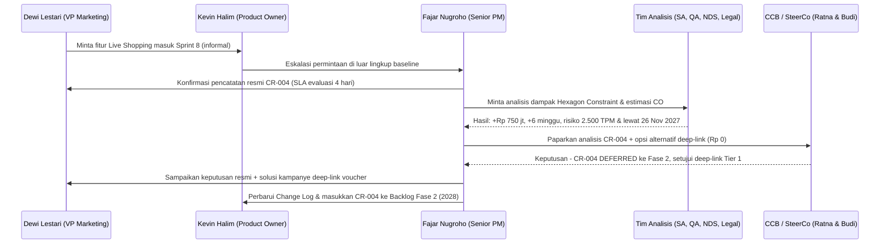

---

## 7. Latihan dan Pembahasan

### 7.1 Soal Latihan

Kerjakan keempat latihan analitis dan kuantitatif berikut berdasarkan konteks **Proyek OMNI (PT Sinar Nusantara Retail Tbk)** sebelum membaca bagian pembahasan.

#### Latihan 1 — Desain Tailoring & Batas Tata Kelola Hybrid (Bobot 20%)
Dua minggu setelah kontrak *Fixed Price* senilai Rp 4,40 M dengan PT NDS ditandatangani (Agustus 2026), **Bambang Hartono** (Delivery Director PT NDS) mengeluhkan kepada Fajar Nugroho bahwa Kevin Halim (PO) dan Dewi Lestari (VP Marketing) sering mengubah detail *user story* menjelang dimulainya sprint, sehingga PT NDS mengancam akan mengeluarkan *Change Order* tambahan untuk setiap revisi layar antarmuka. Di sisi lain, Kevin merasa metode *Scrum* justru membolehkan perubahan *backlog* kapan saja.
1. Jelaskan akar konflik metodologis antara kontrak *Fixed Price* (*Predictive*) dan eksekusi *Scrum* (*Adaptive*) pada kasus ini.
2. Rancang **3 aturan main tata kelola Hybrid (*Hybrid Guardrails*)** yang konkret bagi Fajar Nugroho agar fleksibilitas *Product Backlog* tetap berjalan tanpa memicu sengketa biaya kontrak **R-08**.

#### Latihan 2 — Analisis EVM Lanjutan & Paradoks TCPI pada Bulan ke-12 (Bobot 30%)
Setelah rekomendasi pemulihan Bulan ke-9 dijalankan oleh Steering Committee, proyek mencapai akhir **Bulan ke-12 (31 Mei 2027)** di tengah fase SIT/UAT dan persiapan PenTest. Data EVM kumulatif terbaru Proyek OMNI (dengan **BAC tetap Rp 9,20 M** dan toleransi akhir ±5% = Rp 9,66 M) adalah sebagai berikut:
- **PV** = **Rp 7,00 M** (Rp 7.000 jt)
- **EV** = **Rp 6,72 M** (Rp 6.720 jt)
- **AC** = **Rp 6,90 M** (Rp 6.900 jt)

Hitung dan analisis:
1. Nilai **SV**, **CV**, **SPI**, dan **CPI** (tampilkan hingga 4 desimal untuk CPI sebelum pembulatan).
2. Nilai **EAC** dan **VAC** pada **3 skenario**: (a) *Atypical*, (b) *Typical* (tren CPI berlanjut), dan (c) *Composite* (CPI × SPI).
3. Nilai **TCPI** untuk mencapai **BAC (Rp 9,20 M)** serta **TCPI** untuk mencapai **EAC skenario Typical**.
4. **Pertanyaan Analisis Senior:** Bandingkan hasil Bulan ke-12 ini dengan Bulan ke-9 (`SPI 0,90`; `CPI 0,94`; `EAC₂ Rp 9,80 M`; `TCPI(BAC) 1,06`). Meskipun SPI, CPI, dan proyeksi EAC jelas membaik drastis, **mengapa nilai `TCPI(BAC)` justru sedikit naik**? Apa rekomendasi Anda kepada CFO Budi Santoso terkait status *Management Reserve* Rp 0,60 M?

#### Latihan 3 — Analisis Finansial Cost of Quality (CoQ) di Hadapan CFO (Bobot 25%)
Menjelang fase pengujian, CFO Budi Santoso bertanya apakah anggaran **CB-05 (QA, SIT, UAT, Load Testing, Pilot Rp 450 jt)** dapat dihemat sebesar **Rp 180 jt** dengan cara meniadakan *automated load testing* 2.500 TPM (hemat Rp 110 jt) dan mengganti *independent Penetration Testing* UU PDP menjadi pemindaian otomatis internal (hemat Rp 70 jt). Berdasarkan kajian teknis Lukas Gunawan dan Rina Kartika:
- Jika pengujian tetap dijalankan penuh (**Opsi A**, biaya *Conformance* Rp 180 jt dipertahankan): probabilitas *downtime* saat Harbolnas hanya **5%** (dampak kerugian *External Failure* **Rp 1.200 jt**), dan probabilitas insiden keamanan/pelanggaran UU PDP hanya **2%** (dampak kerugian *External Failure* **Rp 2.000 jt**).
- Jika pengujian dipangkas (**Opsi B**, hemat Rp 180 jt): probabilitas *downtime* Harbolnas melonjak menjadi **45%**, dan probabilitas kegagalan keamanan/UU PDP melonjak menjadi **25%** (nilai dampak kerugian tetap sama).

Diminta:
1. Hitung total ekspektasi biaya (*Expected Total Cost = Biaya Conformance + Expected External Failure Cost*) untuk **Opsi A** dan **Opsi B**.
2. Hitung **Net Expected Savings** dan **rasio manfaat-terhadap-biaya (*Benefit-Cost Ratio*)** dari mempertahankan investasi pengujian Rp 180 jt tersebut.
3. Susun argumen eksekutif 3 poin untuk meyakinkan CFO Budi Santoso (menggabungkan angka finansial CoQ dan tata kelola Charter).

#### Latihan 4 — Simulasi Keputusan CCB atas CR-007 pada Bulan ke-10 (Bobot 25%)
Pada awal **Bulan ke-10 (Maret 2027)** — tepat satu minggu setelah rapat EVM Bulan ke-9 yang menunjukkan `CPI = 0,94` dan `SPI = 0,90` — Dewi Lestari kembali mengajukan permintaan resmi **CR-007: Modul Flash Sale Gamifikasi ("Spin-the-Wheel & Live Countdown")**. Hasil evaluasi teknis dan komersial menunjukkan:
- Biaya *Change Order* PT NDS = **Rp 320 jt**; tambahan *auto-scaling* cloud & *load testing* khusus = **Rp 80 jt** (total **Rp 400 jt / Rp 0,40 M**).
- Tambahan durasi pada *Critical Path* = **4 minggu**, menggeser M5 (*Feature Freeze*) dan mendorong Go-Live ke **24 Desember 2027**.
- Seorang anggota tim mengusulkan: *"Kita masih punya sisa Contingency Reserve Rp 340 jt (dari Rp 700 jt, setelah Rp 360 jt dipakai untuk migrasi data R-02 dan mitigasi POS R-01). Kita pakai saja dana itu ditambah penghematan kecil agar fitur ini bisa lolos tanpa minta dana baru ke CFO!"*

Diminta:
1. Identifikasi **3 pelanggaran prinsip manajemen proyek senior** dalam usulan anggota tim tersebut.
2. Tentukan **Tier CCB**, **keputusan akhir yang tepat**, dan **langkah tindak lanjut komunikasi** Fajar Nugroho terhadap Dewi Lestari dan PT NDS.

---

### 7.2 Pembahasan Latihan

#### Pembahasan Latihan 1
1. **Akar Konflik Metodologis:**
   Konflik terjadi karena *mismatch* antara **model komersial** dan **model eksekusi**. Kontrak *Fixed Price* dibangun di atas asumsi *Predictive* bahwa ruang lingkup sudah terkunci sehingga risiko perubahan berada di sisi pembeli (*SNR*), sedangkan *Scrum* mengasumsikan ruang lingkup cair melalui *Product Backlog* yang terus berevolusi. Ketika tidak ada mekanisme penerjemah di antara keduanya, setiap penyempurnaan *user story* oleh PO dipersepsikan vendor sebagai penambahan ruang lingkup gratis (*unpaid scope creep*).

2. **Tiga Aturan Main Tata Kelola Hybrid (*Hybrid Guardrails*):**
   - **Guardrail 1 — Mekanisme "Swap for Free" Berbasis Kapasitas (*Story Points / Feature Swap*):** Ruang lingkup kontrak *Fixed Price* Rp 4,40 M dikunci pada **total kapasitas nilai/kompleksitas fitur (misalnya batas total Story Points atau daftar Epics wajib)**, bukan pada gambar layar kaku. Kevin Halim boleh mengganti atau menyempurnakan sebuah *user story* sebelum *Sprint Planning* dengan syarat **mengeluarkan fitur lain yang belum dikerjakan dengan bobot Story Points setara** (menjaga *net effort* = 0). Jika penambahan tidak disertai pengurangan, barulah wajib masuk *Change Request* berbayar.
   - **Guardrail 2 — Aturan "Sprint Boundary Freeze & Definition of Ready (DoR)":** Perubahan prioritas hanya boleh dilakukan pada *Product Backlog* untuk sprint mendatang; begitu *Sprint Planning* selesai, ruang lingkup sprint yang sedang berjalan (2 minggu) bersifat beku agar 18 personel PT NDS tidak mengalami *rework* sia-sia. Setiap *user story* harus memenuhi *Definition of Ready* minimal 5 hari sebelum sprint dimulai.
   - **Guardrail 3 — Single Point of Commercial Instruction:** Seluruh permintaan bisnis dari Dewi Lestari atau unit lain wajib melalui Kevin Halim (PO) untuk penyaringan nilai dan divalidasi Fajar Nugroho (Senior PM) terhadap koridor kontrak SoW. PT NDS diinstruksikan secara kontraktual untuk menolak permintaan langsung dari luar jalur resmi tersebut.

---

#### Pembahasan Latihan 2
Diketahui per **31 Mei 2027 (Bulan ke-12)**: `BAC = Rp 9,20 M`, `PV = Rp 7,00 M`, `EV = Rp 6,72 M`, `AC = Rp 6,90 M`.
- Sisa pekerjaan (`BAC − EV`) = `9,20 − 6,72` = **Rp 2,48 M**
- Sisa dana baseline (`BAC − AC`) = `9,20 − 6,90` = **Rp 2,30 M**

1. **Indikator Variansi & Kinerja Bulan ke-12:**
   - **SV** = `EV − PV` = `6,72 − 7,00` = **−Rp 0,28 M** *(membaik dari −Rp 0,48 M di Bulan ke-9)*
   - **CV** = `EV − AC` = `6,72 − 6,90` = **−Rp 0,18 M** *(membaik dari −Rp 0,28 M di Bulan ke-9)*
   - **SPI** = `EV ÷ PV` = `6,72 ÷ 7,00` = **0,96** *(tepat 0,9600 — naik signifikan dari 0,90!)*
   - **CPI** = `EV ÷ AC` = `6,72 ÷ 6,90` = **0,9739 ≈ 0,97** *(naik signifikan dari 0,94!)*

2. **Tiga Skenario EAC & VAC:**
   - **(a) Atypical:**
     - `EAC₁ = AC + (BAC − EV) = 6,90 + 2,48 =` **Rp 9,38 M**
     - `VAC₁ = 9,20 − 9,38 =` **−Rp 0,18 M** *(−1,96% dari BAC)*
   - **(b) Typical (Tren CPI = 0,973913 berlanjut):**
     - `EAC₂ = BAC ÷ CPI = 9,20 ÷ (6,72 ÷ 6,90) = (9,20 × 6,90) ÷ 6,72 = 63,48 ÷ 6,72 = 9,4464 ≈` **Rp 9,45 M**
     - `VAC₂ = 9,20 − 9,45 =` **−Rp 0,25 M** *(−2,68% dari BAC — sudah masuk kembali jauh di dalam batas toleransi ±5% yaitu Rp 9,66 M!)*
   - **(c) Composite (CPI × SPI = 0,973913 × 0,96 = 0,934957):**
     - `EAC₃ = 6,90 + (2,48 ÷ 0,934957) = 6,90 + 2,6525 = 9,5525 ≈` **Rp 9,55 M**
     - `VAC₃ = 9,20 − 9,55 =` **−Rp 0,35 M** *(−3,83% dari BAC — bahkan pada skenario pesimistis sekalipun masih di bawah Rp 9,66 M!)*

3. **Nilai TCPI:**
   - **TCPI menuju BAC (Rp 9,20 M):**
     `TCPI(BAC) = (9,20 − 6,72) ÷ (9,20 − 6,90) = 2,48 ÷ 2,30 = 1,0783 ≈` **1,08**
   - **TCPI menuju EAC Typical (Rp 9,45 M):**
     `TCPI(EAC=9,45) = 2,48 ÷ (9,45 − 6,90) = 2,48 ÷ 2,55 = 0,9725 ≈` **0,97** *(setara CPI aktual saat ini — sangat realistis!)*

4. **Penjelasan Paradoks Kenaikan TCPI & Rekomendasi ke CFO:**
   - **Mengapa `TCPI(BAC)` naik dari 1,06 menjadi 1,08 padahal proyek membaik?** Karena `TCPI(BAC)` mengukur efisiensi yang dibutuhkan untuk menutup sisa defisit kumulatif (`−Rp 0,18 M`) dengan sisa anggaran yang makin menyempit (`BAC − AC` kini tinggal **Rp 2,30 M**, separuh dari sisa dana Bulan ke-9 yang Rp 4,60 M). Menutup defisit absolut yang lebih kecil di atas basis penyebut yang jauh lebih kecil menghasilkan rasio persentase lebih tinggi (`0,18 ÷ 2,30 = +7,83%`, sehingga perlu `1,08`). Inilah mengapa Senior PM **tidak pernah membaca satu angka EVM secara terisolasi**!
   - **Rekomendasi untuk CFO Budi Santoso:** Laporkan bahwa intervensi pemulihan berhasil mengembalikan proyek ke koridor toleransi ±5% (`EAC₂ = Rp 9,45 M` jauh lebih baik dibanding proyeksi Bulan ke-9 sebesar `Rp 9,80 M`). Namun karena `TCPI(BAC) = 1,08` (selisih > 0,10 di atas CPI 0,97), memaksa finis persis di Rp 9,20 M berisiko menekan mutu pengujian dan pelatihan toko. Rekomendasikan agar CFO mencadangkan pencairan parsial *Management Reserve* sebesar **Rp 0,25 M – Rp 0,35 M** (sehingga sisa Rp 0,25 M – Rp 0,35 M *Management Reserve* tetap aman utuh bagi perusahaan) untuk mengunci target realisasi akhir **≤ Rp 9,45 M** sambil menjaga Go-Live 26 November 2027.

---

#### Pembahasan Latihan 3
1. **Perhitungan Total Ekspektasi Biaya (*Cost of Quality*):**
   - **Opsi A — Pertahankan Pengujian Penuh (Investasi Conformance = Rp 180 jt):**
     - Biaya *Conformance* tambahan (Load Test + PenTest Independen) = **Rp 180 jt**
     - *Expected External Failure* (Downtime Harbolnas) = `5% × Rp 1.200 jt` = **Rp 60 jt**
     - *Expected External Failure* (Insiden UU PDP / Keamanan) = `2% × Rp 2.000 jt` = **Rp 40 jt**
     - Total *Expected External Failure* (Opsi A) = `60 + 40` = **Rp 100 jt**
     - **Total Expected Cost (Opsi A)** = `180 + 100` = **Rp 280 jt (Rp 0,28 M)**
   - **Opsi B — Pangkas Pengujian (Hemat Conformance = Rp 180 jt):**
     - Biaya *Conformance* tambahan = **Rp 0**
     - *Expected External Failure* (Downtime Harbolnas) = `45% × Rp 1.200 jt` = **Rp 540 jt**
     - *Expected External Failure* (Insiden UU PDP / Keamanan) = `25% × Rp 2.000 jt` = **Rp 500 jt**
     - **Total Expected Cost (Opsi B)** = `0 + 540 + 500` = **Rp 1.040 jt (Rp 1,04 M)**

2. **Net Expected Savings & Benefit-Cost Ratio (BCR):**
   - **Pengurangan Risiko Kegagalan Eksternal (Manfaat Kotor):** `Rp 1.040 jt − Rp 100 jt` = **Rp 940 jt**
   - **Net Expected Savings (Opsi A vs Opsi B):** `Rp 1.040 jt − Rp 280 jt` = **Rp 760 jt (Rp 0,76 M)**
   - **Benefit-Cost Ratio (BCR):** `Rp 940 jt ÷ Rp 180 jt` = **5,22 kali** *(setiap Rp 1 yang diinvestasikan pada Load Test & PenTest melindungi perusahaan dari ekspektasi kerugian Rp 5,22)*.

3. **Tiga Argumen Eksekutif untuk CFO Budi Santoso:**
   - **Argumen Finansial (ROI Perlindungan Risiko):** Memangkas Rp 180 jt justru menaikkan ekspektasi beban kerugian perusahaan hampir 4 kali lipat (dari Rp 280 jt menjadi Rp 1.040 jt), dengan rasio perlindungan **5,22×**. Ini bukan penghematan, melainkan pemindahan biaya dari *capex* proyek ke kerugian operasional (*External Failure*) yang jauh lebih besar.
   - **Argumen Kepatuhan & Veto Gate 3:** Dalam *Project Charter* yang disahkan Direksi, **lulus uji beban 2.500 TPM** dan **0 temuan Critical/High PenTest independen UU PDP** adalah kriteria wajib *Gate 3*. Tanpa PenTest independen, **Rina Kartika** berwenang menggunakan *veto power* untuk menahan Go-Live — yang justru menyebabkan penundaan Harbolnas dan pembengkakan biaya jauh di atas Rp 180 jt.
   - **Argumen Perlindungan Manfaat Bisnis:** Target Proyek OMNI adalah menaikkan omzet digital menjadi ~Rp 300 M/tahun. Satu insiden *downtime* pada hari puncak Harbolnas 12.12 akan langsung menghancurkan kepercayaan pelanggan baru dan menggagalkan target 500.000 MAU.

---

#### Pembahasan Latihan 4
1. **Tiga Pelanggaran Prinsip Manajemen Proyek Senior pada Usulan Tersebut:**
   - **Pelanggaran 1 — Penyalahgunaan Contingency Reserve untuk Scope Addition:** *Contingency Reserve* (CB-06 Rp 0,70 M) secara eksklusif dialokasikan untuk menanggulangi **risiko teridentifikasi (*known-unknowns*)** di dalam ruang lingkup baseline (seperti R-01 dan R-02). Menggunakannya untuk mendanai fitur baru (CR-007) melanggar integritas *Cost Baseline* dan mengosongkan bantalan risiko sisa proyek (padahal fase SIT, UAT, dan Rollout 120 toko penuh risiko masih di depan mata!).
   - **Pelanggaran 2 — Mengabaikan Dampak Jalur Kritis & Hard Deadline:** Usulan hanya melihat sisi uang dan mengabaikan fakta paling fatal: tambahan 4 minggu mendorong Go-Live ke **24 Desember 2027**, melanggar *hard deadline* **26 November 2027** dan melewatkan seluruh puncak belanja Harbolnas 12.12 serta Natal!
   - **Pelanggaran 3 — Bypass Tata Kelola Keuangan (CFO/SteerCo):** Mencoba "menyelipkan" biaya Rp 400 jt agar tidak perlu menghadap CFO pada saat CPI proyek sudah 0,94 dan EAC sudah diproyeksikan Rp 9,80 M adalah pelanggaran berat atas prinsip transparansi *Stewardship* dan *Tiered Change Control*.

2. **Klasifikasi Tier, Keputusan Tepat, dan Langkah Komunikasi:**
   - **Klasifikasi Tier:** **Tier 3 (Executive Steering Committee & CFO)** karena dampak biaya Rp 400 jt melampaui batas Tier 2 (≤ Rp 150 jt), melampaui BAC Rp 9,20 M, dan menggeser *hard deadline* 26 Nov 2027.
   - **Keputusan Akhir yang Tepat:** **DEFERRED (Ditunda ke Fase 2 / Q1 2028)** — proyek tetap melindungi tanggal 26 November 2027, menjaga sisa *Contingency Reserve* Rp 340 jt khusus untuk risiko SIT/UAT/Rollout (R-05, R-06, R-09), dan menghindari pembengkakan *Change Order* PT NDS.
   - **Komunikasi & Tindak Lanjut:** (1) Sampaikan analisis objektif *Hexagon Constraint* kepada Dewi Lestari dengan mengapresiasi kreativitas pemasaran, lalu posisikan fitur gamifikasi tersebut sebagai **inisiatif prioritas #1 pada Roadmap Q1 2028** (setelah basis 500.000 pengguna stabil terbentuk); (2) Tawarkan pemanfaatan maksimal mesin promo voucher otomatis *Digital Loyalty Engine* (DL-04) yang sudah ada di baseline untuk kampanye Harbolnas 12.12; (3) Konfirmasikan secara tertulis kepada Bambang Hartono (PT NDS) bahwa CR-007 berstatus *Deferred* sehingga tidak ada otorisasi kerja maupun penagihan di luar kontrak Rp 4,40 M.

---

## 8. Tugas Modul dan Rubrik Penilaian

### Brief Tugas Mandiri (±6 Jam — Bobot 60% Nilai Modul)

**Peran Anda:** Anda adalah **Fajar Nugroho** (Senior Project Manager Proyek OMNI di PT Sinar Nusantara Retail Tbk).

**Konteks Tugas:** Setelah menyelesaikan audit tengah jalan (akhir Bulan ke-9, 28 Februari 2027) dan menghadapi dinamika lintas fungsi antara Marketing, Store Ops, Finance, dan Vendor PT NDS, Sponsor **Ratna Kusuma** meminta Anda menyusun **"Executive Governance & Baseline Control Dossier — Proyek OMNI"** sebagai dokumen rujukan resmi Steering Committee untuk mengawal paruh kedua proyek (Maret–November 2027) agar tetap lulus Go-Live Nasional **≤ 26 November 2027**.

**Empat Deliverable Wajib dalam Satu Dokumen Terpadu (Maksimal 10–12 halaman / setara dokumen Markdown/PDF rapi):**

1. **Bagian A — Tailoring & Charter Alignment Brief (1–2 halaman):**
   - Rangkum prinsip *Hybrid Governance* Proyek OMNI (mengaitkan *Stage-Gate* Gate 2–4 dengan sisa Sprint 11–14 dan 3 Gelombang Rollout 120 toko).
   - Susun tabel **Matriks Otoritas & Toleransi (*Manage by Exception*)** bagi Senior PM, PO, Sponsor, CFO, dan Legal/InfoSec (mencakup ambang batas biaya, jadwal, perubahan lingkup, dan hak veto).
2. **Bagian B — Penguatan Scope Baseline & RTM Kritis (2–3 halaman):**
   - Susun minimal **8 butir Acceptance Criteria terukur** yang mencakup seluruh aspek kunci (Aplikasi, BOPIS, OMS, Loyalty, Payment, Performa 2.500 TPM, UU PDP, dan Pelatihan 120 toko) lengkap dengan metode verifikasinya.
   - Buat **Requirements Traceability Matrix (RTM)** minimal 8 baris yang menelusuri dari *Business Objective* hingga *Test Case* dan status verifikasi.
   - Tulis protokol 5 langkah untuk mencegah *Scope Creep* (dari unit bisnis) dan *Gold Plating* (dari tim teknis/vendor) menjelang *Feature Freeze* (M5).
3. **Bagian C — Executive EVM Health Assessment & Action Plan (2–3 halaman):**
   - Sajikan kembali analisis EVM Bulan ke-9 (PV Rp 4,80 M; EV Rp 4,32 M; AC Rp 4,60 M) lengkap dengan 3 skenario EAC, ETC, VAC, dan TCPI, lalu tambahkan **simulasi sensitivitas "What-If"**: hitung ulang EAC dan TCPI apabila rencana pemulihan Anda berhasil menaikkan CPI sisa proyek menjadi `1,00` (Skenario Atypical) vs `1,02`.
   - Susun memo rekomendasi 1 halaman kepada CFO Budi Santoso mengenai strategi penggunaan sisa *Contingency Reserve* vs permintaan *earmark* parsial *Management Reserve* (sertakan dasar aturan PMBOK).
4. **Bagian D — Quality Gate Readiness & CCB Decision Package (2–3 halaman):**
   - Rancang *Cost of Quality* (CoQ) *Justification Table* untuk melindungi anggaran QA/Testing (CB-05 Rp 450 jt) dari pemangkasan.
   - Lengkapi **1 Formulir Change Request & CCB Decision Log** nyata untuk sebuah permintaan perubahan baru pilihan Anda yang realistis di Proyek OMNI (di luar CR-004 dan CR-007), lengkap dengan evaluasi *Hexagon Constraint*, klasifikasi Tier, keputusan CCB, dan rencana komunikasi pemangku kepentingan.

### Rubrik Penilaian Tugas Modul (Skala 4 — Bobot Total 100%)

Konversi nilai akhir: **Skor 4 = 90–100 (Sangat Baik)** | **Skor 3 = 75–89 (Baik)** | **Skor 2 = 60–74 (Cukup)** | **Skor 1 = < 60 (Perlu Perbaikan)**. Nilai lulus modul minimal **≥ 70**.

| Kriteria Penilaian | Bobot | Skor 4 (90–100: Sangat Baik) | Skor 3 (75–89: Baik) | Skor 2 (60–74: Cukup) | Skor 1 (< 60: Perlu Perbaikan) |
|--------------------|-------|------------------------------|----------------------|-----------------------|--------------------------------|
| **1. Kedalaman Tailoring & Tata Kelola Charter** | **20%** | Model *Hybrid* sangat tajam dan kontekstual; batas otoritas & toleransi (PM, Sponsor, CFO, Legal) konsisten penuh dengan PRINCE2/PMBOK serta data Proyek OMNI | Model *Hybrid* dan matriks otoritas lengkap dan benar, namun detail integrasi antar-gerbang atau eskalasi masih dapat dipertajam | Menjelaskan konsep *Hybrid* dan otoritas secara umum; beberapa peran/toleransi masih kabur atau kurang selaras dengan kasus SNR | Sekadar definisi teori tanpa penyesuaian ke konteks Proyek OMNI atau mencampuradukkan peran PM dan Sponsor |
| **2. Ketajaman Scope, Acceptance Criteria & RTM** | **20%** | ≥ 8 *Acceptance Criteria* seluruhnya terukur (*SMART/testable*), RTM tertelusur penuh dua arah, protokol anti-*scope creep* & *gold plating* sangat operasional | Mayoritas *Acceptance Criteria* terukur dan RTM konsisten; ada 1–2 kriteria yang masih agak normatif | Kriteria penerimaan masih banyak bersifat kualitatif ("cepat/baik"); RTM terputus atau tidak merujuk *Out-of-Scope* | Tidak ada pemisahan *In/Out-of-Scope* yang jelas; tidak menyusun RTM atau kriteria tidak dapat diuji |
| **3. Akurasi Hitungan EVM, Simulasi, & Reserve Analysis** | **25%** | 100% hitungan EVM, 3 skenario EAC, TCPI, dan simulasi *What-If* akurat tanpa cacat; memisahkan fungsi *Contingency* vs *Management Reserve* secara presisi dengan rekomendasi eksekutif tajam | Hitungan utama EVM benar (deviasi pembulatan minor); analisis *Reserve* tepat, namun argumen strategis ke CFO belum sepenuhnya komprehensif | Terdapat 1–2 kekeliruan rumus (misal EAC atau TCPI), atau penjelasan perbedaan kedua jenis cadangan masih samar | Banyak kesalahan aritmetika dasar, mencampur *Management Reserve* ke BAC/EVM, atau tidak ada analisis keputusan |
| **4. Kualitas Rencana Mutu (CoQ) & Simulasi CCB** | **20%** | Analisis CoQ kuantitatif & persuasif; formulir CR & CCB Log mengevaluasi seluruh 6 dimensi *Hexagon Constraint* dengan keputusan, Tier, dan komunikasi pemangku kepentingan yang matang | Analisis CoQ dan evaluasi CCB sudah mencakup sebagian besar dimensi kunci dengan keputusan yang logis | Analisis CoQ terlalu deskriptif tanpa keterkaitan finansial kuat; evaluasi CR hanya meninjau biaya & jadwal (mengabaikan mutu/risiko/kontrak) | Mengabaikan konsep CoQ atau langsung menyetujui/menolak perubahan tanpa proses analisis dampak CCB |
| **5. Konsistensi Studi Kasus & Komunikasi Eksekutif** | **15%** | 100% konsisten dengan angka, tokoh, tanggal, dan risiko Proyek OMNI; bahasa lugas, ringkas, siap dipresentasikan ke Direksi (*board-ready*) | Sangat sedikit ketidakkonsistenan minor; struktur dokumen rapi dan mudah dibaca | Beberapa angka/tokoh meleset dari dokumen induk; penyajian masih terlalu teknis dan kurang terstruktur untuk eksekutif | Tidak konsisten dengan studi kasus Proyek OMNI; format berantakan dan sulit dipahami |

---

## 9. Kuis dan Kunci Jawaban

### 9.1 Soal Kuis (10 Soal Situasional Level Senior)

Pilih **satu jawaban paling tepat (A, B, C, atau D)** untuk setiap skenario berikut.

**1.** Perusahaan ritel nasional sedang menjalankan transformasi *omnichannel* 18 bulan dengan kontrak vendor utama *Fixed Price*, tenggat Go-Live mutlak sebelum musim belanja puncak, kepatuhan ketat terhadap UU PDP, namun spesifikasi pengalaman pengguna aplikasi selulernya masih perlu divalidasi berulang bersama pelanggan. Pendekatan *tailoring* manakah yang paling tepat dipilih oleh Senior Project Manager?
- A. *Pure Predictive (Waterfall)* dari awal hingga akhir agar tidak ada satu pun perubahan spesifikasi yang mengganggu kontrak *Fixed Price*.
- B. *Hybrid Delivery*, menggunakan *Stage-Gate Predictive* untuk tata kelola investasi, kontrak, kepatuhan, dan *wave rollout*, dipadukan dengan *Agile Scrum* untuk pembangunan inkremental aplikasi dan integrasi API.
- C. *Pure Agile* tanpa *Cost Baseline* dan tanpa *Stage-Gate* agar tim pengembang dapat merespons perubahan pasar setiap minggu secara bebas.
- D. *Pure Iterative* tanpa merilis perangkat lunak ke toko hingga seluruh 120 toko selesai dilatih dan seluruh fitur fase 1 serta fase 2 rampung bersamaan.

**2.** Sebuah proyek strategis baru saja memperoleh persetujuan *Business Case* dari Komite Investasi dengan proyeksi ROI 28%. Manajer operasional langsung meminta Senior PM untuk merekrut tim internal lintas divisi dan menandatangani perjanjian kerja dengan vendor perangkat lunak minggu ini juga. Apa tindakan paling tepat yang harus dilakukan Senior PM?
- A. Segera memulai rekrutmen dan menandatangani kontrak karena *Business Case* yang disetujui sudah setara dengan otorisasi pelaksanaan proyek.
- B. Menyusun *Work Breakdown Structure* (WBS) detail dan *Gantt Chart* lengkap terlebih dahulu sebelum meminta persetujuan siapa pun.
- C. Memastikan *Project Charter* disusun dan ditandatangani secara resmi oleh Project Sponsor terlebih dahulu karena Charter-lah yang secara formal mengesahkan proyek serta memberi mandat otoritas penggunaan sumber daya kepada PM.
- D. Meminta divisi pengadaan menerbitkan kontrak sementara atas nama pribadi PM agar jadwal *kick-off* tidak tertunda.

**3.** Dalam sesi *Sprint Review* Proyek OMNI, seorang *Senior Developer* dengan bangga memamerkan fitur "mode gelap otomatis berbasis cuaca lokal" yang ia bangun selama akhir pekan di luar *Sprint Backlog* dan tanpa permintaan Product Owner, dengan alasan ingin memberi kejutan menyenangkan bagi VP Marketing. Mengapa Senior PM harus menghentikan dan meninjau ulang praktik ini?
- A. Praktik tersebut adalah *Gold Plating* yang menambah kompleksitas kode, berpotensi memunculkan celah keamanan atau cacat yang tidak teruji dalam skenario UAT, serta menambah beban pemeliharaan tanpa validasi nilai bisnis.
- B. Praktik tersebut adalah *Scope Creep* yang hanya diperbolehkan jika biaya pengembangannya di bawah 5% dari BAC.
- C. Praktik tersebut melanggar hak paten vendor sehingga seluruh kode sprint tersebut harus dihapus total tanpa evaluasi.
- D. Praktik tersebut sebenarnya dianjurkan dalam *PMBOK 7th Edition* selama pengembang melakukannya di luar jam kerja resmi.

**4.** Pada tinjauan akhir bulan ke-6, sebuah proyek pengembangan sistem memiliki **BAC = Rp 5,00 M**, **PV = Rp 2,50 M**, **EV = Rp 2,00 M**, dan **AC = Rp 2,40 M**. Jika tren efisiensi biaya saat ini diperkirakan berlanjut hingga akhir proyek (*typical variance*), bagaimana status proyek dan berapa proyeksi **Estimate at Completion (EAC)**?
- A. Lebih cepat dari jadwal, hemat anggaran; EAC = Rp 4,17 M.
- B. Terlambat jadwal, hemat anggaran; EAC = Rp 5,40 M.
- C. Sesuai jadwal, melebihi anggaran; EAC = Rp 5,80 M.
- D. Terlambat jadwal (`SPI = 0,80`), melebihi anggaran (`CPI = 0,83`); EAC = **Rp 6,00 M** (`VAC = −Rp 1,00 M`).

**5.** Sebuah proyek infrastruktur digital dengan **BAC = Rp 10,00 M** telah mencatatkan **EV = Rp 4,00 M** dan **AC = Rp 5,00 M**. Sponsor menegaskan bahwa anggaran proyek tidak akan ditambah sepeser pun (harus selesai tepat pada BAC Rp 10,00 M). Berapakah nilai **To-Complete Performance Index (TCPI)** yang dibutuhkan, dan bagaimana interpretasi Senior PM?
- A. `TCPI = 0,80`; target BAC sangat mudah dicapai karena tim cukup mempertahankan produktivitas saat ini.
- B. `TCPI = 1,20`; sangat sulit dan berisiko tinggi dicapai dibanding CPI historis `0,80`, sehingga Senior PM harus segera memaparkan data objektif dan opsi *descoping* atau *re-baseline* kepada Sponsor.
- C. `TCPI = 1,25`; proyek sudah pasti harus dihentikan total karena nilai TCPI melampaui 1,00.
- D. `TCPI = 0,83`; proyek akan surplus Rp 1,00 M di akhir pengerjaan.

**6.** Di tengah pelaksanaan proyek, pemerintah menerbitkan amendemen peraturan keamanan siber baru yang sama sekali tidak pernah diprediksi maupun tercatat dalam *Risk Register* awal, sehingga membutuhkan modul audit tambahan senilai Rp 350 jt. Dari pos cadangan manakah pendanaan ini seharusnya diajukan, dan siapa pemilik otoritas persetujuannya?
- A. Dari *Contingency Reserve*, dapat langsung dicairkan oleh Senior PM tanpa melibatkan Sponsor atau CCB.
- B. Dari pemotongan pos anggaran pengujian QA (*Appraisal Cost*) agar total BAC tetap tidak berubah.
- C. Dari *Management Reserve* (karena merupakan *unknown-unknown*), yang memerlukan persetujuan formal CFO / Sponsor / Steering Committee melalui proses *Integrated Change Control* untuk selanjutnya ditambahkan ke *Cost Baseline*.
- D. Dari dana operasional vendor *Fixed Price* karena vendor wajib menanggung seluruh perubahan hukum negara tanpa kompensasi.

**7.** Seorang Direktur Keuangan mengusulkan pemotongan anggaran *automated load testing* dan *independent security testing* sebesar Rp 200 jt agar proyek terlihat hemat di laporan kuartal ini. Menggunakan konsep **Cost of Quality (CoQ)**, respons manakah yang paling mencerminkan kompetensi Senior PM?
- A. Menyajikan analisis perbandingan antara *Cost of Conformance* (*Appraisal* Rp 200 jt) melawan ekspektasi lonjakan *External Failure Cost* (potensi *downtime*, kehilangan omzet, dan denda regulasi) yang jauh lebih mahal agar keputusan diambil berbasis risiko ekonomi total.
- B. Langsung menyetujui pemotongan demi menjaga hubungan baik dengan CFO lalu mengandalkan pengguna nyata untuk melaporkan *bug* pasca-Go-Live.
- C. Menolak secara emosional tanpa data finansial dengan alasan tim QA akan kehilangan pekerjaan.
- D. Memangkas cakupan pelatihan pengguna secara diam-diam untuk menutupi biaya pengujian tanpa melaporkan ke Steering Committee.

**8.** Manakah pernyataan berikut yang paling akurat membedakan **Quality Assurance (QA)** dan **Quality Control (QC)** dalam manajemen proyek modern?
- A. QA dilakukan hanya pada fase penutupan proyek, sedangkan QC dilakukan hanya pada fase inisiasi.
- B. QA adalah tanggung jawab eksklusif tim *tester* untuk mencari *bug* di kode program, sedangkan QC adalah tanggung jawab Sponsor untuk menandatangani Charter.
- C. QA bertujuan menurunkan *Grade* produk agar lebih murah, sedangkan QC bertujuan menaikkan *Grade* produk.
- D. QA berfokus secara proaktif pada **proses** untuk mencegah cacat (misalnya audit standar *coding*, *Definition of Done*, dan *Stage-Gate Review*), sedangkan QC berfokus pada **inspeksi deliverable/produk** untuk mendeteksi dan memperbaiki cacat (misalnya SIT, UAT, *Load Test*, dan *PenTest*).

**9.** Seorang Vice President yang juga merupakan anggota Steering Committee menelepon Senior PM secara pribadi dan meminta penambahan modul laporan analitik baru yang tidak tercantum dalam *Scope Statement*, dengan alasan *"ini hanya tambahan kecil dan sangat penting bagi rapat saya bulan depan."* Apa langkah **pertama** yang seharusnya dilakukan Senior PM?
- A. Langsung memerintahkan tim pengembang mengerjakan permintaan tersebut karena berasal dari anggota Steering Committee.
- B. Mencatat permintaan sebagai *Change Request* formal dan melakukan analisis dampak menyeluruh (*Hexagon Constraint*: lingkup, jadwal, biaya, mutu, risiko, dan manfaat) sebelum membawanya ke mekanisme CCB untuk keputusan resmi.
- C. Langsung menolak permintaan tersebut secara sepihak tanpa mengevaluasi nilai bisnisnya terlebih dahulu.
- D. Mengerjakan permintaan secara diam-diam dengan menggunakan *Contingency Reserve* agar tidak menimbulkan perdebatan di rapat Steering Committee.

**10.** Setelah tiga *Change Request* disetujui CCB selama enam bulan terakhir, tim QA menemukan bahwa skrip pengujian mereka masih mengacu pada spesifikasi API versi lama (`v1.0`), sementara vendor pengembang sudah mengimplementasikan versi terbaru (`v1.3`), sehingga puluhan skenario SIT gagal secara massal. Kegagalan proses tata kelola apakah yang paling tepat menggambarkan akar masalah tersebut?
- A. Kegagalan *Estimate Costs* pada saat penyusunan *Business Case*.
- B. Kegagalan *Project Charter Sign-off* pada Gate 1.
- C. Lemahnya **Configuration Management** (pengendalian versi, *status accounting*, dan sinkronisasi artefak baseline pasca-persetujuan CCB).
- D. Terlalu ketatnya penerapan *Manage by Exception* oleh Sponsor.

---

### 9.2 Kunci Jawaban dan Pembahasan

| No | Kunci | Pembahasan Lengkap |
|----|-------|--------------------|
| **1** | **B** | **Benar:** *Hybrid Delivery* memadukan ketegasan *Predictive Stage-Gate* (kontrak *Fixed Price*, batas anggaran, kepatuhan UU PDP, *wave rollout*) dengan kelincahan *Agile Scrum* untuk menyempurnakan fitur aplikasi secara inkremental.<br/>*Mengapa opsi lain salah:* (A) terlalu kaku untuk produk digital yang butuh validasi UX berulang; (C) meniadakan *baseline* & *Stage-Gate* berbahaya bagi proyek berregulasi dan bertenggat mutlak; (D) menunda rilis hingga fase 2 selesai menghambat realisasi manfaat dan memperbesar risiko *big-bang*. |
| **2** | **C** | **Benar:** *Business Case* hanya membenarkan kelayakan investasi (*pra-proyek*). **Project Charter** yang ditandatangani Sponsor adalah dokumen formal yang mengesahkan keberadaan proyek dan memberikan otoritas kepada Senior PM untuk menggunakan sumber daya organisasi.<br/>*Mengapa opsi lain salah:* (A) mencampuradukkan *Business Case* dengan otorisasi *Charter*; (B) perencanaan detail (WBS/jadwal) dilakukan setelah mandat inisiasi sah; (D) menandatangani kontrak atas nama pribadi melanggar tata kelola korporat. |
| **3** | **A** | **Benar:** Penambahan fitur di luar spesifikasi oleh tim proyek sendiri tanpa permintaan/persetujuan adalah definisi klasik **Gold Plating**. Meskipun terasa "gratis", ia menciptakan risiko cacat tak teruji, celah keamanan, dan biaya pemeliharaan.<br/>*Mengapa opsi lain salah:* (B) keliru membedakan *Gold Plating* vs *Scope Creep* dan membuat aturan 5% fiktif; (C) tidak terkait hak paten vendor; (D) PMBOK menentang *Gold Plating* meskipun dikerjakan di luar jam kerja. |
| **4** | **D** | **Benar:** `SPI = 2,00 ÷ 2,50 = 0,80` (< 1,00 → terlambat jadwal); `CPI = 2,00 ÷ 2,40 = 0,8333 ≈ 0,83` (< 1,00 → melebihi anggaran); `EAC = BAC ÷ CPI = 5,00 ÷ (2,00 ÷ 2,40) = (5,00 × 2,40) ÷ 2,00 = Rp 6,00 M`; `VAC = 5,00 − 6,00 = −Rp 1,00 M`.<br/>*Mengapa opsi lain salah:* (A), (B), dan (C) salah membaca arah variansi (`EV < PV` dan `EV < AC`) serta keliru dalam perhitungan EAC. |
| **5** | **B** | **Benar:** `TCPI(BAC) = (BAC − EV) ÷ (BAC − AC) = (10,00 − 4,00) ÷ (10,00 − 5,00) = 6,00 ÷ 5,00 = 1,20`. Dibanding CPI historis `4,00 ÷ 5,00 = 0,80`, lonjakan +0,40 sangat tidak realistis tanpa tindakan drastis (*descoping* atau *re-baseline*).<br/>*Mengapa opsi lain salah:* (A) membalik rumus sehingga menghasilkan CPI, bukan TCPI; (C) keliru menghitung 1,25 dan keliru menyimpulkan TCPI > 1 otomatis menghentikan proyek; (D) angka dan arah surplus salah total. |
| **6** | **C** | **Benar:** Perubahan regulasi mendadak yang tidak teridentifikasi di *Risk Register* adalah **unknown-unknown**, sehingga sumber dananya adalah **Management Reserve** atas persetujuan CFO/Sponsor/SteerCo melalui *Integrated Change Control*, lalu masuk ke *Cost Baseline*.<br/>*Mengapa opsi lain salah:* (A) *Contingency Reserve* hanya untuk risiko teridentifikasi (*known-unknowns*); (B) memangkas QA merusak mutu dan tidak menyelesaikan sumber dana kepatuhan; (D) kontrak *Fixed Price* tetap memberi hak *Change Order* jika ada perubahan regulasi baru di luar SoW. |
| **7** | **A** | **Benar:** Senior PM menerjemahkan isu mutu ke bahasa finansial CFO melalui **Cost of Quality (CoQ)**: menunjukkan bahwa investasi *Appraisal/Prevention* (Rp 200 jt) jauh lebih murah dibandingkan ekspektasi *External Failure Cost*.<br/>*Mengapa opsi lain salah:* (B) menjadikan pelanggan sebagai penguji memicu kerugian reputasi & finansial masif; (C) argumen emosional tanpa data tidak meyakinkan eksekutif; (D) memotong pelatihan diam-diam melanggar etika tata kelola dan memperburuk adopsi. |
| **8** | **D** | **Benar:** QA (*Manage Quality*) bersifat proaktif dan berfokus pada **proses** untuk mencegah cacat; QC (*Control Quality*) bersifat detektif dan berfokus pada **produk/deliverable** untuk menemukan serta memperbaiki cacat sebelum serah terima.<br/>*Mengapa opsi lain salah:* (A) QA & QC berjalan sepanjang proyek, bukan hanya penutupan/inisiasi; (B) membalik definisi dan keliru menyebut QC tugas Sponsor; (C) mencampuradukkan konsep *Grade* dengan QA/QC. |
| **9** | **B** | **Benar:** Dalam *Integrated Change Control*, setiap permintaan perubahan di luar baseline — siapa pun pengusulnya, termasuk anggota SteerCo — harus dicatat sebagai *Change Request*, dievaluasi dampaknya lintas *Hexagon Constraint*, dan diputuskan melalui CCB.<br/>*Mengapa opsi lain salah:* (A) memicu *scope creep* (*executive bypass*); (C) menolak tanpa analisis mengabaikan potensi nilai bisnis dan merusak relasi; (D) menggunakan *Contingency Reserve* secara diam-diam melanggar tata kelola finansial. |
| **10** | **C** | **Benar:** Ketidaksinkronan versi dokumen spesifikasi API antara tim pengembang (`v1.3`) dan tim QA (`v1.0`) setelah persetujuan CCB adalah gejala klasik lemahnya **Configuration Management** (*version control*, *status accounting*, dan distribusi baseline terbarukan).<br/>*Mengapa opsi lain salah:* (A) estimasi biaya pra-proyek tidak menyebabkan konflik versi API saat SIT; (B) Charter Gate 1 tidak mengatur sinkronisasi versi teknis; (D) *Manage by Exception* adalah prinsip eskalasi toleransi, bukan kontrol versi artefak. |

---

## 10. Rangkuman, Glosarium, dan Referensi

### 10.1 Rangkuman

1. **Senior PM adalah Arsitek Tata Kelola dan Nilai:** Alih-alih terikat kaku pada satu metodologi, Senior PM menyintesis **PMBOK (7th & 6th Ed.)**, **PRINCE2**, dan **ISO 21502** melalui *tailoring* — seperti pendekatan *Hybrid Delivery* Proyek OMNI yang menyatukan kepastian *Stage-Gate* dengan kelincahan *14 Sprint Agile*.
2. **Project Charter adalah Mandat Resmi, Bukan Formalitas:** *Business Case* membenarkan investasi, *Project Charter* melahirkan proyek serta mengunci otoritas berjenjang (*Manage by Exception*), dan *Project Management Plan* menjabarkan eksekusi detailnya.
3. **Integritas Lingkup Dibangun di Atas Kejelasan Batas:** *Scope Baseline* (*Scope Statement*, WBS, WBS Dictionary), daftar eksplisit *Out-of-Scope*, *Acceptance Criteria* terukur, dan *Requirements Traceability Matrix* (RTM) merupakan benteng utama melawan *scope creep* maupun *gold plating*.
4. **EVM Membongkar Realitas Kinerja Secara Objektif:** Dengan memisahkan *Contingency Reserve* (bagian dari BAC) dari *Management Reserve* (di luar BAC) serta mengolah PV, EV, AC menjadi SV, CV, SPI, CPI, tiga skenario EAC, VAC, dan TCPI, Senior PM dapat mendeteksi ancaman proyek sejak dini (seperti Bulan ke-9 Proyek OMNI) dan menawarkan opsi pemulihan yang terukur bagi Direksi.
5. **Mutu adalah Keputusan Ekonomi, Bukan Beban Tambahan:** Membedakan *Quality* vs *Grade* serta *QA* vs *QC*, lalu mengomunikasikan *Cost of Quality* (*Conformance* vs *Non-Conformance*) memungkinkan Senior PM melindungi gerbang pengujian kritis (2.500 TPM & PenTest UU PDP) di hadapan CFO.
6. **Perubahan Dikelola, Bukan Dihindari atau Dibiarkan Liar:** *Integrated Change Control* dengan *Tiered CCB*, evaluasi *Hexagon Constraint*, dan disiplin *Configuration Management* memastikan setiap perubahan memberi nilai bisnis bersih tanpa meruntuhkan *hard deadline* maupun keselarasan antar-tim.

---

### 10.2 Glosarium

| No | Istilah (Bahasa Inggris) | Penjelasan dalam Bahasa Indonesia |
|----|--------------------------|-----------------------------------|
| 1 | **Acceptance Criteria** | Kriteria terukur dan objektif yang wajib dipenuhi suatu *deliverable* agar dapat diterima secara formal oleh pelanggan atau Sponsor. |
| 2 | **Budget at Completion (BAC)** | Total anggaran resmi yang ditetapkan dalam *Cost Baseline* proyek (mencakup *Base Cost Estimate* + *Contingency Reserve*, tidak termasuk *Management Reserve*). |
| 3 | **Business Case** | Dokumen kelayakan ekonomi dan strategis pra-proyek yang memaparkan latar belakang masalah, opsi solusi, estimasi biaya-manfaat, dan justifikasi investasi. |
| 4 | **Change Control Board (CCB)** | Badan tata kelola resmi yang berwenang meninjau, menyetujui, menolak, atau menunda permintaan perubahan terhadap baseline proyek. |
| 5 | **Configuration Management** | Proses sistematis pengendalian versi, pelacakan status, dan audit kesesuaian artefak/konfigurasi produk agar seluruh tim merujuk pada baseline terbarukan. |
| 6 | **Contingency Reserve** | Dana atau waktu cadangan di dalam *Cost/Schedule Baseline* untuk menanggulangi risiko teridentifikasi (*known-unknowns*) yang tercantum di *Risk Register*. |
| 7 | **Cost of Quality (CoQ)** | Total biaya terkait mutu, terdiri atas biaya kepatuhan (*Prevention* & *Appraisal*) dan biaya kegagalan (*Internal* & *External Failure*). |
| 8 | **Cost Performance Index (CPI)** | Rasio efisiensi biaya dalam EVM (`EV ÷ AC`); nilai < 1,00 menunjukkan biaya aktual melebihi nilai pekerjaan yang dihasilkan. |
| 9 | **Earned Schedule (ES)** | Pengembangan metode EVM yang mengukur progres jadwal dalam satuan waktu (bukan uang) guna mengatasi distorsi SPI menjelang akhir proyek. |
| 10 | **Earned Value Management (EVM)** | Metodologi kuantitatif yang mengintegrasikan lingkup, jadwal, dan biaya (PV, EV, AC) untuk menilai kinerja saat ini dan meramalkan hasil akhir proyek. |
| 11 | **Estimate at Completion (EAC)** | Proyeksi total biaya akhir proyek saat selesai berdasarkan kinerja aktual hingga tanggal pelaporan dan asumsi efisiensi sisa pekerjaan. |
| 12 | **Gold Plating** | Penambahan fitur atau penyempurnaan di luar lingkup yang diminta, dilakukan sendiri oleh tim proyek tanpa persetujuan pelanggan/Sponsor. |
| 13 | **Hybrid Delivery** | Pendekatan pengiriman proyek yang memadukan unsur *Predictive* (misal *Stage-Gate* & tata kelola kontrak) dengan unsur *Adaptive/Agile* (misal *Scrum* iteratif). |
| 14 | **Integrated Change Control** | Proses evaluasi dampak perubahan secara menyeluruh terhadap seluruh dimensi kendala proyek (*Hexagon Constraint*) sebelum menyetujui pembaruan baseline. |
| 15 | **Manage by Exception** | Prinsip tata kelola (PRINCE2) yang menetapkan batas toleransi delegasi kepada PM; eskalasi ke level eksekutif dilakukan hanya jika toleransi terprediksi terlampaui. |
| 16 | **Management Reserve** | Dana cadangan di luar *Cost Baseline (BAC)* yang dipegang CFO/Steering Committee khusus untuk risiko tak terduga (*unknown-unknowns*). |
| 17 | **Performance Measurement Baseline (PMB)** | Baseline terintegrasi antara lingkup, jadwal, dan biaya (*S-Curve*) yang digunakan sebagai tolok ukur perbandingan kinerja pelaksanaan proyek. |
| 18 | **Project Charter** | Dokumen resmi yang diterbitkan dan ditandatangani Sponsor untuk mengesahkan keberadaan proyek serta memberikan otoritas kepada Project Manager. |
| 19 | **Requirements Traceability Matrix (RTM)** | Matriks penelusuran dua arah yang menghubungkan tujuan bisnis, persyaratan rinci, paket kerja/WBS, desain sistem, dan kasus uji penerimaan. |
| 20 | **Scope Creep** | Pertambahan ruang lingkup proyek secara bertahap dan tidak terkendali tanpa melalui evaluasi dampak serta persetujuan resmi CCB. |
| 21 | **Tailoring** | Penyesuaian sadar terhadap siklus hidup, proses, artefak, dan tata kelola proyek agar sesuai dengan konteks unik organisasi dan proyek. |
| 22 | **To-Complete Performance Index (TCPI)** | Indeks efisiensi biaya yang wajib dicapai pada sisa pekerjaan proyek agar target anggaran akhir (BAC atau EAC) dapat terpenuhi. |

---

### 10.3 Referensi

1. **Project Management Institute (PMI).** (2021). *A Guide to the Project Management Body of Knowledge (PMBOK® Guide) — Seventh Edition and The Standard for Project Management.* Newtown Square, PA: PMI.
2. **Project Management Institute (PMI).** (2017). *A Guide to the Project Management Body of Knowledge (PMBOK® Guide) — Sixth Edition.* Newtown Square, PA: PMI.
3. **Project Management Institute (PMI).** (2019). *The Standard for Earned Value Management.* Newtown Square, PA: PMI.
4. **PeopleCert / AXELOS.** (2023). *PRINCE2® 7: Managing Successful Projects.* London: PeopleCert.
5. **International Organization for Standardization (ISO).** (2020). *ISO 21502:2020 — Project, Programme and Portfolio Management — Guidance on Project Management.* Geneva: ISO.
6. **Kerzner, Harold.** (2022). *Project Management: A Systems Approach to Planning, Scheduling, and Controlling* (13th ed.). Hoboken, NJ: Wiley.
7. **Fleming, Quentin W., & Koppelman, Joel M.** (2016). *Earned Value Project Management* (4th ed.). Newtown Square, PA: PMI.
8. **Lipke, Walter.** (2009). *Earned Schedule.* Raleigh, NC: Lulu Publishing.
9. **Republik Indonesia.** (2022). *Undang-Undang Nomor 27 Tahun 2022 tentang Pelindungan Data Pribadi (UU PDP).* Lembaran Negara Republik Indonesia Tahun 2022 Nomor 196.

---

## 11. Lampiran: Template Siap Pakai

Seluruh template di bawah ini dirancang untuk langsung disalin (*copy-paste*) dan disesuaikan pada proyek nyata di organisasi Anda.

### 11.1 Template Project Charter (Edisi Eksekutif)

```text
========================================================================
PROJECT CHARTER: [NAMA PROYEK]
========================================================================

| Metadata | Keterangan |
|----------|------------|
| Kode Proyek / Program | [PRJ-XX] / [Nama Program jika ada] |
| Versi & Tanggal Efektif | v1.0 — [DD Bulan YYYY] |
| Project Sponsor | [Nama Lengkap — Jabatan Eksekutif] |
| Senior Project Manager | [Nama Lengkap] |
| Pendekatan Delivery | [Predictive / Agile / Hybrid — jelaskan ringkas] |

1. LATAR BELAKANG & JUSTIFIKASI BISNIS (BUSINESS PURPOSE)
- Masalah/peluang bisnis saat ini (burning platform): [...]
- Keterkaitan dengan strategi perusahaan / referensi Business Case: [...]

2. TUJUAN TERUKUR & KRITERIA KEBERHASILAN (MEASURABLE OBJECTIVES)
| Kategori | Metrik Keberhasilan | Kondisi Baseline | Target Proyek |
|----------|---------------------|------------------|---------------|
| Bisnis / ROI | [...] | [...] | [...] |
| Jadwal | [...] | — | <= [Tanggal Target] |
| Biaya | [...] | — | Deviasi <= +-[X]% dari BAC |
| Mutu & Kepatuhan | [...] | [...] | [...] |

3. RUANG LINGKUP TINGKAT TINGGI
- In-Scope (Termasuk):
  1. [...]
  2. [...]
- Out-of-Scope (Secara Eksplisit Dikecualikan):
  1. [...]
  2. [...]

4. RINGKASAN ANGGARAN & LINIMASA MILESTONE
- Base Cost Estimate: Rp [...]
- Contingency Reserve (Known-Unknowns): Rp [...]
- Cost Baseline (BAC): Rp [...]
- Management Reserve (Unknown-Unknowns — Otoritas CFO/SteerCo): Rp [...]
- Total Project Funding Requirement: Rp [...]

| ID | Milestone / Stage-Gate | Tanggal Target | Kriteria Kelulusan |
|----|------------------------|----------------|--------------------|
| M0 | Kick-off | [Tanggal] | [...] |
| M1 | Gate 1: Charter & Kontrak | [Tanggal] | [...] |
| M... | [...] | [Tanggal] | [...] |

5. RISIKO STRATEGIS AWAL, ASUMSI, & KENDALA KUNCI
- Risiko Utama: [Daftar 3–5 risiko tingkat tinggi]
- Kendala (Constraints): [Hard deadline, batas dana, regulasi, kontrak]
- Asumsi (Assumptions): [Ketergantungan sistem/tim/vendor]

6. MANDAT OTORITAS SENIOR PM & BATAS TOLERANSI (MANAGE BY EXCEPTION)
- Otoritas Tim & Vendor: [...]
- Batas Penarikan Contingency Reserve: PM s.d. Rp [...] per kejadian; di atasnya persetujuan Sponsor.
- Batas Eskalasi SteerCo: Deviasi EAC > +-[...]%, geser hard deadline, atau penggunaan Management Reserve.
- Otoritas Veto Kepatuhan (bila ada): [Jabatan / Unit — lingkup veto].

7. PENGESAHAN FORMAL (SIGN-OFF)
| Peran | Nama & Jabatan | Tanda Tangan | Tanggal |
|-------|----------------|--------------|---------|
| Project Sponsor | [...] | _____________ | [...] |
| CFO / Otoritas Dana | [...] | _____________ | [...] |
| Senior Project Manager | [...] | _____________ | [...] |
```

---

### 11.2 Template Change Request (CR) Form & CCB Decision Log

```text
========================================================================
FORMULIR CHANGE REQUEST (CR)
========================================================================

| Field | Isi |
|-------|-----|
| ID CR | CR-XXX |
| Tanggal Pengajuan | [DD Bulan YYYY] |
| Pengusul (Requestor) | [Nama — Jabatan / Divisi] |
| Prioritas & Klasifikasi Tier | [Tinggi / Sedang / Rendah] — [Tier 1 / Tier 2 / Tier 3] |
| Judul Perubahan | [Judul singkat dan spesifik] |

1. DESKRIPSI & JUSTIFIKASI BISNIS PERUBAHAN
- Kondisi Saat Ini (Baseline): [...]
- Perubahan yang Diusulkan: [...]
- Alasan / Nilai Bisnis (Estimasi Manfaat): [...]

2. EVALUASI DAMPAK HEXAGON CONSTRAINT (DIISI SENIOR PM & TIM TEKNIS)
| Dimensi | Dampak Terukur | Rincian & Artefak Terdampak |
|---------|----------------|-----------------------------|
| Scope & Kontrak | [Dalam / Luar SoW] | Nomor RTM / WBS / klausul kontrak terdampak: [...] |
| Schedule | [+X hari/minggu] | Dampak pada Critical Path & Hard Deadline: [...] |
| Cost & Sumber Dana | [+Rp X jt] | Rincian vendor/cloud + usulan sumber dana (bukan Contingency jika scope addition) |
| Quality & Compliance | [Tinggi / Sedang / Rendah] | Tambahan skenario SIT/UAT/Load Test/Audit regulasi: [...] |
| Risk | [Risiko baru / eskalasi] | ID Risk Register terdampak: [...] |
| Resources & Benefits | [Rasio Manfaat vs Biaya] | Ketersediaan tim kunci & alternatif solusi (jika ada): [...] |

3. REKOMENDASI SENIOR PM & KEPUTUSAN CCB
- Rekomendasi Senior PM: [Approve / Approve with Condition / Defer to Phase 2 / Reject]
- Alternatif Taktis (bila ditolak/ditunda): [...]
- Keputusan Resmi CCB: [ ] Approved  [ ] Deferred  [ ] Rejected
- Ketua CCB / Sponsor: [Nama] | Tanggal: [DD/MM/YYYY] | Catatan: [...]

------------------------------------------------------------------------
CCB DECISION LOG (RINGKASAN REGISTER PERUBAHAN)
------------------------------------------------------------------------

| ID CR | Tgl Masuk | Pengusul | Ringkasan Perubahan | Dampak Biaya | Dampak Jadwal | Tier | Keputusan | Tgl Putus | Baseline Diperbarui? |
|-------|-----------|----------|---------------------|--------------|---------------|------|-----------|-----------|----------------------|
| CR-001 | [...] | [...] | [...] | Rp [...] | [...] hari | T2 | Approved | [...] | Ya (v1.1) |
| CR-002 | [...] | [...] | [...] | Rp [...] | [...] mgg | T3 | Deferred | [...] | Tidak (Backlog F2) |
```

---

### 11.3 Template Quality Metrics, Cost of Quality Tracker, & Acceptance Checklist

```text
========================================================================
QUALITY METRICS, COST OF QUALITY TRACKER, & ACCEPTANCE CHECKLIST
========================================================================
Nama Proyek: [Nama Proyek] | Fase / Gerbang: [Gate X] | QA Lead: [Nama]

A. MATRIKS METRIK MUTU & KRITERIA PENERIMAAN (ACCEPTANCE CRITERIA)
| Kode | Deliverable / Modul | Kategori Mutu | Metrik Target (Terukur) | Metode Verifikasi (QA/QC) | Hasil Aktual | Status | Verifikator |
|------|---------------------|---------------|-------------------------|---------------------------|--------------|--------|-------------|
| QM-01 | [Nama Deliverable] | Fungsional | 0 cacat Critical/High; >= 98% pass rate UAT | UAT Sign-off | [...] | [ ] Lulus | [Nama] |
| QM-02 | [Nama Sistem] | Performa | Beban [X] TPM; latensi p95 <= [Y] detik | Automated Load Test | [...] | [ ] Lulus | [Nama] |
| QM-03 | [Keamanan/Data] | Kepatuhan | 0 temuan Critical/High; 100% kepatuhan regulasi | PenTest Independen & Audit | [...] | [ ] Lulus | [Nama] |
| QM-04 | [Operasional] | Adopsi | >= 95% staf lulus uji praktik; SLA <= [Z] jam | Evaluasi Pilot | [...] | [ ] Lulus | [Nama] |

B. PELACAK COST OF QUALITY (COQ) PROYEK
| Kategori CoQ | Jenis Biaya | Komponen Aktivitas | Anggaran (Rp jt) | Realisasi (Rp jt) | Catatan / Mitigasi |
|--------------|-------------|--------------------|------------------|-------------------|--------------------|
| Conformance | Prevention | Standar arsitektur, code review, CI/CD, pelatihan | [...] | [...] | [...] |
| Conformance | Appraisal | SIT, UAT, Load Testing, PenTest, Pilot | [...] | [...] | [...] |
| Non-Conformance | Internal Failure | Rework kode, pembersihan ulang data, re-testing | [...] | [...] | [...] |
| Non-Conformance | External Failure | Downtime, kompensasi pelanggan, denda (Target = 0) | 0 | [...] | [...] |

C. CHECKLIST KELULUSAN STAGE-GATE QUALITY REVIEW
- [ ] Seluruh deliverable wajib fase berjalan telah memenuhi Definition of Done dan terdokumentasi di Configuration Repository versi terbaru.
- [ ] Tidak terdapat cacat Critical atau High yang masih terbuka (open).
- [ ] Seluruh item pada Requirements Traceability Matrix (RTM) untuk fase ini telah terhubung ke hasil pengujian yang lulus.
- [ ] Persetujuan independen dari Legal / Compliance / InfoSec (Veto Check) telah diperoleh tertulis.
- [ ] Seluruh cacat Low/Cosmetic yang diberi pengecualian bersyarat telah memiliki pemilik dan tenggat remediasi tertulis.

Keputusan Gate: [ ] GO (Lulus Penuh) | [ ] CONDITIONAL GO | [ ] NO-GO (Tahan & Remediasi)
Disetujui oleh: [Sponsor] | [QA Lead] | [Legal/InfoSec] | [Senior PM] — Tanggal: [DD Bulan YYYY]
```


---


# Modul 02: Project Planning & Execution

---

## 1. Identitas Modul

| Atribut | Keterangan |
|---------|------------|
| **Kelompok Jalur** | Jalur Utama — *Project Management* (Jilid I: *Leadership & Project Delivery*) |
| **Level Kompetensi** | Senior (*Senior Project Manager / Delivery Lead*) |
| **Durasi Pembelajaran** | **12 jam sesi** (4 sesi × 3 jam) + **±6 jam tugas mandiri** |
| **Prasyarat** | Modul 01: *Advanced Project Management* (menguasai *Project Charter*, *Scope Baseline*, dasar EVM, dan *Integrated Change Control*) |
| **Peran Sasaran** | Senior Project Manager, Delivery Manager, Technical Project Manager, Senior Business Analyst, System Analyst / Solution Architect yang memimpin perencanaan & eksekusi |
| **Keluaran Utama (*Deliverables*)** | *Work Breakdown Structure* (WBS) 4-level & *WBS Dictionary*, *Network Diagram* PDM & analisis *Critical Path Method* (CPM) 78 minggu, estimasi probabilistik PERT, Matriks RACI, serta rencana pemulihan jadwal (*Crashing* vs *Fast Tracking*) untuk Proyek OMNI |

---

## 2. Gambaran Modul

Pada level praktisi pemula, perencanaan proyek kerap direduksi menjadi aktivitas administratif: membuat daftar tugas di lembar kerja (*spreadsheet*) dan menggambar batang warna-warni di *Gantt chart*. Namun pada level senior, **perencanaan (*planning*) adalah rekayasa kepastian eksekusi**, dan **eksekusi (*execution*) adalah disiplin mengendalikan deviasi sebelum deviasi tersebut menghancurkan target bisnis**.

Ketika seorang Senior Project Manager memimpin transformasi berskala nasional seperti **Proyek OMNI** di **PT Sinar Nusantara Retail Tbk (SNR)** — dengan anggaran *Budget at Completion* (BAC) **Rp 9,20 M**, tenggat mutlak **26 November 2027 (78 minggu)** sebelum puncak belanja Harbolnas 12.12, integrasi *legacy* di **120 toko** dan **3 pusat distribusi (DC)**, serta ketergantungan lintas proyek terhadap **ERP-Refresh** dan **POS-Modern** — satu kekeliruan dalam memecah lingkup kerja atau mengabaikan satu ketergantungan tersembunyi dapat memicu efek domino bernilai miliaran rupiah.

Modul 02 menjembatani tata kelola strategis dari Modul 01 menuju perangkat teknis perencanaan dan pengendalian eksekusi yang presisi. Anda akan menguasai cara memecah lingkup ke dalam **WBS berbasis keluaran (*deliverable-oriented*)** yang selaras 100% dengan anggaran, memodelkan logika ketergantungan menggunakan **Precedence Diagramming Method (PDM)**, mengukur ketidakpastian durasi secara kuantitatif dengan **PERT (*Program Evaluation and Review Technique*)**, mengidentifikasi jalur paling rapuh melalui **Critical Path Method (CPM)**, mengalokasikan tanggung jawab tanpa ambiguitas melalui **Matriks RACI**, serta mengambil keputusan kompresi jadwal (**Crashing** vs **Fast Tracking**) berbasis analisis biaya–risiko ketika realitas lapangan menyimpang dari rencana.

---

## 3. Capaian Pembelajaran

Setelah menyelesaikan Modul 02, peserta dan pembaca mampu:

1. **Merancang *Work Breakdown Structure* (WBS) 3–4 level beserta *WBS Dictionary*** yang mematuhi *100% Rule*, berbasis *deliverable*, serta terpetakan secara utuh ke *Control Account* dan *Cost Baseline* proyek.
2. **Memodelkan jaringan logika proyek menggunakan *Precedence Diagramming Method* (PDM)** dengan memilih tipe relasi (*FS, SS, FF, SF*), klasifikasi ketergantungan (*Mandatory, Discretionary, External, Internal*), serta *Lead* dan *Lag* secara akurat.
3. **Menghitung estimasi durasi probabilistik menggunakan *Three-Point Estimating* (PERT)** — mencakup *expected duration* (`tE`), standar deviasi (`σ`), varians (`σ²`), interval kepercayaan 68%/95%/99,7%, dan probabilitas pencapaian target (*Z-score*).
4. **Menganalisis *Critical Path Method* (CPM)** melalui *Forward Pass* (`ES`, `EF`), *Backward Pass* (`LS`, `LF`), *Total Float* (`TF`), dan *Free Float* (`FF`) untuk membedakan jalur kritis, *near-critical path*, dan cadangan kelonggaran jadwal.
5. **Menyusun strategi optimasi sumber daya dan pemulihan jadwal** dengan membandingkan *Resource Leveling* vs *Resource Smoothing* serta *Crashing* vs *Fast Tracking* berdasarkan trade-off biaya, mutu, dan risiko *rework*.
6. **Mengendalikan eksekusi proyek secara terukur** menggunakan Matriks RACI yang bebas konflik otoritas, *Milestone Trend Analysis* (MTA), *Rolling Wave Planning*, dan transformasi *Work Performance Data* menjadi keputusan korektif eksekutif.

---

## 4. Rencana Sesi

Rencana pembelajaran dirancang untuk **4 sesi × 3 jam = 12 jam tatap muka/lokakarya** dengan komposisi proporsional **±30% konsep (3,6 jam)**, **±50% workshop studi kasus Proyek OMNI (6,0 jam)**, dan **±20% diskusi/refleksi senior (2,4 jam)**, dilanjutkan **±6 jam tugas mandiri**.

| Sesi | Tema Utama | Konsep (±30%) | Workshop Kasus Proyek OMNI (±50%) | Diskusi & Refleksi (±20%) | Durasi |
|------|------------|---------------|-----------------------------------|---------------------------|--------|
| **Sesi 1** | Dekomposisi Lingkup: WBS, *100% Rule*, *Control Account* & *WBS Dictionary* | 55 menit — Prinsip *deliverable-oriented WBS*, *8/80 rule*, *Control Account*, dan struktur *WBS Dictionary* | 90 menit — Menyusun WBS 4-level Proyek OMNI yang totalnya persis cocok **Rp 9,20 M** (CB-01 s.d. CB-06) + menulis *WBS Dictionary* WP Migrasi Data & Adaptor POS | 35 menit — Bedah *anti-pattern* WBS berbasis departemen/aktivitas dan risiko *missing scope* pada kontrak *Fixed Price* PT NDS | 3 jam |
| **Sesi 2** | Logika Jaringan PDM, Estimasi Durasi & Analisis PERT | 55 menit — Relasi PDM (*FS/SS/FF/SF*), *Lead/Lag*, 4 teknik estimasi, rumus PERT (`tE`, `σ`, `σ²`, *Z-score*) | 90 menit — Memetakan ketergantungan lintas proyek (ERP-Refresh & POS-Modern) serta menghitung PERT paket kerja Migrasi 1,2 Juta Data Loyalty (Risiko R-02) | 35 menit — Mengapa estimasi *single-point* menyesatkan eksekutif dan bagaimana mengomunikasikan rentang probabilistik ke CFO/CEO | 3 jam |
| **Sesi 3** | *Critical Path Method* (CPM), *Float* & Kompresi Jadwal | 55 menit — *Forward/Backward Pass*, *Total Float* vs *Free Float*, *Near-Critical Path*, *Crashing* vs *Fast Tracking* | 90 menit — Menghitung jaringan 78 minggu Proyek OMNI (M0–M8) dan merancang skenario pemulihan keterlambatan 3 minggu akibat API POS-Modern | 35 menit — Debat simulasi SteerCo: *Pure Crashing* vs *Fast Tracking* vs *Hybrid Recovery* dengan *veto* UU PDP dari Legal/InfoSec | 3 jam |
| **Sesi 4** | Optimasi Sumber Daya, RACI, MTA & Pengendalian Eksekusi | 55 menit — *Resource Leveling* vs *Smoothing*, aturan Matriks RACI, *Milestone Trend Analysis*, *Rolling Wave*, dan alur WPD → WPI → WPR | 90 menit — Menyusun Matriks RACI Proyek OMNI (16 tokoh kunci), audit konflik sumber daya 3 *senior architect* IT, dan menyusun *Action Plan* Bulan ke-9 | 35 menit — Refleksi *anti-patterns* lapangan, pengarahan Tugas Mandiri (±6 jam), dan evaluasi kuis situasional | 3 jam |
| **Total** | **4 Sesi Terpadu** | **3 jam 40 menit (30,6%)** | **6 jam 00 menit (50,0%)** | **2 jam 20 menit (19,4%)** | **12 jam** |

---

## 5. Materi

### 5.1 Work Breakdown Structure (WBS), 100% Rule, dan WBS Dictionary

**Work Breakdown Structure (WBS)** adalah dekomposisi hierarkis berbasis keluaran (*deliverable-oriented hierarchical decomposition*) atas seluruh pekerjaan yang harus dijalankan tim proyek untuk mencapai tujuan proyek dan menghasilkan keluaran yang disyaratkan. Dalam praktik manajemen proyek modern (*PMBOK Guide* & *PMI Practice Standard for WBS*), WBS merupakan tulang punggung integrasi seluruh *baseline* proyek: lingkup (*scope*), jadwal (*schedule*), biaya (*cost*), risiko (*risk*), dan tanggung jawab (*accountability*) bermuara pada simpul-simpul WBS.

#### Prinsip Fundamental Penyusunan WBS Level Senior

1. **100% Rule (Aturan 100%):** WBS harus mencakup **100% pekerjaan yang didefinisikan oleh ruang lingkup proyek (*in-scope*)** — termasuk pekerjaan manajemen proyek, pengujian, kepatuhan regulasi, pelatihan, dan penyerahan operasional — serta **tidak boleh memuat satu pun pekerjaan di luar lingkup (*out-of-scope*)**. Aturan ini berlaku secara vertikal di setiap tingkatan: jumlah seluruh elemen anak (*child elements*) harus persis sama dengan 100% elemen induknya (*parent element*). Jika terdapat biaya atau upaya yang tidak terpetakan ke dalam WBS, proyek tersebut memiliki "pekerjaan gelap" (*hidden work*) yang pasti akan merusak akurasi anggaran dan jadwal.
2. **Deliverable-Oriented Decomposition (Berbasis Keluaran, Bukan Kata Kerja):** Setiap elemen WBS harus merepresentasikan **hasil nyata (kata benda / *noun*)** yang dapat diverifikasi — seperti *"Order Management System (OMS)"*, *"240 Unit Tablet/Scanner Terkonfigurasi"*, atau *"Laporan Penetration Testing UU PDP"* — bukan daftar aktivitas kata kerja seperti *"Melakukan rapat koordinasi"* atau *"Mengerjakan coding"*. Daftar aktivitas (*Activity List*) baru diturunkan pada tahap penjadwalan di bawah *Work Package*.
3. **Mutually Exclusive, Collectively Exhaustive (MECE):** Tidak boleh ada tumpang tindih (*overlap*) antar-elemen WBS agar tidak terjadi penghitungan ganda (*double counting*) anggaran maupun kebingungan kepemilikan antar-tim atau antar-vendor.
4. **Work Package (Paket Kerja):** Tingkatan terendah pada setiap cabang WBS tempat biaya dan durasi dapat diestimasi serta dikelola secara andal. Sebagai pedoman praktis (*rule of thumb*), banyak organisasi menerapkan **aturan 8/80 (*8/80 rule*)** — satu *Work Package* idealnya berukuran antara 8 hingga 80 jam kerja (atau 1–2 periode pelaporan / 1–2 sprint dalam proyek *hybrid*). Terlalu besar akan menyembunyikan keterlambatan (*watermeloning*), sedangkan terlalu kecil menimbulkan beban administrasi pelacakan (*micromanagement overhead*).
5. **Control Account (CA) dan Planning Package (PP):**
   - **Control Account (CA)** adalah titik kendali manajemen (*management control point*) tempat lingkup, anggaran, biaya aktual, dan jadwal diintegrasikan serta dibandingkan dengan *Earned Value* (EVM). Setiap *Work Package* hanya boleh berada di bawah **satu** *Control Account*, sementara satu *Control Account* dapat menaungi beberapa *Work Package*.
   - **Planning Package (PP)** adalah komponen WBS di bawah *Control Account* yang ruang lingkup kerjanya sudah diketahui, namun detail aktivitas jadwalnya belum diuraikan karena waktunya masih jauh di masa depan (digunakan bersama *Rolling Wave Planning*).

#### Diagram Struktur Hierarki WBS (*Deliverable-Oriented*)

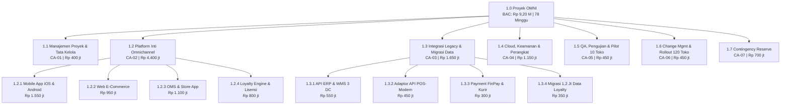

#### WBS Dictionary (Kamus WBS)

Diagram pohon WBS saja tidak cukup untuk mengikat vendor dan tim lintas fungsi, karena label singkat seperti *"1.3.4 Migrasi 1,2 Juta Data Loyalty"* dapat ditafsirkan secara berbeda oleh *Product Owner*, *Solution Architect*, dan vendor. Oleh karena itu, WBS wajib dilengkapi **WBS Dictionary**, yaitu dokumen pendamping yang merinci setiap *Work Package* mencakup:

- **Kode WBS & Kode Control Account:** Identitas pelacakan biaya dan EVM.
- **Deskripsi Pekerjaan (*Statement of Work*):** Batasan rinci apa yang termasuk dan secara eksplisit apa yang dikecualikan.
- **Pemilik (*Responsible Organization / Owner*):** Pihak tunggal yang bertanggung jawab mengeksekusi paket kerja.
- **Kriteria Penerimaan (*Acceptance Criteria*):** Standar kuantitatif agar keluaran sah dinyatakan selesai (*Definition of Done*).
- **Asumsi, Ketergantungan, Sumber Daya, Estimasi Biaya, dan Referensi Kontrak:** Vital untuk mencegah sengketa *Change Request* dengan vendor *Fixed Price*.

---

### 5.2 Activity Sequencing & Dependency Management

Setelah *Work Package* ditetapkan dalam WBS, langkah berikutnya adalah memecah setiap *Work Package* menjadi aktivitas jadwal (*Schedule Activities*) dan menyusun urutan logisnya menggunakan **Precedence Diagramming Method (PDM)** — metode jaringan berbasis *Activity-on-Node* (AON) yang menjadi standar di perangkat penjadwalan modern seperti MS Project, Primavera P6, dan Jira Plans.

#### Empat Tipe Relasi Logis PDM

| Tipe Relasi | Kepanjangan | Logika Ketergantungan | Contoh Nyata di Proyek OMNI |
|-------------|-------------|-----------------------|-----------------------------|
| **FS** *(paling umum, ±90% jaringan)* | *Finish-to-Start* | Aktivitas B **tidak dapat dimulai** sebelum Aktivitas A **selesai**. | Pengujian *Pilot 10 Toko* tidak dapat dimulai sebelum *SIT, UAT & PenTest UU PDP* dinyatakan lulus. |
| **SS** | *Start-to-Start* | Aktivitas B **tidak dapat dimulai** sebelum Aktivitas A **dimulai** (memungkinkan kerja paralel). | Penulisan *test script* QA dapat dimulai setelah pengembangan modul *OMS* dimulai (misalnya `SS + 2 minggu`). |
| **FF** | *Finish-to-Finish* | Aktivitas B **tidak dapat diselesaikan** sebelum Aktivitas A **selesai**. | Finalisasi dokumentasi SOP operasional *Click & Collect* tidak dapat dinyatakan selesai sebelum konfigurasi final *Store Fulfillment App* selesai. |
| **SF** *(sangat jarang)* | *Start-to-Finish* | Aktivitas B **tidak dapat diselesaikan** sebelum Aktivitas A **dimulai**. | Operasional situs e-commerce lama (2019) tidak dapat dimatikan (*decommission*) sebelum platform OMNI baru mulai beroperasi melayani transaksi produksi. |

#### Empat Kategori Ketergantungan (*Dependency Determination*)

Senior Project Manager harus membedakan ketergantungan berdasarkan **sifat keharusan** dan **sumber kendali** karena kedua dimensi ini menentukan ruang manuver saat melakukan *schedule compression*:

1. **Mandatory Dependencies (*Hard Logic*):** Keharusan fisik, teknis, atau kontraktual yang tidak dapat dilanggar. Contoh: pengujian *Load Test 2.500 TPM* tidak dapat dijalankan sebelum kode aplikasi terpasang di lingkungan *Staging* yang setara produksi. *Hard logic* **tidak dapat di-fast-track** secara paksa.
2. **Discretionary Dependencies (*Soft Logic / Preferred Logic*):** Urutan yang dipilih berdasarkan praktik terbaik (*best practice*) atau preferensi tim untuk menekan risiko, meskipun secara teknis bisa dikerjakan paralel. Contoh: menyelesaikan seluruh desain UI 100% sebelum memulai pembangunan API *backend*. *Soft logic* adalah kandidat utama saat tim mempertimbangkan **Fast Tracking**.
3. **External Dependencies:** Ketergantungan antara aktivitas proyek dan pihak/proyek di luar kendali langsung PM. Contoh: ketersediaan rilis API dari proyek paralel **POS-Modern** (Risiko R-01) atau sertifikasi keamanan PCI-DSS dari **PT FinPay Nusantara**. Ketergantungan eksternal wajib dikelola lewat *interface agreement*, *buffer* jadwal, dan eskalasi tingkat program.
4. **Internal Dependencies:** Ketergantungan antar-aktivitas yang berada sepenuhnya di dalam kendali tim proyek OMNI. Contoh: penyelesaian *Product Backlog* awal sebelum Sprint 1 dimulai.

#### Lead dan Lag

- **Lead (`−`):** Percepatan aktivitas penerus (*successor*) sehingga tumpang tindih dengan aktivitas pendahulu (*predecessor*). Ditulis misalnya **`FS − 2 minggu`** (aktivitas B dimulai 2 minggu sebelum aktivitas A selesai). *Lead* mencerminkan penerapan *Fast Tracking* dan harus diikuti mitigasi risiko *rework*.
- **Lag (`+`):** Penundaan wajib (*waiting time*) antara pendahulu dan penerus tanpa memerlukan tambahan sumber daya. Ditulis misalnya **`FS + 1 minggu`** (jeda 1 minggu setelah migrasi data untuk periode stabilisasi atau menunggu pengiriman fisik tablet ke luar Jawa). *Lag* wajib didokumentasikan alasannya agar tidak disalahartikan sebagai *padding* tersembunyi.

---

### 5.3 Duration & Effort Estimation serta Analisis PERT

Salah satu kesalahan paling fatal dalam penjadwalan adalah mencampuradukkan **Effort** (upaya kerja dalam *person-hours* atau *person-days*) dengan **Duration** (durasi kalender dalam hari atau minggu kerja). Suatu paket kerja dengan *effort* 160 *person-hours* yang dikerjakan 2 insinyur penuh waktu (40 jam/minggu) memerlukan *duration* 2 minggu kerja. Namun hukum **Brooks's Law** mengingatkan bahwa menambah orang pada pekerjaan perangkat lunak yang kompleks tidak selalu memotong durasi secara linear akibat beban komunikasi dan kurva belajar (*ramp-up*).

#### Empat Teknik Estimasi Utama

| Teknik Estimasi | Cara Kerja | Keunggulan | Kelemahan & Kapan Dipakai |
|-----------------|------------|------------|---------------------------|
| **Analogous Estimating** (*Top-Down*) | Menggunakan data historis proyek serupa sebagai pembanding durasi/biaya. | Sangat cepat dan murah. | Akurasi rendah (±25%–50%). Dipakai pada fase inisiasi / *Project Charter* ketika detail teknis belum tersedia. |
| **Parametric Estimating** | Menggunakan model statistik atau rasio produktivitas historis (misalnya 12 jam konfigurasi per toko × 120 toko = 1.440 jam). | Objektif, terukur, dan cepat diskalakan. | Bergantung pada validitas data historis dan asumsi linearitas. Ideal untuk aktivitas berulang seperti *rollout* toko atau migrasi SKU. |
| **Bottom-Up Estimating** | Mengestimasi setiap *Work Package* / aktivitas di level paling detail lalu menjumlahkannya ke atas (*roll-up*). | Akurasi paling tinggi dan membangun komitmen tim pelaksana. | Memakan waktu dan biaya perencanaan besar. Wajib dipakai saat menetapkan *Schedule & Cost Baseline* di M2. |
| **Three-Point Estimating (PERT)** | Mengakomodasi ketidakpastian dengan 3 skenario: *Optimistic* (`O`), *Most Likely* (`M`), dan *Pessimistic* (`P`). | Menangkap risiko ekor (*tail risk*) dan menghasilkan probabilitas penyelesaian terukur. | Membutuhkan keahlian memfasilitasi estimasi jujur agar bebas *optimism bias*. Ideal untuk pekerjaan berisiko tinggi (integrasi *legacy*, migrasi data kotor). |

#### Formula Matematis PERT (*Beta Distribution*)

Pada *Program Evaluation and Review Technique* (PERT) berbasis distribusi Beta (lebih realistis daripada distribusi segitiga `(O + M + P) / 3` karena memberi bobot 4× pada skenario paling mungkin `M`):

```text
Expected Duration (tE)     = (O + 4M + P) / 6
Standar Deviasi (σ)        = (P − O) / 6
Varians (σ²)               = [(P − O) / 6]²

Agregasi Jalur Berurutan (n aktivitas independen):
tE_jalur                   = Σ tE_i
σ²_jalur                   = Σ σ²_i        (PERHATIAN: jumlahkan VARIANS, BUKAN standar deviasi!)
σ_jalur                    = √(Σ σ²_i)

Z-Score untuk Target Durasi (T):
Z                          = (T − tE_jalur) / σ_jalur
```

**Interval Kepercayaan Distribusi Normal (Aturan Empiris):**
- **`tE ± 1σ`** → Tingkat kepercayaan **68,26%** (sering dibulatkan **68%**).
- **`tE ± 2σ`** → Tingkat kepercayaan **95,44%** (sering dibulatkan **95%**).
- **`tE ± 3σ`** → Tingkat kepercayaan **99,73%** (sering dibulatkan **99,7%**).

**Tabel Referensi Cepat Probabilitas Kumulatif Distribusi Normal `P(Durasi ≤ T)`:**

| Nilai `Z` | Probabilitas `P(≤ T)` | Makna Manajerial bagi Senior PM |
|-----------|-----------------------|---------------------------------|
| `−2,00` | **2,28%** | Target hampir mustahil tercapai tanpa perubahan lingkup atau *crashing* besar |
| `−1,00` | **15,87%** | Risiko keterlambatan sangat tinggi (~84% peluang meleset) |
| `−0,67` | **25,25%** | Hanya 1 dari 4 peluang tepat waktu; tidak layak dijadikan komitmen eksekutif |
| `−0,50` | **30,85%** | Peluang gagal masih dominan (~69%) |
| `0,00` | **50,00%** | Taruhan koin 50:50 — titik *expected value* `tE`, belum memiliki *schedule buffer* |
| `+0,50` | **69,15%** | Mulai moderat, cocok untuk target internal tim |
| `+1,00` | **84,13%** | Zona sehat untuk komitmen *milestone* operasional |
| `+1,65` | **95,05%** | Zona komitmen tinggi untuk tenggat kontraktual / *regulatory* |
| `+2,00` | **97,72%** | Kepastian sangat tinggi (cadangan `+2σ`) |

#### Contoh Hitungan Bertahap PERT: Modul Integrasi Payment Gateway FinPay

Misalkan paket kerja integrasi *Payment Gateway* terdiri dari 3 sub-aktivitas berurutan (dalam **hari kerja**):

| Kode | Sub-Aktivitas | `O` | `M` | `P` | `tE = (O+4M+P)/6` | `σ = (P−O)/6` | `σ² = σ²` |
|------|---------------|-----|-----|-----|-------------------|---------------|-----------|
| **P1** | Desain Kontrak API & Keamanan PCI-DSS | 2 | 4 | 6 | `(2+16+6)/6 = 4,00` | `(6−2)/6 = 0,67` | `0,4444` |
| **P2** | Pengembangan & *Sandbox Testing* | 5 | 6 | 13 | `(5+24+13)/6 = 7,00` | `(13−5)/6 = 1,33` | `1,7778` |
| **P3** | Sertifikasi & Uji *Failover* FinPay | 3 | 4 | 11 | `(3+16+11)/6 = 5,00` | `(11−3)/6 = 1,33` | `1,7778` |
| **TOTAL** | **Jalur Integrasi FinPay** | — | — | — | **16,00 hari** | **√4,0000 = 2,00 hari** | **4,0000** |

**Interpretasi Bertahap:**
1. **Durasi Ekspektasi Total (`tE_total`):** `4,00 + 7,00 + 5,00 = 16,00 hari`.
2. **Varians & Standar Deviasi Jalur:** `σ²_total = 0,4444 + 1,7778 + 1,7778 = 4,0000`, sehingga `σ_total = √4,0000 = 2,00 hari`. *(Perhatikan: jika Anda keliru menjumlahkan `σ` secara langsung `0,67 + 1,33 + 1,33 = 3,33`, Anda melebih-lebihkan ketidakpastian karena mengasumsikan seluruh risiko terburuk terjadi serentak!)*
3. **Rentang Interval Kepercayaan:**
   - **68,26% (`±1σ`):** `16 − 2` s.d. `16 + 2` = **14,0 – 18,0 hari**.
   - **95,44% (`±2σ`):** `16 − 4` s.d. `16 + 4` = **12,0 – 20,0 hari**.
   - **99,73% (`±3σ`):** `16 − 6` s.d. `16 + 6` = **10,0 – 22,0 hari**.
4. **Probabilitas Selesai pada Target Tertentu:**
   - Jika Sponsor menuntut selesai dalam **15 hari**: `Z = (15 − 16) / 2 = −0,50` → probabilitas hanya **30,85%** (berisiko tinggi!).
   - Jika PM memasang komitmen **18 hari** (memasukkan *buffer* `+1σ`): `Z = (18 − 16) / 2 = +1,00` → probabilitas meningkat menjadi **84,13%**.
   - Jika ditetapkan **20 hari** (`+2σ`): `Z = (20 − 16) / 2 = +2,00` → probabilitas **97,72%**.

---

### 5.4 Critical Path Method (CPM): Forward Pass, Backward Pass, dan Float

**Critical Path Method (CPM)** adalah teknik analisis jaringan deterministik untuk menentukan durasi minimum proyek dan mengidentifikasi jalur aktivitas yang memiliki fleksibilitas jadwal nol (**Jalur Kritis / *Critical Path***). Setiap keterlambatan sekecil apa pun pada aktivitas di Jalur Kritis akan langsung menunda tanggal penyelesaian seluruh proyek.

> **Konvensi Penomoran Waktu dalam Modul Ini (*Zero-Based Indexing*):**
> Untuk menghindari kesalahan selisih satu satuan (*off-by-one error*), seluruh perhitungan CPM dalam buku ini menggunakan **Konvensi Mulai = 0 (*Week 0 / Day 0 Convention*)** di mana angka `0` berarti "awal Minggu ke-1" dan angka `16` berarti "akhir Minggu ke-16". Rumus menjadi sangat bersih:
> - **Forward Pass:** `ES = max(EF semua pendahulu)` *(atau `0` jika tanpa pendahulu)*; `EF = ES + D`
> - **Backward Pass:** `LF = min(LS semua penerus)` *(atau `Durasi Proyek` jika aktivitas terakhir)*; `LS = LF − D`
> - **Total Float (`TF`):** `TF = LS − ES = LF − EF` *(kelonggaran total aktivitas sebelum menunda akhir proyek)*
> - **Free Float (`FF`):** `FF = min(ES semua penerus langsung) − EF` *(kelonggaran aktivitas sebelum menunda Early Start aktivitas penerus langsungnya)*
>
> *(Catatan perbandingan: beberapa buku ajar lama memakai Konvensi Mulai = 1 di mana `EF = ES + D − 1` dan `LS = LF − D + 1`. Nilai `TF`, `FF`, durasi proyek, dan Jalur Kritis tetap 100% identik di kedua konvensi; yang penting adalah konsistensi!)*

#### Perbedaan Kritis: Total Float (`TF`) vs Free Float (`FF`) & Near-Critical Path

- **Total Float (`TF`):** Waktu maksimum sebuah aktivitas boleh tertunda tanpa menunda **tanggal selesai proyek** (atau *milestone* eksternal yang mengikat). Perlu diingat: `TF` sering kali **dimiliki bersama (*shared*) oleh seluruh aktivitas pada cabang non-kritis yang sama**. Jika aktivitas pertama di cabang tersebut menghabiskan seluruh `TF`, aktivitas berikutnya di cabang yang sama kehilangan seluruh kelonggarannya!
- **Free Float (`FF`):** Waktu maksimum sebuah aktivitas boleh tertunda tanpa menunda **`Early Start (ES)` dari aktivitas penerus langsungnya**. Selalu berlaku **`0 ≤ FF ≤ TF`**. Mengetahui `FF` sangat penting untuk koordinasi antar-tim atau antar-vendor: jika `TF = 4` tetapi `FF = 0`, keterlambatan 1 minggu pada vendor A tidak menunda *Go-Live* proyek, tetapi **langsung mengacaukan jadwal mulai (*mobilization*) vendor B** sehingga memicu klaim *idle time*!
- **Near-Critical Path:** Jalur non-kritis yang memiliki `TF` sangat kecil (lazimnya `TF = 1–2 minggu` pada proyek tahunan). Senior PM wajib memantau *Near-Critical Path* nyaris seketat Jalur Kritis, karena sedikit deviasi saja akan mengubahnya menjadi Jalur Kritis baru (*critical path shift*).

#### Contoh Hitungan Bertahap CPM (Jaringan 7 Aktivitas, Konvensi Minggu-0)

Tinjau proyek pengembangan modul integrasi (durasi dalam **minggu**):

| ID | Aktivitas | Pendahulu | Durasi (`D`) | `ES` | `EF` | `LS` | `LF` | `TF` | `FF` | Status |
|----|-----------|-----------|--------------|------|------|------|------|------|------|--------|
| **A** | Inisiasi & Desain | — | 2 | 0 | 2 | 0 | 2 | **0** | **0** | **Kritis** |
| **B** | Modul Inti *Backend* | A | 6 | 2 | 8 | 2 | 8 | **0** | **0** | **Kritis** |
| **C** | Desain UI & Aset | A | 3 | 2 | 5 | 6 | 9 | **4** | **0** | Non-Kritis (`TF > FF`) |
| **D** | Integrasi API *Legacy* | B | 5 | 8 | 13 | 8 | 13 | **0** | **0** | **Kritis** |
| **E** | Pengembangan *Frontend* | C | 4 | 5 | 9 | 9 | 13 | **4** | **4** | Non-Kritis |
| **F** | Automasi Pengujian | B | 4 | 8 | 12 | 9 | 13 | **1** | **1** | **Near-Critical** |
| **G** | UAT & *Deployment* | D, E, F | 3 | 13 | 16 | 13 | 16 | **0** | **0** | **Kritis** |

**Verifikasi Langkah demi Langkah:**
1. **Forward Pass (kiri ke kanan, ambil `max` pada titik gabung / *merge node*):**
   - `A`: `ES = 0`, `EF = 0 + 2 = 2`.
   - `B`: `ES = EF(A) = 2`, `EF = 2 + 6 = 8`.
   - `C`: `ES = EF(A) = 2`, `EF = 2 + 3 = 5`.
   - `D`: `ES = EF(B) = 8`, `EF = 8 + 5 = 13`.
   - `E`: `ES = EF(C) = 5`, `EF = 5 + 4 = 9`.
   - `F`: `ES = EF(B) = 8`, `EF = 8 + 4 = 12`.
   - `G` (*merge node* dari D, E, F): `ES = max(13, 9, 12) = 13`, `EF = 13 + 3 = 16`. **Durasi Proyek = 16 minggu.**
2. **Backward Pass (kanan ke kiri, ambil `min` pada titik pecah / *burst node*):**
   - `G`: `LF = 16`, `LS = 16 − 3 = 13`.
   - `D`, `E`, `F` (semua hanya menuju G): `LF = LS(G) = 13` → `LS(D) = 8`, `LS(E) = 9`, `LS(F) = 9`.
   - `C` (menuju E): `LF = LS(E) = 9`, `LS = 9 − 3 = 6`.
   - `B` (*burst node* menuju D dan F): `LF = min(LS(D)=8, LS(F)=9) = 8`, `LS = 8 − 6 = 2`.
   - `A` (*burst node* menuju B dan C): `LF = min(LS(B)=2, LS(C)=6) = 2`, `LS = 2 − 2 = 0`.
3. **Analisis Float & Jalur:**
   - **Jalur Kritis (`TF = 0`):** **`A → B → D → G`** = `2 + 6 + 5 + 3 = 16 minggu`.
   - **Near-Critical Path (`TF = 1`):** **`A → B → F → G`** = `2 + 6 + 4 + 3 = 15 minggu`.
   - **Pelajaran Kunci `TF` vs `FF` pada Aktivitas C:** Aktivitas `C` memiliki `TF = 6 − 2 = 4 minggu`, tetapi **`FF = ES(E) − EF(C) = 5 − 5 = 0 minggu`**! Artinya, jika tim desain UI terlambat 1 minggu menyelesaikan `C`, *Go-Live* proyek di minggu ke-16 memang belum bergeser, tetapi tim *Frontend* (`E`) **langsung tertahan 1 minggu** dan sisa *float* bersama cabang `C–E` langsung menyusut dari 4 menjadi 3 minggu.

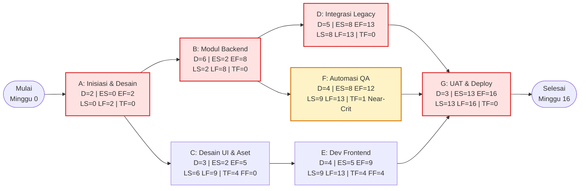

---

### 5.5 Schedule Compression & Resource Optimization

Ketika tenggat mutlak (*hard deadline*) terancam — baik sejak awal perencanaan maupun akibat keterlambatan saat eksekusi — Senior Project Manager tidak boleh sekadar menyuruh tim "bekerja lebih keras". Diperlukan dua keluarga teknik terstruktur: **Schedule Compression** (mempersingkat jadwal tanpa mengurangi ruang lingkup) dan **Resource Optimization** (menyeimbangkan beban sumber daya).

#### Crashing vs Fast Tracking

| Dimensi | **Crashing** | **Fast Tracking** |
|---------|--------------|-------------------|
| **Mekanisme** | Menambahkan sumber daya (lembur, tim paralel, subkontraktor tambahan, perangkat lebih cepat) pada aktivitas di **Jalur Kritis** untuk memperpendek durasi. | Menjalankan aktivitas/fase yang semula berurutan (*FS*) secara **tumpang tindih/paralel** (*SS* atau *FS dengan Lead*). |
| **Dampak Biaya Langsung** | **Pasti naik** (*trade-off* biaya–waktu yang terukur per minggu). | Biaya langsung awal minimal / Rp 0, tetapi berpotensi memicu **biaya *rework* tinggi** bila asumsi berubah. |
| **Dampak Risiko & Mutu** | Risiko kelelahan tim (*burnout*), beban koordinasi (*Brooks's Law*), dan keterbatasan ketersediaan spesialis. | Risiko **rework**, cacat kualitas, dan gagal uji integrasi meningkat tajam. |
| **Syarat Mutlak** | Hanya efektif pada aktivitas di **Jalur Kritis** yang memiliki batas durasi *crash* (*Crash Duration*) dan *slope* biaya terendah. | Hanya boleh diterapkan pada **Discretionary Dependencies (*soft logic*)** — tidak mungkin pada *hard logic*. |

**Rumus Biaya Percepatan (*Crash Cost Slope*):**

```text
Maksimum Percepatan (Max Crash)  = Durasi Normal (Dn) − Durasi Crash Minimum (Dc)
Crash Cost per Satuan Waktu      = (Biaya Crash [Cc] − Biaya Normal [Cn]) / (Dn − Dc)
```

**Algoritma Crashing Biaya Minimum (Wajib Dikuasai Senior PM):**
1. Identifikasi seluruh jalur dan **Jalur Kritis** saat ini.
2. Pilih aktivitas pada Jalur Kritis dengan **Crash Cost per minggu terendah** yang masih memiliki sisa kapasitas percepatan.
3. Kurangi durasinya **1 satuan waktu demi 1 satuan waktu** (*step-by-step*), lalu **hitung ulang semua jalur**!
4. **PERINGATAN KRUSIAL:** Begitu jalur lain ikut menjadi kritis (*parallel critical paths*), untuk mengurangi 1 minggu berikutnya Anda harus memilih **yang lebih murah** antara:
   - Meng-crash **1 aktivitas bersama** yang berada di semua jalur kritis sekaligus, ATAU
   - Meng-crash **kombinasi aktivitas paralel** (satu di tiap jalur kritis secara serentak).

**Contoh Cepat Menggunakan Jaringan 5.4 (`A–G`, 16 Minggu → Target 13 Minggu):**
Diketahui jalur awal: `P1 (A–B–D–G) = 16 mgg`, `P2 (A–B–F–G) = 15 mgg`, `P3 (A–C–E–G) = 12 mgg`. Data *crash*: `A` (maks 1 mgg, Rp 50 jt/mgg), `B` (maks 2 mgg, Rp 35 jt/mgg), `D` (maks 2 mgg, Rp 20 jt/mgg), `F` (maks 2 mgg, Rp 18 jt/mgg), `G` (maks 1 mgg, Rp 30 jt/mgg).
- **Iterasi 1 (16 → 15 mgg):** Jalur kritis hanya `P1 {A:50, B:35, D:20, G:30}`. Termurah: **Crash `D` 1 mgg (Rp 20 jt)**. Sekarang `P1 = 15` dan `P2 = 15` (**dua jalur kritis paralel!**).
- **Iterasi 2 (15 → 14 mgg):** Harus memangkas `P1` dan `P2` bersamaan. Pilihan: aktivitas bersama `G` (**Rp 30 jt**), aktivitas bersama `B` (Rp 35 jt), aktivitas bersama `A` (Rp 50 jt), atau pasangan `D + F` (`20 + 18 = Rp 38 jt`). Termurah: **Crash `G` 1 mgg (Rp 30 jt)**. Sekarang `P1 = 14`, `P2 = 14` (`G` habis).
- **Iterasi 3 (14 → 13 mgg):** Pilihan tersisa: aktivitas bersama `B` (**Rp 35 jt**), `A` (Rp 50 jt), atau pasangan `D + F` (`20 + 18 = Rp 38 jt`). Termurah: **Crash `B` 1 mgg (Rp 35 jt)**.
- **Total Biaya Percepatan 3 Minggu:** `Rp 20 jt + Rp 30 jt + Rp 35 jt = Rp 85 jt`. *(Bandingkan jika PM ceroboh terus meng-crash `D` saja di iterasi 2 — durasi proyek tidak akan berkurang sama sekali karena tertahan oleh `P2`!)*

#### Resource Leveling vs Resource Smoothing

Saat alokasi SDM diplot ke dalam **Resource Histogram** (grafik batang kebutuhan personel per minggu dibandingkan kapasitas tersedia), sering muncul **overallocation** — misalnya 3 *senior architect* IT SNR dijadwalkan bekerja 150% kapasitas secara bersamaan di Proyek OMNI dan ERP-Refresh.

| Dimensi | **Resource Leveling** | **Resource Smoothing** |
|---------|-----------------------|------------------------|
| **Tujuan** | Menghilangkan *overallocation* ketika sumber daya terbatas (*resource-constrained*) dan tidak bisa ditambah. | Meratakan fluktuasi puncak dan lembah beban kerja agar utilisasi lebih stabil. |
| **Dampak pada Jalur Kritis & Tanggal Selesai** | **Dapat mengubah Jalur Kritis** dan sering kali **memperpanjang durasi proyek**. | **Tidak boleh mengubah Jalur Kritis** maupun menunda tanggal selesai proyek. |
| **Batasan Pergeseran** | Boleh menggeser aktivitas melewati *Total Float*-nya bila perlu. | Aktivitas hanya boleh digeser **di dalam batas *Free Float* dan *Total Float*** yang tersedia. |
| **Contoh di Proyek OMNI** | Jika hanya ada 1 *Lead Solution Architect* (Dimas Prasetyo) untuk desain OMS dan desain API ERP-Refresh secara bersamaan, keduanya harus diurutkan (*leveled*) meski menambah durasi bila tidak dibantu arsitek tambahan. | Menggeser jadwal pelatihan awal toko non-kritis (`A12`, `TF = 4 mgg`) dalam batas *float*-nya agar beban tim *Change Management* tidak menumpuk di satu minggu yang sama dengan persiapan Pilot. |

---

### 5.6 Resource Allocation, Matriks RACI, dan Milestone Management

Jadwal yang sempurna di atas kertas akan lumpuh jika peran eksekusi kabur dan pencapaian antar-tahap tidak dipantau secara ketat. Dua instrumen tata kelola eksekusi yang wajib dipegang Senior PM adalah **Matriks RACI** dan **Milestone Trend Analysis (MTA)**.

#### Matriks RACI (*Responsibility Assignment Matrix*)

Matriks RACI memetakan setiap *deliverable* atau *Work Package* penting terhadap peran pemangku kepentingan:
- **R — Responsible (Pelaksana):** Pihak yang benar-benar mengerjakan dan menghasilkan *deliverable*. Minimal harus ada **satu `R`** pada setiap baris (boleh lebih dari satu jika dikerjakan lintas tim, namun tetap jelas pembagiannya).
- **A — Accountable (Penanggung Jawab Akhir / Pemilik Keputusan):** Pihak yang memiliki otoritas menyetujui (*sign-off*) keluaran dan memikul tanggung jawab akhir atas keberhasilan atau kegagalannya. **ATURAN EMAS MUTLAK: Setiap baris WAJIB memiliki TEPAT SATU `A`!** Nol `A` menciptakan kekosongan kepemilikan (*orphan deliverable*), sedangkan dua atau lebih `A` memicu kebuntuan keputusan (*diffusion of responsibility*: *"jika semua orang accountable, berarti tidak ada seorang pun yang accountable"*).
- **C — Consulted (Dikonsultasikan — Komunikasi Dua Arah):** Pakar atau pemilik fungsi yang masukannya wajib diminta **sebelum** keputusan diambil atau keluaran difinalisasi (contoh: Legal/InfoSec dikonsultasikan pada desain enkripsi UU PDP).
- **I — Informed (Diinformasikan — Komunikasi Satu Arah):** Pihak yang diberi tahu mengenai progres atau keputusan setelah terjadi agar tetap selaras tanpa memperlambat eksekusi.

**Pengecekan Kesehatan Matriks RACI (Audit Vertikal & Horizontal):**
- *Audit Horizontal (per baris):* Pastikan tepat 1 `A`, minimal 1 `R`, tidak penuh `C` (terlalu banyak pihak yang harus dimintai persetujuan akan melumpuhkan kecepatan), dan tidak penuh `I` tanpa pelaksana.
- *Audit Vertikal (per kolom/orang):* Pastikan tidak ada satu tokoh pun yang dibebani terlalu banyak `A` atau `R` secara bersamaan (*single point of failure / bottleneck* organisasi), dan tidak ada kolom yang seluruhnya kosong.

#### Milestone Management & Milestone Trend Analysis (MTA)

**Milestone** adalah titik peristiwa signifikan berdurasi **nol (`D = 0`)** yang menandai penyelesaian fase, persetujuan *Stage-Gate*, atau serah terima ketergantungan lintas proyek (misalnya M0 s.d. M8 pada Proyek OMNI).

**Milestone Trend Analysis (MTA)** adalah teknik visual sederhana namun sangat kuat untuk mendeteksi tren pergeseran jadwal (*slippage*) sejak dini. Pada grafik MTA, sumbu horizontal mencatat **tanggal pelaporan (*reporting date*)** dan sumbu vertikal mencatat **perkiraan tanggal tercapainya milestone (*forecast milestone date*)**:
- **Garis datar (horizontal):** *Milestone* stabil sesuai rencana (*on track*).
- **Garis menanjak (*upward slope*):** Sinyal peringatan dini terjadinya *schedule slippage* yang makin memburuk dari bulan ke bulan — menuntut intervensi *corrective action* segera, bukan menunggu tanggal jatuh tempo tiba.
- **Garis menurun (*downward slope*):** Terjadi percepatan jadwal (misalnya hasil *crashing* yang berhasil).

---

### 5.7 Execution Control: Rolling Wave Planning dan Pengendalian Slippage

Rencana induk (*Project Management Plan*) bukan dokumen mati yang disimpan di laci setelah *kick-off*. Senior PM mengelola ketidakpastian proyek jangka panjang melalui dua mekanisme eksekusi yang saling melengkapi: **Rolling Wave Planning** dan siklus **Work Performance Data → Information → Reports**.

#### Rolling Wave Planning (Perencanaan Gelombang Bergulir)

Pada proyek 18 bulan berpendekatan *hybrid* seperti Proyek OMNI, mustahil dan kontraproduktif merinci aktivitas harian untuk *Wave Rollout* Gelombang 3 (bulan ke-16) saat proyek baru memasuki bulan ke-2. **Rolling Wave Planning** adalah bentuk *progressive elaboration* di mana:
- Pekerjaan **jangka pendek** (misalnya 2–3 bulan ke depan atau 2–3 Sprint mendatang) diuraikan secara detail hingga level *Work Package*, *User Story*, dan aktivitas harian/mingguan.
- Pekerjaan **jangka panjang** (fase mendatang) dipertahankan pada level tinggi sebagai **Planning Package** di WBS, lalu dirinci secara bertahap seiring waktu bergulir dan informasi baru terkumpul (misalnya hasil evaluasi *Pilot 10 Toko* langsung dipakai menyempurnakan rencana detail *Gelombang 1–3*).

#### Alur Data Kinerja ke Keputusan Eksekutif (WPD → WPI → WPR)

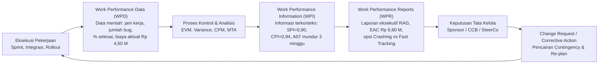

1. **Work Performance Data (WPD):** Pengamatan dan pengukuran mentah saat eksekusi berlangsung (contoh: tanggal selesai riil Sprint 10, biaya faktur vendor terbayar `AC = Rp 4,60 M`, 42% data loyalty masih duplikat).
2. **Work Performance Information (WPI):** Data mentah yang telah dianalisis terhadap *baseline* sehingga bermakna (contoh: `SV = −Rp 0,48 M`, `SPI = 0,90`, `CPI = 0,94`, keterlambatan API POS-Modern mendorong Jalur Kritis dari Minggu 78 ke Minggu 81).
3. **Work Performance Reports (WPR):** Representasi fisik/elektronik dari WPI dalam bentuk dasbor status, analisis tren, dan rekomendasi keputusan untuk Sponsor dan *Steering Committee* — menjadi pemicu resmi **Corrective Action** (memperbaiki kinerja yang sudah menyimpang), **Preventive Action** (mencegah penyimpangan yang diperkirakan terjadi), atau **Defect Repair**.

#### Protokol 5 Langkah Mengatasi Schedule Slippage Saat Eksekusi

Ketika *schedule slippage* terdeteksi (misalnya SPI turun ke `0,90` pada Bulan ke-9 Proyek OMNI), Senior PM menjalankan protokol disiplin berikut:
1. **Isolasi Akar Masalah (*Root Cause*):** Bedakan apakah keterlambatan berasal dari *Critical Path*, *Near-Critical Path*, atau jalur non-kritis yang masih punya *float*.
2. **Perbarui Jaringan & Hitung Dampak Riil:** Masukkan *actuals* dan estimasi sisa durasi (*Estimate to Complete*) yang jujur ke model CPM untuk mengetahui proyeksi tanggal selesai terbaru.
3. **Evaluasi Tuas Pemulihan Berurutan:** (a) Eliminasi hambatan (*remove impediments*) dan eskalasi dependensi eksternal; (b) Evaluasi *Fast Tracking* terbatas pada *soft logic* berisiko rendah; (c) Hitung opsi *Crashing* biaya terendah; (d) Hanya jika ketiga tuas di atas gagal, ajukan opsi *descoping* terukur (*MoSCoW* — menunda fitur *Should/Could-Have* ke Fase 2) melalui *Change Control Board* (CCB).
4. **Hitung Dampak Biaya & Cadangan:** Pastikan sumber pendanaan jelas (apakah terserap *Contingency Reserve* di bawah otoritas PM/Sponsor atau membutuhkan *Management Reserve* dari CFO/SteerCo).
5. **Kunci *Recovery Plan* & Pantau Mingguan:** Tetapkan indikator kemajuan mingguan (*inchstones*) agar keterlambatan tidak berulang secara diam-diam.

---

### 5.8 Kesalahan Umum di Lapangan (*Anti-Patterns*)

Seorang Senior Project Manager dikenali dari kemampuannya mencegah jebakan perencanaan dan eksekusi berikut sebelum terjadi:

1. **WBS Berbasis Struktur Departemen, Bukan *Deliverable*:** Membagi WBS menjadi *"1.1 Tim IT, 1.2 Tim Marketing, 1.3 Tim Operasional"* menyebabkan tidak jelasnya keluaran akhir yang terintegrasi, memicu saling lempar tanggung jawab pada integrasi lintas fungsi, dan menyulitkan pengukuran *Earned Value*.
2. **Ilusi Kepastian Tunggal (*Single-Point Estimation Bias*):** Melaporkan kepada Direksi *"migrasi data butuh 20 minggu"* tanpa mengungkap ketidakpastian `σ` atau skenario pesimistis `P`. Ketika realitas bergeser ke 26 minggu, PM dianggap gagal mengelola jadwal, padahal sejak awal probabilitas selesai dalam 20 minggu mungkin di bawah 30%.
3. **Sindrom Pelajar (*Student Syndrome*) & Hukum Parkinson (*Parkinson's Law*):** Ketika *padding* (cadangan tersembunyi) diselipkan diam-diam di setiap aktivitas, tim cenderung menunda mulai bekerja hingga mepet tenggat (*Student Syndrome*) atau pekerjaan otomatis membesar mengisi seluruh waktu yang tersedia (*Parkinson's Law*). Solusi senior: gunakan estimasi realistis tanpa *padding* tersembunyi, lalu konsolidasikan cadangan secara transparan pada *Contingency Reserve* dan *Project Buffer*.
4. **Meng-crash Aktivitas Non-Kritis:** Menyetujui lembur mahal atau penambahan tenaga pada aktivitas yang memiliki *Total Float > 0*. Biaya proyek langsung membengkak, namun tanggal selesai proyek **tidak maju satu hari pun**.
5. **Fast Tracking Membuta pada *Hard Logic*:** Memaksa pengujian UAT atau *rollout* toko berjalan sebelum integrasi inti dan kepatuhan UU PDP stabil demi tampak "tetap sesuai jadwal" di laporan bulanan. Akibatnya terjadi ledakan cacat produksi, *rework* berlipat ganda, dan penundaan jauh lebih parah di ujung proyek.
6. **RACI Tanpa `A` Tunggal (*Multiple Accountables*):** Menempatkan dua atau tiga direktur sebagai `A` pada satu *deliverable* strategis (misalnya *"Persetujuan Go-Live"* diberi `A` untuk COO, CTO, dan Legal sekaligus). Saat terjadi konflik prioritas, keputusan membeku. Seharusnya hanya satu `A` (misalnya Sponsor/COO), sementara Legal dan CTO berperan `C` dengan hak persyaratan kelulusan (*gate criteria*) yang jelas.
7. **Sindrom Laporan Semangka (*Watermelon Reporting*):** Laporan status proyek tampak "hijau" di luar setiap bulan karena memakai estimasi subjektif (*"sekitar 80% selesai"*), padahal di dalamnya "merah pekat" karena aktivitas jalur kritis diam-diam meleset berminggu-minggu. Obat utamanya adalah *WPD → WPI* berbasis bukti keluaran objektif (*binary completion* atau *milestone* terverifikasi) serta pemantauan MTA.

---

## 6. Studi Kasus: Penerapan pada Proyek OMNI

Pada bagian ini, seluruh kerangka perencanaan dan pengendalian eksekusi dari Bagian 5 diterapkan secara utuh dan terverifikasi secara matematis pada **PT Sinar Nusantara Retail Tbk (SNR) — Proyek OMNI** yang dipimpin oleh Senior Project Manager **Fajar Nugroho**.

### 6.1 WBS 4-Level Proyek OMNI (100% Rule = BAC Rp 9,20 M) & WBS Dictionary

Struktur WBS Proyek OMNI dirancang berbasis *deliverable* dalam **7 Control Account (CA-01 s.d. CA-07)** dan **21 Work Package** yang memetakan 100% ruang lingkup *in-scope* serta cocok **persis 100%** dengan rincian komponen anggaran `CB-01` s.d. `CB-06` (`00-studi-kasus-utama.md`), menghasilkan total **BAC = Rp 9.200 jt (Rp 9,20 M)**.

| Kode WBS | Level | Elemen WBS (*Deliverable-Oriented*) | Kode Biaya (`CB`) | Pemilik Utama | Anggaran (Rp jt) | Porsi BAC |
|----------|-------|-------------------------------------|-------------------|---------------|------------------|-----------|
| **1.0** | **L1** | **Proyek OMNI (Omnichannel, Click & Collect, Digital Loyalty)** | **BAC** | **Fajar Nugroho (Senior PM)** | **9.200** | **100,00%** |
| **1.1** | **L2** | **Manajemen Proyek & Tata Kelola (CA-01)** | **CB-04** | **Fajar Nugroho** | **400** | **4,35%** |
| 1.1.1 | L3 | Project Charter, Arsitektur HLD & Kontrak Vendor PT NDS | CB-04 | Fajar Nugroho / Dimas | 120 | 1,30% |
| 1.1.2 | L3 | PMO Governance, Pengendalian Jadwal, Scrum & EVM | CB-04 | Fajar Nugroho / Tania | 180 | 1,96% |
| 1.1.3 | L3 | Manajemen Risiko, Audit Stage-Gate (G1–G4) & Penutupan | CB-04 | Fajar Nugroho / Antonius | 100 | 1,09% |
| **1.2** | **L2** | **Pengembangan Platform Inti Omnichannel (CA-02)** | **CB-01** | **Bambang Hartono (PT NDS)** | **4.400** | **47,83%** |
| 1.2.1 | L3 | Aplikasi Mobile Pelanggan (iOS & Android) | CB-01 | PT NDS / Kevin Halim | 1.550 | 16,85% |
| 1.2.2 | L3 | Web E-Commerce Responsif & Optimasi SEO | CB-01 | PT NDS / Kevin Halim | 950 | 10,33% |
| 1.2.3 | L3 | Order Management System (OMS) & *Store Fulfillment App* | CB-01 | PT NDS / Dimas Prasetyo | 1.100 | 11,96% |
| 1.2.4 | L3 | Digital Loyalty Engine (Silver/Gold/Platinum) & Lisensi | CB-01 | PT NDS / Dewi Lestari | 800 | 8,70% |
| **1.3** | **L2** | **Integrasi Sistem Legacy & Migrasi Data (CA-03)** | **CB-02** | **Dimas Prasetyo (Lead SA)** | **1.650** | **17,93%** |
| 1.3.1 | L3 | API Middleware & Sinkronisasi ERP / WMS 3 DC (≤ 60 detik) | CB-02 | Dimas / Siti Rahmawati | 550 | 5,98% |
| 1.3.2 | L3 | Adaptor API POS-Modern 120 Toko & Pemindai QR | CB-02 | Dimas / Tim POS-Modern | 450 | 4,89% |
| 1.3.3 | L3 | Integrasi *Payment Gateway* PT FinPay (PCI-DSS) & Kurir | CB-02 | Dimas / PT NDS | 300 | 3,26% |
| 1.3.4 | L3 | *Data Cleansing* & Migrasi 1,2 Juta Data *Sinar Member Card* | CB-02 | Nadia Putri / Tim Data | 350 | 3,80% |
| **1.4** | **L2** | **Infrastruktur Cloud, Keamanan & Perangkat Toko (CA-04)** | **CB-03** | **Irwan Pratama (CTO)** | **1.150** | **12,50%** |
| 1.4.1 | L3 | Lingkungan Cloud Region Jakarta (Dev/Staging/Prod/DR) | CB-03 | Tim Cloud IT SNR | 480 | 5,22% |
| 1.4.2 | L3 | Kepatuhan UU PDP, Enkripsi PII & *Penetration Testing* | CB-03 | Rina Kartika / Auditor Ind. | 250 | 2,72% |
| 1.4.3 | L3 | Pengadaan, Konfigurasi & Distribusi 240 Tablet/Scanner | CB-03 | Procurement / Agus Setiawan | 420 | 4,57% |
| **1.5** | **L2** | **Verifikasi Kualitas, Pengujian & Pilot 10 Toko (CA-05)** | **CB-05** | **Lukas Gunawan (QA Lead)** | **450** | **4,89%** |
| 1.5.1 | L3 | *System Integration Testing* (SIT) & Automasi QA | CB-05 | Lukas Gunawan / PT NDS | 140 | 1,52% |
| 1.5.2 | L3 | *User Acceptance Testing* (UAT) & *Load Test* 2.500 TPM | CB-05 | Lukas / Nadia / Kevin | 160 | 1,74% |
| 1.5.3 | L3 | *Pilot* 10 Toko Jabodetabek & Evaluasi Gate 3 (SLA ≤ 2 jam) | CB-05 | Agus Setiawan / Lukas | 150 | 1,63% |
| **1.6** | **L2** | **Manajemen Perubahan, Pelatihan & Rollout 120 Toko (CA-06)** | **CB-04** | **Agus Setiawan (Store Ops)** | **450** | **4,89%** |
| 1.6.1 | L3 | Desain SOP Omnichannel, Skema Insentif & *Change Mgmt* | CB-04 | Agus / Nadia / Ratna | 150 | 1,63% |
| 1.6.2 | L3 | *Training-of-Trainers* (6 RM, 120 SM) & Pelatihan 1.440 Staf | CB-04 | Agus Setiawan / HRD | 180 | 1,96% |
| 1.6.3 | L3 | *Wave Rollout* Gelombang 1–3 (110 Toko) & *Hypercare* | CB-04 | Fajar / Agus / IT Ops | 120 | 1,30% |
| **1.7** | **L2** | **Cadangan Kontinjensi / *Contingency Reserve* (CA-07)** | **CB-06** | **Fajar Nugroho / Ratna** | **700** | **7,61%** |
| 1.7.1 | L3 | Cadangan Risiko Jadwal & Integrasi (R-01, R-02, R-09) | CB-06 | Fajar Nugroho (via CR) | 450 | 4,89% |
| 1.7.2 | L3 | Cadangan Risiko Kepatuhan, Performa & Vendor (R-05–R-08) | CB-06 | Fajar Nugroho (via CR) | 250 | 2,72% |
| *—* | *Di luar BAC* | ***Management Reserve*** *(Otoritas CFO Budi Santoso & SteerCo)* | *MR* | *Budi Santoso (CFO)* | *600* | *—* |
| **TOTAL** | — | ***Total Project Funding Requirement*** | — | **Steering Committee** | **9.800** | — |

**Verifikasi Rekonsiliasi Komponen Biaya (`CB-01` s.d. `CB-06`):**
- `CB-01` = CA-02 = **Rp 4.400 jt** (Rp 4,40 M) — *cocok 100%*
- `CB-02` = CA-03 = **Rp 1.650 jt** (Rp 1,65 M) — *cocok 100%*
- `CB-03` = CA-04 = **Rp 1.150 jt** (Rp 1,15 M) — *cocok 100%*
- `CB-04` = CA-01 (`400 jt`) + CA-06 (`450 jt`) = **Rp 850 jt** (Rp 0,85 M) — *cocok 100%*
- `CB-05` = CA-05 = **Rp 450 jt** (Rp 0,45 M) — *cocok 100%*
- `CB-06` = CA-07 = **Rp 700 jt** (Rp 0,70 M) — *cocok 100%*
- **Total Cost Baseline (BAC) = Rp 9.200 jt (Rp 9,20 M)** + *Management Reserve* Rp 600 jt = **Rp 9.800 jt (Rp 9,80 M)**.

*(Catatan dekomposisi Level 4: Paket kerja kritis seperti `1.3.4` dipecah lebih lanjut ke Level 4 menjadi `1.3.4.1 Audit & Profiling Data`, `1.3.4.2 Deduplikasi & Cleansing`, `1.3.4.3 Re-verifikasi Kontak & Consent UU PDP`, dan `1.3.4.4 Dry-Run Migrasi & Cutover` yang akan dihitung secara PERT pada Sub-bab 6.3).*

#### Cuplikan WBS Dictionary Proyek OMNI (2 Work Package Kritis)

| Field WBS Dictionary | **WP 1.3.2 — Adaptor API POS-Modern 120 Toko** | **WP 1.3.4 — *Data Cleansing* & Migrasi 1,2 Juta Data Loyalty** |
|----------------------|------------------------------------------------|-----------------------------------------------------------------|
| **Control Account & Kode Biaya** | CA-03 / CB-02 (`Rp 450 jt`) | CA-03 / CB-02 (`Rp 350 jt`) |
| **Pemilik Paket Kerja** | Dimas Prasetyo (*Lead SA*) bersama tim PT NDS | Nadia Putri (*Lead BA*) & Tim Data Internal SNR |
| **Deskripsi In-Scope** | Pembangunan adaptor API sinkronisasi stok toko *near-real-time* (jeda ≤ 60 detik) dan endpoint pemindai QR voucher/poin loyalty antara OMS OMNI dan sistem POS-Modern di 120 toko. | Audit, deduplikasi, normalisasi, re-verifikasi kontak aktif, pencatatan persetujuan (*consent*) sesuai UU PDP, dan migrasi saldo poin 1,2 juta *Sinar Member Card* ke *Digital Loyalty Engine*. |
| **Secara Eksplisit Out-of-Scope** | Penggantian perangkat keras mesin kasir POS 120 toko (lingkup Proyek POS-Modern). | Pembuatan *Enterprise Data Warehouse* & analitik AI lanjutan (lingkup Proyek DataHub). |
| **Ketergantungan Kritis** | **Eksternal:** Rilis kontrak & sandbox API dari Proyek POS-Modern (Risiko R-01). | **Internal:** Finalisasi skema *Digital Loyalty Engine* (WP 1.2.4) & ketentuan *consent* UU PDP dari Rina Kartika (WP 1.4.2). |
| **Kriteria Penerimaan (*Acceptance Criteria*)** | Akurasi stok sinkronisasi ≥ 98,0%; latensi sinkronisasi ≤ 60 detik pada beban 2.500 TPM; 0 *Critical/High bug* di SIT; ditandatangani Irwan Pratama & Lukas Gunawan. | Minimal 800.000 profil terverifikasi siap aktif; tingkat duplikasi < 0,5%; 100% rekonsiliasi saldo poin lolos audit keuangan (Budi Santoso) & kepatuhan UU PDP (Rina Kartika). |

---

### 6.2 Tabel Aktivitas Utama & Analisis CPM 78 Minggu Proyek OMNI

Jaringan jadwal induk Proyek OMNI terdiri dari **17 aktivitas makro (A01–A17)** yang memetakan seluruh fase dari **1 Juni 2026 (Minggu 0 / M0)** hingga **26 November 2027 (Minggu 78 / M8)** menggunakan **Konvensi Minggu-0**.

| ID | Aktivitas Utama & Milestone Terkait | WBS | Pendahulu | Durasi (mgg) | `ES` | `EF` | `LS` | `LF` | `TF` | `FF` | Status Jalur |
|----|-------------------------------------|-----|-----------|--------------|------|------|------|------|------|------|--------------|
| **A01** | Inisiasi, *Charter*, HLD & Kontrak NDS (**M0→M1**: 31 Jul 26) | 1.1.1 | — | 9 | 0 | 9 | 0 | 9 | **0** | **0** | **KRITIS** |
| **A02** | *Scope Baseline*, WBS & *Backlog* Awal (**M1→M2**: 31 Agu 26) | 1.1.2 | A01 | 4 | 9 | 13 | 9 | 13 | **0** | **0** | **KRITIS** |
| **A03** | Setup Cloud Dev/Staging Jakarta & CI/CD | 1.4.1 | A01 | 3 | 9 | 12 | 10 | 13 | **1** | **1** | *Near-Critical* |
| **A04** | Release 1 (S1–S6): Core, OMS MVP & API ERP/WMS (**M3**: 20 Nov 26) | 1.2, 1.3.1 | A02, A03 | 12 | 13 | 25 | 13 | 25 | **0** | **0** | **KRITIS** |
| **A05** | *Data Cleansing* & Migrasi 1,2 Juta Loyalty (**Risiko R-02**) | 1.3.4 | A02 | 22 | 13 | 35 | 15 | 37 | **2** | **2** | *Near-Critical* |
| **A06** | Release 2 (S7–S11): App, Web, FinPay & Loyalty (**M4**: 12 Feb 27) | 1.2, 1.3.3 | A04 | 12 | 25 | 37 | 25 | 37 | **0** | **0** | **KRITIS** |
| **A07** | Release 3 (S12–S14): *Click & Collect* & Adaptor POS (**M5**: 23 Apr 27) | 1.2.3, 1.3.2 | A05, A06 | 10 | 37 | 47 | 37 | 47 | **0** | **0** | **KRITIS** |
| **A08** | Pengadaan & Distribusi 240 Tablet/Scanner (**Risiko R-09**) | 1.4.3 | A06 | 14 | 37 | 51 | 41 | 55 | **4** | **4** | Non-Kritis |
| **A09** | Cloud Production, Enkripsi & Kesiapan UU PDP (**Risiko R-05**) | 1.4.1, 1.4.2 | A04 | 18 | 25 | 43 | 29 | 47 | **4** | **4** | Non-Kritis |
| **A10** | SIT, UAT, *Load Test* 2.500 TPM & *PenTest* UU PDP (18 Jun 27) | 1.5.1, 1.5.2 | A07, A09 | 8 | 47 | 55 | 47 | 55 | **0** | **0** | **KRITIS** |
| **A11** | Penyusunan SOP Omnichannel & Skema Insentif Toko | 1.6.1 | A06 | 6 | 37 | 43 | 41 | 47 | **4** | **0** | Non-Kritis (`TF>FF`) |
| **A12** | *Training-of-Trainers* (6 RM & 120 SM) (**Risiko R-03**) | 1.6.2 | A11 | 8 | 43 | 51 | 47 | 55 | **4** | **4** | Non-Kritis |
| **A13** | *Pilot* 10 Toko Jabodetabek & Evaluasi Gate 3 (**M6**: 16 Jul 27) | 1.5.3 | A08, A10, A12 | 4 | 55 | 59 | 55 | 59 | **0** | **0** | **KRITIS** |
| **A14** | *Wave Rollout* Gelombang 1 — 30 Toko Jawa (20 Agu 27) | 1.6.3 | A13 | 5 | 59 | 64 | 59 | 64 | **0** | **0** | **KRITIS** |
| **A15** | *Wave Rollout* Gelombang 2 — 40 Toko Jawa–Bali–Sumatra (24 Sep 27) | 1.6.3 | A14 | 5 | 64 | 69 | 64 | 69 | **0** | **0** | **KRITIS** |
| **A16** | *Wave Rollout* Gelombang 3 — 40 Toko Nasional (**M7**: 29 Okt 27) | 1.6.3 | A15 | 5 | 69 | 74 | 69 | 74 | **0** | **0** | **KRITIS** |
| **A17** | *Hypercare*, Stabilisasi ≥ 99,5% & *Go-Live* Nasional (**M8**: 26 Nov 27) | 1.6.3, 1.1.3 | A16 | 4 | 74 | 78 | 74 | 78 | **0** | **0** | **KRITIS** |

#### Temuan Strategis dari Analisis Jaringan 78 Minggu Proyek OMNI

1. **Jalur Kritis (11 Aktivitas, Total = 78 Minggu):**
   **`A01 (9) → A02 (4) → A04 (12) → A06 (12) → A07 (10) → A10 (8) → A13 (4) → A14 (5) → A15 (5) → A16 (5) → A17 (4) = 78 minggu`**. Tidak ada satu minggu pun *float* pada rantai ini; keterlambatan 3 minggu pada API POS-Modern di `A07` secara otomatis mendorong `M8` dari Minggu 78 (26 Nov 2027) ke **Minggu 81 (17 Des 2027)** — melewati Harbolnas 12.12!
2. **Dua *Near-Critical Path* Berbahaya:**
   - **`A03` (Cloud Dev/Staging, `TF = 1`):** Penundaan 2 minggu dalam persetujuan *security provisioning* Cloud langsung menunda dimulainya Sprint 1 (`A04`).
   - **`A05` (Migrasi 1,2 Juta Data Loyalty R-02, `TF = 2`):** Jalur ini hanya memiliki bantalan 2 minggu sebelum memblokir `A07`. Itulah mengapa ketika data lama ternyata 2× lebih kotor dari asumsi awal, `A05` langsung menghabiskan seluruh *float*-nya dan memicu keterlambatan pada tinjauan Bulan ke-9!
3. **Kelonggaran Terbagi (*Shared Float*) di Cabang Change Management (`A11 → A12`):** Aktivitas `A11` (SOP & Insentif Toko) memiliki `TF = 4 minggu`, tetapi **`FF = 0 minggu`**. Artinya, negosiasi berlarut-larut dengan **Agus Setiawan** (Head of Store Ops) mengenai insentif toko di `A11` akan langsung menggeser jadwal pelatihan 6 Regional Manager & 120 Store Manager di `A12` yang sudah dipesan jauh hari!

```mermaid
flowchart LR
    A01["A01: Charter & Kontrak<br/>D=9 | 0-9 | TF=0"] --> A02["A02: Baseline & WBS<br/>D=4 | 9-13 | TF=0"]
    A01 --> A03["A03: Cloud Dev/Stg<br/>D=3 | 9-12 | TF=1"]
    A02 --> A04["A04: Release 1 S1-S6<br/>D=12 | 13-25 | TF=0"]
    A03 --> A04
    A02 --> A05["A05: Migrasi Loyalty R-02<br/>D=22 | 13-35 | TF=2"]
    A04 --> A06["A06: Release 2 S7-S11<br/>D=12 | 25-37 | TF=0"]
    A04 --> A09["A09: Cloud Prod & UU PDP<br/>D=18 | 25-43 | TF=4"]
    A05 --> A07["A07: Release 3 & POS API<br/>D=10 | 37-47 | TF=0"]
    A06 --> A07
    A06 --> A08["A08: 240 Tablet R-09<br/>D=14 | 37-51 | TF=4"]
    A06 --> A11["A11: SOP & Insentif<br/>D=6 | 37-43 | TF=4 FF=0"]
    A11 --> A12["A12: ToT 6 RM & 120 SM<br/>D=8 | 43-51 | TF=4"]
    A07 --> A10["A10: SIT, UAT, Load, PenTest<br/>D=8 | 47-55 | TF=0"]
    A09 --> A10
    A08 --> A13["A13: Pilot 10 Toko M6<br/>D=4 | 55-59 | TF=0"]
    A10 --> A13
    A12 --> A13
    A13 --> A14["A14: Wave 1 - 30 Toko<br/>D=5 | 59-64 | TF=0"]
    A14 --> A15["A15: Wave 2 - 40 Toko<br/>D=5 | 64-69 | TF=0"]
    A15 --> A16["A16: Wave 3 - 40 Toko M7<br/>D=5 | 69-74 | TF=0"]
    A16 --> A17["A17: Hypercare & Go-Live M8<br/>D=4 | 74-78 | TF=0"]

    style A01 fill:#fee2e2,stroke:#dc2626,stroke-width:2px
    style A02 fill:#fee2e2,stroke:#dc2626,stroke-width:2px
    style A04 fill:#fee2e2,stroke:#dc2626,stroke-width:2px
    style A06 fill:#fee2e2,stroke:#dc2626,stroke-width:2px
    style A07 fill:#fee2e2,stroke:#dc2626,stroke-width:2px
    style A10 fill:#fee2e2,stroke:#dc2626,stroke-width:2px
    style A13 fill:#fee2e2,stroke:#dc2626,stroke-width:2px
    style A14 fill:#fee2e2,stroke:#dc2626,stroke-width:2px
    style A15 fill:#fee2e2,stroke:#dc2626,stroke-width:2px
    style A16 fill:#fee2e2,stroke:#dc2626,stroke-width:2px
    style A17 fill:#fee2e2,stroke:#dc2626,stroke-width:2px
    style A03 fill:#fef3c7,stroke:#d97706,stroke-width:2px
    style A05 fill:#fef3c7,stroke:#d97706,stroke-width:2px
```

---

### 6.3 Analisis PERT pada Paket Kerja Migrasi Data Loyalty (Risiko R-02)

Pada baseline awal, aktivitas **A05 (WP 1.3.4: Migrasi 1,2 Juta Data *Sinar Member Card*)** dialokasikan durasi **22 minggu** (ES = 13, EF = 35, LF = 37, TF = 2 minggu). Namun temuan audit awal bersama **Nadia Putri** (*Lead BA*) dan tim IT menunjukkan ±62% data kontak usang/duplikat lintas 120 toko dan format nomor telepon tidak konsisten. Fajar Nugroho memfasilitasi estimasi **Three-Point (PERT)** pada 4 sub-paket Level 4 yang berjalan berurutan (satuan: **minggu**):

| Kode | Sub-Paket Kerja (Level 4 dari WP 1.3.4) | `O` | `M` | `P` | `tE = (O+4M+P)/6` | `σ = (P−O)/6` | `σ² = σ²` |
|------|-----------------------------------------|-----|-----|-----|-------------------|---------------|-----------|
| **L1** | Audit & *Profiling* 1,2 Juta Data *Sinar Member Card* | 1 | 3 | 5 | `(1+12+5)/6 = 3,00` | `(5−1)/6 = 0,67` | `0,4444` |
| **L2** | Deduplikasi & *Data Cleansing* (62% Data Usang) | 5 | 8 | 17 | `(5+32+17)/6 = 9,00` | `(17−5)/6 = 2,00` | `4,0000` |
| **L3** | Re-verifikasi Kontak Pelanggan & *Consent* UU PDP | 4 | 6 | 14 | `(4+24+14)/6 = 7,00` | `(14−4)/6 = 1,67` | `2,7778` |
| **L4** | *Dry-Run* Migrasi, Rekonsiliasi Poin & *Cutover* | 3 | 4 | 11 | `(3+16+11)/6 = 5,00` | `(11−3)/6 = 1,33` | `1,7778` |
| **TOTAL** | **Paket Kerja Migrasi Data Loyalty (A05)** | — | — | — | **24,00 minggu** | **√9,0000 = 3,00 mgg** | **9,0000** |

#### Analisis Kuantitatif & Implikasi Manajerial bagi Fajar Nugroho

1. **Durasi Ekspektasi (`tE`) = 24,00 minggu** (padahal *baseline* hanya menganggarkan 22 minggu!), dengan **Standar Deviasi Total (`σ`) = 3,00 minggu** (`σ² = 0,4444 + 4,0000 + 2,7778 + 1,7778 = 9,0000`).
2. **Interval Kepercayaan Penyelesaian A05:**
   - **68,26% (`±1σ`):** `21,0 – 27,0 minggu` (EF antara Minggu 34 – Minggu 40).
   - **95,44% (`±2σ`):** `18,0 – 30,0 minggu` (EF antara Minggu 31 – Minggu 43).
   - **99,73% (`±3σ`):** `15,0 – 33,0 minggu` (EF antara Minggu 28 – Minggu 46).
3. **Probabilitas Memenuhi Target Jadwal:**
   - **Target Baseline (`≤ 22 minggu`, EF = 35):** `Z = (22 − 24) / 3 = −0,67` → probabilitas hanya **25,25%**!
   - **Batas Kritis sebelum Menunda A07 (`≤ 24 minggu`, EF = LF = 37):** `Z = (24 − 24) / 3 = 0,00` → probabilitas tepat **50,00%** (seluruh *float* 2 minggu habis!).
   - **Risiko Melewati LF = 37:** Terdapat **50,00% peluang** A05 meleset melewati Minggu 37 dan menggeser Jalur Kritis; bahkan untuk mencapai tingkat keyakinan **84,13% (`+1σ`)**, dibutuhkan **27 minggu** (melampaui batas 3 minggu!).
4. **Keputusan Proaktif Senior PM:** Berbekal bukti kuantitatif PERT ini — bukan sekadar firasat — Fajar Nugroho mengusulkan strategi **migrasi bertahap (*phased opt-in migration*)** kepada Dewi Lestari (VP Marketing) & Rina Kartika (Legal): memigrasikan **800.000 anggota aktif 24 bulan terakhir** sebagai prioritas utama (memenuhi *Success Criteria* Proyek OMNI) melalui skrip deduplikasi otomatis + kampanye *self-service re-verification* di aplikasi, sementara 400.000 data dorman > 2 tahun dimigrasikan secara *on-demand* saat pelanggan mendaftar ulang. Langkah ini memangkas ekor ketidakpastian `P` pada `L2` dan `L3` secara drastis.

---

### 6.4 Matriks RACI Proyek OMNI

Matriks RACI berikut memetakan **12 *deliverable* & keputusan kritis** Proyek OMNI terhadap pemangku kepentingan nyata dari `00-studi-kasus-utama.md`. Perhatikan penerapan ketat **aturan tepat satu `A` per baris**.

| No | *Deliverable* / Keputusan Kritis | Hendra (CEO) | Ratna (COO / Sponsor) | Budi (CFO) | Irwan (CTO) | Dewi (VP Mkt) | Agus (Store Ops) | Siti (SCM) | Rina (Legal/InfoSec) | Antonius (PMO) | Fajar (Sr. PM) | Kevin (PO) | Dimas (Lead SA) | Lukas (QA Lead) | Bambang (PT NDS) |
|----|----------------------------------|--------------|-----------------------|------------|-------------|---------------|------------------|------------|----------------------|----------------|----------------|------------|-----------------|-----------------|------------------|
| 1 | Project Charter & Manfaat Bisnis (M1) | I | **A** | C | C | C | C | I | C | C | **R** | I | C | I | I |
| 2 | Scope Baseline, WBS 4-Level & Jadwal 78 Mgg (M2) | I | **A** | C | C | C | C | C | C | C | **R** | C | C | C | C |
| 3 | Pencairan *Contingency Reserve* Rp 0,70 M (CB-06) | I | **A** | I | I | I | I | I | I | C | **R** | I | I | I | I |
| 4 | Pencairan *Management Reserve* Rp 0,60 M | C | C | **A** | I | I | I | I | I | C | **R** | I | I | I | I |
| 5 | Arsitektur OMS, Cloud & API ERP/WMS/POS | I | I | I | **A** | I | I | C | C | C | I | C | **R** | I | C |
| 6 | Prioritas *Product Backlog* & *Scope* Fitur (14 Sprint) | I | I | I | I | C | C | I | I | I | C | **A/R** | C | I | I |
| 7 | Pembangunan Platform Inti & Adaptor (Kontrak NDS) | I | I | I | C | I | I | I | I | I | **A** | C | C | C | **R** |
| 8 | *Data Cleansing* & Migrasi 1,2 Juta Data Loyalty | I | I | C | C | **A** | I | I | C | I | C | C | C | C | **R** |
| 9 | Audit Kepatuhan UU PDP, PCI-DSS & *PenTest* | I | I | I | C | I | I | I | **A** | I | C | I | C | **R** | C |
| 10 | Pengelolaan Dependensi Lintas Proyek (POS-Modern & ERP) | I | C | I | C | I | I | C | I | **A** | **R** | I | C | I | I |
| 11 | SOP *Click & Collect*, Pelatihan 120 Toko & Pilot (M6) | I | C | I | I | I | **A** | C | I | I | **R** | C | I | C | I |
| 12 | Keputusan *Go-Live* Nasional (Gate 4 / M8) | I | **A** | C | C | C | C | C | C | C | **R** | I | C | C | I |

**Catatan Tata Kelola Penting atas Matriks RACI Proyek OMNI:**
- **Baris 6 (*Product Backlog*):** Kevin Halim (PO) memegang **`A/R`** untuk prioritisasi *backlog* di dalam batas *Scope Baseline*; **Dewi Lestari** (VP Marketing) berperan **`C`** (bukan `A`!), sehingga tambahan fitur gamifikasi atau *flash sale* kompleks di luar *baseline* (Risiko R-04) tidak dapat dipaksakan langsung ke tim pengembang tanpa melalui *Change Control Board* (CCB).
- **Baris 9 (Kepatuhan UU PDP) vs Baris 12 (*Go-Live* Nasional):** **Rina Kartika** (Head of Legal & InfoSec) adalah **`A` tunggal** pada kelulusan Audit UU PDP & *PenTest* (Baris 9). Tanpa *sign-off* Rina di Baris 9, kriteria *Gate 4* pada Baris 12 tidak terpenuhi — sehingga **Ratna Kusuma** tetap menjadi **`A` tunggal** keputusan *Go-Live* tanpa menciptakan konflik dua `A`, sementara *veto power* kepatuhan Rina terlindungi secara struktural!
- **Baris 3 vs Baris 4 (Otoritas Cadangan):** Memisahkan secara tegas `A` atas *Contingency Reserve* (Ratna Kusuma selaku Sponsor) dan *Management Reserve* (Budi Santoso selaku CFO) mencegah kebuntuan birokrasi saat dibutuhkan respons cepat di lapangan.

---

### 6.5 Skenario Schedule Recovery Bulan ke-9: Crashing vs Fast Tracking (3 Minggu Slippage POS-Modern)

#### Konteks Situasi — Akhir Bulan ke-9 (28 Februari 2027, Pasca Sprint 10)

Merujuk data kinerja EVM resmi (`00-studi-kasus-utama.md`):
- `BAC = Rp 9,20 M` | `PV = Rp 4,80 M` | `EV = Rp 4,32 M` | `AC = Rp 4,60 M`
- `SV = −Rp 0,48 M` | `CV = −Rp 0,28 M` | **`SPI = 0,90`** | **`CPI = 0,94`** (`0,9391`)
- `EAC = Rp 9,80 M` *(potensi defisit Rp 0,60 M bila tren dibiarkan)* | `TCPI = 1,06`

Akar krisis jadwal: selain pembersihan data loyalty (yang sudah dimitigasi dengan strategi *phased opt-in*), rilis API proyek paralel **POS-Modern** (Risiko R-01) mundur **3 minggu**, sehingga aktivitas kritis **A07 (Release 3 & Adaptor POS)** bergeser dari selesai **Minggu 47 (23 Apr 2027)** menjadi **Minggu 50 (14 Mei 2027)**. Tanpa tindakan pemulihan, seluruh rantai kritis mundur 3 minggu: **M8 Go-Live Nasional meleset ke Minggu 81 (17 Desember 2027)** — gagal menangkap puncak belanja Harbolnas 12.12! CEO **Hendra Wijaya** dan Sponsor **Ratna Kusuma** menegaskan bahwa tanggal **26 November 2027 (Minggu 78)** tidak dapat ditawar.

#### Analisis Opsi Crashing pada Aktivitas Kritis Tersisa (`A10` s.d. `A17`)

Fajar Nugroho bersama **Dimas Prasetyo**, **Lukas Gunawan**, **Agus Setiawan**, dan **Bambang Hartono** (PT NDS) menyusun tabel biaya percepatan (*Crash Cost*) untuk aktivitas kritis pasca-A07:

| ID | Aktivitas Kritis Tersisa | Durasi Normal (`Dn`) | Durasi Crash Min (`Dc`) | Maks Crash (mgg) | Biaya Normal (`Cn`, Rp jt) | Biaya Crash (`Cc`, Rp jt) | **Crash Cost / Minggu** | Catatan Teknis & Risiko |
|----|--------------------------|----------------------|-------------------------|------------------|----------------------------|---------------------------|-------------------------|-------------------------|
| **A10** | SIT, UAT, *Load Test* & *PenTest* | 8 mgg | 6 mgg | 2 mgg | 300 | 430 | **Rp 65 jt/mgg** | Tambah 4 QA automasi PT NDS + shift malam uji beban; *PenTest* UU PDP tetap penuh |
| **A13** | *Pilot* 10 Toko Jabodetabek (M6) | 4 mgg | 3 mgg | 1 mgg | 150 | 260 | **Rp 110 jt/mgg** | Risiko tinggi: jendela observasi SLA ≤ 2 jam terlalu pendek |
| **A14** | *Wave Rollout* Gel. 1 (30 Toko Jawa) | 5 mgg | 4 mgg | 1 mgg | 40 | 95 | **Rp 55 jt/mgg** | Tambah 2 tim *floor-support* lapangan & lembur instalasi akhir pekan (akses darat Jawa mudah) |
| **A15** | *Wave Rollout* Gel. 2 (40 Toko Jw-Bl-Sm) | 5 mgg | 4 mgg | 1 mgg | 45 | 105 | **Rp 60 jt/mgg** | Tambah 2 tim *floor-support* regional & tiket pesawat tim pelatihan Sumatra–Bali |
| **A16** | *Wave Rollout* Gel. 3 (40 Toko Nasional) | 5 mgg | 4 mgg | 1 mgg | 35 | 115 | **Rp 80 jt/mgg** | Biaya perjalanan & dukungan teknis Kalimantan/Sulawesi lebih mahal |
| **A17** | *Hypercare* & Stabilisasi ≥ 99,5% (M8) | 4 mgg | 4 mgg | **0 mgg** | 40 | — | *Tidak diizinkan* | Memotong *Hypercare* jelang Harbolnas 12.12 mengancam target *uptime* ≥ 99,5% |

*(Catatan konsistensi biaya: Total `Cn` untuk `A14 + A15 + A16` = `40 + 45 + 35` = `Rp 120 jt` sesuai WP 1.6.3, ditambah `A17` = `Rp 40 jt` dari porsi dukungan penutupan WP 1.1.3; `A10` = `140 + 160 = Rp 300 jt` sesuai WP 1.5.1 + 1.5.2; `A13` = `Rp 150 jt` sesuai WP 1.5.3.)*

#### Perbandingan Tiga Skenario Pemulihan 3 Minggu (Minggu 81 → Minggu 78)

| Skenario Strategi | Komposisi Pemulihan 3 Minggu | Tambahan Biaya | Dampak Risiko & Mutu | Kelayakan Eksekutif |
|-------------------|------------------------------|----------------|----------------------|---------------------|
| **Opsi A: *Pure Crashing* (Biaya Terendah)** | 1. Crash **A14** 1 mgg (**Rp 55 jt**)<br/>2. Crash **A15** 1 mgg (**Rp 60 jt**)<br/>3. Crash **A10** 1 mgg (**Rp 65 jt**) | **Rp 180 jt** | Risiko *rework* rendah; namun pemadatan SIT/UAT ke 7 minggu menambah tekanan lembur tim QA & PT NDS. | Layak, terserap *Contingency Reserve* WP 1.7.1 (Rp 450 jt), namun lebih mahal Rp 45 jt dari Opsi C. |
| **Opsi B: *Pure Fast Tracking* (Tanpa Tambah Tim)** | 1. Overlap **A07 → A10** (`FS − 2 mgg`) mulai SIT/UAT penuh sebelum adaptor POS stabil<br/>2. Overlap **A13 → A14** (`FS − 1 mgg`) mulai Gel. 1 sebelum Gate 3 Pilot selesai | **Rp 0** *(awal)*<br/>Potensi *rework* **Rp 180–300 jt** | **SANGAT BERBAHAYA:** Melanggar Stage-Gate 3 Pilot (Agus menolak); perubahan kontrak API POS memicu ulang SIT; risiko gagal *PenTest* UU PDP (veto Rina). | **DITOLAK** — risiko kegagalan produksi di 30+ toko tidak sebanding dengan penghematan semu. |
| **Opsi C: *Hybrid Optimization* (REKOMENDASI SENIOR PM)** | 1. **1 mgg *Controlled Fast Tracking*** pada `A07 → A10` (`FS − 1 mgg`, mulai Minggu 49): uji SIT/UAT *modul non-POS* (Mobile, Web, FinPay, ERP/WMS, Loyalty) memakai *API mock/stub POS* selama 1 minggu terakhir A07 (Minggu 49–50), sementara durasi A10 **tetap 8 mgg penuh** (Wk 49–57) sehingga cakupan *PenTest* & SIT POS final tetap utuh (**+Rp 20 jt** untuk *mock harness* & env tambahan)<br/>2. **2 mgg *Targeted Crashing***: Crash **A14** 1 mgg (**Rp 55 jt**) + Crash **A15** 1 mgg (**Rp 60 jt**) | **Rp 135 jt** | **Optimal:** Pilot 10 Toko (Gate 3) utuh 4 mgg; PenTest UU PDP utuh; *rework* terisolasi lewat *API Contract Testing* bersama tim POS-Modern; hemat **Rp 45 jt** dibanding Opsi A. | **DISETUJUI** — hanya memakai 19,3% dari *Contingency Reserve* (Rp 700 jt) & 30% dari WP 1.7.1 (Rp 450 jt), tanpa menyentuh *Management Reserve* CFO! |

**Verifikasi Jalur Pasca-Pemulihan Opsi C (Cek Jalur Paralel!):**
- Jalur Kritis Pulih: `A07 (37–50)` → `A10 [FS−1] (49–57, 8 mgg)` → `A13 Pilot (57–61, 4 mgg)` → `A14 Gel.1 Crashed (61–65, 4 mgg)` → `A15 Gel.2 Crashed (65–69, 4 mgg)` → `A16 Gel.3 (69–74, 5 mgg)` → `A17 Hypercare (74–78, 4 mgg)` = **TEPAT 78 MINGGU (26 November 2027)!**
- Cek Jalur Paralel Non-Kritis:
  - `A09` (Cloud Prod & UU PDP) selesai Minggu 43 ≤ `ES(A10) = 49` *(aman, sisa float 6 minggu)*.
  - `A08` (240 Tablet/Scanner) selesai Minggu 51 ≤ `ES(A13) = 57` *(aman, sisa float 6 minggu)*.
  - `A12` (ToT 6 RM & 120 SM) selesai Minggu 51 ≤ `ES(A13) = 57` *(aman, sisa float 6 minggu)*.
- **Kesimpulan Finansial untuk Budi Santoso (CFO):** Penggunaan **Rp 135 jt** dari *Contingency Reserve* CB-06 (`Rp 700 jt`) tetap berada di dalam **BAC Rp 9,20 M**. Dipadukan dengan pengendalian ketat *scope creep* Marketing (R-04) dan *fixed-price boundary* PT NDS untuk mengembalikan CPI sisa proyek ke `TCPI = 1,06`, Proyek OMNI dapat memenuhi tenggat **26 November 2027** tanpa mencairkan *Management Reserve* Rp 0,60 M!

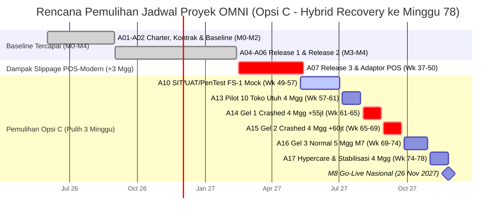

---

## 7. Latihan dan Pembahasan

### 7.1 Soal Latihan

Kerjakan keempat latihan berikut secara mandiri sebelum membuka pembahasan pada Sub-bab 7.2. Gunakan **Konvensi Minggu-0** (`EF = ES + D`, `LS = LF − D`).

#### Latihan 1: Membangun Jaringan PDM & Menghitung CPM, Total Float, dan Free Float

Tim proyek sedang merencanakan rilis subsistem *E-Commerce Checkout & Logistics* yang terdiri dari 8 aktivitas berikut (durasi dalam **minggu**):

| ID | Aktivitas | Pendahulu | Durasi (mgg) |
|----|-----------|-----------|--------------|
| **A** | Analisis Kebutuhan & Desain API | — | 3 |
| **B** | Setup *Environment Staging* | A | 2 |
| **C** | Pengembangan Modul Katalog | A | 6 |
| **D** | Pengembangan Modul Keranjang & Promo | B | 5 |
| **E** | Integrasi *Payment Gateway* | C | 4 |
| **F** | Integrasi Logistik & Kurir | C, D | 5 |
| **G** | *Security & Penetration Testing* | E | 3 |
| **H** | UAT & *Go-Live Readiness* | F, G | 2 |

**Tugas Anda:**
1. Lakukan *Forward Pass* dan *Backward Pass* untuk mengisi `ES`, `EF`, `LS`, `LF`, `TF`, dan `FF` seluruh aktivitas.
2. Tentukan durasi total proyek, **Jalur Kritis**, dan **Near-Critical Path**.
3. Jelaskan implikasi praktis jika Aktivitas **D** mengalami keterlambatan 1 minggu terhadap Aktivitas **F** dan terhadap tanggal selesai proyek!

#### Latihan 2: Analisis PERT & Probabilitas Penyelesaian Target

Paket kerja integrasi *real-time inventory* di DC Cikarang terdiri dari 3 aktivitas berurutan dengan estimasi *three-point* (satuan: **hari kerja**):

| Kode | Aktivitas | Optimistic (`O`) | Most Likely (`M`) | Pessimistic (`P`) |
|------|-----------|------------------|-------------------|-------------------|
| **T1** | Adaptasi Skema Database ERP | 3 | 6 | 9 |
| **T2** | Pengembangan Adaptor API POS | 6 | 9 | 18 |
| **T3** | Uji Beban & *Failover* Sinkronisasi | 5 | 8 | 17 |

**Tugas Anda:**
1. Hitung `tE`, `σ`, dan `σ²` untuk masing-masing aktivitas serta total jalur (`tE_total`, `σ²_total`, `σ_total`).
2. Tentukan interval kepercayaan **68,26%**, **95,44%**, dan **99,73%**.
3. Jika Sponsor meminta paket kerja ini selesai maksimal dalam **22 hari kerja**, berapakah probabilitas tercapainya target tersebut? Berapa hari kerja yang harus Anda ajukan jika ingin memiliki tingkat kepastian minimal **84,13%**?

#### Latihan 3: Keputusan Crashing Biaya Terendah untuk Memulihkan 3 Minggu

Sub-proyek integrasi modul toko memiliki 6 aktivitas dengan struktur ketergantungan dan data biaya berikut (durasi dalam **minggu**, biaya dalam **Rp jt**):

| ID | Aktivitas | Pendahulu | Durasi Normal (`Dn`) | Durasi Crash Min (`Dc`) | Biaya Normal (`Cn`) | Biaya Crash (`Cc`) |
|----|-----------|-----------|----------------------|-------------------------|---------------------|--------------------|
| **K** | Arsitektur & Setup | — | 4 | 2 | 80 | 150 |
| **L** | Modul POS Sync | K | 6 | 4 | 120 | 170 |
| **M** | Modul Loyalty | K | 5 | 3 | 100 | 140 |
| **N** | Integrasi & SIT | L | 5 | 3 | 110 | 200 |
| **P** | Migrasi Data | M | 4 | 3 | 90 | 120 |
| **Q** | UAT & Cutover | N, P | 3 | 2 | 70 | 110 |

**Tugas Anda:**
1. Hitung durasi normal proyek, identifikasi seluruh jalur, dan hitung *Crash Cost per minggu* setiap aktivitas.
2. Manajemen membutuhkan percepatan **3 minggu** dari durasi normal dengan **tambahan biaya paling rendah**. Tunjukkan proses *crashing* **iterasi demi iterasi** (minggu ke-1, ke-2, dan ke-3), perhatikan kemunculan jalur kritis paralel!
3. Berapa total biaya tambahan *crashing* dan total biaya proyek yang baru?

#### Latihan 4: Audit Kesalahan Matriks RACI

Seorang Project Coordinator baru menyusun draf Matriks RACI untuk fase *Rollout* Proyek OMNI sebagai berikut:

| No | *Deliverable* | Ratna (Sponsor) | Budi (CFO) | Agus (Store Ops) | Rina (Legal) | Fajar (PM) | Bambang (NDS) |
|----|---------------|-----------------|------------|------------------|--------------|------------|---------------|
| 1 | Persetujuan Perubahan Anggaran > Rp 500 jt | A | A | I | I | R | I |
| 2 | Pelatihan 1.440 Kasir & Staf Toko | I | I | C | I | C | I |
| 3 | Penyelesaian *Bug Critical* Pasca-UAT | I | I | I | A | C | R |
| 4 | Penyusunan SOP *Click & Collect* Toko | C | C | C | C | A/R | C |

**Tugas Anda:** Identifikasi **seluruh kesalahan prinsip RACI** pada keempat baris di atas dan tuliskan usulan perbaikannya!

---

### 7.2 Pembahasan Latihan

#### Pembahasan Latihan 1 (PDM & CPM)

**1. Tabel Hasil Perhitungan Forward Pass, Backward Pass, dan Float (Konvensi Minggu-0):**

| ID | Pendahulu | `D` | `ES` | `EF` | `LS` | `LF` | `TF = LS−ES` | `FF = min(ES_succ)−EF` | Status |
|----|-----------|-----|------|------|------|------|--------------|------------------------|--------|
| **A** | — | 3 | 0 | 3 | 0 | 3 | **0** | **0** | **Kritis** |
| **B** | A | 2 | 3 | 5 | 4 | 6 | **1** | **0** | *Near-Critical* |
| **C** | A | 6 | 3 | 9 | 3 | 9 | **0** | **0** | **Kritis** |
| **D** | B | 5 | 5 | 10 | 6 | 11 | **1** | **0** | *Near-Critical* |
| **E** | C | 4 | 9 | 13 | 9 | 13 | **0** | **0** | **Kritis** |
| **F** | C, D | 5 | 10 | 15 | 11 | 16 | **1** | **1** | *Near-Critical* |
| **G** | E | 3 | 13 | 16 | 13 | 16 | **0** | **0** | **Kritis** |
| **H** | F, G | 2 | 16 | 18 | 16 | 18 | **0** | **0** | **Kritis** |

*Pemeriksaan Titik Kritis (Merge & Burst):*
- *Merge* di **F** (pendahulu C dan D): `ES(F) = max(EF(C)=9, EF(D)=10) = 10` → `EF(F) = 15`.
- *Merge* di **H** (pendahulu F dan G): `ES(H) = max(EF(F)=15, EF(G)=16) = 16` → `EF(H) = 18`.
- *Burst* di **C** (penerus E dan F): `LF(C) = min(LS(E)=9, LS(F)=11) = 9` → `LS(C) = 3`.
- *Burst* di **A** (penerus B dan C): `LF(A) = min(LS(B)=4, LS(C)=3) = 3` → `LS(A) = 0`.
- *Free Float* **B**: `ES(D) − EF(B) = 5 − 5 = 0`. *Free Float* **D**: `ES(F) − EF(D) = 10 − 10 = 0`. *Free Float* **F**: `ES(H) − EF(F) = 16 − 15 = 1`.

**2. Durasi Proyek & Identifikasi Jalur:**
- **Durasi Proyek:** **18 minggu**.
- **Jalur Kritis (`TF = 0`):** **`A → C → E → G → H`** (`3 + 6 + 4 + 3 + 2 = 18 minggu`).
- **Near-Critical Path (`TF = 1`):** **`A → B → D → F → H`** (`3 + 2 + 5 + 5 + 2 = 17 minggu`). *(Jalur ketiga `A → C → F → H` berdurasi 16 minggu).*

**3. Dampak Keterlambatan 1 Minggu pada Aktivitas D:**
Karena **D** memiliki **`FF = 0`** dan **`TF = 1`**, keterlambatan 1 minggu pada D (`EF(D)` menjadi `11`) akan **langsung menunda `Early Start` Aktivitas F** dari Minggu 10 ke Minggu 11 (`EF(F)` bergeser ke Minggu 16). Tanggal selesai proyek (Minggu 18) **belum tertunda**, TETAPI seluruh *float* jalur `A–B–D–F–H` langsung habis (`TF = 0`), sehingga proyek kini memiliki **dua Jalur Kritis paralel** (`A–C–E–G–H` dan `A–B–D–F–H`) yang menggandakan risiko keterlambatan!

---

#### Pembahasan Latihan 2 (PERT & Probabilitas)

**1. Tabel Perhitungan PERT:**

| Kode | `O` | `M` | `P` | `tE = (O+4M+P)/6` | `σ = (P−O)/6` | `σ² = σ²` |
|------|-----|-----|-----|-------------------|---------------|-----------|
| **T1** | 3 | 6 | 9 | `(3+24+9)/6 = 6,00` | `(9−3)/6 = 1,00` | `1,00` |
| **T2** | 6 | 9 | 18 | `(6+36+18)/6 = 10,00` | `(18−6)/6 = 2,00` | `4,00` |
| **T3** | 5 | 8 | 17 | `(5+32+17)/6 = 9,00` | `(17−5)/6 = 2,00` | `4,00` |
| **TOTAL** | — | — | — | **25,00 hari** | **√9,00 = 3,00 hari** | **9,00** |

**2. Interval Kepercayaan:**
- **68,26% (`tE ± 1σ`):** `25 − 3` s.d. `25 + 3` = **22,0 – 28,0 hari kerja**.
- **95,44% (`tE ± 2σ`):** `25 − 6` s.d. `25 + 6` = **19,0 – 31,0 hari kerja**.
- **99,73% (`tE ± 3σ`):** `25 − 9` s.d. `25 + 9` = **16,0 – 34,0 hari kerja**.

**3. Analisis Target Probabilitas:**
- **Target `≤ 22 hari`:** `Z = (22 − 25) / 3 = −1,00` → dari tabel distribusi normal, `P(Z ≤ −1,00) = 15,87%`. Peluang gagal mencapai target mencapai **84,13%** — sangat tidak disarankan untuk disetujui tanpa *crashing* atau penyederhanaan lingkup.
- **Target Kepastian `≥ 84,13%`:** Nilai probabilitas `84,13%` berkorespondensi tepat dengan **`Z = +1,00`**. Maka `T = tE + (1,00 × σ) = 25 + 3 = 28 hari kerja`. PM harus mengajukan **28 hari kerja** (memasukkan *schedule buffer* 3 hari).

---

#### Pembahasan Latihan 3 (Crashing Biaya Minimum 3 Minggu)

**1. Identifikasi Jalur Awal & *Crash Cost per Minggu*:**
- **Jalur 1:** `K (4) → L (6) → N (5) → Q (3) = 18 minggu` (**Jalur Kritis**, `TF = 0`).
- **Jalur 2:** `K (4) → M (5) → P (4) → Q (3) = 16 minggu` (Non-Kritis, `TF = 2`).
- **Total Biaya Normal Proyek:** `80 + 120 + 100 + 110 + 90 + 70 = Rp 570 jt`.

| ID | `Dn` | `Dc` | Maks Crash | `Cn` (Rp jt) | `Cc` (Rp jt) | **Crash Cost / Minggu** |
|----|------|------|------------|--------------|--------------|-------------------------|
| **K** | 4 | 2 | 2 mgg | 80 | 150 | `(150−80)/2 =` **Rp 35 jt/mgg** |
| **L** | 6 | 4 | 2 mgg | 120 | 170 | `(170−120)/2 =` **Rp 25 jt/mgg** |
| **M** | 5 | 3 | 2 mgg | 100 | 140 | `(140−100)/2 =` **Rp 20 jt/mgg** |
| **N** | 5 | 3 | 2 mgg | 110 | 200 | `(200−110)/2 =` **Rp 45 jt/mgg** |
| **P** | 4 | 3 | 1 mgg | 90 | 120 | `(120−90)/1 =` **Rp 30 jt/mgg** |
| **Q** | 3 | 2 | 1 mgg | 70 | 110 | `(110−70)/1 =` **Rp 40 jt/mgg** |

*(Perhatikan jebakan: `M` memiliki biaya termurah Rp 20 jt/mgg, tetapi `M` TIDAK berada di Jalur Kritis pada awal proyek sehingga tidak boleh dipilih di Iterasi 1 dan 2!)*

**2. Eksekusi Crashing Langkah demi Langkah (Target: 18 → 15 Minggu):**
- **Iterasi 1 (18 → 17 minggu):**
  - Jalur Kritis: hanya **Jalur 1** `{K: 35, L: 25, N: 45, Q: 40}`.
  - Pilihan termurah: **Crash `L` 1 minggu** = **+Rp 25 jt** *(sisa kapasitas `L` = 1 mgg)*.
  - Status jalur: Jalur 1 = `17 mgg`, Jalur 2 = `16 mgg`.
- **Iterasi 2 (17 → 16 minggu):**
  - Jalur Kritis: masih hanya **Jalur 1** `{K: 35, L: 25, N: 45, Q: 40}`.
  - Pilihan termurah: **Crash `L` 1 minggu lagi** = **+Rp 25 jt** *(kapasitas `L` habis: 0 mgg tersisa)*.
  - Status jalur: Jalur 1 = `16 mgg`, Jalur 2 = `16 mgg`. **KEDUA JALUR KINI KRITIS PARALEL!**
- **Iterasi 3 (16 → 15 minggu):**
  - Untuk menurunkan durasi proyek menjadi 15 minggu, **Jalur 1 DAN Jalur 2 wajib turun bersamaan**. Evaluasi seluruh kombinasi sah:
    - Opsi (a) Crash aktivitas bersama **`K`** 1 mgg (mengurangi Jalur 1 & 2 sekaligus): **Rp 35 jt**.
    - Opsi (b) Crash aktivitas bersama **`Q`** 1 mgg (mengurangi Jalur 1 & 2 sekaligus): **Rp 40 jt**.
    - Opsi (c) Crash paralel 1 aktivitas di Jalur 1 (`N`: Rp 45 jt, karena `L` sudah habis) + 1 aktivitas di Jalur 2 (`M`: Rp 20 jt): `45 + 20 =` **Rp 65 jt**.
  - Pilihan termurah: **Crash `K` 1 minggu** = **+Rp 35 jt** *(sisa kapasitas `K` = 1 mgg)*.
  - Status jalur: Jalur 1 = `15 mgg`, Jalur 2 = `15 mgg`. Target tercapai!

**3. Ringkasan Biaya Akhir:**
- **Total Tambahan Biaya Crashing (3 minggu):** `Rp 25 jt (L) + Rp 25 jt (L) + Rp 35 jt (K) =` **Rp 85 jt**.
- **Total Biaya Proyek Baru:** `Rp 570 jt + Rp 85 jt =` **Rp 655 jt**.

---

#### Pembahasan Latihan 4 (Audit Kesalahan RACI)

| Baris | Kesalahan Prinsip RACI yang Ditemukan | Perbaikan yang Direkomendasikan |
|-------|---------------------------------------|---------------------------------|
| **1. Persetujuan Perubahan Anggaran > Rp 500 jt** | **Dua `A` sekaligus** (Ratna dan Budi). Melanggar aturan tepat satu `A` sehingga berpotensi memicu kebuntuan otoritas anggaran. | **Budi Santoso (CFO) = `A`** (pemilik otoritas *Management Reserve* & batas finansial korporat), **Ratna Kusuma (Sponsor) = `C`**, **Fajar (PM) = `R`** (penyusun proposal CR). |
| **2. Pelatihan 1.440 Kasir & Staf Toko** | **Tidak ada `A` dan tidak ada `R`!** Hanya berisi `I` dan `C` (*orphan deliverable* — tidak ada yang merasa wajib mengeksekusi maupun bertanggung jawab akhir). | **Agus Setiawan (Store Ops) = `A`**, **Tim Pelatihan / Store Ops & Fajar (PM) = `R`**, Ratna = `I`, Bambang = `C` (jika perlu materi aplikasi). |
| **3. Penyelesaian *Bug Critical* Pasca-UAT** | **Penunjukan `A` yang salah peran (*misaligned accountability*)!** Rina Kartika (Legal/InfoSec) bukan penanggung jawab teknis penyelesaian *bug* perangkat lunak vendor — ia hanya perlu dikonsultasikan jika *bug* terkait keamanan/UU PDP. | **Fajar (PM) atau Lukas (QA Lead) / Irwan (CTO) = `A`** (sesuai tata kelola delivery: **Fajar = `A`** atas kontrak vendor NDS), **Bambang (PT NDS) = `R`** (eksekutor perbaikan), **Rina = `C`** (khusus bug keamanan/UU PDP), Agus = `I`. |
| **4. Penyusunan SOP *Click & Collect* Toko** | **Terlalu banyak `C` (5 orang!)** menciptakan birokrasi persetujuan berlebih (*analysis paralysis*), dan `A` diberikan ke Fajar padahal pemilik proses bisnis operasional 120 toko adalah Agus Setiawan. | **Agus Setiawan (Store Ops) = `A`** (pemilik operasional 120 toko), **Fajar (PM) / Nadia (Lead BA) = `R`**, **Ratna = `C`** (keselarasan insentif), **Bambang = `C`** (kesesuaian fitur *Store Fulfillment App*), **Budi & Rina = `I`** (cukup diinformasikan kecuali ada implikasi pajak/hukum). |

---

## 8. Tugas Modul dan Rubrik Penilaian

### Brief Tugas Mandiri (±6 Jam) — *Schedule & Resource Re-Baseline* Fase 3 & 4 Proyek OMNI

**Konteks Tugas:** Anda berperan sebagai **Fajar Nugroho (Senior PM Proyek OMNI)** pada awal Maret 2027 (tepat setelah rapat tinjauan Bulan ke-9 dengan `SPI = 0,90`, `CPI = 0,94`, dan keterlambatan 3 minggu API POS-Modern). Steering Committee telah menyetujui prinsip **Opsi C (*Hybrid Recovery*, anggaran tambahan Rp 135 jt dari Contingency Reserve CB-06)**, namun meminta paket dokumen perencanaan detail **Fase 3 & 4 (Minggu 49 s.d. Minggu 78)** sebelum mencairkan dana.

**Deliverable yang Harus Dikumpulkan (Format PDF/Markdown Maksimal 8 Halaman):**
1. **Dekomposisi WBS Level 4 & *WBS Dictionary* (2 Paket Kerja):** Pecah `WP 1.5.3 (Pilot 10 Toko)` dan `WP 1.6.3 (Wave Rollout Gelombang 1–3 & Hypercare)` hingga Level 4 beserta alokasi biaya detail yang tepat menyamai anggaran baseline + tambahan *crashing* (`Rp 150 jt + Rp 120 jt + Rp 115 jt crashing A14/A15 = Rp 385 jt`), lengkap dengan minimal 2 entri *WBS Dictionary* penuh.
2. **Jadwal Terperinci & Jaringan PDM *Rolling Wave* (Minggu 49–78):** Susun minimal 12 aktivitas rinci untuk Fase 3 & 4 lengkap dengan relasi PDM (`FS`, minimal 1 `SS` atau `FS − Lead` yang terjustifikasi), perhitungan `ES, EF, LS, LF, TF, FF`, serta diagram jaringan yang membuktikan **M8 tetap tercapai pada Minggu 78 (26 November 2027)**.
3. **Analisis PERT & Mitigasi Risiko Distribusi Tablet (Risiko R-09):** Lakukan estimasi 3-titik PERT (minimal 3 sub-aktivitas) untuk pengiriman & instalasi 240 tablet/scanner ke luar Jawa (Sumatra, Kalimantan, Sulawesi), hitung `tE`, `σ`, interval 95%, dan probabilitas selesai sebelum Gelombang 2 & 3.
4. **Rencana Alokasi Sumber Daya (*Resource Histogram* & RACI Rollout):** Petakan kebutuhan tim *floor-support* dan QA pada Minggu 49–78, tunjukkan cara menerapkan *Resource Smoothing* untuk mencegah *overallocation* saat transisi Gelombang 1 → 2 → 3, serta lengkapi Matriks RACI operasional *rollout* (minimal 6 baris, aturan tepat satu `A` terpenuhi 100%).
5. **Memo Eksekutif Pengendalian Eksekusi (1 Halaman):** Jelaskan indikator *WPD → WPI → WPR* mingguan dan mekanisme *Milestone Trend Analysis* (MTA) yang akan Anda laporkan ke Ratna Kusuma & Budi Santoso agar `TCPI = 1,06` dan tenggat 26 November 2027 tidak kembali meleset.

### Rubrik Penilaian Tugas Modul (Skala 1–4, Bobot Total = 100%)

| Kriteria Penilaian | Bobot | **Skor 4: Sangat Baik (90–100)** | **Skor 3: Baik (75–89)** | **Skor 2: Cukup (60–74)** | **Skor 1: Perlu Perbaikan (< 60)** |
|--------------------|-------|----------------------------------|--------------------------|--------------------------|------------------------------------|
| **1. Akurasi WBS Level 4 & *WBS Dictionary*** | **20%** | Mematuhi *100% Rule* dan *deliverable-oriented* secara penuh; rekonsiliasi angka 100% presisi (`Rp 385 jt`); *WBS Dictionary* memuat kriteria penerimaan kuantitatif & batas *out-of-scope* tegas. | Mematuhi *100% Rule* dan berbasis *deliverable*; angka cocok; *WBS Dictionary* lengkap namun kriteria penerimaan masih agak normatif. | Sebagian elemen masih berbentuk aktivitas (kata kerja) atau ada selisih kecil pada pembagian biaya; *WBS Dictionary* kurang rinci. | Tidak mematuhi *100% Rule*, berbasis departemen, angka biaya tidak cocok dengan baseline Proyek OMNI, atau *WBS Dictionary* tidak ada. |
| **2. Ketepatan PDM, CPM & Bukti Pulih Minggu 78** | **25%** | Seluruh hitungan `ES, EF, LS, LF, TF, FF` 100% benar; relasi `FS`/`Lead` sah secara teknis; Jalur Kritis & *Near-Critical Path* teridentifikasi tepat dan terbukti selesai tepat di Minggu 78. | Hitungan CPM benar dengan maksimal 1 kekeliruan minor pada `FF`; logika jaringan realistis dan selesai pada Minggu 78. | Terdapat beberapa kesalahan pada *Backward Pass* atau *Float*; pemulihan jadwal bergantung pada asumsi *Fast Tracking* yang kurang realistis. | Banyak kesalahan aritmetika CPM, logika ketergantungan tidak valid, atau jadwal akhir tidak mencapai target Minggu 78. |
| **3. Analisis PERT Risiko R-09 & Interpretasi** | **20%** | Rumus `tE`, `σ`, `σ²`, agregasi varians (`Σσ²`), interval 95%, dan *Z-score* 100% akurat; menghasilkan rekomendasi mitigasi logistik konkret yang terhubung dengan hasil probabilitas. | Seluruh perhitungan PERT benar; rekomendasi mitigasi baik namun belum tajam mengaitkan angka *Z-score* dengan keputusan cadangan jadwal. | Rumus `tE` benar tetapi keliru saat mengagregasi standar deviasi jalur (menjumlahkan `σ` bukan `σ²`) atau interpretasi probabilitas kurang tepat. | Perhitungan PERT salah mendasar atau hanya menggunakan estimasi *single-point*. |
| **4. Optimasi Sumber Daya & Audit Matriks RACI** | **20%** | *Resource Smoothing* terukur menghilangkan puncak beban tanpa menggeser Jalur Kritis; Matriks RACI memakai tokoh nyata Proyek OMNI, 100% tepat satu `A` per baris, bebas *bottleneck*. | Alokasi sumber daya logis; RACI memenuhi aturan tepat satu `A` namun masih terdapat sedikit kelebihan `C` pada 1–2 baris. | Optimasi sumber daya masih bersifat naratif umum; ditemukan 1 pelanggaran RACI (misalnya `A` kurang tepat peran atau tanpa `R`). | Tidak ada analisis beban sumber daya; Matriks RACI melanggar aturan tepat satu `A` atau tidak konsisten dengan tokoh Proyek OMNI. |
| **5. Pengendalian Eksekusi (WPD–WPR & MTA) & Kualitas Komunikasi** | **15%** | Memo eksekutif tajam setara laporan SteerCo; kerangka WPD→WPI→WPR & MTA konkret, terukur, terhubung dengan `TCPI = 1,06` dan kepatuhan UU PDP; bahasa ringkas & profesional. | Memo jelas dan terstruktur; indikator pemantauan eksekusi cukup operasional dan konsisten dengan kondisi Bulan ke-9. | Pembahasan kontrol eksekusi masih teoritis dan belum mengaitkan secara spesifik metrik EVM/MTA dengan Proyek OMNI. | Memo tidak terstruktur, tidak menjawab kebutuhan informasi Sponsor/CFO, atau tidak menyertakan mekanisme kontrol slippage. |

---

## 9. Kuis dan Kunci Jawaban

### 9.1 Soal Kuis

Pilih **satu jawaban paling tepat (A, B, C, atau D)** untuk setiap skenario berikut.

**1.** Saat meninjau draf WBS Proyek OMNI dari tim konsultan, Anda mendapati elemen *"1.2 Tim Pengembangan IT"*, *"1.3 Tim Operasional Toko"*, dan *"1.4 Melakukan Rapat Mingguan"*, sementara biaya pelatihan 1.440 kasir belum tercantum di cabang mana pun. Prinsip WBS apa saja yang dilanggar?
- A. Hanya *8/80 Rule* dan *Rolling Wave Planning*
- B. *Deliverable-Oriented Decomposition* dan *100% Rule*
- C. *Resource Smoothing* dan *Control Account Mapping*
- D. *Activity Sequencing* dan *Mandatory Dependency*

**2.** Dalam jaringan PDM Proyek OMNI, penulisan skrip pengujian otomatis QA baru boleh dimulai 2 minggu setelah pembangunan kode OMS dimulai, agar tim QA dapat membaca spesifikasi endpoint awal secara paralel. Tipe relasi ketergantungan yang paling tepat dimodelkan adalah:
- A. `FS + 2 minggu` (*Finish-to-Start dengan Lag*)
- B. `FS − 2 minggu` (*Finish-to-Start dengan Lead*)
- C. `SS + 2 minggu` (*Start-to-Start dengan Lag*)
- D. `FF − 2 minggu` (*Finish-to-Finish dengan Lead*)

**3.** Tiga aktivitas berurutan pada jalur kritis memiliki standar deviasi (`σ`) masing-masing: `σ₁ = 3 hari`, `σ₂ = 4 hari`, dan `σ₃ = 0 hari` (durasi pasti). Berapakah **standar deviasi total (`σ_total`)** jalur tersebut menurut metode PERT?
- A. `7,00 hari`
- B. `5,00 hari`
- C. `3,50 hari`
- D. `25,00 hari`

**4.** Suatu paket kerja migrasi data memiliki estimasi PERT `O = 4 minggu`, `M = 7 minggu`, dan `P = 16 minggu`. Berapakah durasi ekspektasi (`tE`) dan batas atas rentang kepercayaan **95,44% (`+2σ`)** untuk paket kerja tersebut?
- A. `tE = 8,0 minggu`; batas atas `95,44% = 12,0 minggu`
- B. `tE = 9,0 minggu`; batas atas `95,44% = 13,0 minggu`
- C. `tE = 8,0 minggu`; batas atas `95,44% = 10,0 minggu`
- D. `tE = 7,0 minggu`; batas atas `95,44% = 11,0 minggu`

**5.** Aktivitas **X** dalam jadwal proyek memiliki `ES = 10`, `EF = 16`, `LS = 14`, dan `LF = 20`. Aktivitas penerus langsung tunggalnya (**Y**) memiliki `ES = 16`. Pernyataan manakah yang **paling akurat** menggambarkan kondisi Aktivitas X?
- A. `TF = 4` dan `FF = 4`; menunda X selama 2 minggu tidak berdampak pada siapa pun
- B. `TF = 4` dan `FF = 0`; menunda X selama 1 minggu tidak menunda *Go-Live* proyek, tetapi langsung menunda awal pelaksanaan Y
- C. `TF = 0` dan `FF = 4`; X berada pada Jalur Kritis proyek
- D. `TF = 6` dan `FF = 0`; X merupakan *Near-Critical Path*

**6.** Sebuah proyek mengalami keterlambatan 2 minggu dan memiliki dua jalur kritis paralel yang aktif (`Jalur 1: A → B → D` dan `Jalur 2: A → C → D`, keduanya 20 minggu). Data *Crash Cost per minggu*: `A = Rp 45 jt`, `B = Rp 20 jt`, `C = Rp 30 jt`, `D = Rp 55 jt`. Untuk memangkas proyek menjadi **19 minggu** dengan biaya terendah, keputusan terbaik Senior PM adalah:
- A. Meng-crash **B** saja sebesar Rp 20 jt karena biayanya paling murah
- B. Meng-crash **B dan C** bersamaan sebesar Rp 50 jt
- C. Meng-crash **A** sebesar Rp 45 jt karena `A` berada di kedua jalur kritis sekaligus
- D. Meng-crash **D** sebesar Rp 55 jt karena terletak di ujung proyek

**7.** Proyek ERP-Refresh dan Proyek OMNI berbagi **3 *senior architect* IT** yang ternyata dijadwalkan bekerja 160% kapasitas pada Bulan ke-6. Karena tenggat 26 November 2027 Proyek OMNI bersifat mutlak (*hard deadline*) dan tidak boleh bergeser sedikit pun, teknik optimasi sumber daya mana yang pertama kali harus dicoba PM di dalam batas kelonggaran jadwal non-kritis?
- A. *Resource Leveling*, karena menjamin tanggal selesai proyek tidak berubah
- B. *Resource Smoothing*, dengan menggeser aktivitas non-kritis di dalam batas *Float*-nya tanpa menyentuh Jalur Kritis
- C. *Fast Tracking* pada aktivitas *hard logic* arsitektur ERP
- D. Mengurangi ruang lingkup kepatuhan UU PDP secara sepihak

**8.** Pada Matriks RACI Proyek OMNI, Wakil Presiden Marketing (Dewi Lestari) dan Kepala Operasional Toko (Agus Setiawan) sama-sama menuntut ditulis sebagai **`A` (*Accountable*)** pada *deliverable* "Persetujuan Final Fitur *Click & Collect*". Sebagai Senior PM, tindakan yang paling tepat adalah:
- A. Menyetujui keduanya sebagai `A` demi menjaga keharmonisan politik kantor
- B. Menghapus keduanya dari kolom `A` dan membiarkan baris tersebut hanya diisi `R` oleh tim developer
- C. Memfasilitasi kesepakatan bersama Sponsor (Ratna Kusuma) agar hanya ada **tepat satu `A`** sesuai kepemilikan manfaat/domain, sementara pihak lainnya berperan sebagai **`C`** dengan kriteria input yang terdokumentasi jelas
- D. Mengubah peran keduanya menjadi `I` agar tidak menghambat Sprint

**9.** Pada grafik *Milestone Trend Analysis* (MTA) bulanan Proyek OMNI, kurva perkiraan tanggal pencapaian Milestone **M5 (Feature Freeze)** menunjukkan kemiringan menanjak (*upward slope*) secara konsisten selama 3 bulan berturut-turut, meskipun tanggal M5 baru akan tiba 2 bulan lagi. Interpretasi dan respons terbaik Senior PM adalah:
- A. Mengabaikannya hingga tanggal M5 terlewati karena laporan status tim masih menunjukkan progres 70%
- B. Mengenali adanya tren *schedule slippage* struktural yang memburuk dan segera memicu analisis akar masalah serta *corrective action* sebelum *float* habis
- C. Menyimpulkan bahwa jadwal proyek sedang mengalami percepatan sehingga anggaran bisa dipotong
- D. Mengubah garis *baseline* M5 secara diam-diam agar grafik kembali datar

**10.** Pada tinjauan akhir Bulan ke-9 Proyek OMNI, catatan faktur menunjukkan `AC = Rp 4,60 M` dan laporan Jira menunjukkan 10 Sprint selesai. Setelah diolah terhadap *baseline*, tim PMO memperoleh `SPI = 0,90`, `CPI = 0,94`, dan keterlambatan 3 minggu pada Jalur Kritis, yang kemudian dikemas menjadi dasbor eksekutif berisi opsi pemulihan Rp 135 jt untuk disetujui SteerCo. Urutan klasifikasi artefak pengendalian eksekusi tersebut secara berturut-turut adalah:
- A. *Work Performance Reports* → *Work Performance Data* → *Work Performance Information*
- B. *Work Performance Information* → *Work Performance Data* → *Work Performance Reports*
- C. *Work Performance Data* → *Work Performance Information* → *Work Performance Reports*
- D. *Baseline Data* → *Change Requests* → *Lessons Learned Register*

---

### 9.2 Kunci Jawaban dan Pembahasan

| No | Kunci | Pembahasan Lengkap |
|----|-------|--------------------|
| **1** | **B** | Elemen berbasis nama tim/departemen dan kata kerja (*"Melakukan rapat"*) melanggar prinsip **Deliverable-Oriented Decomposition** (harus kata benda hasil nyata), sedangkan hilangnya biaya pelatihan 1.440 kasir (padahal *in-scope*) melanggar **100% Rule**. |
| **2** | **C** | Aktivitas QA dimulai setelah aktivitas OMS **dimulai** (bukan selesai), dengan jeda waktu tunggu 2 minggu agar endpoint awal tersedia → **`SS + 2 minggu`** (*Start-to-Start dengan Lag 2 minggu*). |
| **3** | **B** | Dalam PERT, yang dijumlahkan untuk jalur berurutan adalah **varians (`σ²`)**, bukan standar deviasi! `σ²_total = 3² + 4² + 0² = 9 + 16 + 0 = 25`, sehingga **`σ_total = √25 = 5,00 hari`**. |
| **4** | **A** | `tE = (4 + 4×7 + 16) / 6 = 48 / 6 = 8,0 minggu`. Standar deviasi `σ = (16 − 4) / 6 = 2,0 minggu`. Batas atas interval kepercayaan 95,44% (`tE + 2σ`) = `8,0 + 2(2,0) =` **12,0 minggu**. |
| **5** | **B** | `TF = LS − ES = 14 − 10 = 4` (atau `LF − EF = 20 − 16 = 4`). Namun `FF = ES(Y) − EF(X) = 16 − 16 = 0`. Artinya penundaan X selama 1 minggu tidak menggeser *Go-Live* akhir, tetapi langsung menunda awal pengerjaan Y sebesar 1 minggu. |
| **6** | **C** | Karena kedua jalur sama-sama kritis (20 mgg), meng-crash B saja tidak memperpendek proyek (tertahan Jalur 2 di 20 mgg). Bandingkan opsi valid: (1) aktivitas bersama `A` = **Rp 45 jt**, (2) pasangan paralel `B + C` = `20 + 30 = Rp 50 jt`, (3) aktivitas bersama `D` = Rp 55 jt. Opsi termurah adalah meng-crash **A sebesar Rp 45 jt**. |
| **7** | **B** | **Resource Smoothing** meratakan beban sumber daya dengan hanya menggeser aktivitas di dalam batas *float*-nya sehingga **tidak boleh mengubah Jalur Kritis maupun tanggal selesai proyek**. Sebaliknya, *Resource Leveling* sering kali memperpanjang durasi proyek. *(Jika Resource Smoothing saja tidak cukup menyelesaikan overallocation, barulah PM bernegosiasi menambah kapasitas/vendor eksternal atau eskalasi ke Program Director).* |
| **8** | **C** | Aturan mutlak Matriks RACI adalah **tepat satu `A`** per baris untuk mencegah kebuntuan dan kaburnya akuntabilitas. Memfasilitasi kesepakatan bersama Sponsor agar satu pihak memegang `A` dan pihak lain `C` dengan kriteria jelas menjaga tata kelola tetap sehat sekaligus menghormati kepentingan kedua pemangku kepentingan. |
| **9** | **B** | Kemiringan menanjak (*upward slope*) pada grafik **Milestone Trend Analysis (MTA)** menandakan perkiraan tanggal selesai *milestone* terus mundur dari satu siklus pelaporan ke siklus berikutnya — sinyal kuat *schedule slippage* yang menuntut analisis akar masalah dan tindakan korektif proaktif sebelum terlambat. |
| **10** | **C** | Pengukuran mentah (`AC = Rp 4,60 M`, 10 Sprint selesai) adalah **Work Performance Data (WPD)**; hasil analisis terhadap *baseline* (`SPI = 0,90`, `CPI = 0,94`, slippage 3 mgg) adalah **Work Performance Information (WPI)**; dan paket dasbor rekomendasi keputusan untuk SteerCo adalah **Work Performance Reports (WPR)**. |

---

## 10. Rangkuman, Glosarium, dan Referensi

### 10.1 Rangkuman

1. **WBS Berbasis Keluaran & *100% Rule*:** Perencanaan yang andal dimulai dari dekomposisi berbasis *deliverable* (kata benda) yang mencakup tepat 100% ruang lingkup proyek, terhubung ke *Control Account* untuk pengukuran EVM, dan dirinci secara kontraktual di dalam **WBS Dictionary**. Pada Proyek OMNI, 7 *Control Account* dan 21 *Work Package* terekonsiliasi presisi ke **BAC Rp 9,20 M**.
2. **PDM, Ketergantungan & PERT:** Kualitas jadwal bergantung pada pemodelan logika PDM (*FS, SS, FF, SF*), pembedaan *hard logic* vs *soft logic* dan ketergantungan eksternal (seperti API POS-Modern), serta pengukuran ketidakpastian durasi menggunakan **PERT** (`tE`, `σ`, `σ²`, dan *Z-score*) — dengan disiplin selalu menjumlahkan **varians (`σ²`)** pada jalur berurutan.
3. **CPM, *Float* & *Near-Critical Path*:** Melalui *Forward Pass* dan *Backward Pass* (konvensi Minggu-0), Senior PM memetakan **Jalur Kritis (`TF = 0`)** sepanjang 78 minggu pada Proyek OMNI, mewaspadai **Near-Critical Path** (Cloud Dev/Staging `TF = 1` dan Migrasi Data Loyalty `TF = 2`), serta membedakan **Total Float** dari **Free Float** (seperti pada penyusunan SOP toko `TF = 4, FF = 0`) untuk mencegah benturan mobilisasi antar-tim.
4. **Kompresi Jadwal & Optimasi Sumber Daya:** Untuk memulihkan keterlambatan tanpa mengurangi lingkup, Senior PM membandingkan **Crashing** (menambah biaya demi memotong waktu secara bertahap sambil memeriksa kemunculan jalur kritis paralel) dan **Fast Tracking** (paralelisasi *soft logic* dengan kontrol risiko *rework*), serta membedakan **Resource Smoothing** (menjaga tanggal selesai tetap utuh) dari **Resource Leveling**. Pada kasus keterlambatan 3 minggu Proyek OMNI, **Opsi C (*Hybrid Recovery*)** memulihkan tenggat 26 November 2027 hanya dengan **Rp 135 jt** dari *Contingency Reserve* tanpa mengorbankan Pilot 10 Toko maupun kepatuhan UU PDP.
5. **Tata Kelola Eksekusi:** Matriks **RACI** dengan aturan ketat **tepat satu `A`** mengeliminasi ambiguitas keputusan; **Rolling Wave Planning** menjaga fleksibilitas proyek jangka panjang; sementara **Milestone Trend Analysis (MTA)** dan siklus **WPD → WPI → WPR** memastikan deviasi eksekusi tertangkap dan terkoreksi jauh sebelum menghancurkan *Go-Live*.

---

### 10.2 Glosarium

| No | Istilah Inggris | Padanan & Penjelasan Ringkas (Bahasa Indonesia) |
|----|-----------------|-------------------------------------------------|
| 1 | **100% Rule** | Aturan bahwa WBS wajib memuat 100% pekerjaan dalam ruang lingkup proyek dan 0% pekerjaan di luar ruang lingkup, berlaku di setiap tingkatan hierarki. |
| 2 | **Control Account (CA)** | Titik kendali manajemen di dalam WBS tempat lingkup, anggaran, biaya aktual, dan jadwal diintegrasikan untuk pengukuran kinerja (*Earned Value*). |
| 3 | **Crashing** | Teknik kompresi jadwal dengan menambahkan sumber daya (dan biaya) pada aktivitas di jalur kritis guna mempersingkat durasi dengan biaya tambahan terendah. |
| 4 | **Critical Path** | Rangkaian aktivitas terpanjang pada jaringan proyek yang menentukan durasi minimum proyek dan memiliki *Total Float* sama dengan nol (atau paling kecil). |
| 5 | **Critical Path Method (CPM)** | Metode analisis jaringan jadwal untuk menghitung *Early/Late Start & Finish*, *Float*, serta mengidentifikasi jalur kritis secara deterministik. |
| 6 | **Discretionary Dependency** | Ketergantungan berdasarkan praktik terbaik atau preferensi tim (*soft logic*) yang dapat dipertimbangkan untuk *Fast Tracking* dengan pengelolaan risiko. |
| 7 | **Fast Tracking** | Teknik kompresi jadwal dengan menjalankan aktivitas atau fase yang semula berurutan secara paralel/tumpang tindih, meningkatkan risiko *rework*. |
| 8 | **Free Float (FF)** | Jumlah waktu suatu aktivitas boleh tertunda tanpa menunda *Early Start* dari aktivitas penerus langsungnya (`min(ES penerus) − EF`). |
| 9 | **Lag** | Waktu tunggu wajib yang ditambahkan di antara aktivitas pendahulu dan aktivitas penerus pada jaringan PDM (misalnya `FS + 2 minggu`). |
| 10 | **Lead** | Percepatan tumpang tindih aktivitas penerus sebelum aktivitas pendahulunya selesai sepenuhnya pada jaringan PDM (misalnya `FS − 1 minggu`). |
| 11 | **Mandatory Dependency** | Ketergantungan yang bersifat keharusan teknis, fisik, atau kontraktual (*hard logic*) sehingga tidak dapat diabaikan atau diparalelkan paksa. |
| 12 | **Milestone Trend Analysis (MTA)** | Metode pemantauan visual yang memetakan perkiraan tanggal pencapaian *milestone* terhadap waktu pelaporan untuk mendeteksi tren *slippage* sejak dini. |
| 13 | **Near-Critical Path** | Jalur non-kritis yang memiliki *Total Float* sangat kecil sehingga berisiko tinggi berubah menjadi jalur kritis baru apabila terjadi sedikit deviasi. |
| 14 | **PERT (*Program Evaluation and Review Technique*)** | Metode estimasi durasi tiga titik (`O`, `M`, `P`) berbasis distribusi Beta untuk menghitung durasi ekspektasi (`tE`), standar deviasi (`σ`), dan probabilitas penyelesaian. |
| 15 | **Precedence Diagramming Method (PDM)** | Metode konstruksi diagram jaringan jadwal berbasis simpul (*Activity-on-Node*) yang mendukung empat jenis relasi ketergantungan (`FS, SS, FF, SF`). |
| 16 | **RACI Matrix** | Matriks penetapan peran dan tanggung jawab (*Responsible, Accountable, Consulted, Informed*) dengan aturan wajib tepat satu `A` per baris. |
| 17 | **Resource Leveling** | Teknik optimasi yang menyesuaikan jadwal aktivitas akibat keterbatasan pasokan sumber daya; dapat mengubah jalur kritis dan memperpanjang durasi proyek. |
| 18 | **Resource Smoothing** | Teknik meratakan fluktuasi kebutuhan sumber daya dengan hanya menggeser aktivitas di dalam batas *float*-nya tanpa mengubah jalur kritis atau tanggal selesai. |
| 19 | **Rolling Wave Planning** | Teknik perencanaan iteratif (*progressive elaboration*) di mana pekerjaan jangka pendek dirinci detail, sementara pekerjaan jangka panjang dibiarkan pada level tinggi hingga mendekati waktu eksekusi. |
| 20 | **Total Float (TF)** | Jumlah waktu maksimum suatu aktivitas boleh tertunda dari *Early Start*-nya tanpa menunda tanggal penyelesaian proyek (`LS − ES = LF − EF`). |
| 21 | **WBS Dictionary** | Dokumen pendamping WBS yang memuat rincian teknis, batas *in/out-of-scope*, pemilik, ketergantungan, biaya, dan kriteria penerimaan setiap *Work Package*. |
| 22 | **Work Performance Data / Information / Reports (WPD/WPI/WPR)** | Hierarki pengolahan informasi pengendalian proyek dari data mentah lapangan (WPD), analisis varians terhadap *baseline* (WPI), hingga laporan keputusan eksekutif (WPR). |

---

### 10.3 Referensi

1. Project Management Institute (PMI). (2021). *A Guide to the Project Management Body of Knowledge (PMBOK® Guide)* — Seventh Edition & *The Standard for Project Management*. Newtown Square, PA: PMI.
2. Project Management Institute (PMI). (2017). *A Guide to the Project Management Body of Knowledge (PMBOK® Guide)* — Sixth Edition (Bab 5 *Project Scope Management*, Bab 6 *Project Schedule Management*, Bab 9 *Project Resource Management*). Newtown Square, PA: PMI.
3. Project Management Institute (PMI). (2019). *Practice Standard for Work Breakdown Structures* — Third Edition. Newtown Square, PA: PMI.
4. Project Management Institute (PMI). (2019). *Practice Standard for Scheduling* — Third Edition. Newtown Square, PA: PMI.
5. International Organization for Standardization (ISO). (2020). *ISO 21502:2020 — Project, Programme and Portfolio Management: Guidance on Project Management*. Geneva: ISO.
6. Kerzner, H. (2022). *Project Management: A Systems Approach to Planning, Scheduling, and Controlling* — Thirteenth Edition. Hoboken, NJ: John Wiley & Sons.
7. Meredith, J. R., Shafer, S. M., & Mantel, S. J. (2021). *Project Management in Practice* — Seventh Edition. Hoboken, NJ: John Wiley & Sons.
8. Goldratt, E. M. (1997). *Critical Chain*. Great Barrington, MA: The North River Press. *(Rujukan klasik mengenai Student Syndrome, Parkinson's Law, dan Project Buffer).*
9. Republik Indonesia. (2022). *Undang-Undang Nomor 27 Tahun 2022 tentang Pelindungan Data Pribadi (UU PDP)*.

---

## 11. Lampiran: Template Siap Pakai

Ketiga template berikut dirancang agar dapat langsung disalin ke Notion, Confluence, Excel/Google Sheets, atau dokumen tata kelola proyek di organisasi Anda.

### Lampiran 11.1 — Template WBS Dictionary

```markdown
**WBS DICTIONARY — [NAMA PROYEK]**
**Versi:** 1.0 | **Tanggal Baseline:** [DD MMM YYYY] | **Disetujui Oleh:** [Nama Sponsor & PM]

| Atribut | Detail Isian |
|---------|--------------|
| **Kode WBS** | `[mis. 1.3.2]` |
| **Nama Work Package** | `[Nama Deliverable — Kata Benda]` |
| **Control Account (CA) & Kode Biaya** | `[mis. CA-03 / CB-02]` |
| **Pemilik Paket Kerja (Accountable / Owner)** | `[Nama & Jabatan Tunggal]` |
| **Pelaksana Utama (Responsible)** | `[Tim Internal / Nama Vendor & Referensi Kontrak]` |
| **Deskripsi Pekerjaan (In-Scope)** | `[Uraian konkret keluaran yang harus dihasilkan]` |
| **Pengecualian Eksplisit (Out-of-Scope)** | `[Daftar hal yang TIDAK termasuk untuk mencegah scope creep/sengketa]` |
| **Ketergantungan (Internal & Eksternal)** | `[Predecessor, interface proyek lain, atau pihak ketiga]` |
| **Asumsi & Kendala Utama** | `[Asumsi teknis, akses data, regulasi, atau batas waktu]` |
| **Estimasi Sumber Daya & Effort** | `[Peran × jumlah orang × estimasi jam/minggu]` |
| **Estimasi Biaya Baseline (BAC)** | `[Rp ... jt]` |
| **Tanggal Target Mulai / Selesai** | `[DD MMM YYYY] s.d. [DD MMM YYYY] (Milestone terkait: M-...)` |
| **Kriteria Penerimaan (Acceptance Criteria / DoD)** | `[Metrik terukur: akurasi ≥ X%, 0 bug Critical, lulus audit ..., sign-off ...]` |
| **Risiko Terkait (ID Risk Register)** | `[mis. R-01, R-05]` |
```

---

### Lampiran 11.2 — Template Schedule & Critical Path Tracker (Konvensi Mulai = 0)

| ID | Kode WBS | Nama Aktivitas / *Milestone* | Pemilik | Pendahulu & Tipe (`FS/SS/FF`, `Lead/Lag`) | `O` | `M` | `P` | Durasi (`D` / `tE`) | `ES` | `EF` | `LS` | `LF` | `TF` | `FF` | Kritis? (`TF=0`) | Aktual / *Forecast* Selesai | Varians (mgg) | Status RAG & Aksi Korektif |
|----|----------|------------------------------|---------|-------------------------------------------|-----|-----|-----|---------------------|------|------|------|------|------|------|------------------|-----------------------------|---------------|----------------------------|
| A01 | 1.1.1 | `[Contoh: Charter & Kontrak]` | `[PM]` | `—` | 7 | 9 | 11 | 9 | 0 | 9 | 0 | 9 | 0 | 0 | **YA** | Minggu 9 | 0 | Hijau — Selesai tepat waktu |
| A02 | 1.3.2 | `[Contoh: Adaptor API POS]` | `[SA]` | `A06 (FS), POS-API (Ext)` | 8 | 10 | 14 | 10 | 37 | 47 | 37 | 47 | 0 | 0 | **YA** | Minggu 50 | −3 | Merah — Aktivasi Opsi C Recovery |
| ... | ... | ... | ... | ... | ... | ... | ... | ... | ... | ... | ... | ... | ... | ... | ... | ... | ... | ... |

**Rumus Excel / Google Sheets (Konvensi Mulai = 0):**
- `tE` = `=(O + 4*M + P) / 6`
- `σ` = `=(P - O) / 6` | `σ²` = `=((P - O) / 6)^2`
- `EF` = `=ES + D` | `LS` = `=LF - D`
- `TF` = `=LS - ES` | `FF` = `=MIN(ES_semua_penerus_langsung) - EF`
- `Status Kritis` = `=IF(TF=0, "KRITIS", IF(TF<=2, "NEAR-CRITICAL", "NON-KRITIS"))`

---

### Lampiran 11.3 — Template RACI Matrix & Resource Allocation Sheet

#### Bagian A: Matriks RACI (*Checklist Wajib: Tepat 1 `A` & Minimal 1 `R` per Baris*)

| Kode WBS | *Deliverable* / Keputusan Kunci | Sponsor | CFO | CTO / IT Lead | Business Owner | Legal / InfoSec | Senior PM | Tech Lead / SA | Vendor Lead | Cek Validasi (`Jumlah A = 1?`) |
|----------|---------------------------------|---------|-----|---------------|----------------|-----------------|-----------|----------------|-------------|-------------------------------|
| 1.1.1 | Project Charter & Kontrak | A | C | C | C | C | R | C | I | ✅ `1 A, 1 R` |
| 1.3.2 | Desain & Integrasi API | I | I | A | I | C | C | R | C | ✅ `1 A, 1 R` |
| 1.4.2 | Audit Kepatuhan & *PenTest* | I | I | C | I | A | C | C | R | ✅ `1 A, 1 R` |
| ... | `[Tambahkan deliverable lain]` | | | | | | | | | |

*Legenda:* **R** = *Responsible* (Pelaksana) | **A** = *Accountable* (Pemilik Keputusan Akhir — **wajib tepat 1**) | **C** = *Consulted* (Dimintai masukan 2 arah sebelum final) | **I** = *Informed* (Diinformasikan 1 arah).

#### Bagian B: Resource Allocation & Capacity Check Sheet (Mingguan / *Full-Time Equivalent* — FTE)

| Peran / Sumber Daya Kunci | Kapasitas Tersedia (FTE) | Mgg 1 | Mgg 2 | Mgg 3 | Mgg 4 | Puncak Kebutuhan (FTE) | Status Beban | Strategi Optimasi (*Smoothing / Leveling / Tambah Kapasitas*) |
|---------------------------|--------------------------|-------|-------|-------|-------|------------------------|--------------|---------------------------------------------------------------|
| *Lead Solution Architect* | 1,0 | 0,8 | 1,2 | 1,4 | 0,8 | **1,4** | 🔴 *Overallocated* (+40%) | Terapkan *Resource Smoothing* geser review non-kritis ke Mgg 1 & 4; libatkan SA pendamping vendor |
| *QA & Test Engineer* | 4,0 | 2,5 | 3,5 | 4,0 | 3,5 | **4,0** | 🟢 Optimal (100%) | Pertahankan alokasi sesuai rencana |
| *Tim Floor-Support Toko* | 6,0 | 2,0 | 4,0 | 8,0 | 4,0 | **8,0** | 🔴 *Overallocated* (+33%) | Tambah 2 personel *crashing* sementara pada Mgg 3 (anggaran CB-06) |
| **Total FTE Proyek** | **11,0** | **5,3** | **8,7** | **13,4** | **8,3** | **13,4** | — | — |


---


# Modul 03: Risk, Issue & Stakeholder Management

---

## 1. Identitas Modul

| Atribut | Keterangan |
|---------|------------|
| **Kelompok Modul** | Jalur Utama — *Project Management* (Jilid I: *Leadership & Project Delivery*) |
| **Kode & Judul** | Modul 03 — *Risk, Issue & Stakeholder Management* |
| **Tingkat Kedalaman** | **Senior** (berbasis praktik *PMBOK Guide 7th/6th Ed.*, ISO 31000, ISO 21502, dan *PRINCE2*) |
| **Durasi Pembelajaran** | **12 jam sesi tatap muka/daring** (4 sesi × 3 jam) + **±6 jam tugas mandiri** |
| **Prasyarat** | Telah menyelesaikan **Modul 01** (*Advanced Project Management*) dan **Modul 02** (*Project Planning & Execution*), serta membaca [Studi Kasus Utama: Proyek OMNI](00-studi-kasus-utama.md) |
| **Peran Sasaran** | Senior Project Manager, Program Coordinator, PMO Lead, Senior Business Analyst, Delivery Manager, dan Product Owner pada proyek lintas fungsi strategis |
| **Keluaran Utama (*Key Deliverables*)** | 1. *Risk Register* terkalibrasi lengkap dengan perhitungan *Expected Monetary Value* (EMV), *Decision Tree*, dan *Reserve Analysis*<br/>2. *Issue Log* aktif dan *Escalation Matrix* 3 tingkat berbasis *Service Level Agreement* (SLA)<br/>3. *Stakeholder Register*, *Power–Interest Grid*, *Salience Mapping*, dan *Stakeholder Engagement Assessment Matrix* (SEAM)<br/>4. *Communication Management Plan* (matriks 5W+1H) siap pakai pada **Proyek OMNI** |

---

## 2. Gambaran Modul

Pada level pemula hingga menengah, seorang *Project Manager* (PM) umumnya dinilai dari kemampuannya menyusun jadwal, memantau tugas, dan melacak anggaran. Namun, di tingkat **Senior Project Manager**, proyek berskala menengah–besar hampir tidak pernah gagal semata-mata karena salah menghitung rumus *Gantt chart* atau lupa memperbarui *burndown chart*. Mayoritas kegagalan proyek strategis justru bersumber dari tiga area yang saling terkait erat: **ketidakpastian yang tidak dikelola secara kuantitatif (*risk*)**, **masalah nyata yang terlambat dieskalasi (*issue*)**, serta **resistensi manusia, konflik kepentingan politik organisasi, dan miskomunikasi (*stakeholder & communication*)**.

Pada **Proyek OMNI** milik **PT Sinar Nusantara Retail Tbk (SNR)**—proyek *flagship* senilai **Rp 9,20 M** (dengan *Management Reserve* **Rp 0,60 M**, total pendanaan **Rp 9,80 M**) dalam **Program Nusantara 2028**—kompleksitas tersebut tampak nyata sejak hari pertama (*kick-off* 1 Juni 2026 menuju *hard deadline* 26 November 2027). Di sisi teknis dan program, Proyek OMNI bergantung pada rilis API dari proyek paralel **POS-Modern** dan kualitas data 1,2 juta kartu fisik *Sinar Member Card* yang ±62% di antaranya usang atau duplikat. Di sisi manusia dan tata kelola, Fajar Nugroho selaku Senior PM harus menyelaraskan 13 pemangku kepentingan kunci (**SH-01 s.d. SH-13**) dengan agenda yang saling bertabrakan: **Hendra Wijaya (CEO)** menuntut tenggat 26 November 2027 tidak meleset menjelang RUPS 2027; **Budi Santoso (CFO)** menjaga ketat batas anggaran Rp 9,20 M; **Dewi Lestari (VP Marketing)** terus mendorong fitur baru pemicu *scope creep*; **Agus Setiawan (Head of Store Ops)** bersama 120 *Store Manager* mengkhawatirkan lonjakan beban kerja *Click & Collect* dan tergerusnya target penjualan cabang fisik; **Rina Kartika (Legal & InfoSec)** memegang *veto power* atas kepatuhan **UU PDP**; sementara **Bambang Hartono (PT NDS)** sangat sensitif terhadap perubahan lingkup pada kontrak *Fixed Price* Rp 4,40 M.

Modul 03 membekali Anda dengan kerangka kerja, perhitungan matematis, dan taktik kepemimpinan lapangan untuk mengubah ketidakpastian menjadi cadangan terukur, membedakan risiko dari isu secara disiplin, membangun mekanisme eskalasi tanpa drama, serta memetakan dan memengaruhi pemangku kepentingan secara strategis agar proyek tidak hanya selesai tepat waktu, tetapi juga benar-benar diadopsi oleh organisasi.

---

## 3. Capaian Pembelajaran

Setelah menyelesaikan Modul 03 beserta seluruh latihan dan tugas mandirinya, peserta mampu:

1. **Merumuskan dan Mengidentifikasi Risiko Secara Sistematis:** Membedakan *individual project risk* dari *overall project risk* serta ancaman (*threat*) dari peluang (*opportunity*), menyusun pernyataan risiko berstruktur *Cause–Risk Event–Impact*, dan menerapkan teknik identifikasi lintas perspektif (*Risk Breakdown Structure*, SWOT, *Assumption & Constraint Analysis*, *Prompt Lists*, dan *Delphi Technique*).
2. **Melakukan Analisis Risiko Kualitatif dan Kuantitatif Terkalibrasi:** Menilai risiko menggunakan matriks Probabilitas × Dampak 5×5, urgensi, dan kualitas data, lalu menghitung *Expected Monetary Value* (EMV), membangun *Decision Tree Analysis*, menafsirkan analisis sensitivitas dan simulasi Monte Carlo secara konseptual, serta menyusun *Reserve Analysis* untuk menetapkan *Contingency Reserve* dan membedakannya dari *Management Reserve*.
3. **Merancang Strategi Respons Risiko dan Rencana Kontinjensi:** Memilih strategi respons yang tepat untuk ancaman (*Escalate, Avoid, Transfer, Mitigate, Accept*) maupun peluang (*Escalate, Exploit, Share, Enhance, Accept*), serta menetapkan *risk trigger*, *risk owner*, *fallback plan*, *secondary risk*, dan *residual risk*.
4. **Mengelola Transisi Risk-to-Issue dan Tata Kelola Eskalasi:** Memisahkan fungsi *Risk Register* dan *Issue Log*, memicu perpindahan risiko menjadi isu secara tepat waktu, serta menerapkan *Escalation Matrix* 3 tingkat berbasis SLA (Level 1 PM → Level 2 Sponsor/Program Director → Level 3 *Executive Steering Committee*).
5. **Memetakan Pemangku Kepentingan dan Mengelola Resistensi Organisasi:** Menerapkan *Stakeholder Register*, *Power–Interest Grid*, *Salience Model*, *Direction of Influence*, dan *Stakeholder Engagement Assessment Matrix* (SEAM) untuk merancang intervensi terukur dalam menggeser resistensi operasional serta mengendalikan konflik kepentingan lintas divisi.
6. **Menyusun Communication Management Plan yang Efektif:** Menghitung kompleksitas saluran komunikasi dengan rumus $n(n-1)/2$, memilih metode komunikasi (*push, pull, interactive*) secara tepat, dan membangun matriks komunikasi 5W+1H yang menjaga keterlibatan eksekutif, tim inti, vendor, dan operasional tanpa menimbulkan kelelahan informasi (*information overload*).

---

## 4. Rencana Sesi

Modul ini dirancang dalam **4 sesi × 3 jam = 12 jam** dengan komposisi pembelajaran **±30% konsep (±3,5 jam)**, **±50% workshop kasus Proyek OMNI (±6 jam)**, dan **±20% diskusi/refleksi senior (±2,5 jam)**, ditambah **±6 jam tugas mandiri**.

| Sesi | Durasi | Fokus Materi | Komposisi Aktivitas (Konsep / Workshop / Diskusi) | Keluaran Sesi |
|------|--------|--------------|---------------------------------------------------|---------------|
| **Sesi 1** | 3 jam | **Fondasi Risiko, Identifikasi Sistematis & Analisis Kualitatif** | • Konsep (55 mnt): *Individual vs Overall Risk*, *Appetite/Tolerance/Threshold*, *Risk Statement*, RBS, *Prompt Lists*, Delphi, Matriks 5×5.<br/>• Workshop (90 mnt): Audit 10 risiko awal Proyek OMNI (R-01 s.d. R-10), penulisan ulang menjadi kalimat *Cause–Risk Event–Impact*, dan skoring P×I 5×5.<br/>• Diskusi (35 mnt): Menguji bias optimisme tim teknis vs tim bisnis dalam menilai probabilitas. | Draft *Risk Register* kualitatif R-01 s.d. R-10 terstandar |
| **Sesi 2** | 3 jam | **Analisis Risiko Kuantitatif (EMV, Decision Tree, Reserve) & Strategi Respons** | • Konsep (55 mnt): EMV, *Decision Tree*, Tornado/Monte Carlo konseptual, *Contingency vs Management Reserve*, 5 strategi *Threat* & 5 strategi *Opportunity*, *Secondary/Residual Risk*.<br/>• Workshop (90 mnt): Kalibrasi EMV R-01 s.d. R-10 terhadap *Contingency Reserve* Rp 0,70 M, konstruksi *Decision Tree* migrasi data loyalty, dan penetapan *Risk Trigger* & *Risk Owner*.<br/>• Diskusi (35 mnt): Mengapa EMV peluang R-10 tidak boleh dipakai memotong cadangan biaya ancaman. | *Risk Register* kuantitatif terkalibrasi + *Decision Tree* |
| **Sesi 3** | 3 jam | **Risk-to-Issue Transition, Issue Log & Escalation Governance** | • Konsep (50 mnt): *Risk Register vs Issue Log*, pemicu konversi, *workaround vs fallback plan*, *Escalation Matrix* 3 tingkat & SLA, anatomi Memo Eskalasi Eksekutif (*BLUF*).<br/>• Workshop (95 mnt): Simulasi krisis Bulan ke-9 Proyek OMNI (28 Feb 2027) — membangun *Issue Log* IS-01 s.d. IS-04 dan menulis Memo Eskalasi ke SteerCo untuk delay API POS-Modern.<br/>• Diskusi (35 mnt): Simulasi peran (*role-play*) eskalasi antara PM, Program Director, CTO, dan CFO tanpa menciptakan budaya saling menyalahkan (*blame culture*). | *Issue Log* Bulan ke-9, *Escalation Matrix* & Memo Eskalasi |
| **Sesi 4** | 3 jam | **Stakeholder Mapping, Manajemen Resistensi & Communication Plan** | • Konsep (50 mnt): *Power–Interest Grid*, *Salience Model*, *Direction of Influence*, SEAM (C vs D), taktik menangani resistensi & *scope creep*, rumus $n(n-1)/2$, *Push/Pull/Interactive*, matriks 5W+1H.<br/>• Workshop (95 mnt): Pemetaan 13 stakeholder Proyek OMNI (SH-01 s.d. SH-13), rencana konversi Agus Setiawan (*Resistant → Supportive*), protokol pengendalian Dewi Lestari, dan penyusunan *Communication Management Plan*.<br/>• Diskusi & Refleksi (35 mnt): Bedah *anti-patterns* di lapangan, *peer review* rencana komunikasi, dan pengarahan tugas mandiri ±6 jam. | Peta Stakeholder lengkap, SEAM, & *Communication Plan* Proyek OMNI |

---

## 5. Materi

### 5.1 Konsep Dasar Risiko, Selera Risiko, dan *Risk Statement*

Menurut standar **PMI (*PMBOK Guide*)** dan **ISO 31000**, **risiko (*risk*)** adalah *peristiwa atau kondisi tidak pasti yang, apabila terjadi, menimbulkan dampak positif atau negatif terhadap satu atau lebih sasaran proyek* (lingkup, jadwal, biaya, mutu, kepatuhan, atau manfaat bisnis). Definisi ini menuntut Senior PM meninggalkan pemahaman sempit bahwa risiko selalu berarti bahaya.

#### A. *Individual Project Risk* vs *Overall Project Risk*

Senior PM wajib mengelola risiko pada dua tingkatan sekaligus:

1. **Individual Project Risk (Risiko Proyek Individual):** Peristiwa atau kondisi tidak pasti yang spesifik dan terlokalisasi, yang jika terjadi memengaruhi satu atau beberapa sasaran proyek. Contoh di Proyek OMNI: keterlambatan rilis API dari proyek paralel POS-Modern (**R-01**) atau kegagalan *Penetration Testing* (**R-05**). Risiko jenis ini dicatat baris demi baris dalam *Risk Register*.
2. **Overall Project Risk (Risiko Proyek Keseluruhan):** Efek gabungan dari seluruh ketidakpastian pada proyek—termasuk risiko individual, kompleksitas arsitektur, tingkat kematangan organisasi, dan dinamika lingkungan bisnis—terhadap variasi hasil keseluruhan proyek. Contoh di Proyek OMNI: kombinasi tenggat mutlak 26 November 2027, ketergantungan pada 3 proyek paralel lain dalam Program Nusantara 2028, pendekatan *hybrid*, serta adopsi di 120 toko menciptakan tingkat eksposur proyek keseluruhan yang tinggi. *Overall project risk* tidak cukup ditangani dengan mitigasi per baris, melainkan membutuhkan keputusan struktural tingkat sponsor/program seperti pemecahan fase rilis, penetapan *Stage-Gate*, *Management Reserve*, atau perubahan struktur kontrak.

#### B. *Threat* (Ancaman) vs *Opportunity* (Peluang)

- **Threat (Risiko Negatif / Ancaman):** Ketidakpastian yang apabila terjadi akan merugikan sasaran proyek—memperpanjang jadwal, membengkakkan biaya, menurunkan mutu, atau memicu sanksi kepatuhan (misalnya R-01 s.d. R-09).
- **Opportunity (Risiko Positif / Peluang):** Ketidakpastian yang apabila terwujud akan mempercepat jadwal, menghemat biaya, meningkatkan mutu, atau menambah manfaat bisnis (misalnya **R-10**: keberhasilan pilot 10 toko lebih awal membuka kanal *pre-order* anggota Platinum sebelum Harbolnas).

#### C. *Risk Appetite*, *Risk Tolerance*, dan *Risk Threshold*

Keputusan apakah sebuah risiko perlu dimitigasi mati-matian atau cukup diterima bergantung pada tiga parameter sikap organisasi terhadap risiko:

| Istilah | Definisi Konseptual | Contoh Konkret pada PT SNR (Proyek OMNI) |
|---------|---------------------|-------------------------------------------|
| **Risk Appetite** *(Selera Risiko)* | Tingkat ketidakpastian yang **bersedia diterima** suatu organisasi secara umum dalam rangka mengejar imbal hasil atau nilai strategis. Bersifat kualitatif dan strategis. | Direksi SNR memiliki *risk appetite* **moderat** untuk inovasi fitur aplikasi mobile, tetapi **sangat rendah (*risk-averse*)** terhadap kepatuhan hukum (UU PDP, PCI-DSS) dan gangguan operasional toko fisik. |
| **Risk Tolerance** *(Toleransi Risiko)* | Rentang deviasi maksimum yang **masih dapat ditoleransi** organisasi di atas atau di bawah sasaran baseline sebelum intervensi eksekutif diwajibkan. Bersifat terukur. | Deviasi biaya akhir yang masih ditoleransi Direksi adalah **±5%** dari BAC Rp 9,20 M (maksimal Rp 9,66 M); toleransi keterlambatan dari *hard deadline* 26 Nov 2027 adalah **0 hari** (nol toleransi). |
| **Risk Threshold** *(Ambang Batas Risiko)* | Titik batas numerik atau kondisi spesifik yang **memicu tindakan manajemen atau eskalasi otomatis** ketika terlewati. | Jika SPI turun di bawah **0,92**, CPI di bawah **0,95**, atau temuan keamanan kategori *High/Critical* > **0**, Senior PM wajib melakukan eskalasi formal ke Sponsor/SteerCo dalam 48 jam. |

#### D. Format Pernyataan Risiko: *Cause – Risk Event – Impact*

Kesalahan paling umum dalam *Risk Register* pemula adalah menulis risiko secara kabur seperti *"Data jelek"* atau *"Vendor terlambat"*. Pernyataan semacam itu tidak bisa dimitigasi karena tidak membedakan **fakta saat ini (penyebab)**, **peristiwa tidak pasti (risiko)**, dan **akibat bisnisnya (dampak)**. Standar Senior PM mensyaratkan struktur **metalinguistik tiga bagian**:

> **"Karena [*Cause* — fakta/kondisi yang sudah ada saat ini], terdapat risiko bahwa [*Risk Event* — peristiwa tidak pasti yang mungkin terjadi], sehingga jika terjadi maka [*Impact* — dampak terukur pada sasaran proyek]."**

Atau dalam bentuk ringkas operasional **"Jika… karena…, maka…"**:

- **Buruk (Kabur):** *"Kualitas data member buruk."* *(Ini bukan risiko; 62% data usang sudah menjadi fakta!)*
- **Baik (Standar Senior PM — R-02):** *"Karena ±62% dari 1,2 juta data kartu fisik Sinar Member Card di sistem lama bersifat duplikat atau memiliki kontak usang (**Cause**), terdapat risiko bahwa proses pembersihan dan migrasi data ke Digital Loyalty Engine gagal mencapai tingkat kebersihan minimum pada Sprint 10 (**Risk Event**), sehingga mengakibatkan mundurnya Release 2 selama 3–4 minggu, tambahan biaya pembersihan data sebesar Rp 210 jt, dan penurunan kepuasan pelanggan lama (**Impact**)."*

---

### 5.2 Identifikasi Risiko Sistematis

Identifikasi risiko bersifat **iteratif** sepanjang siklus hidup proyek, bukan rapat satu kali saat *kick-off*. Senior PM memadukan minimal lima teknik agar tidak ada titik buta (*blind spots*):

1. **Risk Breakdown Structure (RBS):** Pengelompokan hierarkis sumber risiko (mirip struktur WBS) yang berfungsi sebagai daftar periksa menyeluruh. Contoh RBS Level 1–2 untuk Proyek OMNI:
   - **1. Teknis & Data:** Arsitektur integrasi API, kualitas migrasi data *legacy*, kinerja beban puncak (2.500 TPM), keamanan siber.
   - **2. Manajemen & Tata Kelola:** *Scope creep*, kesalahan estimasi *hybrid*, mekanisme persetujuan CCB, kualitas pelaporan.
   - **3. Komersial & Pengadaan:** Sengketa kontrak *Fixed Price* PT NDS, SLA *Payment Gateway*, keterlambatan logistik 240 tablet ke luar Jawa.
   - **4. Organisasi & Sumber Daya:** Resistensi 120 toko, *turnover* tenaga ahli vendor/internal, perebutan sumber daya antar 4 proyek Program Nusantara 2028.
   - **5. Eksternal & Regulasi:** Ketergantungan proyek paralel POS-Modern/ERP-Refresh, kepatuhan UU PDP & PCI-DSS, lonjakan trafik musiman Harbolnas.
2. **Analisis SWOT (*Strengths, Weaknesses, Opportunities, Threats*):** Menelaah kelemahan internal organisasi untuk menemukan ancaman (*weaknesses → threats*, mis. belum adanya pengalaman *Click & Collect* memicu risiko R-03) dan kekuatan internal untuk menggali peluang (*strengths → opportunities*, mis. kekuatan basis 1,2 juta anggota dan jaringan 120 toko membuka peluang R-10 *pre-order* Platinum).
3. **Assumption & Constraint Analysis (Analisis Asumsi dan Batasan):** Setiap asumsi perencanaan yang belum terbukti adalah benih risiko! Contoh: asumsi bahwa *"API POS-Modern selesai di Bulan ke-7"* langsung melahirkan risiko **R-01** jika asumsi itu meleset; batasan (*constraint*) *"kontrak Fixed Price Rp 4,40 M tanpa fleksibilitas lingkup"* langsung melahirkan risiko sengketa komersial **R-08**.
4. **Prompt Lists (*PESTLE* & *TECOP*):** Daftar pemantik terstruktur untuk memaksa tim melihat di luar masalah teknis harian:
   - **PESTLE:** *Political, Economic, Social, Technological, Legal, Environmental*.
   - **TECOP:** *Technical, Environmental, Commercial, Operational, Political*.
   Penggunaan *Legal* dalam PESTLE langsung menyorot **R-05 (UU PDP)**, sementara *Political/Operational* dalam TECOP menyorot **R-03 (resistensi Store Ops)** dan **R-04 (agenda Marketing)**.
5. **Delphi Technique:** Teknik pengumpulan pendapat pakar secara **anonim dan berulang (2–3 putaran)** melalui fasilitator tanpa tatap muka langsung. Teknik ini sangat krusial di perusahaan hierarkis untuk mencegah *HiPPO effect* (*Highest Paid Person's Opinion*) atau dominasi eksekutif tertentu. Misalnya, melalui Delphi anonim, *Store Manager* senior dan *Lead Engineer* PT NDS berani mengungkap potensi kegagalan migrasi data dan resistensi toko secara jujur tanpa takut dianggap pesimis di hadapan Direktur.

---

### 5.3 Analisis Risiko Kualitatif dan Kuantitatif (EMV, *Decision Tree*, dan *Reserve Analysis*)

Setelah risiko diidentifikasi, tidak semua risiko layak mendapat perhatian dan dana yang sama. Senior PM melakukan penyaringan bertahap: **Analisis Kualitatif** untuk prioritisasi cepat, dilanjutkan **Analisis Kuantitatif** untuk risiko prioritas tinggi guna menghitung kebutuhan cadangan finansial secara objektif.

#### A. Analisis Risiko Kualitatif

Tiga pilar analisis kualitatif tingkat senior:

1. **Matriks Probabilitas × Dampak (5×5):** Mengalikan skor Probabilitas ($P$, skala 1–5) dengan skor Dampak ($I$, skala 1–5) untuk menghasilkan **Skor Risiko (1–25)**. Agar tidak subjektif, definisi tiap angka skala **wajib ditetapkan di awal proyek** dan selaras dengan *Risk Tolerance* organisasi.

| Skala | Probabilitas ($P$) | Dampak Biaya (Relatif ke BAC Rp 9,20 M) | Dampak Jadwal (Jalur Kritis) | Dampak Mutu / Kepatuhan / Operasi |
|-------|--------------------|-----------------------------------------|------------------------------|-----------------------------------|
| **1 — Sangat Rendah** | ≤ 10% | < Rp 50 jt (< 0,5% BAC) | < 1 minggu | Gangguan minor, mudah diperbaiki |
| **2 — Rendah** | 11%–30% | Rp 50 jt – Rp 100 jt (0,5%–1,1%) | 1–2 minggu | Penurunan kecil di area non-inti |
| **3 — Sedang** | 31%–50% | Rp 101 jt – Rp 200 jt (1,1%–2,2%) | 2–4 minggu | Butuh persetujuan Sponsor; penurunan adopsi lokal |
| **4 — Tinggi** | 51%–70% | Rp 201 jt – Rp 350 jt (2,2%–3,8%) | 4–8 minggu | Mengancam milestone utama / target bisnis kunci |
| **5 — Sangat Tinggi** | > 70% | > Rp 350 jt (> 3,8% BAC) | > 8 minggu atau melewati *hard deadline* | Pelanggaran UU PDP/PCI-DSS, *veto Go-Live*, kegagalan sistem |

**Pemetaan Zona Skor Matriks 5×5:**

| Probabilitas \ Dampak | **1** (Sangat Rendah) | **2** (Rendah) | **3** (Sedang) | **4** (Tinggi) | **5** (Sangat Tinggi) |
|-----------------------|:---------------------:|:--------------:|:--------------:|:--------------:|:---------------------:|
| **5 (> 70%)** | 5 (Sedang) | 10 (Tinggi) | 15 (Kritis) | 20 (Kritis) | 25 (Kritis) |
| **4 (51%–70%)** | 4 (Rendah) | 8 (Sedang) | 12 (Tinggi) | 16 (Kritis) | 20 (Kritis) |
| **3 (31%–50%)** | 3 (Rendah) | 6 (Sedang) | 9 (Sedang) | 12 (Tinggi) | 15 (Kritis) |
| **2 (11%–30%)** | 2 (Rendah) | 4 (Rendah) | 6 (Sedang) | 8 (Sedang) | 10 (Tinggi) |
| **1 (≤ 10%)** | 1 (Rendah) | 2 (Rendah) | 3 (Rendah) | 4 (Rendah) | 5 (Sedang) |

- **Zona Kritis (Skor 15–25):** Wajib respons proaktif segera, rencana kontinjensi terdanai, pemantauan mingguan, visibilitas langsung ke Sponsor/SteerCo.
- **Zona Tinggi (Skor 10–14):** Wajib rencana respons aktif, penetapan *trigger* & *risk owner*, pemantauan dua mingguan (*bi-weekly*).
- **Zona Sedang (Skor 5–9):** Rencana mitigasi terukur sesuai kapasitas tim, pemantauan bulanan.
- **Zona Rendah (Skor 1–4):** Ditempatkan dalam *Watchlist*, dipantau berkala per fase/milestone.

2. **Risk Urgency & Proximity (Urgensi dan Kedekatan Waktu):** Dua risiko dengan skor sama (misal sama-sama 12) tidak selalu memiliki prioritas eksekusi yang sama. Jika R-04 (*scope creep* Marketing) sudah mengancam sejak Sprint 3, sementara R-09 (pengiriman tablet) baru terjadi menjelang Wave Rollout Bulan ke-13, maka R-04 memiliki **urgensi lebih tinggi** dan wajib ditangani lebih dulu. Parameter tambahan yang sering dinilai pada level senior adalah **Detectability** (seberapa mudah tanda awal risiko terdeteksi) dan **Manageability** (seberapa besar kendali tim atas risiko tersebut).
3. **Risk Data Quality Assessment (Penilaian Kualitas Data Risiko):** Evaluasi apakah estimasi probabilitas dan dampak dibangun di atas data historis/pengujian nyata (kualitas tinggi) atau sekadar tebakan rapat (kualitas rendah). Apabila kualitas data rendah (misalnya sebelum audit sampel data *Sinar Member Card*), tindakan pertama bukan menetapkan angka palsu, melainkan melakukan *spike* atau audit cepat untuk meningkatkan kualitas data.

#### B. Analisis Risiko Kuantitatif

Analisis kuantitatif menerjemahkan eksposur risiko ke dalam satuan uang (Rp) atau waktu (hari/minggu) untuk mendukung keputusan investasi mitigasi dan penyusunan cadangan anggaran.

##### 1. *Expected Monetary Value* (EMV)

EMV adalah nilai rata-rata tertimbang dampak finansial suatu risiko apabila skenario serupa diulang berkali-kali:

$$\text{EMV} = P \times I$$

Di mana:
- $P$ = Probabilitas terjadinya risiko (desimal $0 \le P \le 1$)
- $I$ = Dampak finansial jika risiko terjadi (**negatif** untuk ancaman/*threat*, **positif** untuk peluang/*opportunity*)

**Contoh:** Pada risiko **R-01** (keterlambatan API POS-Modern), probabilitas $P = 0,55$ (55%) dan estimasi biaya percepatan/dampak $I = -\text{Rp } 240\text{ jt}$. Maka:

$$\text{EMV}_{\text{R-01}} = 0,55 \times (-\text{Rp } 240\text{ jt}) = -\text{Rp } 132,0\text{ jt}$$

##### 2. *Decision Tree Analysis* (Analisis Pohon Keputusan)

Ketika Senior PM harus memilih di antara dua atau lebih opsi strategi yang memiliki biaya awal berbeda dan hasil tidak pasti, **Decision Tree** menghitung EMV bersih masing-masing jalur dari kanan ke kiri (*rollback*).

**Contoh Terapan Proyek OMNI — Pilihan Mitigasi Risiko R-01 (API POS-Modern):**
- **Opsi A (Tunggu Rilis API Standar — Biaya Awal Rp 0):** Peluang API tepat waktu 45% (dampak Rp 0); peluang terlambat 3–5 minggu 55% (biaya lembur & percepatan −Rp 240 jt).
  $$\text{EMV}(\text{Opsi A}) = 0 + [0,45 \times 0 + 0,55 \times (-240)] = -\text{Rp } 132,0\text{ jt}$$
- **Opsi B (Bangun *Mock/Bridge Adapter* Paralel Lebih Awal — Biaya Awal −Rp 65 jt):** Peluang integrasi mulus tanpa mengganggu jalur kritis 85% (dampak tambahan Rp 0); peluang tetap butuh penyesuaian skema saat API final rilis 15% (biaya penyesuaian −Rp 80 jt).
  $$\text{EMV}(\text{Opsi B}) = -65 + [0,85 \times 0 + 0,15 \times (-80)] = -65 - 12 = -\text{Rp } 77,0\text{ jt}$$

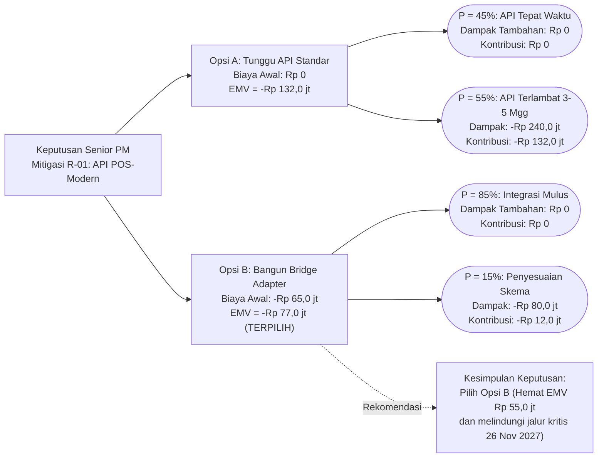

Dengan berinvestasi Rp 65,0 jt di muka, Opsi B memangkas eksposur kerugian rata-rata dari −Rp 132,0 jt menjadi −Rp 77,0 jt (**penghematan EMV bersih Rp 55,0 jt**) sekaligus melindungi jalur kritis menuju 26 November 2027.

##### 3. Analisis Sensitivitas (*Tornado Diagram*) & Simulasi Monte Carlo (Konseptual)

- **Sensitivity Analysis (*Tornado Diagram*):** Menguji satu variabel risiko pada satu waktu (sambil menjaga variabel lain konstan) untuk mengetahui risiko mana yang paling dominan menggoyang total biaya atau jadwal proyek. Risiko dengan rentang dampak terlebar ditempatkan di puncak diagram sehingga bentuk batangnya menyerupai corong tornado. Pada Proyek OMNI, analisis sensitivitas menempatkan **R-01 (API POS-Modern)**, **R-02 (Migrasi Data Loyalty)**, dan **R-05 (Kepatuhan UU PDP)** di tiga posisi teratas penggerak ketidakpastian jadwal dan biaya.
- **Monte Carlo Simulation:** Menggunakan komputer untuk menjalankan ribuan iterasi acak (misalnya 10.000 simulasi) berdasarkan distribusi probabilitas (segitiga/PERT: *optimistic, most likely, pessimistic*) pada seluruh aktivitas jadwal dan item biaya sekaligus. Keluarannya berupa kurva probabilitas kumulatif (*S-curve*), misalnya: *"Terdapat probabilitas 50% (P50) Proyek OMNI selesai dengan biaya ≤ Rp 8,90 M, dan probabilitas 80% (P80) selesai dengan biaya ≤ Rp 9,20 M."* Nilai selisih antara P80 (tingkat kepercayaan yang disyaratkan Direksi) dan estimasi dasar tanpa cadangan (Rp 8,50 M) adalah justifikasi ilmiah bagi **Contingency Reserve Rp 0,70 M**.

##### 4. *Reserve Analysis*: *Contingency Reserve* vs *Management Reserve*

Senior PM wajib menjaga pemisahan ketat dua lapis cadangan dana berikut agar tidak melanggar tata kelola keuangan perusahaan:

| Dimensi | Contingency Reserve (*CB-06* Proyek OMNI) | Management Reserve (Di Luar BAC) |
|---------|-------------------------------------------|----------------------------------|
| **Target Ketidakpastian** | ***Known-Unknowns*** — risiko yang **sudah teridentifikasi** di *Risk Register*, namun kepastian terjadinya dan besaran pastinya belum diketahui. | ***Unknown-Unknowns*** — peristiwa **tak terduga** di luar cakupan *Risk Register* (mis. aturan baru pemerintah, krisis pasokan global, kebangkrutan sub-vendor mendadak). |
| **Besaran pada Proyek OMNI** | **Rp 0,70 M (Rp 700 jt)** — terkalibrasi dari total EMV ancaman R-01 s.d. R-09 (~7,6% dari BAC). | **Rp 0,60 M (Rp 600 jt)** — ditetapkan kebijakan korporasi (~6,5% dari BAC). |
| **Posisi terhadap *Cost Baseline* (BAC)** | **Termasuk di dalam BAC** (Rp 8,50 M biaya dasar + Rp 0,70 M = **BAC Rp 9,20 M**). Masuk perhitungan EVM. | **Di luar BAC**, tetapi masuk **Total Project Funding Requirement** (Rp 9,20 M + Rp 0,60 M = **Rp 9,80 M**). Tidak masuk BAC sampai resmi dicairkan. |
| **Otoritas Pencairan** | **Senior PM (Fajar Nugroho)** hingga batas delegasi (mis. ≤ Rp 100 jt per insiden), dan **Project Sponsor (Ratna Kusuma)** untuk nilai di atasnya, tanpa mengubah BAC. | **CFO (Budi Santoso) & Executive Steering Committee** melalui **Formal Change Request** yang disetujui CCB. Saat dicairkan, dana berpindah ke *Cost Baseline* sehingga BAC baru meningkat. |

---

### 5.4 Strategi Respons Risiko, *Secondary/Residual Risk*, dan *Risk Trigger*

Mengidentifikasi dan menghitung risiko tidak ada gunanya jika tidak diterjemahkan menjadi tindakan nyata yang memiliki pemilik (*Risk Owner*) dan pemicu (*Risk Trigger*). PMBOK membedakan 5 strategi untuk **Ancaman (*Threat*)** dan 5 strategi untuk **Peluang (*Opportunity*)**:

#### A. Lima Strategi Respons Ancaman (*Threat*)

| Strategi | Prinsip Kerja | Contoh Penerapan pada Proyek OMNI |
|----------|---------------|-----------------------------------|
| **1. Escalate** *(Eskalasi)* | Risiko berada di luar kewenangan atau batas lingkup proyek; dialihkan ke tingkat Program, Sponsor, atau Direksi. Setelah diterima pihak atas, risiko tidak lagi dikelola aktif oleh PM di proyek. | Jika keterlambatan proyek POS-Modern disebabkan sengketa kontrak korporasi antara CFO SNR dan vendor POS di luar Proyek OMNI, Fajar mengeskalasikan risiko kepemilikan jadwal lintas-program ini kepada **Antonius Wibowo (Program Director)** dan **SteerCo**. |
| **2. Avoid** *(Hindari)* | Mengubah rencana proyek untuk **menghilangkan sepenuhnya** ancaman atau melindungi sasaran dari dampaknya (menurunkan $P \to 0\%$ atau menghilangkan paparan). | Menghilangkan risiko keterlambatan *Go-Live* akibat fitur gamifikasi rumit (**R-04**) dengan secara tegas menetapkan gamifikasi dan integrasi *marketplace* sebagai **Out-of-Scope** Fase 1 di Project Charter & Scope Baseline. |
| **3. Transfer** *(Alihkan)* | Memindahkan dampak finansial ancaman kepada pihak ketiga yang lebih mampu menanggungnya (via kontrak *Fixed Price*, klausul penalti SLA, garansi, atau asuransi), biasanya dengan membayar premi. *(Catatan: risiko tidak hilang, hanya berpindah tanggungan finansialnya!)* | Klausul *Service Level Agreement* dan denda keterlambatan (*liquidated damages*) pada kontrak *Fixed Price* PT NDS, kewajiban kepatuhan PCI-DSS dialihkan ke *Payment Gateway* **PT FinPay Nusantara**, serta asuransi pengiriman logistik 240 unit tablet ke luar Jawa (**R-09**). |
| **4. Mitigate** *(Mitigasi)* | Mengambil tindakan proaktif lebih awal untuk **menurunkan probabilitas** terjadinya ancaman dan/atau **memperkecil dampaknya** hingga batas yang dapat diterima. | Membangun *Bridge Adapter* paralel untuk **R-01**, menjalankan *data profiling* & pembersihan awal untuk **R-02**, menyusun skema insentif *omnichannel sales credit* & *change champions* untuk **R-03**, serta melakukan *load test* dini sejak Sprint 9 untuk **R-06**. |
| **5. Accept** *(Terima)* | Menyadari keberadaan risiko tanpa mengubah rencana proyek dasar karena biaya mitigasi melebihi manfaatnya.<br/>• **Active Accept:** Menyisihkan cadangan dana/waktu (*Contingency Reserve* / *buffer*) dan menyiapkan *Fallback Plan*.<br/>• **Passive Accept:** Tidak melakukan persiapan khusus; cukup dicatat dan ditangani dengan *workaround* bila terjadi. | **Active Accept:** Menyediakan dana cadangan Rp 24 jt dan buffer waktu 5 hari untuk penyesuaian pengiriman minor tablet di wilayah timur (**R-09**).<br/>**Passive Accept:** Risiko gangguan cuaca lokal 1 hari saat sesi pelatihan tatap muka di satu cabang kota kecil. |

#### B. Lima Strategi Respons Peluang (*Opportunity*)

| Strategi | Prinsip Kerja | Contoh Penerapan pada Proyek OMNI |
|----------|---------------|-----------------------------------|
| **1. Escalate** *(Eskalasi)* | Peluang melampaui batas proyek dan memberi nilai di tingkat program/portofolio; diserahkan ke pimpinan program/eksekutif. | Jika pola data perilaku *Click & Collect* berpotensi dimonetisasi untuk analitik AI lintas-perusahaan, peluang ini dieskalasikan ke Program Director untuk dimasukkan ke cakupan **Proyek DataHub (PRJ-04)**. |
| **2. Exploit** *(Eksploitasi)* | Mengambil tindakan tegas agar peluang **pasti terjadi** ($P \to 100\%$). | Menugaskan tim khusus integrasi promosi agar fitur *pre-order* anggota Platinum (**R-10**) dipastikan siap digunakan segera setelah Pilot 10 toko lulus kriteria M6. |
| **3. Share** *(Bagi)* | Mengalokasikan sebagian atau seluruh kepemilikan peluang kepada pihak ketiga yang paling mampu menangkap manfaatnya (kemitraan, *joint venture*, insentif bersama). | Bekerja sama dengan **PT FinPay Nusantara** (mitra *Payment Gateway*) untuk program *co-funded cashback* khusus transaksi perdana aplikasi OMNI bagi anggota Platinum. |
| **4. Enhance** *(Tingkatkan)* | Meningkatkan probabilitas dan/atau memperbesar dampak positif peluang dengan memperkuat pemicu utamanya. | Melakukan pelatihan dini bagi 10 *Store Manager* Pilot dan *early onboarding* 50.000 pelanggan Platinum teraktif agar peluang keberhasilan pilot lebih awal (**R-10**) meningkat dari 35% menjadi > 60%. |
| **5. Accept** *(Terima)* | Memanfaatkan peluang apabila terjadi secara alami tanpa mengalokasikan upaya/biaya proaktif khusus. | Memanfaatkan lonjakan organik unduhan aplikasi apabila kampanye media sosial rutin tim Marketing kebetulan menjadi viral. |

#### C. Konsep Pendukung Krusial: *Secondary Risk*, *Residual Risk*, *Fallback Plan*, *Workaround*, dan *Risk Trigger*

- **Residual Risk (Risiko Residu / Sisa):** Risiko yang **tetap tersisa** setelah rencana respons utama dijalankan. Contoh: meski kita membangun *Bridge Adapter* untuk R-01, masih tersisa probabilitas 15% perlunya penyesuaian skema saat API final rilis. Risiko sisa inilah yang ditutup oleh *Contingency Reserve*.
- **Secondary Risk (Risiko Sekunder):** Risiko **baru** yang muncul justru sebagai efek samping dari tindakan respons kita. Contoh: saat kita menerapkan *Lazy Migration* via OTP untuk memitigasi R-02, muncul *secondary risk* berupa lonjakan keluhan pelanggan lama yang nomor ponselnya sudah tidak aktif sehingga membanjiri *Contact Center*.
- **Risk Trigger (Pemicu Risiko / *Early Warning Indicator*):** Tanda atau gejala terukur yang menandakan bahwa suatu risiko hampir terjadi atau baru saja terjadi, sehingga *Risk Owner* harus segera mengeksekusi rencana kontinjensi. Contoh: *"Deviasi jadwal API POS-Modern melebihi 5 hari kerja pada laporan sinkronisasi program mingguan."*
- **Contingency Plan vs Fallback Plan:** *Contingency Plan* (Rencana Kontinjensi) dijalankan ketika *Risk Trigger* terdeteksi. **Fallback Plan** (Rencana Cadangan Lapis Kedua) adalah rencana darurat yang dijalankan apabila *Contingency Plan* utama ternyata tidak efektif atau gagal meredam dampak.
- **Workaround (Solusi Darurat Tak Terencana):** Respons spontan yang dirancang di tempat untuk mengatasi risiko yang sebelumnya **tidak teridentifikasi** (*unknown-unknown*) atau yang diterima secara pasif (*Passive Accept*) ketika kejadiannya sudah menimpa proyek.

---

### 5.5 *Risk Register* vs *Issue Log* serta *Escalation Matrix & Governance*

Salah satu indikator paling jelas yang membedakan PM junior dan Senior PM adalah disiplin membedakan **Risiko (*Risk*)** dari **Isu (*Issue*)**.

| Dimensi Pembeda | Risk Register (Daftar Risiko) | Issue Log (Catatan Isu) |
|-----------------|-------------------------------|-------------------------|
| **Orientasi Waktu** | **Masa depan** (*mungkin* terjadi; $0\% < P < 100\%$). | **Saat ini** (*sudah* terjadi atau sedang berlangsung; $P = 100\%$). |
| **Sifat Dampak** | Dapat berupa ancaman (**negatif**) maupun peluang (**positif**). | Hampir selalu **negatif** berupa hambatan, konflik, deviasi, atau kegagalan yang menuntut resolusi segera. |
| **Fokus Pengelolaan** | Pencegahan proaktif (*mitigate/avoid*), kesiapan *trigger*, dan alokasi cadangan (*reserve*). | Pemecahan masalah segera (*problem solving*), pengendalian dampak (*damage control*), dan akuntabilitas tindakan korektif. |
| **Pemilik (*Owner*)** | *Risk Owner* (memantau *trigger*) & *Risk Action Owner* (mengeksekusi mitigasi). | *Issue Owner* (bertanggung jawab menuntaskan masalah sesuai tenggat/SLA). |
| **Contoh di Proyek OMNI** | **R-01 (Bulan ke-2):** *Ada kemungkinan 55% API POS-Modern mundur sehingga mengancam integrasi stok.* | **IS-02 (Bulan ke-9):** *API POS-Modern resmi mundur 3 minggu sejak 15 Feb 2027 dan menghambat integrasi Sprint 11.* |

#### Kapan Risiko Berubah Menjadi Isu?

Risiko berpindah dari *Risk Register* ke *Issue Log* tepat pada saat **peristiwa risiko (*Risk Event*) terkonfirmasi telah terjadi ($P = 100\%$)** atau berdampak langsung pada pekerjaan berjalan. Pada saat transisi ini, Senior PM menjalankan empat langkah baku:
1. Mengubah status baris pada *Risk Register* menjadi **Occurred / Realized (Dialihkan ke Issue Log)** dan mencatat referensi ID isu (misal `R-01 → IS-02`).
2. Membuka entri baru pada *Issue Log* dengan deskripsi dampak faktual, tingkat keparahan (*Severity*), *Issue Owner*, rencana aksi korektif (*Action Plan*), dan batas waktu (*Target Resolution Date*).
3. Mengaktifkan *Contingency Plan* / pencairan *Contingency Reserve* (atau *Change Request* jika membutuhkan *Management Reserve* / perubahan baseline).
4. Mengevaluasi apakah isu menembus ambang batas (*threshold*) wewenang PM; jika ya, segera menjalankan **Escalation Matrix** sesuai SLA.

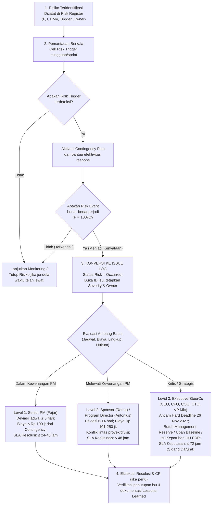

#### Prinsip Emas Eskalasi Senior PM (*Escalation Without Drama*)

Eskalasi **bukan tanda kelemahan** seorang PM; menyembunyikan masalah hingga terlambat diperbaiki (*watermelon reporting* — tampak hijau di luar, merah di dalam) itulah kegagalan fatal Senior PM. Agar eskalasi dihormati eksekutif:
1. **Jangan pernah mengeskalasi masalah kosong** — selalu hadirkan fakta terukur, akar penyebab, minimal 2 opsi solusi (beserta dampak biaya/jadwal/risiko masing-masing), dan 1 rekomendasi tegas (*options & recommendation*).
2. **Terapkan asas *No Surprises*** — informasikan Sponsor (Ratna Kusuma) secara informal terlebih dahulu sebelum isu merah muncul di forum SteerCo bersama CEO dan CFO.
3. **Eskalasi berbasis SLA dan ambang batas objektif** — sehingga pihak yang dieskalasi melihatnya sebagai mekanisme tata kelola proyek yang profesional, bukan serangan personal.

---

### 5.6 Manajemen Pemangku Kepentingan (*Stakeholder Management*) Tingkat Senior

**Pemangku kepentingan (*stakeholder*)** adalah setiap individu, kelompok, atau organisasi yang dapat **memengaruhi**, **terpengaruh oleh**, atau **merasa dirinya terpengaruh** oleh keputusan, aktivitas, atau hasil proyek. Frasa *"merasa dirinya terpengaruh"* amat penting: walau secara objektif *Click & Collect* justru mendatangkan lebih banyak pengunjung ke toko fisik, selama 120 *Store Manager* *merasa* fitur tersebut akan menggerus komisi mereka, persepsi itu adalah realitas politik yang wajib dikelola!

#### A. *Stakeholder Identification* & *Stakeholder Register*

Identifikasi pemangku kepentingan dilakukan sejak penyusunan *Project Charter* dan diperbarui setiap perpindahan fase atau pergantian pejabat. Semua data dirangkum dalam **Stakeholder Register** yang mencakup:
- **Informasi Identifikasi:** Kode, nama, jabatan, unit/organisasi, peran proyek, kontak.
- **Informasi Penilaian:** Kepentingan utama, ekspektasi kunci, tingkat kekuasaan (*Power*), tingkat minat (*Interest*), *Salience*, arah pengaruh (*Direction of Influence*), dan posisi dukungan saat ini vs target.
- **Klasifikasi:** Internal vs Eksternal, Pendukung (*Supporter*) vs Netral (*Neutral*) vs Penentang (*Resistor*).

*(Catatan Kerahasiaan: Penilaian sensitif seperti "resisten" atau "sumber scope creep" disimpan di dokumen kerja internal PM/Sponsor, **tidak** disebarluaskan secara terbuka ke seluruh peserta rapat proyek!)*

#### B. Tiga Kerangka Pemetaan Pemangku Kepentingan (*Stakeholder Mapping*)

1. **Power–Interest Grid (Matriks Kekuasaan–Kepentingan):** Mengelompokkan pemangku kepentingan berdasarkan kewenangan memengaruhi keputusan proyek (*Power*) dan kepedulian terhadap detail/hasil proyek (*Interest*):
   - **High Power, High Interest → *Manage Closely*:** Libatkan intensif dalam keputusan kunci, kolaborasi rutin, selaraskan ekspektasi secara proaktif.
   - **High Power, Low–Moderate Interest → *Keep Satisfied*:** Jangan banjiri detail teknis harian; sampaikan ringkasan eksekutif tepat sasaran pada *milestone* dan *gate* keputusan, serta patuhi ambang batas mereka (anggaran, regulasi, jadwal).
   - **Low–Moderate Power, High Interest → *Keep Informed*:** Berikan informasi rutin, libatkan dalam konsultasi teknis/operasional, dan manfaatkan semangat mereka sebagai *advocate* atau *early tester*.
   - **Low Power, Low Interest → *Monitor*:** Berikan pembaruan minimal yang efisien (*pull communication*) sambil memantau apakah posisi mereka bergeser naik di fase berikutnya.

2. **Salience Model (Mitchell, Agle, & Wood):** Memetakan pemangku kepentingan berdasarkan irisan tiga atribut dinamis—sangat kuat untuk proyek kompleks dan multi-divisi:
   - **Power (Kekuasaan):** Kemampuan memaksakan kehendak (otoritas anggaran, *veto*, kontrak).
   - **Legitimacy (Legitimasi):** Kesesuaian keterlibatan mereka secara struktural, hukum, atau moral dalam proyek.
   - **Urgency (Urgensi):** Kebutuhan mendesak atas perhatian segera (kritis waktu atau sensitivitas operasional).

   Kombinasi ketiganya menghasilkan tujuh profil kunci; empat yang paling sering dihadapi Senior PM adalah:
   - **Definitive Stakeholder (Power + Legitimacy + Urgency):** Prioritas utama mutlak—contoh di Proyek OMNI: **Ratna Kusuma (SH-02, COO/Sponsor)** dan **Agus Setiawan (SH-06)** saat memasuki fase *Pilot* dan *Rollout* 120 toko.
   - **Dominant Stakeholder (Power + Legitimacy):** Memiliki otoritas resmi tetapi tidak mendesak setiap hari—contoh: **Hendra Wijaya (SH-01, CEO)** dan **Budi Santoso (SH-03, CFO)**.
   - **Dangerous Stakeholder (Power + Urgency, tanpa Legitimasi penuh di luar lingkup):** Dapat mengganggu proyek secara sepihak jika tidak diarahkan—misalnya seorang eksekutif non-sponsor yang menekan vendor secara langsung di luar jalur CCB.
   - **Dormant Stakeholder (Hanya Power saat ini):** Terlihat tenang di awal proyek, namun bisa berubah menjadi *Definitive* secara tiba-tiba bila terpicu—contoh: **Rina Kartika (SH-08, Legal & InfoSec)** tampak tenang di Sprint 1–4, tetapi jika UU PDP terabaikan menjelang *Go-Live*, ia langsung menggunakan *veto power*-nya!

3. **Direction of Influence (Arah Pengaruh):** Menentukan pendekatan gaya komunikasi berdasarkan arah relasi hierarkis:
   - **Upward (Ke Atas):** Eksekutif, Sponsor, SteerCo (SH-01 s.d. SH-05).
   - **Downward (Ke Bawah):** Tim inti proyek, *Scrum team*, spesialis teknis (SH-11, SH-12, QA).
   - **Outward (Ke Luar):** Vendor PT NDS (SH-13), PT FinPay Nusantara, agregator kurir, regulator UU PDP, pelanggan.
   - **Sideward (Ke Samping / Sejajar):** Rekan manajer unit bisnis dan sesama PM lintas-program (SH-06 Agus, SH-07 Siti, SH-08 Rina, SH-09 Antonius, PM ERP-Refresh & PM POS-Modern).

#### C. *Stakeholder Engagement Assessment Matrix* (SEAM)

SEAM membandingkan tingkat keterlibatan **Saat Ini (`C` — *Current*)** terhadap tingkat keterlibatan **Yang Diinginkan (`D` — *Desired*)** pada lima spektrum:
1. **Unaware:** Tidak mengetahui proyek maupun dampaknya.
2. **Resistant:** Mengetahui proyek dan secara aktif maupun pasif menentang perubahan.
3. **Neutral:** Mengetahui proyek, tetapi tidak mendukung maupun menolak.
4. **Supportive:** Mengetahui proyek dan mendukung keberhasilannya.
5. **Leading:** Terlibat aktif memastikan keberhasilan proyek dan mengajak pihak lain mendukung.

Tugas utama Senior PM adalah menutup celah (*gap*) antara `C` dan `D` secara terukur—terutama menggeser aktor berdaya tinggi dari **Resistant → Supportive** (seperti Agus Setiawan) atau dari **Neutral → Supportive** (seperti Budi Santoso dan Rina Kartika).

#### D. Taktik Senior Mengatasi Resistensi Organisasi & Konflik Kepentingan

Resistensi hampir **tidak pernah irasional**; di balik setiap penolakan terdapat kepentingan sah yang merasa terancam (*What's In It For Me?* / WIIFM). Senior PM menerapkan pendekatan 4 langkah:
1. **Diagnosis Akar Resistensi (Empati Analitis):** Bedakan apakah penolakan berasal dari *ketakutan kehilangan KPI/insentif* (mis. kekhawatiran toko fisik omzetnya diambil kanal online), *beban kerja tambahan tanpa alat memadai*, *ketidakpastian kompetensi*, atau *kurang dilibatkan sejak desain*.
2. **Co-Creation (Libatkan Penentang dalam Perancangan Solusi):** Orang jauh lebih sulit menentang sistem yang ikut mereka rancang. Undang perwakilan *Store Manager* paling vokal menjadi anggota tim desain SOP *Click & Collect* dan peserta Pilot 10 toko.
3. **Penyelarasan Insentif (*Incentive Realignment*):** Bersama Sponsor (COO) dan CFO, perbaiki akar struktural konflik kepentingan—misalnya menetapkan kebijakan *Omnichannel Sales Attribution* agar pesanan *Click & Collect* tetap dihitung 100% sebagai pencapaian target penjualan toko pemenuh barang.
4. **Mengendalikan *Scope Creep* Eksekutif Tanpa Konfrontasi Personal:** Saat menghadapi eksekutif antusias seperti Dewi Lestari (SH-05), jangan pernah menjawab *"Tidak boleh"* secara mentah. Gunakan teknik **"Yes, And... via Trade-off & Backlog Fase 2"**: akui nilai bisnis idenya, kuantifikasi dampak biaya/jadwalnya (mis. *"+Rp 185 jt dan mundur 3 minggu dari 26 Nov 2027"*), catat resmi dalam *Phase 2 Product Backlog*, lalu kembalikan keputusan *trade-off* ke forum *Change Control Board* (CCB) bersama Sponsor dan CFO.

---

### 5.7 Perencanaan Komunikasi (*Communication Management Plan*)

Penelitian PMI menunjukkan bahwa lebih dari **75%–85% waktu kerja Senior PM** dihabiskan untuk berkomunikasi, dan komunikasi yang buruk merupakan salah satu pemicu utama kegagalan proyek. Komunikasi tingkat senior bukan berarti mengirim lebih banyak email atau memperbanyak rapat, melainkan **menyampaikan informasi yang tepat, kepada audiens yang tepat, dalam format dan waktu yang tepat, melalui kanal yang terkendali**.

#### A. Kompleksitas Saluran Komunikasi: Rumus $n(n-1)/2$

Apabila setiap pemangku kepentingan berkomunikasi bebas secara langsung satu sama lain tanpa tata kelola, jumlah saluran komunikasi potensial ($C$) tumbuh secara **kuadratik** mengikuti jumlah pihak ($n$):

$$C = \frac{n(n - 1)}{2}$$

Perhatikan betapa cepat kompleksitas melonjak pada Proyek OMNI:
- 5 anggota tim inti: $C = \frac{5 \times 4}{2} = 10$ saluran.
- **13 entitas pemangku kepentingan kunci (SH-01 s.d. SH-13):** $C = \frac{13 \times 12}{2} = \mathbf{78}$ saluran.
- Jika dihitung per **15 individu pimpinan/inti** pada tabel SH-01 s.d. SH-13 (SH-11 dan SH-12 masing-masing 2 orang): $C = \frac{15 \times 14}{2} = \mathbf{105}$ saluran.
- Bayangkan bila Senior PM membuka jalur komunikasi langsung bebas dengan **120 Store Manager** ($n = 121$ termasuk PM): $C = \frac{121 \times 120}{2} = \mathbf{7.260}$ saluran—dijamin melumpuhkan proyek!
- Dengan **model komunikasi berjenjang (*cascade*)** melalui Agus Setiawan + 6 Regional Manager ($n = 8$ termasuk PM), jalur aktif inti di kantor pusat menyusut menjadi hanya $\frac{8 \times 7}{2} = \mathbf{28}$ saluran!

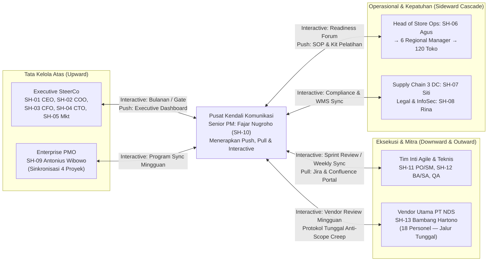

#### B. Tiga Metode Komunikasi & Prinsip 5W+1H

1. **Interactive Communication (Komunikasi Interaktif — Dua Arah *Real-Time*):** Rapat SteerCo, *Sprint Review*, negosiasi kontrak vendor, *workshop* desain SOP, eskalasi konflik. Paling efektif membangun kesepakatan bersama pada topik kompleks atau sensitif, tetapi paling mahal dari sisi waktu.
2. **Push Communication (Komunikasi Dorong — Satu Arah ke Penerima Tertentu):** Laporan status mingguan, *Executive RAG Dashboard*, memo eskalasi, notulen keputusan (*Minutes of Meeting* / MoM), surat resmi CR. Menjamin informasi terkirim, **tidak otomatis menjamin dibaca atau dipahami**—harus dilengkapi permintaan konfirmasi untuk keputusan kritis.
3. **Pull Communication (Komunikasi Tarik — Repositori Mandiri):** Portal proyek (Confluence/SharePoint), *dashboard* *real-time* Jira/Power BI, perpustakaan SOP *Click & Collect*, dan modul video pelatihan bagi 1.440 staf toko. Sangat efisien untuk volume informasi besar dan audiens luas.

Seluruh metode ini dituangkan dalam **Matriks Komunikasi 5W+1H** yang menetapkan secara tegas: **Who** (audiens & pengirim), **What** (konten & tingkat detail), **Why** (tujuan komunikasi/keputusan yang diharapkan), **When** (frekuensi & jadwal), **Where/Channel** (media & metode *Push/Pull/Interactive*), dan **How/Format** (templat standar, mis. *1-page RAG*, *BLUF Memo*, *Burnup Chart*).

---

### 5.8 Kesalahan Umum di Lapangan (*Anti-Patterns*)

Pada praktik proyek transformasi digital di Indonesia, banyak PM berpengalaman sekalipun masih terjebak pada pola keliru (*anti-patterns*) berikut:

| No | *Anti-Pattern* di Lapangan | Dampak Nyata pada Proyek | Praktik Senior PM yang Benar |
|----|----------------------------|--------------------------|------------------------------|
| **1** | ***Write-Once, Forget-Forever Risk Register*** — *Risk Register* hanya diisi sekali saat *kick-off* demi lolos audit PMO, lalu tidak pernah dibuka lagi. | Risiko berubah menjadi krisis mendadak tanpa *trigger* aktif; *Contingency Reserve* habis tanpa jejak analisis. | Jadikan peninjauan Top-5 Risiko dan *Risk Trigger* sebagai agenda wajib 15 menit pada rapat mingguan tim dan tinjauan bulanan SteerCo. |
| **2** | **Mencampuradukkan Risiko dengan Isu atau Fakta** — Menulis kejadian yang sudah berlangsung di *Risk Register* dengan probabilitas "90%". | Tim terus "memitigasi" masalah yang sebenarnya sudah butuh pemecahan segera, bukan pemantauan probabilitas. | Begitu terjadi ($P=100\%$), segera pindahkan ke *Issue Log* lengkap dengan *Issue Owner*, SLA, dan rencana aksi korektif. |
| **3** | **Menggunakan *Contingency Reserve* untuk *Scope Creep*** — Mengambil dana CB-06 Rp 0,70 M untuk membiayai fitur gamifikasi tambahan dari Marketing. | Cadangan untuk risiko nyata (data kotor, delay API) terkuras habis; saat risiko benar-benar terjadi, proyek jebol anggaran (*cost overrun*). | Tegakkan aturan besi: *Contingency Reserve* hanya untuk risiko teridentifikasi di *Risk Register*; fitur baru wajib melalui CCB dan pendanaan terpisah atau tukar lingkup (*scope trade-off*). |
| **4** | **Menetralkan Cadangan Biaya dengan EMV Peluang** — Mengurangi *Contingency Reserve* Rp 0,70 M menjadi Rp 0,60 M karena R-10 punya EMV +Rp 0,105 M. | Proyek kekurangan likuiditas cadangan biaya tunai ketika ancaman terjadi, karena peluang biasanya berbentuk *upside* pendapatan pasca-*go-live*. | Hitung *Contingency Reserve* secara konservatif murni dari eksposur ancaman (*Threat EMV*); kelola peluang terpisah sebagai target peningkatan manfaat bisnis. |
| **5** | ***Back-Channel Communication* ke Vendor** — Eksekutif bisnis menghubungi langsung *developer* PT NDS untuk menambah fitur kecil "mumpung sekalian". | Muncul *scope creep* tersembunyi, *velocity* sprint anjlok, dan sengketa tagihan *Change Request* mendadak di akhir fase. | Tetapkan protokol komunikasi tunggal (*Single Point of Contact*): seluruh perubahan kebutuhan wajib masuk ke Product Owner (Kevin) dan disaring PM (Fajar) via CCB sebelum dikerjakan tim PT NDS. |
| **6** | ***Watermelon Reporting* & Takut Mengeskalasi** — Laporan ke SteerCo terus berwarna "Hijau" meski SPI sudah 0,90 dan API mundur 3 minggu, berharap masalah sembuh sendiri. | Kehilangan jendela waktu pemulihan (*recovery window*); kepercayaan CEO dan CFO runtuh permanen saat krisis meledak menjelang *Go-Live*. | Laporkan status **Amber/Red** secara jujur begitu menembus *threshold*, selalu dibarengi akar masalah, opsi mitigasi terukur, dan rekomendasi keputusan. |
| **7** | **Mengabaikan *Resistant Stakeholder* yang Berpengaruh** — Berfokus hanya kepada Sponsor yang suportif dan menganggap operasional toko "tinggal ikut perintah Direksi". | Aplikasi selesai dibangun tepat waktu, tetapi gagal diadopsi di 120 toko: SLA *Click & Collect* meleset, staf toko memperlambat proses, dan manfaat bisnis gagal tercapai. | Libatkan penentang kunci sejak awal (*co-creation*), benahi akar benturan KPI/insentifnya, dan bangun koalisi *change champions* di level manajer lapangan. |

---
## 6. Studi Kasus: Penerapan pada Proyek OMNI

Bagian ini menerapkan seluruh kerangka Modul 03 secara terpadu pada **Proyek OMNI — PT Sinar Nusantara Retail Tbk (SNR)** (*kick-off* 1 Juni 2026, *hard deadline* 26 November 2027, BAC **Rp 9,20 M**, *Contingency Reserve* **Rp 0,70 M**, *Management Reserve* **Rp 0,60 M**, vendor utama **PT Nusantara Digital Solusi / PT NDS**). Seluruh artefak di bawah ini siap dijadikan acuan langsung oleh Senior PM **Fajar Nugroho (SH-10)**.

---

### 6.1 *Risk Register* Lengkap & Kalibrasi EMV Proyek OMNI (R-01 s.d. R-10)

Pada **Milestone M2 (Baseline & Readiness — 31 Agustus 2026)**, Fajar Nugroho bersama Tim Inti, PMO, dan perwakilan bisnis menyelesaikan analisis kualitatif (Matriks 5×5 sesuai Sub-bab 5.3) serta analisis kuantitatif EMV untuk seluruh 10 risiko baseline (**R-01 s.d. R-10**).

| ID | Pernyataan Risiko (*Cause – Event – Impact*) & Kategori | Jenis | $P$ (1–5 / %) | $I$ (1–5 / Rp jt) | Skor $P \times I$ (Zona) | EMV = $P \times I$ (Rp jt) | Strategi & Rencana Respons Utama | *Risk Trigger* | *Risk Owner* |
|----|----------------------------------------------------------|-------|---------------|-------------------|--------------------------|----------------------------|----------------------------------|----------------|--------------|
| **R-01** | **Karena** proyek POS-Modern berjalan paralel dengan jadwal ketat, **ada risiko** rilis API sinkronisasi stok toko mundur 3–5 minggu, **sehingga** mengganggu jalur kritis Release 3 dan memicu biaya percepatan/lembur Rp 240 jt. *(Eksternal / Program)* | Threat | 4 (55%) | 4 (−240) | **16** *(Kritis)* | **−132,0** | **Mitigate & Escalate:** Bangun *Mock/Bridge Adapter* sejak Sprint 6; kunci *Interface Control Document* (ICD) bersama PM POS-Modern; sinkronisasi mingguan di forum Program Nusantara 2028. | Deviasi jadwal *staging API* POS-Modern > 5 hari kerja pada laporan program mingguan. | **Antonius Wibowo (SH-09)** & **Dimas Prasetyo (SH-12)** |
| **R-02** | **Karena** ±62% dari 1,2 juta data kartu fisik *Sinar Member Card* duplikat/usang, **ada risiko** migrasi *Digital Loyalty Engine* gagal bersih di Sprint 10, **sehingga** menunda Release 2 selama 3–4 minggu dan menambah biaya *cleansing* Rp 210 jt. *(Teknis / Data)* | Threat | 4 (60%) | 4 (−210) | **16** *(Kritis)* | **−126,0** | **Mitigate:** Lakukan *data profiling* sampel 100.000 baris di Sprint 4; siapkan opsi *Lazy Migration* (migrasi anggota aktif + verifikasi OTP) dan alat *automated cleansing*. | Tingkat kegagalan validasi skrip ETL uji coba > 25% pada Sprint 7. | **Nadia Putri (SH-12)** & **Kevin Halim (SH-11)** |
| **R-03** | **Karena** staf toko khawatir *Click & Collect* menambah beban kerja dan menggerus omzet fisik, **ada risiko** 120 *Store Manager* & kasir menolak SOP baru, **sehingga** SLA ≤ 2 jam gagal dan butuh biaya *retraining/hypercare* Rp 220 jt. *(Organisasi / Stakeholder)* | Threat | 3 (45%) | 4 (−220) | **12** *(Tinggi)* | **−99,0** | **Mitigate:** Terapkan *Omnichannel Sales Attribution* (omzet BOPIS 100% masuk kredit toko pemenuh); libatkan 10 *Store Manager* vokal dalam *co-creation* SOP Pilot; siapkan insentif Pilot. | Kehadiran sosialisasi *Store Manager* < 80% atau skor kesiapan survei < 3,0/5,0 sebelum M6. | **Agus Setiawan (SH-06)** & **Ratna Kusuma (SH-02)** |
| **R-04** | **Karena** ekspektasi tinggi tim Marketing terhadap fitur kompetitor, **ada risiko** penambahan fitur gamifikasi/*live-shopping* di tengah sprint (*scope creep*), **sehingga** membengkakkan biaya CR Rp 150 jt dan menekan jadwal. *(Lingkup / Tata Kelola)* | Threat | 4 (60%) | 3 (−150) | **12** *(Tinggi)* | **−90,0** | **Avoid & Mitigate:** Kunci daftar *Out-of-Scope* di Charter; alihkan ide baru ke *Phase 2 Parking Lot*; terapkan aturan wajib CCB dan *Feature Freeze* pada M5 (23 Apr 2027). | Muncul > 2 permintaan perubahan non-baseline di luar *Product Backlog* dalam 1 sprint. | **Fajar Nugroho (SH-10)** & **Kevin Halim (SH-11)** |
| **R-05** | **Karena** persyaratan ketat UU No. 27/2022 (UU PDP) dan integrasi pembayaran PCI-DSS, **ada risiko** ditemukan celah *Critical/High* pada *PenTest* atau audit privasi, **sehingga** Rina Kartika memveto *Go-Live* dengan biaya remediasi & audit ulang Rp 400 jt. *(Legal / Keamanan)* | Threat | 2 (20%) | 5 (−400) | **10** *(Tinggi)* | **−80,0** | **Mitigate & Transfer:** Tanamkan *Privacy-by-Design* sejak Sprint 1; lakukan *pre-PenTest* di Sprint 11; alihkan kepatuhan kartu pembayaran ke PT FinPay Nusantara (PCI-DSS *certified*). | Ditemukan ≥ 1 temuan *High/Critical* pada *security scan* otomatis Sprint 10–11. | **Rina Kartika (SH-08)** & **Irwan Pratama (SH-04)** |
| **R-06** | **Karena** lonjakan trafik belanja Harbolnas 12.12 hingga 2.500 TPM dan sinkronisasi stok 120 toko, **ada risiko** terjadi *downtime* atau *latency* tinggi saat uji beban, **sehingga** butuh *tuning* arsitektur & *cloud burst* Rp 240 jt. *(Teknis / Arsitektur)* | Threat | 2 (25%) | 4 (−240) | **8** *(Sedang)* | **−60,0** | **Mitigate:** Terapkan arsitektur *auto-scaling* AWS/GCP Jakarta + *caching layer* stok; jalankan *progressive load test* (500 → 1.500 → 2.500 TPM) sejak Release 2. | Waktu respons API > 1,5 detik atau *error rate* > 1% pada simulasi 1.500 TPM. | **Dimas Prasetyo (SH-12)** & **Irwan Pratama (SH-04)** |
| **R-07** | **Karena** 3 *senior architect* IT SNR terbagi ke 4 proyek dan pasar talenta digital ketat, **ada risiko** *turnover* insinyur kunci PT NDS atau tim internal, **sehingga** *velocity* turun dan timbul biaya *onboarding* Rp 140 jt. *(Sumber Daya)* | Threat | 3 (35%) | 3 (−140) | **9** *(Sedang)* | **−49,0** | **Mitigate & Transfer:** Wajibkan *key-person clause* & masa transisi 14 hari tanpa biaya pada kontrak PT NDS; terapkan *pair programming* & dokumentasi arsitektur di Confluence. | Pengajuan *resign* personel inti atau *velocity* sprint turun > 20% dua sprint berturut-turut. | **Bambang Hartono (SH-13)** & **Tania Wijaya (SH-11)** |
| **R-08** | **Karena** kontrak *Fixed Price* Rp 4,40 M memiliki ruang tafsir pada detail integrasi, **ada risiko** sengketa lingkup dengan PT NDS memicu lonjakan biaya *Change Request* Rp 160 jt. *(Komersial / Vendor)* | Threat | 2 (25%) | 3 (−160) | **6** *(Sedang)* | **−40,0** | **Mitigate & Avoid:** Dokumentasikan *Acceptance Criteria* rinci per *User Story* dan tanda tangan *BRD Sign-off*; larang instruksi langsung dari user ke developer PT NDS. | PT NDS menerbitkan surat keberatan ruang lingkup (*Out-of-Scope Notice*) pada review sprint. | **Fajar Nugroho (SH-10)** & **Rina Kartika (SH-08)** |
| **R-09** | **Karena** jaringan 52 toko tersebar di luar Jawa (Sumatra, Kalimantan, Sulawesi, Bali–Nusra), **ada risiko** pengiriman 240 tablet/scanner terlambat saat Wave 2–3, **sehingga** muncul biaya ekspres udara & unit cadangan Rp 80 jt. *(Pengadaan / Logistik)* | Threat | 2 (30%) | 2 (−80) | **4** *(Rendah)* | **−24,0** | **Transfer & Active Accept:** Pesan perangkat 8 minggu lebih awal (*lead time* aman) dengan asuransi pengiriman & klausul SLA vendor; siapkan 10% unit *buffer* (24 unit) di 3 DC. | Konfirmasi jadwal kirim vendor perangkat mundur > 7 hari dari jadwal Wave 1/2. | **Siti Rahmawati (SH-07)** & **Fajar Nugroho (SH-10)** |
| **SUBTOTAL** | **Total Eksposur Ancaman (*Total Threat EMV*: R-01 s.d. R-09)** | **Threat** | — | — | — | **−700,0** | **Dasar Kalibrasi *Contingency Reserve* (CB-06) = Rp 0,70 M (7,6% dari BAC Rp 9,20 M)** | — | **Fajar Nugroho (SH-10)** |
| **R-10** | **Karena** pilot 10 toko Jabodetabek terfokus pada cabang berkapasitas tinggi, **ada peluang** pilot lulus kriteria SLA ≤ 2 jam 2 minggu lebih awal, **sehingga** kanal *pre-order* anggota Platinum dapat dibuka sebelum Harbolnas dengan tambahan margin +Rp 300 jt. *(Bisnis / Peluang)* | **Opportunity** | 3 (35%) | +4 (+300) | **12** *(Tinggi)* | **+105,0** | **Enhance & Exploit:** Siapkan modul kampanye *pre-order* Platinum di Sprint 13–14; pilih 10 toko pilot dengan kinerja inventori tertinggi & dampingi penuh saat M6. | Pilot 10 toko mencapai akurasi stok ≥ 98% dan SLA ≤ 2 jam pada akhir minggu ke-2 Pilot. | **Dewi Lestari (SH-05)** & **Kevin Halim (SH-11)** |

#### Catatan Kalibrasi Cadangan (*Reserve Analysis* Proyek OMNI)

1. **Verifikasi Penjumlahan EMV Ancaman:**
   $$\text{Total Threat EMV} = (-132,0) + (-126,0) + (-99,0) + (-90,0) + (-80,0) + (-60,0) + (-49,0) + (-40,0) + (-24,0) = -\mathbf{Rp\ 700,0\ jt} \ (= -\mathbf{Rp\ 0,70\ M})$$
   Angka ini terkalibrasi tepat dengan alokasi **CB-06 Contingency Reserve = Rp 0,70 M** (7,6% dari BAC Rp 9,20 M) dalam struktur anggaran induk Proyek OMNI.
2. **Mengapa EMV Peluang R-10 (+Rp 105,0 jt) Tidak Mengurangi *Contingency Reserve*?**
   Meskipun secara matematis *Net EMV* = −Rp 700,0 jt + Rp 105,0 jt = −Rp 595,0 jt, CFO (**Budi Santoso**) dan Senior PM (**Fajar Nugroho**) menetapkan *Contingency Reserve* tetap **Rp 0,70 M**. Alasannya: R-10 menghasilkan **tambahan pendapatan/margin komersial** pasca-pilot (bukan pengurangan biaya tunai proyek), sehingga tidak bisa dipakai membayar lembur teknis atau *data cleansing* di tengah proyek.
3. **Posisi *Management Reserve* (Rp 0,60 M):** Disimpan di luar BAC (6,5% dari BAC; menjadikan *Total Project Funding Requirement* **Rp 9,80 M**) di bawah kendali CFO & SteerCo khusus untuk *unknown-unknowns* di luar R-01 s.d. R-10.
4. **Identifikasi *Secondary Risk* & *Residual Risk* Utama:**
   - Pada **R-01**, setelah *Bridge Adapter* dipasang, tersisa **Residual Risk** probabilitas 15% penyesuaian skema saat API final rilis (EMV sisa −Rp 12 jt) dan **Secondary Risk** bertambahnya beban pemeliharaan kode temporer yang harus dibersihkan sebelum *Go-Live*.
   - Pada **R-02**, opsi *Lazy Migration* (aktivasi OTP) menimbulkan **Secondary Risk** lonjakan panggilan ke *Contact Center* dari anggota lama yang ganti nomor HP, sehingga perlu disiapkan *Fallback Plan* berupa skrip bantuan verifikasi di kasir 120 toko.

---

### 6.2 *Issue Log* Bulan ke-9 (28 Februari 2027) & *Escalation Matrix* 3 Tingkat

Memasuki titik tinjauan resmi **akhir Bulan ke-9 (28 Februari 2027 — pasca-Sprint 10)**, kinerja EVM Proyek OMNI menunjukkan tekanan serius: **BAC = Rp 9,20 M**, **PV = Rp 4,80 M**, **EV = Rp 4,32 M**, **AC = Rp 4,60 M**, menghasilkan **SV = −Rp 0,48 M (SPI = 0,90)**, **CV = −Rp 0,28 M (CPI = 0,94)**, **EAC = Rp 9,80 M**, dan **TCPI = 1,06**. Tekanan ini terjadi karena dua risiko kritis (**R-02** dan **R-01**) telah **berubah status menjadi isu nyata ($P = 100\%$)**, disertai dua isu tata kelola dan operasional yang mencuat bersamaan (**IS-03** dan **IS-04**).

#### A. *Issue Log* Aktif Proyek OMNI (Per 28 Februari 2027)

| ID Isu | Asal Risiko | Deskripsi Isu Faktual & Dampak Terukur | Tingkat Keparahan | Status & Level Eskalasi | *Issue Owner* | Rencana Aksi Korektif & Kebutuhan Keputusan | Target Selesai |
|--------|-------------|----------------------------------------|-------------------|-------------------------|---------------|---------------------------------------------|----------------|
| **IS-01** | **R-02** *(Occurred)* | **Data 1,2 Juta *Sinar Member Card* 2× Lebih Kotor dari Asumsi:** 744.000 baris gagal validasi ETL (duplikat lintas toko, nomor HP tidak aktif, tanpa bukti *consent* UU PDP). Release 2 (M4, target 12 Feb 2027) mundur 2 minggu; menyumbang deviasi SV & CV Bulan ke-9. | **Kritis** | *In Progress* — **Level 2** *(Sponsor & Legal)* | **Nadia Putri & Dimas Prasetyo (SH-12)** | Ajukan keputusan **Lazy Migration** (migrasi 450.000 anggota aktif 24 bulan terakhir + verifikasi mandiri OTP untuk sisanya); cairkan **Rp 55 jt** dari *Contingency Reserve* (CB-06) untuk modul OTP & kampanye aktivasi; minta validasi kepatuhan UU PDP dari Rina Kartika (SH-08). | 14 Mar 2027 |
| **IS-02** | **R-01** *(Occurred)* | **Keterlambatan Rilis API Proyek POS-Modern Selama 3 Minggu:** Tim POS-Modern terkendala sertifikasi *firmware* terminal kasir sehingga API *staging* mundur dari 15 Feb ke 8 Mar 2027. Mengancam **Gate 2 / Feature Freeze (M5, 23 Apr 2027)** pada jalur kritis menuju 26 Nov 2027. | **Kritis** | *Escalated* — **Level 2 → Level 3** *(PMO, CTO & SteerCo)* | **Dimas Prasetyo (SH-12)** & **Fajar Nugroho (SH-10)** | Aktivasi **Bridge Adapter** sementara (dana Rp 65 jt dari CB-06) agar pengembangan & uji *Store Fulfillment App* di Sprint 11–12 tidak terhenti; eskalasi ke Antonius (SH-09) & Irwan (SH-04) untuk penugasan 2 *senior backend engineer* lintas-program dan *fast-tracking* SIT parsial. | 21 Mar 2027 |
| **IS-03** | **R-04 & R-08** *(Occurred)* | **Permintaan Fitur *Gamification Spin-the-Wheel* di Luar Kontrak & Klaim CR PT NDS Rp 185 jt:** Tim Marketing (SH-05) meminta langsung fitur gamifikasi ke tim developer PT NDS tanpa CCB; Bambang Hartono (SH-13) mengirim pemberitahuan potensi *Change Request* Rp 185 jt dan penundaan Sprint 12 selama 2 minggu. | **Tinggi** | *Escalated* — **Level 2** *(Sponsor / CCB)* | **Fajar Nugroho (SH-10)** & **Kevin Halim (SH-11)** | Hentikan pengerjaan fitur tidak resmi (*Stop-Work Notice* ke PT NDS); masukkan *Spin-the-Wheel* ke *Phase 2 Backlog (2028)* melalui sidang CCB dipimpin Ratna Kusuma (SH-02); terbitkan ulang aturan protokol komunikasi tunggal anti-*back-channel*. | 7 Mar 2027 |
| **IS-04** | **R-03** *(Occurred)* | **Penolakan 3 Regional Manager Luar Jabodetabek Terhadap Jadwal Pelatihan & SLA *Click & Collect* ≤ 2 Jam:** 3 dari 6 Regional Manager menilai staf toko tidak mampu mengejar SLA 2 jam saat akhir pekan dan keberatan karena penjualan daring tidak masuk kuota penjualan cabang. | **Tinggi** | *Open* — **Level 2** *(COO / Sponsor)* | **Agus Setiawan (SH-06)** & **Fajar Nugroho (SH-10)** | Susun surat keputusan bersama COO (SH-02) & CFO (SH-03) tentang **100% Omnichannel Sales Attribution** bagi toko pemenuh pesanan BOPIS; terapkan masa transisi SLA bertahap (≤ 3 jam pada 2 minggu pertama Pilot, lalu ≤ 2 jam); rekrut 3 Regional Manager tersebut sebagai pengarah desain SOP. | 19 Mar 2027 |

#### B. *Escalation Matrix* 3 Tingkat Proyek OMNI (Berbasis SLA)

| Tingkat Eskalasi | Pemegang Otoritas | Ambang Batas Pemicu (*Escalation Triggers*) | Kewenangan Keputusan | SLA Tanggapan / Keputusan |
|------------------|-------------------|---------------------------------------------|----------------------|---------------------------|
| **Level 1 — Operasional Proyek** | **Fajar Nugroho (SH-10)** — Senior Project Manager *(didukung SH-11, SH-12, SH-13)* | • Deviasi jadwal ≤ 5 hari kerja (tidak menembus *milestone* kunci)<br/>• Dampak biaya ≤ Rp 100 jt dari *Contingency Reserve* (CB-06)<br/>• Konflik teknis internal atau penyesuaian urutan *sprint backlog* tanpa mengubah lingkup | Realokasi tugas tim, aktivasi *Contingency Plan* ≤ Rp 100 jt, penerbitan *work instruction* teknis, penegakan protokol harian. | **≤ 24 jam** (tanggapan awal); **≤ 48 jam** (rencana resolusi). |
| **Level 2 — Sponsor & Program** | **Ratna Kusuma (SH-02)** (Project Sponsor / COO) & **Antonius Wibowo (SH-09)** (Program Director / PMO) *(melibatkan Irwan SH-04 / Rina SH-08 sesuai domain)* | • Deviasi jadwal 6–14 hari atau mengancam *milestone* M3–M7<br/>• Penggunaan *Contingency Reserve* Rp 101 jt – Rp 250 jt<br/>• SPI < 0,92 atau CPI < 0,95<br/>• Konflik lintas proyek (*POS-Modern / ERP-Refresh*), sengketa CR vendor, atau resistensi antar-divisi | Persetujuan pencairan CB-06 > Rp 100 jt, keputusan CCB minor, realokasi sumber daya IT lintas program, penerbitan kebijakan operasional (mis. *sales attribution*). | **≤ 24 jam** (penerimaan eskalasi); **≤ 48 jam** (keputusan formal). |
| **Level 3 — Strategis / Eksekutif** | **Executive Steering Committee** — Ketua: **Hendra Wijaya (SH-01)**; Anggota: Ratna (SH-02), Budi (SH-03), Irwan (SH-04), Dewi (SH-05) | • Mengancam **Hard Deadline 26 Nov 2027** atau deviasi jadwal > 14 hari pada jalur kritis<br/>• Membutuhkan pencairan **Management Reserve (Rp 0,60 M)** atau perubahan BAC Rp 9,20 M<br/>• Perubahan lingkup utama / *Stage-Gate* M1, M5, M6, M8<br/>• Potensi pelanggaran UU PDP/PCI-DSS atau sengketa kontrak hukum PT NDS | Perubahan Baseline (Scope/Schedule/Cost), pencairan *Management Reserve*, penghentian/penjadwalan ulang program, keputusan strategis *Go/No-Go* nasional. | **≤ 72 jam** melalui **Sidang Darurat SteerCo (*Emergency SteerCo*)** atau rapat bulanan terjadwal. |

---

### 6.3 Pemetaan 13 Pemangku Kepentingan (SH-01 s.d. SH-13) & *Stakeholder Engagement Assessment Matrix*

#### A. Peta *Power–Interest Grid* Proyek OMNI (13 Stakeholder Kunci)

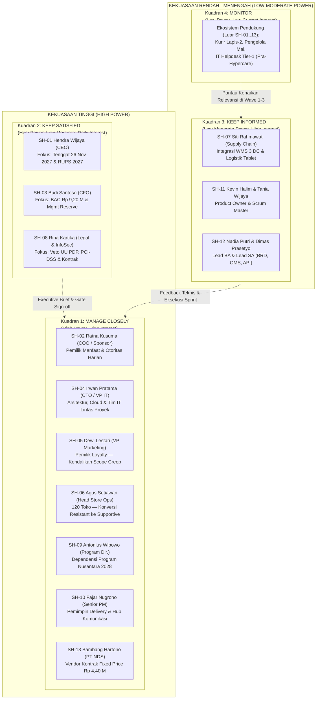

#### B. Tabel Pemetaan Lengkap & *Stakeholder Engagement Assessment Matrix* (SEAM: `C` vs `D`)

| Kode | Nama & Peran | Kuadran *Power–Interest* | Profil *Salience* | Arah Pengaruh | Unaware | Resistant | Neutral | Supportive | Leading | Fokus Strategi Penutupan Kesenjangan (`C → D`) |
|------|--------------|--------------------------|-------------------|---------------|---------|-----------|---------|------------|---------|-----------------------------------------------|
| **SH-01** | **Hendra Wijaya** — CEO (Ketua SteerCo) | *Keep Satisfied* | Dominant | *Upward* | | | | **C** | **D** | Sajikan ringkasan progres menuju 26 Nov 2027 & nilai strategis RUPS 2027; bangun optimisme berbasis data agar aktif menyokong kebijakan lintas divisi. |
| **SH-02** | **Ratna Kusuma** — COO (*Project Sponsor*) | *Manage Closely* | **Definitive** | *Upward* | | | | | **C / D** | Pertahankan kemitraan 1-on-1 mingguan; gunakan otoritasnya untuk menengahi konflik Store Ops (SH-06) dan Marketing (SH-05). |
| **SH-03** | **Budi Santoso** — CFO (Otoritas Dana) | *Keep Satisfied* | Dominant | *Upward* | | | **C** | **D** | | Tunjukkan disiplin EVM, penolakan *scope creep*, dan pemisahan ketat *Contingency* vs *Management Reserve* untuk meraih kepercayaan penuh. |
| **SH-04** | **Irwan Pratama** — CTO / VP IT | *Manage Closely* | **Definitive** | *Upward* | | | | **C** | **D** | Libatkan dalam desain *Bridge Adapter* dan forum pembagian 3 *senior architect* antar proyek agar proaktif mengamankan integrasi ERP/POS. |
| **SH-05** | **Dewi Lestari** — VP Marketing & CX | *Manage Closely* | **Definitive** *(berisiko Dangerous bila bypass CCB)* | *Upward* | | | | **C / D**\* | | **\*Catatan Khusus:** Antusias pada visi (*Supportive*), tetapi pemicu *scope creep*. Salurkan energinya ke *Phase 2 Backlog* & kepemimpinan peluang **R-10**. |
| **SH-06** | **Agus Setiawan** — Head of Store Ops (120 Toko) | *Manage Closely* | **Definitive** *(kritis saat Pilot/Rollout)* | *Sideward* | | **C** | | **D** | | **PRIORITAS UTAMA:** Atasi kekhawatiran beban kerja & omzet melalui *100% Sales Attribution*, *co-creation* SOP, Pilot 10 toko, dan insentif tim toko. |
| **SH-07** | **Siti Rahmawati** — Head of Supply Chain (3 DC) | *Keep Informed* | Legitimate + Urgent *(saat integrasi WMS)* | *Sideward* | | | **C** | **D** | | Libatkan lebih awal dalam desain sinkronisasi stok ≤ 60 detik di DC Cikarang, Surabaya, Medan, dan jadwalkan pengiriman tablet jauh sebelum Wave 1. |
| **SH-08** | **Rina Kartika** — Head of Legal & InfoSec | *Keep Satisfied* | **Dormant** *(berubah Definitive di Gate UU PDP)* | *Sideward* | | | **C** | **D** | | Terapkan *early compliance check* (UU PDP, *consent*, *pre-PenTest*) sejak Sprint 4 agar menjadi mitra pencegah masalah, bukan pemblokir di akhir. |
| **SH-09** | **Antonius Wibowo** — Program Director / PMO | *Manage Closely* | **Definitive** | *Sideward / Upward* | | | | **C** | **D** | Penyelarasan mingguan matriks dependensi 4 proyek Program Nusantara 2028; jadikan sekutu utama dalam penyelesaian isu POS-Modern. |
| **SH-10** | **Fajar Nugroho** — Senior Project Manager | *Manage Closely* | Definitive *(Internal Lead)* | *Hub* | | | | | **C / D** | Menjaga integritas tata kelola *hybrid*, objektivitas pelaporan RAG, dan keseimbangan kepentingan seluruh pihak. |
| **SH-11** | **Kevin Halim & Tania Wijaya** — PO & Scrum Master | *Keep Informed* | Legitimate + Urgent | *Downward* | | | | | **C / D** | Berdayakan Kevin menyaring permintaan Dewi di *backlog*, dan dukung Tania menjaga stabilitas *velocity* 14 sprint & menghilangkan hambatan. |
| **SH-12** | **Nadia Putri & Dimas Prasetyo** — Lead BA & Lead SA | *Keep Informed* | Legitimate + Urgent | *Downward* | | | | **C** | **D** | Libatkan sebagai penasihat teknis utama pada opsi mitigasi data loyalty (IS-01) dan arsitektur *Bridge Adapter* (IS-02). |
| **SH-13** | **Bambang Hartono** — Delivery Director PT NDS | *Manage Closely* | Dominant / Contractual | *Outward* | | | **C** | **D** | | Bangun relasi kemitraan adil berbasis *Acceptance Criteria* jelas, lindungi timnya dari permintaan *back-channel*, dan jaga ketepatan pembayaran *milestone*. |

*(Tambahan populasi lapangan: **120 Store Manager** di bawah Agus Setiawan berada pada posisi awal `C = Unaware / Resistant` dan ditargetkan mencapai `D = Supportive` secara bertahap per gelombang Pilot → Wave 1–3.)*

#### C. Rencana Aksi Taktis Khusus untuk Dua Titik Panas Politik Organisasi

1. **Menggeser Agus Setiawan (SH-06) & 120 Store Manager dari *Resistant* → *Supportive*:**
   - **Langkah 1 — Hilangkan Ketakutan Kanibalisasi Omzet (Minggu 1–2):** Fajar bersama Ratna Kusuma (COO) dan Budi Santoso (CFO) menerbitkan kebijakan **100% Omnichannel Sales Attribution**—setiap transaksi *Click & Collect* yang diambil di Toko X dicatat 100% sebagai pencapaian target penjualan Toko X, ditambah bonus *foot-traffic* untuk penjualan tambahan (*cross-sell*) saat pelanggan mengambil barang di toko.
   - **Langkah 2 — *Co-Creation* SOP & Uji Lapangan Nyata (Bulan ke-7–10):** Undang Agus Setiawan menunjuk 6 Regional Manager dan 10 *Store Manager* senior (sengaja memasukkan 3 orang yang paling skeptis) untuk ikut merancang alur *Store Fulfillment App* dan menguji simulasi waktu pengemasan langsung di lantai toko.
   - **Langkah 3 — Kurangi Friksi Beban Kerja dengan Teknologi & Transisi SLA:** Pastikan *Store Fulfillment App* terintegrasi *barcode scanner* (memangkas input manual kupon 45 detik yang selama ini membebani kasir) dan berlakukan masa adaptasi SLA bertahap (≤ 3 jam selama 2 minggu awal Pilot, lalu ≤ 2 jam penuh).
   - **Langkah 4 — *Change Champions* & Pelatihan Berjenjang (CB-04 Rp 0,85 M):** Jalankan *Training-of-Trainers* bagi 6 Regional Manager & 120 Store Manager sebelum pelatihan 1.440 kasir/staf, dengan menunjuk 10 Store Manager Pilot sukses sebagai duta testimoni (*peer-to-peer advocacy*) bagi Wave 1–3.

2. **Mengendalikan *Scope Creep* Dewi Lestari (SH-05) Tanpa Mematahkan Dukungan:**
   - **Aturan 1 — *Validate, Quantify, Park*:** Setiap ide baru dari tim Marketing (seperti *gamification*, *live-shopping*, atau *flash sale* kompleks) disambut secara konstruktif, langsung dihitung estimasi biaya CR dan dampaknya terhadap *hard deadline* 26 Nov 2027, lalu dicatat transparan di **Phase 2 Innovation Backlog (2028)**.
   - **Aturan 2 — *Zero-Sum Trade-off* untuk Kebutuhan Mendesak:** Jika Dewi bersikeras suatu fitur wajib masuk Fase 1, Kevin Halim (PO) dan Fajar menerapkan prinsip *trade-off*: *"Fitur mana dari backlog Fase 1 dengan bobot story point setara yang bersedia Ibu tunda ke Fase 2 agar anggaran Rp 9,20 M dan tanggal 26 Nov 2027 tetap utuh?"*
   - **Aturan 3 — Pagar Protokol Tunggal ke Vendor PT NDS:** Menegakkan kesepakatan tertulis bersama Bambang Hartono (SH-13) bahwa segala instruksi pekerjaan yang tidak melewati *ticket* Product Backlog disetujui PO & PM **tidak diakui sebagai dasar penagihan CR**.
   - **Aturan 4 — Alihkan Ambisi ke Peluang Terstruktur (R-10):** Berikan panggung strategis kepada Dewi sebagai *Risk Owner* peluang **R-10** (*pre-order* anggota Platinum pasca-Pilot), sehingga dorongan inovasinya tersalurkan menjadi nilai bisnis nyata tanpa merusak baseline.

---

### 6.4 *Communication Management Plan* Proyek OMNI

#### A. Audit Kompleksitas Saluran Komunikasi

Berdasarkan rumus $C = \frac{n(n-1)}{2}$:
- Jaringan **13 entitas pemangku kepentingan kunci** (SH-01 s.d. SH-13): $C = \frac{13 \times 12}{2} = \mathbf{78}$ saluran potensial (atau **105 saluran** jika dihitung per 15 individu pimpinan/inti).
- Jika dibiarkan terbuka ke **120 Store Manager** + PM ($n = 121$): $C = \frac{121 \times 120}{2} = \mathbf{7.260}$ saluran.
- Untuk mencegah kebisingan dan kebocoran *back-channel*, Fajar menerapkan arsitektur **Hub-and-Spoke Terkendali & Operational Cascade** (melalui 6 Regional Manager: hanya $8 \times 7 / 2 = \mathbf{28}$ saluran koordinasi inti di tingkat regional).

#### B. Matriks Komunikasi 5W+1H Proyek OMNI

| Audiens (*Who*) | Konten Informasi (*What*) | Tujuan (*Why*) | Frekuensi (*When*) | Media & Metode (*Where / Method*) | Format & Penanggung Jawab (*How / Owner*) |
|-----------------|---------------------------|----------------|--------------------|-----------------------------------|-------------------------------------------|
| **Executive SteerCo** (SH-01 CEO, SH-02 COO, SH-03 CFO, SH-04 CTO, SH-05 VP Mkt) | Status RAG proyek, tren EVM (SPI/CPI/EAC), Top-5 Risiko & Isu Level 3, status *Stage-Gate* (M1, M5, M6, M8), keputusan CCB/Reserve | Keputusan strategis cepat, persetujuan *Gate*, menjaga keyakinan menjelang RUPS 2027 | Bulanan (Jumat pekan ke-4) + *Ad-hoc* ≤ 72 jam jika eskalasi Level 3 | Rapat tatap muka (*Interactive*) + *Pre-read* email H−2 (*Push*) | *Executive Deck* maks. 6 slide (*BLUF* + 1-halaman RAG Dashboard) — **Fajar Nugroho (SH-10)** |
| **Project Sponsor** (SH-02 Ratna) & **Program Director** (SH-09 Antonius) | Kemajuan milestone, risiko/isu Level 2, dependensi ERP-Refresh/POS-Modern, dinamika politik Store Ops & Marketing | Penyelarasan taktis (*No Surprises*), pelepasan hambatan lintas proyek, persetujuan CB-06 > Rp 100 jt | Mingguan (Senin pagi, 45 menit) | Tatap muka / video call (*Interactive*) + *Action Log* (*Push*) | Ringkasan 1 halaman + *Dependency & Issue Tracker* — **Fajar Nugroho (SH-10)** |
| **Legal, Compliance & InfoSec** (SH-08 Rina) & **CFO** (SH-03 Budi) | Status audit UU PDP, *consent management*, hasil *PenTest*, laporan realisasi biaya & saldo CB-06 / Management Reserve | Memastikan kepatuhan penuh (hindari *veto Go-Live*) dan transparansi disiplin fiskal | Dua mingguan (*bi-weekly*) + tinjauan wajib tiap *Release/Gate* | Rapat terfokus (*Interactive*) + laporan formal (*Push*) | *Compliance Checklist* & *Cost/Reserve Burn Report* — **Fajar (SH-10)** & **Dimas (SH-12)** |
| **Tim Inti Agile & Teknis** (SH-11 PO/SM, SH-12 BA/SA, QA Lead Lukas) | Prioritas *Product Backlog*, *velocity*, *burndown*, blokir teknis, *Risk Trigger* mingguan, *Defect Log* | Menjaga ritme 14 Sprint, kualitas teknis, dan deteksi dini pemicu risiko | Harian (*Daily Stand-up* 15 mnt), Mingguan (*Risk Sync*), per 2 minggu (*Sprint Review/Retro*) | *Interactive* + repositori Jira/Confluence (*Pull*) | *Scrum Board*, *Velocity/Burndown Chart*, *Live Risk & Issue Board* — **Tania (SH-11)** & **Fajar (SH-10)** |
| **Vendor Utama PT NDS** (SH-13 Bambang Hartono) | Kinerja SLA/kualitas kode, status *milestone* kontrak Rp 4,40 M, verifikasi *Acceptance Criteria*, log *Change Request* | Menjamin mutu *delivery* kontrak *Fixed Price* dan mencegah sengketa lingkup/CR | Mingguan (*Vendor Governance Sync*) + bulanan (*Invoice & Milestone Sign-off*) | Rapat formal (*Interactive*) + MoM bertanda tangan (*Push*) | *Vendor Scorecard*, *Deliverable Sign-off Sheet*, *CR Log* — **Fajar (SH-10)** |
| **Store Ops (SH-06 Agus, 6 Regional Mgr, 120 Store Mgr, 1.440 Staf)** & **Supply Chain (SH-07 Siti — 3 DC)** | Progres Pilot 10 toko, panduan SOP *Click & Collect*, jadwal pengiriman tablet & pelatihan, kebijakan *Sales Attribution*, panduan *Hypercare* | Membangun adopsi operasional, menekan resistensi, dan menjamin kesiapan 120 toko & 3 DC | Dua mingguan untuk Agus/Siti/6 RM; bulanan (*Townhall/Kit*) untuk 120 Toko; harian saat Wave Rollout | Forum kesiapan (*Interactive*), *Newsletter/Kit* (*Push*), Portal SOP & Video LMS (*Pull*) | *Rollout Readiness Scorecard*, *SOP Quick-Card* 1 halaman, Video Tutorial 5 menit — **Agus (SH-06)** & **Fajar (SH-10)** |

---

## 7. Latihan dan Pembahasan

### 7.1 Soal Latihan

Kerjakan keempat latihan berikut menggunakan data resmi **Proyek OMNI** pada [Studi Kasus Utama](00-studi-kasus-utama.md) dan artefak Bagian 6:

1. **Latihan 1 — Analisis Kuantitatif EMV & *Decision Tree* (Migrasi Data Loyalty R-02):**
   Menjelang akhir Bulan ke-8, audit data membuktikan bahwa 62% dari 1,2 juta data kartu fisik *Sinar Member Card* rusak/duplikat sehingga mengancam *Milestone* M4 dan target 800.000 anggota terverifikasi. Fajar Nugroho dan Nadia Putri merumuskan tiga opsi mitigasi:
   - **Opsi 1 (Pembersihan Manual Internal):** Biaya tambahan awal **Rp 40 jt**. Probabilitas selesai bersih tepat waktu = **35%** (dampak tambahan Rp 0); probabilitas gagal & menunda Release 2 = **65%** (biaya lembur, pengerjaan ulang & keterlambatan = **−Rp 220 jt**).
   - **Opsi 2 (Sewa Alat *Automated Data Cleansing* + 2 Spesialis Data Eksternal 4 Minggu):** Biaya tambahan awal **Rp 95 jt**. Probabilitas selesai bersih ≥ 95% tepat waktu = **80%** (dampak tambahan Rp 0); probabilitas tersisa anomali minor = **20%** (biaya pembersihan parsial tambahan = **−Rp 50 jt**).
   - **Opsi 3 (Migrasi Bertahap / *Lazy Migration* via OTP):** Migrasikan hanya 450.000 anggota aktif 24 bulan terakhir, sisanya verifikasi mandiri via OTP saat login pertama. Biaya tambahan awal **Rp 55 jt** (modul OTP & kampanye aktivasi). Probabilitas adopsi mulus & target 800.000 tercapai = **70%** (dampak tambahan Rp 0); probabilitas keluhan pelanggan lama melonjak sehingga butuh *Contact Center* sementara & promo aktivasi = **30%** (biaya tambahan = **−Rp 120 jt**).

   **Tugas Anda:** (a) Hitung EMV bersih masing-masing opsi dengan langkah lengkap; (b) Tentukan opsi terbaik berdasarkan EMV finansial murni; dan (c) Evaluasi *secondary risk*, kepatuhan **UU PDP**, serta preferensi stakeholder (Dewi Lestari & Rina Kartika) untuk merumuskan rekomendasi Senior PM yang utuh.

2. **Latihan 2 — Konversi *Risk-to-Issue* & Penyusunan Memo Eskalasi SteerCo (Delay API POS-Modern):**
   Pada 28 Februari 2027 (Bulan ke-9, SPI = 0,90; CPI = 0,94; EAC = Rp 9,80 M), tim proyek paralel **POS-Modern** mengonfirmasi secara tertulis bahwa rilis API sinkronisasi stok mundur 3 minggu karena kendala sertifikasi *firmware* kasir, mengancam *Feature Freeze* (M5, 23 Apr 2027) dan jalur kritis menuju 26 Nov 2027.
   **Tugas Anda:** (a) Jelaskan mengapa kondisi ini tidak lagi cukup dikelola di *Risk Register* melainkan wajib berpindah ke *Issue Log* (IS-02); (b) Tentukan tingkat eskalasi & SLA sesuai *Escalation Matrix* Proyek OMNI; dan (c) Susun **Memo Eskalasi Eksekutif 1 Halaman** (format *BLUF — Bottom Line Up Front*) dari Fajar Nugroho kepada Executive SteerCo yang memuat situasi faktual, dampak terukur, 2 opsi solusi beserta konsekuensinya, dan 1 rekomendasi keputusan tegas.

3. **Latihan 3 — Rencana *Stakeholder Engagement* Menghadapi Resistensi 120 *Store Manager*:**
   Menjelang persiapan Pilot 10 toko, survei kesiapan awal menunjukkan 68% dari 120 *Store Manager* bersikap skeptis/menolak (*Resistant*) terhadap *Click & Collect*, dan 3 Regional Manager menolak jadwal pelatihan akhir pekan.
   **Tugas Anda:** Susun rencana intervensi *Stakeholder Engagement* 4 tahap (memadukan diagnosis akar resistensi, penyelaras insentif, *co-creation*, dan indikator keberhasilan terukur) untuk menggeser Agus Setiawan (SH-06) dan 120 *Store Manager* dari *Resistant* menjadi *Supportive* sebelum Gelombang 1 (19 Juli 2027).

4. **Latihan 4 — Membedakan *Contingency Reserve* (Rp 0,70 M) vs *Management Reserve* (Rp 0,60 M):**
   Klasifikasikan lima kejadian berikut di Proyek OMNI: apakah didanai dari **Contingency Reserve (CB-06)**, **Management Reserve**, atau **tidak boleh menggunakan keduanya** (harus ditolak / didanai anggaran bisnis terpisah)? Sertakan otoritas persetujuan serta dampaknya terhadap BAC Rp 9,20 M untuk setiap kasus:
   - *(a)* Biaya **Rp 55 jt** modul OTP *Lazy Migration* untuk mengatasi data loyalty kotor (IS-01 / eks R-02).
   - *(b)* Perubahan mendadak regulasi otentikasi keamanan transaksi digital oleh regulator nasional di Bulan ke-11 yang belum pernah ada sebelumnya, menuntut modifikasi keamanan senilai **Rp 280 jt**.
   - *(c)* Permintaan VP Marketing (Dewi Lestari) menambah fitur *live-shopping* senilai **Rp 190 jt** agar sama dengan kompetitor.
   - *(d)* Biaya **Rp 140 jt** *cloud burst* dan *tuning* arsitektur setelah simulasi *load test* 2.500 TPM menunjukkan *latency* tinggi (teridentifikasi di R-06).
   - *(e)* Kebangkrutan mendadak sub-vendor penyedia layanan pesan notifikasi SMS OTP di Bulan ke-12 yang memaksa migrasi darurat ke penyedia baru senilai **Rp 175 jt**.

---

### 7.2 Pembahasan Latihan

#### Pembahasan Latihan 1 — EMV & *Decision Tree* Migrasi Data Loyalty (R-02)

**(a) Perhitungan EMV Bersih per Opsi:**

Rumus: $\text{EMV} = \text{Biaya Awal} + \sum (P_i \times \text{Dampak Tambahan}_i)$

| Opsi Mitigasi | Biaya Awal (Rp jt) | Cabang 1 (Lancar) | Cabang 2 (Terkendala) | Perhitungan EMV Bersih (Rp jt) | Peringkat EMV |
|---------------|--------------------|-------------------|-----------------------|--------------------------------|---------------|
| **Opsi 1:** Manual Internal | −40,0 | $0,35 \times 0 = 0$ | $0,65 \times (-220) = -143,0$ | $-40,0 + (-143,0) = \mathbf{-183,0}$ | 3 (Terburuk) |
| **Opsi 2:** *Automated Tool* + 2 Spesialis | −95,0 | $0,80 \times 0 = 0$ | $0,20 \times (-50) = -10,0$ | $-95,0 + (-10,0) = \mathbf{-105,0}$ | 2 |
| **Opsi 3:** *Lazy Migration* + OTP | −55,0 | $0,70 \times 0 = 0$ | $0,30 \times (-120) = -36,0$ | $-55,0 + (-36,0) = \mathbf{-91,0}$ | **1 (Terbaik)** |

- Verifikasi rinci:
  - **Opsi 1:** $0,65 \times (-220) = -143,0$; ditambah biaya awal $-40,0 = \mathbf{-Rp\ 183,0\ jt}$.
  - **Opsi 2:** $0,20 \times (-50) = -10,0$; ditambah biaya awal $-95,0 = \mathbf{-Rp\ 105,0\ jt}$.
  - **Opsi 3:** $0,30 \times (-120) = -36,0$; ditambah biaya awal $-55,0 = \mathbf{-Rp\ 91,0\ jt}$.

**(b) Keputusan Berdasarkan EMV Finansial Murni:**
**Opsi 3 (*Lazy Migration* + OTP)** unggul dengan EMV **−Rp 91,0 jt**, menghemat eksposur rata-rata sebesar **Rp 14,0 jt** dibanding Opsi 2 (−Rp 105,0 jt) dan **Rp 92,0 jt** dibanding Opsi 1 (−Rp 183,0 jt). Selain itu, biaya tunai awalnya (Rp 55 jt) masih berada di bawah batas delegasi Level 1 Senior PM (≤ Rp 100 jt dari *Contingency Reserve* CB-06).

**(c) Evaluasi Senior PM (*Secondary Risk*, UU PDP & Stakeholder):**
- **Keunggulan UU PDP (Menyenangkan Rina Kartika, SH-08):** Opsi 3 secara struktural jauh lebih patuh terhadap **UU No. 27 Tahun 2022 (UU PDP)** karena kita tidak memigrasikan paksa ±750.000 data kontak lama tanpa persetujuan eksplisit (*explicit consent*); pelanggan yang mendaftar ulang via OTP otomatis memberikan persetujuan digital sah.
- **Risiko Sekunder (*Secondary Risk*) & Mitigasi CX (Menjaga Dewi Lestari, SH-05):** Opsi 3 memiliki risiko sekunder lonjakan keluhan dari pelanggan lama yang ganti nomor HP (probabilitas 30%). Mitigasi sekundernya: sediakan jalur verifikasi alternatif di kasir 120 toko menggunakan KTP/kartu fisik lama, berikan bonus 500 poin aktivasi digital, dan kunci dana cadangan taktis Rp 36 jt di CB-06 sebagai *fallback* dukungan *Contact Center*.
- **Catatan Pembanding Opsi 2:** Apabila SteerCo sangat memprioritaskan kepastian jadwal tertinggi (probabilitas lancar 80% vs 70%) tanpa friksi aktivasi pelanggan, Opsi 2 tetap menjadi alternatif kuat dengan selisih EMV tipis (Rp 14 jt). Rekomendasi akhir Senior PM: **pilih Opsi 3** disertai *pre-cleansing* otomatis cepat atas 450.000 data aktif agar mutu data tinggi, patuh UU PDP, dan efisien anggaran.

---

#### Pembahasan Latihan 2 — Konversi *Risk-to-Issue* & Memo Eskalasi SteerCo

**(a) Alasan Konversi ke *Issue Log* (IS-02):**
Probabilitas keterlambatan API POS-Modern telah berubah dari ketidakpastian 55% (**R-01**) menjadi kepastian **100%** (resmi mundur 3 minggu per 28 Feb 2027) dan langsung memukul jalur kritis serta menurunkan SPI ke 0,90. Status R-01 ditutup sebagai *Occurred → IS-02*, lalu penanganan beralih dari pemantauan probabilitas menjadi tindakan korektif terukur dengan *Issue Owner* dan SLA.

**(b) Tingkat Eskalasi & SLA:**
Isu ini melewati ambang batas Level 1 (deviasi > 5 hari) dan bahkan menembus ambang **Level 3 Executive SteerCo** karena (1) keterlambatan 3 minggu (> 14 hari) berada pada jalur kritis menuju *hard deadline* 26 Nov 2027, (2) SPI = 0,90 (< 0,92) dan EAC menyentuh Rp 9,80 M, serta (3) membutuhkan sinkronisasi lintas proyek di Program Nusantara 2028. Oleh karena itu, Fajar melakukan *pre-briefing* ke Level 2 (**Ratna Kusuma** & **Antonius Wibowo**, SLA ≤ 48 jam) dan mengajukan keputusan formal ke **Sidang Darurat SteerCo** (Level 3, SLA ≤ 72 jam).

**(c) Contoh Memo Eskalasi Eksekutif 1 Halaman (Format *BLUF*):**

> **MEMO ESKALASI EKSEKUTIF — PROYEK OMNI (IS-02)**
> **Kepada:** Executive Steering Committee (Hendra Wijaya, Ratna Kusuma, Budi Santoso, Irwan Pratama, Dewi Lestari) & Antonius Wibowo (Program Director)
> **Dari:** Fajar Nugroho — Senior Project Manager Proyek OMNI | **Tanggal:** 1 Maret 2027 | **SLA Keputusan:** ≤ 72 jam (4 Maret 2027)
>
> **1. RINGKASAN KEPUTUSAN YANG DIMINTA (*BLUF*):**
> Proyek OMNI meminta persetujuan SteerCo untuk **mengaktifkan Opsi B (*Bridge Adapter* + *Fast-Tracking* SIT Parsial + Pinjaman 2 *Senior Engineer* Lintas-Program)** senilai **Rp 65 jt dari *Contingency Reserve* (CB-06, tidak menambah BAC Rp 9,20 M)** guna menyerap keterlambatan 3 minggu API proyek **POS-Modern** dan melindungi **Hard Deadline 26 November 2027**.
>
> **2. SITUASI FAKTUAL & DAMPAK (Per 28 Feb 2027):**
> - Proyek paralel POS-Modern resmi mundur 3 minggu akibat sertifikasi *firmware* kasir (API *staging* baru siap 8 Mar 2027).
> - Bersama isu kualitas data loyalty (IS-01), kinerja EVM Bulan ke-9 berada pada **SPI = 0,90 (SV −Rp 0,48 M)** dan **CPI = 0,94 (CV −Rp 0,28 M; proyeksi EAC Rp 9,80 M bila tanpa koreksi)**.
> - Tanpa intervensi, **Gate 2 / Feature Freeze (M5, 23 Apr 2027)** akan bergeser 3 minggu ke 14 Mei 2027, memangkas jendela Pilot 10 toko dan mengancam kesiapan Harbolnas 26 Nov 2027.
>
> **3. PERBANDINGAN OPSI SOLUSI:**
> - **Opsi A (Tunggu API Final POS-Modern — Tanpa *Bridge*):** Biaya langsung awal Rp 0, tetapi proyek mundur 3 minggu di jalur kritis, memicu *crashing* lembur besar saat Fase 3 (proyeksi biaya lembur −Rp 240 jt, melampaui BAC) dan risiko tinggi *Go-Live* melewati 26 Nov 2027. *(Tidak direkomendasikan)*
> - **Opsi B (Aktifkan *Bridge Adapter* + 2 *Senior Backend Engineer* 4 Minggu + *Fast-Track* SIT Parsial):** Biaya **Rp 65 jt** (didanai dari sisa CB-06 Rp 700 jt; **BAC tetap Rp 9,20 M**); memangkas keterlambatan efektif dari 3 minggu menjadi **0 hari** pada M5; proyeksi SPI pulih ke ≥ 0,97 pada akhir April 2027. *Residual risk:* 15% penyesuaian skema saat API final (cadangan sisa Rp 12 jt telah disiapkan). *(DIREKOMENDASIKAN)*
>
> **4. KEPUTUSAN YANG DIMINTA HARI INI:**
> 1. Persetujuan pencairan Rp 65 jt dari CB-06 *Contingency Reserve* (Sponsor/CFO — BAC tidak berubah).
> 2. Otorisasi CTO (Irwan Pratama) & Program Director (Antonius Wibowo) untuk penugasan sementara 2 *senior backend engineer* dari proyek ERP-Refresh selama 4 minggu (2–27 Mar 2027).

---

#### Pembahasan Latihan 3 — Rencana *Stakeholder Engagement* 120 *Store Manager*

Pendekatan terstruktur 4 tahap untuk menggeser Agus Setiawan (SH-06) dan 120 *Store Manager* dari *Resistant → Supportive*:

1. **Tahap 1 — Diagnosis Empatik & Penyelarasan Insentif (Maret 2027):**
   - *Akar resistensi:* (1) takut omzet online tidak dihitung ke KPI toko fisik, (2) takut beban kerja akhir pekan melonjak tanpa tambahan staf, (3) cemas dinilai gagal jika SLA ≤ 2 jam tidak tercapai.
   - *Intervensi struktural:* Bersama COO (Ratna) dan CFO (Budi), tetapkan surat edaran **100% Omnichannel Sales Attribution** untuk seluruh pesanan *Click & Collect* yang dipenuhi toko, plus bonus tim toko bagi pencapaian SLA ≥ 95% selama periode Pilot & Gelombang 1–3.
2. **Tahap 2 — *Co-Creation* SOP & Koalisi Pemimpin Lapangan (April–Mei 2027):**
   - Libatkan Agus Setiawan dan 3 Regional Manager yang menolak dalam *workshop* penyederhanaan SOP; tunjukkan langsung bukti waktu kerja bahwa pemindaian QR loyalty & *Store Fulfillment App* justru **menghemat 45 detik antrean kasir per transaksi** dibanding input voucher manual lama.
   - Jadwalkan pelatihan pada hari kerja non-puncak (Selasa–Kamis pagi) secara bergilir (*batch*) agar tidak mengganggu pelayanan akhir pekan.
3. **Tahap 3 — Bukti Nyata di Pilot 10 Toko & *Peer Advocacy* (Juni–Juli 2027):**
   - Terapkan masa adaptasi SLA bertahap (≤ 3 jam pada minggu 1–2 Pilot, lalu ≤ 2 jam pada minggu 3–4) dengan pendampingan langsung tim proyek di toko.
   - Rekam testimoni video singkat dari 10 *Store Manager* Pilot yang berhasil menaikkan *cross-sell* pengunjung pengambil barang untuk diputar ke 110 *Store Manager* Gelombang 1–3.
4. **Tahap 4 — Pemantauan Metrik Adopsi Terukur (Pra-Wave 1 s.d. M7):**
   - *Indikator keberhasilan:* (a) Skor survei kesiapan 120 *Store Manager* naik dari 32% mendukung menjadi **≥ 85% *Supportive*** sebelum 19 Juli 2027; (b) Tingkat kehadiran pelatihan 1.440 staf mencapai **≥ 95%**; (c) Pencapaian SLA *Click & Collect* ≤ 2 jam pada Pilot mencapai **≥ 95%**.

---

#### Pembahasan Latihan 4 — Klasifikasi *Contingency Reserve* vs *Management Reserve*

| Kasus | Sumber Pendanaan | Alasan & Dasar Klasifikasi | Otoritas Persetujuan | Dampak terhadap BAC (Rp 9,20 M) |
|-------|------------------|----------------------------|----------------------|---------------------------------|
| **(a) Rp 55 jt modul OTP data loyalty (IS-01)** | **Contingency Reserve (CB-06)** | *Known-unknown*: risiko kualitas data 1,2 jt anggota sudah teridentifikasi di *Risk Register* (**R-02**, EMV −Rp 126 jt). | **Senior PM (Fajar Nugroho)** sesuai batas delegasi Level 1 (≤ Rp 100 jt), dilaporkan ke Sponsor. | **BAC tetap Rp 9,20 M** (dana sudah masuk dalam CB-06 di dalam BAC). |
| **(b) Rp 280 jt perubahan regulasi otentikasi mendadak Bulan ke-11** | **Management Reserve (Rp 0,60 M)** | *Unknown-unknown*: aturan baru regulator yang belum ada saat perencanaan dan di luar lingkup R-05 awal; wajib dipatuhi agar legal *Go-Live*. | **CFO (Budi Santoso) & Executive SteerCo** melalui *Formal Change Request* (CCB Level 3). | **BAC naik menjadi Rp 9,48 M** (Rp 280 jt dipindahkan dari *Management Reserve* ke *Cost Baseline*; sisa MR = Rp 320 jt). |
| **(c) Rp 190 jt fitur *live-shopping* dari Marketing** | **TIDAK BOLEH keduanya** *(Tolak ke Fase 2 atau pendanaan terpisah)* | Ini adalah ***scope creep*** (perluasan lingkup baru yang eksplisit *Out-of-Scope*), bukan risiko teridentifikasi maupun krisis tak terduga. | **CCB / SteerCo** (rekomendasi PM: tolak dari Fase 1, parkir ke *Phase 2 Backlog* 2028; jika dipaksa, butuh tambahan anggaran bisnis baru di luar cadangan risiko). | **BAC tetap Rp 9,20 M** bila ditolak ke Fase 2 (atau bertambah via anggaran bisnis baru bila disetujui khusus). |
| **(d) Rp 140 jt *cloud burst* & *tuning* beban 2.500 TPM** | **Contingency Reserve (CB-06)** | *Known-unknown*: risiko gangguan performa uji beban 2.500 TPM sudah teridentifikasi di *Risk Register* (**R-06**). | **Project Sponsor (Ratna Kusuma)** — Level 2 karena nominal berada pada rentang Rp 101–250 jt. | **BAC tetap Rp 9,20 M** (memakai porsi CB-06). |
| **(e) Rp 175 jt migrasi darurat akibat kebangkrutan sub-vendor SMS OTP** | **Management Reserve (Rp 0,60 M)** | *Unknown-unknown*: kebangkrutan mendadak pihak ketiga non-utama yang tidak teridentifikasi dalam *Risk Register* baseline, namun kritis bagi operasional. | **CFO (Budi Santoso) & Executive SteerCo** via *Formal Change Request* (Level 3). | **BAC naik sebesar Rp 175 jt** dari baseline saat itu karena pencairan *Management Reserve* mengubah *Cost Baseline*. |

---

## 8. Tugas Modul dan Rubrik Penilaian

### Brief Tugas Mandiri (±6 Jam)

**Peran Anda:** Anda bertindak sebagai **Fajar Nugroho (Senior Project Manager Proyek OMNI)** pada titik tinjauan kritis **Akhir Bulan ke-9 (28 Februari 2027)** ketika SPI = 0,90, CPI = 0,94, dan *hard deadline* 26 November 2027 tersisa 9 bulan.

**Keluaran yang Harus Dikumpulkan (*Paket Manajemen Risiko, Isu & Stakeholder Proyek OMNI*):**
Susun satu dokumen profesional (PDF/Markdown, ±8–12 halaman) yang mencakup lima komponen terintegrasi berikut:

1. **Pembaruan *Risk Register* & Analisis Kualitatif (R-01 s.d. R-10 + 2 Risiko Baru):** Perbarui status 10 risiko awal per Bulan ke-9 (tandai yang telah menjadi isu, sesuaikan probabilitas/dampak risiko tersisa menjelang Fase 3–4), dan identifikasi **2 risiko baru** yang realistis muncul saat memasuki fase *UAT* dan *Wave Rollout* 120 toko (gunakan format *Cause–Risk Event–Impact* dan Matriks 5×5).
2. **Analisis Kuantitatif EMV, *Decision Tree*, & Rekonsiliasi Cadangan:** Hitung ulang saldo sisa **Contingency Reserve (CB-06)** setelah pencairan penanganan IS-01 (Rp 55 jt) dan IS-02 (Rp 65 jt), bandingkan dengan sisa eksposur EMV ancaman yang masih terbuka, lalu susun **1 Decision Tree** baru untuk memilih opsi percepatan uji beban 2.500 TPM (**R-06**) atau logistik 240 tablet luar Jawa (**R-09**).
3. ***Issue Log* Aktif, *Escalation Matrix* & 1 Memo Eskalasi Eksekutif:** Sajikan *Issue Log* per Bulan ke-9 lengkap dengan rencana korektif, *Issue Owner*, dan SLA, ditambah **1 Memo Eskalasi 1 Halaman (format BLUF)** yang ditujukan kepada SteerCo untuk isu paling kritis pilihan Anda.
4. **Pemetaan 13 Pemangku Kepentingan, SEAM & Strategi Penanganan Konflik:** Buat peta *Power–Interest Grid* dan *Salience* untuk SH-01 s.d. SH-13, tabel SEAM (`C` vs `D`), serta rencana aksi konkret 90 hari untuk menuntaskan resistensi Store Ops (SH-06) dan menertibkan *scope creep* Marketing (SH-05).
5. ***Communication Management Plan* (5W+1H) & Perhitungan Saluran:** Tampilkan analisis saluran komunikasi $n(n-1)/2$ untuk proyek Anda dan matriks komunikasi 5W+1H khusus menghadapi fase kritis **Pilot 10 Toko hingga Go-Live Nasional 120 Toko**.

### Rubrik Penilaian (4 Skala — Bobot Total 100%)

| Kriteria Penilaian | Bobot | Skor 4: Sangat Baik (90–100) | Skor 3: Baik (75–89) | Skor 2: Cukup (60–74) | Skor 1: Perlu Perbaikan (< 60) |
|--------------------|-------|------------------------------|----------------------|-----------------------|--------------------------------|
| **1. Kualitas *Risk Register*, *Risk Statement* & Matriks 5×5** | **20%** | Seluruh risiko memakai format *Cause–Event–Impact* tajam; konsisten dengan data Proyek OMNI; 2 risiko baru sangat kontekstual; *trigger* & *owner* spesifik dan terukur. | Mayoritas risiko terstruktur baik; 2 risiko baru relevan; *trigger* dan *owner* jelas meski beberapa dampak belum terkuantifikasi tajam. | Format pernyataan risiko masih campuran (sebagian kabur); *trigger* terlalu umum; konsistensi data kasus kurang rapi. | Risiko ditulis dangkal (hanya 2–3 kata), bercampur dengan isu/fakta, atau tidak merujuk konteks Proyek OMNI. |
| **2. Ketepatan Analisis Kuantitatif (EMV, *Decision Tree* & *Reserve*)** | **25%** | Seluruh perhitungan EMV, *rollback Decision Tree*, dan rekonsiliasi saldo CB-06 **100% akurat**; membedakan *Contingency* vs *Management Reserve* secara tepat dan menganalisis *secondary/residual risk*. | Perhitungan EMV & *Decision Tree* akurat (atau hanya salah pembulatan minor); pemahaman cadangan tepat namun analisis *secondary risk* masih ringkas. | Rumus EMV dipakai tetapi ada kesalahan hitung material atau mencampurkan EMV peluang untuk memangkas cadangan ancaman. | Tidak memuat perhitungan kuantitatif valid, gagal membedakan *Contingency* vs *Management Reserve*, atau salah konsep mendasar. |
| **3. Kelengkapan *Issue Log*, *Escalation Matrix* & Memo Eskalasi** | **20%** | Transisi *Risk-to-Issue* tepat; *Escalation Matrix* 3 tingkat memiliki ambang batas & SLA objektif; Memo Eskalasi *BLUF* ringkas, menyajikan ≥ 2 opsi terukur dan 1 rekomendasi eksekutif siap diputuskan. | *Issue Log* dan *Escalation Matrix* lengkap dan konsisten; Memo Eskalasi jelas namun opsi perbandingan atau tautan ke EVM kurang tajam. | *Issue Log* terisi tetapi SLA/ambang batas kabur; Memo Eskalasi hanya melaporkan masalah tanpa opsi solusi dan rekomendasi jelas. | Tidak membedakan risiko vs isu; tidak ada *Escalation Matrix* atau memo eskalasi bersifat emosional/menyalahkan pihak lain. |
| **4. Ketajaman *Stakeholder Mapping*, SEAM & Strategi Konflik** | **20%** | Seluruh 13 stakeholder (SH-01 s.d. SH-13) dipetakan akurat pada *Power–Interest*, *Salience*, dan SEAM; strategi untuk Agus (SH-06) & Dewi (SH-05) praktis, menyentuh akar insentif/tata kelola, dan terukur. | 13 stakeholder lengkap dan tepat kuadran; strategi untuk Agus dan Dewi masuk akal namun indikator keberhasilan atau tahapan waktu belum rinci. | Sebagian stakeholder terlewat atau penempatan kuadran kurang konsisten; strategi menghadapi resistensi terlalu normatif ("sosialisasi lebih sering"). | Pemetaan tidak lengkap, mengabaikan dinamika politik SH-05/SH-06/SH-08, atau menyarankan pendekatan koersif tanpa analisis kepentingan. |
| **5. Kualitas *Communication Plan* (5W+1H) & Kesiapan Lapangan** | **15%** | Perhitungan $n(n-1)/2$ tepat; arsitektur komunikasi mencegah *back-channel* dan *overload*; matriks 5W+1H lengkap (Push/Pull/Interactive), selaras dengan fase Pilot & Rollout 120 toko; penyajian siap cetak. | Perhitungan saluran benar; matriks 5W+1H mencakup seluruh kelompok utama dan metode komunikasi cukup proporsional. | Matriks komunikasi generik, metode *Push/Pull/Interactive* belum dibedakan jelas, atau frekuensi rapat tidak realistis bagi eksekutif. | Tidak ada perhitungan saluran, matriks 5W+1H tidak lengkap, dan dokumen sulit dibaca/tidak terstruktur. |
| **TOTAL BOBOT** | **100%** | **Nilai Akhir = $\sum (\text{Bobot} \times \text{Nilai Kriteria})$; Nilai Lulus Modul ≥ 70** | | | |

---

## 9. Kuis dan Kunci Jawaban

### 9.1 Soal Kuis

Pilih **satu jawaban paling tepat** (A, B, C, atau D) dari sudut pandang **Senior Project Manager**:

**1.** Pada rapat identifikasi risiko Proyek OMNI, seorang anggota tim menuliskan baris berikut di *Risk Register*: *"Data member loyalty saat ini 62% duplikat dan tidak akurat."* Sebagai Senior PM, koreksi paling tepat terhadap catatan tersebut adalah:
- A. Membiarkannya tetap seperti itu karena angka 62% sudah bersifat kuantitatif dan objektif.
- B. Menulis ulang dalam format *Cause–Risk Event–Impact*, karena 62% data duplikat adalah *penyebab (fakta saat ini)*, bukan peristiwa risiko yang belum terjadi maupun dampaknya terhadap sasaran proyek.
- C. Langsung menghapusnya dari *Risk Register* karena data kotor termasuk *unknown-unknown* yang cukup ditangani oleh *Management Reserve*.
- D. Memindahkannya ke *Communication Plan* karena masalah data merupakan tanggung jawab tim Marketing.

**2.** Anda memimpin sesi identifikasi risiko Proyek OMNI yang dihadiri Direktur, manajer toko senior, dan insinyur PT NDS. Anda khawatir para manajer lapangan dan insinyur tidak berani mengungkapkan risiko resistensi toko serta kelemahan arsitektur karena segan terhadap eksekutif di ruangan (*HiPPO effect*). Teknik identifikasi risiko paling efektif untuk mengatasi bias tersebut adalah:
- A. *Brainstorming* terbuka di ruang rapat besar bersama seluruh anggota Steering Committee.
- B. Analisis *Earned Value Management* (EVM) menggunakan data AC dan EV bulan berjalan.
- C. *Delphi Technique* — mengumpulkan masukan pakar secara anonim dalam beberapa putaran melalui fasilitator hingga tercapai konsensus objektif.
- D. *Monte Carlo Simulation* pada jadwal induk 18 bulan sebelum risiko diidentifikasi.

**3.** Dalam analisis kuantitatif suatu proyek, terdapat dua risiko ancaman terbuka dan satu risiko peluang:
- Ancaman X: Probabilitas 40%, Dampak biaya −Rp 200 jt.
- Ancaman Y: Probabilitas 25%, Dampak biaya −Rp 160 jt.
- Peluang Z: Probabilitas 50%, Potensi tambahan margin pendapatan pasca-*go-live* +Rp 100 jt.

Berapakah **Total Threat EMV** (dasar penetapan *Contingency Reserve* yang konservatif) dan **Net EMV** keseluruhan secara berturut-turut?
- A. Total Threat EMV = −Rp 120 jt; Net EMV = −Rp 70 jt *(Contingency Reserve tetap disarankan Rp 120 jt)*.
- B. Total Threat EMV = −Rp 70 jt; Net EMV = −Rp 120 jt *(Contingency Reserve cukup Rp 70 jt)*.
- C. Total Threat EMV = −Rp 360 jt; Net EMV = −Rp 260 jt *(Contingency Reserve harus Rp 360 jt)*.
- D. Total Threat EMV = −Rp 120 jt; Net EMV = −Rp 170 jt *(Contingency Reserve dipotong menjadi Rp 50 jt)*.

**4.** Untuk menangani risiko **R-05** terkait keamanan transaksi kartu pembayaran (standar PCI-DSS), PT SNR memutuskan tidak membangun mesin pemrosesan kartu kredit sendiri, melainkan menggunakan *Payment Gateway* tersertifikasi PCI-DSS (**PT FinPay Nusantara**) dengan perjanjian SLA dan klausul ganti rugi kontrak. Strategi respons risiko ancaman yang diterapkan pada aspek pemrosesan pembayaran ini terutama adalah:
- A. *Passive Accept* — menerima risiko tanpa menyiapkan rencana kontinjensi.
- B. *Escalate* — menyerahkan seluruh tanggung jawab proyek ke CEO.
- C. *Enhance* — meningkatkan probabilitas terjadinya insiden keamanan.
- D. *Transfer* — mengalihkan sebagian besar eksposur teknis/finansial kepada pihak ketiga spesialis melalui kontrak.

**5.** Risiko **R-10** pada Proyek OMNI mencatat peluang bahwa apabila Pilot 10 toko selesai 2 minggu lebih awal, SNR dapat membuka kanal *pre-order* anggota Platinum sebelum Harbolnas (+Rp 300 jt margin). Tim proyek memutuskan memfokuskan dukungan teknis penuh pada 10 toko pilot dengan akurasi stok tertinggi dan menyiapkan kampanye *pre-order* lebih awal agar probabilitas peluang tersebut naik dari 35% menjadi 65%. Strategi respons peluang yang sedang dijalankan adalah:
- A. *Avoid*
- B. *Enhance*
- C. *Transfer*
- D. *Accept*

**6.** Untuk memitigasi risiko kualitas data loyalty (**R-02**), Proyek OMNI menerapkan *Lazy Migration* (verifikasi mandiri via OTP saat pelanggan login pertama kali). Namun, penerapan *Lazy Migration* ternyata menimbulkan risiko baru berupa lonjakan panggilan komplain ke *Contact Center* dari pelanggan lama yang nomor ponselnya sudah tidak aktif. Dalam terminologi manajemen risiko, risiko baru yang lahir akibat tindakan respons tersebut disebut:
- A. *Residual Risk*
- B. *Overall Project Risk*
- C. *Secondary Risk*
- D. *Passive Risk*

**7.** Pada Bulan ke-11 Proyek OMNI, pemerintah secara mendadak menerbitkan peraturan teknis keamanan baru yang wajib dipenuhi sebelum *Go-Live* dan belum pernah ada saat perencanaan proyek maupun di dalam *Risk Register* (membutuhkan biaya implementasi tambahan Rp 250 jt). Tindakan tata kelola anggaran yang paling benar menurut standar Senior PM adalah:
- A. Mengambil Rp 250 jt langsung dari *Contingency Reserve* (CB-06) tanpa mengubah BAC dan tanpa persetujuan CFO.
- B. Memotong anggaran pelatihan 120 toko (CB-04) secara sepihak agar total biaya tetap Rp 9,20 M.
- C. Meminta PT NDS mengerjakan secara gratis di bawah kontrak *Fixed Price* tanpa diskusi ruang lingkup.
- D. Mencatatnya ke *Issue Log* sebagai *unknown-unknown*, lalu mengajukan *Formal Change Request* ke CFO & Executive SteerCo untuk mencairkan Rp 250 jt dari **Management Reserve** (sehingga BAC baru naik sebesar Rp 250 jt).

**8.** **Rina Kartika (SH-08, Head of Legal, Compliance & InfoSec)** tidak hadir dalam rapat *Daily Stand-up* maupun *Sprint Review* harian, tetapi memiliki wewenang mutlak (*veto power*) untuk menahan *Go-Live* Proyek OMNI jika kepatuhan UU PDP atau *Penetration Testing* belum bersih. Pada *Power–Interest Grid* dan *Salience Model*, profil serta pendekatan terbaik terhadap Rina Kartika adalah:
- A. *Keep Satisfied* (*Dormant Stakeholder* yang dapat berubah menjadi *Definitive* di *gate* kepatuhan) — libatkan lebih awal pada *milestone* kepatuhan, *Privacy-by-Design*, dan *pre-PenTest* agar tidak memblokir di detik terakhir.
- B. *Monitor* (*Low Power, Low Interest*) — cukup kirimkan berita proyek menjelang hari *Go-Live* agar tidak mengganggu kerjanya.
- C. *Keep Informed* — undang ke seluruh rapat harian tim teknis agar selalu mengikuti perkembangan kode.
- D. *Resistant Stakeholder* — minta CEO mencabut kewenangan *veto* legalnya agar jadwal 26 Nov 2027 tidak terganggu.

**9.** Pada *Stakeholder Engagement Assessment Matrix* (SEAM), **Agus Setiawan (SH-06, Head of Store Ops)** berada di posisi *Current* = **Resistant** dan *Desired* = **Supportive**, karena khawatir *Click & Collect* menambah beban staf toko dan menggerus target omzet cabang fisik. Intervensi paling tepat bagi Senior PM untuk menutup kesenjangan tersebut adalah:
- A. Meminta CEO mengeluarkan surat perintah sanksi disiplin bagi *Store Manager* yang menolak menjalankan SOP *Click & Collect*.
- B. Berkolaborasi dengan Sponsor (COO) & CFO merumuskan kebijakan *100% Omnichannel Sales Attribution* bagi toko pemenuh BOPIS, melibatkan perwakilan *Store Manager* vokal dalam *co-creation* SOP Pilot, dan menerapkan masa adaptasi SLA bertahap.
- C. Menghapus fitur *Click & Collect* dari Proyek OMNI tanpa persetujuan SteerCo agar Agus Setiawan senang.
- D. Memindahkan seluruh tanggung jawab komunikasi dengan 120 toko kepada vendor PT NDS agar PM tidak terlibat konflik internal.

**10.** Pada awal Fase 1, kelompok koordinasi inti Proyek OMNI terdiri dari **10 orang**. Memasuki Fase 2, ditambahkan **3 pemangku kepentingan baru** ke dalam lingkaran koordinasi interaktif tersebut sehingga menjadi **13 orang**. Berapa **pertambahan** jumlah saluran komunikasi potensial akibat penambahan 3 orang tersebut (berdasarkan rumus $n(n-1)/2$), dan metode komunikasi apa yang paling efisien untuk mendistribusikan buku panduan SOP serta video pelatihan kepada **1.440 staf toko**?
- A. Bertambah 3 saluran; gunakan metode *Interactive Communication* tatap muka 1-on-1 untuk seluruh 1.440 staf.
- B. Bertambah 78 saluran; gunakan metode *Push Communication* berupa email berlampiran 50 MB setiap hari.
- C. Bertambah 33 saluran (dari 45 menjadi 78 saluran); gunakan kombinasi *Pull Communication* (portal SOP & video LMS mandiri) didukung *cascade* pelatihan melalui 6 Regional Manager & 120 Store Manager.
- D. Bertambah 12 saluran (dari 33 menjadi 45 saluran); biarkan 1.440 staf menghubungi Senior PM secara langsung setiap ada pertanyaan.

---

### 9.2 Kunci Jawaban dan Pembahasan

| No | Kunci | Pembahasan Ringkas |
|----|-------|--------------------|
| **1** | **B** | Data 62% duplikat sudah merupakan **fakta saat ini (*Cause*)**, bukan peristiwa ketidakpastian masa depan. Pernyataan risiko yang benar harus menghubungkan *Cause* (data lama 62% duplikat) → *Risk Event* (migrasi gagal bersih sesuai jadwal Sprint 10) → *Impact* (Release 2 mundur & tambahan biaya *cleansing*). |
| **2** | **C** | **Delphi Technique** menggunakan putaran kuesioner anonim melalui fasilitator sehingga menghilangkan tekanan hierarki (*HiPPO effect*) dan memunculkan risiko sensitif secara jujur. *Brainstorming* terbuka (A) justru rentan dominasi eksekutif; EVM (B) dan Monte Carlo (D) bukan teknik identifikasi risiko. |
| **3** | **A** | $\text{EMV}_X = 0,40 \times (-200) = -80\text{ jt}$; $\text{EMV}_Y = 0,25 \times (-160) = -40\text{ jt}$; maka **Total Threat EMV** $= -80 + (-40) = \mathbf{-Rp\ 120\ jt}$. $\text{EMV}_Z = 0,50 \times (+100) = +50\text{ jt}$; maka **Net EMV** $= -120 + 50 = \mathbf{-Rp\ 70\ jt}$. Secara konservatif, *Contingency Reserve* tetap ditetapkan Rp 120 jt karena peluang margin pasca-*go-live* tidak dapat dipakai menutup biaya tunai ancaman selama proyek berjalan. |
| **4** | **D** | Menggunakan *Payment Gateway* tersertifikasi PCI-DSS dengan SLA dan klausul ganti rugi kontrak adalah contoh klasik strategi **Transfer** (mengalihkan tanggungan kepatuhan teknis & finansial kepada pihak ketiga spesialis). *(Catatan: organisasi tetap mengelola residual risk integrasi dan ketersediaan layanan.)* |
| **5** | **B** | Strategi **Enhance** bertujuan menaikkan probabilitas terjadinya peluang (dari 35% → 65%) dan/atau memperbesar dampak positifnya dengan memperkuat pemicu utamanya. *Exploit* menargetkan kepastian $P \to 100\%$, sedangkan *Avoid* dan *Transfer* adalah strategi untuk ancaman (*threat*). |
| **6** | **C** | Risiko baru yang muncul secara langsung akibat pelaksanaan suatu rencana respons risiko disebut **Secondary Risk**. Sementara *Residual Risk* (A) adalah sisa risiko awal yang tetap tertinggal setelah respons dijalankan. |
| **7** | **D** | Perubahan regulasi mendadak yang tidak teridentifikasi sebelumnya adalah ***unknown-unknown***. Pendanaannya diambil dari **Management Reserve** (di luar BAC) melalui *Formal Change Request* yang disetujui CFO & SteerCo; saat dicairkan, dana berpindah ke *Cost Baseline* sehingga BAC meningkat sebesar Rp 250 jt. |
| **8** | **A** | Rina memiliki **kekuasaan tinggi** (*veto power* legal/keamanan) namun tidak membutuhkan detail harian sprint (**Keep Satisfied** / **Dormant Stakeholder** yang langsung menjadi **Definitive** jika kepatuhan dilanggar). Melibatkannya lebih awal pada desain UU PDP dan *pre-PenTest* mencegah kejutan fatal menjelang *Go-Live*. |
| **9** | **B** | Resistensi operasional bersumber pada ancaman nyata terhadap KPI/omzet dan beban kerja. Solusi level senior menyelesaikan akar kepentingan (*incentive realignment* via *100% Sales Attribution*) sekaligus membangun kepemilikan melalui *co-creation* dan transisi SLA. Pendekatan paksa (A) memicu sabotase pasif; menghapus lingkup sepihak (C) melanggar Charter. |
| **10** | **C** | Saluran awal ($n=10$): $10 \times 9 / 2 = \mathbf{45}$ saluran. Saluran baru ($n=13$): $13 \times 12 / 2 = \mathbf{78}$ saluran. Pertambahan $= 78 - 45 = \mathbf{33}$ saluran baru. Untuk audiens besar (1.440 staf toko), **Pull Communication** (portal SOP & video LMS) yang dipadukan *cascade* berjenjang adalah metode paling skalabel dan hemat biaya. |

---

## 10. Rangkuman, Glosarium, dan Referensi

### 10.1 Rangkuman

1. **Risiko bukan hanya bahaya, dan harus dikelola pada dua level:** Senior PM menyeimbangkan penanganan *Individual Project Risk* (baris per baris di *Risk Register* berformat *Cause–Risk Event–Impact*) dan *Overall Project Risk* (keputusan struktural tata kelola) dengan berpedoman pada *Risk Appetite*, *Risk Tolerance*, dan *Risk Threshold* organisasi.
2. **Kuantifikasi menjembatani risiko dengan disiplin anggaran:** Matriks Probabilitas × Dampak 5×5 menyaring prioritas kualitatif, sedangkan **EMV ($P \times I$)**, **Decision Tree**, analisis sensitivitas, dan simulasi Monte Carlo menerjemahkan ketidakpastian menjadi angka rupiah yang objektif. **Contingency Reserve** (Rp 0,70 M, masuk BAC) menutup *known-unknowns* di bawah otoritas PM/Sponsor, sedangkan **Management Reserve** (Rp 0,60 M, di luar BAC) menutup *unknown-unknowns* di bawah otoritas CFO/SteerCo via *Change Request*.
3. **Strategi respons harus hidup bersama *Trigger*, *Owner*, dan kesadaran efek samping:** Ancaman dikelola melalui *Escalate, Avoid, Transfer, Mitigate,* atau *Accept* (*Active/Passive*); peluang melalui *Escalate, Exploit, Share, Enhance,* atau *Accept*. Setiap respons wajib memeriksa *Residual Risk* dan *Secondary Risk*, serta menyiapkan *Fallback Plan*.
4. **Disiplin transisi *Risk-to-Issue* dan *Escalation Matrix* mencegah krisis terlambat:** Begitu risiko terjadi ($P = 100\%$), ia berpindah ke *Issue Log* dengan *Issue Owner*, rencana korektif, dan SLA eskalasi 3 tingkat (Level 1 PM → Level 2 Sponsor/PMO → Level 3 SteerCo). Eskalasi profesional selalu menerapkan asas *No Surprises* dan format *BLUF* (*fakta + opsi terukur + rekomendasi*).
5. **Keberhasilan adopsi ditentukan oleh politik pemangku kepentingan dan arsitektur komunikasi:** *Power–Interest Grid*, *Salience Model*, dan *SEAM* (`C` vs `D`) memandu Senior PM mengubah resistensi menjadi dukungan melalui empati analitis, *co-creation*, dan penyelarasan insentif. Sementara itu, *Communication Management Plan* (5W+1H dengan kombinasi *Push, Pull,* dan *Interactive*) menjinakkan ledakan saluran komunikasi $n(n-1)/2$ dan menutup celah *back-channel* pemicu *scope creep*.

---

### 10.2 Glosarium

| Istilah Inggris | Padanan & Penjelasan Ringkas dalam Bahasa Indonesia |
|-----------------|-----------------------------------------------------|
| **Communication Channels ($n(n-1)/2$)** | Jumlah jalur komunikasi potensial antar-individu/pihak dalam jaringan proyek; tumbuh kuadratik seiring bertambahnya pemangku kepentingan. |
| **Contingency Plan** | Rencana tindakan yang telah disiapkan sebelumnya untuk dijalankan segera saat *Risk Trigger* suatu risiko teridentifikasi terjadi. |
| **Contingency Reserve** | Cadangan biaya/waktu di **dalam** *Cost Baseline* (BAC) untuk menutup risiko teridentifikasi (*known-unknowns*); di Proyek OMNI sebesar Rp 0,70 M. |
| **Decision Tree Analysis** | Diagram pohon keputusan kuantitatif yang membandingkan EMV bersih berbagai opsi strategis dengan memperhitungkan biaya awal dan probabilitas hasil. |
| **Delphi Technique** | Teknik konsensus pakar secara anonim dan berulang untuk mengidentifikasi risiko atau estimasi tanpa bias dominasi jabatan (*HiPPO effect*). |
| **Escalation Matrix** | Matriks tata kelola berjenjang yang menetapkan ambang batas pemicu, pemegang otoritas, dan SLA penyelesaian ketika isu melampaui kewenangan PM. |
| **Expected Monetary Value (EMV)** | Nilai eksposur finansial rata-rata tertimbang suatu risiko, dihitung dengan rumus $\text{EMV} = P \times I$ (negatif untuk ancaman, positif untuk peluang). |
| **Fallback Plan** | Rencana cadangan lapis kedua yang dijalankan apabila *Contingency Plan* utama terbukti tidak efektif meredam dampak risiko. |
| **Individual vs Overall Project Risk** | Risiko individual adalah peristiwa tidak pasti yang spesifik; risiko proyek keseluruhan adalah efek gabungan seluruh ketidakpastian terhadap hasil total proyek. |
| **Issue Log** | Dokumen pencatatan dan pelacakan masalah nyata yang **sudah terjadi** ($P = 100\%$), lengkap dengan *Issue Owner*, tingkat keparahan, tindakan korektif, dan target selesai. |
| **Management Reserve** | Cadangan dana di **luar** BAC (masuk *Total Project Funding Requirement*) di bawah otoritas CFO/SteerCo untuk risiko tak terduga (*unknown-unknowns*); di Proyek OMNI Rp 0,60 M. |
| **Monte Carlo Simulation** | Simulasi berbasis komputer ribuan iterasi acak menggunakan distribusi probabilitas untuk memprediksi rentang biaya atau tanggal penyelesaian proyek (mis. P50, P80). |
| **Power–Interest Grid** | Matriks 2×2 pemetaan pemangku kepentingan berdasarkan kekuasaan dan minat menjadi 4 kuadran: *Manage Closely, Keep Satisfied, Keep Informed,* dan *Monitor*. |
| **Push / Pull / Interactive Communication** | Tiga metode komunikasi: *Push* (kirim satu arah ke penerima tertentu), *Pull* (repositori yang diakses mandiri), dan *Interactive* (pertukaran dua arah *real-time*). |
| **Residual Risk** | Sisa risiko yang tetap tertinggal setelah rencana respons risiko utama selesai dijalankan. |
| **Risk Appetite / Tolerance / Threshold** | Berturut-turut: selera umum organisasi terhadap risiko; batas deviasi maksimum yang dapat diterima; dan titik batas spesifik pemicu tindakan/eskalasi. |
| **Risk Breakdown Structure (RBS)** | Representasi hierarkis sumber risiko proyek berdasarkan kategori (teknis, komersial, organisasi, eksternal, dll.) untuk memastikan identifikasi menyeluruh. |
| **Risk Register** | Dokumen hidup berisi daftar risiko teridentifikasi, analisis P×I & EMV, strategi respons, *Risk Trigger*, *Risk Owner*, dan status terkini. |
| **Risk Trigger** | Tanda peringatan dini (*early warning indicator*) terukur yang menunjukkan bahwa risiko hampir atau sedang terjadi sehingga memicu eksekusi *Contingency Plan*. |
| **Salience Model** | Kerangka klasifikasi pemangku kepentingan berdasarkan tiga atribut: *Power* (kekuasaan), *Legitimacy* (legitimasi), dan *Urgency* (urgensi). |
| **Secondary Risk** | Risiko baru yang muncul secara langsung sebagai dampak sampingan dari pelaksanaan rencana respons terhadap risiko awal. |
| **Stakeholder Engagement Assessment Matrix (SEAM)** | Matriks perbandingan tingkat keterlibatan pemangku kepentingan saat ini (`C`) terhadap target (`D`) pada 5 level: *Unaware, Resistant, Neutral, Supportive, Leading*. |
| **Workaround** | Respons darurat tak terencana untuk menangani risiko yang sebelumnya tidak teridentifikasi (*unknown-unknown*) atau diterima secara pasif saat kejadiannya sudah berlangsung. |

---

### 10.3 Referensi

1. Project Management Institute (PMI). (2021). *A Guide to the Project Management Body of Knowledge (PMBOK® Guide) – Seventh Edition and The Standard for Project Management*. Newtown Square, PA: PMI.
2. Project Management Institute (PMI). (2017). *PMBOK® Guide – Sixth Edition* (Bab 10: Project Communications Management, Bab 11: Project Risk Management, Bab 13: Project Stakeholder Management). Newtown Square, PA: PMI.
3. Project Management Institute (PMI). (2019). *The Standard for Risk Management in Portfolios, Programs, and Projects*. Newtown Square, PA: PMI.
4. International Organization for Standardization (ISO). (2018). *ISO 31000:2018 — Risk Management Guidelines*. Geneva: ISO.
5. International Organization for Standardization (ISO). (2020). *ISO 21502:2020 — Project, Programme and Portfolio Management — Guidance on Project Management*. Geneva: ISO.
6. PeopleCert / AXELOS. (2023). *PRINCE2® 7 Managing Successful Projects* (Praktik *Risk*, *Issues*, dan *People/Stakeholders*). London: PeopleCert.
7. Hillson, D. (2019). *Capturing Upside Risk: Finding and Managing Opportunities in Projects*. Boca Raton, FL: CRC Press.
8. Mitchell, R. K., Agle, B. R., & Wood, D. J. (1997). "Toward a Theory of Stakeholder Identification and Salience: Defining the Principle of Who and What Really Counts." *Academy of Management Review*, 22(4), 853–886.
9. Republik Indonesia. (2022). *Undang-Undang Nomor 27 Tahun 2022 tentang Pelindungan Data Pribadi (UU PDP)*. Lembaran Negara Republik Indonesia Tahun 2022 Nomor 196.

---

## 11. Lampiran: Template Siap Pakai

Salin dan sesuaikan ketiga templat berikut ke Excel/Google Sheets, Confluence, atau dokumen tata kelola proyek Anda.

### 11.1 Template *Risk Register* & *EMV Calculator*

```markdown
**RISK REGISTER & EMV CALCULATOR — [NAMA PROYEK]**
- **Tanggal Pembaruan:** [DD-MM-YYYY] | **Versi:** [v1.0] | **Pemilik Dokumen:** [Nama Senior PM]
- **Cost Baseline (BAC):** Rp [X,XX] M | **Contingency Reserve:** Rp [X,XX] M | **Management Reserve:** Rp [X,XX] M

| ID | Kategori (RBS) | Pernyataan Risiko (Karena [Cause], ada risiko [Event], sehingga [Impact]) | Jenis (Threat / Opp) | P (1–5) | P (%) | I (1–5) | Dampak Biaya (Rp jt) | Skor P×I | Zona | EMV = P × I (Rp jt) | Strategi Respons | Rencana Respons & Fallback Plan | Risk Trigger | Risk Owner | Secondary / Residual Risk | Status (Open/Occurred/Closed) |
|----|----------------|---------------------------------------------------------------------------|----------------------|:-------:|:-----:|:-------:|---------------------:|:--------:|------|--------------------:|------------------|---------------------------------|--------------|------------|---------------------------|-------------------------------|
| R-01 | [Teknis/Komersial/...] | Karena ..., ada risiko ..., sehingga ... | Threat | 4 | 55% | 4 | -240,0 | 16 | Kritis | -132,0 | Mitigate | [Aksi proaktif + fallback] | [Indikator terukur] | [Nama & Jabatan] | [Risiko sisa/sekunder] | Open |
| ... | | | | | | | | | | | | | | | | |
| **TOTAL** | **Total Threat EMV (Dasar Contingency Reserve)** | | **Threat** | — | — | — | — | — | — | **-[Total]** | — | — | — | — | — | — |
| **OPP** | **Total Opportunity EMV (Dikelola Terpisah)** | | **Opp** | — | — | — | — | — | — | **+[Total]** | — | — | — | — | — | — |

**Ringkasan Rekonsiliasi Cadangan (*Reserve Burn Tracker*)**
| Jenis Cadangan | Alokasi Awal (Rp jt) | Terpakai s.d. Periode Ini (Rp jt) | Sisa Saldo (Rp jt) | Sisa Threat EMV Terbuka (Rp jt) | Status Kecukupan (Hijau/Kuning/Merah) |
|----------------|---------------------:|----------------------------------:|-------------------:|--------------------------------:|---------------------------------------|
| **Contingency Reserve (Masuk BAC)** | | | | | |
| **Management Reserve (Di Luar BAC)** | | | | | |
```

---

### 11.2 Template *Issue Log* & *Escalation Matrix*

```markdown
**ISSUE LOG AKTIF — [NAMA PROYEK]**
- **Periode Pelaporan:** [DD-MM-YYYY] | **Senior PM:** [Nama]

| ID Isu | Ref. Risiko (jika ada) | Tanggal Muncul | Deskripsi Fakta & Dampak Terukur (Jadwal/Biaya/Mutu) | Keparahan (Kritis/Tinggi/Sedang/Rendah) | Level Eskalasi (L1/L2/L3) | Issue Owner | Rencana Aksi Korektif & Keputusan Dibutuhkan | Target Selesai | Status (Open/In Progress/Escalated/Closed) |
|--------|------------------------|----------------|------------------------------------------------------|-----------------------------------------|---------------------------|-------------|----------------------------------------------|----------------|--------------------------------------------|
| IS-01 | R-02 | DD-MM-YYYY | [Fakta objektif & angka dampak] | Kritis | L2 | [Nama] | [Tindakan konkret & opsi keputusan] | DD-MM-YYYY | In Progress |

---

**ESCALATION MATRIX & SLA GOVERNANCE — [NAMA PROYEK]**

| Level | Otoritas Eskalasi | Ambang Batas Jadwal | Ambang Batas Biaya | Ambang Batas Lingkup / Kepatuhan / Konflik | SLA Tanggapan Awal | SLA Keputusan / Resolusi |
|-------|-------------------|---------------------|--------------------|--------------------------------------------|--------------------|--------------------------|
| **Level 1** | Senior Project Manager | Deviasi ≤ [5] hari kerja | ≤ Rp [100] jt (dari Contingency Reserve) | Masalah teknis/operasional internal tanpa ubah baseline | ≤ 24 jam | ≤ 48 jam |
| **Level 2** | Project Sponsor / Program Director | Deviasi [6–14] hari kerja | Rp [101–250] jt (Contingency Reserve) | Konflik antar-divisi/proyek paralel, klaim CR minor | ≤ 24 jam | ≤ 48 jam |
| **Level 3** | Executive Steering Committee | > [14] hari atau ancam Hard Deadline | > Rp [250] jt atau cairkan Management Reserve | Perubahan Baseline, isu hukum/regulasi, veto Go-Live | ≤ 24 jam | ≤ 72 jam (Sidang Darurat) |

**Checklist Memo Eskalasi Eksekutif 1 Halaman (*BLUF*)**
1. **Keputusan yang Diminta (1–2 kalimat di baris teratas):** Apa yang harus disetujui dan kapan tenggatnya?
2. **Fakta & Dampak Terukur:** Kaitan langsung ke jadwal jalur kritis, EVM (SPI/CPI/EAC), dan sasaran bisnis.
3. **Minimal 2 Opsi Solusi:** Tabel perbandingan Biaya, Jadwal, Risiko Sekunder, dan Kelayakan tiap opsi.
4. **Rekomendasi Tegas PM & Langkah Pertama (48 jam ke depan):** Siapa melakukan apa segera setelah disetujui.
```

---

### 11.3 Template *Stakeholder Register*, *Engagement Matrix* & *Communication Plan*

```markdown
**STAKEHOLDER REGISTER & ENGAGEMENT ASSESSMENT MATRIX (SEAM) — [NAMA PROYEK]**
*(Dokumen Kerja Internal PM & Sponsor — Klasifikasi Penilaian Bersifat Rahasia)*

| Kode | Nama & Jabatan | Peran di Proyek | Kepentingan Utama & WIIFM | Kuadran Power–Interest | Profil Salience (P/L/U) | Arah Pengaruh | Unaware | Resistant | Neutral | Supportive | Leading | Strategi Engagement & Aksi Kunci | Pemilik Aksi |
|------|----------------|-----------------|---------------------------|------------------------|-------------------------|---------------|:-------:|:---------:|:-------:|:----------:|:-------:|----------------------------------|--------------|
| SH-01 | [Nama — Jabatan] | [Peran] | [Apa kepentingan utamanya?] | [Manage Closely / Keep Satisfied / Keep Informed / Monitor] | [Definitive / Dominant / Dormant / ...] | [Upward / Downward / Sideward / Outward] | | C | | D | | [Aksi konkret menutup celah C -> D] | [Nama] |

---

**COMMUNICATION MANAGEMENT PLAN (5W+1H) — [NAMA PROYEK]**
- **Jumlah Pihak Koordinasi Inti (n):** [X] pihak -> **Potensi Saluran n(n-1)/2:** [Y] saluran
- **Aturan Protokol Komunikasi Tunggal:** [Jelaskan jalur resmi perubahan lingkup & larangan back-channel ke vendor]

| Kelompok Audiens (*Who*) | Informasi Utama (*What*) | Tujuan & Keputusan (*Why*) | Frekuensi & Jadwal (*When*) | Kanal & Metode (*Where*: Push / Pull / Interactive) | Format Standar (*How*) | Penanggung Jawab (*Owner*) |
|--------------------------|--------------------------|----------------------------|-----------------------------|-----------------------------------------------------|------------------------|----------------------------|
| Executive SteerCo | Status RAG, EVM, Top-5 Risiko/Isu, Keputusan Gate | Pengambilan keputusan strategis & dukungan eksekutif | Bulanan + Ad-hoc Level 3 | Interactive (Rapat) + Push (Pre-read H-2) | Executive Deck maks. 6 slide | Senior PM |
| Tim Inti & Vendor | Progres sprint, blokir, Risk Trigger, Acceptance Criteria | Eksekusi harian, mutu deliverable, kepatuhan kontrak | Harian / Mingguan / per Sprint | Interactive + Pull (Jira/Confluence) | Scrum Board, Scorecard, MoM | Scrum Master & Senior PM |
| Pengguna / Operasional | SOP baru, jadwal pelatihan, kesiapan rollout, kanal bantuan | Adopsi sistem & pencegahan resistensi lapangan | Dua mingguan / per Gelombang | Push (Kit/Newsletter) + Pull (LMS/SOP) + Interactive (Forum) | Quick-Card 1 hal. & Video | Change Lead & Senior PM |
```


---


# Modul 04: Agile, Scrum & Hybrid Project Management

## 1. Identitas Modul

| Atribut | Keterangan |
|---------|------------|
| **Kelompok Modul** | Jalur Utama — Project Management (Jilid I: *Leadership & Project Delivery*) |
| **Kode & Urutan** | Modul 04 dari 12 |
| **Level Kompetensi** | Senior (*Advanced Practitioner*) |
| **Durasi Pembelajaran** | **12 jam sesi** (4 sesi × 3 jam) + **±6 jam tugas mandiri** |
| **Prasyarat** | Telah menyelesaikan Modul 01 (*Advanced Project Management*), Modul 02 (*Project Planning & Execution*), dan Modul 03 (*Risk, Issue & Stakeholder Management*) serta memahami dokumen rujukan [00-studi-kasus-utama.md](00-studi-kasus-utama.md) |
| **Peran Sasaran** | Senior Project Manager, Agile Delivery Lead, Scrum Master, Product Owner, Program Coordinator, serta Senior Business Analyst / System Analyst yang memimpin atau berkolaborasi dalam proyek transformasi digital |
| **Keluaran Utama (*Key Deliverables*)** | (1) *Hybrid Operating Model* & pembagian akuntabilitas peran; (2) *Product Backlog* prioritas berstandar INVEST & *Given–When–Then*; (3) *Release Plan*, proyeksi *Velocity*, dan analisis *Agile EVM*; (4) *Definition of Ready* (DoR) & *Definition of Done* (DoD) berkepatuhan regulasi; serta (5) protokol *Scope Swap* pada kontrak vendor |

---

## 2. Gambaran Modul

Pada organisasi korporat modern, hampir tidak ada proyek transformasi digital berskala besar yang dapat diselesaikan secara murni menggunakan pendekatan *Predictive* (*Waterfall*) maupun murni menggunakan *Agile* tanpa tata kelola korporat. Di satu sisi, kebutuhan pengalaman pelanggan pada aplikasi *mobile*, situs *e-commerce*, dan program *loyalty* terus berkembang seiring perubahan pasar sehingga menuntut iterasi cepat dan umpan balik nyata. Di sisi lain, Direksi tetap menuntut kepastian anggaran, tanggal peluncuran komersial yang tidak bisa ditawar, kontrak vendor yang sah secara hukum, kepatuhan regulasi data pribadi, serta orkestrasi peluncuran fisik di ratusan lokasi operasional.

Di titik persimpangan inilah kompetensi seorang **Senior Project Manager** benar-benar diuji. Banyak proyek gagal bukan karena timnya tidak mengenal Scrum, melainkan karena organisasi terjebak dalam **Fake Agile** atau **Water-Scrum-Fall** yang disfungsional: tim pengembang menjalankan rapat harian dan sprint dua mingguan, namun tata kelola eksekutif tetap menuntut kepastian lingkup 100% sejak hari pertama, kontrak vendor mengunci spesifikasi secara kaku, dan pengujian keamanan baru dilakukan di ujung proyek.

Modul 04 membekali Anda untuk melampaui pengetahuan mekanis tentang upacara Scrum menuju penguasaan **Agile Delivery yang empiris** sekaligus **Disciplined Hybrid Governance**. Melalui kelanjutan studi kasus **PT Sinar Nusantara Retail Tbk (SNR) — Proyek OMNI**, Anda akan mempraktikkan cara menyelaraskan 14 Sprint pengembangan perangkat lunak dengan 4 *Stage-Gate* eksekutif, anggaran *Cost Baseline* Rp 9,20 M, kontrak *Fixed Price* PT Nusantara Digital Solusi (NDS) senilai Rp 4,40 M, kepatuhan UU No. 27 Tahun 2022 tentang Pelindungan Data Pribadi (UU PDP), dan tenggat mutlak **26 November 2027**.

---

## 3. Capaian Pembelajaran

Setelah menyelesaikan Modul 04 beserta seluruh latihan dan tugas mandirinya, Anda diharapkan mampu:

1. **Mengevaluasi dan memilih pendekatan *delivery*** (*Predictive*, *Agile*, atau *Hybrid*) secara ilmiah berbasis karakteristik kompleksitas proyek menggunakan *Stacey Matrix* dan *Cynefin Framework*.
2. **Merancang operasionalisasi kerangka kerja Scrum (Scrum Guide 2020)** secara utuh — meliputi 3 *Accountabilities*, 3 *Artifacts* beserta 3 *Commitments*, dan 5 *Events* — sekaligus memosisikan peran **Senior Project Manager** secara harmonis tanpa berbenturan dengan *Product Owner* dan *Scrum Master*.
3. **Menyusun dan mengelola *Product Backlog* berstandar senior** menggunakan struktur *Epic–Feature–User Story*, kriteria **INVEST** & **DEEP**, *Acceptance Criteria* berformat *Given–When–Then*, serta teknik prioritisasi **MoSCoW** dan **WSJF**.
4. **Menganalisis kinerja iterasi dan meramalkan penyelesaian *Release*** secara kuantitatif berbasis estimasi relatif (*Story Points*, *Planning Poker*), *Velocity*, *Sprint Burndown*, *Release Burnup*, serta metrik aliran Kanban (*WIP Limit*, *Cycle Time*, *Throughput*, *CFD*, dan *Little's Law*).
5. **Merancang arsitektur *Disciplined Hybrid Governance*** yang menyatukan *Predictive Stage-Gate* (anggaran, kepatuhan regulasi, *wave rollout*) dengan *Agile Iterative Delivery*, termasuk menerjemahkan progres *Story Points* ke dalam pelaporan **Agile EVM** bagi *Steering Committee*.
6. **Mengelola mekanisme komersial dan perubahan lingkup (*Scope Swap*)** dalam kontrak vendor *Fixed Price* (seperti kontrak PT NDS Rp 4,40 M) untuk menyerap dinamika bisnis tanpa memicu *scope creep* maupun pembengkakan biaya.

---

## 4. Rencana Sesi

Pembelajaran tatap muka atau lokakarya daring dilaksanakan dalam **4 sesi × 3 jam (total 12 jam / 720 menit)** dengan komposisi pedagogis **±30% konsep (215 menit)**, **±50% *workshop* studi kasus Proyek OMNI (360 menit)**, dan **±20% diskusi/refleksi senior (145 menit)**.

| Sesi | Fokus Topik | Konsep (±30%) | Workshop Kasus Proyek OMNI (±50%) | Diskusi & Refleksi (±20%) | Output Sesi |
|------|-------------|---------------|-----------------------------------|---------------------------|-------------|
| **Sesi 1** (3 jam / 180 mnt) | *Agile Mindset*, *Empiricism*, *Stacey Matrix*, *Cynefin Framework*, & Arsitektur Scrum 2020 | **55 mnt:** 4 Nilai & 12 Prinsip Agile, 3 pilar *Empiricism*, pemetaan *Cynefin/Stacey*, peran PM vs PO vs SM dalam Scrum 2020 | **90 mnt:** Pemetaan komponen Proyek OMNI ke *Cynefin Framework* & perancangan batas peran Fajar Nugroho (PM), Kevin Halim (PO), dan Tania Wijaya (SM) | **35 mnt:** Debat kritis: "Apakah Senior PM masih relevan di tim Scrum?" & identifikasi gejala *Fake Agile* | Peta *Cynefin* Proyek OMNI & *Role Clarity Charter* |
| **Sesi 2** (3 jam / 180 mnt) | *Product Backlog Management*, *User Story* (INVEST & *Given–When–Then*), Prioritisasi, & Estimasi Relatif | **55 mnt:** Hirarki *Epic–Story*, prinsip INVEST & DEEP, Gherkin (*Given–When–Then*), MoSCoW, WSJF, *Story Points* & *Planning Poker* | **90 mnt:** Menulis ulang *requirement* fitur *Click & Collect* dan *Digital Loyalty* menjadi *User Stories* INVEST + *Given–When–Then*, simulasi *Planning Poker*, & skoring WSJF | **35 mnt:** Kalibrasi perbedaan estimasi antar-peran (BA, SA, QA, Vendor) & kiat memecah *Epic* raksasa (*Story Splitting*) | Cuplikan *Product Backlog* Prioritas & Skor WSJF Proyek OMNI |
| **Sesi 3** (3 jam / 180 mnt) | *Velocity*, *Release Planning*, *Burndown/Burnup*, Kanban *Flow Metrics*, & *Little's Law* | **50 mnt:** Kalibrasi *Velocity*, *Release Burnup* vs *Burndown*, metrik Kanban (*Lead/Cycle Time*, *WIP Limit*, *CFD*), dan *Little's Law* | **90 mnt:** Analisis data *Velocity* Sprint 1–10 Proyek OMNI, proyeksi 3 skenario *Release 3*, dampak *scope creep* +40 SP, & optimasi *WIP Limit* antrean bug integrasi POS | **40 mnt:** Membaca sinyal bahaya pada *Burnup* & *CFD* sebelum keterlambatan meledak di *Steering Committee* | Proyeksi *Release Forecast* Sprint 11–14 & Kebijakan *WIP Limit* |
| **Sesi 4** (3 jam / 180 mnt) | *Disciplined Hybrid Governance*, Kontrak Vendor Agile, *Agile EVM*, & *Anti-Patterns* | **55 mnt:** *Water-Scrum-Fall* vs *Disciplined Hybrid*, klausul *Change for Free / Scope Swap*, *Agile EVM*, DoR/DoD kepatuhan UU PDP, & 8 *Anti-Patterns* | **90 mnt:** Simulasi negosiasi *Scope Swap* Sprint 8 (gamifikasi Dewi Lestari vs kontrak PT NDS Rp 4,40 M), penyusunan DoD Proyek OMNI, & dasbor *Agile EVM* Bulan ke-9 | **35 mnt:** Refleksi lintas modul (Modul 01–04), *briefing* Tugas Modul (±6 jam), & evaluasi formatif | Protokol *Scope Swap*, DoR/DoD Proyek OMNI, & *Hybrid Governance Blueprint* |
| **Total** | **4 Sesi Lengkap** | **215 mnt (29,9%)** | **360 mnt (50,0%)** | **145 mnt (20,1%)** | **720 menit (12 jam)** |

---

## 5. Materi

### 5.1 Agile Mindset, Agile Manifesto, dan Empiricism

Kesalahan paling umum saat organisasi beralih ke *Agile* adalah menganggap *Agile* semata-mata sebagai seperangkat alat — papan Jira, rapat berdiri 15 menit, atau kartu *Story Points*. Padahal, secara fundamental **Agile adalah sebuah pola pikir (*mindset*)** yang berakar pada kemampuan organisasi merespons perubahan pasar dan ketidakpastian secara cepat, terukur, serta berorientasi pada penciptaan nilai pelanggan (*customer value*). Alat dan kerangka kerja seperti Scrum atau Kanban hanyalah mekanisme untuk mewujudkan pola pikir tersebut.

#### Empat Nilai Agile Manifesto (2001)

Dirumuskan oleh 17 praktisi rekayasa perangkat lunak pada tahun 2001, *Manifesto for Agile Software Development* menetapkan empat pasangan nilai yang menuntut kecermatan dalam membacanya:

1. ***Individuals and interactions* lebih utama daripada *processes and tools*.** Proses dan perangkat lunak manajemen proyek tetap penting untuk menjaga ketertiban, namun solusi terbaik lahir dari komunikasi langsung antar-manusia yang kompeten — misalnya diskusi tatap muka 15 menit antara *Lead SA* (Dimas Prasetyo) dan *Lead BA* (Nadia Putri) jauh lebih efektif daripada 40 komentar tiket yang saling menyalahkan.
2. ***Working software* lebih utama daripada *comprehensive documentation*.** Dokumen tebal setebal 300 halaman tidak menghasilkan omzet sepeser pun bagi perusahaan; perangkat lunak yang benar-benar berjalan dan teruji di tangan pengguna adalah ukuran kemajuan utama. Dokumentasi tetap dibuat, tetapi secukupnya (*just enough, just in time*) untuk kepatuhan hukum, audit, dan pemeliharaan sistem.
3. ***Customer collaboration* lebih utama daripada *contract negotiation*.** Kontrak melindungi kedua belah pihak secara hukum, tetapi keberhasilan produk digital membutuhkan kolaborasi aktif dengan perwakilan bisnis dan pengguna di sepanjang proyek, bukan sikap defensif "ini tidak tertulis di lampiran kontrak".
4. ***Responding to change* lebih utama daripada *following a plan*.** Perencanaan tetap wajib — seperti ungkapan Dwight D. Eisenhower, *"Plans are nothing; planning is everything."* Namun saat realitas pasar atau temuan teknis berubah, tim harus berani beradaptasi alih-alih memaksakan rencana usang yang tidak lagi relevan.

> **Prinsip Pembacaan Senior:** Kalimat penutup Agile Manifesto sering dilupakan: *"Meskipun item di sisi kanan memiliki nilai, kami lebih menghargai item di sisi kiri."* Pada proyek korporat berisiko tinggi seperti Proyek OMNI, mengabaikan sisi kanan (dokumentasi kepatuhan UU PDP, kontrak vendor, rencana anggaran) adalah kecerobohan; sebaliknya, mendewakan sisi kanan sambil mengorbankan sisi kiri adalah birokrasi mati.

#### Dua Belas Prinsip Agile Manifesto dalam Empat Klaster Praktis

Agar mudah diterapkan oleh seorang Senior PM, 12 prinsip Agile Manifesto dapat dikelompokkan ke dalam empat klaster operasional:

| Klaster | Ringkasan Prinsip Agile Manifesto | Penerapan Nyata pada Proyek Korporat |
|---------|-----------------------------------|--------------------------------------|
| **1. Fokus Nilai Pelanggan** | (P1) Kepuasan pelanggan melalui pengiriman perangkat lunak bernilai secara dini dan berkelanjutan; (P2) Menyambut perubahan kebutuhan bahkan di tahap akhir demi keunggulan kompetitif pelanggan | Merilis versi fungsional secara bertahap (Release 1–3) dan memvalidasi umpan balik kasir/pelanggan sejak awal, bukan menunggu bulan ke-18 |
| **2. Eksekusi Iteratif & Berkelanjutan** | (P3) Mengirimkan perangkat lunak yang bekerja dalam interval singkat (2 minggu–2 bulan); (P7) Perangkat lunak yang bekerja adalah ukuran utama kemajuan; (P8) Proses mendukung ritme kerja berkelanjutan (*sustainable pace*) | Sprint 2 mingguan yang selalu menghasilkan *Increment* teruji; melarang lembur kronis (*death march*) yang justru merusak kualitas kode dan memicu *turnover* |
| **3. Kolaborasi & Pemberdayaan Tim** | (P4) Bisnis dan tim teknis bekerja sama setiap hari; (P5) Bangun proyek di sekitar individu termotivasi, beri kepercayaan dan dukungan; (P6) Percakapan tatap muka adalah cara paling efektif; (P11) Arsitektur dan desain terbaik lahir dari tim yang *self-organizing* | Keterlibatan harian *Product Owner* bersama pengembang PT NDS; peran Senior PM menyingkirkan hambatan organisasi (*impediments*), bukan mendikte baris kode |
| **4. Keunggulan Teknis & Adaptasi** | (P9) Perhatian berkelanjutan pada keunggulan teknis dan desain yang baik meningkatkan ketangkasan; (P10) *Simplicity* — seni memaksimalkan pekerjaan yang **tidak** perlu dilakukan; (P12) Secara berkala tim berefleksi dan menyelaraskan cara kerja | Menerapkan *automated testing*, *CI/CD pipeline*, membuang fitur *over-engineering* yang minim ROI, serta menjalankan *Sprint Retrospective* yang melahirkan aksi perbaikan nyata |

#### Empiricism (*Empirical Process Control*) dan Lima Nilai Scrum

Berbeda dengan manufaktur tradisional yang menggunakan *Defined Process Control* (masukan sama + langkah baku = keluaran pasti identik), pengembangan produk digital penuh dengan variabel tak terduga sehingga membutuhkan **Empiricism** — keyakinan bahwa pengetahuan lahir dari pengalaman nyata dan keputusan diambil berdasarkan fakta yang teramati. *Empiricism* berdiri di atas tiga pilar yang saling mengunci:

1. **Transparency (*Transparansi*):** Seluruh proses dan hasil kerja harus terlihat secara jujur oleh mereka yang mengerjakan maupun yang menerima hasil kerja. Jika pengujian integrasi POS masih gagal 40%, papan pelacakan harus menampilkan warna merah apa adanya, bukan "hijau semangka" (*watermelon status*: hijau di luar untuk menyenangkan Direksi, merah di dalam).
2. **Inspection (*Inspeksi*):** Artefak dan progres menuju tujuan harus diperiksa secara berkala untuk mendeteksi variansi atau masalah yang tidak diinginkan (misalnya melalui *Daily Scrum* dan *Sprint Review*). Inspeksi tanpa transparansi adalah ilusi.
3. **Adaptation (*Adaptasi*):** Jika inspeksi menemukan penyimpangan dari batas yang dapat diterima, proses atau produk harus segera disesuaikan secepat mungkin. Inspeksi tanpa adaptasi hanyalah rapat rutin yang membuang waktu.

Ketiga pilar *Empiricism* hanya dapat hidup bila tim menumbuhkan **5 Nilai Scrum (*Scrum Values*)**: ***Commitment*** (komitmen mencapai tujuan dan saling mendukung), ***Focus*** (fokus pada pekerjaan Sprint terbaik), ***Openness*** (keterbukaan atas progres dan tantangan nyata), ***Respect*** (saling menghargai kompetensi dan kemandirian rekan tim), serta ***Courage*** (keberanian menyampaikan kabar buruk lebih dini dan menolak lingkup tidak realistis).

---

### 5.2 Memilih Pendekatan Delivery secara Ilmiah: Stacey Matrix & Cynefin Framework

Salah satu kesalahan terbesar organisasi modern adalah dogma metodologi: memaksakan Agile untuk pembangunan gedung fisik yang regulasinya kaku, atau sebaliknya memaksakan *Waterfall* untuk membangun aplikasi *mobile* baru yang perilaku penggunanya belum teruji. Senior PM wajib memilih pendekatan *delivery* berdasarkan **tingkat ketidakpastian dan kompleksitas domain masalah** menggunakan dua kerangka ilmiah utama: **Stacey Matrix** dan **Cynefin Framework**.

#### Stacey Complexity Matrix

Dikembangkan oleh Ralph Stacey dan dipopulerkan dalam manajemen proyek oleh Ken Schwaber, *Stacey Matrix* memetakan pekerjaan pada dua sumbu:
- **Sumbu Vertikal — Ketidakpastian Kebutuhan (*Requirements Uncertainty*):** Sejauh mana para pemangku kepentingan sepakat dan yakin mengenai *apa* yang harus dibangun.
- **Sumbu Horizontal — Ketidakpastian Teknologi/Solusi (*Technical Uncertainty*):** Sejauh mana tim menguasai *bagaimana* cara membangunnya dengan teknologi yang tersedia.

Pemetaan tersebut menghasilkan empat zona keputusan:
1. **Simple (*Clear / Close to Certainty*):** Kebutuhan jelas dan disepakati; teknologi sudah mapan serta berulang. **Pendekatan optimal: *Predictive (Waterfall)*.** Contoh di Proyek OMNI: pengadaan dan distribusi fisik 240 unit tablet/scanner ke 120 toko serta penyusunan jadwal pelatihan gelombang (*Wave Rollout*).
2. **Complicated:** Kebutuhan cukup dapat didefinisikan atau teknologi memiliki banyak ketergantungan teknis yang membutuhkan keahlian spesialis untuk menganalisisnya sebelum eksekusi. **Pendekatan optimal: *Predictive* dengan *Stage-Gate* ketat atau *Hybrid*.** Contoh di Proyek OMNI: desain arsitektur keamanan UU PDP, konfigurasi infrastruktur *Cloud* Jakarta, dan migrasi basis data 1,2 juta *Sinar Member Card*.
3. **Complex:** Kebutuhan masih berkembang (*emergent*), preferensi pengguna belum pasti, atau integrasi lintas sistem menimbulkan efek samping yang baru terlihat setelah diuji langsung. Hubungan sebab-akibat hanya jelas bila dilihat ke belakang (*retrospectively*). **Pendekatan optimal: *Agile (Scrum/Kanban)*.** Contoh di Proyek OMNI: pengalaman antarmuka aplikasi *mobile*, alur operasional *Click & Collect* (BOPIS) bagi kasir dan pelanggan, serta mekanisme *Digital Loyalty*.
4. **Chaos (*Anarchy*):** Tidak ada kesepakatan kebutuhan maupun kejelasan teknis; situasi krisis akut. **Pendekatan optimal:** Tindakan stabilisasi darurat jangka pendek untuk memindahkan situasi kembali ke zona *Complex* atau *Complicated* (bukan menjalankan proyek formal biasa).

#### Cynefin Framework (Dave Snowden)

*Cynefin Framework* melengkapi *Stacey Matrix* dengan panduan pengambilan keputusan bagi pemimpin (*sense-making framework*) dalam lima domain:

| Domain Cynefin | Karakteristik Hubungan Sebab–Akibat | Pola Keputusan Pemimpin | Praktik & Pendekatan Delivery | Contoh pada Proyek OMNI |
|----------------|-------------------------------------|-------------------------|-------------------------------|-------------------------|
| **Clear (dahulu Simple)** | Jelas, stabil, dan diketahui semua orang (*known knowns*) | **Sense – Categorize – Respond** | *Best Practice* (SOP baku, *Predictive/Checklist*) | Instalasi standar tablet toko, pengisian dokumen kontrak baku, aktivasi akun kasir per gelombang |
| **Complicated** | Dapat diketahui lewat analisis pakar (*known unknowns*) | **Sense – Analyze – Respond** | *Good Practice* (Arsitek spesialis, *Predictive* / *Hybrid*) | Perancangan integrasi API ERP–WMS–OMS, audit kepatuhan UU PDP & *Penetration Testing*, pembersihan data 1,2 juta anggota |
| **Complex** | Baru terlihat setelah dicoba (*unknown unknowns*) | **Probe – Sense – Respond** | *Emergent Practice* (**Agile / Scrum** — eksperimen aman, iterasi cepat, umpan balik) | Desain UX *mobile app*, skema penebusan poin *Digital Loyalty*, alur *Store Fulfillment App* pada Pilot 10 toko |
| **Chaotic** | Tidak ada pola sebab–akibat yang terbaca saat krisis (*unknowables*) | **Act – Sense – Respond** | *Novel Practice* (Tindakan cepat *command* untuk menahan pendarahan, lalu stabilisasi) | *System outage* massal saat beban puncak 2.500 TPM atau insiden kebocoran data keamanan saat *Go-Live* |
| **Confused (Disorder)** | Belum jelas masalah masuk domain yang mana | Pecah masalah dan tempatkan tiap bagian ke 4 domain di atas | *Discovery Workshop* / *Technical Spike* | Fase inisiasi awal sebelum *Gate 1* saat Marketing, Store Ops, dan IT masih saling berdebat tentang lingkup OMNI |

#### Perbandingan Komprehensif: Predictive vs Agile vs Hybrid

Seorang Senior PM harus mampu menjelaskan secara rasional kepada *Steering Committee* mengapa sebuah proyek menggunakan pendekatan tertentu. Tabel berikut membandingkan ketiga paradigma tersebut secara menyeluruh:

| Dimensi Manajemen | Predictive (*Waterfall*) | Agile (*Scrum / Kanban*) | Disciplined Hybrid *(Pilihan Proyek OMNI)* |
|-------------------|--------------------------|--------------------------|--------------------------------------------|
| **Segitiga Kendala (*Iron Triangle*)** | **Lingkup tetap (*fixed*)**; jadwal & biaya menyesuaikan lingkup | **Waktu & biaya tetap (*timeboxed*)**; lingkup fleksibel sesuai prioritas nilai | **Anggaran & tenggat utama tetap**; fitur inti (*Must-Have*) dikunci, fitur pendukung fleksibel via *Scope Swap* |
| **Kejelasan Kebutuhan** | Harus terinci lengkap di awal (*upfront BRD/Scope Baseline*) | Berkembang bertahap (*emergent*) lewat *Backlog Refinement* | Kebutuhan tingkat *Epic*/arsitektur/regulasi ditetapkan di awal; detail *User Story* dielaborasikan per Sprint |
| **Struktur Pengiriman (*Delivery*)** | Sekuensial per fase; nilai bisnis baru diterima penuh di akhir (*big bang*) | Inkremental setiap 1–4 minggu; nilai bisnis divalidasi terus-menerus | *Stage-Gate* makro di level program/eksekutif + siklus Sprint 2 mingguan di level pembangunan produk |
| **Pengelolaan Perubahan** | Ketat melalui *Change Control Board* (CCB) dan *Change Request* formal | Diakomodasi alami melalui prioritisasi ulang *Product Backlog* antar-Sprint | Perubahan di dalam kapasitas Sprint/Release dikelola PO (*Scope Swap*); perubahan anggaran/tenggat/regulasi masuk CCB |
| **Manajemen Risiko** | Analisis risiko formal di awal (*Risk Register*, cadangan kontinjensi) | Mitigasi inheren lewat siklus pendek, demo awal, dan integrasi kontinu | Kombinasi *Risk Register* & *Contingency Reserve* (Rp 0,70 M) dengan validasi empiris tiap akhir Sprint |
| **Pelaporan Eksekutif** | *Gantt Chart*, *Milestone*, dan *Earned Value Management* (EVM) | *Velocity*, *Sprint Burndown*, *Release Burnup*, dan demo produk nyata | *Milestone Stage-Gate* + **Agile EVM** (mengonversi *Burnup/Velocity* ke SPI/CPI) + demo *Increment* per Release |
| **Kontrak Vendor Utama** | *Fixed Price / Fixed Scope* berbasis spesifikasi kaku | *Time & Materials* (T&M) atau tim terdedikasi (*Dedicated Squad*) | *Fixed Price per Milestone/Release* dilengkapi klausul *Scope Swap* (*Change for Free*) & batas perubahan |
| **Kapan Paling Tepat** | Domain *Clear/Complicated*, biaya perubahan mahal, regulasi sangat kaku | Domain *Complex*, produk digital inovatif, pasar dinamis, tim internal stabil | Proyek transformasi korporat yang menggabungkan pembangunan perangkat lunak (*Complex*) dengan integrasi *legacy*, kepatuhan hukum, & *rollout* fisik (*Complicated/Clear*) |

---

### 5.3 Scrum Framework Mendalam (Scrum Guide 2020)

**Scrum** adalah kerangka kerja (*framework*) ringan yang membantu individu, tim, dan organisasi menghasilkan nilai melalui solusi adaptif untuk masalah yang kompleks. Berdasarkan **Scrum Guide 2020** (Ken Schwaber & Jeff Sutherland), Scrum sengaja dirancang tidak lengkap secara preskriptif — ia mendefinisikan struktur dasar (3 *Accountabilities*, 3 *Artifacts* dengan 3 *Commitments*, dan 5 *Events*) serta membiarkan tim mengisi praktik teknis di dalamnya.

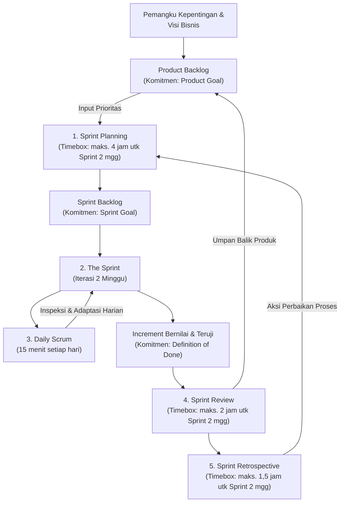

#### Tiga Accountabilities dalam Scrum — dan Posisi Strategis Senior Project Manager

Scrum Guide 2020 mengganti istilah *"Roles"* menjadi ***Accountabilities*** (akuntabilitas) dalam satu **Scrum Team** yang lintas fungsi (*cross-functional*), *self-managing*, dan biasanya berukuran ≤ 10 orang per tim (untuk proyek besar seperti Proyek OMNI, dibentuk dua *squad* paralel yang terkoordinasi pada satu *Product Backlog* terpadu):

1. **Product Owner (PO):** Akuntabel dalam **memaksimalkan nilai produk** yang dihasilkan Scrum Team. PO adalah satu individu (bukan komite!) yang berwenang menetapkan dan mengomunikasikan *Product Goal*, membuat serta mengurutkan item *Product Backlog*, dan memastikan *Product Backlog* transparan serta dipahami tim. Keputusan PO harus dihormati seluruh organisasi; siapapun yang ingin mengubah prioritas harus meyakinkan PO, bukan langsung memerintah *developer*.
2. **Scrum Master (SM):** Akuntabel dalam **menegakkan penerapan Scrum** sesuai Scrum Guide dan meningkatkan efektivitas Scrum Team. SM melayani tim melalui *coaching* kemandirian, menyingkirkan hambatan (*impediments*) di luar jangkauan tim, memastikan seluruh *Scrum Events* berjalan produktif sesuai *timebox*, serta membantu PO dan organisasi memahami praktik empiris. SM **bukan** sekretaris rapat dan bukan mandor tim.
3. **Developers:** Seluruh anggota Scrum Team yang berkomitmen menciptakan aspek apa pun dari *Increment* yang dapat digunakan pada setiap Sprint (mencakup *software engineer*, *UI/UX designer*, *QA engineer*, *database engineer*, hingga *DevOps*). Mereka menyusun rencana Sprint (*Sprint Backlog*), menjaga kualitas sesuai *Definition of Done*, dan saling menjaga akuntabilitas harian.

##### Lalu, di Mana Posisi Senior Project Manager dalam Lingkungan Scrum dan Hybrid?

Dalam buku teks Scrum murni untuk pengembangan satu produk perangkat lunak internal, jabatan *Project Manager* memang tidak disebutkan. Namun dalam proyek transformasi korporat bernilai miliaran rupiah seperti **Proyek OMNI** (melibatkan 4 proyek paralel dalam Program Nusantara 2028, kontrak vendor Rp 4,40 M, kepatuhan UU PDP, pengadaan 240 tablet, dan pelatihan 1.440 karyawan di 120 toko), **keberadaan Senior Project Manager bersifat vital**. Kuncinya adalah **pemisahan wewenang yang tegas** agar tidak terjadi tumpang tindih (*role collision*):

| Area Tanggung Jawab | Senior Project Manager *(Fajar Nugroho)* | Product Owner *(Kevin Halim)* | Scrum Master *(Tania Wijaya)* |
|---------------------|------------------------------------------|-------------------------------|-------------------------------|
| **Fokus Utama** | Integrasi keseluruhan proyek (*end-to-end*): jadwal induk, anggaran BAC Rp 9,20 M, kontrak vendor, risiko lintas unit, kepatuhan, dan *wave rollout* 120 toko | Memaksimalkan nilai bisnis produk digital, memprioritaskan *Product Backlog*, dan mewakili suara pelanggan/bisnis | Menjaga kesehatan proses Scrum, kelancaran aliran kerja tim, *coaching* Agile, dan menghilangkan hambatan operasional Sprint |
| **Wewenang Keputusan** | Eskalasi *Steering Committee*, persetujuan *Stage-Gate*, pengelolaan *Contingency Reserve*, penegakan kontrak/SLA PT NDS, koordinasi dependensi ERP-Refresh & POS-Modern | Urutan prioritas fitur, isi *User Story*, penerimaan (*acceptance*) fitur bisnis, serta keputusan *Scope Swap* fungsional | Fasilitasi *Scrum Events*, perlindungan tim dari gangguan luar Sprint, desain perbaikan retrospektif, dan kebijakan *WIP Limit* |
| **Yang TIDAK Boleh Dilakukan** | **Jangan** mengintervensi prioritas harian backlog sepihak, **jangan** memimpin *Daily Scrum* seperti laporan absensi, dan **jangan** mendikte estimasi *Story Points* | **Jangan** memaksa tim menerima *backlog* melebihi kapasitas Sprint atau mencampuri cara teknis *Developers* menulis kode | **Jangan** bertindak sebagai atasan langsung yang memberi perintah tugas atau mengambil alih kepemilikan *Product Backlog* |

#### Tiga Artifacts, Tiga Commitments, dan Definition of Ready (DoR)

Setiap artefak Scrum memiliki **komitmen (*commitment*)** spesifik yang memperkuat transparansi dan memberikan tolok ukur objektif atas kemajuan:

1. **Product Backlog → Komitmen: *Product Goal*.** Daftar terurut dan dinamis dari segala sesuatu yang dibutuhkan untuk meningkatkan produk; merupakan satu-satunya sumber pekerjaan bagi Scrum Team. *Product Goal* mendeskripsikan kondisi masa depan produk yang menjadi target jangka menengah/panjang tim.
2. **Sprint Backlog → Komitmen: *Sprint Goal*.** Terdiri dari *Sprint Goal* (mengapa Sprint ini bernilai), sekumpulan item *Product Backlog* terpilih (apa yang dibangun), dan rencana eksekusi konkret (bagaimana membangunnya). *Sprint Goal* memberi fleksibilitas: jika satu tugas teknis menemui kendala, tim tetap dapat bernegosiasi detail lingkup selama *Sprint Goal* tercapai.
3. **Increment → Komitmen: *Definition of Done (DoD)*.** Batu loncatan konkret menuju *Product Goal*. Setiap *Increment* bersifat aditif terhadap *Increment* sebelumnya dan **wajib terverifikasi penuh** memenuhi standar kualitas **DoD**. Item yang baru "selesai *coding* tapi belum diuji QA atau belum lolos cek keamanan" **bukan** *Increment* dan tidak boleh dihitung dalam *Velocity*.

Sebagai praktik komplementer industri (di luar teks wajib Scrum Guide 2020, namun sangat krusial di proyek *enterprise*), tim senior juga menerapkan **Definition of Ready (DoR)** — daftar syarat minimum agar sebuah *User Story* layak ditarik ke dalam *Sprint Planning* (misalnya: *Acceptance Criteria* jelas, ketergantungan API teridentifikasi, desain UI siap, dan sudah diestimasi). DoR mencegah tim membuang 4 hari pertama Sprint hanya untuk menebak maksud fitur; namun DoR harus diperlakukan sebagai panduan kolaborasi, bukan "gerbang birokrasi kaku" untuk menolak berdiskusi.

#### Lima Events (Ceremonies) Scrum

Seluruh acara dalam Scrum dibatasi waktu (*timeboxed*) untuk menciptakan keteraturan dan mengurangi kebutuhan rapat *ad-hoc* di luar kerangka Scrum. Tabel berikut merangkum 5 *Events* beserta *timebox* untuk **Sprint 2 minggu** (standar Proyek OMNI) dan perbandingan terhadap Sprint 4 minggu (batas maksimum Scrum Guide 2020):

| Event Scrum | Tujuan Utama | Timebox (Sprint 2 Mgg / 4 Mgg) | Peserta Utama | Input Utama | Output Utama | Kesalahan Umum di Lapangan |
|-------------|--------------|-------------------------------|---------------|-------------|--------------|----------------------------|
| **1. The Sprint** | Wadah (*container*) bagi seluruh acara lain untuk mengubah ide menjadi nilai (*Increment*) yang dapat diinspeksi | Tetap 2 minggu *(maks. 1 bulan)* | Seluruh Scrum Team | *Product Backlog* terurut | *Increment* memenuhi DoD | Mengubah durasi Sprint seenaknya; memaksa masuknya permintaan darurat yang merusak *Sprint Goal* |
| **2. Sprint Planning** | Menjawab 3 hal: (1) Mengapa Sprint ini bernilai? (2) Apa yang dapat diselesaikan? (3) Bagaimana cara mengerjakannya? | Maks. **4 jam** *(maks. 8 jam utk 4 mgg)* | Scrum Team (dapat mengundang ahli bisnis/SA) | *Product Backlog* siap (memenuhi DoR), kapasitas tim, *Velocity* historis, DoD | *Sprint Goal* + *Sprint Backlog* + rencana kerja awal | PO mendikte jumlah SP melebihi kapasitas tim; tidak merumuskan *Sprint Goal* sehingga Sprint hanya berisi daftar tugas terpisah |
| **3. Daily Scrum** | Menginspeksi progres menuju *Sprint Goal* dan mengadaptasi *Sprint Backlog* untuk 24 jam ke depan | Maks. **15 menit** (waktu & tempat sama tiap hari) | *Developers* (PO & SM hadir sebagai pendukung bila diperlukan) | *Sprint Backlog*, papan tugas, hambatan harian | Rencana kerja 24 jam ke depan & daftar eskalasi *impediment* | Berubah menjadi rapat laporan status searah ke Senior PM/SM; melebar menjadi sesi *debugging* teknis 45 menit |
| **4. Sprint Review** | Menginspeksi hasil *Increment* bersama pemangku kepentingan dan mengadaptasi *Product Backlog* | Maks. **2 jam** *(maks. 4 jam utk 4 mgg)* | Scrum Team + *Stakeholders* kunci (Sponsor, Marketing, Store Ops, Legal) | *Increment* yang memenuhi DoD, *Release Burnup*, perubahan kondisi pasar | Umpan balik produk nyata & pembaruan *Product Backlog* | Hanya presentasi *PowerPoint* tanpa demo perangkat lunak hidup; mencampuradukkan demo fitur yang belum lulus DoD |
| **5. Sprint Retrospective** | Merencanakan cara meningkatkan kualitas dan efektivitas proses, interaksi, alat, serta DoD tim | Maks. **1,5 jam** *(maks. 3 jam utk 4 mgg)* | Internal Scrum Team (ruang aman psikologis) | Pengalaman Sprint berjalan, metrik aliran, insiden kualitas | Minimal 1–2 aksi perbaikan proses konkret yang masuk ke *Sprint Backlog* berikutnya | Menjadi ajang saling menyalahkan (*blame game*); daftar perbaikan hanya dicatat di dokumen tanpa pernah dieksekusi |

---

### 5.4 Product Backlog Management, Estimasi Agile, dan Release Forecasting

Kualitas keluaran tim Agile sangat ditentukan oleh kualitas masukan di dalam *Product Backlog*. *Product Backlog* yang kabur, berantakan, atau berisi daftar keinginan tak terurut akan melumpuhkan bahkan tim *developer* paling andal sekalipun.

#### Hierarki Kebutuhan, User Story, dan Acceptance Criteria (Given–When–Then)

Pada proyek skala menengah–besar, kebutuhan diorganisasi secara berjenjang agar mudah dipantau dari tingkat direksi hingga tingkat pengembang:
- **Initiative / Theme:** Tujuan strategis tingkat program/proyek (contoh: *Omnichannel Store Fulfillment*).
- **Epic:** Kumpulan besar kemampuan bisnis yang terlalu besar untuk diselesaikan dalam 1 Sprint dan biasanya memakan beberapa Sprint (contoh: *EP-03: Click & Collect / BOPIS 120 Toko*).
- **Feature:** Pengelompokan fungsional di bawah *Epic* yang dapat dirilis sebagai satu nilai kohesif (contoh: *Pickup QR Verification di Kasir*).
- **User Story:** Unit kebutuhan terkecil yang bernilai langsung bagi pengguna akhir dan dapat diselesaikan tuntas (lulus DoD) dalam **satu Sprint**.
- **Task:** Pecahan langkah teknis internal *Developers* (*backend API*, *UI screen*, *unit test*, *script* migrasi) yang dilakukan untuk menuntaskan *User Story*.

Setiap *User Story* yang baik memadukan konsep **3C** (*Card* — ringkasan singkat; *Conversation* — dialog kolaboratif antara PO, BA, SA, QA, dan *Developers*; *Confirmation* — bukti pengujian objektif) dengan format baku:

> **"As a `[peran/persona pengguna]`, I want `[tindakan/kemampuan spesifik]`, so that `[manfaat bisnis/nilai terukur]`."**

Bagian *Confirmation* dituangkan sebagai **Acceptance Criteria (AC)** menggunakan sintaks **Gherkin (*Given–When–Then*)** agar bebas tafsir dan dapat langsung diubah menjadi kasus uji otomatis (*automated test cases*):
- **Given (*Kondisi Awal*):** Prasyarat sistem, status pengguna, atau data awal sebelum aksi terjadi.
- **When (*Pemicu/Aksi*):** Tindakan spesifik yang dilakukan pengguna atau sistem.
- **Then (*Hasil yang Diharapkan*):** Keluaran terukur yang wajib terjadi — mencakup *happy path*, skenario pengecualian (*negative/edge cases*), serta persyaratan non-fungsional (waktu respons, keamanan, kepatuhan).

#### Prinsip INVEST (User Story) dan DEEP (Product Backlog)

| Prinsip **INVEST** (Kualitas *User Story*) | Penjelasan Praktis | Prinsip **DEEP** (Kualitas *Product Backlog*) | Penjelasan Praktis |
|--------------------------------------------|--------------------|-----------------------------------------------|--------------------|
| **I — Independent** | Sebisa mungkin tidak terkunci ketat pada urutan *story* lain agar fleksibel diprioritaskan | **D — Detailed Appropriately** | Item di urutan atas (untuk 1–2 Sprint ke depan) sangat rinci & memenuhi DoR; item urutan bawah cukup berupa *Epic* garis besar |
| **N — Negotiable** | Bukan kontrak teknis mati; detail solusi dibahas bersama saat *refinement* | **E — Estimated** | Setiap item memiliki estimasi ukuran relatif sesuai tingkat rinciannya (*T-Shirt Size* di bawah, *Story Points* di atas) |
| **V — Valuable** | Memberikan nilai bisnis/pengguna yang jelas (hindari memotong *story* secara horizontal seperti "buat tabel database saja") | **E — Emergent** | Backlog hidup dan berevolusi seiring pembelajaran dari *Sprint Review*, data pengguna, dan perubahan pasar |
| **E — Estimable** | Cukup dipahami sehingga tim dapat memperkirakan kompleksitasnya; jika terlalu kabur, buat *Technical Spike* dulu | **P — Prioritized** | Diurutkan secara tegas dari nilai bisnis tertinggi/risiko paling kritis di puncak hingga terendah di dasar (tidak ada dua item yang sama-sama "Prioritas 1") |
| **S — Small** | Cukup kecil untuk tuntas dalam satu Sprint (idealnya 2–5 hari kerja, mis. 1–8 SP) | | |
| **T — Testable** | Memiliki *Acceptance Criteria* objektif agar QA dapat menyatakan *Pass/Fail* tanpa debat | | |

#### Backlog Refinement dan Teknik Story Splitting (SPIDR)

**Backlog Refinement** (dahulu disebut *grooming*) adalah aktivitas berkelanjutan — idealnya mengalokasikan **5%–10% kapasitas Sprint** — bagi PO, BA, SA, dan *Developers* untuk memecah *Epic* besar, memperjelas *Acceptance Criteria*, mengidentifikasi ketergantungan lintas sistem, dan mengestimasi item untuk 1–2 Sprint mendatang. Jika sebuah *User Story* terlalu besar (misalnya ≥ 13 SP), tim memecahnya secara vertikal menggunakan pola **SPIDR**:
- **S (*Spike*):** Pisahkan riset teknis berbatas waktu (mis. 2 hari) untuk menghilangkan ketidakpastian integrasi API *legacy* sebelum membangun fitur penuh.
- **P (*Paths*):** Pisahkan alur utama (*happy path*, mis. pembayaran QRIS sukses) dari alur alternatif/pengecualian (*partial refund* atau pembatalan pesanan).
- **I (*Interfaces*):** Pisahkan berdasarkan antarmuka/kanal (mis. alur *Click & Collect* versi *Web* terlebih dahulu, lalu adaptasi *Mobile App* iOS/Android).
- **D (*Data*):** Mulai dari subset data sederhana (mis. migrasi anggota aktif 12 bulan terakhir dulu sebelum arsip data duplikat 5 tahun).
- **R (*Rules*):** Implementasikan aturan bisnis dasar terlebih dahulu, baru tambahkan aturan khusus (mis. poin *tier Silver* dasar sebelum *multiplier* khusus ulang tahun *Platinum*).

#### Teknik Prioritisasi: MoSCoW, Value vs Effort, dan WSJF

Untuk mencegah prioritas backlog dikuasai oleh **HiPPO (*Highest Paid Person's Opinion*)**, Product Owner dan Senior PM menggunakan kerangka prioritisasi objektif:

1. **MoSCoW:** Mengelompokkan item ke dalam empat kategori komitmen:
   - **Must-Have (M):** Wajib ada agar produk legal, aman, dan layak beroperasi saat *Go-Live* (ideal maksimal ≤ 60% dari total kapasitas upaya agar tersedia ruang adaptasi).
   - **Should-Have (S):** Penting secara bisnis, namun tidak melumpuhkan peluncuran jika sementara ditangani dengan *workaround* manual (~20% kapasitas).
   - **Could-Have (C):** Fitur pemanis (*nice-to-have*) yang menjadi **penyangga utama (*contingency buffer*)** untuk ditukar (*Scope Swap*) atau ditunda bila terjadi gangguan jadwal (~20% kapasitas).
   - **Won't-Have (this time) (W):** Disepakati secara eksplisit **tidak masuk** dalam rilis berjalan (tetap dicatat untuk fase berikutnya agar pemangku kepentingan merasa didengar).
2. **Value vs Effort Matrix:** Memetakan fitur pada 4 kuadran: *Quick Wins* (Nilai Tinggi, Upaya Rendah → kerjakan pertama), *Major Strategic Bets* (Nilai Tinggi, Upaya Tinggi → pecah bertahap), *Fill-Ins* (Nilai Rendah, Upaya Rendah → kerjakan hanya jika ada kapasitas sisa), dan *Time Sinks* (Nilai Rendah, Upaya Tinggi → tolak/buang).
3. **WSJF (*Weighted Shortest Job First*):** Dikembangkan dari prinsip ekonomi aliran Donald Reinertsen dan banyak digunakan pada *Scaled Agile Framework (SAFe)*. WSJF memprioritaskan pekerjaan yang menghasilkan nilai ekonomi tertinggi per satuan waktu tunggu dengan rumus:

$$\text{Cost of Delay (CoD)} = \text{User/Business Value} + \text{Time Criticality} + \text{Risk Reduction / Opportunity Enablement}$$

$$\text{WSJF} = \frac{\text{Cost of Delay (CoD)}}{\text{Job Size (atau Duration)}}$$

Setiap komponen dinilai secara relatif dalam satu kolom menggunakan skala Fibonacci termodifikasi (`1, 2, 3, 5, 8, 13, 20`). Berikut ilustrasi penerapan **WSJF pada empat kandidat fitur Proyek OMNI** menjelang Release 2–3:

| ID | Fitur Kandidat Proyek OMNI | Business Value (BV) | Time Criticality (TC) | Risk Reduction (RR) | Total CoD (`BV+TC+RR`) | Job Size | Skor WSJF (`CoD / Size`) | Urutan Prioritas |
|----|----------------------------|---------------------|-----------------------|---------------------|------------------------|----------|--------------------------|------------------|
| **F-01** | *Consent Management* & Enkripsi PII (UU PDP) | 5 | 13 | 13 | **31** | 5 | **6,20** | **#1** *(Wajib cegah veto Legal)* |
| **F-02** | *Click & Collect* Pickup QR & Notifikasi SLA ≤ 2 Jam | 13 | 8 | 5 | **26** | 5 | **5,20** | **#2** *(Nilai pelanggan tinggi, ukuran ringkas)* |
| **F-03** | Adaptor Sinkronisasi Stok POS ≤ 60 Detik | 13 | 13 | 8 | **34** | 8 | **4,25** | **#3** *(CoD tertinggi, tetapi ukuran besar)* |
| **F-04** | Gamifikasi *Spin Wheel* & *Leaderboard* Marketing | 8 | 3 | 2 | **13** | 13 | **1,00** | **#4** *(Kandidat kuat tunda / Scope Swap)* |

Perhatikan pelajaran strategis dari tabel di atas: meskipun *F-04 (Gamifikasi)* disuarakan paling vokal oleh VP Marketing, analisis WSJF membuktikan secara transparan bahwa menunda kepatuhan UU PDP (*F-01*, WSJF 6,20) atau *Click & Collect* (*F-02*, WSJF 5,20) memiliki biaya keterlambatan ekonomi dan risiko penundaan *Go-Live* yang jauh lebih destruktif.

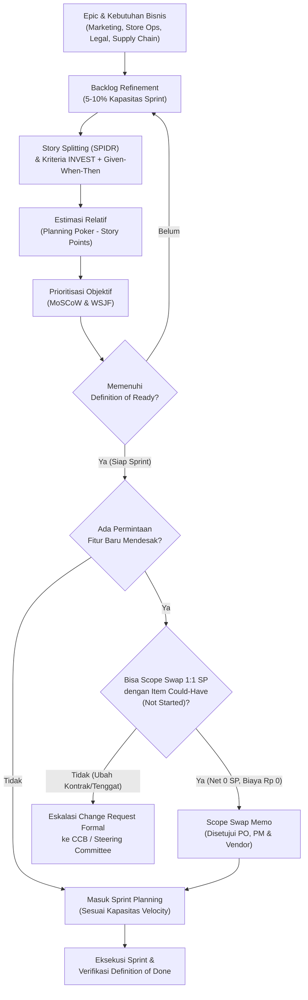

#### Estimasi Relatif (Story Points, Planning Poker), Velocity, dan Release Forecasting

Manusia secara psikologis sangat buruk dalam memperkirakan durasi absolut (*"tugas ini pasti selesai dalam 14,5 jam"*), namun jauh lebih akurat dalam melakukan **perbandingan relatif** (*"tugas B kira-kira dua kali lebih rumit dibandingkan tugas A"*). Oleh sebab itu, tim Agile menggunakan **Story Points (SP)** — satuan ukuran relatif yang memadukan tiga faktor: **volume upaya (*effort*)**, **kompleksitas teknis**, dan **tingkat ketidakpastian/risiko**.

Tim menetapkan satu *reference story* (misalnya sebuah fitur CRUD katalog sederhana = **2 SP** atau **3 SP**), lalu membandingkan *story* lainnya menggunakan deret **Fibonacci termodifikasi (`1, 2, 3, 5, 8, 13, 20, 40`)**. Jarak antar-angka yang kian melebar mencerminkan realitas bahwa semakin besar sebuah pekerjaan, semakin rendah presisi estimasinya (jika hasil estimasi ≥ 20 SP, itu adalah sinyal wajib untuk memecah *story* tersebut). Teknik kolaboratif **Planning Poker** dilakukan dengan cara setiap anggota *Developers* memilih kartu secara tertutup lalu membukanya bersamaan untuk mencegah bias jangkar (*anchoring bias* — yakni kecenderungan anggota junior sekadar mengikuti angka senior). Perbedaan angka ekstrem (misalnya 3 vs 13) memicu diskusi teknis berharga yang sering membongkar risiko tersembunyi (seperti kebutuhan enkripsi UU PDP atau keterbatasan API *legacy*).

##### Velocity dan Rumus Proyeksi Penyelesaian Release

**Velocity** adalah jumlah total *Story Points* dari *User Stories* yang **benar-benar selesai dan lulus 100% Definition of Done** dalam satu Sprint. Item yang baru selesai 80% pada akhir Sprint diberi nilai **0 SP** pada Sprint tersebut (tidak ada kredit parsial) dan dikembalikan ke *Product Backlog* untuk diprioritaskan ulang. Setelah tim melewati 3–4 Sprint awal (*calibration period*), rata-rata *Velocity* menjadi alat peramalan empiris yang sangat andal:

$$\text{Average Velocity} = \frac{\sum_{i=1}^{n} \text{Completed SP}_i}{n}$$

$$\text{Perkiraan Sisa Sprint} = \left\lceil \frac{\text{Remaining Backlog (SP)}}{\text{Projected Velocity (SP/Sprint)}} \right\rceil$$

$$\text{Kapasitas Tersisa (SP)} = \text{Sisa Sprint} \times \text{Projected Velocity (SP/Sprint)}$$

> **Peringatan Profesional:** *Velocity* adalah **metrik kapasitas lokal untuk peramalan**, bukan KPI produktivitas individu maupun alat pembanding antar-tim. Dua squad berbeda memiliki skala kalibrasi *Story Points* yang berbeda. Begitu manajemen menjadikan *Velocity* sebagai target bonus atau membandingkan Squad Alpha (25 SP) vs Squad Beta (40 SP), tim akan langsung melakukan *point inflation* (fitur 3 SP dinaikkan menjadi 8 SP) sehingga seluruh keandalan peramalan hancur.

##### Sprint Burndown Chart vs Release Burnup Chart

- **Sprint Burndown Chart:** Memantau sisa pekerjaan (*Story Points* atau jam tugas tersisa) dari hari ke-1 hingga hari ke-10 dalam satu Sprint dibandingkan garis tren ideal. Berguna di tingkat operasional tim (*Developers* & SM) untuk mendeteksi hambatan harian (misalnya kurva mendatar 4 hari berturut-turut menandakan tiket macet di pengujian/dependensi).
- **Release Burnup Chart:** Menampilkan **dua kurva sekaligus** sepanjang seluruh Sprint dalam satu *Release* atau proyek: (1) **Garis Total Lingkup (*Total Scope Line*)** di bagian atas, dan (2) **Garis Akumulasi Pekerjaan Selesai (*Cumulative Completed SP*)** yang menanjak dari bawah ke atas.

Mengapa Senior PM wajib menggunakan **Release Burnup Chart** saat melapor ke eksekutif? Karena pada *Release Burndown*, ketika tim menyelesaikan 40 SP namun pemangku kepentingan menyisipkan 40 SP fitur baru, grafik tampak datar dan tim disalahkan seolah "tidak bekerja". Sebaliknya, pada *Release Burnup*, garis atas yang melompat naik langsung **memvisualisasikan *scope creep* secara tak terbantahkan** di samping garis bawah yang membuktikan bahwa tim tetap bekerja produktif. Titik perpotongan proyeksi garis bawah (menggunakan rentang *Velocity* pesimistis, rata-rata, dan optimistis — *cone of uncertainty*) dengan garis lingkup atas langsung menunjukkan rentang tanggal penyelesaian *Release* secara jujur.

---

### 5.5 Kanban & Flow Metrics sebagai Pelengkap Scrum

Banyak tim di proyek korporat — seperti tim QA *Defect Triage*, tim dukungan *API Integration*, *DevOps*, atau tim *Hypercare* pasca-*Go-Live* — menghadapi aliran pekerjaan mendesak yang tidak selalu cocok dikunci dalam Sprint 2 mingguan. Di sinilah **Kanban** berperan baik sebagai metode mandiri maupun sebagai pelengkap Scrum (**Scrumban**).

Kanban bertumpu pada visualisasi seluruh tahapan aliran kerja di papan (*To Do → In Analysis → In Development → Code Review → QA Verification → Done*) dan **pembatasan jumlah pekerjaan aktif secara bersamaan (*Work in Progress Limit / WIP Limit*)**. Secara kontra-intuitif, memulai terlalu banyak pekerjaan sekaligus tidak membuat proyek selesai lebih cepat; sebaliknya, *multitasking* memicu *context switching* (hilangnya 20%–40% efisiensi kognitif setiap kali berpindah konteks), penumpukan antrean *code review*, dan lonjakan *defect*. Prinsip emas Kanban berbunyi: **"Stop starting, start finishing."**

#### Empat Metrik Aliran Utama (*Flow Metrics*) dan Little's Law

1. **Work in Progress (WIP):** Jumlah item pekerjaan yang sudah dimulai tetapi belum selesai (*Done*) pada satu titik waktu.
2. **Throughput ($\lambda$):** Jumlah item pekerjaan yang selesai tuntas per satuan waktu (misalnya tiket/minggu atau *story*/Sprint).
3. **Lead Time vs Cycle Time:**
   - **Lead Time:** Total waktu kalender sejak permintaan masuk ke sistem (*backlog/tiket dibuka*) hingga benar-benar dirilis dan diterima pengguna (perspektif pelanggan).
   - **Cycle Time:** Waktu aktual sejak tim *mulai aktif mengerjakan* item tersebut (*In Progress*) hingga dinyatakan selesai (*Done*) (perspektif efisiensi proses tim).
4. **Cumulative Flow Diagram (CFD):** Grafik area bertumpuk yang menampilkan jumlah kumulatif item di setiap kolom status dari waktu ke waktu. Cara membaca CFD bagi Senior PM:
   - **Jarak vertikal** antar-pita status menunjukkan besarnya **WIP** pada tahap tersebut. Jika pita kolom *"QA Verification"* melebar drastis sementara pita *"Done"* landai, terjadi ***bottleneck* (penyumbatan) di QA**.
   - **Jarak horizontal** antara garis masuk (*In Progress*) dan garis selesai (*Done*) menunjukkan rata-rata **Cycle Time**.
   - **Kemiringan (*slope*)** kurva *"Done"* menunjukkan rata-rata **Throughput**.

Hubungan matematis antara ketiga variabel aliran tersebut dirumuskan dalam **Little's Law** (John Little, 1961), yang berlaku pada sistem antrean dalam kondisi stabil (rata-rata laju kedatangan ≈ laju penyelesaian dalam periode pengamatan dengan satuan waktu yang konsisten):

$$\text{Average Cycle Time} = \frac{\text{Average WIP}}{\text{Average Throughput}}$$

Atau dapat disusun ulang untuk merancang batas kapasitas antrean:

$$\text{WIP Limit Maksimal} = \text{Average Throughput} \times \text{Target Cycle Time}$$

**Implikasi manajerial yang sangat kuat bagi Senior PM:** Jika *Throughput* tim relatif konstan dalam jangka pendek (karena jumlah personel tidak bisa ditambah seketika), satu-satunya tuas tercepat untuk memangkas **Cycle Time** hingga separuhnya adalah **menurunkan WIP Limit hingga separuhnya**. Memasukkan tiket baru secara terus-menerus ke tim yang sudah penuh hanya memperpanjang waktu tunggu setiap tiket tanpa menambah keluaran akhir.

---

### 5.6 Hybrid Project Management & Kontrak Vendor di Dunia Korporat

#### Water-Scrum-Fall yang Disfungsional vs Disciplined Hybrid Governance

Di lapangan, istilah "Hybrid" sering disalahgunakan untuk membenarkan praktik setengah matang yang dikenal sebagai **Water-Scrum-Fall** disfungsional. Seorang Senior PM harus mampu membedakan keduanya secara tajam:

| Karakteristik | Water-Scrum-Fall *(Disfungsional / Anti-Pattern)* | Disciplined Hybrid Governance *(Praktik Senior)* |
|---------------|---------------------------------------------------|--------------------------------------------------|
| **Perencanaan Awal** | Menulis BRD & spesifikasi teknis kaku 100% selama 4–5 bulan sebelum satu baris kode pun ditulis | Menetapkan *Project Charter*, arsitektur inti (*High-Level Architecture*), batasan regulasi, dan *Epic Roadmap* dalam 6–8 minggu (*Gate 1–2*), lalu merinci *User Stories* secara iteratif |
| **Integrasi & Pengujian** | *Developer* hanya membuat kode selama Sprint, lalu seluruh pengujian integrasi, keamanan, dan UAT dibuang ke "fase *testing* raksasa" di akhir proyek | Pengujian unit, integrasi API, otomasi QA, dan cek UU PDP melekat pada **DoD di setiap Sprint**; Fase SIT/UAT/Pilot akhir difokuskan pada validasi *end-to-end* lintas sistem & kesiapan operasional 120 toko |
| **Tata Kelola Perubahan** | Setiap perubahan kecil dari *Sprint Review* ditolak atau memicu birokrasi *Change Request* berminggu-minggu | Otonomi dua lapis: PO mengelola prioritas & *Scope Swap* dalam batas Release/kontrak; *Steering Committee* / CCB hanya memutuskan perubahan yang menyentuh *Cost Baseline*, tenggat *Hard Deadline*, atau kepatuhan hukum |
| **Pelaporan Eksekutif** | Melaporkan "% selesai" fiktif berdasarkan daftar tugas *Gantt* tanpa memperlihatkan perangkat lunak yang benar-benar berjalan | Menggabungkan *Stage-Gate Milestone* dan **Agile EVM** dengan demo *Increment* nyata pada setiap penutupan Release |
| **Relasi dengan Vendor** | Hubungan adversarial berbasis tudingan "tidak ada di dokumen tender"; vendor menimbun margin lewat *Change Request* mahal | Kontrak *Fixed Price per Release* dengan mekanisme transparan (*Scope Swap*, kriteria terima berbasis DoD, dan *shared risk register*) |

#### Arsitektur Hybrid Delivery Proyek OMNI

Proyek OMNI adalah contoh buku teks penerapan **Disciplined Hybrid Governance**: lapisan terluar bersifat **Predictive Stage-Gate** (mengamankan anggaran Rp 9,20 M, kontrak PT NDS Rp 4,40 M, kepatuhan UU PDP, dan kesiapan 120 toko), sedangkan mesin pembangunan perangkat lunaknya bersifat **Agile Scrum** (14 Sprint × 2 minggu dalam 3 Release).

```mermaid
flowchart LR
    subgraph F1["FASE 1: Predictive Initiation (Jun - Agu 2026)"]
        G0["M0 Kick-off<br/>(1 Jun 2026)"] --> G1["GATE 1 (31 Jul 2026)<br/>Charter, Arsitektur &<br/>Kontrak PT NDS Rp 4,40 M"]
        G1 --> M2["M2 Baseline & Cloud<br/>(31 Agu 2026)<br/>Product Backlog 560 SP"]
    end

    subgraph F2["FASE 2: Agile Scrum Core (14 Sprint x 2 Mgg)"]
        R1["Release 1 (S1-S6)<br/>Core, OMS, ERP/WMS<br/>230 SP - M3: 20 Nov 2026"]
        R2["Release 2 (S7-S11)<br/>App, Web, FinPay, Loyalty<br/>210 SP - M4: 12 Feb 2027*"]
        R3["Release 3 (S12-S14)<br/>Click & Collect, POS Sync<br/>120 SP"]
        R1 --> R2 --> R3
    end

    subgraph F3["FASE 3: Predictive Verification & Pilot (Apr - Jul 2027)"]
        G2["GATE 2 (23 Apr 2027)<br/>Feature Freeze &<br/>Release 3 Selesai"] --> SIT["SIT, UAT, Load Test<br/>2.500 TPM & PenTest UU PDP"]
        SIT --> G3["GATE 3 (16 Jul 2027)<br/>Pilot 10 Toko Jabodetabek<br/>(SLA ≤ 2 Jam)"]
    end

    subgraph F4["FASE 4: Predictive Wave Rollout (Jul - Nov 2027)"]
        W1["Gelombang 1: 30 Toko Jawa<br/>Gelombang 2: 40 Toko<br/>Gelombang 3: 40 Toko (M7)"] --> G4["GATE 4 (26 Nov 2027)<br/>Go-Live Nasional 120 Toko<br/>& Hypercare Closure"]
    end

    M2 --> R1
    R3 --> G2
    G3 --> W1
```

#### Menjembatani Kontrak Vendor Fixed-Price dengan Agile Delivery

Salah satu dilema tersulit bagi Senior PM di Indonesia (baik BUMN maupun swasta terbuka seperti PT SNR Tbk) adalah **kebijakan pengadaan (*procurement*) yang mewajibkan kontrak *Fixed Price*** demi kepastian anggaran CFO, sementara tim teknis menggunakan Scrum yang lingkup rincinya terus berevolusi. Kontrak *Fixed Price* tradisional dengan spesifikasi kaku menciptakan insentif rusak: vendor kehilangan semangat inovasi karena setiap revisi menggerus marginnya, sementara klien frustrasi karena terpaksa menerima fitur usang atau membayar *Change Request* berlipat.

Senior PM dapat menjembatani ketegangan ini melalui empat struktur kontrak ramah-Agile:

1. **Fixed-Price per Release / Milestone with Scope Swap (Model Proyek OMNI — PT NDS Rp 4,40 M):** Harga total kontrak (Rp 4,40 M) dan jumlah kapasitas (mis. 14 Sprint / 560 SP terkalibrasi, diikat dalam 4–5 termin pembayaran *milestone* berbasis kelulusan DoD tiap Release + UAT + Go-Live) dikunci, namun **isi rinci fitur pada Sprint yang belum berjalan boleh ditukar 1:1 dalam satuan Story Points** tanpa biaya tambahan selama tidak melampaui total kapasitas dan tidak mengubah arsitektur fundamental.
2. **Money for Nothing, Change for Free (Jeff Sutherland):**
   - ***Change for Free:*** Klien berhak menyisipkan fitur baru prioritas tinggi tanpa biaya tambahan asalkan mengeluarkan item *Product Backlog* lain yang belum dikerjakan (*Not Started*) dengan estimasi *Story Points* setara.
   - ***Money for Nothing:*** Jika pada Sprint ke-11 atau ke-12 klien menilai nilai bisnis produk sudah cukup matang dan fitur sisa bernilai rendah, klien berhak menghentikan kontrak lebih dini dengan membayar sebagian kecil nilai sisa (lazimnya **20%** dari sisa nilai kontrak) sebagai kompensasi margin & penugasan ulang tim vendor — klien menghemat 80% sisa biaya, sementara vendor tetap memperoleh margin bersih tanpa biaya produksi tambahan.
3. **Capped Time & Materials (T&M) with Not-to-Exceed (NTE) & Shared Risk/Reward:** Pembayaran berbasis laju aktual tim terdedikasi (*dedicated squad rate* per Sprint) dengan batas pagu atas (*cap*), dilengkapi klausul pembagian penghematan atau risiko pembengkakan (misalnya 50:50 jika melewati pagu akibat kinerja bersama).
4. **Pre-Allocated Change Budget / Innovation Buffer:** Menyisihkan 10%–15% dari nilai kontrak di awal sebagai kuota perubahan resmi yang hanya dapat dicairkan atas persetujuan PO dan Sponsor tanpa harus mengulang tender atau menerbitkan adendum hukum setiap bulan.

#### Agile Earned Value Management (Agile EVM) & Pelaporan Steering Committee

Direktur Keuangan (Budi Santoso) dan CEO (Hendra Wijaya) tidak dapat mengambil keputusan strategis hanya dari angka *"Velocity Sprint 10 = 31 SP"*. Senior PM bertugas menjadi **penerjemah bilingual**: mengonversi metrik empiris Scrum ke dalam bahasa **EVM (Modul 01)** yang dipahami *Steering Committee*.

Rumus dasar **Agile EVM** pada komponen pengembangan perangkat lunak:

$$\text{Nilai per Story Point} = \frac{\text{BAC}_{\text{Agile}}}{\text{Total Baseline SP}}$$

$$\text{Percent Complete (Agile)} = \frac{\text{Completed SP}}{\text{Total Baseline SP}} \times 100\%$$

$$\text{EV}_{\text{Agile}} = \text{Completed SP} \times \text{Nilai per Story Point}$$

$$\text{PV}_{\text{Agile}} = \text{Planned SP (s.d. Sprint } t\text{)} \times \text{Nilai per Story Point}$$

$$\text{SPI}_{\text{Agile}} = \frac{\text{Completed SP}}{\text{Planned SP (s.d. Sprint } t\text{)}} = \frac{\text{EV}_{\text{Agile}}}{\text{PV}_{\text{Agile}}}$$

$$\text{CPI}_{\text{Agile}} = \frac{\text{EV}_{\text{Agile}}}{\text{AC}_{\text{Agile}}}$$

**Rekonsiliasi dengan Data Resmi Bulan ke-9 Proyek OMNI (28 Februari 2027):**
Pada kontrak PT NDS (`CB-01` = Rp 4,40 M = Rp 4.400 jt) untuk total baseline **560 SP**, biaya referensi per *Story Point* adalah `Rp 4.400 jt / 560 SP` = **Rp 7,86 jt/SP** (presisi: Rp 7,8571 jt/SP). Hingga akhir Sprint 10:
- **Planned SP** = 400 SP → $\text{PV}_{\text{NDS}} = 400 \times 7,8571 = \textbf{Rp 3.142,86 jt}$ (~Rp 3,14 M).
- **Completed SP** = 360 SP → $\text{EV}_{\text{NDS}} = 360 \times 7,8571 = \textbf{Rp 2.828,57 jt}$ (~Rp 2,83 M).
- **$\text{SPI}_{\text{Agile}}$** = `360 / 400` = **0,90** — **identik** dengan SPI agregat seluruh Proyek OMNI pada akhir Bulan ke-9 (`EV Rp 4,32 M / PV Rp 4,80 M = 0,90`)!
- Selisih $\text{SV}_{\text{NDS}} = 2.828,57 - 3.142,86 = \textbf{−Rp 314,29 jt}$ (−Rp 0,31 M), sementara sisa −Rp 0,17 M dari total SV proyek (−Rp 0,48 M) berasal dari keterlambatan paket integrasi *legacy* (`CB-02`, dampak penundaan API POS-Modern).

Dengan pendekatan **Agile EVM** ini, Fajar Nugroho dapat menunjukkan kepada CFO Budi Santoso secara langsung bagaimana penurunan *Velocity* di Sprint 8–10 berkorelasi dengan deviasi Rp 0,48 M, sekaligus memaparkan opsi pemulihan yang terukur.

---

### 5.7 Kesalahan Umum di Lapangan (*Anti-Patterns*)

Memahami teori saja tidak cukup; kematangan seorang Senior PM terlihat dari kepekaannya mendeteksi **anti-patterns** sebelum merusak proyek:

| No | Anti-Pattern | Gejala di Lapangan | Dampak Destruktif | Pencegahan oleh Senior PM |
|----|--------------|--------------------|-------------------|---------------------------|
| **1** | **Fake Agile / Cargo Cult Agile** | Menjalankan semua ritual Scrum dan memakai istilah *Sprint/Epic*, tetapi seluruh keputusan tetap *command-and-control* dan tidak ada adaptasi setelah *Review* | Tim sinis, *overhead* rapat membengkak tanpa manfaat kecepatan maupun kualitas | Fokus pada hasil empiris (*working Increment* & *feedback loop*), lindungi kemandirian tim, dan edukasi *Steering Committee* |
| **2** | **Zombie Scrum** | Tim tampak hidup menjalankan Sprint rutin, tetapi produk tidak pernah dirilis ke pengguna nyata, *Stakeholder* absen di *Sprint Review*, dan *Retrospective* mati rasa | Biaya hangus besar untuk fitur yang tidak diinginkan pasar (*build trap*) | Wajibkan kehadiran perwakilan bisnis (Marketing, Store Ops) pada demo *Increment* nyata dan kaitkan setiap *Release* dengan metrik bisnis |
| **3** | **Water-Scrum-Fall Disfungsional** | *Backlog* dibekukan total 4 bulan di awal, lalu QA, keamanan, dan integrasi ditumpuk di fase *Hardening* akhir | Ledakan cacat (*defect explosion*) menjelang *Go-Live* yang memaksa penundaan jadwal | Terapkan *shift-left testing*, integrasi kontinu (CI/CD), dan masukkan standar QA/keamanan ke dalam **DoD setiap Sprint** |
| **4** | **Weaponized Velocity** | Manajemen membandingkan *Velocity* antar-tim atau menuntut *"naikkan Velocity 25% bulan depan!"* | Inflasi *Story Points*, penurunan mutu kode, pemotongan QA diam-diam, dan hancurnya akurasi *forecast* | Tegaskan *Velocity* hanya milik tim untuk *forecasting*; ukur kinerja bisnis dari *Outcome* (akurasi stok, SLA, *defect escape rate*) |
| **5** | **Mini-Waterfall di Dalam Sprint** | Hari 1–3 analisis, Hari 4–8 *coding*, Hari 9–10 QA dibanjiri puluhan tiket sekaligus | Tiket gagal lulus QA di akhir Sprint → *carryover* kronis dan lembur akhir pekan | Pecah *User Story* lebih kecil (≤ 5 SP), terapkan *WIP Limit*, dan biasakan QA menulis skenario uji sejak Hari ke-1 bersama *Developers* |
| **6** | **Daily Scrum sebagai Laporan Status ke PM** | Setiap orang berbicara menghadap Senior PM sambil membela diri *"kemarin saya kerja ini, hari ini itu"* | Hilangnya kolaborasi lintas *Developers* dan masalah teknis disembunyikan dari atasan | Biarkan *Developers* berbicara satu sama lain berfokus pada papan *Sprint Goal*; Senior PM hadir sebagai pendengar pasif atau cukup berkoordinasi lewat SM |
| **7** | **Senior PM Merangkap "Super-PO" & "Mandor SM"** | PM mengacak-acak urutan backlog seenaknya sekaligus memerintahkan tugas rinci ke tiap *developer* | PO kehilangan otoritas di mata bisnis, SM tidak berfungsi, dan PM menjadi *bottleneck* tunggal | Hormati *Role Clarity Charter*: PM memegang integrasi lintas proyek, anggaran, & vendor; PO memegang nilai/prioritas produk; SM memegang efektivitas proses |
| **8** | **Mengabaikan NFR & Kepatuhan dalam DoD** | Kepatuhan UU PDP, uji performa (2.500 TPM), dan *Penetration Testing* dianggap "urusan nanti sebelum Go-Live" | Veto mendadak dari *Legal/InfoSec* (Rina Kartika) di Gate 3 yang memaksa *re-architecture* mahal | Masukkan kriteria keamanan, *privacy-by-design*, dan ambang performa ke dalam DoD sejak Sprint 1 serta jadwalkan *Security Check* tiap *Release* |

---

## 6. Studi Kasus: Penerapan pada Proyek OMNI

Sebagai kelanjutan langsung dari *baseline* pada [00-studi-kasus-utama.md](00-studi-kasus-utama.md), bagian ini memperlihatkan bagaimana **Fajar Nugroho (Senior PM)** bersama **Kevin Halim (Product Owner)**, **Tania Wijaya (Scrum Master)**, tim inti internal SNR, dan **Bambang Hartono (PT NDS)** mengoperasionalkan **Disciplined Hybrid Delivery** pada Proyek OMNI dari Sprint 1 hingga titik tinjauan resmi **akhir Bulan ke-9 (28 Februari 2027 — pasca-Sprint 10)**.

### 6.1 Model Operasi Hybrid Proyek OMNI & Pembagian Peran

Untuk mengelola skala 18 personel vendor PT NDS ditambah tim inti internal SNR secara efektif tanpa melanggar ukuran ideal Scrum Team, tim pembangunan perangkat lunak pada Fase 2 dibagi menjadi **dua *cross-functional Squad* yang berbagi satu *Product Backlog* terpadu**:
- **Squad Alpha (*Core Commerce, OMS, ERP/POS Sync & Click & Collect*):** Fokus pada katalog 18.500 SKU, *Order Management System* (OMS), middleware sinkronisasi stok ≤ 60 detik, adaptor POS-Modern, dan *Store Fulfillment App*.
- **Squad Beta (*Mobile App, Web E-Commerce, Payment & Digital Loyalty*):** Fokus pada aplikasi iOS/Android, Web responsif, integrasi *Payment Gateway* PT FinPay Nusantara (PCI-DSS), *Digital Loyalty Engine*, serta modul kepatuhan *consent* UU PDP.

Agar tidak terjadi konflik kewenangan antara struktur korporat *Predictive* dan tim *Agile*, Fajar Nugroho mengesahkan **Matriks Model Operasi & Pembagian Peran Proyek OMNI** sejak *Gate 1 (31 Juli 2026)*:

| Tokoh & Peran | Akuntabilitas Utama dalam Model Hybrid | Forum Utama yang Dipimpin / Diikuti | Batas Tegas Wewenang (*Guardrails*) |
|---------------|----------------------------------------|--------------------------------------|--------------------------------------|
| **Fajar Nugroho** *(Senior PM)* | Integrasi menyeluruh proyek (anggaran BAC Rp 9,20 M, jadwal 18 bulan menuju 26 Nov 2027, kontrak PT NDS Rp 4,40 M, risiko R-01 s.d. R-10, dependensi ERP-Refresh & POS-Modern, serta *Wave Rollout* 120 toko) | Memimpin *Weekly Project Sync*, *Vendor Governance Review*, & pelaporan *Steering Committee* bulanan; hadir sebagai pengamat strategis pada *Sprint Review* | Tidak mengacak prioritas harian *Product Backlog* tanpa Kevin; tidak memimpin *Daily Scrum* atau mendikte estimasi SP |
| **Kevin Halim** *(Product Owner)* | Memaksimalkan nilai bisnis produk OMNI; mengelola satu *Product Backlog* lintas Squad Alpha & Beta; menyelaraskan kebutuhan Dewi Lestari (Marketing), Agus Setiawan (Store Ops), dan Siti Rahmawati (Supply Chain) | Memimpin *Backlog Refinement* & *Sprint Review*; menyepakati *Sprint Goal* di *Sprint Planning*; menerbitkan usulan *Scope Swap* | Tidak boleh menyetujui tambahan biaya kontrak PT NDS atau menggeser tanggal *Stage-Gate* tanpa Fajar & Sponsor (Ratna Kusuma) |
| **Tania Wijaya** *(Scrum Master)* | Menegakkan ritme Scrum 2 mingguan di Squad Alpha & Beta; memfasilitasi *Scrum Events*; mengelola papan *Kanban Defect Triage* & *WIP Limit*; melatih kemandirian tim & menyingkirkan *impediments* | Memfasilitasi *Sprint Planning*, *Cross-Squad Sync* (2×/minggu), *Sprint Retrospective*, dan *Agile Coaching* bisnis | Tidak bertindak sebagai manajer lini pemberi instruksi teknis dan tidak mengambil alih keputusan prioritas fitur dari Kevin |
| **Nadia Putri** *(Lead BA)* & **Dimas Prasetyo** *(Lead SA)* | Nadia membantu Kevin mengurai *Epic* menjadi *User Stories* berstandar INVEST & *Given–When–Then* serta memvalidasi SOP toko; Dimas menjaga integritas arsitektur OMS, API, cloud, dan standar *security-by-design* | Aktif dalam *Backlog Refinement*, *Architecture Review Board* bersama CTO (Irwan Pratama), dan sinkronisasi teknis lintas proyek | Memastikan seluruh *User Story* memenuhi DoR sebelum *Sprint Planning*, tanpa menciptakan "fase analisis tertutup" berbulan-bulan |
| **Lukas Gunawan** *(QA & Test Lead)* | Menegakkan standar pengujian *shift-left* di setiap Sprint, mengelola papan Kanban bug, mengoordinasikan SIT/UAT, uji beban 2.500 TPM, dan audit *Penetration Testing* bersama Rina Kartika | Menjaga gerbang mutu **Definition of Done (DoD)** tiap Sprint; memimpin *Defect Triage* harian saat mendekati rilis | Berwenang menahan klaim *"Done"* pada setiap *User Story* yang belum lulus uji otomatis, regresi, atau kriteria keamanan |
| **Bambang Hartono** *(Delivery Director PT NDS)* | Memastikan stabilitas kapasitas 18 personel vendor (developer, QA, DevOps), kepatuhan SLA kualitas kode, serta eksekusi transparan klausul *Fixed Price with Scope Swap* Rp 4,40 M | Menghadiri *Sprint Review*, *Bi-weekly Vendor Governance*, dan menandatangani *Scope Swap Memo* / berita acara *Milestone* | Tidak boleh melakukan rotasi insinyur kunci (mitigasi R-07) tanpa pemberitahuan 14 hari kerja dan *knowledge transfer* terverifikasi |

#### Irama Tata Kelola Terpadu (*Hybrid Governance Cadence*)

- **Harian:** *Daily Scrum* (15 menit per squad, dipimpin *Developers*) + *QA/Integration Kanban Standup* (10 menit oleh Lukas Gunawan & DevOps untuk blokir API).
- **Mingguan:** *Cross-Squad Dependency & Risk Sync* (45 menit dipimpin Fajar & Tania untuk memantau R-01 POS-Modern & R-02 Data Loyalty) + *Backlog Refinement* (2 jam oleh Kevin, Nadia, Dimas, dan perwakilan *Developers*).
- **Dua Mingguan (Akhir Sprint):** *Joint Sprint Review* (2 jam dengan demo perangkat lunak nyata di hadapan Ratna, Dewi, Agus, Siti, dan Rina) + *Sprint Retrospective* (1,5 jam per squad).
- **Bulanan & Stage-Gate:** *Executive Steering Committee* (dipimpin CEO Hendra Wijaya — membahas **Agile EVM**, *Release Burnup*, isu program bersama Antonius Wibowo, dan persetujuan **Gate 1–4**).

---

### 6.2 Cuplikan Product Backlog Prioritas Proyek OMNI

Berikut cuplikan representatif *Product Backlog* terpadu Proyek OMNI yang telah memenuhi prinsip **DEEP** (item Release 2–3 dirinci ke tingkat *User Story* terukur dan diprioritaskan dengan MoSCoW):

| ID Story | Epic | Ringkasan *User Story* | SP | MoSCoW | Target Release / Sprint |
|----------|------|------------------------|----|--------|-------------------------|
| `US-OM-04` | EP-01: OMS & Sync Stok | Sinkronisasi stok *near-real-time* (≤ 60 detik) antara ERP pusat, WMS 3 DC, dan katalog web/app | 8 | **Must** | R1 (S4) — *Selesai* |
| `US-PG-02` | EP-02: Commerce & Payment | *Checkout* multi-metode pembayaran (QRIS, VA, Kartu Kredit/Debit, e-Wallet) via PT FinPay sesuai PCI-DSS | 8 | **Must** | R2 (S7) — *Selesai* |
| `US-LY-05` | EP-03: Digital Loyalty | Migrasi, deduplikasi, dan verifikasi OTP pelanggan *Sinar Member Card* lama ke akun digital berbasis QR | 8 | **Must** | R2 (S9–S10) — *Selesai* |
| `US-DP-01` | EP-05: UU PDP & Security | Manajemen persetujuan (*consent management*) eksplisit, enkripsi data PII, dan fitur permintaan hapus akun (UU PDP) | 5 | **Must** | R2 (S10) — *Selesai* |
| `US-LY-11` | EP-03: Digital Loyalty | Penebusan poin & voucher otomatis lintas kanal (App/Web/POS) dengan kalkulasi *tier Silver/Gold/Platinum* | 8 | **Must** | R2 (S11) — *Prioritas #1* |
| `US-GM-01` | EP-03: Digital Loyalty *(Scope Swap S8)* | MVP *Daily Check-In* & *Streak Bonus Point* 7 hari berturut-turut untuk retensi MAU | 13 | **Should** | R2 (S11) — *Masuk via Swap* |
| `US-CC-01` | EP-04: Click & Collect (BOPIS) | Pencarian ketersediaan stok per toko berbasis lokasi GPS dan reservasi stok otomatis saat *checkout Click & Collect* | 8 | **Must** | R3 (S12) |
| `US-CC-02` | EP-04: Click & Collect (BOPIS) | *Store Fulfillment App* (tablet/scanner toko): antrean picking, pemindaian barcode SKU, dan timer peringatan SLA ≤ 2 jam | 8 | **Must** | R3 (S12–S13) |
| `US-CC-03` | EP-04: Click & Collect (BOPIS) | Verifikasi serah terima pesanan *Click & Collect* via QR unik pelanggan di kasir & pemotongan stok POS ≤ 60 detik | 5 | **Must** | R3 (S13) |
| `US-WB-14` | EP-02: Commerce & Payment | Tabel perbandingan spesifikasi hingga 4 SKU berdampingan di Web *(Ditukar keluar / Swap Out di S8)* | 8 | **Could** | *Ditunda ke Fase 2 (2028)* |
| `US-LY-19` | EP-03: Digital Loyalty | Kustomisasi tema visual kartu loyalty digital musiman (Imlek/Lebaran/Natal) *(Ditukar keluar / Swap Out di S8)* | 5 | **Could** | *Ditunda ke Fase 2 (2028)* |

#### Spesifikasi Detail User Story Kunci dengan Acceptance Criteria (*Given–When–Then*)

##### 1. `US-CC-01` — Pencarian Stok Toko & Reservasi *Click & Collect* (8 SP | Release 3 — Sprint 12)
> **User Story:** *As a* pelanggan aplikasi mobile SNR, *I want* melihat ketersediaan stok barang secara real-time di toko terdekat dan memesan dengan opsi *Click & Collect*, *so that* saya dapat mengambil pesanan di toko dalam ≤ 2 jam tanpa ongkos kirim dan tanpa risiko barang habis saat tiba.

**Acceptance Criteria (*Given–When–Then*):**
- **Skenario 1 (*Happy Path* — Reservasi Stok Berhasil):**
  - **Given** pelanggan telah masuk ke aplikasi mobile, mengaktifkan izin lokasi, dan memilih SKU `HL-4021` (jumlah = 2 unit) sementara Toko SNR Pondok Indah memiliki stok tersedia (*available-to-promise*) = 5 unit.
  - **When** pelanggan memilih metode **"Ambil di Toko (Click & Collect — SNR Pondok Indah)"** dan menyelesaikan pembayaran melalui FinPay QRIS.
  - **Then** OMS segera mengunci (*soft-lock* menjadi *hard-reserve*) 2 unit pada stok Toko Pondok Indah dalam waktu **≤ 60 detik**, sisa stok publik berubah menjadi 3 unit, pesanan masuk ke *Store Fulfillment App* toko tujuan, dan pelanggan menerima notifikasi estimasi siap ambil **≤ 2 jam**.
- **Skenario 2 (*Edge Case* — *Race Condition* / Stok Menipis di Bawah Ambang Aman):**
  - **Given** sisa stok SKU `HL-4021` di Toko Pondok Indah tinggal 1 unit (di bawah *safety buffer* toko = 2 unit untuk mencegah *overselling* dengan pembeli fisik di rak).
  - **When** pelanggan mencoba memilih opsi *Click & Collect* untuk Toko Pondok Indah.
  - **Then** sistem menonaktifkan opsi *Click & Collect* untuk toko tersebut dengan label *"Stok Terbatas — Pembelian Langsung di Toko"* dan otomatis merekomendasikan 3 toko terdekat lain yang memiliki stok ≥ 2 unit atau opsi pengiriman reguler dari DC Cikarang.
- **Skenario 3 (*Negative Case* — Pembayaran Kedaluwarsa):**
  - **Given** pelanggan memilih *Click & Collect* (2 unit dikunci *soft-lock* sementara) tetapi tidak menyelesaikan pembayaran dalam 15 menit.
  - **When** batas waktu *payment gateway* berakhir (*expired*).
  - **Then** OMS otomatis membatalkan pesanan dan melepaskan kembali 2 unit ke stok publik Toko Pondok Indah dalam ≤ 60 detik.

##### 2. `US-CC-02` — Pemenuhan Pesanan & Peringatan SLA ≤ 2 Jam pada *Store Fulfillment App* (8 SP | Release 3 — Sprint 12–13)
> **User Story:** *As a* staf gudang/kasir toko SNR, *I want* menerima notifikasi pesanan *Click & Collect*, memindai barcode barang yang diambil, dan melihat hitung mundur SLA 2 jam pada tablet toko, *so that* pesanan pelanggan selalu siap tepat waktu dan kesalahan ambil barang (*wrong SKU*) dapat dicegah.

**Acceptance Criteria (*Given–When–Then*):**
- **Skenario 1 (*Happy Path* — Pemindaian & Kesiapan Ambil):**
  - **Given** terdapat pesanan *Click & Collect* berstatus `Paid` pada tablet *Store Fulfillment App* Toko SNR Pondok Indah.
  - **When** petugas menekan *"Mulai Siapkan"*, memindai barcode seluruh SKU sesuai pesanan dengan *scanner* tablet, lalu menekan *"Siap Diambil"*.
  - **Then** status pesanan berubah menjadi `Ready for Pickup`, sistem mengirim kode QR pengambilan unik ke aplikasi & email pelanggan dalam ≤ 10 detik, dan waktu proses tercatat untuk laporan kepatuhan SLA (target ≥ 95% pesanan ≤ 2 jam).
- **Skenario 2 (*Exception* — Eskalasi Peringatan SLA & Barang Fisik Rusak):**
  - **Given** pesanan belum berstatus `Ready for Pickup` ketika waktu berjalan telah mencapai **90 menit** (sisa 30 menit menuju batas SLA 2 jam).
  - **When** timer mencapai menit ke-90.
  - **Then** sistem memicu notifikasi kuning/merah ke dashboard *Store Manager* dan menandai tiket sebagai *At Risk*; apabila petugas melaporkan fisik barang rusak (*damaged item*), sistem menyediakan alur pengalihan pesanan ke toko terdekat atau *refund* otomatis dengan persetujuan *Store Manager*.

##### 3. `US-LY-05` — Aktivasi & Migrasi Akun *Digital Loyalty* Berbasis Kepatuhan UU PDP (8 SP | Release 2 — Sprint 9–10)
> **User Story:** *As a* pemegang kartu fisik *Sinar Member Card* lama, *I want* menautkan data keanggotaan lama saya ke aplikasi mobile SNR dengan verifikasi OTP dan persetujuan privasi yang jelas, *so that* saldo poin dan tingkatan keanggotaan (*Silver/Gold/Platinum*) saya terbawa utuh secara aman tanpa duplikasi akun.

**Acceptance Criteria (*Given–When–Then*):**
- **Skenario 1 (*Happy Path* — Klaim Akun & *Consent* UU PDP):**
  - **Given** nomor telepon atau nomor kartu lama pelanggan cocok dengan rekaman terbersihkan di basis data migrasi dan pelanggan belum memiliki akun digital.
  - **When** pelanggan memasukkan kode OTP 6 digit (berlaku 3 menit) dan mencentang kotak persetujuan eksplisit (*un-prechecked opt-in*) pemrosesan data pribadi sesuai kebijakan privasi UU PDP.
  - **Then** sistem menggabungkan saldo poin historis yang tervalidasi, menerbitkan kartu QR digital sesuai *tier*, mengenkripsi kolom PII (*Personal Identifiable Information* — nomor HP, email, tanggal lahir) menggunakan AES-256, dan merekam *timestamp*, versi kebijakan, serta alamat IP pada tabel *Audit Consent Log*.
- **Skenario 2 (*Edge Case* — Data Duplikat Lintas Toko):**
  - **Given** nomor HP pelanggan terdeteksi tertaut pada 2 kartu fisik lama dari cabang berbeda akibat data kotor (kasus 62% data lama SNR).
  - **When** pelanggan memverifikasi kepemilikan melalui OTP dan tanggal lahir.
  - **Then** sistem menampilkan ringkasan kedua nomor kartu, menggabungkan total poin aktif ke satu akun *Single Customer View* tanpa kehilangan poin, dan menonaktifkan kartu duplikat secara permanen dalam log audit.

---

### 6.3 Rencana Release 1–3 (14 Sprint), Data Velocity Sprint 1–10, dan Analisis Dampak Gangguan

Total baseline lingkup pengembangan perangkat lunak Proyek OMNI ditetapkan sebesar **560 Story Points (SP)** yang dibagi dalam **14 Sprint × 2 minggu** melintasi 3 *Release* utama (selaras dengan linimasa pada [00-studi-kasus-utama.md](00-studi-kasus-utama.md)):

| Release | Cakupan Sprint | Fokus Kemampuan Bisnis (*Product Increment*) | Target Baseline SP | Milestone Terkait |
|---------|----------------|----------------------------------------------|--------------------|-------------------|
| **Release 1** | Sprint 1–6 (6 Sprint) | Fondasi arsitektur *Cloud*, katalog 18.500 SKU, OMS MVP, dan *sandbox* integrasi ERP-Refresh & WMS 3 DC | **230 SP** | **M3** (20 Nov 2026) |
| **Release 2** | Sprint 7–11 (5 Sprint) | Aplikasi Mobile & Web Beta, *Payment Gateway* PT FinPay (PCI-DSS), *Digital Loyalty Engine* + migrasi 1,2 juta data member, & modul UU PDP | **210 SP** | **M4** (12 Feb 2027* — *baseline*) |
| **Release 3** | Sprint 12–14 (3 Sprint) | *Click & Collect* (BOPIS) *end-to-end*, *Store Fulfillment App* (tablet/scanner), adaptor API POS-Modern (≤ 60 detik), & *hardening* uji beban 2.500 TPM | **120 SP** | **M5 / Gate 2** (23 Apr 2027 — *Feature Freeze*) |
| **TOTAL** | **14 Sprint** | **Platform Omnichannel Lengkap Siap SIT, UAT & Pilot 10 Toko** | **560 SP** | **Tenggat Akhir M8: 26 Nov 2027** |

#### Log Kinerja Velocity Aktual Sprint 1–10 (Status Resmi Akhir Bulan ke-9: 28 Februari 2027)

*Catatan Rekonsiliasi Jadwal:* Pada jadwal *baseline*, Release 2 (Sprint 7–11) direncanakan rampung 12 Februari 2027 (termasuk jeda libur akhir tahun). Namun akibat dua gangguan kritis — kualitas data 1,2 juta anggota *Sinar Member Card* yang ternyata **2 kali lebih kotor** dari asumsi awal (**R-02**) serta penundaan antarmuka API proyek paralel **POS-Modern** selama **3 minggu** (**R-01**) — per **akhir Bulan ke-9 (28 Februari 2027)** proyek baru menuntaskan **Sprint 10** (mundur ±2 minggu dari rencana M4; Sprint 11 bergeser ke awal Maret 2027). Berikut data historis *Velocity* gabungan Squad Alpha & Squad Beta:

| Sprint | Release | Planned SP | Actual Completed SP | Kumulatif Planned SP | Kumulatif Actual SP | Deviasi Kumulatif (SP) | Catatan Operasional & Dinamika Lapangan |
|--------|---------|------------|---------------------|----------------------|---------------------|------------------------|-----------------------------------------|
| **S1** | R1 | 30 | **28** | 30 | 28 | −2 | Fase *forming* tim gabungan SNR–PT NDS; penyelarasan CI/CD & lingkungan *cloud* Jakarta |
| **S2** | R1 | 36 | **34** | 66 | 62 | −4 | Kalibrasi *Planning Poker* dan penyesuaian skema master data 18.500 SKU |
| **S3** | R1 | 40 | **38** | 106 | 100 | −6 | Ritme Scrum mulai matang; integrasi *sandbox* ERP berjalan mulus |
| **S4** | R1 | 40 | **41** | 146 | 141 | −5 | Tim mencapai ritme stabil; otomatisasi pengujian API mempercepat *Cycle Time* |
| **S5** | R1 | 42 | **42** | 188 | 183 | −5 | Kinerja puncak R1; *WMS Sync* DC Cikarang & Surabaya lulus uji awal |
| **S6** | R1 | 42 | **43** | 230 | 226 | −4 | **Penutupan R1 (M3 lulus tepat waktu!)** — 226 dari 230 SP selesai; hanya 4 SP *carryover* minor |
| **S7** | R2 | 42 | **40** | 272 | 266 | −6 | Awal R2 kuat: integrasi QRIS & VA PT FinPay selesai memenuhi standar PCI-DSS |
| **S8** | R2 | 43 | **34** | 315 | 300 | −15 | **Mulai terganggu:** ditemukan inkonsistensi masif data *Sinar Member Card* (**R-02**); permintaan gamifikasi Dewi Lestari (**R-04**) berhasil diredam via *Scope Swap* (biaya Rp 0) |
| **S9** | R2 | 42 | **29** | 357 | 329 | −28 | **Titik terendah Velocity:** *rework* skrip pembersihan data 1,2 juta anggota menyita kapasitas; keterlambatan API POS-Modern (**R-01**) mulai memblokir *story* sinkronisasi |
| **S10** | R2 | 43 | **31** | **400** | **360** | **−40** | Dampak lanjutan blokir API POS-Modern (mundur 3 minggu); Dimas Prasetyo membangun *API Mock/Stub* sementara agar tim tetap bergerak |
| **Total S1–S10** | **R1–R2** | **400 SP** | **360 SP** | **400 SP** | **360 SP** | **−40 SP** | **$\text{SPI}_{\text{Agile}} = 360 / 400 = \mathbf{0,90}$** *(identik dengan EVM SPI Bulan ke-9!)* |

#### Ringkasan Metrik Empiris Pasca-Sprint 10 & Implikasi Strategis

Dari data 10 Sprint di atas, Tania Wijaya dan Fajar Nugroho menarik temuan objektif berikut untuk rapat *Steering Committee* akhir Bulan ke-9:
1. **Sisa Pekerjaan Baseline (*Remaining Backlog*):** `560 − 360` = **200 SP** untuk **4 Sprint tersisa** (Sprint 11–14) sebelum **Gate 2 / Feature Freeze (23 April 2027)**.
2. **Tiga Tolok Ukur *Velocity*:**
   - Rata-rata keseluruhan (S1–S10): `360 / 10` = **36,0 SP/Sprint**.
   - Rata-rata 3 Sprint terakhir (S8–S10 — kondisi terganggu): `(34 + 29 + 31) / 3 = 94 / 3` = **31,33 SP/Sprint**.
   - Rata-rata periode stabil (S4–S7 — kondisi normal tanpa blokir eksternal): `(41 + 42 + 43 + 40) / 4 = 166 / 4` = **41,5 SP/Sprint**.
3. **Kesenjangan Kapasitas Nyata:** Menyelesaikan 200 SP dalam 4 Sprint menuntut *Velocity* **50,0 SP/Sprint** — padahal rekor tertinggi tim sepanjang sejarah proyek hanya 43 SP/Sprint. Memaksa tim lembur untuk mengejar 50 SP akan memicu *anti-pattern* kelelahan dan meledakkan cacat di Fase UAT.
4. **Keputusan Pemulihan Terukur (*Hybrid Recovery Plan*):**
   - **Langkah 1 (Eliminasi Blokir):** Eskalasi lintas program melalui Antonius Wibowo (PMO) untuk mengunci rilis kontrak API POS-Modern di awal Sprint 11 serta menuntaskan skrip migrasi data loyalty, sehingga *Velocity* pulih ke rentang stabil **41,5 SP/Sprint** (kapasitas 4 Sprint = `4 × 41,5` = **166 SP**).
   - **Langkah 2 (De-scoping Terkendali berbasis MoSCoW):** Kevin Halim dan Ratna Kusuma menunda sementara **34 SP** item berkategori *Could-Have / Should-Have* non-kritis (`200 − 166 = 34 SP`, misalnya analitik tampilan promo lanjutan dan laporan kustomisasi tambahan) ke *Post-Go-Live Backlog* (Desember 2027) tanpa menyentuh fitur wajib *Click & Collect*, *Digital Loyalty*, maupun kepatuhan UU PDP. Dengan demikian, **Gate 2 (23 April 2027)** dan *Hard Deadline* **26 November 2027** tetap terlindungi.

---

### 6.4 Definition of Ready (DoR) & Definition of Done (DoD) Proyek OMNI

Untuk memastikan tidak ada *story* mentah masuk ke Sprint dan tidak ada "utang kepatuhan" yang tertunda hingga detik terakhir di hadapan Rina Kartika (Legal & InfoSec), Proyek OMNI memberlakukan DoR dan DoD resmi berikut:

#### A. Definition of Ready (DoR) — Syarat Masuk *Sprint Planning*
1. **Format & Nilai Jelas:** Ditulis dalam format *User Story* yang memenuhi prinsip **INVEST** dan tertaut pada *Epic* serta prioritas MoSCoW yang disetujui Kevin Halim (PO).
2. **Teruji Secara Objektif:** Memiliki minimal 2–3 skenario *Acceptance Criteria* berformat **Given–When–Then** (mencakup *happy path* dan *edge/negative case*) yang telah ditinjau oleh Nadia Putri (BA) dan Lukas Gunawan (QA).
3. **Terestimasi & Berukuran Tepat:** Telah diestimasi melalui *Planning Poker* oleh *Developers* dengan ukuran **≤ 8 SP** (maksimal 13 SP hanya untuk *story* pengecualian yang telah dibedah alur teknisnya).
4. **Ketergantungan & Desain Siap:** *Wireframe/UI mockup* disetujui, spesifikasi kontrak API (*OpenAPI/Swagger*) bersama proyek ERP-Refresh atau POS-Modern telah terdefinisi (atau *mock endpoint* tersedia), dan tidak ada blokir eksternal yang belum memiliki pemilik.
5. **Klasifikasi Data & Privasi:** Setiap *story* yang menyentuh data pelanggan telah ditandai apakah memproses data PII sehingga persyaratan UU PDP langsung tercantum dalam *Acceptance Criteria*.

#### B. Definition of Done (DoD) — Syarat Mutlak Klaim *Increment* & *Velocity*
Sebuah *User Story* **hanya** diakui sebagai *Done* (dan boleh dihitung ke dalam *Velocity* serta pembayaran termin PT NDS) apabila memenuhi seluruh 8 kriteria berikut:
1. **Kode & Reviu Rekan (*Peer Code Review*):** Seluruh kode telah digabungkan (*merged*) ke cabang utama (*main/release branch*) dan lulus *code review* oleh minimal satu *senior engineer* tanpa pelanggaran standar *linting*.
2. **Pengujian Otomatis Lulus:** *Unit test* lulus 100% dengan *code coverage* minimal **≥ 80%** pada logika bisnis inti; *automated API integration test* lulus pada lingkungan *Staging*.
3. **Verifikasi QA & Bebas Cacat Kritis:** Seluruh skenario *Given–When–Then* lulus verifikasi QA (Lukas Gunawan); **0 cacat Critical**, **0 cacat High**, dan seluruh cacat Medium terdokumentasi di papan Kanban dengan rencana resolusi.
4. **Kepatuhan UU PDP (*Privacy-by-Design*):** Seluruh data PII terenkripsi saat penyimpanan (*AES-256*) dan saat transmisi (*TLS 1.3*), mekanisme *consent opt-in* tercatat pada *Audit Log*, serta bebas dari penyimpanan data rahasia di *log* aplikasi.
5. **Keamanan & Kesiapan *Penetration Testing*:** Lulus pemindaian keamanan statis/dinamis otomatis (*SAST/DAST*) pada *CI/CD pipeline* tanpa celah *OWASP Top 10* berkategori *Critical/High* dan patuh standar PCI-DSS untuk modul pembayaran.
6. **Ambang Performa (*Performance Baseline*):** Waktu respons API kritikal memenuhi *p95 < 400 ms* pada pengujian simulasi lokal sebagai prasyarat kelulusan uji beban puncak **2.500 TPM** di Fase 3.
7. **Dokumentasi & Kesiapan Operasional:** Spesifikasi API (*Swagger*), *release notes*, serta dampak perubahan SOP kasir/toko telah diperbarui dan ditinjau oleh Dimas Prasetyo & Nadia Putri.
8. **Penerimaan Bisnis (*PO Acceptance*):** Didemonstrasikan secara langsung pada lingkungan *Staging* dan dinyatakan diterima (*Accepted*) oleh Kevin Halim (Product Owner).

---

### 6.5 Mekanisme Scope Swap di Sprint 8: Kasus Gamifikasi Dewi Lestari

**Konteks Kejadian (Awal Sprint 8 — Desember 2026):**
Menjelang *Sprint Planning* Sprint 8, **Dewi Lestari** (VP Marketing & CX) mengunjungi tim proyek dengan membawa hasil riset kompetitor. Ia mendesak agar Proyek OMNI segera menambahkan paket fitur **"Daily Check-In Spin Wheel & Badge Gamification"** ke dalam Release 2 dengan alasan fitur tersebut krusial untuk mengejar target **500.000 MAU** di tahun pertama.

Jika Proyek OMNI dikelola dengan pola *Waterfall* kaku atau *Fake Agile*, hanya ada dua ujung yang buruk: (a) permintaan langsung ditolak mentah-mentah sehingga merusak dukungan *Steering Committee* dari Marketing, atau (b) fitur dipaksakan masuk ke backlog PT NDS sehingga Bambang Hartono menerbitkan *Change Request* berbayar mahal dan menggeser jadwal.

**Eksekusi Disciplined Hybrid — Klausul *Change for Free / Scope Swap*:**

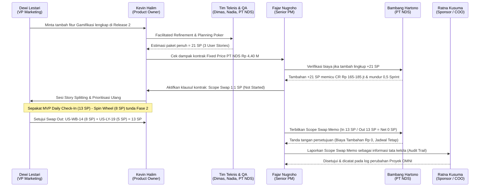

**Rincian Neraca *Scope Swap Memo #SSM-004* (Disahkan Sprint 8):**

| Arah Perubahan | ID Story | Deskripsi Fitur | Kategori MoSCoW | Story Points | Status Sebelumnya |
|----------------|----------|-----------------|-----------------|--------------|-------------------|
| **SWAP IN (+)** | `US-GM-01` | MVP *Daily Check-In* & *Streak Bonus Point* 7 Hari *(hasil pemecahan dari paket awal 21 SP)* | Should-Have | **+13 SP** | Permintaan baru Marketing |
| **SWAP OUT (−)** | `US-WB-14` | Tabel perbandingan 4 SKU berdampingan di Web *(ditunda ke Fase 2 tahun 2028)* | Could-Have | **−8 SP** | *Not Started* (Rencana R2 S11) |
| **SWAP OUT (−)** | `US-LY-19` | Kustomisasi tema kartu digital musiman Imlek/Lebaran/Natal *(ditunda ke Fase 2 tahun 2028)* | Could-Have | **−5 SP** | *Not Started* (Rencana R2 S11) |
| **NET CHANGE** | — | **Pertukaran Seimbang 1:1 Story Point tanpa Mengubah Arsitektur Inti** | — | **0 SP** | **Biaya CR PT NDS = Rp 0** |

**Hasil Nyata:** Dewi Lestari memperoleh fitur retensi harian yang paling berdampak bagi target 500.000 MAU; Bambang Hartono (PT NDS) tetap terlindungi margin dan kapasitas kerjanya; CFO Budi Santoso senang karena tidak ada penggerusan *Contingency Reserve* Rp 0,70 M (menghemat potensi CR Rp 165–185 jt); dan Fajar Nugroho berhasil membuktikan keunggulan nyata tata kelola *Disciplined Hybrid*.

---

## 7. Latihan dan Pembahasan

### 7.1 Soal Latihan

Kerjakan seluruh 4 latihan berikut secara mandiri terlebih dahulu sebelum memeriksa pembahasan pada Sub-bab 7.2.

#### Latihan 1: Proyeksi Penyelesaian Release & Analisis Dampak *Scope Creep* (+40 SP)
Berdasarkan data *Velocity* aktual Proyek OMNI pada Sprint 1–10 (`28, 34, 38, 41, 42, 43, 40, 34, 29, 31` SP; total selesai = **360 SP** dari baseline **560 SP**, tersisa **4 Sprint** yakni S11–S14 menuju Gate 2 tanggal 23 April 2027):
1. Hitung proyeksi jumlah Sprint yang dibutuhkan untuk menuntaskan sisa *backlog* (**200 SP**) menggunakan tiga asumsi *Velocity*: (a) rata-rata keseluruhan S1–S10, (b) rata-rata 3 Sprint terakhir S8–S10, dan (c) rata-rata periode stabil S4–S7.
2. Misalkan mekanisme *Scope Swap* **tidak diterapkan**, sehingga masuk permintaan fitur baru total **+40 SP** tanpa penukaran (sisa *backlog* membengkak menjadi **240 SP**). Hitung ulang proyeksi jumlah Sprint pada ketiga asumsi *Velocity* tersebut serta hitung berapa **defisit kapasitas (SP)** jika proyek tetap dipaksa berhenti di Sprint 14 dengan asumsi *Velocity* pemulihan stabil (S4–S7).
3. Sebagai Fajar Nugroho (Senior PM), rumuskan **3 rekomendasi tindakan konkret** yang harus diajukan bersama Kevin Halim kepada *Steering Committee*.

#### Latihan 2: Rekayasa Ulang *User Story* Buruk ke Standar INVEST & *Given–When–Then*
Pada sesi *discovery*, Anda menerima dua draf *User Story* mentah berikut yang jelas melanggar prinsip INVEST:
- **Draf Buruk A (dari Marketing):** *"Sebagai sistem, saya harus punya modul promosi lengkap dengan voucher, flash sale, dan notifikasi push biar penjualan naik."*
- **Draf Buruk B (dari Store Ops):** *"Kasir perlu halaman admin database untuk ubah status pesanan Click & Collect secara manual di SQL kalau pelanggan datang."*

Tugas Anda:
1. Identifikasi minimal **3 pelanggaran prinsip INVEST** pada masing-masing draf di atas.
2. Tulis ulang **satu *User Story* prioritas hasil pemecahan** untuk masing-masing draf (gunakan format *"As a… I want… So that…"*) agar memenuhi seluruh kriteria INVEST, berikan estimasi indikatif *Story Points*, dan susun **minimal 2 skenario *Acceptance Criteria* (*Given–When–Then*)** per *story* (termasuk minimal satu *edge/negative case* atau kepatuhan NFR).

#### Latihan 3: Optimalisasi Alur Kerja QA & Integrasi dengan *Little's Law* dan CFD
Pada Sprint 9 Proyek OMNI, papan Kanban **Tim Defect Triage & Integrasi API** (dikelola Lukas Gunawan) mencatat rata-rata **24 tiket** dalam status aktif (*WIP* = 24 tiket di kolom *In Progress + Code Review + QA*) dengan rata-rata penyelesaian (*Throughput*) sebesar **8 tiket/minggu**.
1. Hitung rata-rata **Cycle Time** saat ini (dalam minggu dan hari kerja, asumsi 5 hari kerja/minggu). Mengapa angka ini berbahaya bagi ritme Sprint 2 mingguan?
2. Jika Tania Wijaya mengusulkan pembatasan **WIP Limit = 12 tiket** dan *Throughput* diasumsikan tetap 8 tiket/minggu, hitung **Cycle Time** baru dan persentase penurunannya.
3. Menjelang fase SIT (April 2027), Lukas Gunawan menetapkan SLA internal **Cycle Time ≤ 1,0 minggu (5 hari kerja)**. Dengan dukungan skrip pengujian otomatis, *Throughput* tim meningkat menjadi **10 tiket/minggu**. Berapa **WIP Limit maksimal** yang boleh ditetapkan agar SLA tercapai?
4. Jelaskan **2 pola visual pada *Cumulative Flow Diagram* (CFD)** yang menandakan adanya *bottleneck* di kolom *QA Verification*.

#### Latihan 4: Keputusan *Hybrid Governance* — Konflik Jadwal *Stage-Gate SteerCo* vs *Sprint Review*
**Skenario Situasional:** Menjelang **Gate 2 (Feature Freeze, Jumat 23 April 2027)**, jadwal rapat bulanan *Steering Committee* (dipimpin CEO Hendra Wijaya & CFO Budi Santoso) jatuh pada **Senin, 19 April 2027** — yakni **5 hari kerja sebelum Sprint 14 berakhir**. Sekretaris Direksi mengirim memo yang menuntut Fajar Nugroho menyerahkan *"Berita Acara 100% Lingkup Release 3 Selesai & Siap SIT"* pada rapat 19 April tersebut agar termin pembayaran PT NDS bisa segera diproses. Pada saat yang sama:
- Squad Alpha & Beta baru menjadwalkan *Sprint Review* Sprint 14 pada Jumat, 23 April 2027.
- Rina Kartika (Legal & InfoSec) baru saja menemukan 1 celah penting pada pencatatan *revocation consent* (pencabutan izin data pribadi UU PDP) pada modul *Digital Loyalty* yang membutuhkan waktu perbaikan dan pengujian ulang selama **3 hari kerja** (selesai 22 April 2027).

Sebagai Fajar Nugroho, bagaimana Anda menangani konflik tata kelola ini? Uraikan keputusan Anda pada empat aspek: **(a) Integritas DoD & UU PDP**, **(b) Opsi Mekanisme Keputusan Gate 2 bagi SteerCo**, **(c) Pengelolaan Termin Pembayaran PT NDS**, dan **(d) Koordinasi dengan PO, SM, serta Legal**.

---

### 7.2 Pembahasan Latihan

#### Pembahasan Latihan 1: Proyeksi Release & Analisis *Scope Creep*

**1. Perhitungan Tiga Asumsi *Velocity* Dasar:**
- **Rata-rata Keseluruhan (S1–S10):** $\frac{28+34+38+41+42+43+40+34+29+31}{10} = \frac{360}{10} = \mathbf{36,0\text{ SP/Sprint}}$.
- **Rata-rata 3 Sprint Terakhir (S8–S10):** $\frac{34+29+31}{3} = \frac{94}{3} = \mathbf{31,33\text{ SP/Sprint}}$.
- **Rata-rata Periode Stabil (S4–S7):** $\frac{41+42+43+40}{4} = \frac{166}{4} = \mathbf{41,5\text{ SP/Sprint}}$.

**2. Tabel Perbandingan Proyeksi (Sisa Baseline 200 SP vs Skenario *Scope Creep* 240 SP):**

| Skenario Velocity | Laju (SP/Sprint) | Proyeksi Sisa 200 SP (Baseline) | Deviasi vs 4 Sprint Tersisa | Proyeksi Sisa 240 SP (+40 SP Creep) | Deviasi vs 4 Sprint Tersisa |
|-------------------|------------------|----------------------------------|-----------------------------|-------------------------------------|-----------------------------|
| **Optimistis / Pemulihan (S4–S7)** | **41,50** | `200 / 41,5 = 4,82` → **5 Sprint** | Terlambat 1 Sprint (2 mgg) | `240 / 41,5 = 5,78` → **6 Sprint** | Terlambat 2 Sprint (4 mgg) |
| **Dasar / Rata-rata (S1–S10)** | **36,00** | `200 / 36,0 = 5,56` → **6 Sprint** | Terlambat 2 Sprint (4 mgg) | `240 / 36,0 = 6,67` → **7 Sprint** | Terlambat 3 Sprint (6 mgg) |
| **Pesimistis / Terganggu (S8–S10)** | **31,33** | `200 / 31,33 = 6,38` → **7 Sprint** | Terlambat 3 Sprint (6 mgg) | `240 / 31,33 = 7,66` → **8 Sprint** | Terlambat 4 Sprint (8 mgg) |

**Perhitungan Defisit Kapasitas pada Skenario +40 SP (Batas 4 Sprint dengan Velocity Pemulihan 41,5 SP/Sprint):**
- Kapasitas realistis maksimum dalam 4 Sprint = $4 \times 41,5 = \mathbf{166\text{ SP}}$.
- Total pekerjaan dengan *scope creep* = **240 SP**.
- **Defisit kapasitas** = $240 - 166 = \mathbf{74\text{ SP}}$ (setara hampir 2 Sprint penuh yang mustahil dikejar hanya dengan lembur tanpa mengorbankan kualitas!). Bahkan pada kondisi baseline 200 SP tanpa *scope creep*, masih ada kesenjangan $200 - 166 = \mathbf{34\text{ SP}}$ yang wajib dikelola secara strategis.

**3. Tiga Rekomendasi Konkret Fajar Nugroho & Kevin Halim ke *Steering Committee*:**
1. **Bekukan Tambahan Lingkup Non-Swap (*Strict Scope Freeze / 1:1 Swap Only*):** Menunjukkan secara visual pada *Release Burnup Chart* bahwa +40 SP memicu defisit 74 SP dan menggerus jendela UAT/PenTest hingga mengancam *Hard Deadline* 26 November 2027. Segala permintaan baru hanya boleh masuk via *Scope Swap* 1:1 atau masuk *Backlog Fase 2 (2028)*.
2. **Eksekusi *MoSCoW De-scoping* Sebesar ≥ 34 SP:** Menunda item *Could-Have* dan *Should-Have* ber-WSJF terendah senilai 34–40 SP ke *Post-Go-Live Release* (Desember 2027) agar sisa lingkup *Must-Have* masuk dalam kapasitas 166 SP (4 Sprint × 41,5 SP/Sprint) sehingga **Gate 2 (23 April 2027)** tetap tercapai.
3. **Intervensi Lintas Program untuk Memulihkan *Velocity* ke 41,5 SP/Sprint:** Mengeskalasi keterlambatan API POS-Modern (R-01) melalui Antonius Wibowo (PMO) untuk mengunci jadwal *endpoint* final di minggu pertama Sprint 11 dan menugaskan 1 *data engineer* tambahan khusus menuntaskan anomali data loyalty (R-02) agar *Developers* kembali fokus pada fitur inti.

---

#### Pembahasan Latihan 2: Rekayasa Ulang *User Story* (INVEST & *Given–When–Then*)

**1. Identifikasi Pelanggaran INVEST:**
- **Draf Buruk A (Marketing):**
  - *Bukan Small (terlalu raksasa — masih setingkat Epic):* Menggabungkan 3 fitur besar sekaligus (voucher, *flash sale*, notifikasi *push*).
  - *Bukan Valuable dari sudut pengguna:* Memakai persona *"Sebagai sistem"* (bukan pengguna bisnis/pelanggan) sehingga manfaat fungsionalnya kabur.
  - *Bukan Estimable & Testable:* Frasa *"modul promosi lengkap"* dan *"biar penjualan naik"* terlalu ambigu untuk diestimasi maupun diuji lulus/gagal oleh QA.
- **Draf Buruk B (Store Ops):**
  - *Bukan Negotiable:* Langsung mendikte solusi teknis berbahaya (*"ubah manual di SQL"*) alih-alih menyatakan kebutuhan bisnis.
  - *Bukan Valuable / Aman:* Akses SQL langsung oleh kasir melanggar keamanan data, integritas stok OMS, dan kepatuhan UU PDP.
  - *Bukan Testable & Independent:* Tidak ada kriteria verifikasi keberhasilan maupun kejelasan alur validasi identitas pelanggan.

**2. Penulisan Ulang Standar Senior:**
- **Hasil Pecahan Draf A → `US-PR-01` (Penebusan Kode Voucher Diskon di Keranjang Belanja | Estimasi: 5 SP):**
  - **User Story:** *As a* pelanggan aplikasi mobile SNR, *I want* memasukkan dan menerapkan kode voucher promosi aktif pada halaman keranjang belanja, *so that* saya langsung melihat potongan harga secara transparan sebelum membayar.
  - **Acceptance Criteria:**
    - *Skenario 1 (Happy Path):* **Given** pelanggan memiliki total belanja Rp 500.000 di keranjang dan kode voucher `OMNI50` (diskon Rp 50.000, minimal belanja Rp 300.000, masih berlaku). **When** pelanggan mengetik `OMNI50` dan menekan *"Terapkan"*. **Then** sistem memvalidasi kuota voucher dalam ≤ 2 detik, memotong total tagihan menjadi Rp 450.000, dan menampilkan rincian diskon sebelum masuk ke *Payment Gateway*.
    - *Skenario 2 (Negative Case — Kedaluwarsa / Batas Penggunaan):* **Given** kode voucher `OMNI50` sudah pernah digunakan pelanggan yang sama (batas 1× per akun) atau masa berlakunya habis. **When** pelanggan menekan *"Terapkan"*. **Then** sistem menolak penerapan voucher, mempertahankan total tagihan Rp 500.000, dan menampilkan pesan spesifik *"Voucher sudah pernah digunakan atau masa berlaku berakhir"*.
- **Hasil Pecahan Draf B → `US-CC-03` (Konfirmasi Serah Terima *Click & Collect* via QR Kasir | Estimasi: 5 SP):**
  - **User Story:** *As a* kasir toko SNR, *I want* memindai kode QR pengambilan milik pelanggan pada *Store Fulfillment App* untuk mengonfirmasi penyerahan barang *Click & Collect*, *so that* status pesanan dan stok POS diperbarui otomatis dengan jejak audit tanpa akses manual ke basis data.
  - **Acceptance Criteria:**
    - *Skenario 1 (Happy Path):* **Given** pesanan berstatus `Ready for Pickup` di Toko SNR Pondok Indah dan pelanggan menunjukkan QR pengambilan valid di aplikasi mobile. **When** kasir memindai QR melalui tablet toko dan menekan *"Konfirmasi Diserahkan"*. **Then** status pesanan berubah menjadi `Completed`, stok fisik di POS tersinkronisasi dalam **≤ 60 detik**, dan sistem mencatat ID kasir beserta *timestamp* pada log audit.
    - *Skenario 2 (Edge/Security Case — QR Tidak Valid atau Salah Toko):* **Given** pelanggan memindai QR milik pesanan yang ditujukan ke Toko SNR Kelapa Gading (bukan Pondok Indah) atau pesanan sudah pernah diambil. **When** kasir memindai QR tersebut. **Then** sistem memblokir konfirmasi serah terima, menampilkan peringatan merah berisi lokasi toko yang benar atau waktu pengambilan sebelumnya, serta mencegah penyerahan ganda (*double-pickup*).

---

#### Pembahasan Latihan 3: Perhitungan *Little's Law* dan Pembacaan CFD

1. **Cycle Time Awal (Sprint 9):**
   $$\text{Cycle Time} = \frac{\text{WIP}}{\text{Throughput}} = \frac{24\text{ tiket}}{8\text{ tiket/minggu}} = \mathbf{3,0\text{ minggu}}\text{ (atau } 3,0 \times 5 = \mathbf{15\text{ hari kerja}}\text{)}$$
   **Mengapa berbahaya?** Karena durasi 1 Sprint Proyek OMNI adalah **2 minggu (10 hari kerja)**. *Cycle Time* 3,0 minggu berarti rata-rata tiket cacat/integrasi tidak akan pernah tuntas dalam Sprint yang sama, menyebabkan penumpukan *carryover* kronis, hilangnya *feedback loop*, dan kegagalan memenuhi DoD.

2. **Cycle Time Setelah Pembatasan WIP Limit = 12 Tiket (Throughput Tetap 8 Tiket/Minggu):**
   $$\text{Cycle Time Baru} = \frac{12\text{ tiket}}{8\text{ tiket/minggu}} = \mathbf{1,5\text{ minggu}}\text{ (atau } \mathbf{7,5\text{ hari kerja}}\text{)}$$
   **Persentase Penurunan:** $\frac{3,0 - 1,5}{3,0} \times 100\% = \mathbf{50\%}$. Tanpa menambah satu orang pun dan bahkan sebelum *Throughput* naik, pembatasan WIP memangkas waktu penyelesaian tiket hingga separuhnya sehingga tiket dapat tuntas di dalam Sprint 2 mingguan.

3. **WIP Limit Maksimal untuk Mencapai SLA Cycle Time ≤ 1,0 Minggu (Throughput = 10 Tiket/Minggu):**
   $$\text{WIP Limit Maksimal} = \text{Throughput} \times \text{Target Cycle Time} = 10\text{ tiket/minggu} \times 1,0\text{ minggu} = \mathbf{10\text{ tiket}}$$
   Dengan batas maksimal 10 tiket aktif di seluruh kolom kerja, tim wajib membantu menyelesaikan tiket yang sedang macet (*swarming*) sebelum menarik tiket ke-11.

4. **Dua Pola Visual *Bottleneck* QA pada *Cumulative Flow Diagram* (CFD):**
   - **Pelebaran Pita Vertikal (*Widening Band*) pada Kolom *QA Verification*:** Garis batas masuk QA terus naik curam sementara garis batas keluar menuju *Done* landai, menunjukkan tumpukan antrean tiket yang belum teruji (WIP di QA meledak).
   - **Pola Tangga Datar (*Flat-Line Staircase*) pada Kurva *Done*:** Garis *Done* mendatar berkepanjangan selama beberapa hari lalu tiba-tiba melonjak tajam tepat di hari terakhir Sprint — indikasi kuat terjadinya *mini-waterfall* atau *batch testing* yang berisiko tinggi menimbulkan cacat lolos (*escaped defects*).

---

#### Pembahasan Latihan 4: Keputusan *Hybrid Governance* (Konflik Jadwal *SteerCo* vs *Sprint Review*)

Seorang Senior PM **tidak boleh** memalsukan laporan "100% selesai" sebelum *Increment* benar-benar lulus DoD dan UU PDP — itu merupakan pelanggaran *Transparency* dan *Anti-Pattern* *Watermelon Status* yang bisa berujung pada kegagalan audit Legal. Langkah tata kelola *Disciplined Hybrid* yang tepat:

1. **Menjaga Integritas DoD & Kepatuhan UU PDP (Non-Negotiable):** Fajar menolak menandatangani status "100% Selesai" pada 19 April. Temuan *revocation consent* UU PDP dari Rina Kartika adalah cacat kepatuhan kritis (risiko veto **R-05**) yang wajib dituntaskan dan diverifikasi QA (Lukas Gunawan) hingga 22 April sesuai DoD.
2. **Mengusulkan Mekanisme *Conditional Gate 2 Approval* (Persetujuan Bersyarat) pada Rapat SteerCo 19 April:**
   - Pada rapat *Steering Committee* 19 April 2027, Fajar menyajikan **Status Transparan Berbasis Fakta**: progres terverifikasi per 19 April (misalnya ~94% lingkup Release 3 telah lulus DoD dan siap demo pendahuluan) disertai **Daftar Terbuka 1 Item Kritis (*Open Punch-List*)** yakni perbaikan *revocation consent* UU PDP (target selesai 22 April) serta 2 *story* akhir Sprint 14.
   - Fajar meminta *Steering Committee* menerbitkan **Conditional Gate 2 Sign-Off** dengan delegasi verifikasi akhir kepada **Ratna Kusuma (Sponsor)** dan **Rina Kartika (Head of Legal/InfoSec)** pasca-*Sprint Review* Jumat, 23 April 2027. Jika seluruh kriteria lulus pada 23 April, proyek otomatis melaju ke SIT/UAT (26 April 2027) tanpa harus menunggu jadwal rapat Direksi bulan berikutnya!
3. **Menjaga Disiplin Komersial Termin Kontrak PT NDS:** Fajar menjelaskan kepada CFO Budi Santoso dan Bambang Hartono bahwa **Berita Acara Serah Terima (BAST) Termin Release 3** disiapkan secara administratif sejak 19 April agar alur keuangan siap, tetapi **tanda tangan pencairan baru dilepas pada 23 April** setelah *Sprint Review* mengonfirmasi 0 temuan UU PDP/Critical/High. Hal ini menjaga akuntabilitas finansial sekaligus memotivasi PT NDS menuntaskan perbaikan 3 hari tepat waktu.
4. **Penyelarasan Operasional Tim Agile & Legal:** Tania Wijaya memfasilitasi *swarming* Squad Beta bersama Rina Kartika & Lukas Gunawan pada 19–22 April agar celah UU PDP segera diuji ulang tanpa menunggu akhir minggu; Kevin Halim memastikan tidak ada fitur baru masuk di sisa 5 hari Sprint 14 (*hard code freeze* kecuali perbaikan *defect*).

---

## 8. Tugas Modul dan Rubrik Penilaian

### Brief Tugas Mandiri (±6 Jam)

**Peran Anda:** **Fajar Nugroho** — Senior Project Manager Proyek OMNI (PT Sinar Nusantara Retail Tbk).
**Konteks Waktu:** **1 Maret 2027** (tepat setelah penutupan Bulan ke-9 dan Sprint 10; SPI = 0,90; selesai 360 SP dari 560 SP; tersisa 4 Sprint menuju Gate 2 tanggal 23 April 2027).

Susun dokumen terpadu bertajuk **"Paket Tata Kelola & Pemulihan Hybrid Delivery Proyek OMNI (Sprint 11–14 Menuju Gate 2)"** yang terdiri atas **5 komponen wajib**:

1. **Hybrid Operating Model & Matriks Batas Peran (Bobot 20%):** Rancang peta pembagian wewenang antara Senior PM (Fajar), PO (Kevin), SM (Tania), QA Lead (Lukas), dan Delivery Director PT NDS (Bambang) lengkap dengan *Governance Cadence* harian hingga *Stage-Gate*, serta identifikasi 3 potensi *anti-pattern* yang paling mengancam Proyek OMNI beserta langkah pencegahannya.
2. **Pembaruan *Product Backlog* Prioritas Release 2–3 (Bobot 25%):** Susun minimal **8 *User Stories*** realistis untuk Sprint 11–14 (mencakup *Click & Collect*, *Digital Loyalty*, Adaptor POS-Modern, dan kepatuhan UU PDP), lengkap dengan estimasi *Story Points*, prioritas MoSCoW, skoring **WSJF** (minimal untuk 5 fitur utama), serta **2 *User Story* terinci dengan minimal 3 skenario *Given–When–Then*** (wajib memuat *happy path*, *edge case*, dan kriteria SLA/UU PDP).
3. **Rencana Pemulihan *Velocity*, *Release Burnup*, & *Kanban WIP* (Bobot 25%):** Lakukan proyeksi penyelesaian sisa **200 SP** pada 3 skenario *Velocity*, susun paket *MoSCoW De-scoping / Scope Swap* sebesar **≥ 34 SP** (sebutkan daftar item yang ditunda ke Fase 2 beserta justifikasi bisnisnya), serta tetapkan kebijakan **WIP Limit** menggunakan *Little's Law* bagi tim QA & Integrasi agar *Cycle Time* ≤ 5 hari kerja.
4. **Dokumen DoR & DoD Proyek OMNI (Bobot 15%):** Susun standar operasional *Definition of Ready* (minimal 5 kriteria) dan *Definition of Done* (minimal 8 kriteria) yang secara spesifik mengintegrasikan kepatuhan **UU PDP**, uji beban **2.500 TPM**, *Penetration Testing*, dan kesiapan SOP 120 toko.
5. **Memo Eksekutif *Agile EVM* & Strategi Kontrak PT NDS (Bobot 15%):** Susun ringkasan eksekutif 1 halaman bagi *Steering Committee* yang menerjemahkan progres 360/400 SP ke dalam **Agile EVM** (terhubung dengan data EVM Bulan ke-9: EV Rp 4,32 M, PV Rp 4,80 M, AC Rp 4,60 M, SPI 0,90, CPI 0,94) dan memaparkan mekanisme perlindungan kontrak PT NDS Rp 4,40 M (klausul *Scope Swap* & *Conditional Gate*) agar tidak memicu *Change Request* tak terkendali.

### Rubrik Penilaian Tugas Modul (Skala 4 Tingkat)

| Kriteria Penilaian | Bobot | Skor 4: Sangat Baik (90–100) | Skor 3: Baik (75–89) | Skor 2: Cukup (60–74) | Skor 1: Perlu Perbaikan (< 60) |
|--------------------|-------|------------------------------|----------------------|-----------------------|--------------------------------|
| **1. Hybrid Operating Model & Batas Peran** | **20%** | Pembagian peran PM–PO–SM–Vendor bebas tumpang tindih, selaras penuh dengan *Cynefin* & Scrum 2020; *cadence* & pencegahan *anti-pattern* sangat konkret untuk Proyek OMNI | Pembagian peran jelas dan konsisten, *cadence* lengkap, namun pencegahan *anti-pattern* masih bersifat umum | Terdapat sebagian kerancuan peran (mis. PM mencampuri backlog harian PO atau SM menjadi sekretaris status) | Model operasi mencerminkan *Water-Scrum-Fall* atau *Waterfall* murni yang bertentangan dengan konteks kasus |
| **2. Kualitas Product Backlog, WSJF & Given–When–Then** | **25%** | Seluruh 8+ *story* memenuhi INVEST & DEEP; hitungan WSJF akurat dan logis; *Given–When–Then* tajam mencakup *happy path*, *edge case*, SLA ≤ 2 jam/≤ 60 detik, dan UU PDP | Mayoritas *story* memenuhi INVEST; hitungan WSJF benar; *Given–When–Then* memadai namun masih kurang spesifik pada *edge case* atau NFR | Beberapa *story* masih terlalu besar (setingkat *Epic*), ambigu, atau *Acceptance Criteria* belum teruji objektif | *Backlog* berupa daftar fitur generik tanpa format *User Story*, tanpa *Story Points*, atau salah menghitung WSJF |
| **3. Analisis Velocity, Release Plan, De-scoping & Little's Law** | **25%** | Seluruh hitungan proyeksi 3 skenario, kapasitas 166 SP, paket *de-scoping* ≥ 34 SP, dan *Little's Law* 100% akurat serta terintegrasi melindungi Gate 2 & 26 Nov 2027 | Hitungan utama benar; rencana pemulihan & *WIP Limit* masuk akal meski rincian item *de-scoping* kurang mendalam | Terdapat kesalahan hitung minor pada proyeksi Sprint atau solusi pemulihan masih bergantung pada asumsi lembur tidak realistis | Salah rumus *Velocity* / *Little's Law*; tidak ada solusi kuantitatif untuk menutup defisit kapasitas |
| **4. Ketajaman DoR & DoD Enterprise** | **15%** | DoR dan DoD sangat aplikatif, objektif (terukur), dan secara eksplisit mengunci syarat UU PDP, *PenTest*, PCI-DSS, 2.500 TPM, serta dokumentasi SOP 120 toko | DoR dan DoD lengkap serta relevan, namun beberapa kriteria mutu atau keamanan belum memuat ambang batas terukur | Hanya memuat standar *coding/testing* dasar tanpa mengaitkannya dengan kepatuhan UU PDP, performa, atau operasional toko | DoR dan DoD tertukar maknanya atau terlalu dangkal untuk standar proyek korporat |
| **5. Memo Eksekutif Agile EVM & Strategi Kontrak Vendor** | **15%** | Mampu menerjemahkan *Story Points* ke *Agile EVM* selaras 100% dengan angka Bulan ke-9 (SPI 0,90; CPI 0,94; kontrak PT NDS Rp 4,40 M); bahasa eksekutif ringkas & meyakinkan | Rekonsiliasi *Agile EVM* dan strategi *Scope Swap* kontrak benar, namun narasi keputusan untuk Direksi kurang tajam | Menyebutkan metrik EVM dan kontrak secara terpisah tanpa menjembatani korelasinya secara kuantitatif | Terdapat kontradiksi angka dengan dokumen studi kasus utama atau gagal menawarkan solusi komersial realistis |
| **TOTAL BOBOT** | **100%** | **Nilai Akhir** = $\sum (\text{Skor Kriteria} \times \text{Bobot})$ *(Lulus modul ≥ 70)* | | | |

---

## 9. Kuis dan Kunci Jawaban

### 9.1 Soal Kuis

Pilihlah **satu jawaban paling tepat (A, B, C, atau D)** untuk setiap skenario berikut.

**1.** Pada awal Proyek OMNI, tim inti masih berdebat mengenai desain pengalaman pengguna (*UX*) alur *Click & Collect* dan interaksi kasir yang belum pernah dijalankan SNR sebelumnya. Berdasarkan **Cynefin Framework**, domain apa yang paling tepat menggambarkan tantangan ini dan bagaimana pola respons pemimpinnya?
- A. Domain *Clear* — terapkan *Sense–Categorize–Respond* menggunakan SOP baku ritel konvensional.
- B. Domain *Complex* — terapkan *Probe–Sense–Respond* melalui eksperimen iteratif, purwarupa, dan umpan balik nyata dalam Sprint.
- C. Domain *Complicated* — terapkan *Sense–Analyze–Respond* dengan membekukan seluruh desain UX selama 4 bulan sebelum *coding*.
- D. Domain *Chaotic* — terapkan *Act–Sense–Respond* dengan memerintahkan seluruh 120 toko langsung menjalankan prosedur darurat.

**2.** Mengacu pada **Scrum Guide 2020**, pasangan **Artifact → Commitment** manakah yang sepenuhnya akurat?
- A. *Product Backlog* → *Release Plan*; *Sprint Backlog* → *Velocity*; *Increment* → *Definition of Ready*.
- B. *Product Backlog* → *Sprint Goal*; *Sprint Backlog* → *Definition of Done*; *Increment* → *Product Goal*.
- C. *Product Backlog* → *Product Goal*; *Sprint Backlog* → *Sprint Goal*; *Increment* → *Definition of Done*.
- D. *Product Backlog* → *Project Charter*; *Sprint Backlog* → *Burnup Chart*; *Increment* → *User Acceptance Test*.

**3.** Di tengah Sprint 10 Proyek OMNI, VP Marketing (Dewi Lestari) mendatangi langsung salah satu *senior developer* PT NDS dan memintanya "menyelipkan fitur pop-up kupon kecil" agar segera tayang minggu depan tanpa memberi tahu Product Owner. Tindakan paling tepat yang harus dilakukan dalam tata kelola Scrum/Hybrid adalah:
- A. *Developer* mengarahkan Dewi Lestari kepada Kevin Halim (*Product Owner*) agar permintaan dievaluasi prioritasnya di *Product Backlog*, sementara Tania Wijaya (*Scrum Master*) mengingatkan kembali aturan perlindungan *Sprint Goal* kepada pemangku kepentingan.
- B. *Developer* langsung mengerjakan fitur tersebut secara lembur demi menjaga hubungan baik dengan anggota *Steering Committee*.
- C. Fajar Nugroho (*Senior PM*) segera mengeluarkan *Change Request* berbayar ke PT NDS dan membatalkan *Sprint Goal* Sprint 10 seketika.
- D. Tania Wijaya (*Scrum Master*) menilai nilai bisnis fitur tersebut dan memasukkannya langsung ke papan tugas *Daily Scrum* keesokan harinya.

**4.** Selama 4 Sprint terakhir, Squad Alpha memiliki *Velocity* berturut-turut `22, 24, 23, 25 SP`, sedangkan Squad Beta memiliki *Velocity* `38, 40, 39, 41 SP`. Seorang anggota Direksi melihat laporan tersebut dan meminta Fajar Nugroho memberi teguran kepada Squad Alpha karena dianggap "kalah produktif hampir 40% dari Squad Beta". Respons paling tepat dari seorang Senior PM adalah:
- A. Menetapkan target wajib agar Squad Alpha menaikkan *Velocity* menjadi minimal 38 SP pada Sprint berikutnya.
- B. Mengganti separuh anggota Squad Alpha dengan personel baru dari PT NDS karena terbukti memiliki kinerja rendah.
- C. Menyamakan konversi 1 *Story Point* = 8 jam kerja di kedua tim lalu menghitung ulang bonus bulanan berdasarkan total SP.
- D. Menjelaskan bahwa *Story Points* dan *Velocity* bersifat relatif-lokal per tim sehingga **tidak dapat dibandingkan lintas tim**; sajikan ukuran *outcome* bisnis, mutu (*defect rate*), dan ketepatan komitmen rilis masing-masing squad.

**5.** Sebuah *User Story* di akhir Sprint 11 berestimasi **8 SP**. Saat *Sprint Review*, kode fitur tersebut sudah 100% selesai ditulis oleh *Developers*, tetapi baru lulus 75% skenario pengujian QA dan belum melalui verifikasi enkripsi PII sesuai *Definition of Done*. Berapa *Story Points* yang boleh dicatat ke dalam *Velocity* Sprint 11?
- A. 6 SP (75% × 8 SP) agar progres upaya *Developers* tetap tercermin pada grafik *Burndown*.
- B. **0 SP** — tidak ada kredit parsial dalam Scrum; *story* dikembalikan ke *Product Backlog* untuk diprioritaskan ulang oleh *Product Owner* hingga lulus 100% DoD.
- C. 8 SP penuh dengan catatan kekurangan QA dipindahkan sebagai tiket terpisah pada Sprint 12.
- D. 4 SP sebagai kompromi antara *Developers* dan QA Lead selama *Product Owner* menyetujui.

**6.** Tim *Defect Triage & API Integration* Proyek OMNI menggunakan papan Kanban dengan **WIP rata-rata = 18 tiket** dan **Throughput rata-rata = 6 tiket/minggu**. Manajemen menginginkan **Cycle Time** rata-rata turun dari kondisi saat ini menjadi **1,5 minggu**, sementara jumlah anggota tim dan *Throughput* jangka pendek belum berubah (tetap 6 tiket/minggu). Berdasarkan **Little's Law**, perubahan kebijakan apa yang harus diterapkan?
- A. Menambah WIP Limit menjadi 27 tiket agar seluruh *developer* selalu sibuk bekerja paralel.
- B. Mempertahankan WIP = 18 tiket namun memindahkan rapat *Daily Scrum* menjadi dua kali sehari.
- C. Menurunkan **WIP Limit menjadi maksimal 9 tiket** (`6 tiket/minggu × 1,5 minggu = 9 tiket`) sehingga *Cycle Time* turun 50% dari 3,0 minggu menjadi 1,5 minggu.
- D. Menghentikan pencatatan *Cycle Time* dan menggantinya dengan pelaporan jumlah baris kode per hari.

**7.** Mengapa **Release Burnup Chart** lebih direkomendasikan daripada *Release Burndown Chart* saat Senior PM melaporkan status proyek *Hybrid* kepada *Steering Committee*?
- A. Karena *Release Burnup Chart* memisahkan secara eksplisit **kurva akumulasi pekerjaan selesai** dan **kurva total lingkup**, sehingga pertambahan lingkup (*scope creep*) langsung terlihat objektif tanpa menutupi progres nyata tim.
- B. Karena *Release Burnup Chart* secara otomatis menghitung *Critical Path* dan alokasi biaya *Management Reserve*.
- C. Karena *Release Burnup Chart* tidak memerlukan estimasi *Story Points* maupun data *Velocity* historis.
- D. Karena *Release Burnup Chart* selalu menghasilkan garis miring ke atas sehingga terlihat lebih optimistis di hadapan Direksi.

**8.** Sebuah organisasi mengklaim menjalankan *Hybrid Project Management*. Mereka menghabiskan 5 bulan menyusun spesifikasi kaku di awal, menjalankan Sprint 2 mingguan di tengah tanpa melibatkan QA maupun perwakilan bisnis, lalu menumpuk seluruh integrasi, *testing*, dan *bug fixing* pada "fase stabilisasi 3 bulan" di akhir proyek. Praktik ini merupakan contoh klasik dari:
- A. *Disciplined Hybrid Governance* yang selaras dengan *Cynefin Framework*.
- B. *Scrumban* dengan optimalisasi aliran *Little's Law*.
- C. *Shift-Left Quality Engineering* berbasis *Empiricism*.
- D. *Water-Scrum-Fall* disfungsional — *anti-pattern* yang menyembunyikan risiko integrasi dan memicu ledakan cacat menjelang *Go-Live*.

**9.** Dalam kontrak *Fixed Price* Rp 4,40 M antara PT SNR dan PT NDS, kedua pihak sepakat menyertakan klausul **"Change for Free" (*Scope Swap*)** dan **"Money for Nothing"**. Apa syarat utama agar PT SNR dapat menggunakan hak *Change for Free* pada Sprint 12?
- A. PT SNR boleh menambahkan fitur baru apa pun kapan saja selama tim PT NDS bersedia bekerja lembur pada akhir pekan.
- B. Fitur baru yang masuk harus diimbangi dengan penukaran keluar (*swap out*) item *Product Backlog* yang **belum mulai dikerjakan (*Not Started*)** dengan estimasi *Story Points* setara tanpa mengubah arsitektur fundamental.
- C. PT SNR harus membatalkan seluruh Release 3 dan membayar denda penalti 50% terlebih dahulu.
- D. Permintaan perubahan cukup disampaikan secara lisan saat *Daily Scrum* tanpa perlu dicatat atau disepakati *Product Owner* dan vendor.

**10.** Pada komponen pengembangan perangkat lunak Proyek OMNI (nilai kontrak PT NDS Rp 4,40 M = Rp 4.400 jt untuk baseline **560 SP**), pada akhir Sprint 10 direncanakan selesai **400 SP**, tetapi realisasi yang lulus DoD baru mencapai **360 SP** dengan biaya aktual komponen tersebut Rp 3.000 jt. Berapa **$\text{SPI}_{\text{Agile}}$** dan perkiraan **$\text{EV}_{\text{Agile}}$** komponen tersebut?
- A. $\text{SPI}_{\text{Agile}} = 1,11$ dan $\text{EV}_{\text{Agile}} \approx \text{Rp 3.142,86 jt}$.
- B. $\text{SPI}_{\text{Agile}} = 0,64$ dan $\text{EV}_{\text{Agile}} \approx \text{Rp 2.500,00 jt}$.
- C. $\text{SPI}_{\text{Agile}} = 0,90$ dan $\text{EV}_{\text{Agile}} \approx \text{Rp 2.828,57 jt}$.
- D. $\text{SPI}_{\text{Agile}} = 0,94$ dan $\text{EV}_{\text{Agile}} \approx \text{Rp 3.000,00 jt}$.

---

### 9.2 Kunci Jawaban dan Pembahasan

1. **Kunci: B.** Desain pengalaman pengguna (*UX*) dan interaksi operasional omnichannel yang belum pernah diuji sebelumnya mengandung ketidakpastian kebutuhan dan perilaku manusia sehingga masuk ke domain **Complex** (*Cynefin Framework*). Pola keputusannya adalah *Probe–Sense–Respond* melalui eksperimen bertahap dan umpan balik empiris. Domain *Clear* (A) hanya untuk prosedur berulang standar; membekukan UX 4 bulan di awal (C) berisiko tinggi menghasilkan produk yang ditolak pengguna; *Chaotic* (D) hanya berlaku saat krisis darurat.
2. **Kunci: C.** Menurut **Scrum Guide 2020**, tiga artefak Scrum beserta komitmen resminya adalah: *Product Backlog* → **Product Goal**, *Sprint Backlog* → **Sprint Goal**, dan *Increment* → **Definition of Done (DoD)**. Opsi A, B, dan D mencampuradukkan atau menukar komitmen resmi Scrum.
3. **Kunci: A.** Dalam Scrum, **Product Owner (Kevin Halim)** adalah satu-satunya otoritas atas isi dan urutan *Product Backlog*; tidak seorang pun (termasuk eksekutif) boleh memotong jalur dan memberi tugas langsung ke *Developers* di tengah Sprint. **Scrum Master (Tania Wijaya)** bertugas melindungi proses dan melatih pemangku kepentingan agar menghormati batas Sprint. Opsi B merusak *Sprint Goal*; opsi C terlalu reaktif sebelum nilai/ukuran dinilai; opsi D salah peran karena SM tidak memprioritaskan fitur bisnis.
4. **Kunci: D.** *Story Points* adalah ukuran relatif internal yang dikalibrasi secara unik oleh tiap tim. Membandingkan *Velocity* antar-tim adalah *anti-pattern* klasik (**Weaponized Velocity**) yang pasti memicu *point inflation* dan merusak kualitas. Senior PM harus mengedukasi eksekutif dan mengarahkan perhatian pada nilai bisnis, mutu, serta keandalan pemenuhan komitmen rilis.
5. **Kunci: B.** Scrum menegakkan prinsip biner atas *Increment*: sebuah *User Story* baru dihitung ke dalam *Velocity* apabila memenuhi **100% Definition of Done** (termasuk QA dan keamanan UU PDP). Memberikan kredit parsial (A, D) menciptakan ilusi progres (*false transparency*), sedangkan mengklaim 8 SP penuh dengan utang QA (C) merusak integritas DoD dan menumpuk *technical debt*.
6. **Kunci: C.** Kondisi awal memiliki $\text{Cycle Time} = 18 / 6 = \mathbf{3,0\text{ minggu}}$. Menggunakan rumus *Little's Law* ($\text{WIP} = \text{Throughput} \times \text{Cycle Time}$), untuk menurunkan *Cycle Time* menjadi 1,5 minggu pada *Throughput* tetap 6 tiket/minggu, batas maksimalnya adalah $6 \times 1,5 = \mathbf{9\text{ tiket}}$. Menambah WIP (A) justru memperburuk *Cycle Time* menjadi 4,5 minggu!
7. **Kunci: A.** Keunggulan utama *Release Burnup Chart* bagi audiens eksekutif adalah kemampuannya menampilkan garis total lingkup dan garis akumulasi selesai secara terpisah. Ketika terjadi *scope creep*, garis atas naik sehingga penyebab mundurnya tanggal perpotongan terlihat transparan dan objektif. Opsi B, C, dan D keliru secara konseptual.
8. **Kunci: D.** Menulis spesifikasi kaku di awal, memisahkan QA/bisnis selama Sprint, dan membuang seluruh pengujian serta integrasi ke fase besar di akhir proyek adalah definisi persis dari **Water-Scrum-Fall disfungsional**. *Disciplined Hybrid* (A) justru mengintegrasikan QA dan kepatuhan ke dalam DoD setiap Sprint.
9. **Kunci: B.** Esensi klausul komersial **Change for Free (*Scope Swap*)** adalah substitusi adil 1:1 berbasis *Story Points* (atau kapasitas setara) terhadap item *backlog* yang **belum mulai dikerjakan (*Not Started*)**, disepakati formal oleh PO, PM, dan vendor, sehingga tidak menambah total upaya kontrak. Opsi A melanggar prinsip *sustainable pace* dan kontrak; C & D bertentangan dengan praktik tata kelola.
10. **Kunci: C.** Verifikasi hitungan:
    - $\text{SPI}_{\text{Agile}} = \frac{\text{Completed SP}}{\text{Planned SP}} = \frac{360}{400} = \mathbf{0,90}$.
    - Nilai per *Story Point* = $\frac{\text{Rp 4.400 jt}}{560\text{ SP}} = \mathbf{\text{Rp 7,8571 jt/SP}}$.
    - $\text{EV}_{\text{Agile}} = 360 \times 7,85714... = \mathbf{\text{Rp 2.828,57 jt}}$ (~Rp 2,83 M).
    *(Sebagai tambahan, $\text{CPI}_{\text{Agile}} = 2.828,57 / 3.000 = 0,943$.)* Opsi A membalik rumus SPI; opsi B memakai total 560 SP sebagai pembagi SPI; opsi D menyamakan EV dengan AC.

---

## 10. Rangkuman, Glosarium, dan Referensi

### 10.1 Rangkuman

1. **Agile adalah *Mindset*, Bukan Sekadar Ritual:** Empat nilai dan 12 prinsip *Agile Manifesto* bertumpu pada tiga pilar *Empiricism* (**Transparency, Inspection, Adaptation**) — menyampaikan nilai bisnis lebih awal, memvalidasi asumsi dengan perangkat lunak nyata, dan beradaptasi berdasarkan bukti lapangan.
2. **Pemilihan Metodologi Harus Ilmiah:** Gunakan *Stacey Matrix* dan *Cynefin Framework* untuk mencocokkan pendekatan dengan tingkat ketidakpastian. Proyek transformasi korporat seperti Proyek OMNI memadukan domain *Clear/Complicated* (kontrak, UU PDP, *wave rollout* 120 toko → *Predictive Stage-Gate*) dan domain *Complex* (UX aplikasi, *Click & Collect*, *Digital Loyalty* → *Agile Scrum*).
3. **Harmoni Peran Senior PM, PO, dan SM:** Dalam *Disciplined Hybrid*, **Senior PM** (Fajar Nugroho) bertanggung jawab atas integrasi menyeluruh, anggaran BAC, kontrak vendor, risiko lintas program, dan *Stage-Gate*; **Product Owner** (Kevin Halim) memegang penuh prioritas nilai *Product Backlog*; dan **Scrum Master** (Tania Wijaya) menjaga efektivitas proses empiris serta kemandirian tim.
4. **Disiplin Backlog dan Estimasi Empiris:** *Product Backlog* berstandar **DEEP** berisi *User Stories* berstandar **INVEST** dengan *Acceptance Criteria* **Given–When–Then**, diprioritaskan secara objektif melalui **MoSCoW** dan **WSJF**, serta diestimasi menggunakan *Story Points* dan *Planning Poker*. *Velocity* adalah alat peramalan lokal tim — **jangan pernah dijadikan KPI adu produktivitas antar-tim**.
5. **Mengelola Aliran dengan Kanban & *Little's Law*:** Membatasi *Work in Progress* (*WIP Limit*) adalah cara paling cepat dan berbiaya nol untuk memangkas *Cycle Time* ($\text{Cycle Time} = \text{WIP} / \text{Throughput}$), mencegah *multitasking*, dan mendeteksi *bottleneck* QA lebih dini melalui *Cumulative Flow Diagram* (CFD).
6. **Menjembatani Dunia Agile dan Tata Kelola Korporat:** Hindari *Water-Scrum-Fall* dengan menanamkan kualitas, pengujian otomatis, dan kepatuhan UU PDP langsung ke dalam **Definition of Done (DoD)** setiap Sprint; gunakan **Scope Swap (*Change for Free*)** untuk mengelola kontrak vendor *Fixed Price* (PT NDS Rp 4,40 M) secara kolaboratif; serta terjemahkan *Release Burnup* ke dalam **Agile EVM** agar *Steering Committee* mengambil keputusan strategis berbasis fakta.

---

### 10.2 Glosarium

| Istilah (Bahasa Inggris) | Padanan / Penjelasan dalam Bahasa Indonesia |
|--------------------------|---------------------------------------------|
| **Acceptance Criteria (AC)** | Kriteria penerimaan terukur (lazim berformat *Given–When–Then*) yang harus dipenuhi agar *User Story* dinyatakan lulus oleh QA dan diterima oleh *Product Owner*. |
| **Agile EVM (*Agile Earned Value Management*)** | Metode menerjemahkan metrik progres Agile (*Completed Story Points* vs *Planned Story Points*) ke dalam indikator kinerja biaya dan jadwal korporat (EV, PV, SPI, CPI). |
| **Backlog Refinement** | Aktivitas berkelanjutan (5%–10% kapasitas Sprint) untuk merinci, memecah, memperjelas *Acceptance Criteria*, dan mengestimasi item *Product Backlog* bagi Sprint mendatang. |
| **Change for Free (*Scope Swap*)** | Klausul kontrak Agile yang memperbolehkan klien menukar masuk fitur baru tanpa biaya tambahan asalkan mengeluarkan fitur lain yang *Not Started* bernilai *Story Points* setara. |
| **Cumulative Flow Diagram (CFD)** | Grafik area bertumpuk dalam Kanban yang memvisualisasikan distribusi WIP per tahap, *Cycle Time*, *Throughput*, dan lokasi *bottleneck* dari waktu ke waktu. |
| **Cycle Time** | Durasi waktu aktual sejak sebuah item mulai aktif dikerjakan tim (*In Progress*) hingga benar-benar selesai (*Done*). |
| **Cynefin Framework** | Kerangka penginderaan (*sense-making*) yang membagi masalah ke dalam 5 domain (*Clear, Complicated, Complex, Chaotic, Confused*) untuk menentukan gaya keputusan dan pendekatan *delivery*. |
| **Definition of Done (DoD)** | Komitmen formal atas kualitas *Increment* (kode, tes otomatis, 0 cacat kritikal, keamanan/UU PDP, dokumentasi) yang wajib terpenuhi sebelum *story* dihitung selesai. |
| **Definition of Ready (DoR)** | Kesepakatan kriteria kesiapan minimum (format INVEST, *Given–When–Then*, estimasi, dependensi jelas) sebelum sebuah *User Story* ditarik ke *Sprint Planning*. |
| **Empiricism** | Prinsip kendali proses berbasis fakta pengalaman nyata melalui tiga pilar yang saling terkait: *Transparency*, *Inspection*, dan *Adaptation*. |
| **Epic** | Kumpulan kebutuhan bisnis berskala besar yang belum cukup kecil untuk 1 Sprint sehingga perlu dipecah menjadi beberapa *Feature* dan *User Stories*. |
| **Increment** | Hasil kerja nyata, terintegrasi, dan teruji yang memenuhi *Definition of Done* pada setiap akhir Sprint sebagai langkah aditif menuju *Product Goal*. |
| **INVEST** | Enam kriteria kualitas *User Story*: *Independent, Negotiable, Valuable, Estimable, Small, Testable*. |
| **Lead Time** | Total waktu sejak permintaan diajukan oleh bisnis/pelanggan hingga solusi tersebut selesai dirilis ke tangan pengguna (mencakup waktu antre + *Cycle Time*). |
| **Little's Law** | Hukum teori antrean yang menyatakan hubungan matematis pada sistem stabil: $\text{Average Cycle Time} = \text{Average WIP} / \text{Average Throughput}$. |
| **Planning Poker** | Teknik estimasi relatif berbasis konsensus menggunakan kartu deret Fibonacci termodifikasi secara tertutup untuk mencegah bias jangkar (*anchoring bias*). |
| **Release Burnup Chart** | Grafik pelacakan rilis yang menampilkan kurva akumulasi *Story Points* selesai secara terpisah dari kurva total lingkup untuk memproyeksikan selesai dan menampakkan *scope creep*. |
| **Story Points (SP)** | Satuan estimasi ukuran relatif yang merepresentasikan gabungan volume upaya, kompleksitas teknis, dan ketidakpastian sebuah *User Story*. |
| **Velocity** | Jumlah total *Story Points* dari *User Stories* yang lulus 100% *Definition of Done* dalam satu Sprint; digunakan khusus untuk peramalan kapasitas lokal tim. |
| **Water-Scrum-Fall** | *Anti-pattern* manajemen proyek hibrida disfungsional: analisis kaku berbulan-bulan di awal, Sprint terbatas pada *coding*, dan penumpukan pengujian/integrasi di akhir proyek. |
| **WIP Limit (*Work in Progress Limit*)** | Batas maksimum jumlah item yang boleh dikerjakan secara bersamaan pada suatu tahap kerja untuk mengurangi *context switching* dan mempercepat *Cycle Time*. |
| **WSJF (*Weighted Shortest Job First*)** | Metode prioritisasi ekonomi aliran yang mengurutkan pekerjaan berdasarkan rasio *Cost of Delay* dibagi *Job Size*. |

---

### 10.3 Referensi

1. Schwaber, K., & Sutherland, J. (2020). *The Scrum Guide: The Definitive Guide to Scrum: The Rules of the Game*. Scrum.org & ScrumInc.
2. Project Management Institute (PMI) & Agile Alliance. (2017). *Agile Practice Guide*. Newtown Square, PA: Project Management Institute.
3. Project Management Institute (PMI). (2021). *A Guide to the Project Management Body of Knowledge (PMBOK® Guide) — Seventh Edition and The Standard for Project Management*. PMI.
4. Beck, K., et al. (2001). *Manifesto for Agile Software Development* (agilemanifesto.org).
5. Snowden, D. J., & Boone, M. E. (2007). "A Leader's Framework for Decision Making." *Harvard Business Review*, 85(11), 68–76.
6. Cohn, M. (2005). *Agile Estimating and Planning*. Upper Saddle River, NJ: Prentice Hall.
7. Vacanti, D. S. (2015). *Actionable Agile Metrics for Predictability: An Introduction*. ActionableAgile Press.
8. Reinertsen, D. G. (2009). *The Principles of Product Development Flow: Second Generation Lean Product Development*. Redondo Beach, CA: Celeritas Publishing.
9. Sutherland, J. (2014). *Scrum: The Art of Doing Twice the Work in Half the Time* (pembahasan kontrak *Money for Nothing, Change for Free*). Crown Business.
10. Republik Indonesia. (2022). *Undang-Undang Nomor 27 Tahun 2022 tentang Pelindungan Data Pribadi (UU PDP)*.

---

## 11. Lampiran: Template Siap Pakai

Salin dan sesuaikan tiga template siap pakai berikut untuk digunakan pada Proyek OMNI maupun proyek nyata di organisasi Anda.

### 11.1 Template *Product Backlog* & *User Story Card*

```text
=== PRODUCT BACKLOG & USER STORY CARD ===
Proyek / Produk : [Nama Proyek]
Product Owner   : [Nama PO]
Tanggal Update  : [DD MMM YYYY]

A. Daftar Product Backlog Terurut (DEEP)
| Rank | ID Story | Epic | Ringkasan User Story | BV | TC | RR | Size | WSJF | MoSCoW | Target Release | Status DoR |
|------|----------|------|----------------------|----|----|----|------|------|--------|----------------|------------|
| 1    | US-XX-01 | EP-01| ...                  | 13 | 13 | 8  | 8    | 4,25 | Must   | R1 / S3        | Ready      |
| 2    | US-XX-02 | EP-02| ...                  | 8  | 5  | 3  | 5    | 3,20 | Should | R2 / S7        | Refining   |

B. Kartu Rinci User Story (INVEST + Given-When-Then)
- ID & Judul Story : [US-XX-01 — Judul Singkat]
- Epic / Release   : [EP-XX / Release X — Sprint X]
- Estimasi (SP)    : [1 / 2 / 3 / 5 / 8]
- Prioritas MoSCoW : [Must / Should / Could / Won't]
- Klasifikasi Data : [Non-PII / PII — Wajib Enkripsi & Consent UU PDP]
- Dependensi       : [API Sistem X / Desain UI / Vendor Y]

Pernyataan User Story:
As a [persona pengguna], I want [aksi/kemampuan spesifik], so that [nilai bisnis terukur].

Acceptance Criteria (Format Gherkin):
1. Skenario 1 (Happy Path):
   - Given [kondisi awal sistem & pengguna]
   - When  [tindakan yang dilakukan]
   - Then  [hasil terukur yang diharapkan]
2. Skenario 2 (Edge / Negative Case):
   - Given [kondisi pengecualian / batas gagal]
   - When  [tindakan pemicu]
   - Then  [penanganan kesalahan / perlindungan data]
3. Skenario 3 (Non-Functional / Kepatuhan):
   - Given [kondisi beban / privasi / keamanan]
   - When  [eksekusi transaksi]
   - Then  [waktu respons <= X ms / enkripsi / audit log tercatat]

Ceklis Cepat INVEST:
[ ] Independent  [ ] Negotiable  [ ] Valuable  [ ] Estimable  [ ] Small (<= 8 SP)  [ ] Testable
```

---

### 11.2 Template *Sprint Planning*, *Velocity Log* & *Release Burnup / Agile EVM Tracker*

```text
=== SPRINT PLANNING, VELOCITY & RELEASE BURNUP / AGILE EVM TRACKER ===
Proyek           : [Nama Proyek]
Total Baseline   : [___] SP  |  BAC Komponen Agile : Rp [___] jt  |  Nilai/SP : Rp [___] jt
Total Sprint     : [___] Sprint × [2] Minggu  |  Target Feature Freeze : [DD MMM YYYY]

A. Sprint Charter (Diisi pada Sprint Planning)
- Nomor & Tanggal Sprint : Sprint [__] ([DD MMM] – [DD MMM YYYY])
- Sprint Goal (1 kalimat): [Tujuan nilai bisnis tunggal yang ingin dicapai]
- Kapasitas Efektif Tim  : [__] Hari-Orang (memperhitungkan cuti/libur/refinement 10%)
- Komitmen Story Points  : [__] SP (acu rata-rata Velocity 3–4 Sprint terakhir)
- Risiko & Dependensi    : [Daftar blokir eksternal & penanggung jawab eskalasi]

B. Log Velocity, Release Burnup & Agile EVM
| Sprint | Planned SP | Actual Done SP (100% DoD) | Kumulatif Planned | Kumulatif Actual | Total Scope (Burnup Top) | Sisa SP | SPI Agile (Act/Plan) | EV Agile (Rp jt) | AC Agile (Rp jt) | CPI Agile | Catatan Gangguan / Scope Swap |
|--------|------------|---------------------------|-------------------|------------------|--------------------------|---------|----------------------|------------------|------------------|-----------|-------------------------------|
| S1     |            |                           |                   |                  |                          |         |                      |                  |                  |           |                               |
| S2     |            |                           |                   |                  |                          |         |                      |                  |                  |           |                               |

C. Kalkulator Proyeksi Release (Diperbarui Setiap Akhir Sprint)
- Sisa Backlog (Remaining SP)                : [___] SP
- Rata-rata Velocity Keseluruhan             : [___] SP/Sprint  -> Proyeksi Sisa = [___] Sprint
- Rata-rata Velocity 3 Sprint Terakhir       : [___] SP/Sprint  -> Proyeksi Sisa = [___] Sprint
- Rata-rata Velocity Stabil (Target Pulih)   : [___] SP/Sprint  -> Proyeksi Sisa = [___] Sprint
- Defisit / Surplus Kapasitas vs Sisa Sprint : [___] SP
- Rekomendasi Aksi (De-scoping / Swap / CR)  : [Jelaskan keputusan terukur]
```

---

### 11.3 Template *Hybrid Governance Charter*, *Scope Swap Memo* & *Definition of Done (DoD) Checklist*

```text
=== HYBRID GOVERNANCE CHARTER, SCOPE SWAP MEMO & DoD CHECKLIST ===

A. Matriks Batas Wewenang Hybrid (Governance Guardrails)
| Jenis Keputusan | Pemilik Keputusan (Accountable) | Konsultasi Wajib (Consulted) | Batas Otonomi / Eskalasi |
|-----------------|----------------------------------|------------------------------|--------------------------|
| Urutan Prioritas Product Backlog | Product Owner | BA, SA, Bisnis | Bebas selama dalam batas Release |
| Scope Swap 1:1 SP (Item Not Started) | Product Owner & Senior PM | Vendor Delivery Director | Net 0 SP & Biaya Rp 0 (lapor Sponsor) |
| Tambahan Lingkup / Biaya / Geser Gate | Steering Committee / CCB | Senior PM, CFO, Legal | Wajib Change Request formal |
| Veto Kepatuhan Regulasi / Keamanan | Head of Legal & InfoSec | QA Lead, Senior PM, CTO | Tidak dapat dilewati tanpa mitigasi tertulis |

B. Formulir Scope Swap Memo (Change for Free)
- Nomor Memo : SSM-[___]  |  Tanggal : [DD MMM YYYY]  |  Kontrak Vendor : [No. Kontrak]
- Pemohon    : [Nama & Unit]  |  Target Release/Sprint : [R__ / S__]

| Arah | ID Story | Ringkasan Fitur | Prioritas MoSCoW | SP | Status Sebelumnya |
|------|----------|-----------------|------------------|----|-------------------|
| IN (+)  |       |                 |                  | +  | Permintaan Baru   |
| OUT (-) |       |                 |                  | -  | Not Started       |
| NET     | —     | Dampak Biaya Kontrak = Rp 0; Dampak Jadwal Gate = 0 Hari | — | 0 | — |

Tanda Tangan Persetujuan:
[ ] Product Owner   [ ] Senior Project Manager   [ ] Vendor Delivery Director   [ ] Sponsor (Mengetahui)

C. Checklist Definition of Done (DoD) — Gerbang Klaim Increment
[ ] 1. Kode tergabung ke cabang utama & lulus Peer Code Review (0 isu kritikal linting).
[ ] 2. Unit test lulus 100% (coverage >= 80%) & automated API integration test lulus di Staging.
[ ] 3. Seluruh Acceptance Criteria (Given-When-Then) lulus verifikasi QA Lead.
[ ] 4. 0 cacat Critical, 0 cacat High; cacat Medium tercatat di Kanban dengan rencana perbaikan.
[ ] 5. Kepatuhan UU PDP terpenuhi (enkripsi PII AES-256/TLS 1.3, consent log tercatat, tanpa bocor di log).
[ ] 6. Lulus pemindaian keamanan otomatis SAST/DAST (0 temuan OWASP Critical/High) & standar PCI-DSS.
[ ] 7. Waktu respons API memenuhi baseline performa (mis. p95 < 400 ms menuju target beban puncak).
[ ] 8. Dokumentasi API (Swagger), release notes, & pembaruan SOP operasional telah ditinjau.
[ ] 9. Increment didemokan langsung di Staging dan dinyatakan Accepted oleh Product Owner.
```


---


# Modul 05: Program Management & PMO

## 1. Identitas Modul

| Atribut | Keterangan |
|---------|------------|
| **Kelompok Jalur** | Jalur Utama — Project Management (Jilid I: *Leadership & Project Delivery*) |
| **Level Kompetensi** | Senior (setara standar *Program Management Professional* / PgMP & *PMO Certified Practitioner* / PMO-CP) |
| **Durasi Pembelajaran** | **12 jam sesi terstruktur** (4 sesi × 3 jam) + **±6 jam tugas mandiri** |
| **Prasyarat** | Telah menyelesaikan **Modul 01** (*Advanced Project Management*), **Modul 02** (*Project Planning & Execution*), **Modul 03** (*Risk, Issue & Stakeholder Management*), dan **Modul 04** (*Agile, Scrum & Hybrid Project Management*) |
| **Peran Sasaran** | Senior Project Manager, Program Manager, PMO Lead / Manager, Delivery Director, Head of IT Delivery, serta Senior BA/SA yang terlibat dalam tata kelola lintas proyek |
| **Keluaran Utama** | 1) *Program Benefits Realization Map & Benefits Register*, 2) *Cross-Project Dependency Matrix & Resource Capacity Plan*, 3) *PMO Executive RAG Dashboard*, dan 4) *Portfolio Prioritization Matrix (Weighted Scoring & Capital Rationing)* pada konteks **Program Nusantara 2028** |

---

## 2. Gambaran Modul

Pada Modul 01 hingga Modul 04, Anda telah menguasai disiplin memimpin satu proyek kompleks secara *end-to-end*—mulai dari menyusun *Project Charter*, mengendalikan jalur kritis, mengelola risiko dan pemangku kepentingan, hingga memadukan pendekatan *Predictive* dan *Agile* pada **Proyek OMNI** (Rp 9,20 M). Namun, pada kenyataannya di korporasi berskala menengah dan besar, hampir tidak ada inisiatif transformasi strategis yang benar-benar berdiri sendiri.

Perhatikan kenyataan di **PT Sinar Nusantara Retail Tbk (SNR)**: keberhasilan **Proyek OMNI** senilai Rp 9,20 M bergantung langsung pada ketersediaan *Master Data* SKU dan API inventori dari **Proyek ERP-Refresh** (Rp 4,10 M) serta adaptor sinkronisasi stok toko dan pemindai QR dari **Proyek POS-Modern** (Rp 3,20 M), sekaligus menjadi sumber data transaksi bagi **Proyek DataHub** (Rp 2,00 M). Keempatnya menyatu dalam **Program Nusantara 2028** senilai total **Rp 18,50 M**. Jika seorang Senior Project Manager hanya berfokus menyelesaikan *deliverable* (keluaran) proyeknya sendiri tepat waktu tanpa memahami orkestrasi lintas proyek, perebutan kapasitas sumber daya bersama (*shared resources*), serta realisasi manfaat bisnis pasca-*Go-Live*, maka organisasi dapat terjebak dalam paradoks klasik: *"proyek dinyatakan sukses secara teknis, tetapi bisnis tetap gagal mencapai target pertumbuhan dan efisiensi."*

Modul 05 mengangkat sudut pandang Anda dari level eksekusi taktis proyek (*doing projects right*) menuju level orkestrasi strategis program, PMO, dan portofolio (*doing the right programs and realizing sustained business value*). Anda akan mempelajari bagaimana *Program Director* **Antonius Wibowo** memimpin tata kelola Program Nusantara 2028, mendeteksi dan membongkar proyek semangka (*Watermelon Project*) lewat pelaporan *Red–Amber–Green* (RAG) berbasis data objektif, menengahi konflik sumber daya antar-PM, membangun *Project Management Office* (PMO) yang bernilai strategis tanpa menjadi "polisi birokrasi", serta membantu Direksi dan CFO **Budi Santoso** memprioritaskan investasi portofolio ketika anggaran perusahaan terbatas (*Capital Rationing*).

---

## 3. Capaian Pembelajaran

Setelah menyelesaikan Modul 05, peserta mampu:

1. **Membedakan dan menyelaraskan** mandat strategis, ukuran keberhasilan, serta mekanisme kendali antara *Project*, *Program*, dan *Portfolio* dalam kerangka *Organizational Project Management* (OPM).
2. **Merancang** *Benefits Realization Plan* dan *Benefits Register* secara menyeluruh—membedakan *Output*, *Capability*, *Outcome*, dan *Business Benefit*—lengkap dengan penetapan *Benefit Owner* dan rencana keberlanjutan (*Benefits Sustainment*) pasca-penutupan proyek.
3. **Mengelola** ketergantungan lintas proyek (*Cross-Project Dependencies*) dan kapasitas sumber daya terbatas bersama (*Shared Bottleneck Resources*) menggunakan peta ketergantungan terpadu serta teknik resolusi konflik prioritas antar-PM.
4. **Menerapkan** tata kelola program berbasis *Stage-Gate Framework*, batas wewenang perubahan (*Change Authority Thresholds*), dan audit kesehatan proyek (*Health Check*) untuk mengeksekusi keputusan *Proceed, Pivot, Hold*, atau *Kill* secara objektif.
5. **Mengevaluasi dan merancang** model *Project Management Office* (PMO) yang sesuai dengan tingkat maturitas organisasi (*Supportive, Controlling, Directive* hingga *Value-Driven EPMO / VMO*), sekaligus menyusun *Executive RAG Dashboard* yang kebal terhadap bias *Watermelon Reporting*.
6. **Menggunakan** teknik prioritisasi dan penyeimbangan portofolio—khususnya *Weighted Scoring Model*, *Cost of Delay / Weighted Shortest Job First* (WSJF), dan *Portfolio Balancing*—untuk menghasilkan keputusan alokasi investasi optimal di bawah keterbatasan modal (*Capital Rationing*).

---

## 4. Rencana Sesi

Pembelajaran tatap muka atau lokakarya daring dilaksanakan dalam **4 sesi × 3 jam = 12 jam** dengan komposisi pedagogis **±30% konsep (3,5 jam)**, **±50% workshop kasus Program Nusantara 2028 & Proyek OMNI (6,0 jam)**, dan **±20% diskusi/refleksi eksekutif (2,5 jam)**.

| Sesi | Durasi | Topik Utama | Konsep (±30%) | Workshop Kasus (±50%) | Diskusi & Refleksi (±20%) |
|------|--------|-------------|---------------|-----------------------|---------------------------|
| **Sesi 1** | 3 jam | **OPM, Program Lifecycle & Benefits Realization Management (BRM)** | 55 menit: Hierarki Project–Program–Portfolio; siklus hidup program; rantai *Output → Capability → Outcome → Benefit*; peran *Benefit Owner* | 90 menit: Menyusun *Benefits Realization Map* & *Benefits Register* Program Nusantara 2028 (omzet digital 15%, akurasi stok ≥ 98%, efisiensi rantai pasok 8%) | 35 menit: Bedah kasus kegagalan realisasi manfaat pasca-*Go-Live* & akuntabilitas COO vs PM |
| **Sesi 2** | 3 jam | **Cross-Project Dependencies, Shared Resources & Program Governance** | 50 menit: Klasifikasi dependensi lintas proyek; *Integrated Program Roadmap*; *Stage-Gate Framework*; *Change Authority Thresholds* | 90 menit: Membangun *Cross-Project Dependency Matrix* PRJ-01..PRJ-04 & simulasi negosiasi alokasi 3 *senior architect* IT bersama CTO dan antar-PM | 40 menit: Debat terpandu keputusan *Kill / Pivot / Proceed* saat proyek komponen terlambat di jalur kritis |
| **Sesi 3** | 3 jam | **PMO Operating Model, Maturitas & Executive RAG Reporting** | 55 menit: Tipe PMO (*Supportive, Controlling, Directive*), EPMO & VMO; Model Maturitas Level 1–5; KPI vs OKR; kriteria RAG objektif & anti-*Watermelon* | 90 menit: Audit *Health Check* Bulan ke-9 Program Nusantara 2028, mendiagnosis *Watermelon Project* PRJ-03 POS-Modern, dan menyusun *PMO Executive Dashboard* | 35 menit: Refleksi *Anti-Patterns*: bagaimana mencegah PMO menjadi "polisi template" di organisasi peserta |
| **Sesi 4** | 3 jam | **Portfolio Management, Weighted Scoring, WSJF & Capital Rationing** | 50 menit: *Strategic Alignment*; *Weighted Scoring Model*; *Cost of Delay / WSJF*; *Portfolio Balancing* (*Run–Grow–Transform*, Risiko vs Nilai); *Capital Rationing* | 90 menit: Simulasi *Investment Committee* SNR Tahun 2027—menghitung skor tertimbang 4 inisiatif baru di bawah pagu CFO Rp 3,50 M & mempresentasikan rekomendasi ke Direksi | 40 menit: *Executive Q&A* ala C-Level, kuis cepat pemantapan konsep, dan *briefing* tugas mandiri ±6 jam |
| **Total** | **12 jam** | **4 Sesi Terpadu** | **3,5 jam (29%)** | **6,0 jam (50%)** | **2,5 jam (21%)** |

---

## 5. Materi

### 5.1 Hierarki Manajemen Organisasi (OPM): Project vs. Program vs. Portfolio

Dalam kerangka *Organizational Project Management* (OPM — manajemen proyek organisasional yang menyelaraskan strategi korporasi dengan eksekusi proyek) menurut *Project Management Institute* (PMI), strategi bisnis diwujudkan melalui tiga lapisan pengelolaan yang berbeda sifat, horizon waktu, serta mandat kepemimpinannya: **Portfolio** (portofolio), **Program** (program), dan **Project** (proyek).

1. **Project (Proyek):** Usaha sementara (*temporary endeavor*) yang memiliki awal dan akhir yang jelas untuk menghasilkan produk, layanan, atau hasil unik (*unique deliverable / output*). Fokus utama Project Manager adalah mengendalikan ruang lingkup, jadwal, biaya, mutu, dan risiko agar *output* terserahkan sesuai *baseline*. Contoh: **Proyek OMNI** (Rp 9,20 M) membangun aplikasi mobile, web e-commerce, OMS, *Click & Collect*, dan *Digital Loyalty Engine* sebelum 26 November 2027.
2. **Program (Program):** Sekelompok proyek terkait, subprogram, dan aktivitas program yang dikelola secara terkoordinasi untuk memperoleh **manfaat (*benefits*) dan tingkat kendali yang tidak mungkin dicapai apabila proyek-proyek tersebut dikelola secara terpisah** (*The Standard for Program Management*, PMI). Kunci pembeda sebuah program adalah adanya **ketergantungan antarkomponen (*interdependencies*)** dan **sinergi manfaat bisnis bersama**. Contoh: **Program Nusantara 2028** (Rp 18,50 M) mengorkestrasi PRJ-01 OMNI, PRJ-02 ERP-Refresh, PRJ-03 POS-Modern, dan PRJ-04 DataHub. Jika Proyek OMNI berjalan tanpa adaptor POS-Modern dan *Master Data* ERP-Refresh, janji stok real-time dan efisiensi rantai pasok 8% mustahil terwujud.
3. **Portfolio (Portofolio):** Kumpulan program, proyek, subportofolio, dan kegiatan operasional yang dikelola sebagai satu kesatuan untuk mencapai **tujuan strategis organisasi** (*The Standard for Portfolio Management*, PMI). Komponen-komponen di dalam portofolio **tidak harus saling bergantung secara teknis**, tetapi mereka **bersaing memperebutkan sumber daya, kapasitas talenta, dan anggaran modal (*capital budget*) perusahaan yang terbatas**. Fokus utama *Portfolio Manager* atau Komite Investasi Eksekutif adalah memilih bauran inisiatif yang tepat (*doing the right work*), menyeimbangkan risiko dan nilai, serta memastikan keselarasan terhadap rencana strategis korporasi (*Strategic Plan*).

```mermaid
flowchart TD
    STR["Strategi Korporasi PT SNR 2026-2028<br/>Visi: Pemimpin Ritel Omnichannel Nasional<br/>Target: Omzet Digital 15% & Efisiensi Rantai Pasok 8%"]

    subgraph PORT["Portofolio Investasi Strategis PT SNR (Komite Investasi Direksi & EPMO)"]
        PROG1["Program Nusantara 2028 (Transform & Grow)<br/>Program Director: Antonius Wibowo | Total Rp 18,50 M"]
        PROG2["Program Ekspansi Gerai & Renovasi Fisik<br/>(Grow — Independen secara Teknis)"]
        STND["Proyek Mandiri Kepatuhan & Infrastruktur<br/>(Run — mis. Pembaruan Keamanan Siber & SOC)"]
        OPS["Operasional Berkelanjutan (Business as Usual)<br/>120 Toko Fisik & 3 Distribution Center"]
    end

    subgraph COMP["Komponen Program Nusantara 2028 (Saling Bergantung)"]
        P1["PRJ-01: Proyek OMNI (Flagship)<br/>PM: Fajar Nugroho | Rp 9,20 M<br/>Jun 2026 - Nov 2027"]
        P2["PRJ-02: Proyek ERP-Refresh<br/>PM: Hendro Saputro | Rp 4,10 M<br/>Mar 2026 - Agu 2027"]
        P3["PRJ-03: Proyek POS-Modern<br/>PM: Dedi Kurniawan | Rp 3,20 M<br/>Mei 2026 - Okt 2027"]
        P4["PRJ-04: Proyek DataHub<br/>PM: Maya Sari | Rp 2,00 M<br/>Jan 2027 - Jun 2028"]
    end

    STR --> PORT
    PROG1 --> P1
    PROG1 --> P2
    PROG1 --> P3
    PROG1 --> P4
```

*Gambar 5.1 — Hierarki OPM PT Sinar Nusantara Retail: Penyelarasan Strategi Korporasi ke Portofolio, Program Nusantara 2028, dan Empat Proyek Komponen.*

Tabel berikut merangkum perbedaan fundamental antara *Project*, *Program*, dan *Portfolio* yang wajib dikuasai oleh seorang praktisi senior.

| Dimensi Pembeda | Project (Proyek) | Program (Program) | Portfolio (Portofolio) |
|-----------------|------------------|-------------------|------------------------|
| **Pertanyaan Inti** | *"Apakah kita mengeksekusi pekerjaan ini dengan benar?"* (*Doing projects right*) | *"Apakah sinergi antarproyek ini mewujudkan manfaat bisnis yang dijanjikan?"* (*Realizing coordinated benefits*) | *"Apakah kita menginvestasikan uang dan talenta pada inisiatif yang paling tepat?"* (*Doing the right things*) |
| **Ruang Lingkup (*Scope*)** | Spesifik, terdefinisi pada *Scope Baseline* / *Product Backlog*; berubah lewat kontrol perubahan ketat | Luas dan berkembang secara bertahap seiring penyesuaian kebutuhan manfaat bisnis | Menyeluruh tingkat korporasi atau unit bisnis; berubah mengikuti pergeseran strategi perusahaan |
| **Hubungan Antarkomponen** | Aktivitas dan paket kerja (WBS) di dalam satu proyek | Proyek-proyek yang **saling bergantung** dan mengejar manfaat bisnis terpadu | Program, proyek, dan operasional yang **tidak harus terkait teknis**, tetapi berbagi pagu anggaran & sumber daya |
| **Sikap terhadap Perubahan** | Mengendalikan perubahan secara ketat untuk melindungi *baseline* | Mengharapkan dan mengorkestrasi perubahan lintas komponen guna memaksimalkan *benefits* | Memantau perubahan lingkungan makro, regulasi, dan pasar untuk *rebalancing* portofolio |
| **Horizon Waktu** | Sementara (*temporary*), berakhir saat *deliverable* diserahterimakan dan proyek ditutup | Lebih panjang daripada proyek tunggal; berakhir setelah manfaat inti beralih ke operasional (*transitioned*) | Berkelanjutan (*continuous / ongoing*) seumur strategi perusahaan, dievaluasi berkala (kuartalan/tahunan) |
| **Definisi Keberhasilan** | Ketepatan lingkup, jadwal, biaya (*on-time, on-budget*), mutu teknis, dan kepuasan pelanggan | Realisasi manfaat bisnis (*benefits realization*), ROI program, dan keberlanjutan kapabilitas baru | Kinerja agregat portofolio, pencapaian target strategis korporasi, dan keseimbangan risiko vs imbal hasil |
| **Pemimpin Utama** | Project Manager (contoh: Fajar Nugroho) | Program Manager / Program Director (contoh: Antonius Wibowo) | Portfolio Manager / VP Strategy / Komite Investasi Direksi (Hendra Wijaya, Budi Santoso, dkk.) |

---

### 5.2 Program Lifecycle & Benefits Realization Management (BRM)

Salah satu kesalahan paling mahal di dunia manajemen proyek adalah menganggap pekerjaan selesai begitu sistem berstatus *Go-Live* dan berita acara serah terima (*User Acceptance Test* / UAT *Sign-Off*) ditandatangani. Faktanya, **proyek berhenti pada *output*, sedangkan nilai bisnis baru mulai tumbuh setelah *output* dipakai secara konsisten oleh operasional**. Di sinilah letak jantung *Program Management*, yaitu **Benefits Realization Management (BRM)** — disiplin terstruktur untuk mengidentifikasi, merencanakan, merealisasikan, mengalihkan, dan mempertahankan manfaat bisnis dari investasi program.

#### Siklus Hidup Program (*Program Life Cycle*)
Merujuk *The Standard for Program Management* (PMI), setiap program melewati tiga fase besar:
1. **Program Definition (Definisi Program):** Memastikan keselarasan visi program dengan strategi organisasi, menyusun *Program Business Case*, *Program Charter*, *Program Roadmap*, dan *Benefits Realization Plan*, serta mendapatkan otorisasi pendanaan dari *Program Steering Committee*.
2. **Program Delivery (Eksekusi & Penghantaran Program):** Menginisiasi, mengoordinasikan, memantau, dan menutup proyek-proyek komponen secara bertahap (*incremental delivery*) sambil mulai mengalirkan kapabilitas dan manfaat awal (*early benefits*) ke unit bisnis.
3. **Program Closure (Penutupan Program):** Memastikan seluruh proyek komponen selesai, manfaat bisnis telah resmi dialihkan ke operasional (*Benefits Transition*) beserta rencana keberlanjutannya (*Sustainment Plan*), sumber daya dibebaskan, dan pelajaran program (*Lessons Learned*) diarsipkan di PMO.

#### Rantai Nilai BRM: Output vs. Capability vs. Outcome vs. Business Benefit
Seorang Senior PM maupun Program Director wajib membedakan empat tingkatan kausalitas nilai berikut agar laporan eksekutif tidak mencampuradukkan aktivitas teknis dengan dampak bisnis:

- **Output (Keluaran Proyek):** Produk, sistem, dokumen, atau artefak konkret yang dibangun dan diserahkan oleh proyek. *Contoh:* Aplikasi mobile OMNI iOS/Android terbit, adaptor API POS-Modern terpasang di 120 toko, dan 1.440 staf toko selesai mengikuti pelatihan.
- **Capability (Kapabilitas Baru):** Kemampuan operasional baru yang kini dimiliki organisasi karena adanya *output* proyek yang telah terintegrasi dengan proses kerja (*SOP*) dan manusia (*people*). *Contoh:* Jaringan 120 toko SNR kini mampu menerima pesanan *Click & Collect* secara daring dan menyiapkan barang di rak dalam waktu **≤ 2 jam** dengan informasi stok *near-real-time* (jeda ≤ 60 detik).
- **Outcome (Hasil Perilaku / Perubahan Operasional):** Perubahan nyata dan terukur pada kinerja operasional atau perilaku pelanggan setelah kapabilitas digunakan secara rutin. *Contoh:* Akurasi stok lintas kanal melonjak dari **88,6% menjadi ≥ 98,0%**, tingkat pembatalan pesanan akibat *stockout* turun dari **11,4% menjadi < 1,5%**, dan pelanggan mencapai **500.000 *Monthly Active Users* (MAU)** serta **800.000 anggota loyalty terverifikasi** dengan *repeat purchase* +25%.
- **Business Benefit (Manfaat Bisnis Strategis):** Dampak finansial atau nilai strategis bersih yang dapat dibukukan pada laporan keuangan atau posisi kompetitif perusahaan. *Contoh:* Kontribusi omzet kanal digital naik dari **3,5% (~Rp 64,75 M) menjadi 15% (~Rp 300 M/tahun)** dalam 18 bulan pasca-*Go-Live*, serta **efisiensi biaya rantai pasok sebesar 8%** per tahun.

```mermaid
flowchart LR
    subgraph OUT["1. OUTPUT (Proyek)"]
        O1["PRJ-01: App Mobile, Web,<br/>OMS & Loyalty Engine"]
        O2["PRJ-02: Master Data SKU<br/>& ERP Inventory API"]
        O3["PRJ-03: Adaptor POS 120 Toko<br/>& Pemindai QR Loyalty"]
        O4["PRJ-04: Data Warehouse<br/>& Analitik Omnichannel"]
    end

    subgraph CAP["2. CAPABILITY (Organisasi)"]
        C1["Sinkronisasi Stok Near-Real-Time<br/>(Jeda ≤ 60 detik) DC & 120 Toko"]
        C2["Layanan Click & Collect (BOPIS)<br/>SLA Siap Ambil ≤ 2 Jam di 120 Toko"]
        C3["Personalisasi Promosi & Poin<br/>Terpadu Online-Offline"]
    end

    subgraph OCM["3. OUTCOME (Operasional & Pasar)"]
        M1["Akurasi Stok ≥ 98,0% &<br/>Stockout Cancel di bawah 1,5%"]
        M2["500.000 MAU & 800.000<br/>Anggota Loyalty Terverifikasi"]
        M3["Repeat Purchase +25% &<br/>Optimalisasi Redistribusi Stok 3 DC"]
    end

    subgraph BEN["4. BUSINESS BENEFIT (Strategis)"]
        B1["Omzet Kanal Digital 15%<br/>(~Rp 300 M/tahun)"]
        B2["Efisiensi Biaya Rantai Pasok 8%<br/>& Pengurangan Deadstock"]
        B3["Pemulihan Pangsa Pasar<br/>Segmen Usia 25-40 Tahun"]
    end

    O1 --> C1
    O2 --> C1
    O3 --> C1
    O1 --> C2
    O3 --> C2
    O1 --> C3
    O4 --> C3

    C1 --> M1
    C2 --> M2
    C3 --> M2
    C3 --> M3
    C1 --> M3

    M1 --> B1
    M2 --> B1
    M3 --> B2
    M2 --> B3
```

*Gambar 5.2 — Peta Realisasi Manfaat (Benefits Realization Map) Program Nusantara 2028: Menautkan Output Empat Proyek hingga Manfaat Bisnis Terukur.*

#### Lima Tahap Siklus Hidup Manfaat (*Benefits Management Life Cycle*)
1. **Benefits Identification:** Menetapkan daftar manfaat strategis dan operasional yang diharapkan, menyusun *Benefits Register* awal, serta memvalidasi keterkaitannya dengan sasaran korporasi.
2. **Benefits Analysis & Planning:** Memetakan ketergantungan *Output → Capability → Outcome → Benefit*, menetapkan *baseline*, target kuantitatif, jadwal pencapaian (*timing*), **Benefit Owner** (harus berasal dari pimpinan bisnis/operasional yang berwenang mengubah proses harian—seperti COO, VP Marketing, atau Head of Supply Chain—**bukan** Project Manager!), dan menyusun *Benefits Realization Plan*.
3. **Benefits Delivery:** Memantau indikator awal (*leading indicators*) selama proyek berjalan dan meninjau ulang validitas *Business Case* setiap kali terjadi perubahan ruang lingkup, keterlambatan jadwal, atau perubahan kondisi pasar.
4. **Benefits Transition:** Mengalihkan tanggung jawab pemanfaatan kapabilitas secara resmi dari tim program ke unit bisnis operasional (*handover* SOP, pelatihan, dukungan *hypercare*, serta pemindahan *ownership* KPI ke kartu skor kinerja unit bisnis).
5. **Benefits Sustainment:** Memastikan manfaat tidak menguap (*benefit leakage*) dalam 6–24 bulan setelah program ditutup. Di PT SNR, PMO bersama CFO dan COO melakukan *Post-Implementation Benefits Review* (audit pasca-implementasi) pada bulan ke-3, ke-6, ke-12, dan ke-18 pasca-*Go-Live* untuk memverifikasi bahwa target omzet digital 15% dan efisiensi rantai pasok 8% benar-benar tercapai dan dipertahankan.

---

### 5.3 Cross-Project Dependency Management & Resource Capacity Planning

Pada program multiproyek, kegagalan paling sering bukan berasal dari buruknya manajemen internal masing-masing proyek, melainkan dari **celah antarproyek (*white spaces between projects*)**. Celah ini terwujud dalam dua bentuk kritis: ketergantungan lintas proyek (*Cross-Project Dependencies*) dan perebutan sumber daya bersama yang langka (*Shared Bottleneck Resources*).

#### Lima Tipe Ketergantungan Lintas Proyek
1. **Ketergantungan Teknis & Antarmuka (*Technical / Interface Dependency*):** Proyek A tidak dapat menyelesaikan integrasi atau pengujian sebelum Proyek B menyerahkan API, skema integrasi, atau lingkungan *sandbox*. *Contoh:* Release 3 Proyek OMNI (*Click & Collect*) bergantung keras pada rilis API sinkronisasi stok toko dari PRJ-03 POS-Modern.
2. **Ketergantungan Data & *Master Data* (*Data Dependency*):** Kualitas keluaran suatu proyek bergantung pada pembakuan data dari proyek lain. *Contoh:* OMS pada PRJ-01 OMNI membutuhkan *Master Data* 18.500 SKU yang bersih dari PRJ-02 ERP-Refresh; sebaliknya PRJ-04 DataHub bergantung pada skema log transaksi produksi PRJ-01 OMNI.
3. **Ketergantungan Sumber Daya Bersama (*Shared Resource Dependency*):** Beberapa proyek membutuhkan keahlian spesialis langka atau tim operasional yang sama pada jendela waktu yang beririsan. *Contoh:* PRJ-01 OMNI dan PRJ-02 ERP-Refresh sama-sama memperebutkan **3 *senior architect* IT** di bawah CTO Irwan Pratama, sementara PRJ-01 OMNI dan PRJ-03 POS-Modern sama-sama membutuhkan waktu 120 Store Manager di bawah Agus Setiawan (*Store Operations*) untuk instalasi kasir dan pelatihan *Click & Collect*.
4. **Ketergantungan Operasional & Kesiapan Bisnis (*Operational / Change Readiness Dependency*):** Unit bisnis memiliki batas daya serap perubahan (*change saturation*). Jika 120 toko dipaksa menerima pergantian terminal kasir POS-Modern dan *rollout* *Click & Collect* OMNI pada minggu yang persis sama tanpa koordinasi gelombang (*wave coordination*), antrean toko akan lumpuh dan memicu resistensi massal.
5. **Ketergantungan Regulasi & Komersial (*Regulatory / Contractual Dependency*):** Kepatuhan UU PDP dan uji keamanan *Penetration Testing* lintas aplikasi (OMNI + POS + DataHub) harus lulus serempak agar *veto power* Head of Legal & InfoSec (Rina Kartika) dapat dicabut sebelum *Go-Live*.

```mermaid
flowchart LR
    P2["PRJ-02: ERP-Refresh<br/>(Mar 2026 - Agu 2027 | Rp 4,10 M)"]
    P3["PRJ-03: POS-Modern<br/>(Mei 2026 - Okt 2027 | Rp 3,20 M)"]
    P1["PRJ-01: Proyek OMNI (Flagship)<br/>(Jun 2026 - Nov 2027 | Rp 9,20 M)"]
    P4["PRJ-04: DataHub<br/>(Jan 2027 - Jun 2028 | Rp 2,00 M)"]
    RES1["Bottleneck: 3 Senior Architect IT<br/>(CTO Irwan Pratama)"]
    RES2["Bottleneck: Tim Store Ops 120 Toko<br/>(Agus Setiawan)"]

    P2 -- "DEP-01: Master Data 18.500 SKU<br/>& ERP Inventory API (FS - Kritis)" --> P1
    P3 -- "DEP-02: Adaptor POS Stock Sync<br/>& QR Voucher API (FS - Blocker M5)" --> P1
    P2 -- "DEP-03: Skema Harga & Promo<br/>Pusat ke Terminal POS (SS)" --> P3
    P1 -- "DEP-04: Stream Transaksi Omnichannel<br/>& 800rb Data Loyalty (FS)" --> P4
    P2 -- "DEP-05: Histori Persediaan 3 DC<br/>untuk Analitik Rantai Pasok (FS)" --> P4

    RES1 -. "Konflik Alokasi Q2 2027" .-> P1
    RES1 -. "Konflik Alokasi Q2 2027" .-> P2
    RES2 -. "Change Saturation Wave 1-3" .-> P1
    RES2 -. "Jadwal Instalasi Kasir 120 Toko" .-> P3
```

*Gambar 5.3 — Peta Ketergantungan Lintas Proyek (Cross-Project Dependency Map) dan Titik Bottleneck Sumber Daya pada Program Nusantara 2028.*

#### Integrated Program Roadmap & Kapasitas Sumber Daya Lintas Proyek
Untuk mengendalikan ketergantungan tersebut, *Program Director* memelihara dua instrumen hidup (*living artifacts*):
1. **Integrated Program Roadmap (Peta Jalan Program Terpadu):** Garis waktu makro yang menampilkan *milestone* antarmuka (*handoff milestones*) antarproyek—bukan ratusan tugas mikro WBS—sehingga setiap pergeseran 1 minggu pada proyek hulu (misalnya PRJ-03) langsung terlihat dampaknya pada proyek hilir (PRJ-01).
2. **Program Resource Capacity Planning:** Memetakan pasokan (*supply*) jam kerja efektif peran langka (arsitek IT, DBA, *security engineer*, *trainer* toko) dibandingkan permintaan agregat (*aggregate demand*) dari seluruh proyek aktif. Jika utilisasi melampaui **85% kapasitas efektif**, risiko kelelahan (*burnout*) dan antrean keterlambatan meningkat eksponensial.

#### Protokol Resolusi Konflik Prioritas Antar-PM
Ketika Fajar Nugroho (PM OMNI) dan Hendro Saputro (PM ERP-Refresh) memperebutkan 3 *senior architect* IT pada Mei–Juni 2027, konflik tidak boleh diselesaikan dengan cara "siapa yang paling keras melobi CTO". Program Director menerapkan **hierarki resolusi objektif 4 langkah**:
1. **Evaluasi Jalur Kritis Program (*Program Critical Path*) & *Float*:** Proyek dengan *Total Float* = 0 dan tenggat mutlak (*hard deadline* 26 Nov 2027 sebelum Harbolnas 12.12) mendapat prioritas utama dibanding proyek yang masih memiliki *float* 3 minggu.
2. **Analisis *Cost of Delay* (Biaya Keterlambatan):** Menghitung kerugian finansial jika proyek A mundur 1 minggu dibandingkan proyek B mundur 1 minggu.
3. **Teknik Dekoupling & Penyeimbangan (*Decoupling & Resource Leveling*):** Memisahkan ketergantungan teknis lewat *API Contract-First / Mock Service* (sehingga tim OMNI tetap bisa mengembangkan kode meski API POS-Modern belum selesai), menjadwal ulang pekerjaan ber-*float* positif, dan menerapkan *time-boxing* (misalnya arsitek fokus 4 hari di OMNI, 1 hari tinjauan desain ERP, menghindari *context switching* per jam).
4. **Penambahan Kapasitas Terarah (*Targeted Augmentation*):** Jika defisit kapasitas pada jalur kritis tetap tak teratasi setelah *leveling*, Program Director mengajukan persetujuan ke SteerCo untuk menyewa *specialist contractor* jangka pendek dari *Contingency Reserve* atau *Program Management Reserve*.

---

### 5.4 Program Governance & Stage-Gate Framework

Tata kelola program (*Program Governance*) adalah kerangka kebijakan, struktur pengambilan keputusan, batas kewenangan, dan mekanisme pengawasan yang memastikan program tetap selaras dengan strategi perusahaan, mengelola risiko secara proaktif, serta menggunakan dana secara akuntabel.

#### Struktur Tata Kelola Berlapis
Pada PT Sinar Nusantara Retail, tata kelola Program Nusantara 2028 berjalan dalam tiga lapis:
- **Lapisan Strategis — *Executive Steering Committee* (SteerCo):** Diketuai CEO **Hendra Wijaya** dengan anggota COO **Ratna Kusuma**, CFO **Budi Santoso**, CTO **Irwan Pratama**, dan VP Marketing **Dewi Lestari**. Bersidang bulanan (atau *ad-hoc* jika ada eskalasi *RED*) untuk menyetujui *Stage-Gate*, perubahan *baseline* mayor, pencairan *Management Reserve*, dan keputusan *Kill/Pivot*.
- **Lapisan Orkestrasi Program — *Program Director & Enterprise PMO*:** Dipimpin **Antonius Wibowo** bersama *Program Change Control Board* (PCCB). Mengadakan *Program Sync* mingguan bersama seluruh PM (PRJ-01 s.d. PRJ-04), menengahi konflik lintas proyek, menjalankan audit kesehatan (*Health Check*), dan menyaring laporan status agar objektif sebelum naik ke SteerCo.
- **Lapisan Eksekusi Proyek — *Project Delivery Teams*:** Masing-masing PM (seperti **Fajar Nugroho** pada Proyek OMNI) memimpin tim lintas fungsi dan vendor (PT NDS) sesuai otoritas harian yang didelegasikan dalam *Project Charter*.

#### Change Authority Thresholds (Matriks Batas Wewenang Perubahan)
Tanpa batas wewenang yang tegas, SteerCo akan tenggelam dalam keputusan teknis remeh, atau sebaliknya PM mengambil risiko finansial di luar mandatnya. Tabel berikut menjadi standar *Change Authority Thresholds* Program Nusantara 2028:

| Dimensi Dampak Perubahan | Tingkat 1: Project Manager (mis. Fajar Nugroho) | Tingkat 2: Program Director / PCCB (Antonius Wibowo) | Tingkat 3: Executive Steering Committee (CEO, COO, CFO, CTO) |
|--------------------------|--------------------------------------------------|------------------------------------------------------|--------------------------------------------------------------|
| **Dampak Biaya (*Cost*)** | ≤ Rp 100 jt (memakai *Contingency Reserve* proyek yang telah dialokasikan, total BAC tetap) | > Rp 100 jt s.d. Rp 350 jt (atau realokasi anggaran antarproyek komponen tanpa mengubah pagu Program Rp 18,50 M) | > Rp 350 jt, pencairan *Management Reserve* (Rp 0,60 M di OMNI), atau kenaikan total pagu Program > Rp 18,50 M |
| **Dampak Jadwal (*Schedule*)** | Deviasi ≤ 1 minggu pada aktivitas non-kritis (*float* > 0); tidak mengubah tanggal *milestone* kontrak | Deviasi > 1 s.d. 3 minggu pada *milestone* antarmuka antarproyek; *hard deadline* program tetap utuh | Deviasi > 3 minggu atau pergeseran *hard deadline* Go-Live Nasional (26 Nov 2027) |
| **Dampak Ruang Lingkup & Manfaat** | Penyesuaian minor *user story* / *backlog* tanpa mengubah *Scope Baseline* dan target manfaat | Perubahan lingkup lintas komponen yang berdampak < 5% target manfaat dan masih selaras *Business Case* | Perubahan *Scope Baseline* mayor, pengurangan fitur inti (*Click & Collect* / Loyalty), atau deviasi manfaat > 5% |
| **Kepatuhan & Keamanan** | Tidak berwenang melonggarkan standar kepatuhan | Rekomendasi teknis mitigasi bersama Head of Legal & InfoSec | Wajib persetujuan *veto* Rina Kartika & SteerCo untuk segala pengecualian (*waiver*) risiko UU PDP / PCI-DSS |

#### Stage-Gate Framework & Kriteria Keputusan (Proceed / Pivot / Hold / Kill)
*Stage-Gate* (atau *Phase-Gate*) adalah titik pemeriksaan formal di antara fase program di mana SteerCo menilai apakah investasi masih layak dilanjutkan berdasarkan bukti objektif—bukan berdasarkan emosi atau *sunk cost fallacy* (keengganan menghentikan proyek hanya karena uang sudah terlanjur banyak dikeluarkan).

```mermaid
flowchart LR
    G0["Gate 0: Ideation &<br/>Strategic Fit"] --> F1["Fase Definisi &<br/>Arsitektur"]
    F1 --> G1["Gate 1: Charter,<br/>Kontrak & Baseline"]
    G1 --> F2["Fase Build &<br/>Integrasi (Sprint)"]
    F2 --> G2["Gate 2: Feature Freeze<br/>& Readiness"]
    G2 --> F3["Fase SIT, UAT,<br/>PenTest & Pilot"]
    F3 --> G3["Gate 3: Go-Live<br/>& Rollout Approval"]
    G3 --> F4["Fase Wave Rollout<br/>& Benefits Transition"]
    F4 --> G4["Gate 4: Closure &<br/>Post-Impl Review"]

    G1 -. "Keputusan Gate" .-> D1["PROCEED / CONDITIONAL<br/>PIVOT / HOLD / KILL"]
    G2 -. "Keputusan Gate" .-> D1
    G3 -. "Keputusan Gate" .-> D1
```

*Gambar 5.4 — Kerangka Stage-Gate Program Nusantara 2028 beserta Empat Opsi Keputusan Tata Kelola pada Setiap Gerbang.*

Pada setiap gerbang, SteerCo secara sadar memilih satu dari empat keputusan berikut:
1. **Proceed (Lanjutkan):** Seluruh kriteria kelulusan terpenuhi; dana fase berikutnya dicairkan (*staged funding*). *Contoh:* Gate 1 disetujui setelah arsitektur ditandatangani CTO dan kontrak PT NDS efektif.
2. **Proceed with Conditions / Pivot (Ubah Arah / Lingkup):** Dasar bisnis masih kuat, tetapi jalur eksekusi, arsitektur, atau cakupan harus diubah. *Contoh:* Jika adaptor API POS-Modern gagal diuji pada Gate 2, SteerCo dapat melakukan *Pivot* sementara memakai integrasi *micro-batch* 5 menit untuk 28 toko *legacy* sembari mengejar *firmware patch*, agar target 26 Nov 2027 tetap aman.
3. **Hold / Pause (Tunda Sementara):** Terdapat ketergantungan eksternal kritis, perubahan regulasi, atau *bottleneck* kapasitas yang harus diselesaikan sebelum pembakaran anggaran dilanjutkan.
4. **Kill / Terminate (Hentikan):** *Business Case* sudah tidak layak (misalnya biaya EAC melonjak > 40% sehingga NPV menjadi negatif, atau asumsi pasar berubah drastis). **Kemampuan menghentikan proyek yang tidak lagi menciptakan nilai adalah ciri kedewasaan tata kelola program tingkat tinggi**, bukan tanda kegagalan PMO.

#### Audit & Health Check Proyek Independen
PMO secara berkala (minimal per kuartal atau saat proyek masuk status *AMBER* dua bulan berturut-turut) menjalankan **Project Health Check**—tinjauan independen berbasis bukti (*evidence-based*) oleh auditor PMO yang tidak terlibat dalam pekerjaan harian proyek. Audit memeriksa 6 area: (1) validitas perhitungan EVM dan progres fisik riil (*physical % complete*), (2) keaktifan mitigasi risiko puncak, (3) kualitas kode/cacat (*defect density*) dan kesiapan kepatuhan UU PDP, (4) kesehatan relasi vendor & kontrak, (5) kejelasan dependensi lintas proyek, serta (6) tingkat kesiapan adopsi bisnis (*change readiness*).

---

### 5.5 Project Management Office (PMO): Tipe, Evolusi Nilai & Model Maturitas

**Project Management Office (PMO)** adalah unit organisasi yang menstandarkan proses tata kelola terkait proyek serta memfasilitasi pembagian sumber daya, metodologi, alat, dan teknik. Namun, tidak semua PMO memiliki mandat yang sama. Kesalahan terbesar banyak perusahaan adalah membentuk PMO tanpa menyepakati mandat kekuasaan dan ekspektasi nilainya.

#### Tiga Tipe Klasik PMO & Evolusi Modern (EPMO dan VMO)

| Tipe PMO | Tingkat Kendali | Peran & Tanggung Jawab Utama | Cocok untuk Organisasi | Risiko Jika Salah Diterapkan |
|----------|-----------------|------------------------------|------------------------|------------------------------|
| **1. Supportive PMO** *(Pendukung)* | Rendah | Bertindak sebagai konsultan internal: menyediakan *template*, *best practices*, pelatihan, repositori *lessons learned*, dan *coaching* PM | Organisasi terdesentralisasi dengan unit bisnis otonom dan PM yang sudah matang | Diabaikan oleh unit bisnis; inkonsistensi pelaporan ke Direksi |
| **2. Controlling PMO** *(Pengendali)* | Menengah | Mewajibkan kepatuhan terhadap kerangka kerja, standar pelaporan RAG/EVM, *Stage-Gate*, dan audit *Health Check*; PM tetap melapor ke unit masing-masing | Organisasi menengah–besar yang butuh visibilitas portofolio & disiplin tata kelola (seperti **PT SNR saat ini**) | Terjebak menjadi **"polisi birokrasi"** jika fokus pada formulir alih-alih solusi hambatan |
| **3. Directive PMO** *(Pengarah Langsung)* | Tinggi | Mengambil alih langsung kendali proyek; seluruh PM berada di bawah struktur organisasi PMO dan ditugaskan ke proyek strategis | Organisasi berisiko tinggi (perbankan inti, migas, konstruksi, transformasi krusial) yang menuntut standardisasi mutlak | Kurang lincah (*rigid*); konflik kepemilikan dengan kepala unit bisnis operasional |
| **4. Strategic Enterprise PMO (EPMO)** | Strategis (C-Level) | Melapor langsung ke CEO/COO; menyelaraskan strategi korporasi ke portofolio, mengelola *Benefits Realization*, prioritisasi investasi, dan kapasitas SDM korporasi | Korporasi yang menjalankan transformasi multi-tahun lintas direktorat | Terputus dari realitas tim lapangan jika tidak membangun jembatan ke praktisi delivery |
| **5. Agile PMO / Value Management Office (VMO)** | Adaptif & Berbasis Nilai | Berevolusi dari kendali *output* dan kepatuhan rencana menuju aliran nilai (*value stream*), OKR, pendanaan berbasis produk (*Lean Portfolio Management*), dan menghilangkan hambatan lintas tim *Agile/Hybrid* | Organisasi produk digital atau *Hybrid Enterprise* yang mengutamakan kecepatan adaptasi pasar | Kehilangan disiplin audit keuangan dan kontrak jika mengabaikan fondasi tata kelola korporat |

#### Model Maturitas PMO (*PMO Maturity Model* — Level 1 s.d. Level 5)
Untuk membangun atau mentransformasi PMO secara bertahap (terinspirasi *OPM3* PMI dan *P3M3* AXELOS), organisasi perlu memetakan tingkat kematangannya saat ini:

- **Level 1 — Ad-Hoc (Awal / Tidak Terstruktur):** Tidak ada PMO formal; keberhasilan proyek bergantung pada "pahlawan individu" (*heroic PM*); setiap departemen memakai format jadwal dan pelaporan berbeda; proyek sering molor tanpa peringatan dini.
- **Level 2 — Repeatable / Basic PMO (Dasar):** PMO *Supportive* mulai dibentuk; tersedia *template* dasar (*Charter*, *Risk Register*, status mingguan); mulai ada inventarisasi daftar proyek aktif, tetapi kepatuhan masih bersifat sukarela.
- **Level 3 — Standardized / Defined PMO (Terstandarisasi):** PMO *Controlling* beroperasi penuh di tingkat korporasi; *Stage-Gate*, kriteria RAG objektif, *Integrated Change Control*, dan pelaporan EVM diterapkan seragam pada proyek strategis (posisi **Enterprise PMO PT SNR** di bawah Antonius Wibowo pada awal 2027).
- **Level 4 — Managed / Quantitatively Controlled EPMO (Terukur):** Keputusan portofolio dan kapasitas sumber daya berbasis data kuantitatif (*Weighted Scoring*, *Capacity Forecasting*, *Benefits Tracking* pasca-*Go-Live*); PMO aktif memprediksi risiko keterlambatan lintas program sebelum terjadi.
- **Level 5 — Optimized / Value-Driven VMO (Teroptimalisasi):** PMO menjadi mitra strategis Direksi dalam perumusan strategi; proses perbaikan berkelanjutan otomatis berjalan; organisasi mampu melakukan *rebalancing* portofolio dan aliran nilai (*value streams*) secara lincah mengikuti dinamika pasar.

#### Membangun & Mentransformasi PMO Tanpa Menjadi "Polisi Birokrasi"
Banyak PMO dibubarkan dalam 2–3 tahun pertama karena dianggap hanya menambah beban administrasi (*overhead*) tanpa mempercepat hasil. Untuk membangun PMO yang dicintai eksekutif sekaligus dipercaya para PM, terapkan 5 prinsip berikut:
1. **Mulai dari Masalah Nyata (*Pain-Driven Charter*):** Jangan langsung merilis buku SOP 200 halaman. Jika keluhan utama Direksi SNR adalah keterlambatan lintas proyek dan proyek semangka, jadikan **visibilitas dependensi** dan **RAG objektif** sebagai *Quick Win* 90 hari pertama.
2. **Proporsionalitas (*Right-Sized Governance / Tailoring*):** Bedakan kedalaman tata kelola berdasarkan ukuran dan risiko proyek (Tier 1 Strategis > Rp 3 M seperti Proyek OMNI memakai *Stage-Gate* & EVM penuh; Tier 3 Kecil < Rp 500 jt cukup memakai *1-page charter* dan *Kanban board*).
3. **Pelayanan Sebelum Kepatuhan (*Serve First, Govern Second*):** PMO harus membantu PM membuka kebuntuan eskalasi ke Direksi, memfasilitasi negosiasi sumber daya antar-direktorat, dan mengotomatisasi dasbor—sehingga PM melihat PMO sebagai pelindung (*enabler*), bukan auditor yang mencari kesalahan.
4. **Ukur Kinerja PMO dari Nilai Bisnis, Bukan Jumlah Laporan:** KPI PMO sejati bukanlah *"98% proyek mengumpulkan laporan Jumat sore"*, melainkan *"% program mencapai target manfaat bisnis"*, *"penurunan keterlambatan akibat dependensi lintas proyek"*, dan *"peningkatan akurasi prediksi biaya/jadwal portofolio"*.
5. **Amankan Sponsor Eksekutif yang Tegas:** Tanpa mandat nyata dari CEO/COO (seperti Hendra Wijaya dan Ratna Kusuma), PMO tidak akan mampu menembus ego sektoral antar-VP.

---

### 5.6 Executive Reporting, KPI, OKR & RAG Status Governance

Komunikasi eksekutif pada level program dan portofolio menuntut pergeseran dari laporan aktivitas (*"apa yang sedang dikerjakan tim minggu ini"*) menjadi laporan keputusan (*"apakah manfaat dan tenggat aman, di mana deviasi kritis, dan keputusan apa yang dibutuhkan Direksi hari ini"*).

#### KPI vs. OKR serta Leading vs. Lagging Indicators
- **KPI (*Key Performance Indicator*):** Metrik operasional berkelanjutan yang mengukur kesehatan proses atau capaian target terstandar. *Contoh:* SPI ≥ 0,95, CPI ≥ 0,95, *system uptime* ≥ 99,5%, akurasi stok ≥ 98,0%.
- **OKR (*Objectives and Key Results*):** Kerangka penetapan sasaran aspiratif berjangka pendek–menengah (kuartalan/tahunan) yang memicu terobosan strategis. *Contoh pada Program Nusantara 2028 Q3 2027:* **Objective:** *"Membuktikan kesiapan operasional Click & Collect yang dicintai pelanggan dan staf toko sebelum rollout nasional."* **KR 1:** Pilot 10 toko mencapai SLA persiapan ≤ 2 jam pada ≥ 95% pesanan; **KR 2:** Tingkat pembatalan *stockout* di 10 toko pilot turun dari 11,4% menjadi < 2,0%; **KR 3:** Skor kesiapan (*adoption score*) 10 Store Manager mencapai ≥ 4,2/5,0.
- **Lagging Indicators (Indikator Tertinggal / Hasil Akhir):** Mengukur hasil yang sudah terjadi—akurat untuk pertanggungjawaban, tetapi terlambat untuk pencegahan. *Contoh:* Omzet digital 15% pasca-*Go-Live*, deviasi biaya akhir proyek, atau total pembatalan pesanan bulan lalu.
- **Leading Indicators (Indikator Pendorong / Peringatan Dini):** Mengukur sinyal prediktif sebelum masalah membesar menjadi kegagalan. *Contoh:* Tren *Sprint Velocity* menurun 3 sprint berturut-turut, tingkat *defect leakage* di SIT, % penyelesaian *data cleansing* anggota loyalty per minggu, atau rasio kehadiran staf toko dalam sesi *Training-of-Trainers*. Dasbor eksekutif senior **wajib memadukan keduanya**.

#### Fenomena *Watermelon Project* & Kriteria Objektif Status RAG
Salah satu patologi paling berbahaya dalam pelaporan manajemen proyek adalah **Watermelon Project (Proyek Semangka)**: proyek yang di bagian luar (laporan bulanan ke Direksi) tampak **HIJAU (*Green*)**, namun begitu dibelah bagian dalamnya ternyata **MERAH (*Red*)** membara—jadwal di jalur kritis sudah mundur berminggu-minggu, kualitas pengujian buruk, atau anggaran membengkak tersembunyi. Penyebab utamanya ada dua: (1) **budaya takut eskalasi (*shoot the messenger culture*)** di mana status merah dianggap aib PM, dan (2) **ketiadaan ambang batas kuantitatif RAG**, sehingga PM bebas menilai status "hijau" berdasarkan perasaan subyektif atau metrik aktivitas yang menyesatkan (seperti menghitung % pemasangan perangkat keras sambil menyembunyikan kegagalan perangkat lunak).

Solusinya adalah **Matriks Kriteria Objektif Status RAG** yang mengikat seluruh proyek di bawah Enterprise PMO PT SNR:

| Dimensi Kinerja | **GREEN (Hijau — Terkendali)** | **AMBER (Kuning — Waspada / Koreksi PM–PD)** | **RED (Merah — Kritis / Eskalasi SteerCo)** |
|-----------------|-------------------------------|-----------------------------------------------|---------------------------------------------|
| **Jadwal (*Schedule*)** | SPI ≥ 0,95 **DAN** deviasi jalur kritis ≤ 1 minggu | 0,85 ≤ SPI < 0,95 **ATAU** deviasi jalur kritis > 1 s.d. 3 minggu | SPI < 0,85 **ATAU** deviasi jalur kritis > 3 minggu / mengancam *hard deadline* |
| **Biaya (*Cost*)** | CPI ≥ 0,95 **DAN** proyeksi EAC ≤ BAC + 5% | 0,88 ≤ CPI < 0,95 **ATAU** proyeksi EAC > BAC + 5% s.d. +10% | CPI < 0,88 **ATAU** proyeksi EAC > BAC + 10% (atau melampaui Total Funding) |
| **Lingkup & Mutu (*Scope/Quality*)** | 0 CR berdampak *baseline* belum diputuskan; 0 *defect Critical*; kepatuhan 100% | CR berdampak ≤ 5% BAC dalam kajian CCB; *defect High* terbuka > 5 | *Scope creep* tak terkendali; ≥ 1 *defect Critical* / isu kepatuhan UU PDP tak bermitigasi |
| **Risiko & Dependensi (*Risk/Dep*)** | Tidak ada risiko *High* tak bermitigasi; seluruh dependensi lintas proyek *on-track* | Risiko *High* bermitigasi aktif; dependensi mundur ≤ 2 minggu (terserap *float* / *workaround*) | Risiko *Critical* aktif **ATAU** dependensi jalur kritis mundur > 2 minggu dan memblokir proyek lain |
| **Manfaat (*Benefits*)** | Indikator *leading* ≥ 95% target; *Business Case* utuh | Proyeksi deviasi manfaat 5%–15%, masih dapat dipulihkan | Proyeksi deviasi manfaat > 15% atau ROI jatuh di bawah *hurdle rate* perusahaan |

**Aturan Emas Agregasi Overall RAG (Anti-Watermelon Rule):**
1. **Prinsip Tautan Terlemah (*Weakest-Link Rule*):** Jika **minimal 1 dimensi berstatus RED**, maka **Overall RAG WAJIB RED**. Status merah tidak boleh "dinetralkan" menjadi kuning atau hijau oleh dimensi lain yang hijau.
2. **Aturan Kuning:** Jika 0 dimensi RED, tetapi terdapat **≥ 2 dimensi AMBER** (atau 1 dimensi AMBER di jalur kritis tanpa rencana pemulihan terverifikasi), maka **Overall RAG = AMBER**.
3. **Aturan Hijau:** **GREEN** hanya diberikan jika seluruh dimensi GREEN, atau maksimal 1 dimensi non-kritis AMBER dengan deviasi ringan (< 3%) dan rencana pemulihan sudah disetujui PMO.
4. **Wajib *Path-to-Green*:** Setiap status AMBER atau RED pada dasbor eksekutif wajib disertai satu kolom ringkas berisi **Akar Masalah**, **Rencana Pemulihan (*Path-to-Green*)**, **Pemilik Aksi**, **Target Tanggal Pulih**, dan **Keputusan yang Diminta dari Direksi (*Ask from SteerCo*)**.

---

### 5.7 Portfolio Management, Prioritisasi & Strategic Alignment

Pada tingkat korporasi, permintaan ide proyek dari seluruh direktorat hampir selalu melebihi ketersediaan anggaran modal (*CapEx/OpEx*) dan kapasitas tim teknologi sebesar 2 hingga 4 kali lipat. Tanpa mekanisme seleksi portofolio yang objektif, organisasi akan jatuh ke jebakan **HIPPO (*Highest Paid Person's Opinion*)** atau **penuh-sesak proyek setengah jadi (*overcommitted portfolio*)** yang membuat semua proyek strategis melambat bersamaan.

#### 1. Weighted Scoring Model (Model Penilaian Tertimbang)
*Weighted Scoring Model* mengevaluasi seluruh kandidat inisiatif terhadap serangkaian kriteria strategis yang telah disepakati Direksi dan diberi bobot (total bobot = 100% atau 1,00).

$$\text{Skor Tertimbang}_i = \sum_{j=1}^{n} \left( w_j \times s_{i,j} \right)$$

di mana $w_j$ adalah bobot kriteria ke-$j$ ($\sum w_j = 1{,}00$), dan $s_{i,j}$ adalah skor kandidat inisiatif ke-$i$ pada kriteria ke-$j$ (umumnya skala 1–5 atau 1–10).

Untuk keputusan alokasi di bawah keterbatasan anggaran (*Capital Rationing*), praktisi senior melengkapinya dengan **Indeks Efisiensi Nilai per Rupiah (*Value-to-Cost Ratio*)** dan **Ambang Kelulusan Strategis (*Strategic Hurdle Score*, misalnya ≥ 3,00 dari 5,00)** agar proyek bernilai rendah tidak ikut lolos hanya demi menghabiskan sisa anggaran (*budget-filling*).

$$\text{Value-to-Cost Ratio}_i = \frac{\text{Skor Tertimbang}_i}{\text{Kebutuhan Anggaran}_i}$$

#### 2. Cost of Delay & WSJF (*Weighted Shortest Job First*)
Pada lingkungan portofolio *Agile / Lean Portfolio Management* (LPM) atau saat memprioritaskan epik lintas tim dalam suatu program, metode **WSJF** (dipopulerkan oleh Donald Reinertsen dan *Scaled Agile Framework* / SAFe) memaksimalkan nilai ekonomi yang mengalir lebih cepat dengan membagi **Biaya Keterlambatan (*Cost of Delay* / CoD)** terhadap **Ukuran/Durasi Pekerjaan (*Job Size / Duration*)**:

$$\text{WSJF} = \frac{\text{Cost of Delay (CoD)}}{\text{Job Size (Durasi Relatif)}}$$

$$\text{Cost of Delay} = \text{User-Business Value} + \text{Time Criticality} + \text{Risk Reduction / Opportunity Enablement (RR/OE)}$$

Keempat komponen dinilai secara relatif menggunakan deret Fibonacci termodifikasi (`1, 2, 3, 5, 8, 13, 20`). Pekerjaan dengan **WSJF tertinggi** dikerjakan terlebih dahulu.

**Contoh Penerapan WSJF pada Backlog Lintas Program Nusantara 2028 (Q1 2027):**

| Kandidat Epik Lintas Program | User-Business Value | Time Criticality | RR / OE | Total CoD | Job Size | Skor WSJF (CoD / Size) | Urutan Prioritas |
|------------------------------|--------------------:|-----------------:|--------:|----------:|---------:|-----------------------:|:----------------:|
| **Epik A:** Patch API Sinkronisasi Stok POS-Modern *(Blocker OMNI)* | 13 | 20 | 13 | **46** | 3 | **15,33** | **#1 (Kerjakan Segera)** |
| **Epik B:** Otomasi *Data Cleansing* 1,2 Juta Anggota Loyalty | 8 | 13 | 8 | **29** | 5 | **5,80** | **#2** |
| **Epik C:** Dasbor Analitik Prediktif Stok DataHub | 8 | 3 | 5 | **16** | 8 | **2,00** | **#3** |
| **Epik D:** Modul Gamifikasi *Spin-the-Wheel* Marketing | 5 | 2 | 1 | **8** | 5 | **1,60** | **#4 (Tunda)** |

Perhatikan betapa jernihnya logika ekonomi WSJF: meskipun Epik B dan Epik C sama-sama memiliki *Business Value* = 8, Epik A dan Epik B jauh lebih kritis secara waktu (*Time Criticality*) menjelang tenggat Harbolnas 12.12 serta berukuran lebih ringkas, sehingga menunda Epik A menyebabkan kerugian program terbesar per minggu.

#### 3. Portfolio Balancing & Capital Rationing
Memilih proyek semata-mata berdasarkan skor tertinggi atau NPV terbesar tetap bisa berbahaya jika seluruh anggaran menumpuk pada satu jenis risiko saja. *Portfolio Balancing* menyeimbangkan bauran investasi pada dua sumbu utama:
1. **Kerangka *Run – Grow – Transform*:**
   - **Run the Business (Operasional & Kepatuhan — ideal ±30%–40%):** Menjaga keandalan sistem inti, keamanan siber, dan kepatuhan regulasi (UU PDP, PCI-DSS). Tanpa porsi ini, fondasi perusahaan rentan lumpuh.
   - **Grow the Business (Pertumbuhan & Efisiensi — ideal ±40%–50%):** Meningkatkan pendapatan, efisiensi biaya, dan pangsa pasar pada model bisnis inti (contoh: *ERP-Refresh*, *POS-Modern*, *Smart Supply Chain*).
   - **Transform the Business (Inovasi & Model Baru — ideal ±15%–25%):** Menciptakan kapabilitas dan kanal pertumbuhan baru berisiko lebih tinggi namun bernilai strategis besar (contoh: *Proyek OMNI* sebagai mesin omnichannel baru).
2. **Matriks Risiko vs. Nilai (*Risk–Reward Bubble Chart*):** Memetakan ukuran anggaran (luas gelembung) terhadap probabilitas keberhasilan (sumbu X) dan nilai bisnis (sumbu Y): *Pearls* (peluang tinggi, nilai tinggi — wajib didanai), *Oysters* (peluang rendah/menengah, nilai terobosan sangat tinggi — didanai terukur lewat *pilot*), *Bread & Butter* (peluang tinggi, nilai moderat — jaga secukupnya), dan *White Elephants* (peluang rendah, nilai rendah — wajib dihentikan/*kill*).
3. **Capital Rationing (Penjatahan Modal):** Ketika total anggaran usulan melebihi pagu CFO, PMO memformulasikan optimasi kombinasi (*knapsack optimization*): memilih kombinasi proyek berstatus lolos ambang (*above hurdle*) yang memaksimalkan total nilai tertimbang **tanpa melampaui pagu dana maupun batas kapasitas sumber daya kritis (misalnya arsitek IT)**. Sisa dana di bawah pagu tidak dipaksakan untuk proyek berperingkat rendah, melainkan disimpan sebagai *Portfolio Management Reserve* atau membiayai fase *pilot* terkendali.

---

### 5.8 Kesalahan Umum di Lapangan (*Anti-Patterns*)

1. ***Watermelon Reporting* (Pelaporan Semangka):** PM melabeli status proyek *GREEN* berbulan-bulan karena takut dimarahi sponsor atau hanya mengukur metrik aktivitas permukaan (*% instalasi perangkat*), lalu tiba-tiba mengubah status menjadi *RED* dua minggu sebelum *Go-Live* ketika opsi pemulihan sudah habis. **Obat:** Kriteria RAG objektif berbasis EVM/jalur kritis, audit *Health Check* PMO independen, dan budaya kepemimpinan yang mengapresiasi eskalasi dini (*bad news early is good news*).
2. ***Bureaucratic / "Template Police" PMO*:** PMO hanya sibuk mengejar kelengkapan tanda tangan dan 15 formulir mingguan tanpa memahami realitas bisnis, tidak membantu membuka hambatan lintas direktorat, dan memperlakukan proyek Rp 300 jt dengan birokrasi yang sama beratnya dengan proyek Rp 10 M. **Obat:** Terapkan *Right-Sized Governance* (berjenjang sesuai Tier risiko/nilai) dan ukur KPI PMO dari kelancaran aliran nilai.
3. ***Output Obsession & Post-Go-Live Abandonment* (Melupakan Realisasi Manfaat):** Tim proyek dibubarkan merayakan *Go-Live* sistem baru tanpa pernah menetapkan *Benefit Owner* bisnis, tanpa menyelaraskan insentif staf operasional (seperti kekhawatiran 120 Store Manager SNR terhadap *Click & Collect*), dan tanpa audit manfaat 6–18 bulan kemudian. **Obat:** Tetapkan *Benefit Owner* dari lini bisnis sejak *Program Definition* dan wajibkan *Benefits Transition & Sustainment Plan*.
4. ***Pseudo-Program* (Program Semu):** Mengelompokkan 10 proyek yang sama sekali tidak saling terkait hanya demi membuat jabatan "Program Director" atau menggabungkan anggaran agar terlihat besar. Akibatnya, rapat program menjadi buang-buang waktu karena antar-PM tidak saling membutuhkan. **Obat:** Kelompokkan menjadi *Program* hanya jika ada ketergantungan kuat dan manfaat bisnis terpadu; jika tidak terkait teknis, kelola di tingkat *Portfolio*.
5. ***Shadow Dependencies & Local Optimization* (Ketergantungan Tersembunyi & Optimasi Lokal):** Setiap PM mengoptimalkan jadwal proyeknya sendiri (misalnya PM POS-Modern mengejar kuantitas instalasi fisik kasir di toko mudah agar terlihat cepat, sambil menunda modul API yang dibutuhkan Proyek OMNI). **Obat:** Penetapan *handoff milestones* yang terikat pada KPI bersama antar-PM dalam *Integrated Program Roadmap*.
6. ***HIPPO Prioritization & Budget-Filling*:** Menyetujui inisiatif berdasar senioritas pengusul paling vokal atau mendanai proyek skor rendah di akhir tahun sekadar agar anggaran tidak hangus (*use-it-or-lose-it*). **Obat:** Terapkan *Weighted Scoring Model*, ambang batas kelulusan (*hurdle score*), dan tinjauan kapasitas sumber daya sebelum menyetujui proyek baru.

---

## 6. Studi Kasus: Penerapan pada Program Nusantara 2028 & Proyek OMNI

Pada bagian ini, seluruh kerangka kerja Modul 05 diterapkan secara konkret pada **PT Sinar Nusantara Retail Tbk (SNR)** di bawah koordinasi Program Director / Head of Enterprise PMO **Antonius Wibowo** dan Senior PM Proyek OMNI **Fajar Nugroho** pada titik tinjauan resmi **Akhir Bulan ke-9 Proyek OMNI (28 Februari 2027)**.

### 6.1 Peta Benefits Realization & Benefits Register Program Nusantara 2028

Program Nusantara 2028 menginvestasikan **Rp 18,50 M** (2026–2028) pada empat proyek komponen (PRJ-01 OMNI Rp 9,20 M; PRJ-02 ERP-Refresh Rp 4,10 M; PRJ-03 POS-Modern Rp 3,20 M; PRJ-04 DataHub Rp 2,00 M). Tidak satu pun manfaat strategis korporasi dapat dicapai sendirian oleh satu proyek. Tabel berikut adalah **Benefits Register** resmi Program Nusantara 2028 yang ditandatangani oleh Executive Steering Committee:

| Kode | Manfaat Bisnis / Outcome Kunci | Kategori | Proyek Kontributor | *Benefit Owner* (Bisnis) | Baseline (Awal 2026) | Target Program Nusantara 2028 | Indikator *Leading* (Selama Delivery) | Jadwal Realisasi & *Sustainment* |
|------|--------------------------------|----------|--------------------|--------------------------|----------------------|-------------------------------|---------------------------------------|----------------------------------|
| **BEN-01** | Pertumbuhan kontribusi omzet kanal digital terhadap total penjualan nasional | *Financial / Revenue* | PRJ-01 (utama), PRJ-02, PRJ-03, PRJ-04 | **Ratna Kusuma** (COO) & **Dewi Lestari** (VP Mkt) | 3,5% total omzet (~Rp 64,75 M/thn) | **15% total omzet** (~Rp 300 M/thn) dalam 18 bln pasca-*Go-Live* | *Conversion rate* beta app, kecepatan *checkout*, jumlah *pre-order* Pilot 10 toko | Mulai Q4 2027; penuh Q2 2029 (audit kuartalan 18 bln) |
| **BEN-02** | Efisiensi biaya rantai pasok (logistik 3 DC, redistribusi stok, penurunan *deadstock*) | *Financial / Cost Efficiency* | PRJ-02 (utama), PRJ-01, PRJ-04 | **Siti Rahmawati** (Head of Supply Chain) | Baseline biaya rantai pasok FY 2025 | **Efisiensi biaya rantai pasok 8%** per tahun | Akurasi *Master Data* 18.500 SKU di ERP, *sync latency* WMS 3 DC ≤ 60 detik | Bertahap Q4 2027; penuh FY 2028 (audit CFO tiap semester) |
| **BEN-03** | Peningkatan akurasi stok lintas kanal & penurunan pembatalan *stockout* | *Operational Outcome* | PRJ-01, PRJ-02, PRJ-03 | **Agus Setiawan** (Head of Store Ops) & **Siti Rahmawati** | Akurasi 88,6%; pembatalan *stockout* 11,4% | Akurasi **≥ 98,0%**; pembatalan *stockout* **< 1,5%** | Uji integrasi API POS–OMS–ERP, tingkat sukses sinkronisasi real-time Pilot 10 toko | Tercapai penuh Nov 2027 (*Wave 3*); dipantau harian via DataHub |
| **BEN-04** | Adopsi layanan *Click & Collect* (BOPIS) nasional berkinerja tinggi di 120 toko | *Service Capability* | PRJ-01, PRJ-03 | **Agus Setiawan** (Head of Store Ops) | 0 toko memiliki layanan *Click & Collect* | **120 toko aktif (100%)**; SLA siap ambil **≤ 2 jam** pada ≥ 95% pesanan | % kelulusan pelatihan 1.440 staf toko, SLA uji coba Pilot 10 toko, skema *shared KPI* insentif toko | *Ramp-up* Jul–Okt 2027; penuh Nov 2027; masuk KPI tahunan Store Manager |
| **BEN-05** | Revitalisasi basis anggota loyalty & peningkatan frekuensi belanja ulang (*repeat purchase*) | *Customer / Retention* | PRJ-01 (utama), PRJ-03, PRJ-04 | **Dewi Lestari** (VP Marketing & CX) | 1,2 jt kartu fisik (62% data usang/duplikat); 0 MAU | **800.000 anggota terverifikasi**; **500.000 MAU** thn ke-1; *repeat purchase* **+25%** | % keberhasilan *data cleansing* & verifikasi OTP pelanggan lama; transaksi QR voucher di Pilot | Mulai Q4 2027; target MAU & *repeat* dievaluasi Nov 2028 |
| **BEN-06** | Kepatuhan hukum data pelanggan & ketahanan sistem beban puncak belanja | *Compliance & Resilience* | PRJ-01, PRJ-02, PRJ-03, PRJ-04 | **Rina Kartika** (Head of Legal/InfoSec) & **Irwan Pratama** (CTO) | Belum teraudit UU PDP; *uptime* ~96% / 150 TPM | **100% patuh UU PDP**; 0 temuan *Critical/High* PenTest; *uptime* **≥ 99,5%** & lulus **2.500 TPM** | Penutupan temuan *audit readiness* UU PDP, hasil *load test* bertahap per *release* | Wajib sebelum Gate 3 (Jul 2027) & diaudit ulang tahunan |

> **Catatan Tata Kelola Manfaat (Anti-*Benefit Leakage*):** Untuk menetralkan risiko **R-03** (resistensi 120 Store Manager dan kasir), COO Ratna Kusuma bersama Agus Setiawan menetapkan kebijakan *Benefits Sustainment* sejak Q2 2027: setiap transaksi *Click & Collect* yang dipenuhi oleh toko fisik **diakui 100% ke dalam target omzet cabang tersebut** dan memberikan poin bonus SLA jika disiapkan ≤ 2 jam. Tanpa perubahan kebijakan insentif operasional ini, *output* teknis Proyek OMNI tidak akan pernah berubah menjadi *business benefit*.

---

### 6.2 Cross-Project Dependency Matrix & Resolusi Bottleneck Sumber Daya

Enterprise PMO memelihara **Cross-Project Dependency Matrix** yang ditinjau setiap pekan dalam *Program Sync*. Berikut cuplikan status ketergantungan kritis per **28 Februari 2027**:

| ID Dep | Proyek Pemberi (*Provider*) | Proyek Penerima (*Consumer*) | Deskripsi Artefak / Antarmuka Wajib | Tipe | Tanggal Wajib (*Need-By*) | Status 28 Feb 2027 | Dampak & Rencana Mitigasi Aktif |
|--------|-----------------------------|------------------------------|-------------------------------------|------|---------------------------|--------------------|---------------------------------|
| **DEP-01** | **PRJ-02** ERP-Refresh | **PRJ-01** Proyek OMNI | Rilis *Master Data* 18.500 SKU bersih & API Inventori Pusat (*Staging* & *Prod*) | Data & Teknis | 20 Nov 2026 (*Staging*) / 15 Apr 2027 (*Prod*) | **GREEN** (*Staging* selesai; *Prod* on-track) | Tetap dikawal pada *Program Sync*; kontrak skema JSON sudah dibekukan (*schema freeze*) |
| **DEP-02** | **PRJ-03** POS-Modern | **PRJ-01** Proyek OMNI | Rilis Adaptor API Sinkronisasi Stok 120 Toko (≤ 60 dtk) & API Pemindai QR Voucher | Teknis *(Jalur Kritis)* | 15 Feb 2027 *(Baseline)* → **Mundur 3 mgg ke 8 Mar 2027** | **RED (Blocker Aktif)** | **Aksi:** Fajar (OMNI) mengaktifkan *Mock API Contract-First* untuk Sprint 12; Antonius (PD) memicu *Task Force* 14 hari pada PRJ-03 & membekukan instalasi fisik non-kritis agar *engineer* POS fokus menuntaskan API |
| **DEP-03** | **PRJ-02** ERP-Refresh | **PRJ-03** POS-Modern | Sinkronisasi struktur kode promo & tarif harga pusat ke *firmware* kasir POS baru | Data & Teknis | 30 Mar 2027 | **GREEN** | Pengujian *sandbox* ERP–POS dijadwalkan minggu ke-2 Maret 2027 |
| **DEP-04** | **PRJ-01** Proyek OMNI | **PRJ-04** DataHub | Spesifikasi final *event stream* transaksi omnichannel & skema 800 rb profil loyalty | Data | 30 Apr 2027 (pasca-M5 *Feature Freeze*) | **AMBER** | Tertahan *data cleansing* 1,2 jt anggota lama yang 2× lebih kotor; *buffer* PRJ-04 masih 4 minggu |
| **DEP-05** | **PRJ-02** ERP-Refresh | **PRJ-04** DataHub | Ekstrak histori pergerakan inventori 3 DC (Cikarang, Surabaya, Medan) untuk model rantai pasok | Data | 31 Mei 2027 | **GREEN** | Pipeline ETL awal sudah diuji pada data historis DC Cikarang |
| **DEP-06** | **Shared IT** (CTO Irwan) | **PRJ-01** & **PRJ-02** | Kapasitas **3 *Senior Architect* IT** selama jendela kritis SIT/Load Test OMNI & *Cutover* ERP (Mei–Jun 2027) | Sumber Daya | 1 Mei – 30 Jun 2027 | **AMBER (Potensi Defisit 50 jam/mgg)** | Antonius & Irwan menyiapkan *Resource Leveling Plan* & opsi *specialist cloud architect* sementara dari *Contingency* (diuji mendalam pada Latihan 3) |
| **DEP-07** | **Store Ops** (Agus S.) | **PRJ-01** & **PRJ-03** | Penjadwalan gelombang (*wave*) instalasi kasir POS-Modern **minimal 3 minggu sebelum** pelatihan & *rollout* *Click & Collect* OMNI di toko yang sama | Operasional (*Change Saturation*) | Jun – Okt 2027 | **AMBER** | PMO menggabungkan jadwal *Wave 1–3* (30 + 40 + 40 toko) menjadi satu *Master Store Rollout Calendar* agar tidak ada toko mengalami dua *cutover* di pekan yang sama |
| **DEP-08** | **Legal/InfoSec** (Rina K.) | **PRJ-01, 03, 04** | Pengujian *Penetration Testing* terpadu & audit kepatuhan UU PDP sebelum *Gate 3* | Regulasi (*Veto Power*) | 18 Jun 2027 | **AMBER** | Audit pra-sertifikasi (*pre-assessment*) dijadwalkan lebih awal pada akhir April 2027 agar cacat *High/Critical* tertangani sebelum Pilot |

---

### 6.3 Dashboard Eksekutif PMO Bulan ke-9 (28 Februari 2027) & Intervensi SteerCo

Berikut adalah **PMO Executive Dashboard** resmi Program Nusantara 2028 per **28 Februari 2027** (akhir Bulan ke-9 Proyek OMNI, setelah Sprint 10 selesai) yang dipresentasikan oleh Program Director **Antonius Wibowo** kepada Executive Steering Committee. Seluruh status RAG mengacu ketat pada matriks objektif Sub-bab 5.6 dan konsisten 100% dengan *Snapshot EVM* resmi Proyek OMNI.

#### Ringkasan Kinerja EVM & Status RAG Program Nusantara 2028 (Per 28 Februari 2027)

| Kode & Nama Proyek (PM) | BAC (Rp M) | PV (Rp M) | EV (Rp M) | AC (Rp M) | SV (Rp M) | CV (Rp M) | SPI | CPI | EAC (Rp M) | Jadwal | Biaya | Lingkup/ Mutu | Risiko/ Dep | **Overall RAG** |
|-------------------------|-----------:|----------:|----------:|----------:|----------:|----------:|----:|----:|-----------:|:------:|:-----:|:-------------:|:-----------:|:---------------:|
| **PRJ-01: Proyek OMNI** *(Fajar Nugroho)* | 9,20 | 4,80 | 4,32 | 4,60 | −0,48 | −0,28 | **0,90** | **0,94** | 9,80 *(+6,5%)* | **AMBER** | **AMBER** | **AMBER** | **AMBER** | **AMBER** |
| **PRJ-02: ERP-Refresh** *(Hendro Saputro)* | 4,10 | 2,70 | 2,65 | 2,68 | −0,05 | −0,03 | **0,98** | **0,99** | 4,15 *(+1,1%)* | **GREEN** | **GREEN** | **GREEN** | **AMBER** | **GREEN** |
| **PRJ-03: POS-Modern** *(Dedi Kurniawan)* | 3,20 | 1,80 | 1,44 | 1,68 | −0,36 | −0,24 | **0,80** | **0,86** | 3,73 *(+16,7%)* | **RED** | **RED** | **AMBER** | **RED** | **RED** |
| **PRJ-04: DataHub** *(Maya Sari)* | 2,00 | 0,25 | 0,24 | 0,24 | −0,01 | 0,00 | **0,96** | **1,00** | 2,00 *(+0,0%)* | **GREEN** | **GREEN** | **GREEN** | **AMBER** | **GREEN** |
| **TOTAL PROGRAM NUSANTARA 2028** | **18,50** | **9,55** | **8,65** | **9,20** | **−0,90** | **−0,55** | **0,91** | **0,94** | **19,68** *(+6,4%)* | **AMBER** | **AMBER** | **AMBER** | **RED** | **RED** *(Eskalasi PRJ-03)* |

*Catatan Verifikasi Perhitungan Agregat Program:*
- Total BAC = $9{,}20 + 4{,}10 + 3{,}20 + 2{,}00 = \mathbf{Rp\ 18{,}50\ M}$.
- Total PV = $4{,}80 + 2{,}70 + 1{,}80 + 0{,}25 = \mathbf{Rp\ 9{,}55\ M}$; Total EV = $4{,}32 + 2{,}65 + 1{,}44 + 0{,}24 = \mathbf{Rp\ 8{,}65\ M}$; Total AC = $4{,}60 + 2{,}68 + 1{,}68 + 0{,}24 = \mathbf{Rp\ 9{,}20\ M}$.
- $\text{SPI}_{\text{Program}} = 8{,}65 / 9{,}55 = \mathbf{0{,}91}$ (0,9058); $\text{CPI}_{\text{Program}} = 8{,}65 / 9{,}20 = \mathbf{0{,}94}$ (0,9402).
- $\text{EAC}_{\text{Program}}$ (*bottom-up* jumlah EAC komponen $= 9{,}80 + 4{,}15 + 3{,}73 + 2{,}00$ maupun *top-down* $18{,}50 / 0{,}9402$) = **Rp 19,68 M** (proyeksi defisit **Rp 1,18 M** atau +6,4% dari total BAC Rp 18,50 M).
- **Mengapa Overall Program berstatus RED padahal SPI Program 0,91 dan CPI Program 0,94 masih di zona AMBER?** Karena berdasarkan *Anti-Watermelon Rule* PMO SNR, **PRJ-03 POS-Modern** berada pada jalur kritis program (*DEP-02*) dengan SPI 0,80 (RED), CPI 0,86 (RED), dan secara langsung menghambat proyek unggulan **PRJ-01 OMNI**. Menyamarkan status program menjadi *AMBER* akan menyembunyikan risiko ancaman terhadap tenggat mutlak 26 November 2027.

#### Pembongkaran *Watermelon Project* pada PRJ-03 POS-Modern & 4 Keputusan SteerCo
Pada Januari 2027, laporan rutin PM POS-Modern sempat menampilkan status **GREEN** karena 50 dari 120 toko telah menerima perangkat fisik terminal kasir baru (41,7%). Namun, *PMO Health Check* mendadak yang dipimpin Antonius Wibowo pada awal Februari 2027 membongkar fakta tersembunyi: tim perangkat lunak vendor POS tertinggal **3 minggu** dalam membangun adaptor API sinkronisasi stok real-time dan pemindai QR voucher, sementara biaya lembur *firmware patch* untuk 28 toko lama melonjakkan AC hingga CPI anjlok ke **0,86** (EAC Rp 3,73 M, +16,7% dari BAC Rp 3,20 M).

Berdasarkan dasbor objektif 28 Februari 2027, **Program Director Antonius Wibowo** mengajukan dan memperoleh **4 Keputusan Eksekutif SteerCo**:
1. **Deklarasi *Recovery Mode* PRJ-03 POS-Modern (Target Pulih: 31 Maret 2027):** CTO Irwan Pratama menugaskan 2 *senior backend engineer* internal untuk mendampingi vendor POS secara harian (*war room*) dan membekukan sementara instalasi fisik di toko gelombang akhir agar sumber daya terkonsentrasi menuntaskan adaptor API sebelum 8 Maret 2027.
2. **Dekoupling Teknis & Pemulihan PRJ-01 Proyek OMNI (Fajar Nugroho):** Menyetujui penggunaan *Mock API Contract-First* pada Sprint 12, menyetujui penggunaan *Contingency Reserve* internal OMNI sebesar Rp 180 jt (otoritas Program Director) untuk menambah 2 *data engineer* temporer menuntaskan pembersihan 1,2 juta data loyalty lama, serta **membekukan 3 *Change Request* fitur gamifikasi baru** dari Marketing hingga pasca-M8 (*Go-Live* Nasional) demi menjaga TCPI 1,06 tetap realistis tanpa menyentuh *Management Reserve* Rp 0,60 M.
3. **Perlindungan Jalur Kritis Terhadap Konflik Sumber Daya Q2 2027:** Menyetujui alokasi prioritas 3 *senior architect* IT untuk fase SIT/Load Test PRJ-01 OMNI pada Mei–Juni 2027 dan menugaskan PMO menyusun jadwal *resource leveling* bersama PM PRJ-02 ERP-Refresh.
4. **Disiplin Pagu Program:** CFO Budi Santoso menunda pencairan *Management Reserve* Proyek OMNI (Rp 0,60 M) hingga evaluasi *Gate 2* (23 April 2027) dan mewajibkan vendor POS-Modern menyerap sebagian biaya *rework firmware* sesuai klausul penalti keterlambatan kontrak.

---

### 6.4 Studi Prioritisasi Portofolio Tahun 2027 (*Weighted Scoring* & *Capital Rationing* Rp 3,50 M)

Pada Rapat Komite Investasi Q1 2027, di luar Program Nusantara 2028 yang sedang berjalan (Rp 18,50 M), empat unit bisnis mengajukan **4 usulan inisiatif investasi baru** dengan total kebutuhan dana **Rp 6,30 M**. Demi menjaga kesehatan arus kas dan rasio belanja modal terhadap laba bersih perusahaan (FY 2025: Rp 114,7 M), CFO **Budi Santoso** menetapkan batas **Capital Rationing maksimal Rp 3,50 M** untuk seluruh inisiatif baru Tahun 2027.

Enterprise PMO mengevaluasi keempat usulan menggunakan **Weighted Scoring Model** 5 kriteria (skala 1–5; *Strategic Hurdle Score* minimum ≥ 3,00):
- **K1 — Kesesuaian Strategis (*Strategic Alignment*):** Bobot **30%** (0,30)
- **K2 — Dampak Finansial / ROI & Efisiensi (*Financial Value*):** Bobot **25%** (0,25)
- **K3 — Kepatuhan, Keamanan & Mitigasi Risiko (*Compliance & Risk*):** Bobot **20%** (0,20)
- **K4 — Sinergi dengan Program Nusantara 2028 (*Program Synergy*):** Bobot **15%** (0,15)
- **K5 — Kesiapan Eksekusi & Ketersediaan Kapasitas Tim (*Feasibility & Resource Fit*):** Bobot **10%** (0,10)

#### Matriks Penilaian Tertimbang Portofolio 2027

| Kode & Nama Inisiatif Baru (Pengusul) | Kategori | Anggaran (Rp M) | K1 Strategi (30%) | K2 Finansial (25%) | K3 Risiko/ Kepatuhan (20%) | K4 Sinergi (15%) | K5 Kapasitas (10%) | **Total Skor Tertimbang** | **Rasio Nilai/Rp (Poin/M)** | Peringkat |
|---------------------------------------|----------|----------------:|------------------:|-------------------:|---------------------------:|-----------------:|-------------------:|--------------------------:|----------------------------:|:---------:|
| **INI-03: Pembaruan Keamanan Siber & SOC 24/7 (*Zero-Trust & UU PDP Shield*)** *(CTO & Legal)* | *Run / Compliance* | 1,50 | 4 *(1,20)* | 3 *(0,75)* | 5 *(1,00)* | 5 *(0,75)* | 4 *(0,40)* | **4,10** | **2,73** | **#1** |
| **INI-02: Otomasi *Replenishment* & Prediksi Permintaan AI di 3 DC (*Smart Supply Chain*)** *(Supply Chain)* | *Grow / Transform* | 1,60 | 4 *(1,20)* | 5 *(1,25)* | 3 *(0,60)* | 4 *(0,60)* | 3 *(0,30)* | **3,95** | **2,47** | **#2** |
| **INI-01: Integrasi *Marketplace* (*Shopee, Tokopedia, TikTok Shop*) — *Quick-Connect*** *(VP Marketing)* | *Grow* | 1,80 | 5 *(1,50)* | 4 *(1,00)* | 2 *(0,40)* | 4 *(0,60)* | 2 *(0,20)* | **3,70** | **2,06** | **#3** |
| **INI-04: Kios Interaktif AR/VR Katalog Furnitur di 20 Toko *Flagship*** *(Marketing & Store Ops)* | *Transform* | 1,40 | 3 *(0,90)* | 2 *(0,50)* | 2 *(0,40)* | 2 *(0,30)* | 3 *(0,30)* | **2,40** *(Di bawah hurdle 3,00)* | **1,71** | **#4 (Gugur)** |

*Verifikasi Perhitungan Skor Tertimbang:*
- **INI-03:** $(0{,}30 \times 4) + (0{,}25 \times 3) + (0{,}20 \times 5) + (0{,}15 \times 5) + (0{,}10 \times 4) = 1{,}20 + 0{,}75 + 1{,}00 + 0{,}75 + 0{,}40 = \mathbf{4{,}10}$.
- **INI-02:** $(0{,}30 \times 4) + (0{,}25 \times 5) + (0{,}20 \times 3) + (0{,}15 \times 4) + (0{,}10 \times 3) = 1{,}20 + 1{,}25 + 0{,}60 + 0{,}60 + 0{,}30 = \mathbf{3{,}95}$.
- **INI-01:** $(0{,}30 \times 5) + (0{,}25 \times 4) + (0{,}20 \times 2) + (0{,}15 \times 4) + (0{,}10 \times 2) = 1{,}50 + 1{,}00 + 0{,}40 + 0{,}60 + 0{,}20 = \mathbf{3{,}70}$.
- **INI-04:** $(0{,}30 \times 3) + (0{,}25 \times 2) + (0{,}20 \times 2) + (0{,}15 \times 2) + (0{,}10 \times 3) = 0{,}90 + 0{,}50 + 0{,}40 + 0{,}30 + 0{,}30 = \mathbf{2{,}40}$.

#### Analisis Kombinasi *Capital Rationing* (Pagu Maksimal Rp 3,50 M) & Keputusan Komite Investasi

| Kombinasi Kandidat Lolos *Hurdle* (Skor ≥ 3,00) | Total Biaya (Rp M) | Sisa Pagu (Rp M) | Total Skor Tertimbang | Keseimbangan Portofolio & Catatan Kapasitas |
|-------------------------------------------------|-------------------:|-----------------:|----------------------:|---------------------------------------------|
| **Kombinasi 1: INI-03 + INI-02** *(DIREKOMENDASIKAN)* | **3,10** | **0,40** | **8,05** *(Tertinggi)* | **Seimbang (*Run/Compliance* + *Grow/Transform*)**: melindungi Proyek OMNI dari risiko *veto* UU PDP sekaligus langsung memperkuat target efisiensi rantai pasok 8%; **tidak** memperebutkan tim OMS/PT NDS |
| Kombinasi 2: INI-03 + INI-01 | 3,30 | 0,20 | 7,80 | Skor lebih rendah; INI-01 memperebutkan tim OMS/API yang sedang kritis di PRJ-01 OMNI serta melanggar keputusan *Out-of-Scope* OMNI Fase 1 |
| Kombinasi 3: INI-02 + INI-01 | 3,40 | 0,10 | 7,65 | Skor terendah di antara 3 pasang; meninggalkan celah risiko keamanan siber & UU PDP tanpa perlindungan SOC 24/7 |
| *3 Inisiatif (INI-03 + INI-02 + INI-01)* | *4,90* | *−1,40* | *—* | **Tidak layak** — melampaui pagu CFO Rp 3,50 M |

**Keputusan Final Komite Investasi (CEO Hendra Wijaya & CFO Budi Santoso):**
1. **Menyetujui INI-03 (Rp 1,50 M) dan INI-02 (Rp 1,60 M)** dengan total investasi **Rp 3,10 M** dan menyisihkan **Rp 0,40 M** sebagai *Portfolio Contingency Buffer* Tahun 2027.
2. **Menunda INI-01 (*Marketplace Quick-Connect*) ke Fase 2 Tahun 2028**, konsisten 100% dengan ketetapan *Out-of-Scope* Proyek OMNI agar tim OMS/API tidak terpecah menjelang *hard deadline* 26 November 2027.
3. **Menolak INI-04 (Kios AR/VR)** karena skor tertimbang 2,40 berada di bawah ambang kelulusan strategis 3,00 dan berisiko menjadi *White Elephant*.

---

## 7. Latihan dan Pembahasan

### 7.1 Soal Latihan

Kerjakan keempat latihan berbasis skenario **PT Sinar Nusantara Retail — Program Nusantara 2028** di bawah ini secara mandiri sebelum mencocokkan dengan pembahasan pada Sub-bab 7.2.

#### Latihan 1: *Weighted Scoring Model* & *Capital Rationing* Tinjauan Tengah Tahun (Q3 2027)
Pada Juli 2027, berkat efisiensi operasional semester I, CFO **Budi Santoso** membuka pagu realokasi investasi tambahan sebesar **Rp 2,60 M** untuk inisiatif percepatan semester II 2027. Empat usulan masuk ke Enterprise PMO (total permintaan Rp 3,90 M). Direksi menetapkan 5 kriteria pembobotan: **K1 Kesesuaian Strategis (35%)**, **K2 Dampak Finansial/Manfaat (25%)**, **K3 Urgensi Menjelang Harbolnas 12.12 (20%)**, **K4 Mitigasi Risiko (10%)**, dan **K5 Kesiapan Eksekusi (10%)**, serta **Ambang Kelulusan Strategis (*Hurdle Score*) ≥ 3,00** (skala 1–5):

| Kandidat Inisiatif H2 2027 | Anggaran (Rp M) | K1 (35%) | K2 (25%) | K3 (20%) | K4 (10%) | K5 (10%) |
|----------------------------|----------------:|---------:|---------:|---------:|---------:|---------:|
| **Opsi A:** Otomasi *Barcode RFID* Gudang DC Cikarang | 1,40 | 4 | 5 | 3 | 4 | 3 |
| **Opsi B:** Program *Omnichannel Staff Incentive & Gamified Training* 120 Toko | 0,80 | 5 | 4 | 5 | 4 | 5 |
| **Opsi C:** Integrasi *WhatsApp Business API* Notifikasi Status *Click & Collect* | 0,60 | 4 | 4 | 5 | 3 | 5 |
| **Opsi D:** *Redesign* Total Aplikasi Internal HRIS Kantor Pusat | 1,10 | 2 | 2 | 1 | 3 | 4 |

**Pertanyaan:**
1. Hitung **Skor Tertimbang**, **Rasio Nilai per Rupiah (Poin/Rp M)**, dan peringkat keempat opsi.
2. Evaluasi seluruh kombinasi anggaran yang muat dalam pagu **Rp 2,60 M**. Mengapa kombinasi berjumlah skor mentah tertinggi (**B + C + D** = Rp 2,50 M) **salah** secara tata kelola portofolio?
3. Susun rekomendasi alokasi portofolio paling optimal untuk diajukan kepada CFO Budi Santoso!

#### Latihan 2: Diagnosis *Watermelon Project*, Status RAG Objektif & Intervensi Program Director
Menjelang rapat *Gate 2* (April 2027), PM proyek **PRJ-03 POS-Modern** menyerahkan laporan bulanan berstatus **GREEN** dengan ringkasan eksekutif: *"Pemasangan fisik terminal kasir sudah mencapai 68 dari 120 toko (56,7%), serapan anggaran terkendali baru Rp 1,92 M dari Rp 3,20 M (60%), dan semangat tim sangat baik."*

Namun, audit *Health Check* mendadak oleh tim PMO **Antonius Wibowo** menemukan fakta berikut:
- $\text{BAC} = \text{Rp } 3{,}20\text{ M}$; $\text{PV} = \text{Rp } 2{,}15\text{ M}$; $\text{EV} = \text{Rp } 1{,}72\text{ M}$; $\text{AC} = \text{Rp } 1{,}92\text{ M}$.
- Modul sinkronisasi stok *near-real-time* POS–OMS masih gagal pada 45% skenario pengujian beban puncak (*edge cases*), menyebabkan deviasi jalur kritis **+4 minggu** yang langsung mengancam *Feature Freeze* Proyek OMNI.
- Ditemukan **1 *defect Critical*** terkait potensi kebocoran token QR voucher loyalty yang belum memiliki tanggal perbaikan (*fix date*).

**Pertanyaan:**
1. Hitung SV, CV, SPI, CPI, EAC, dan TCPI proyek PRJ-03, lalu jelaskan **tiga gejala *Watermelon Project*** yang terjadi pada laporan PM tersebut.
2. Tetapkan status **RAG per dimensi** (Jadwal, Biaya, Lingkup/Mutu, Risiko/Dependensi) serta **Overall RAG** berdasarkan Matriks Kriteria Objektif PMO SNR (Sub-bab 5.6). Perhatikan secara cermat anomali pada dimensi Biaya!
3. Rancang **rencana intervensi 14 hari** dan **rekomendasi keputusan SteerCo (*Proceed / Pivot / Hold / Kill*)** dari sudut pandang Program Director Antonius Wibowo.

#### Latihan 3: Resolusi Konflik Sumber Daya Kunci — 3 *Senior Architect* IT (Q2 2027)
Selama 6 minggu puncak pada Mei–Juni 2027, PT SNR hanya memiliki **3 *Senior Enterprise/Solution Architect* IT** di bawah CTO **Irwan Pratama** (masing-masing berkapasitas **40 jam/minggu** → total kapasitas **120 jam/minggu**). Permintaan paralel lintas program mencapai **170 jam/minggu**:
- **PRJ-01 Proyek OMNI** (Fajar Nugroho): butuh **80 jam/minggu** untuk SIT/UAT, *Load Testing* 2.500 TPM, dan *security hardening* UU PDP (*Total Float* = **0 minggu**, *hard deadline* 26 Nov 2027).
- **PRJ-02 ERP-Refresh** (Hendro Saputro): butuh **70 jam/minggu** untuk *Data Cutover Rehearsal* dan *Performance Tuning* ERP (*Total Float* = **3 minggu**, target selesai Agu 2027).
- **PRJ-04 DataHub** (Maya Sari): butuh **20 jam/minggu** untuk tinjauan arsitektur skema *Data Lake* (*Total Float* = **6 minggu**, target selesai Jun 2028).

**Pertanyaan:**
1. Hitung defisit kapasitas dan rasio utilisasi permintaan saat ini, lalu jelaskan risiko jika ketiga proyek dipaksa berjalan paralel tanpa penyesuaian.
2. Terapkan hierarki resolusi konflik 4 langkah (Sub-bab 5.3) untuk menentukan prioritas dan menyusun **matriks alokasi jam kerja baru (≤ 120 jam/minggu)** yang adil, realistis, dan tidak memicu *context switching* ekstrem.
3. Jelaskan bagaimana *Contingency Reserve* dan opsi *targeted augmentation* dapat menutup sisa kebutuhan tanpa mengorbankan tenggat ketiga proyek.

#### Latihan 4: Pemetaan Rantai *Output → Capability → Outcome → Business Benefit* & *Sustainment*
Dalam notula rapat Direksi dan laporan vendor Program Nusantara 2028, tercampur 8 pernyataan berikut:
1. *"Adaptor API POS-Modern terpasang dan beroperasi di 120 toko."*
2. *"Kontribusi omzet kanal digital meningkat menjadi 15% (~Rp 300 M/tahun)."*
3. *"Petugas di 120 toko mampu memproses dan menyiapkan pesanan Click & Collect dalam waktu ≤ 2 jam."*
4. *"Tingkat pembatalan pesanan online akibat kehabisan stok turun dari 11,4% menjadi < 1,5%."*
5. *"Aplikasi Mobile iOS & Android Proyek OMNI lulus UAT dan terbit di App Store / Play Store."*
6. *"Penghematan biaya rantai pasok perusahaan sebesar 8% per tahun dari optimalisasi 3 DC."*
7. *"Skor kepuasan pelanggan (NPS) omnichannel naik +18 poin dengan 500.000 MAU aktif."*
8. *"Tim pemasaran memiliki kemampuan menjalankan kampanye voucher tersegmentasi secara otomatis berbasis profil 800.000 anggota terverifikasi."*

**Pertanyaan:**
1. Klasifikasikan kedelapan pernyataan tersebut ke dalam 4 tahap rantai nilai BRM (**Output, Capability, Outcome, Business Benefit**).
2. Tentukan **Benefit Owner** yang tepat (dari struktur organisasi PT SNR) untuk manfaat nomor 2 dan nomor 6, lalu jelaskan mengapa **Fajar Nugroho (Senior PM)** tidak boleh ditunjuk sebagai *Benefit Owner*.
3. Identifikasi **dua ancaman *benefit leakage*** terbesar pada bulan ke-3 hingga ke-12 pasca-*Go-Live* dan rancang mekanisme *Benefits Sustainment* untuk mencegahnya.

---

### 7.2 Pembahasan Latihan

#### Pembahasan Latihan 1: *Weighted Scoring Model* & *Capital Rationing* (Pagu Rp 2,60 M)

**1. Perhitungan Skor Tertimbang, Rasio Nilai/Rp, dan Peringkat:**
- **Opsi A (RFID DC Cikarang — Rp 1,40 M):**
  $(0{,}35 \times 4) + (0{,}25 \times 5) + (0{,}20 \times 3) + (0{,}10 \times 4) + (0{,}10 \times 3) = 1{,}40 + 1{,}25 + 0{,}60 + 0{,}40 + 0{,}30 = \mathbf{3{,}95}$
  Rasio Nilai/Rp = $3{,}95 / 1{,}40 = \mathbf{2{,}82\text{ poin/M}}$ (**Peringkat #3**, lolos *hurdle* ≥ 3,00).
- **Opsi B (*Store Incentive & Training* 120 Toko — Rp 0,80 M):**
  $(0{,}35 \times 5) + (0{,}25 \times 4) + (0{,}20 \times 5) + (0{,}10 \times 4) + (0{,}10 \times 5) = 1{,}75 + 1{,}00 + 1{,}00 + 0{,}40 + 0{,}50 = \mathbf{4{,}65}$
  Rasio Nilai/Rp = $4{,}65 / 0{,}80 = \mathbf{5{,}81\text{ poin/M}}$ (**Peringkat #1**, lolos *hurdle*).
- **Opsi C (*WhatsApp Business API Click & Collect* — Rp 0,60 M):**
  $(0{,}35 \times 4) + (0{,}25 \times 4) + (0{,}20 \times 5) + (0{,}10 \times 3) + (0{,}10 \times 5) = 1{,}40 + 1{,}00 + 1{,}00 + 0{,}30 + 0{,}50 = \mathbf{4{,}20}$
  Rasio Nilai/Rp = $4{,}20 / 0{,}60 = \mathbf{7{,}00\text{ poin/M}}$ (**Peringkat #2**, lolos *hurdle*).
- **Opsi D (*Redesign* HRIS Kantor Pusat — Rp 1,10 M):**
  $(0{,}35 \times 2) + (0{,}25 \times 2) + (0{,}20 \times 1) + (0{,}10 \times 3) + (0{,}10 \times 4) = 0{,}70 + 0{,}50 + 0{,}20 + 0{,}30 + 0{,}40 = \mathbf{2{,}10}$
  Rasio Nilai/Rp = $2{,}10 / 1{,}10 = \mathbf{1{,}91\text{ poin/M}}$ (**Peringkat #4 — GUGUR**, di bawah *Strategic Hurdle* 3,00).

**2. Evaluasi Kombinasi Anggaran (≤ Rp 2,60 M) & Mengapa Kombinasi B + C + D Salah:**
- Mengambil ketiga opsi yang lolos *hurdle* (B + C + A) membutuhkan $0{,}80 + 0{,}60 + 1{,}40 = \text{Rp } 2{,}80\text{ M}$ (melampaui pagu sebesar Rp 0,20 M).
- Kombinasi layak dari kandidat yang **lolos *hurdle***:
  - **B + C:** Biaya **Rp 1,40 M** (sisa Rp 1,20 M), Total Skor = $4{,}65 + 4{,}20 = \mathbf{8{,}85}$ *(tertinggi di antara kandidat lolos!)*.
  - **A + B:** Biaya **Rp 2,20 M** (sisa Rp 0,40 M), Total Skor = $3{,}95 + 4{,}65 = \mathbf{8{,}60}$.
  - **A + C:** Biaya **Rp 2,00 M** (sisa Rp 0,60 M), Total Skor = $3{,}95 + 4{,}20 = \mathbf{8{,}15}$.
- **Mengapa B + C + D (Rp 2,50 M; jumlah skor mentah 10,95) adalah jebakan fatal?** Karena Opsi D memiliki skor tertimbang **2,10** (jauh di bawah ambang kelulusan 3,00; kesesuaian strategi 2 dan urgensi Harbolnas 1). Memasukkan Opsi D semata-mata agar angka penjumlahan skor terlihat besar dan pagu Rp 2,60 M habis terpakai adalah anti-pola ***Budget-Filling***—membuang Rp 1,10 M modal langka dan memecah fokus tim IT pada proyek yang tidak menopang Program Nusantara 2028.

**3. Rekomendasi Optimal kepada CFO Budi Santoso:**
- **Rekomendasi Utama:** Danai penuh **Opsi B (Rp 0,80 M)** dan **Opsi C (Rp 0,60 M)** dengan total **Rp 1,40 M** (nilai tertimbang **8,85**; langsung menuntaskan risiko resistensi 120 toko R-03 dan mempercepat adopsi *Click & Collect* menjelang Harbolnas 12.12).
- **Optimalisasi Sisa Pagu Rp 1,20 M (Pendekatan Senior *Phasing / Value Engineering*):** Ajukan kepada CFO dua pilihan bernilai tinggi: (a) kembalikan sisa Rp 1,20 M ke *Portfolio Reserve* / penyangga risiko Program Nusantara 2028, **atau** (b) jalankan **Opsi A Fase Pilot (RFID Zona *Fast-Moving* DC Cikarang)** yang lingkupnya dipangkas menjadi **Rp 1,00 M** (sehingga total = **Rp 2,40 M** ≤ Rp 2,60 M, menyisakan *buffer* Rp 0,20 M) untuk membuktikan ROI sebelum ekspansi penuh di 2028. **Tolak Opsi D.**

---

#### Pembahasan Latihan 2: Diagnosis *Watermelon Project* & Intervensi Program Director

**1. Perhitungan EVM PRJ-03 POS-Modern (April 2027) & 3 Gejala *Watermelon Project*:**
- $\text{SV} = \text{EV} - \text{PV} = 1{,}72 - 2{,}15 = \mathbf{-\text{Rp } 0{,}43\text{ M}}$ *(terlambat signifikan)*
- $\text{CV} = \text{EV} - \text{AC} = 1{,}72 - 1{,}92 = \mathbf{-\text{Rp } 0{,}20\text{ M}}$ *(over-budget)*
- $\text{SPI} = 1{,}72 / 2{,}15 = \mathbf{0{,}80}$ *(baru menuntaskan 80% nilai rencana)*
- $\text{CPI} = 1{,}72 / 1{,}92 = \mathbf{0{,}8958 \approx 0{,}90}$
- $\text{EAC} = \text{BAC} / \text{CPI} = 3{,}20 / 0{,}89583 = \mathbf{\text{Rp } 3{,}57\text{ M}}$ *(potensi pembengkakan **+Rp 0,37 M** atau **+11,6%** di atas BAC Rp 3,20 M!)*
- $\text{TCPI}_{\text{BAC}} = (3{,}20 - 1{,}72) / (3{,}20 - 1{,}92) = 1{,}48 / 1{,}28 = \mathbf{1{,}16}$ *(hampir mustahil mengejar BAC tanpa intervensi struktural)*

**Tiga Gejala *Watermelon Project* yang Terbongkar:**
1. **Metrik Aktivitas Menyesatkan (*Vanity Progress*):** PM menonjolkan pemasangan fisik 68/120 terminal kasir (56,7%), padahal komponen bernilai kritis secara arsitektur (API sinkronisasi stok) gagal uji integrasi di 45% *edge cases*.
2. **Ilusi Serapan Anggaran (*Spend vs. Value Confusion*):** PM menyebut serapan Rp 1,92 M (60% dari BAC) sebagai "terkendali", padahal nilai kerja yang sungguh-sungguh dihasilkan (EV) baru Rp 1,72 M (53,8% BAC) → proyek sejatinya merugi Rp 0,20 M per titik tinjauan.
3. **Penyembunyian Cacat Kritis & Dampak Lintas Proyek:** PM tidak melaporkan 1 *defect Critical* kebocoran token QR voucher maupun keterlambatan +4 minggu di jalur kritis yang langsung memblokir Proyek OMNI.

**2. Penetapan Status RAG Objektif (Berdasarkan Matriks Sub-bab 5.6):**
- **Jadwal:** **RED** — SPI = 0,80 (< 0,85) **dan** deviasi jalur kritis +4 minggu (> 3 minggu).
- **Biaya:** **RED** — *Perhatikan nuansa penting ini!* Meskipun CPI = 0,90 masih berada di rentang AMBER (0,88–0,95), proyeksi **EAC = Rp 3,57 M (+11,6% di atas BAC)** melampaui batas RED (> +10% BAC). Sesuai prinsip kehati-hatian matriks PMO (*ATAU*), dimensi Biaya berstatus **RED**.
- **Lingkup & Mutu:** **RED** — terdapat **1 *defect Critical*** kebocoran token QR (keamanan & potensi *veto* Rina Kartika) tanpa *fix date*, serta kegagalan 45% *edge cases*.
- **Risiko & Dependensi:** **RED** — dependensi jalur kritis DEP-02 mundur > 2 minggu (+4 minggu) dan memblokir *Feature Freeze* PRJ-01 OMNI.
- **Overall RAG PRJ-03:** **RED** (4 dari 4 dimensi berstatus RED; eskalasi wajib ke SteerCo).

**3. Rencana Intervensi 14 Hari & Rekomendasi SteerCo (Program Director Antonius Wibowo):**
- **Keputusan SteerCo yang Direkomendasikan: *PIVOT* Teknis + *RECOVERY MODE* (bukan *Kill* karena POS-Modern esensial bagi operasional 120 toko, dan bukan *Proceed* biasa).**
- **Aksi Intervensi 14 Hari (War Room):**
  1. *Hari 1–2:* Hentikan sementara *rollout* fisik terminal kasir baru di toko non-pilot; alihkan seluruh *senior developer* vendor POS + 2 *engineer* pendamping dari CTO untuk menambal *defect Critical* token QR dan menstabilkan API stok.
  2. *Hari 3–7:* Terapkan **Pivot Arsitektur Sementara (Plan B Terkendali)** jika sinkronisasi *event-driven* real-time pada 28 toko lama gagal lulus uji beban: aktifkan adaptor *micro-batch sync* (tiap 60 detik via *message queue*) pada tahap Pilot 10 toko agar **Gate 2 Proyek OMNI tidak meleset**, sementara perbaikan permanen berjalan paralel.
  3. *Hari 8–14:* Audit forensik kontrak vendor POS-Modern bersama Legal (Rina Kartika) untuk menerapkan penalti SLA / *rework* atas biaya vendor (menekan EAC kembali di bawah Rp 3,40 M), serta mewajibkan laporan *burn-up* teknis harian terverifikasi QA Lead (bukan narasi subyektif PM).

---

#### Pembahasan Latihan 3: Resolusi Konflik 3 *Senior Architect* IT (Mei–Juni 2027)

**1. Analisis Defisit Kapasitas:**
- Total Kapasitas Tersedia = $3 \text{ arsitek} \times 40 \text{ jam/minggu} = \mathbf{120\text{ jam/minggu}}$ (kapasitas efektif sehat pada 85% = 102 jam/minggu).
- Total Permintaan Paralel = $80\ (\text{OMNI}) + 70\ (\text{ERP}) + 20\ (\text{DataHub}) = \mathbf{170\text{ jam/minggu}}$.
- **Defisit Kapasitas** = $170 - 120 = \mathbf{50\text{ jam/minggu}}$ (tingkat utilisasi permintaan = $170 / 120 = \mathbf{141{,}7\%}$).
- **Risiko Jika Dipaksa Paralel:** *Context switching* antarsistem menurunkan produktivitas efektif hingga 20%–30%, memicu cacat arsitektur keamanan UU PDP, *burnout* arsitek senior (*risiko turnover R-07*), dan menyebabkan **seluruh tiga proyek terlambat bersamaan**.

**2. Penerapan Hierarki Resolusi 4 Langkah & Matriks Alokasi Baru (≤ 120 jam/minggu):**
- **Urutan Prioritas Objektif:** (1) **PRJ-01 OMNI** (*Float* = 0 mgg, *hard deadline* 26 Nov 2027, *Cost of Delay* tertinggi menjelang Harbolnas 12.12); (2) **PRJ-02 ERP-Refresh** (*Float* = 3 mgg, target Agu 2027); (3) **PRJ-04 DataHub** (*Float* = 6 mgg, target Jun 2028).
- **Rancangan Alokasi Terdedikasi (*Time-Boxed*, Mengurangi *Context Switching*) untuk 6 Minggu Mei–Juni 2027:**

| Personel | Alokasi Utama (Hari Kerja) | PRJ-01 OMNI (Jam/mgg) | PRJ-02 ERP-Refresh (Jam/mgg) | PRJ-04 DataHub (Jam/mgg) | Total (Jam/mgg) |
|----------|----------------------------|----------------------:|-----------------------------:|-------------------------:|----------------:|
| **Arsitek #1** *(Lead SA — Dimas Prasetyo)* | **100% Dedikasi Penuh OMNI** (SIT, *Load Test* 2.500 TPM, *Hardening* UU PDP) | 40 | 0 | 0 | **40** |
| **Arsitek #2** *(Integration Architect)* | **75% OMNI (Sen–Rab + Kam pagi)** & **25% ERP Interface Review (Kam siang–Jum)** | 30 | 10 | 0 | **40** |
| **Arsitek #3** *(ERP & Data Architect)* | **90% ERP-Refresh (Sen–Jum pagi)** & **10% *Gate Review* Skema DataHub (Jum siang)** | 0 | 36 | 4 | **40** |
| **Total Pasokan Internal** | — | **70** *(kurang 10 jam)* | **46** *(kurang 24 jam)* | **4** *(kurang 16 jam)* | **120 (100%)** |

**3. Menutup Sisa Defisit 50 Jam/Minggu Tanpa Mengorbankan Tenggat Ketiga Proyek:**
1. **Untuk PRJ-04 DataHub (selisih 16 jam/mgg):** Terapkan ***Resource Leveling*** dengan memanfaatkan *Total Float* 6 minggu—geser sesi tinjauan mendalam *Data Lake* ke Juli 2027 (pasca-puncak SIT OMNI), cukup lakukan *lightweight architecture checkpoint* 4 jam/minggu pada Mei–Juni. **Dampak jadwal akhir DataHub: 0 hari.**
2. **Untuk PRJ-02 ERP-Refresh (selisih 24 jam/mgg):** Terapkan ***Resource Leveling* parsial** (pakai 2 dari 3 minggu *float* untuk menggeser sebagian *Performance Tuning* non-kritis ke akhir Juni) **ditambah delegasi** tugas rutin *Cutover Rehearsal* kepada *Senior System Engineer* internal ERP di bawah supervisi Arsitek #3. **Dampak tenggat Agu 2027: tetap aman (sisa *float* 1 minggu).**
3. **Untuk PRJ-01 Proyek OMNI (selisih 10 jam/mgg):** Aktifkan ***Targeted Augmentation*** jangka pendek (6 minggu) dengan menyewa **1 *External Performance & Security Architect*** spesialis *Cloud/Load Testing* (biaya estimasi ±Rp 90 jt, **masih dalam wewenang PM Fajar Nugroho ≤ Rp 100 jt** dari *Contingency Reserve* CB-06 Rp 700 jt) untuk mendampingi Dimas Prasetyo pada simulasi 2.500 TPM. Hasilnya: kapasitas riil OMNI mencapai **80+ jam/minggu**, jalur kritis terlindungi, dan 3 arsitek internal tidak mengalami *over-allocation*.

---

#### Pembahasan Latihan 4: Klasifikasi BRM, *Benefit Owner*, & *Benefits Sustainment*

**1. Klasifikasi 8 Pernyataan pada Rantai Nilai BRM:**

| Tahap Rantai Nilai BRM | Nomor & Ringkasan Pernyataan | Alasan Klasifikasi |
|------------------------|------------------------------|--------------------|
| **Output** *(Keluaran Teknis Proyek)* | **No. 1** (Adaptor API POS-Modern terpasang di 120 toko)<br/>**No. 5** (Aplikasi Mobile OMNI lulus UAT & terbit di *store*) | Merupakan artefak/perangkat lunak konkret yang diserahterimakan proyek; belum membuktikan pemanfaatan atau nilai ekonomi |
| **Capability** *(Kapabilitas Baru Organisasi)* | **No. 3** (Petugas 120 toko mampu menyiapkan pesanan *Click & Collect* ≤ 2 jam)<br/>**No. 8** (Tim pemasaran mampu menjalankan kampanye voucher tersegmentasi otomatis) | Gabungan teknologi (*output*) + SOP + keterampilan manusia yang menciptakan kemampuan operasional baru |
| **Outcome** *(Perubahan Perilaku / Kinerja Operasional)* | **No. 4** (Pembatalan *stockout* turun dari 11,4% ke < 1,5%)<br/>**No. 7** (NPS omnichannel naik +18 poin & 500.000 MAU aktif) | Perubahan nyata dan terukur pada kinerja layanan serta perilaku adopsi pelanggan |
| **Business Benefit** *(Dampak Finansial / Strategis)* | **No. 2** (Omzet kanal digital naik ke 15% atau ~Rp 300 M/tahun)<br/>**No. 6** (Penghematan biaya rantai pasok 8% per tahun) | Nilai finansial dan strategis akhir yang tercatat pada laporan laba-rugi korporasi |

**2. Penetapan *Benefit Owner* & Alasan Mengapa Bukan PM Fajar Nugroho:**
- **No. 2 (Omzet digital 15%):** *Benefit Owner* = **Ratna Kusuma (COO)** bersama **Dewi Lestari (VP Marketing & CX)**.
- **No. 6 (Efisiensi rantai pasok 8%):** *Benefit Owner* = **Siti Rahmawati (Head of Supply Chain & Warehouse)** dengan verifikasi finansial CFO **Budi Santoso**.
- **Mengapa bukan Fajar Nugroho (Senior PM)?** Karena peran PM bersifat sementara (*temporary*) dan berakhir saat proyek ditutup (Nov 2027), serta PM **tidak memiliki kewenangan struktural** atas anggaran pemasaran, skema komisi staf toko, kebijakan diskon, maupun rotasi persediaan di 3 DC dalam 18 bulan pasca-*Go-Live*.

**3. Dua Ancaman *Benefit Leakage* & Mekanisme *Benefits Sustainment*:**
1. **Ancaman 1 — Kembalinya Kebiasaan Lama di Toko Fisik (*Process Reversion*):** Tanpa pengawasan pasca-*hypercare*, staf toko yang sibuk di akhir pekan mengabaikan notifikasi tablet *Store Fulfillment App* sehingga SLA *Click & Collect* melorot > 2 jam dan pelanggan kecewa. **Sustainment:** Masukkan metrik SLA ≤ 2 jam dan kredit omzet *Click & Collect* ke dalam KPI bulanan Store Manager, serta integrasikan dasbor pemantauan otomatis per toko di PRJ-04 DataHub.
2. **Ancaman 2 — Degradasi Kualitas Data Stok & Loyalty (*Data Entropy*):** Jika *cycle count* stok rak toko dan validasi data anggota baru tidak disiplin, akurasi stok akan turun lagi di bawah 95% dan memicu *stockout* berulang. **Sustainment:** Tetapkan *Data Stewardship SOP* bulanan di bawah Store Ops & Supply Chain, serta jalankan **Post-Implementation Benefits Review** oleh Enterprise PMO dan CFO pada Bulan ke-3, ke-6, ke-12, dan ke-18 pasca-*Go-Live* untuk membandingkan realisasi finansial terhadap *Benefits Register*.

---

## 8. Tugas Modul dan Rubrik Penilaian

### 8.1 Brief Tugas Mandiri (±6 Jam)

**Peran Anda:** Anda ditunjuk mendampingi Program Director **Antonius Wibowo** sebagai **Senior Program & PMO Lead** untuk menyusun **Executive Program & Portfolio Governance Pack — Program Nusantara 2028 (Kuartal I 2027)** yang akan dipresentasikan dalam Rapat Direksi dan Komite Investasi PT Sinar Nusantara Retail Tbk.

**Deliverable Wajib (1 Dokumen Terpadu 8–12 halaman atau Slide Deck Eksekutif + Lampiran Perhitungan):**
1. **Bagian A — Program Benefits Realization Plan (25%):** Susun *Benefits Realization Map* dan *Benefits Register* yang memuat minimal 5 manfaat terukur Program Nusantara 2028 (mencakup target omzet digital 15%, akurasi stok ≥ 98%, efisiensi rantai pasok 8%, adopsi loyalty, dan kepatuhan UU PDP), lengkap dengan pemetaan *Output → Capability → Outcome → Benefit*, penunjukan *Benefit Owner*, indikator *leading/lagging*, serta rencana *Benefits Sustainment* 18 bulan pasca-*Go-Live*.
2. **Bagian B — Cross-Project Dependency & Resource Resolution Plan (25%):** Susun matriks minimal 6 ketergantungan kritis antarproyek (PRJ-01 OMNI, PRJ-02 ERP-Refresh, PRJ-03 POS-Modern, PRJ-04 DataHub) dan rancangan penyeimbangan beban kerja untuk **dua *bottleneck* utama**: 3 *senior architect* IT (Mei–Juni 2027) serta *Master Store Rollout Calendar* 120 toko (Store Ops) agar tidak terjadi *change saturation*.
3. **Bagian C — PMO Executive RAG Dashboard & Anti-Watermelon Governance (25%):** Susun 1 halaman *Executive RAG Dashboard* Bulan ke-9 (28 Februari 2027) yang konsisten 100% dengan angka EVM (PRJ-01 SPI 0,90 / CPI 0,94; agregat Rp 18,50 M), lengkap dengan *Path-to-Green* untuk proyek *AMBER/RED*, batas wewenang eskalasi (*Change Authority Thresholds*), dan rancangan evolusi PMO PT SNR dari Level 3 (*Controlling*) menuju Level 4 (*Value-Driven EPMO*) dalam 12 bulan tanpa menjadi birokrasi kaku.
4. **Bagian D — Portfolio Prioritization & Capital Rationing Proposal (25%):** Evaluasi minimal 4 kandidat inisiatif baru di luar Program Nusantara 2028 di bawah pagu ketat CFO **Rp 3,50 M** menggunakan *Weighted Scoring Model* (minimal 5 kriteria berbobot 100% + *hurdle score*), analisis keseimbangan *Run–Grow–Transform*, perhitungan rasio nilai per rupiah, serta rekomendasi keputusan yang tajam untuk SteerCo.

### 8.2 Rubrik Penilaian (4 Skala — Total Bobot 100%)

| Kriteria Penilaian | Bobot | Skor 4: Sangat Baik (90–100) | Skor 3: Baik (75–89) | Skor 2: Cukup (60–74) | Skor 1: Perlu Perbaikan (< 60) |
|--------------------|------:|------------------------------|----------------------|-----------------------|--------------------------------|
| **1. Ketajaman *Benefits Realization Management*** | **25%** | Rantai *Output → Capability → Outcome → Benefit* sangat tajam & konsisten dengan target SNR; *Benefit Owner* berasal dari lini bisnis tepat; *Sustainment Plan* operasional & anti-*benefit leakage* sangat realistis | Rantai BRM benar dan lengkap; *Benefit Owner* tepat; rencana *sustainment* ada namun kurang detail pada mekanisme audit pasca-*Go-Live* | Masih mencampuradukkan sebagian *output* dengan *outcome/benefit*; *sustainment* bersifat normatif | Tidak membedakan *output* dan *benefit*; menunjuk PM sebagai *Benefit Owner*; tidak ada rencana *sustainment* |
| **2. Pengelolaan Dependensi & Kapasitas Sumber Daya** | **25%** | Seluruh dependensi kritis PRJ-01..PRJ-04 terpetakan dengan tanggal, *float*, dan mitigasi konkret (*Mock API, Wave Calendar*); solusi defisit 3 arsitek matematis, realistis, dan bebas *over-allocation* | Dependensi utama teridentifikasi baik; rencana penyeimbangan arsitek & Store Ops masuk akal meski beberapa detail *float* atau biaya kurang rinci | Daftar dependensi masih umum; solusi konflik sumber daya hanya menyarankan "lembur" atau "tambah staf" tanpa analisis kapasitas | Dependensi antarproyek tidak lengkap atau keliru arah; tidak menyelesaikan konflik sumber daya kunci |
| **3. Objektivitas RAG Dashboard & Desain PMO** | **25%** | Seluruh hitungan EVM & agregasi Rp 18,50 M terverifikasi 100%; menerapkan *Anti-Watermelon Rule* ketat; *Path-to-Green* & *Ask from SteerCo* tajam; peta transformasi PMO menghindari jebakan birokrasi | Perhitungan EVM & RAG sebagian besar akurat; *Path-to-Green* jelas; rancangan evolusi PMO relevan meski kurang kontekstual ke kultur SNR | Ada kesalahan kecil pada agregasi atau aturan RAG (cenderung "memutihkan" status merah); usulan PMO terlalu administratif | Kesalahan fatal hitungan EVM/anggaran; status RAG subyektif (*Watermelon*); tidak menjawab evolusi PMO |
| **4. Akurasi Prioritisasi Portofolio & *Capital Rationing*** | **20%** | Seluruh kalkulasi *Weighted Scoring*, rasio nilai/Rp, dan kombinasi pagu Rp 3,50 M 100% akurat; menerapkan *hurdle score*, keseimbangan *Run–Grow–Transform*, dan proteksi kapasitas OMNI | Kalkulasi *Weighted Scoring* tepat dan mematuhi pagu Rp 3,50 M; analisis keseimbangan portofolio memadai meski kurang tajam menyoroti *resource fit* | Terdapat sedikit kekeliruan bobot/hitungan atau tidak mempertimbangkan *hurdle score* dan keseimbangan portofolio | Perhitungan salah, melampaui pagu CFO, atau memilih inisiatif berdasarkan opini subyektif (*HIPPO*) |
| **5. Kualitas Komunikasi Eksekutif & Konsistensi Studi Kasus** | **5%** | Sangat ringkas, terstruktur ala C-Level, siap dipresentasikan ke Direksi; 100% konsisten dengan nama tokoh, tanggal, dan angka *Studi Kasus Utama* | Struktur jelas dan profesional; hampir seluruh detail studi kasus konsisten | Cukup terbaca namun terlalu panjang/operasional untuk audiens Direksi; beberapa angka/tokoh kurang konsisten | Tidak terstruktur, tidak sesuai format eksekutif, dan banyak menyimpang dari data *Studi Kasus Utama* |

---

## 9. Kuis dan Kunci Jawaban

### 9.1 Soal Kuis

Pilihlah **satu jawaban yang paling tepat** (A, B, C, atau D) untuk setiap skenario level senior berikut.

**Soal 1.**
Direksi sebuah perusahaan ritel memiliki 5 inisiatif tahun berjalan: pembangunan aplikasi e-commerce, pembaruan ERP inventori, pembaruan POS toko, renovasi lobi kantor pusat, dan peningkatan sistem penggajian HRIS. Tiga inisiatif pertama saling bergantung secara teknis dan bersama-sama mengejar target omzet omnichannel 15%, sedangkan dua sisanya independen namun memperebutkan pagu anggaran modal yang sama. Bagaimana pengelompokan yang paling tepat menurut standar PMI OPM?
- A. Kelima inisiatif digabungkan menjadi satu *Program* besar agar mudah dikendalikan satu Program Director.
- B. Tiga inisiatif omnichannel dikelola sebagai satu **Program**, sedangkan keseluruhan lima inisiatif (termasuk dua proyek independen) dikelola di tingkat **Portfolio**.
- C. Masing-masing dari lima inisiatif cukup dikelola sebagai proyek terpisah tanpa Program karena semua sudah memiliki Project Manager.
- D. Renovasi lobi dan HRIS dimasukkan ke dalam Program sebagai subproyek agar tidak mengganggu rapat Komite Investasi.

**Soal 2.**
Pada Proyek OMNI PT SNR, tim proyek berhasil meluncurkan aplikasi mobile tepat waktu (26 Nov 2027) dengan deviasi biaya hanya +1,5%, tetapi 6 bulan setelah *Go-Live* kontribusi omzet digital baru mencapai 5% (jauh dari target 15%) karena 70% Store Manager enggan memproses pesanan *Click & Collect* dengan cepat. Dalam perspektif *Program Management & BRM*, apa akar kegagalan utama kasus ini?
- A. Kegagalan *Scope Verification* oleh tim QA pada fase UAT.
- B. Proyek gagal menghasilkan *Output* perangkat lunak sesuai spesifikasi kontrak PT NDS.
- C. Kegagalan ***Benefits Transition & Sustainment*** karena tidak adanya keselarasan insentif operasional dan peran aktif *Benefit Owner* dari lini bisnis.
- D. Project Manager lupa memperpanjang kontrak vendor PT NDS untuk 12 bulan tambahan.

**Soal 3.**
Siapakah pihak yang paling tepat ditunjuk sebagai **Benefit Owner** untuk target *"Efisiensi biaya rantai pasok sebesar 8% per tahun"* pada Program Nusantara 2028?
- A. Fajar Nugroho (Senior Project Manager Proyek OMNI) karena proyeknya adalah *flagship*.
- B. Bambang Hartono (Delivery Director vendor PT NDS) sebagai pengembang perangkat lunak OMS.
- C. Antonius Wibowo (Head of PMO) karena ia pembuat *Benefits Register*.
- D. **Siti Rahmawati (Head of Supply Chain & Warehouse)** bersama dukungan pengawasan COO/CFO, karena ia memimpin operasional 3 DC dan berwenang mengubah proses bisnis harian pasca-*Go-Live*.

**Soal 4.**
Pada Bulan ke-9 Program Nusantara 2028, PM PRJ-03 POS-Modern melaporkan status keseluruhan proyek **GREEN** karena instalasi fisik kasir sudah mencapai 50 toko. Padahal, hasil audit PMO menunjukkan SPI = 0,80, CPI = 0,86, dan modul API sinkronisasi stok mundur 3 minggu sehingga menghambat Proyek OMNI. Fenomena apakah yang terjadi, dan status *Overall RAG* apakah yang wajib ditetapkan berdasarkan *Anti-Watermelon Rule*?
- A. *Gold Plating*; status *Overall RAG* = **AMBER** karena kemajuan perangkat keras mengimbangi keterlambatan perangkat lunak.
- B. ***Watermelon Project***; status *Overall RAG* = **RED** karena dimensi Jadwal, Biaya, dan Dependensi Kritis telah menembus ambang batas merah.
- C. *Scope Creep*; status *Overall RAG* = **GREEN dengan catatan** selama PM berjanji mengejar ketertinggalan bulan depan.
- D. *Optimism Bias*; status *Overall RAG* = **AMBER** sampai tenggat akhir proyek terlewati.

**Soal 5.**
Pada sebuah rapat *Stage-Gate* pertengahan tahun, analisis ulang *Business Case* sebuah proyek inovasi AR/VR menunjukkan lonjakan biaya vendor sebesar +55% akibat perubahan teknologi, sehingga proyeksi NPV menjadi negatif (−Rp 1,2 M), padahal Rp 900 jt sudah terlanjur dibelanjakan. Sponsor proyek mendesak agar proyek tetap dilanjutkan *"supaya uang Rp 900 jt yang sudah keluar tidak sia-sia."* Sikap apakah yang paling tepat dari Program Director dan SteerCo?
- A. Menyetujui keputusan **Proceed** karena membatalkan proyek akan terlihat buruk di laporan tahunan Direksi.
- B. Melakukan **Hold** tanpa batas waktu sambil menunggu harga vendor turun sendiri.
- C. Menolak jebakan ***Sunk Cost Fallacy*** dan merekomendasikan keputusan **Kill (Terminate)** jika tidak ada opsi *Pivot* yang mampu mengembalikan kelayakan *Business Case*, lalu mengalihkan sisa anggaran ke inisiatif bernilai positif.
- D. Mengurangi standar pengujian keamanan dan mutu agar biaya bisa dipotong kembali ke anggaran awal.

**Soal 6.**
Pada Kuartal II 2027, tiga proyek dalam Program Nusantara 2028 memperebutkan 3 *senior architect* IT dengan total permintaan 170 jam/minggu melawan kapasitas 120 jam/minggu. PRJ-01 OMNI memiliki *Total Float* = 0 minggu (tenggat mutlak sebelum Harbolnas 12.12), PRJ-02 ERP-Refresh memiliki *Float* = 3 minggu, dan PRJ-04 DataHub memiliki *Float* = 6 minggu. Langkah resolusi konflik prioritas pertama yang paling tepat oleh Program Director adalah:
- A. Membagi rata 40 jam/minggu kepada masing-masing proyek agar semua PM merasa adil.
- B. Meminta ketiga arsitek lembur wajib 57 jam/minggu selama 6 minggu berturut-turut.
- C. Menyelaraskan prioritas berdasarkan **jalur kritis program, *float*, dan *Cost of Delay***—melindungi PRJ-01 OMNI terlebih dahulu, melakukan *resource leveling* memanfaatkan *float* PRJ-04 & PRJ-02, serta menutup sisa defisit kritis lewat *targeted augmentation* jika perlu.
- D. Menyerahkan keputusan sepenuhnya kepada PM mana yang lebih dulu mengirim tiket permintaan ke CTO.

**Soal 7.**
Sebuah perusahaan baru saja membentuk PMO 6 bulan lalu. Para PM mengeluh bahwa PMO hanya mewajibkan pengisian 12 formulir mingguan yang sama beratnya untuk proyek kecil maupun besar, tidak pernah membantu membuka kebuntuan eskalasi antar-direktorat, dan mengukur kinerjanya sendiri dari *"persentase ketepatan pengumpulan template"*. Kondisi ini mencerminkan kegagalan PMO tipe apa dan bagaimana langkah perbaikan paling strategis?
- A. *Supportive PMO* yang terlalu longgar; solusinya ubah paksa menjadi *Directive PMO* dan berikan sanksi disiplin kepada PM yang terlambat.
- B. ***Bureaucratic / "Template Police" Controlling PMO***; solusinya terapkan ***Right-Sized Governance* (berjenjang sesuai Tier risiko/nilai)**, otomasi pelaporan, bantu buka hambatan lintas unit, dan ubah KPI PMO menjadi realisasi nilai bisnis.
- C. *Agile VMO* yang terlalu bebas; solusinya hapus seluruh *Stage-Gate* dan biarkan setiap tim berjalan sendiri.
- D. *Maturity Level 5 PMO*; keluhan PM adalah hal wajar pada tahap optimasi tinggi.

**Soal 8.**
Di bawah kerangka *Lean Portfolio Management*, sebuah tim lintas program harus memilih urutan eksekusi dua epik berikut menggunakan metode **WSJF**:
- **Epik X:** *Business Value* = 13, *Time Criticality* = 13, *RR/OE* = 8, *Job Size* = 8.
- **Epik Y:** *Business Value* = 8, *Time Criticality* = 13, *RR/OE* = 5, *Job Size* = 3.

Manakah pernyataan perhitungan dan keputusan prioritas yang paling tepat?
- A. Kerjakan **Epik X** terlebih dahulu karena *Cost of Delay*-nya lebih tinggi (34 dibanding 26).
- B. Kerjakan **Epik Y** terlebih dahulu karena skor **WSJF Epik Y = 8,67** lebih tinggi daripada **WSJF Epik X = 4,25**.
- C. Kerjakan **Epik X** terlebih dahulu karena *Business Value*-nya (13) lebih tinggi daripada Epik Y (8).
- D. Kerjakan keduanya secara paralel 50%–50% karena skor *Time Criticality*-nya sama-sama 13.

**Soal 9.**
Manakah pasangan indikator berikut yang secara tepat menunjukkan **Leading Indicator** dan **Lagging Indicator** pada Program Nusantara 2028?
- A. *Leading:* Kontribusi omzet digital 15% di akhir 2028; *Lagging:* Jumlah staf toko yang lulus pelatihan *Click & Collect*.
- B. *Leading:* Total laba bersih FY 2028; *Lagging:* Tingkat pembatalan *stockout* bulan lalu.
- C. *Leading:* Persentase progres mingguan *data cleansing* anggota loyalty & kelulusan uji SLA Pilot 10 toko; *Lagging:* Kontribusi omzet kanal digital 15% dan efisiensi biaya rantai pasok 8% pasca-*Go-Live*.
- D. *Leading:* Total anggaran final yang sudah dibayarkan saat penutupan proyek; *Lagging:* Tren *Sprint Velocity* selama Fase 2.

**Soal 10.**
CFO menetapkan pagu *Capital Rationing* sebesar **Rp 3,00 M** dan *Strategic Hurdle Score* minimum **3,00** untuk memilih di antara 3 usulan portofolio baru:
- Usulan P: Biaya Rp 1,60 M, Skor Tertimbang = **4,20**
- Usulan Q: Biaya Rp 1,30 M, Skor Tertimbang = **3,80**
- Usulan R: Biaya Rp 1,10 M, Skor Tertimbang = **2,30**

Keputusan portofolio manakah yang paling tepat menurut prinsip *Strategic Alignment* dan *Capital Rationing*?
- A. Danai **P + Q** (total **Rp 2,90 M**, total skor **8,00**), sisihkan Rp 0,10 M ke *Portfolio Reserve*, dan **tolak R** karena di bawah *hurdle score* 3,00.
- B. Danai **P + R** (Rp 2,70 M) karena meninggalkan cadangan dana lebih besar daripada P + Q.
- C. Danai **Q + R** (Rp 2,40 M) karena paling hemat biaya.
- D. Danai **P + Q + R** sekaligus (Rp 4,00 M) lalu potong ruang lingkup masing-masing sebesar 25% secara sepihak.

---

### 9.2 Kunci Jawaban dan Pembahasan

1. **Jawaban: B.** Menurut standar PMI OPM, **Program** hanya mengelompokkan proyek-proyek yang saling bergantung untuk meraih manfaat terpadu (3 inisiatif omnichannel), sedangkan **Portfolio** mengelola seluruh program dan proyek independen perusahaan yang bersaing memperebutkan pagu modal dan kapasitas organisasi. Menggabungkan proyek tak terkait ke dalam Program (opsi A dan D) adalah *anti-pattern Pseudo-Program*.
2. **Jawaban: C.** *Output* proyek (aplikasi mobile) telah selesai tepat waktu dan sesuai anggaran, namun tidak terkonversi menjadi *outcome* dan *business benefit* akibat lemahnya manajemen perubahan operasional, tidak selarasnya KPI/insentif 120 Store Manager, serta tidak berjalannya **Benefits Transition & Sustainment** oleh *Benefit Owner*.
3. **Jawaban: D.** **Benefit Owner** wajib berasal dari pimpinan unit bisnis/operasional yang berwenang atas proses harian dan laporan kinerja setelah proyek ditutup (Siti Rahmawati selaku Head of Supply Chain, didukung COO/CFO). PM (Fajar), vendor (Bambang), maupun Head of PMO (Antonius) tidak mengendalikan operasi harian 3 DC pasca-penutupan proyek.
4. **Jawaban: B.** Menampilkan status hijau di luar berdasarkan metrik permukaan (jumlah perangkat kasir terpasang) sambil menyembunyikan keterlambatan jalur kritis (SPI 0,80), pembengkakan biaya (CPI 0,86), dan blokir lintas proyek adalah definisi klasik **Watermelon Project**. Berdasarkan *Anti-Watermelon Rule* (*Weakest-Link Principle*), keberadaan dimensi RED mewajibkan status *Overall RAG* = **RED**.
5. **Jawaban: C.** Uang Rp 900 jt yang telah dibelanjakan adalah *sunk cost* (biaya hangus yang tidak dapat dikembalikan oleh keputusan masa depan). Tata kelola *Stage-Gate* yang matang menilai kelayakan investasi berdasarkan nilai bersih ke depan (*forward-looking NPV/Benefit*). Jika tidak ada skenario *Pivot* yang layak, keputusan **Kill** justru menyelamatkan modal perusahaan untuk dialihkan ke portofolio yang lebih produktif.
6. **Jawaban: C.** Resolusi konflik sumber daya di level program harus objektif berdasarkan **Program Critical Path, Float, dan Cost of Delay**—bukan bagi rata yang membuat semua proyek gagal (opsi A), memaksa lembur kronis yang merusak kualitas (opsi B), atau politik lobi (opsi D).
7. **Jawaban: B.** Mewajibkan birokrasi seragam tanpa proporsionalitas risiko dan mengukur kinerja PMO dari pengumpulan formulir adalah *anti-pattern* **Bureaucratic / "Template Police" Controlling PMO**. Perbaikan strategisnya adalah *Right-Sized Governance* (berjenjang per Tier), layanan penghilang hambatan (*enabler*), dan KPI berbasis nilai bisnis.
8. **Jawaban: B.** Hitungan WSJF:
   - $\text{CoD}_X = 13 + 13 + 8 = 34$; $\text{WSJF}_X = 34 / 8 = \mathbf{4{,}25}$.
   - $\text{CoD}_Y = 8 + 13 + 5 = 26$; $\text{WSJF}_Y = 26 / 3 = \mathbf{8{,}67}$.
   Meski CoD Epik X lebih besar secara absolut, Epik Y jauh lebih ringkas (*Job Size* 3 vs 8) sehingga menghasilkan aliran nilai per satuan waktu lebih dari dua kali lipat lebih tinggi. Memecah fokus 50%–50% (opsi D) malah memperlambat keduanya.
9. **Jawaban: C.** **Leading indicators** memberi peringatan dini selama eksekusi agar tim masih sempat bertindak (progres mingguan *data cleansing*, uji SLA Pilot), sedangkan **Lagging indicators** mengukur dampak hasil akhir setelah periode berjalan (omzet digital 15% dan efisiensi rantai pasok 8% pasca-*Go-Live*).
10. **Jawaban: A.** Kedua kandidat yang lolos ambang batas kelulusan (*hurdle* ≥ 3,00) adalah P (4,20) dan Q (3,80). Total biaya P + Q = Rp 2,90 M ≤ Rp 3,00 M dengan total nilai tertimbang maksimum **8,00**. Usulan R (2,30) gugur karena di bawah ambang strategis, dan memotong lingkup 25% secara sepihak (opsi D) merusak integritas manfaat seluruh inisiatif.

---

## 10. Rangkuman, Glosarium, dan Referensi

### 10.1 Rangkuman

1. **Hierarki OPM:** *Project* berfokus menghasilkan *output* tepat lingkup, jadwal, dan biaya (*doing projects right*); *Program* mengorkestrasi proyek-proyek yang saling bergantung untuk mewujudkan manfaat bisnis terpadu (*realizing coordinated benefits*); sedangkan *Portfolio* memilih dan menyeimbangkan bauran investasi korporasi di tengah sumber daya terbatas (*doing the right things*).
2. **Benefits Realization Management (BRM):** Nilai bisnis mengalir melalui rantai **Output → Capability → Outcome → Business Benefit**. Keberhasilan program tidak berhenti di *Go-Live*; wajib ada **Benefit Owner** dari lini bisnis serta rencana **Benefits Transition & Sustainment** (termasuk penyelarasan insentif operasional dan *Post-Implementation Benefits Review*) agar tidak terjadi *benefit leakage*.
3. **Dependensi & Kapasitas Lintas Proyek:** Kegagalan program umumnya muncul di celah antarproyek (*white spaces*). Program Director mengendalikannya melalui *Integrated Program Roadmap*, *Cross-Project Dependency Matrix*, teknik dekoupling (*Mock API / Contract-First*), dan resolusi konflik sumber daya berbasis jalur kritis, *float*, dan *Cost of Delay*.
4. **Program Governance & Stage-Gate:** Tata kelola yang sehat menetapkan *Change Authority Thresholds* berjenjang (PM vs Program Director vs SteerCo), audit *Health Check* independen, dan keberanian mengambil keputusan **Proceed, Pivot, Hold, atau Kill** di setiap gerbang tanpa terjebak *sunk cost fallacy*.
5. **PMO & Pelaporan RAG Objektif:** PMO berevolusi dari *Supportive / Controlling / Directive* menuju *Value-Driven EPMO / VMO* melalui 5 tingkat maturitas. Kunci agar PMO dihormati—bukan dicap "polisi birokrasi"—adalah *Right-Sized Governance*, fokus pada layanan penghilang hambatan, dan penerapan **Kriteria RAG Objektif (*Anti-Watermelon Rule*)** yang memadukan *leading* dan *lagging indicators*.
6. **Portfolio Prioritization:** Keputusan investasi di bawah keterbatasan anggaran (*Capital Rationing*) dilakukan secara transparan melalui **Weighted Scoring Model** (dilengkapi *hurdle score* & nilai per rupiah), **WSJF** (untuk urutan aliran nilai *Agile/Lean*), serta **Portfolio Balancing** (*Run–Grow–Transform* dan Risiko vs Nilai).

### 10.2 Glosarium

| Istilah Inggris | Padanan & Penjelasan dalam Bahasa Indonesia |
|-----------------|---------------------------------------------|
| **Benefit Leakage** | *Kebocoran manfaat* — hilangnya atau tidak tercapainya manfaat bisnis yang telah direncanakan setelah sistem *Go-Live* karena rendahnya adopsi atau kembalinya kebiasaan kerja lama |
| **Benefit Owner** | *Pemilik manfaat* — pimpinan unit bisnis/operasional yang bertanggung jawab memastikan kapabilitas proyek digunakan dan menghasilkan manfaat bisnis berkelanjutan pasca-penutupan proyek |
| **Benefits Realization Management (BRM)** | *Manajemen realisasi manfaat* — proses terpadu mengidentifikasi, merencanakan, menghantarkan, mengalihkan, dan mempertahankan manfaat bisnis dari suatu program atau portofolio |
| **Benefits Register** | *Daftar manfaat* — artefak formal yang merinci seluruh manfaat program, *baseline*, target kuantitatif, *benefit owner*, proyek kontributor, dan jadwal verifikasinya |
| **Capital Rationing** | *Penjatahan modal* — pembatasan pagu anggaran investasi perusahaan sehingga manajemen harus memilih kombinasi proyek dengan nilai tertinggi dalam batas dana tersedia |
| **Change Authority Threshold** | *Batas wewenang perubahan* — ambang batas kuantitatif biaya, jadwal, dan lingkup yang menentukan apakah suatu perubahan diputuskan oleh PM, Program Director, atau Steering Committee |
| **Change Saturation** | *Kejenuhan perubahan* — kondisi ketika unit operasional menerima terlalu banyak perubahan sistem/proses secara bersamaan sehingga kinerja turun dan resistensi meningkat |
| **Cost of Delay (CoD)** | *Biaya keterlambatan* — dampak kerugian ekonomi atau peluang yang hilang per satuan waktu apabila suatu fitur, proyek, atau keputusan ditunda |
| **Cross-Project Dependency** | *Ketergantungan lintas proyek* — keterkaitan teknis, data, sumber daya, operasional, atau regulasi di mana kemajuan satu proyek bergantung pada keluaran proyek lain |
| **Enterprise PMO (EPMO)** | *Kantor Manajemen Proyek Tingkat Korporasi* — PMO strategis yang melapor ke eksekutif puncak untuk menyelaraskan strategi perusahaan, portofolio investasi, dan realisasi manfaat |
| **Health Check (Project Audit)** | *Pemeriksaan kesehatan proyek* — tinjauan independen berbasis bukti objektif oleh PMO untuk memverifikasi kondisi riil jadwal, biaya, mutu, risiko, dan kesiapan bisnis proyek |
| **Hurdle Score / Hurdle Rate** | *Ambang batas kelulusan* — skor strategis minimum atau tingkat pengembalian minimum yang wajib dipenuhi suatu kandidat inisiatif agar layak dipertimbangkan didanai |
| **Lagging Indicator** | *Indikator hasil akhir* — metrik yang mengukur capaian setelah suatu peristiwa selesai terjadi (misalnya omzet tahunan atau biaya final proyek) |
| **Leading Indicator** | *Indikator pendorong / peringatan dini* — metrik prediktif selama proses berlangsung yang memberi sinyal dini apakah target akhir kemungkinan tercapai atau meleset |
| **Organizational Project Management (OPM)** | *Manajemen proyek organisasional* — kerangka penyelarasan strategi korporasi melalui integrasi manajemen Portofolio, Program, dan Proyek |
| **Portfolio Balancing** | *Penyeimbangan portofolio* — pengaturan komposisi investasi lintas kategori (*Run–Grow–Transform*), tingkat risiko, dan horizon waktu agar selaras dengan profil risiko organisasi |
| **Stage-Gate Framework** | *Kerangka gerbang bertahap* — mekanisme tata kelola berbasis titik keputusan formal antar-fase (*Proceed, Pivot, Hold, Kill*) untuk mengendalikan risiko dan pencairan dana bertahap |
| **Sunk Cost Fallacy** | *Sesat pikir biaya hangus* — bias psikologis untuk terus melanjutkan proyek yang tidak lagi layak secara ekonomi semata-mata karena banyak biaya atau waktu telah terlanjur dikeluarkan |
| **Value Management Office (VMO)** | *Kantor Manajemen Nilai* — evolusi modern PMO di lingkungan *Agile/Hybrid* yang berfokus pada optimalisasi aliran nilai bisnis (*value streams*), OKR, dan kelincahan portofolio |
| **Watermelon Project** | *Proyek semangka* — proyek yang dilaporkan berstatus Hijau (*Green*) di luar kepada eksekutif, padahal kondisi riil di dalamnya Merah (*Red*) pada jadwal kritis, biaya, atau mutu |
| **Weighted Shortest Job First (WSJF)** | *Prioritisasi pekerjaan terpendek berbobot nilai* — metode pengurutan prioritas berbasis rasio *Cost of Delay* dibagi ukuran/durasi pekerjaan (*Job Size*) |

### 10.3 Referensi

1. Project Management Institute (PMI). (2024). *The Standard for Program Management* (5th ed.). Newtown Square, PA: PMI.
2. Project Management Institute (PMI). (2017). *The Standard for Portfolio Management* (4th ed.). Newtown Square, PA: PMI.
3. Project Management Institute (PMI). (2021). *A Guide to the Project Management Body of Knowledge (PMBOK® Guide)* (7th ed.). Newtown Square, PA: PMI.
4. Project Management Institute (PMI). (2025). *Project Management Offices: A Practice Guide* (PMO-CP Reference). Newtown Square, PA: PMI.
5. AXELOS. (2020). *Managing Successful Programmes (MSP®)* (5th ed.). London: The Stationery Office (TSO).
6. Reinertsen, D. G. (2009). *The Principles of Product Development Flow: Second Generation Lean Product Development*. Redondo Beach, CA: Celeritas Publishing. *(Rujukan primer Cost of Delay & WSJF)*.
7. Scaled Agile, Inc. (2024). *SAFe® 6.0 Framework — Lean Portfolio Management & WSJF*. Tersedia di: https://scaledagileframework.com
8. Letavec, C. J. (2014). *Strategic Benefits Realization: Optimizing Value Through Programs, Portfolios and Organizational Change Management*. Plantation, FL: J. Ross Publishing.
9. Kendall, G. I., & Rollins, S. C. (2003). *Advanced Project Portfolio Management and the PMO: Multiplying ROI at Warp Speed*. Boca Raton, FL: J. Ross Publishing.
10. Undang-Undang Republik Indonesia Nomor 27 Tahun 2022 tentang Pelindungan Data Pribadi (UU PDP) *(konteks kepatuhan tata kelola program PT SNR)*.

---

## 11. Lampiran: Template Siap Pakai

### 11.1 Template Benefits Realization Plan & Benefits Register

```markdown
#### BENEFITS REALIZATION PLAN & REGISTER
- **Nama Program / Portofolio:** [Isi Nama Program]
- **Sponsor Eksekutif:** [Nama & Jabatan] | **Program Director:** [Nama]
- **Periode Program:** [Bulan/Tahun – Bulan/Tahun] | **Total Investasi:** Rp [X,XX] M
- **Versi & Tanggal Tinjauan:** v1.0 — [DD MMM YYYY]

##### A. Peta Kausalitas Manfaat (Value Chain)
| ID | Output (Proyek Sumber) | Capability (Proses + SDM + Sistem) | Outcome (Perilaku / Operasional) | Business Benefit (Nilai Finansial / Strategis) |
|----|------------------------|------------------------------------|----------------------------------|------------------------------------------------|
| B-01 | [Deliverable proyek] | [Kemampuan baru organisasi] | [Perubahan metrik operasional] | [Dampak Rp / % efisiensi / pangsa pasar] |

##### B. Benefits Register & Rencana Keberlanjutan (Sustainment)
| ID | Deskripsi Manfaat | Benefit Owner (Bisnis) | Baseline | Target | Indikator Leading | Indikator Lagging | Tanggal Mulai Realisasi | Jadwal Audit Pasca-Go-Live | Risiko Benefit Leakage & Mitigasi |
|----|-------------------|------------------------|----------|--------|-------------------|-------------------|-------------------------|----------------------------|-----------------------------------|
| B-01 | [...] | [Jabatan Bisnis, bukan PM] | [...] | [...] | [...] | [...] | [Bulan/Thn] | Bln ke-3, 6, 12, 18 | [Mis. penyesuaian KPI & insentif staf] |
```

---

### 11.2 Template Cross-Project Dependency Matrix & PMO Executive RAG Dashboard

```markdown
#### CROSS-PROJECT DEPENDENCY MATRIX & PMO EXECUTIVE RAG DASHBOARD
- **Periode Pelaporan:** [DD MMM YYYY] | **Disusun oleh:** [Head of PMO / Program Director]

##### A. Cross-Project Dependency Matrix
| ID | Provider (Proyek Pemberi) | Consumer (Proyek Penerima) | Artefak / Antarmuka Wajib | Tipe (Teknis/Data/Resource/Ops) | Need-By Date | Float | Status RAG | Mitigasi / Workaround & PIC |
|----|---------------------------|----------------------------|---------------------------|---------------------------------|--------------|-------|------------|-----------------------------|
| DEP-01 | [PRJ-XX] | [PRJ-YY] | [API / Data / Kapasitas] | [Tipe] | [DD/MM/YY] | [X mgg] | [G/A/R] | [Aksi konkret & PIC] |

##### B. PMO Executive RAG Dashboard (Anti-Watermelon Standard)
> **Aturan Agregasi:** ≥ 1 dimensi RED → Overall RED | ≥ 2 dimensi AMBER → Overall AMBER | Semua GREEN → Overall GREEN.

| Kode & Proyek (PM) | BAC (Rp M) | PV | EV | AC | SPI | CPI | EAC (Rp M) | Jadwal | Biaya | Lingkup/Mutu | Risiko/Dep | Overall RAG | Tren (vs Bln Lalu) |
|--------------------|-----------:|---:|---:|---:|----:|----:|-----------:|:------:|:-----:|:------------:|:----------:|:-----------:|:------------------:|
| PRJ-01 [...] | | | | | | | | [G/A/R] | [G/A/R] | [G/A/R] | [G/A/R] | **[G/A/R]** | [Naik/Tetap/Turun] |
| **TOTAL PROGRAM** | **Rp ... M** | | | | | | **Rp ... M** | | | | | **[G/A/R]** | |

##### C. Path-to-Green & Keputusan yang Diminta dari SteerCo (Wajib untuk Status AMBER / RED)
| Proyek | Akar Masalah (Berbasis Bukti) | Rencana Pemulihan (Path-to-Green) | PIC & Target Tanggal Pulih | Keputusan yang Diminta dari Direksi (Ask) |
|--------|-------------------------------|-----------------------------------|----------------------------|-------------------------------------------|
| [PRJ-XX] | [Fakta objektif] | [Langkah korektif terukur] | [Nama — DD MMM YYYY] | [Persetujuan dana / eskalasi vendor / pivot] |
```

---

### 11.3 Template Portfolio Weighted Scoring Model & Stage-Gate Checklist

```markdown
#### PORTFOLIO WEIGHTED SCORING MODEL & STAGE-GATE REVIEW CHECKLIST
- **Siklus Investasi:** [Tahun / Kuartal] | **Pagu Capital Rationing CFO:** Rp [X,XX] M
- **Strategic Hurdle Score Minimum:** [3,00 / 5,00] | **Skala Skor:** 1 (Sangat Rendah) – 5 (Sangat Tinggi)

##### A. Matriks Prioritisasi Portofolio (Weighted Scoring)
| Kode & Usulan Inisiatif | Kategori (Run/Grow/Transform) | Biaya (Rp M) | K1 Strategi (30%) | K2 Finansial (25%) | K3 Risiko/Kepatuhan (20%) | K4 Sinergi (15%) | K5 Kapasitas (10%) | Total Skor | Nilai/Rp (Poin/M) | Status (Lolos/Gugur) |
|-------------------------|-------------------------------|-------------:|------------------:|-------------------:|--------------------------:|-----------------:|-------------------:|-----------:|------------------:|----------------------|
| INI-01 [...] | [...] | | | | | | | =SUM(w*s) | =Skor/Biaya | [≥ 3,00?] |

###### Ringkasan Optimasi Pagu & Portfolio Balancing
- **Kombinasi Terpilih (≤ Pagu CFO):** [INI-XX + INI-YY] = Rp [X,XX] M (Total Skor: [X,XX]; Sisa Pagu / Reserve: Rp [X,XX] M)
- **Komposisi Portofolio:** Run [X]% | Grow [X]% | Transform [X]%
- **Verifikasi Kapasitas Bottleneck:** [Apakah memperebutkan tim kritis proyek berjalan? Ya/Tidak + mitigasi]

##### B. Stage-Gate Governance Checklist (Gate [1/2/3/4])
| No | Kriteria Verifikasi Gerbang | Bukti Objektif yang Diperiksa | Status (Lulus/Syarat/Gagal) | Catatan Auditor PMO |
|----|-----------------------------|-------------------------------|-----------------------------|---------------------|
| 1 | Keselarasan *Business Case* & Realisasi Manfaat | Pembaruan *Benefits Register* & ROI/NPV terkini | [ ] | |
| 2 | Kinerja Baseline Jadwal & Biaya (EVM) | SPI, CPI, EAC, dan kecukupan *Contingency / MR* | [ ] | |
| 3 | Kesiapan Antarmuka & Dependensi Lintas Proyek | Konfirmasi *sign-off* seluruh *Provider/Consumer* | [ ] | |
| 4 | Mutu Teknis, Keamanan & Kepatuhan Regulasi | Hasil SIT/UAT, *Load Test*, *PenTest*, Audit UU PDP | [ ] | |
| 5 | Kesiapan Operasional & Manajemen Perubahan | Progres pelatihan, SOP, dan persetujuan *Benefit Owner* | [ ] | |

- **Keputusan Resmi Steering Committee:** [ ] **PROCEED**  [ ] **PROCEED WITH CONDITIONS / PIVOT**  [ ] **HOLD**  [ ] **KILL**
- **Tanda Tangan Persetujuan:** Ketua SteerCo (__________) | CFO (__________) | Program Director (__________)
```


---


# Indeks Glosarium Gabungan (Modul 01–05)

Daftar istilah teknis Bahasa Inggris–Indonesia yang dihimpun secara otomatis dari seluruh bab Jilid I untuk memudahkan pencarian cepat.

| Istilah | Penjelasan | Sumber |
|---------|------------|--------|
| **1** | **Acceptance Criteria** | Modul 01 |
| **10** | **Earned Value Management (EVM)** | Modul 01 |
| **11** | **Estimate at Completion (EAC)** | Modul 01 |
| **12** | **Gold Plating** | Modul 01 |
| **13** | **Hybrid Delivery** | Modul 01 |
| **14** | **Integrated Change Control** | Modul 01 |
| **15** | **Manage by Exception** | Modul 01 |
| **16** | **Management Reserve** | Modul 01 |
| **17** | **Performance Measurement Baseline (PMB)** | Modul 01 |
| **18** | **Project Charter** | Modul 01 |
| **19** | **Requirements Traceability Matrix (RTM)** | Modul 01 |
| **2** | **Budget at Completion (BAC)** | Modul 01 |
| **20** | **Scope Creep** | Modul 01 |
| **21** | **Tailoring** | Modul 01 |
| **22** | **To-Complete Performance Index (TCPI)** | Modul 01 |
| **3** | **Business Case** | Modul 01 |
| **4** | **Change Control Board (CCB)** | Modul 01 |
| **5** | **Configuration Management** | Modul 01 |
| **6** | **Contingency Reserve** | Modul 01 |
| **7** | **Cost of Quality (CoQ)** | Modul 01 |
| **8** | **Cost Performance Index (CPI)** | Modul 01 |
| **9** | **Earned Schedule (ES)** | Modul 01 |
| **Acceptance Criteria (AC)** | Kriteria penerimaan terukur (lazim berformat *Given–When–Then*) yang harus dipenuhi agar *User Story* dinyatakan lulus oleh QA dan diterima oleh *Product Owner*. | Modul 04 |
| **Agile EVM (Agile Earned Value Management)** | Metode menerjemahkan metrik progres Agile (*Completed Story Points* vs *Planned Story Points*) ke dalam indikator kinerja biaya dan jadwal korporat (EV, PV, SPI, CPI). | Modul 04 |
| **Backlog Refinement** | Aktivitas berkelanjutan (5%–10% kapasitas Sprint) untuk merinci, memecah, memperjelas *Acceptance Criteria*, dan mengestimasi item *Product Backlog* bagi Sprint mendatang. | Modul 04 |
| **Benefit Leakage** | *Kebocoran manfaat* — hilangnya atau tidak tercapainya manfaat bisnis yang telah direncanakan setelah sistem *Go-Live* karena rendahnya adopsi atau kembalinya kebiasaan kerja lama | Modul 05 |
| **Benefit Owner** | *Pemilik manfaat* — pimpinan unit bisnis/operasional yang bertanggung jawab memastikan kapabilitas proyek digunakan dan menghasilkan manfaat bisnis berkelanjutan pasca-penutupan proyek | Modul 05 |
| **Benefits Realization Management (BRM)** | *Manajemen realisasi manfaat* — proses terpadu mengidentifikasi, merencanakan, menghantarkan, mengalihkan, dan mempertahankan manfaat bisnis dari suatu program atau portofolio | Modul 05 |
| **Benefits Register** | *Daftar manfaat* — artefak formal yang merinci seluruh manfaat program, *baseline*, target kuantitatif, *benefit owner*, proyek kontributor, dan jadwal verifikasinya | Modul 05 |
| **Capital Rationing** | *Penjatahan modal* — pembatasan pagu anggaran investasi perusahaan sehingga manajemen harus memilih kombinasi proyek dengan nilai tertinggi dalam batas dana tersedia | Modul 05 |
| **Change Authority Threshold** | *Batas wewenang perubahan* — ambang batas kuantitatif biaya, jadwal, dan lingkup yang menentukan apakah suatu perubahan diputuskan oleh PM, Program Director, atau Steering Committee | Modul 05 |
| **Change for Free (Scope Swap)** | Klausul kontrak Agile yang memperbolehkan klien menukar masuk fitur baru tanpa biaya tambahan asalkan mengeluarkan fitur lain yang *Not Started* bernilai *Story Points* setara. | Modul 04 |
| **Change Saturation** | *Kejenuhan perubahan* — kondisi ketika unit operasional menerima terlalu banyak perubahan sistem/proses secara bersamaan sehingga kinerja turun dan resistensi meningkat | Modul 05 |
| **Communication Channels ($n(n-1)/2$)** | Jumlah jalur komunikasi potensial antar-individu/pihak dalam jaringan proyek; tumbuh kuadratik seiring bertambahnya pemangku kepentingan. | Modul 03 |
| **Contingency Plan** | Rencana tindakan yang telah disiapkan sebelumnya untuk dijalankan segera saat *Risk Trigger* suatu risiko teridentifikasi terjadi. | Modul 03 |
| **Contingency Reserve** | Cadangan biaya/waktu di **dalam** *Cost Baseline* (BAC) untuk menutup risiko teridentifikasi (*known-unknowns*); di Proyek OMNI sebesar Rp 0,70 M. | Modul 03 |
| **Cost of Delay (CoD)** | *Biaya keterlambatan* — dampak kerugian ekonomi atau peluang yang hilang per satuan waktu apabila suatu fitur, proyek, atau keputusan ditunda | Modul 05 |
| **Cross-Project Dependency** | *Ketergantungan lintas proyek* — keterkaitan teknis, data, sumber daya, operasional, atau regulasi di mana kemajuan satu proyek bergantung pada keluaran proyek lain | Modul 05 |
| **Cumulative Flow Diagram (CFD)** | Grafik area bertumpuk dalam Kanban yang memvisualisasikan distribusi WIP per tahap, *Cycle Time*, *Throughput*, dan lokasi *bottleneck* dari waktu ke waktu. | Modul 04 |
| **Cycle Time** | Durasi waktu aktual sejak sebuah item mulai aktif dikerjakan tim (*In Progress*) hingga benar-benar selesai (*Done*). | Modul 04 |
| **Cynefin Framework** | Kerangka penginderaan (*sense-making*) yang membagi masalah ke dalam 5 domain (*Clear, Complicated, Complex, Chaotic, Confused*) untuk menentukan gaya keputusan dan pendekatan *delivery*. | Modul 04 |
| **Decision Tree Analysis** | Diagram pohon keputusan kuantitatif yang membandingkan EMV bersih berbagai opsi strategis dengan memperhitungkan biaya awal dan probabilitas hasil. | Modul 03 |
| **Definition of Done (DoD)** | Komitmen formal atas kualitas *Increment* (kode, tes otomatis, 0 cacat kritikal, keamanan/UU PDP, dokumentasi) yang wajib terpenuhi sebelum *story* dihitung selesai. | Modul 04 |
| **Definition of Ready (DoR)** | Kesepakatan kriteria kesiapan minimum (format INVEST, *Given–When–Then*, estimasi, dependensi jelas) sebelum sebuah *User Story* ditarik ke *Sprint Planning*. | Modul 04 |
| **Delphi Technique** | Teknik konsensus pakar secara anonim dan berulang untuk mengidentifikasi risiko atau estimasi tanpa bias dominasi jabatan (*HiPPO effect*). | Modul 03 |
| **Empiricism** | Prinsip kendali proses berbasis fakta pengalaman nyata melalui tiga pilar yang saling terkait: *Transparency*, *Inspection*, dan *Adaptation*. | Modul 04 |
| **Enterprise PMO (EPMO)** | *Kantor Manajemen Proyek Tingkat Korporasi* — PMO strategis yang melapor ke eksekutif puncak untuk menyelaraskan strategi perusahaan, portofolio investasi, dan realisasi manfaat | Modul 05 |
| **Epic** | Kumpulan kebutuhan bisnis berskala besar yang belum cukup kecil untuk 1 Sprint sehingga perlu dipecah menjadi beberapa *Feature* dan *User Stories*. | Modul 04 |
| **Escalation Matrix** | Matriks tata kelola berjenjang yang menetapkan ambang batas pemicu, pemegang otoritas, dan SLA penyelesaian ketika isu melampaui kewenangan PM. | Modul 03 |
| **Expected Monetary Value (EMV)** | Nilai eksposur finansial rata-rata tertimbang suatu risiko, dihitung dengan rumus $\text{EMV} = P \times I$ (negatif untuk ancaman, positif untuk peluang). | Modul 03 |
| **Fallback Plan** | Rencana cadangan lapis kedua yang dijalankan apabila *Contingency Plan* utama terbukti tidak efektif meredam dampak risiko. | Modul 03 |
| **Health Check (Project Audit)** | *Pemeriksaan kesehatan proyek* — tinjauan independen berbasis bukti objektif oleh PMO untuk memverifikasi kondisi riil jadwal, biaya, mutu, risiko, dan kesiapan bisnis proyek | Modul 05 |
| **Hurdle Score / Hurdle Rate** | *Ambang batas kelulusan* — skor strategis minimum atau tingkat pengembalian minimum yang wajib dipenuhi suatu kandidat inisiatif agar layak dipertimbangkan didanai | Modul 05 |
| **Increment** | Hasil kerja nyata, terintegrasi, dan teruji yang memenuhi *Definition of Done* pada setiap akhir Sprint sebagai langkah aditif menuju *Product Goal*. | Modul 04 |
| **Individual vs Overall Project Risk** | Risiko individual adalah peristiwa tidak pasti yang spesifik; risiko proyek keseluruhan adalah efek gabungan seluruh ketidakpastian terhadap hasil total proyek. | Modul 03 |
| **INVEST** | Enam kriteria kualitas *User Story*: *Independent, Negotiable, Valuable, Estimable, Small, Testable*. | Modul 04 |
| **Issue Log** | Dokumen pencatatan dan pelacakan masalah nyata yang **sudah terjadi** ($P = 100\%$), lengkap dengan *Issue Owner*, tingkat keparahan, tindakan korektif, dan target selesai. | Modul 03 |
| **Istilah (Bahasa Inggris)** | Padanan / Penjelasan dalam Bahasa Indonesia | Modul 04 |
| **Istilah Inggris** | Padanan & Penjelasan Ringkas dalam Bahasa Indonesia | Modul 03 |
| **Lagging Indicator** | *Indikator hasil akhir* — metrik yang mengukur capaian setelah suatu peristiwa selesai terjadi (misalnya omzet tahunan atau biaya final proyek) | Modul 05 |
| **Lead Time** | Total waktu sejak permintaan diajukan oleh bisnis/pelanggan hingga solusi tersebut selesai dirilis ke tangan pengguna (mencakup waktu antre + *Cycle Time*). | Modul 04 |
| **Leading Indicator** | *Indikator pendorong / peringatan dini* — metrik prediktif selama proses berlangsung yang memberi sinyal dini apakah target akhir kemungkinan tercapai atau meleset | Modul 05 |
| **Little's Law** | Hukum teori antrean yang menyatakan hubungan matematis pada sistem stabil: $\text{Average Cycle Time} = \text{Average WIP} / \text{Average Throughput}$. | Modul 04 |
| **Management Reserve** | Cadangan dana di **luar** BAC (masuk *Total Project Funding Requirement*) di bawah otoritas CFO/SteerCo untuk risiko tak terduga (*unknown-unknowns*); di Proyek OMNI Rp 0,60 M. | Modul 03 |
| **Monte Carlo Simulation** | Simulasi berbasis komputer ribuan iterasi acak menggunakan distribusi probabilitas untuk memprediksi rentang biaya atau tanggal penyelesaian proyek (mis. P50, P80). | Modul 03 |
| **No** | Istilah (Bahasa Inggris) | Modul 01 |
| **Organizational Project Management (OPM)** | *Manajemen proyek organisasional* — kerangka penyelarasan strategi korporasi melalui integrasi manajemen Portofolio, Program, dan Proyek | Modul 05 |
| **Planning Poker** | Teknik estimasi relatif berbasis konsensus menggunakan kartu deret Fibonacci termodifikasi secara tertutup untuk mencegah bias jangkar (*anchoring bias*). | Modul 04 |
| **Portfolio Balancing** | *Penyeimbangan portofolio* — pengaturan komposisi investasi lintas kategori (*Run–Grow–Transform*), tingkat risiko, dan horizon waktu agar selaras dengan profil risiko organisasi | Modul 05 |
| **Power–Interest Grid** | Matriks 2×2 pemetaan pemangku kepentingan berdasarkan kekuasaan dan minat menjadi 4 kuadran: *Manage Closely, Keep Satisfied, Keep Informed,* dan *Monitor*. | Modul 03 |
| **Push / Pull / Interactive Communication** | Tiga metode komunikasi: *Push* (kirim satu arah ke penerima tertentu), *Pull* (repositori yang diakses mandiri), dan *Interactive* (pertukaran dua arah *real-time*). | Modul 03 |
| **Release Burnup Chart** | Grafik pelacakan rilis yang menampilkan kurva akumulasi *Story Points* selesai secara terpisah dari kurva total lingkup untuk memproyeksikan selesai dan menampakkan *scope creep*. | Modul 04 |
| **Residual Risk** | Sisa risiko yang tetap tertinggal setelah rencana respons risiko utama selesai dijalankan. | Modul 03 |
| **Risk Appetite / Tolerance / Threshold** | Berturut-turut: selera umum organisasi terhadap risiko; batas deviasi maksimum yang dapat diterima; dan titik batas spesifik pemicu tindakan/eskalasi. | Modul 03 |
| **Risk Breakdown Structure (RBS)** | Representasi hierarkis sumber risiko proyek berdasarkan kategori (teknis, komersial, organisasi, eksternal, dll.) untuk memastikan identifikasi menyeluruh. | Modul 03 |
| **Risk Register** | Dokumen hidup berisi daftar risiko teridentifikasi, analisis P×I & EMV, strategi respons, *Risk Trigger*, *Risk Owner*, dan status terkini. | Modul 03 |
| **Risk Trigger** | Tanda peringatan dini (*early warning indicator*) terukur yang menunjukkan bahwa risiko hampir atau sedang terjadi sehingga memicu eksekusi *Contingency Plan*. | Modul 03 |
| **Salience Model** | Kerangka klasifikasi pemangku kepentingan berdasarkan tiga atribut: *Power* (kekuasaan), *Legitimacy* (legitimasi), dan *Urgency* (urgensi). | Modul 03 |
| **Secondary Risk** | Risiko baru yang muncul secara langsung sebagai dampak sampingan dari pelaksanaan rencana respons terhadap risiko awal. | Modul 03 |
| **Stage-Gate Framework** | *Kerangka gerbang bertahap* — mekanisme tata kelola berbasis titik keputusan formal antar-fase (*Proceed, Pivot, Hold, Kill*) untuk mengendalikan risiko dan pencairan dana bertahap | Modul 05 |
| **Stakeholder Engagement Assessment Matrix (SEAM)** | Matriks perbandingan tingkat keterlibatan pemangku kepentingan saat ini (`C`) terhadap target (`D`) pada 5 level: *Unaware, Resistant, Neutral, Supportive, Leading*. | Modul 03 |
| **Story Points (SP)** | Satuan estimasi ukuran relatif yang merepresentasikan gabungan volume upaya, kompleksitas teknis, dan ketidakpastian sebuah *User Story*. | Modul 04 |
| **Sunk Cost Fallacy** | *Sesat pikir biaya hangus* — bias psikologis untuk terus melanjutkan proyek yang tidak lagi layak secara ekonomi semata-mata karena banyak biaya atau waktu telah terlanjur dikeluarkan | Modul 05 |
| **Value Management Office (VMO)** | *Kantor Manajemen Nilai* — evolusi modern PMO di lingkungan *Agile/Hybrid* yang berfokus pada optimalisasi aliran nilai bisnis (*value streams*), OKR, dan kelincahan portofolio | Modul 05 |
| **Velocity** | Jumlah total *Story Points* dari *User Stories* yang lulus 100% *Definition of Done* dalam satu Sprint; digunakan khusus untuk peramalan kapasitas lokal tim. | Modul 04 |
| **Water-Scrum-Fall** | *Anti-pattern* manajemen proyek hibrida disfungsional: analisis kaku berbulan-bulan di awal, Sprint terbatas pada *coding*, dan penumpukan pengujian/integrasi di akhir proyek. | Modul 04 |
| **Watermelon Project** | *Proyek semangka* — proyek yang dilaporkan berstatus Hijau (*Green*) di luar kepada eksekutif, padahal kondisi riil di dalamnya Merah (*Red*) pada jadwal kritis, biaya, atau mutu | Modul 05 |
| **Weighted Shortest Job First (WSJF)** | *Prioritisasi pekerjaan terpendek berbobot nilai* — metode pengurutan prioritas berbasis rasio *Cost of Delay* dibagi ukuran/durasi pekerjaan (*Job Size*) | Modul 05 |
| **WIP Limit (Work in Progress Limit)** | Batas maksimum jumlah item yang boleh dikerjakan secara bersamaan pada suatu tahap kerja untuk mengurangi *context switching* dan mempercepat *Cycle Time*. | Modul 04 |
| **Workaround** | Respons darurat tak terencana untuk menangani risiko yang sebelumnya tidak teridentifikasi (*unknown-unknown*) atau diterima secara pasif saat kejadiannya sudah berlangsung. | Modul 03 |
| **WSJF (Weighted Shortest Job First)** | Metode prioritisasi ekonomi aliran yang mengurutkan pekerjaan berdasarkan rasio *Cost of Delay* dibagi *Job Size*. | Modul 04 |
