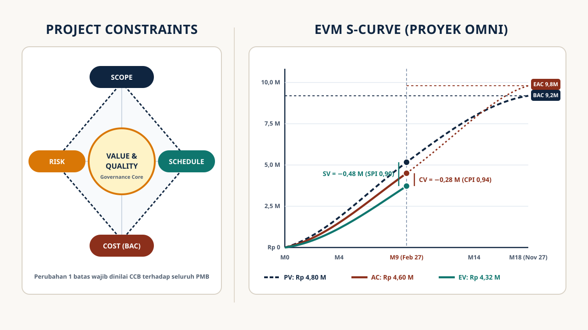
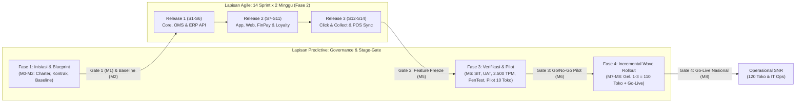
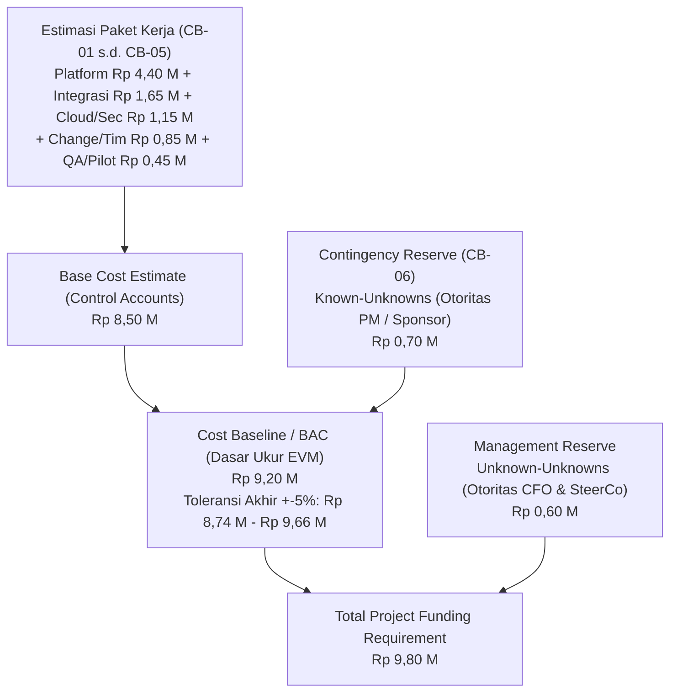
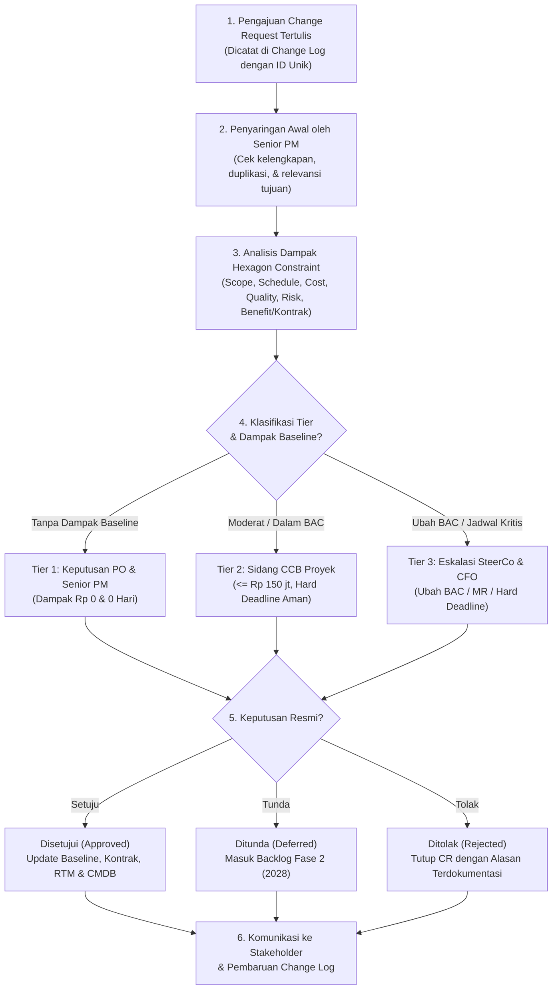
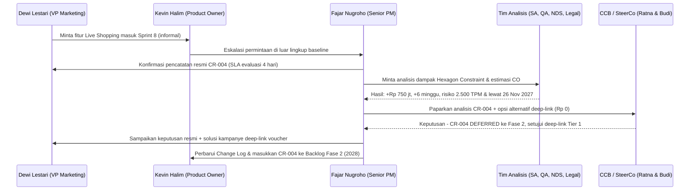

# Modul 01: Advanced Project Management

## 1. Identitas Modul

| Atribut | Keterangan |
|---------|------------|
| **Kelompok Program** | Jalur Utama — Project Management (Jilid I: *Leadership & Project Delivery*) |
| **Level Kompetensi** | Senior (berorientasi tata kelola strategis, integrasi lintas fungsi, dan pengambilan keputusan eksekutif) |
| **Durasi Pembelajaran** | **12 jam sesi tatap muka/sinkron** (4 sesi × 3 jam) + **±6 jam tugas mandiri** |
| **Prasyarat** | Pengalaman kerja minimal ±3 tahun sebagai Project Manager, Project Coordinator, Business Analyst, Scrum Master, atau Team Lead; memahami dasar siklus hidup proyek dan penjadwalan dasar |
| **Peran Sasaran** | Calon & praktisi **Senior Project Manager**, *Delivery Manager*, *IT Project Lead*, serta profesional BA/SA yang ingin menguasai tata kelola pengiriman proyek skala menengah–besar |
| **Keluaran Utama** | Paket Fondasi Tata Kelola Proyek OMNI: *Project Charter*, *Project Scope Statement* beserta *Acceptance Criteria* & *Requirements Traceability Matrix* (RTM), Analisis *Earned Value Management* (EVM) Bulan ke-9 dengan rekomendasi eksekutif, *Quality Assurance & Control Plan*, serta *Integrated Change Control & CCB Log* |

---

## 2. Gambaran Modul

Mengapa sebuah organisasi membayar **Senior Project Manager** jauh lebih mahal dibandingkan Junior atau Mid-level Project Manager, padahal keduanya sama-sama mengelola jadwal, anggaran, dan daftar tugas? Jawabannya terletak pada pergeseran pusat gravitasi tanggung jawab: dari **administrasi tugas** (*task administration*) menuju **orkestrasi nilai, tata kelola, dan integrasi keputusan** (*value orchestration, governance, and decision integration*).

Pada level junior dan menengah, seorang Project Manager sering kali berfokus pada kepatuhan mekanis terhadap rencana yang sudah dibuat orang lain — memperbarui *Gantt chart*, mencatat notulen rapat, menagih progres mingguan, dan meneruskan masalah ke atasan. Ketika lingkungan proyek stabil dan lingkupnya sempit, pendekatan tersebut masih memadai. Namun, pada proyek strategis berskala menengah–besar seperti **Proyek OMNI di PT Sinar Nusantara Retail Tbk (SNR)** — bernilai **Rp 9,20 M**, berdurasi **18 bulan** menuju tenggat mutlak **26 November 2027**, melibatkan **120 toko fisik**, **3 pusat distribusi (DC)**, kontrak vendor *Fixed Price* **Rp 4,40 M**, serta bergantung pada tiga proyek paralel lain dalam **Program Nusantara 2028** — pendekatan mekanis akan runtuh pada kuartal pertama.

Di level senior, Anda tidak sekadar "menjalankan metodologi", melainkan **merancang pendekatan pengiriman yang paling tepat (*tailoring*)** bagi konteks bisnis, kultur organisasi, dan struktur kontrak yang ada. Anda bukan sekadar pencatat anggaran, melainkan penjaga **Performance Measurement Baseline (PMB)** yang mampu membaca sinyal dini penyimpangan biaya dan jadwal melalui **Earned Value Management (EVM)** sebelum proyek terjerumus ke jurang defisit. Anda juga bukan sekadar penerima permintaan fitur dari eksekutif, melainkan pemimpin tata kelola yang melindungi integritas ruang lingkup (*scope*), mutu (*quality*), dan kepatuhan regulasi melalui **Integrated Change Control** yang objektif dan terukur.

Modul 01 ini membangun fondasi intelektual dan operasional tersebut. Seluruh konsep standar global — **PMBOK 7th & 6th Edition**, **PRINCE2**, dan **ISO 21502** — dibedah secara kritis dan langsung diterapkan pada **Proyek OMNI** dari sudut pandang **Fajar Nugroho** (Senior Project Manager). Penguasaan modul ini menjadi pijakan mutlak sebelum Anda melangkah ke perencanaan detail dan jalur kritis di Modul 02, pengelolaan risiko dan pemangku kepentingan di Modul 03, eksekusi *Agile/Hybrid* di Modul 04, serta tata kelola Program dan PMO di Modul 05.

---

## 3. Capaian Pembelajaran

Setelah menyelesaikan Modul 01 ini, peserta mampu:

1. **Merancang** arsitektur siklus hidup proyek dan pendekatan *tailoring* (*predictive*, *iterative*, *incremental*, *adaptive/agile*, atau *hybrid*) yang selaras dengan tingkat ketidakpastian bisnis, profil risiko, dan struktur kontrak organisasi.
2. **Menyusun** *Project Charter* berstandar eksekutif yang memisahkan secara tegas *Business Case*, mandat otoritas Senior PM, kriteria keberhasilan bisnis, batas pendanaan, dan mekanisme eskalasi tata kelola.
3. **Merumuskan** *Scope Baseline* yang ketat — mencakup *Project Scope Statement*, pemisahan eksplisit *In-Scope* vs *Out-of-Scope*, *Acceptance Criteria* terukur, dan *Requirements Traceability Matrix* (RTM) — guna mencegah *scope creep* maupun *gold plating*.
4. **Mengevaluasi** kinerja jadwal dan biaya proyek secara kuantitatif menggunakan struktur *Cost Baseline*, *Reserve Analysis* (*Contingency* vs *Management Reserve*), dan indikator lengkap *Earned Value Management* (PV, EV, AC, SV, CV, SPI, CPI, tiga skenario EAC, ETC, VAC, dan TCPI) untuk menghasilkan rekomendasi keputusan eksekutif.
5. **Mengembangkan** sistem pengendalian mutu proyek berbasis keseimbangan *Cost of Quality* (*Prevention*, *Appraisal*, *Internal Failure*, dan *External Failure*), pembedaan fungsional QA vs QC, serta gerbang mutu (*Stage-Gate Quality Reviews*).
6. **Mengoperasikan** proses *Integrated Change Control* dan *Configuration Management* melalui *Change Control Board* (CCB) dengan mengevaluasi dampak perubahan secara menyeluruh terhadap seluruh dimensi kendala proyek (*Hexagon Constraint*).

---

## 4. Rencana Sesi

Modul ini dirancang untuk **12 jam pembelajaran terstruktur** (4 sesi × 3 jam = 720 menit) dengan proporsi pedagogis **±30% paparan konsep** (220 menit), **±50% workshop studi kasus Proyek OMNI** (360 menit), dan **±20% diskusi/refleksi senior** (140 menit).

| Sesi | Tema & Sub-Topik Utama | Paparan Konsep (±30%) | Workshop Kasus Proyek OMNI (±50%) | Diskusi & Refleksi (±20%) | Total |
|------|------------------------|-----------------------|-----------------------------------|---------------------------|-------|
| **Sesi 1** | **Lifecycle, Tailoring, & Otoritas Charter**<br/>PMBOK 7th/6th, PRINCE2, ISO 21502; spektrum *lifecycle*; *tailoring*; *Business Case* vs *Charter* vs *PM Plan*; otoritas Senior PM | 55 mnt | **90 mnt:** Merancang model *Hybrid Delivery* Proyek OMNI (4 Fase *Stage-Gate* + 14 Sprint) & menyusun *Project Charter* untuk disetujui Ratna Kusuma | 35 mnt | 180 mnt (3 jam) |
| **Sesi 2** | **Scope Management & Integritas Baseline**<br/>RTM, *Scope Statement*, *In/Out-of-Scope*, *Acceptance Criteria*, pencegahan *Scope Creep* vs *Gold Plating*, *Validate vs Control Scope* | 55 mnt | **90 mnt:** Menyusun *Scope Statement*, *Acceptance Criteria* terukur (BOPIS ≤ 2 jam, sinkronisasi ≤ 60 detik), dan cuplikan RTM Proyek OMNI | 35 mnt | 180 mnt (3 jam) |
| **Sesi 3** | **Schedule, Cost, Reserves, & EVM Senior**<br/>PMB, *Cost Baseline* vs *Funding Requirement*, *Contingency* vs *Management Reserve*, *S-Curve*, EVM lengkap (SV, CV, SPI, CPI, 3 EAC, TCPI) | 55 mnt | **90 mnt:** Audit EVM resmi Proyek OMNI Bulan ke-9 (28 Feb 2027) & simulasi opsi keputusan eksekutif untuk rapat Steering Committee | 35 mnt | 180 mnt (3 jam) |
| **Sesi 4** | **Quality, CoQ, & Integrated Change Control**<br/>QA vs QC, *Cost of Quality*, *Stage-Gate Reviews*, CCB, evaluasi *Hexagon Constraint*, *Configuration Management*, & *Anti-Patterns* | 55 mnt | **90 mnt:** Menyusun *Quality Plan* (CB-05 Rp 450 jt) & simulasi sidang CCB menghadapi permintaan fitur tambahan Dewi Lestari | 35 mnt | 180 mnt (3 jam) |
| **Total** | **4 Sesi Lengkap Modul 01** | **220 mnt (30,6%)** | **360 mnt (50,0%)** | **140 mnt (19,4%)** | **720 mnt (12 jam)** |

> **Catatan Fasilitator & Pembelajar Mandiri:** Jika modul ini dipelajari secara mandiri (*self-paced*), alokasikan waktu sesuai proporsi di atas: baca narasi Bab 5 terlebih dahulu, bedah artefak Proyek OMNI di Bab 6, kerjakan Latihan di Bab 7 tanpa melihat pembahasan, lalu tuntaskan Tugas Modul di Bab 8 dan Kuis di Bab 9.

---

## 5. Materi



### 5.1 Project Lifecycle, Standar Global, dan Tailoring

Salah satu kekeliruan terbesar yang membedakan praktisi menengah dan senior adalah memperlakukan metodologi manajemen proyek sebagai dogma. Di lapangan, kita kerap menjumpai kubu "puritan *Waterfall*" yang memaksakan spesifikasi beku 400 halaman untuk aplikasi seluler yang pasarnya berubah tiap kuartal, berhadapan dengan kubu "puritan *Agile*" yang menolak menyusun *baseline* anggaran dan gerbang kepatuhan regulasi pada proyek bernilai miliaran rupiah. Senior Project Manager berdiri di atas polarisasi tersebut: memahami lanskap standar global dan melakukan **tailoring** — penyesuaian sadar atas siklus hidup, tata kelola, artefak, dan ritme kerja agar sesuai dengan konteks nyata proyek.

#### A. Sintesis Tiga Standar Global Utama

Senior PM modern perlu memadukan keunggulan komplementer dari tiga rujukan standar internasional:

1. **PMBOK Guide (6th Edition & 7th Edition — PMI):**
   - **PMBOK 6th Edition** berfokus pada *process-based framework* melalui **5 Process Groups** (*Initiating, Planning, Executing, Monitoring & Controlling, Closing*) dan **10 Knowledge Areas** (*Integration, Scope, Schedule, Cost, Quality, Resource, Communications, Risk, Procurement, Stakeholder*). Kekuatan utamanya adalah kedisiplinan input–teknik–output (*ITTO*) dan ketajaman pengendalian baseline seperti WBS, CPM, dan EVM.
   - **PMBOK 7th Edition** menggeser perspektif dari sekadar kepatuhan proses menuju **penciptaan nilai (*value delivery system*)** yang dipandu **12 Project Management Principles** (seperti *Stewardship, Team, Stakeholders, Value, Systems Thinking, Tailoring, Quality, Complexity, Risk, Adaptability & Resilience, Change*) dan **8 Project Performance Domains** (*Stakeholders, Team, Development Approach & Life Cycle, Planning, Project Work, Delivery, Measurement, Uncertainty*). Kedua edisi tidak saling meniadakan: PMBOK 7th memberikan kompas strategis dan prinsip adaptif, sementara PMBOK 6th menyediakan peralatan taktis yang teruji untuk eksekusi terkendali.
2. **PRINCE2 (*Projects IN Controlled Environments* — edisi ke-7):**
   - Menonjol dalam **tata kelola bisnis (*governance*)** dan pengendalian berjenjang. Tiga kontribusi terpenting PRINCE2 bagi Senior PM adalah: (a) **Continued Business Justification** — proyek wajib dihentikan atau direstrukturisasi jika justifikasi bisnisnya runtuh; (b) **Manage by Stages** — membagi proyek ke dalam gerbang keputusan (*Stage-Gate*) di mana *Project Board / Steering Committee* mengotorisasi dana tahap berikutnya; serta (c) **Manage by Exception** — menetapkan batas toleransi (*tolerance*) pada waktu, biaya, mutu, lingkup, manfaat, dan risiko. Selama proyek berada dalam toleransi, Senior PM berwenang penuh mengambil keputusan operasional tanpa mengganggu eksekutif; eskalasi dilakukan *hanya* saat proyek diprediksi melampaui toleransi.
3. **ISO 21502:2020 (*Project, Programme and Portfolio Management — Guidance on Project Management*):**
   - Memberikan jembatan harmonisasi korporat lintas industri yang menempatkan proyek sebagai bagian dari ekosistem *governance*, *benefits realization*, dan *organizational enablement*. ISO 21502 menegaskan bahwa tanggung jawab proyek tidak berakhir ketika sistem selesai dibangun (*output*), melainkan terhubung dengan kesiapan organisasi mengadopsi perubahan (*outcome*) dan mewujudkan nilai ekonomi (*benefit*).

#### B. Spektrum Project Lifecycle (Development Approaches)

Pemilihan *development approach* (pendekatan pengembangan) ditentukan oleh dua sumbu utama: **seberapa stabil kebutuhan (*requirements certainty*)** dan **seberapa tinggi tuntutan pengiriman bertahap untuk mempercepat nilai (*frequency of delivery*)**.

| Pendekatan (*Lifecycle*) | Karakteristik Utama | Kapan Tepat Dipakai | Kelebihan & Risiko Utama |
|--------------------------|---------------------|---------------------|--------------------------|
| **Predictive (*Waterfall* / Plan-Driven)** | Lingkup, jadwal, dan biaya didefinisikan detail di awal; perubahan dikendalikan ketat lewat CCB; pengiriman besar di akhir | Kebutuhan sangat jelas, regulasi ketat, proyek konstruksi/infrastruktur fisik, atau kontrak *Fixed Price* baku | **Kelebihan:** Prediktabilitas biaya & tata kelola tinggi.<br/>**Risiko:** Lambat beradaptasi; kegagalan asumsi baru terdeteksi terlambat |
| **Iterative** | Lingkup ditentukan di awal, namun solusi disempurnakan melalui serangkaian prototipe dan umpan balik berulang sebelum rilis penuh | Desain antarmuka kompleks, arsitektur sistem baru, atau riset teknologi dengan risiko teknis tinggi | **Kelebihan:** Mengurangi risiko salah desain sejak dini.<br/>**Risiko:** Rilis nilai ke pengguna akhir masih menunggu iterasi selesai |
| **Incremental** | Produk dipecah menjadi potongan fungsional yang dirilis bertahap (*waves/releases*), tiap rilis langsung memberi nilai operasional | Migrasi bertahap multi-cabang (misalnya *wave rollout* 120 toko), modernisasi sistem bertahap | **Kelebihan:** Realisasi manfaat lebih cepat & mengurangi risiko *big-bang cutover*.<br/>**Risiko:** Membutuhkan arsitektur modular agar inkremen saling kompatibel |
| **Adaptive (*Agile*)** | Menggabungkan iteratif & inkremental dalam siklus pendek (*Sprint* 1–4 minggu); *backlog* berevolusi mengikuti umpan balik pelanggan | Pengembangan produk digital berketidakpastian tinggi, kebutuhan bisnis dinamis, tim *dedicated* lintas fungsi | **Kelebihan:** Responsif terhadap pasar, transparansi progres tinggi.<br/>**Risiko:** Sulit dipadukan dengan *hard deadline*, ketergantungan lintas program, dan anggaran korporat kaku |
| **Hybrid** | Memadukan elemen *Predictive* pada lapisan tata kelola, kontrak, kepatuhan, dan *rollout* dengan *Agile/Iterative* pada lapisan pengembangan solusi | Transformasi digital korporat berskala menengah–besar (seperti **Proyek OMNI** SNR) | **Kelebihan:** Menyeimbangkan kepastian eksekutif dengan kelincahan teknis.<br/>**Risiko:** Menjadi birokratis ganda jika batas peran *Predictive* dan *Agile* tidak tegas |

#### C. Kerangka Tailoring 4 Langkah bagi Senior PM

Mengacu pada *PMBOK 7th Edition*, *tailoring* bukan berarti membuang prosedur sesuka hati, melainkan proses disiplin dalam empat langkah:

1. **Select Initial Development Approach:** Pilih pendekatan dasar berdasarkan sifat produk, tingkat inovasi, dan ketergantungan teknis (misalnya *Hybrid* untuk Proyek OMNI).
2. **Tailor for the Organization:** Sesuaikan dengan maturitas PMO, struktur persetujuan anggaran CFO, aturan pengadaan/kontrak vendor, dan regulasi (UU PDP No. 27 Tahun 2022 & PCI-DSS).
3. **Tailor for the Project:** Sesuaikan ukuran artefak, frekuensi pelaporan, ambang batas CCB, dan komposisi tim terhadap skala proyek (Rp 9,20 M, 18 bulan, 120 toko).
4. **Implement Ongoing Improvement:** Lakukan inspeksi dan adaptasi berkala melalui retrospektif sprint dan tinjauan gerbang fase (*Stage-Gate Review*).



Diagram di atas memperlihatkan arsitektur *Hybrid Delivery* Proyek OMNI secara jernih: tata kelola investasi, kontrak *Fixed Price* PT NDS, verifikasi kepatuhan, dan *rollout* fisik ke 120 toko dikendalikan dengan ketegasan *Predictive/Incremental Stage-Gate*, sementara pembangunan perangkat lunak dan integrasi API yang kompleks dijalankan dalam 14 *Sprint Agile* agar umpan balik bisnis dari Product Owner (Kevin Halim) dan pengguna toko dapat diserap lebih awal.

---

### 5.2 Project Charter dan Otoritas Senior Project Manager

Banyak proyek gagal bukan pada bulan ke-12, melainkan pada hari ke-1 karena lahir tanpa mandat yang jelas. Tanpa **Project Charter** yang ditandatangani oleh Sponsor berwenang, seorang Project Manager hanyalah "koordinator sukarela" yang memohon bantuan antar-departemen tanpa daya ikat organisasi.

#### A. Membedakan Empat Dokumen Fondasi Proyek

Pada level senior, Anda wajib membedakan fungsi, pemilik, dan waktu lahirnya empat dokumen kunci yang sering dicampuradukkan di lapangan:

| Dimensi | Business Case | Benefits Management Plan | Project Charter | Project Management Plan (PMP) |
|---------|---------------|--------------------------|-----------------|-------------------------------|
| **Pertanyaan Inti yang Dijawab** | *Mengapa* investasi ini layak secara ekonomi dan strategis? | *Bagaimana dan kapan* manfaat bisnis diukur dan diwujudkan? | *Siapa* yang diberi mandat, *apa* batas proyek, dan *berapa* dana awal? | *Bagaimana* proyek dieksekusi, dipantau, dikendalikan, dan ditutup secara detail? |
| **Pemilik / Penyusun** | Business Sponsor, Finance, & Business Analyst (pra-proyek) | Business Sponsor & Program Manager / PMO | Diterbitkan & ditandatangani **Project Sponsor** (draf dapat dibantu Senior PM) | Disusun & dikelola **Senior Project Manager** bersama tim inti, disetujui Sponsor/SteerCo |
| **Kapan Dibuat** | Sebelum proyek diinisiasi (*Pre-Project*) | Bersamaan dengan *Business Case*, diperbarui sepanjang siklus | Awal Fase Inisiasi (M1 — **akta kelahiran resmi proyek**) | Akhir Fase Perencanaan (M2 — menetapkan **Baseline** resmi) |
| **Tingkat Detail** | Analisis finansial (NPV, IRR, Payback), opsi strategis, *burning platform* | Metrik KPI manfaat, pemilik manfaat, jadwal realisasi pasca-Go-Live | Ringkas-strategis (3–6 halaman): tujuan, lingkup tingkat tinggi, milestone, anggaran induk, otoritas PM | Sangat detail dan komprehensif: 10+ rencana turunan (*Scope, Schedule, Cost, Quality, Risk, Change, dll.*) |
| **Otoritas Perubahan** | Steering Committee / Direksi | Sponsor & Program Director | Hanya **Project Sponsor / Steering Committee** | Melalui proses **Integrated Change Control (CCB)** |

#### B. Anatomi Otoritas Senior Project Manager

Project Charter memberikan dua hal sekaligus: **legitimasi keberadaan proyek** dan **mandat otoritas Senior Project Manager** untuk mengalokasikan sumber daya organisasi. Pada proyek strategis, seorang Senior PM harus memastikan Charter secara eksplisit menuliskan **batas otoritas (*Authority Thresholds*)** berdasarkan prinsip *Manage by Exception* (PRINCE2):

1. **Otoritas Operasional & Sumber Daya:** Kewenangan mengarahkan tim inti lintas departemen (BA, SA, QA, PO, SM), memantau kinerja vendor utama (PT NDS) sesuai klausul kontrak, serta memanggil rapat eskalasi lintas divisi.
2. **Otoritas Finansial Berjenjang:** Misalnya, Senior PM berwenang mengalokasikan *Contingency Reserve* hingga batas tertentu per kejadian risiko teridentifikasi (contoh: ≤ Rp 100 jt per insiden dengan pelaporan bulanan kepada Sponsor), sementara penggunaan di atas ambang batas memerlukan persetujuan Sponsor (Ratna Kusuma), dan pencairan *Management Reserve* sepenuhnya menjadi hak CFO (Budi Santoso) bersama Steering Committee.
3. **Otoritas Perubahan (*Change Threshold*):** Perubahan teknis minor tanpa dampak terhadap *Scope Baseline*, *Cost Baseline*, atau *Critical Path* dapat diputuskan pada level tim/PM; segala perubahan yang memengaruhi baseline wajib masuk sidang CCB.
4. **Otoritas Eskalasi & Veto Kepatuhan:** Memetakan hak veto independen — misalnya pada Proyek OMNI, **Rina Kartika** (Head of Legal, Compliance & InfoSec) memegang hak veto Go-Live apabila audit UU PDP atau *Penetration Testing* belum bersih dari temuan *Critical/High*. Mencantumkan realitas tata kelola ini sejak Charter mencegah konflik politis menjelang Go-Live.

---

### 5.3 Scope Management Tingkat Senior

Dalam studi kegagalan proyek teknologi informasi global (*PMI Pulse of the Profession*), ketidakjelasan ruang lingkup dan perubahan lingkup yang tidak terkendali (*scope creep*) secara konsisten menempati tiga besar penyebab pembengkakan biaya dan keterlambatan. Pada level senior, manajemen ruang lingkup bukan sekadar membuat daftar fitur, melainkan membangun **garis pertahanan kontraktual, teknis, dan bisnis** yang menjaga agar setiap rupiah yang dibelanjakan berjejak langsung ke tujuan strategis.

#### A. Product Scope vs Project Scope dan Scope Baseline

Seorang Senior PM membedakan secara presisi:
- **Product Scope:** Fitur, fungsi, dan karakteristik teknis/non-teknis yang melekat pada produk atau layanan yang dihasilkan (misalnya: aplikasi iOS/Android dengan kartu loyalty QR, API sinkronisasi stok ≤ 60 detik, dan uji beban 2.500 TPM). Kelengkapannya diukur terhadap **persyaratan produk (*Requirements*)**.
- **Project Scope:** Seluruh pekerjaan yang harus dilakukan untuk menghasilkan produk tersebut beserta layanan pendukungnya — termasuk penyusunan dokumentasi kepatuhan UU PDP, manajemen perubahan organisasi, penyusunan SOP omnichannel, dan pelatihan 1.440 kasir serta staf gudang di 120 toko. Kelengkapannya diukur terhadap **Project Management Plan**.

Keduanya dikunci secara resmi dalam **Scope Baseline** yang terdiri atas tiga komponen tak terpisahkan:
1. **Project Scope Statement:** Deskripsi naratif terperinci mengenai lingkup produk, *deliverables* utama, **Acceptance Criteria**, serta daftar **Exclusions (*Out-of-Scope*)**, kendala (*constraints*), dan asumsi (*assumptions*).
2. **Work Breakdown Structure (WBS):** Dekomposisi hierarkis 100% pekerjaan proyek berorientasi *deliverable* (akan dibedah mendalam di Modul 02).
3. **WBS Dictionary:** Kamus spesifikasi setiap paket kerja (*Work Package*) termasuk pemilik, kriteria penerimaan, dan estimasi sumber daya.

#### B. Kekuatan Eksplisit Out-of-Scope dan Acceptance Criteria Terukur

Di tingkat senior, kalimat paling mahal di dalam *Scope Statement* sering kali bukan apa yang Anda masukkan ke *In-Scope*, melainkan apa yang Anda tuliskan tegas di bagian **Out-of-Scope (Exclusions)**. Mengapa? Karena pemangku kepentingan cenderung mengisi ruang abu-abu dengan asumsi masing-masing. Pada Proyek OMNI, tanpa penegasan bahwa *integrasi marketplace pihak ketiga (Shopee, Tokopedia, TikTok Shop)* dan *penggantian perangkat keras mesin kasir POS* adalah **Out-of-Scope**, tim Marketing dan Store Ops dapat menganggap keduanya termasuk dalam paket Rp 9,20 M — sebuah resep pasti bagi sengketa kontrak dengan PT NDS (Risiko **R-08**).

Demikian pula, **Acceptance Criteria** (kriteria penerimaan) harus dirumuskan secara kuantitatif, objektif, dan dapat diuji (*testable*), bukan normatif:
- *Lemah (Junior):* "Aplikasi harus cepat, stok akurat, dan petugas toko mudah menggunakan fitur Click & Collect."
- *Kuat (Senior):* "Sinkronisasi stok antara POS 120 toko, WMS 3 DC, dan OMS memiliki latensi **≤ 60 detik** pada persentil ke-95 (p95); akurasi stok lintas kanal **≥ 98,0%** selama Pilot 10 toko; SLA persiapan pesanan *Click & Collect* **≤ 2 jam** tercapai pada **≥ 95%** pesanan; dan sistem stabil pada uji beban **2.500 transaksi/menit (TPM)** dengan *error rate* < 0,5%."

#### C. Requirements Traceability Matrix (RTM)

**Requirements Traceability Matrix (RTM)** adalah tabel penelusuran dua arah yang menghubungkan setiap kebutuhan bisnis (*Business Objective*) → kebutuhan pemangku kepentingan (*Stakeholder Requirement*) → nomor WBS / *User Story* → spesifikasi desain sistem → kasus uji (*Test Case* SIT/UAT) → hingga status verifikasi penerimaan.

Manfaat strategis RTM bagi Senior PM meliputi:
- **Mencegah "fitur yatim piatu":** Setiap fitur yang diusulkan harus dapat ditelusuri balik ke target bisnis di Charter; jika tidak mendukung satupun target bisnis, fitur tersebut layak ditolak atau ditunda.
- **Mempercepat analisis dampak perubahan:** Ketika sebuah regulasi berubah atau *Change Request* masuk, RTM menunjukkan secara instan modul kode, API, dan skenario UAT mana saja yang ikut terdampak.
- **Bukti audit serah terima:** Memudahkan Sponsor dan auditor (seperti Rina Kartika untuk UU PDP) memverifikasi bahwa 100% persyaratan wajib telah diuji dan lulus sebelum *Gate Sign-off*.

#### D. Mencegah Scope Creep vs Gold Plating

Kedua fenomena ini sama-sama menggerogoti jadwal, anggaran, dan mutu, tetapi sumbernya berbeda:

| Dimensi | Scope Creep | Gold Plating |
|---------|-------------|--------------|
| **Definisi** | Penambahan lingkup atau fitur secara bertahap dan tidak terkendali **tanpa melalui evaluasi dampak dan persetujuan CCB** | Penambahan fitur, optimasi, atau "sentuhan ekstra" di luar spesifikasi yang diminta **oleh tim proyek sendiri** tanpa permintaan maupun persetujuan pelanggan/Sponsor |
| **Pemicu Umum** | Permintaan informal pemangku kepentingan di koridor/chat (contoh: tim Marketing langsung meminta developer menambah animasi kupon) | Niat baik berlebihan dari insinyur/desainer untuk "memberi kejutan" atau perfeksionisme teknis tanpa mempertimbangkan risiko |
| **Bahaya Tersembunyi** | Menambah beban kerja tersembunyi, merusak jadwal jalur kritis, dan memicu sengketa biaya vendor | Menambah kompleksitas kode, membuka celah keamanan/bug baru yang belum diuji, memakan waktu pengujian, dan meningkatkan biaya pemeliharaan jangka panjang |
| **Strategi Pencegahan Senior PM** | Kontrak & *Scope Statement* tegas, disiplin jalur *Product Backlog* satu pintu melalui PO, dan aturan tegas "no ticket/CR, no build" | *Peer code review* & *Definition of Done* ketat, budaya fokus nilai bisnis, dan transparansi bahwa fitur ekstra pun wajib melalui evaluasi *Product Owner* / CCB |

Sebagai penutup pengendalian lingkup, bedakan dua proses penting di PMBOK: **Validate Scope** (mendapatkan penerimaan formal dari pelanggan/Sponsor atas *deliverable* yang telah lulus pemeriksaan mutu — contohnya penandatanganan *UAT Sign-off* oleh Agus Setiawan & Dewi Lestari pada Gate 3) dan **Control Scope** (memantau status lingkup produk/proyek serta mengelola perubahan atas *Scope Baseline* melalui CCB).

---

### 5.4 Schedule & Cost Management Fundamentals, Reserve Analysis, dan Earned Value Management (EVM)

Pada proyek bernilai miliaran rupiah, laporan status berbunyi *"secara umum proyek berjalan lancar, tinggal sedikit perbaikan"* adalah bentuk kelalaian profesional. Senior PM harus mampu menerjemahkan realitas jadwal, biaya, dan progres kerja ke dalam bahasa kuantitatif yang jujur, terintegrasi, dan dapat dipertanggungjawabkan di hadapan CFO dan Direksi.

#### A. Performance Measurement Baseline (PMB) dan Anatomi Anggaran Proyek

**Performance Measurement Baseline (PMB)** adalah baseline terpadu yang menggabungkan **Scope Baseline**, **Schedule Baseline**, dan **Cost Baseline** menjadi satu kurva rujukan kinerja berbasis waktu (**S-Curve**). Setiap titik pada S-Curve menunjukkan berapa nilai pekerjaan (*Planned Value*) yang seharusnya telah selesai secara kumulatif hingga tanggal tertentu.

Pada struktur penganggaran profesional (PMBOK), biaya proyek dibangun berlapis dari bawah ke atas (*bottom-up aggregation*):

1. **Activity & Work Package Estimates:** Estimasi biaya langsung tenaga kerja, vendor, perangkat lunak, perangkat keras, dan operasional per paket kerja.
2. **Control Accounts (Base Cost Estimate):** Agregasi paket kerja ke titik kendali manajemen tempat EVM diukur (pada Proyek OMNI: CB-01 hingga CB-05 = **Rp 8,50 M**).
3. **Contingency Reserve (Cadangan Kontinjensi):** Dana cadangan untuk **risiko yang telah teridentifikasi (*known-unknowns*)** dalam *Risk Register* — biasanya dihitung melalui *Expected Monetary Value* (EMV) atau simulasi Monte Carlo (pada Proyek OMNI: CB-06 = **Rp 0,70 M**). **Contingency Reserve termasuk di dalam Cost Baseline / BAC** dan dikelola dalam otoritas Senior PM (sesuai ambang batas Charter).
4. **Cost Baseline / Budget at Completion (BAC):** Penjumlahan *Base Cost Estimate* + *Contingency Reserve* (**Rp 8,50 M + Rp 0,70 M = Rp 9,20 M**). Angka inilah yang menjadi tolok ukur penilaian kinerja biaya proyek (EVM).
5. **Management Reserve (Cadangan Manajemen):** Dana cadangan untuk **risiko tak terduga yang belum teridentifikasi (*unknown-unknowns*)** di luar daftar risiko baseline (pada Proyek OMNI = **Rp 0,60 M**). **Management Reserve TIDAK termasuk dalam Cost Baseline (BAC)** dan tidak muncul dalam perhitungan EVM rutin. Penggunaannya hanya dapat disetujui oleh **CFO / Sponsor / Steering Committee**; ketika dicairkan, barulah nilainya ditambahkan ke *Cost Baseline* melalui prosedur perubahan resmi (*re-baseline*).
6. **Total Project Funding Requirement:** Penjumlahan *Cost Baseline* + *Management Reserve* (**Rp 9,20 M + Rp 0,60 M = Rp 9,80 M**), yaitu total arus kas maksimal yang disiapkan korporasi bagi proyek.



#### B. Earned Value Management (EVM) Lengkap

**Earned Value Management (EVM)** adalah standar emas pengendalian proyek yang menyatukan dimensi **lingkup, jadwal, dan biaya** ke dalam satu sistem ukuran objektif. Kekuatan EVM terletak pada kemampuannya membongkar ilusi "anggaran masih tersisa" (*budget underrun illusion*). Jika Anda menganggarkan Rp 4,80 M pada Bulan ke-9 dan baru membelanjakan Rp 4,60 M, laporan akuntansi biasa akan menilainya "hemat Rp 0,20 M". Namun jika nilai pekerjaan yang benar-benar selesai (*Earned Value*) baru Rp 4,32 M, fakta sebenarnya adalah proyek sedang **terlambat DAN boros**!

##### 1. Tiga Variabel Dasar EVM
- **PV (*Planned Value*):** Nilai anggaran resmi (*authorized budget*) yang dialokasikan untuk pekerjaan yang **direncanakan selesai** hingga titik pelaporan (*status date*).
- **EV (*Earned Value*):** Nilai anggaran resmi dari pekerjaan yang **benar-benar telah selesai dan terverifikasi** hingga titik pelaporan (`EV = % Pekerjaan Selesai × BAC` pada tingkat paket kerja yang diagregasikan).
- **AC (*Actual Cost*):** Total biaya aktual yang **benar-benar telah dikeluarkan/diakui** untuk menyelesaikan pekerjaan EV tersebut hingga titik pelaporan.

##### 2. Analisis Variansi dan Indeks Kinerja (*Current Status*)

| Metrik | Rumus | Makna Angka | Interpretasi Manajerial |
|--------|-------|-------------|-------------------------|
| **SV** (*Schedule Variance*) | `SV = EV − PV` | `> 0`: Lebih cepat<br/>`= 0`: Sesuai jadwal<br/>`< 0`: Terlambat | Mengukur deviasi progres jadwal dalam satuan uang; pada akhir proyek SV selalu kembali ke 0 (karena seluruh EV akhirnya = BAC) |
| **CV** (*Cost Variance*) | `CV = EV − AC` | `> 0`: Hemat (*under budget*)<br/>`= 0`: Sesuai anggaran<br/>`< 0`: Boros (*over budget*) | Mengukur selisih nilai hasil kerja terhadap biaya aktual; CV negatif di fase tengah cenderung sulit pulih tanpa tindakan struktural |
| **SPI** (*Schedule Performance Index*) | `SPI = EV ÷ PV` | `> 1,00`: Efisien jadwal<br/>`< 1,00`: Tertinggal jadwal | Rasio progres aktual dibanding rencana. `SPI = 0,90` berarti tim baru menghasilkan 90% progres dari yang direncanakan |
| **CPI** (*Cost Performance Index*) | `CPI = EV ÷ AC` | `> 1,00`: Efisien biaya<br/>`< 1,00`: Inefisien biaya | Rasio nilai yang diperoleh per rupiah pengeluaran. `CPI = 0,94` berarti tiap Rp 1,00 dibelanjakan baru menghasilkan nilai Rp 0,94 |

> **Wawasan Senior (Kestabilan CPI):** Riset historis atas ratusan proyek kompleks (Christensen & Payne; Fleming & Koppelman) menunjukkan bahwa ketika proyek telah melewati **20% penyelesaian**, indeks **CPI kumulatif cenderung stabil dan jarang membaik lebih dari 10%** tanpa intervensi drastis pada lingkup, metode kerja, atau struktur kontrak. Oleh sebab itu, memantau CPI sejak dini adalah peringatan dini (*early warning system*) paling andal bagi Senior PM.

##### 3. Peramalan Biaya Akhir (*Forecasting*: EAC, ETC, VAC) dan Target Efisiensi (TCPI)

Eksekutif tidak cukup diberi tahu kondisi hari ini; mereka menuntut proyeksi ke mana proyek akan berakhir (**Estimate at Completion / EAC**), berapa sisa uang yang masih dibutuhkan (**Estimate to Complete / ETC**), dan seberapa besar selisih akhir terhadap anggaran (**Variance at Completion / VAC**).

Terdapat **tiga skenario peramalan EAC standar berbasis EVM** (plus satu skenario re-estimasi manual):

1. **Skenario 1 — Atypical Variance (Penyimpangan Bersifat Satu Kali / Tidak Berulang):**
   Digunakan apabila pembengkakan biaya sejauh ini disebabkan kejadian insidental yang sudah tertangani tuntas, sehingga sisa pekerjaan diyakini berjalan sesuai tarif anggaran semula (`CPI masa depan = 1,00`):
   > `EAC₁ = AC + (BAC − EV)`
2. **Skenario 2 — Typical Variance (Tren Efisiensi Biaya Saat Ini Berlanjut — Paling Umum):**
   Digunakan apabila faktor penyebab inefisiensi bersifat sistemik (misalnya produktivitas tim atau tarif perubahan vendor) sehingga CPI kumulatif saat ini adalah prediktor terbaik bagi sisa proyek:
   > `EAC₂ = BAC ÷ CPI` *(secara aljabar setara dengan `AC + [(BAC − EV) ÷ CPI]`)*
3. **Skenario 3 — Composite Cost & Schedule Factor (Biaya & Jadwal Sama-Sama Memengaruhi Biaya Sisa):**
   Digunakan ketika proyek tertinggal jadwal sekaligus terikat *hard deadline*, sehingga tim terpaksa melakukan percepatan (*crashing*/lembur) yang menggerus efisiensi biaya secara berlipat:
   > `EAC₃ = AC + [(BAC − EV) ÷ (CPI × SPI)]`
4. **Skenario 4 — Bottom-Up Re-estimate (Re-estimasi Ulang dari Bawah):**
   Digunakan apabila asumsi estimasi awal terbukti cacat secara fundamental sehingga data historis tidak lagi relevan:
   > `EAC₄ = AC + Bottom-up ETC`

Dari EAC yang dipilih, diturunkan metrik kelanjutannya:
- **ETC (*Estimate to Complete*):** Sisa dana yang dibutuhkan sejak tanggal pelaporan hingga proyek selesai → `ETC = EAC − AC`.
- **VAC (*Variance at Completion*):** Proyeksi surplus atau defisit akhir dibanding BAC → `VAC = BAC − EAC` *(nilai negatif berarti proyeksi defisit/overrun)*.
- **TCPI (*To-Complete Performance Index*):** Rasio efisiensi biaya yang **wajib dicapai** pada sisa pekerjaan agar target anggaran tercapai:
  - Target tetap sesuai **BAC**: `TCPI(BAC) = (BAC − EV) ÷ (BAC − AC)`
  - Target sesuai **EAC baru yang disetujui** (bila BAC tidak lagi realistis): `TCPI(EAC) = (BAC − EV) ÷ (EAC − AC)`

##### 4. Keterbatasan SPI dan Pengenalan Earned Schedule (ES)

Senior PM perlu menyadari satu kelemahan klasik **SPI berbasis uang**: menjelang akhir proyek (misalnya 90% selesai), meskipun proyek terlambat 2 bulan, EV akan makin mendekati BAC sehingga SPI secara artifisial merangkak naik kembali menuju `1,00`. Untuk mengatasi distorsi ini, praktik senior memadukan EVM dengan **Earned Schedule (ES)** (diperkenalkan Walter Lipke): menerjemahkan EV ke sumbu **waktu** (bulan/minggu ke berapa seharusnya nilai EV tersebut tercapai pada kurva PV), lalu menghitung:
- `SV(t) = ES − AT` *(AT = Actual Time yang telah berlalu)*
- `SPI(t) = ES ÷ AT`
- Estimasi durasi akhir sederhana: `EAC(t) = Durasi Rencana ÷ SPI` (atau lebih akurat menggunakan `SPI(t)`).

Sebagai contoh cepat pada Proyek OMNI Bulan ke-9 (dari durasi 18 bulan) dengan `SPI = 0,90`: proyeksi durasi linier tanpa percepatan adalah `18 ÷ 0,90 = 20 bulan` (mundur **2 bulan** melampaui tenggat mutlak 26 November 2027!). Angka sederhana ini langsung membuka mata Steering Committee bahwa intervensi jadwal bukan pilihan, melainkan keharusan.

---

### 5.5 Quality Management Tingkat Senior

Dalam percakapan sehari-hari, mutu sering disalahartikan sebagai "kemewahan". Senior PM membedakan secara tegas antara **Quality (Mutu)** dan **Grade (Tingkatan/Kelas)**:
- **Quality:** Sejauh mana serangkaian karakteristik inheren memenuhi persyaratan (*degree to which a set of inherent characteristics fulfills requirements* — ISO 9000).
- **Grade:** Kategori yang diberikan kepada produk dengan fungsi serupa tetapi karakteristik teknis berbeda.

Sebuah fitur web sederhana tanpa animasi mewah tetapi bebas *bug*, cepat dimuat, dan memenuhi 100% spesifikasi bisnis adalah **Low Grade, High Quality** — hal ini sepenuhnya dapat diterima. Sebaliknya, aplikasi penuh fitur gamifikasi canggih tetapi kerap *crash* saat beban puncak 2.500 TPM dan bocor data pelanggan adalah **High Grade, Low Quality** — sebuah bencana bisnis dan reputasi!

#### A. Quality Assurance (QA) vs Quality Control (QC)

| Dimensi | Quality Assurance (QA — *Manage Quality*) | Quality Control (QC — *Control Quality*) |
|---------|-------------------------------------------|------------------------------------------|
| **Fokus Utama** | **Proses** — memastikan cara kerja tim mampu menghasilkan mutu secara konsisten | **Produk / Deliverable** — memeriksa hasil kerja untuk menemukan dan memperbaiki cacat |
| **Sifat Pendekatan** | **Proaktif & Preventif** (mencegah cacat terjadi) | **Reaktif & Detektif** (mendeteksi cacat sebelum sampai ke pengguna akhir) |
| **Contoh Aktivitas di Proyek OMNI** | Standar *coding* & *peer code review*, arsitektur CI/CD, *Definition of Done* sprint, audit kepatuhan proses UU PDP, tinjauan *Stage-Gate* | Pengujian fungsional (SIT & UAT), *automated regression test*, uji beban 2.500 TPM, *Penetration Testing*, verifikasi akurasi stok Pilot 10 toko |
| **Tanggung Jawab** | Seluruh tim proyek, difasilitasi Senior PM, Scrum Master, dan QA Lead | Tim QA & Test Lead (Lukas Gunawan), *Security Tester*, serta *Business Users* (saat UAT) |

#### B. Cost of Quality (CoQ): Bahasa Finansial Mutu di Hadapan CFO

Ketika tekanan anggaran meningkat, biaya pengujian (*QA/Testing*) kerap menjadi pos pertama yang diincar untuk dipangkas. Di sinilah Senior PM menggunakan kerangka **Cost of Quality (CoQ)** (Philip Crosby & Joseph Juran) untuk berbicara dalam bahasa CFO: **total biaya yang dikeluarkan organisasi bukan hanya biaya memastikan mutu, melainkan juga seluruh biaya akibat kegagalan mutu.**

```
Total Cost of Quality (CoQ) = Cost of Conformance + Cost of Non-Conformance
```

1. **Cost of Conformance (Biaya Kepatuhan — Investasi Mencegah Kegagalan):**
   - **Prevention Costs (Biaya Pencegahan):** Pelatihan tim pengembang terhadap standar keamanan OWASP/UU PDP, penyusunan SOP toko & pelatihan 1.440 staf, desain arsitektur *high-availability*, otomatisasi *CI/CD pipeline*, dan tinjauan kebutuhan (*requirements review*).
   - **Appraisal Costs (Biaya Penilaian/Pengujian):** Pengujian integrasi (SIT), *User Acceptance Testing* (UAT), *Load Testing* 2.500 TPM, *Penetration Testing* independen, dan inspeksi Pilot 10 toko.
2. **Cost of Non-Conformance (Biaya Ketidakpatuhan — Kerugian Akibat Kegagalan):**
   - **Internal Failure Costs (Kegagalan Internal — ditemukan sebelum Go-Live):** Pengerjaan ulang kode (*rework*), pembersihan ulang migrasi data loyalty yang rusak, pemborosan waktu lembur tim, dan pengulangan siklus UAT.
   - **External Failure Costs (Kegagalan Eksternal — ditemukan pelanggan setelah Go-Live):** *Downtime* saat Harbolnas 12.12 (kehilangan omzet langsung), lonjakan pembatalan *overselling* dan kompensasi voucher, denda administratif pelanggaran UU PDP (hingga 2% pendapatan tahunan sesuai UU No. 27 Tahun 2022), beban *call center*, serta erosi kepercayaan merek SNR.

Hukum empiris rekayasa perangkat lunak (*Rule of Ten*) menyatakan bahwa biaya memperbaiki cacat kebutuhan yang lolos hingga tahap produksi bisa mencapai **10 hingga 100 kali lipat** dibandingkan biaya mencegahnya pada tahap desain. Bagi Senior PM, mempertahankan anggaran **Prevention & Appraisal** (seperti CB-05 Rp 450 jt pada Proyek OMNI) bukanlah pemborosan, melainkan **asuransi finansial berimbal hasil tinggi**.

#### C. Quality Metrics dan Stage-Gate Quality Reviews

Mutu tidak dapat dikendalikan tanpa ukuran operasional (**Quality Metrics**). Pada model *Hybrid*, mutu ditegakkan pada dua tingkat:
1. **Tingkat Sprint (*Definition of Done* / DoD):** Setiap *User Story* dianggap "selesai" (dan boleh dihitung sebagai EV!) hanya jika kode telah melewati *peer review*, *unit test coverage* ≥ 80%, lulus uji keamanan statis (*SAST*), dan didemonstrasikan ke Product Owner tanpa cacat *Severity 1/2*.
2. **Tingkat Fase (*Stage-Gate Quality Reviews*):** Gerbang keputusan formal (*Gate 1 s.d. Gate 4*) di mana proyek dilarang berpindah fase apabila *Exit Criteria* mutu belum terpenuhi. Pada proyek berisiko tinggi, pendekatan *conditional pass* hanya diperbolehkan untuk cacat minor (*Low/Cosmetic*) dengan rencana remediasi bertenggat jelas — **tidak pernah** untuk cacat keamanan kritis atau kepatuhan hukum.

---

### 5.6 Integrated Change Control dan Configuration Management

Perubahan pada proyek berdurasi 18 bulan adalah keniscayaan; **perubahan yang tidak terkendali** adalah kelalaian. **Perform Integrated Change Control** adalah proses meninjau setiap permintaan perubahan (*Change Request* / CR), mengevaluasi dampak terpadunya lintas dimensi proyek, menyetujui/menolak/menunda perubahan secara terdokumentasi, serta menyelaraskan kembali seluruh *baseline* yang terdampak.

#### A. Dari Triple Constraint Menuju Hexagon Constraint

Pada level dasar, PM diajarkan *Triple Constraint* (Lingkup–Jadwal–Biaya). Pada level senior, setiap permintaan perubahan dievaluasi terhadap **6 dimensi saling terhubung (*Hexagon Constraint*)**:
1. **Scope (Lingkup):** Perubahan fitur, arsitektur, kontrak vendor, dan batas *In/Out-of-Scope*.
2. **Schedule (Jadwal):** Dampak terhadap *Critical Path*, *float/slack*, dan milestone *hard deadline* (26 Nov 2027).
3. **Cost (Biaya):** Dampak terhadap biaya langsung, *Change Order* vendor *Fixed Price*, serta sumber pendanaan (bukan sembarangan mengambil *Contingency Reserve*).
4. **Quality (Mutu):** Tambahan skenario SIT/UAT, risiko *regression defect*, dampak performa 2.500 TPM, dan kepatuhan UU PDP/PCI-DSS.
5. **Risk (Risiko):** Apakah perubahan memicu risiko baru atau memperbesar probabilitas risiko eksisting (misalnya kelelahan tim R-07 atau sengketa kontrak R-08).
6. **Resources & Business Benefits (Sumber Daya & Manfaat):** Ketersediaan talenta langka (*senior architect* yang terbagi ke ERP-Refresh) dan perbandingan rasio biaya perubahan terhadap tambahan manfaat bisnis (*ROI* perubahan).

#### B. Arsitektur Change Control Board (CCB) dan Ambang Batas Berjenjang

**Change Control Board (CCB)** adalah badan tata kelola resmi yang diberi mandat dalam *Project Management Plan* untuk mengambil keputusan atas permintaan perubahan. Agar tidak menjadi birokrasi lambat yang melumpuhkan *Sprint Agile*, Senior PM menerapkan **Tiered Authority (Otoritas Berjenjang)**:

| Tingkat (*Tier*) | Karakteristik Perubahan | Pengambil Keputusan | SLA Keputusan |
|------------------|-------------------------|---------------------|---------------|
| **Tier 1 (Operasional / Sprint)** | Penyesuaian prioritas *Product Backlog* dalam batas lingkup kontrak, penyesuaian UI minor; **dampak biaya = Rp 0**, **dampak jadwal = 0 hari**, tanpa dampak arsitektur/regulasi | **Product Owner** (Kevin Halim) & **Senior PM** (Fajar Nugroho) | ≤ 2 hari kerja |
| **Tier 2 (Takti­kal / Proyek)** | Perubahan lingkup moderat atau realokasi anggaran antar pos biaya; dampak biaya **≤ Rp 150 jt** (di dalam batas BAC/Contingency yang relevan) dan **tidak menggeser Gate/Hard Deadline** | **CCB Proyek** (Sponsor Ratna Kusuma, Senior PM, Lead SA, QA Lead, Legal, Vendor PM) | ≤ 5 hari kerja |
| **Tier 3 (Strategis / Baseline)** | Perubahan yang **mengubah Scope Baseline besar**, **melampaui BAC Rp 9,20 M** (meminta *Management Reserve*), **menggeser Hard Deadline 26 Nov 2027**, atau berdampak lintas proyek Program Nusantara 2028 | **Executive Steering Committee** (CEO, COO, CFO, CTO, VP Mkt) & **Program Director** (Antonius Wibowo) | ≤ 10 hari kerja (Sidang SteerCo) |

#### C. Alur Kerja Integrated Change Control dan Configuration Management



Perubahan yang disetujui tidak berhenti di notulen rapat. Di sinilah **Configuration Management (Manajemen Konfigurasi)** bekerja sebagai tulang punggung pengendalian versi agar seluruh tim — baik internal SNR maupun 18 personel vendor PT NDS — selalu bekerja di atas "sumber kebenaran tunggal" (*single source of truth*). Tiga pilar utamanya adalah:
1. **Configuration Identification:** Menetapkan artefak apa saja yang dikendalikan versinya (*Configuration Items* — misalnya spesifikasi API OMS v2.1, dokumen Scope Statement v1.2, skema migrasi database loyalty, dan *source code release tag*).
2. **Configuration Status Accounting:** Mencatat riwayat revisi, status persetujuan CR, siapa mengubah apa, dan kapan perubahan diterapkan.
3. **Configuration Verification & Audit:** Memastikan *build* perangkat lunak yang dipasang di lingkungan produksi (120 toko dan Cloud Jakarta) 100% identik dengan konfigurasi yang telah lulus SIT, UAT, dan PenTest.

---

### 5.7 Kesalahan Umum di Lapangan (*Anti-Patterns*)

Pengalaman puluhan proyek transformasi digital menunjukkan bahwa kegagalan jarang disebabkan ketidaktahuan terhadap definisi teori, melainkan oleh jebakan praktik (*anti-patterns*) berikut ini:

1. **Water-Scrum-Fall Palsu (*Dysfunctional Hybrid*):**
   *Gejala:* Manajemen mengklaim menjalankan *Hybrid*, tetapi di awal memaksakan spesifikasi kaku yang tak boleh disentuh sambil di tengah jalan menyuruh tim *Agile* mengerjakan seluruh fitur sekaligus tanpa prioritas *backlog*, lalu menumpuk seluruh pengujian di akhir.
   *Koreksi Senior PM:* Tetapkan batas tegas: *Predictive* hanya mengunci *outcome*, batas dana, *milestone* integrasi lintas proyek, dan gerbang kepatuhan; di dalam batas itu, *Product Owner* dan tim *Scrum* memiliki otonomi penuh memprioritaskan *user stories* dan menjalankan *testing* di setiap sprint.

2. **Vanity Charter (Charter Sekadar Formalitas Administrasi):**
   *Gejala:* Project Charter disusun setelah proyek berjalan 4 bulan hanya untuk melengkapi audit PMO, isinya kalimat klise tanpa angka target, tanpa *Out-of-Scope*, dan tanpa batas otoritas PM.
   *Koreksi Senior PM:* Perlakukan penandatanganan Charter (Gate 1) sebagai kontrak penyelarasan eksekutif. Jangan pernah mengizinkan eksekusi skala penuh atau penandatanganan kontrak vendor sebelum Sponsor mengesahkan Charter.

3. **Sindrom 90% (*The 90% Syndrome*) & Ilusi EVM Berbasis Waktu:**
   *Gejala:* Tim melapor "modul integrasi sudah 90% selesai" selama enam minggu berturut-turut, atau PM menghitung EV berdasarkan persentase waktu yang berlalu (`9 bulan ÷ 18 bulan = 50%`) alih-alih *deliverable* terverifikasi.
   *Koreksi Senior PM:* Terapkan aturan pengukuran EV objektif (*0/100* untuk paket kerja pendek, *50/50* atau *weighted milestones* berbasis *Definition of Done* untuk paket kerja menengah). Pekerjaan yang belum lulus *QA/UAT* tidak boleh diklaim 100% EV!

4. **Menjadikan Contingency Reserve sebagai "Dana Tambahan Bebas" (*Slush Fund*):**
   *Gejala:* PM mencairkan *Contingency Reserve* untuk mendanai fitur baru titipan departemen lain atau menutupi ketidakefisienan vendor *Fixed Price* tanpa berita acara risiko.
   *Koreksi Senior PM:* *Contingency Reserve* hanya boleh ditarik saat **risiko teridentifikasi (*known-unknown*) benar-benar terjadi** dan tercatat pada *Risk Register*. Penambahan fitur baru (*scope addition*) wajib didanai melalui persetujuan anggaran baru atau *Management Reserve* atas otoritas CFO/SteerCo.

5. **Executive Bypass (Memotong Jalur CCB Lewat Jalur Informal):**
   *Gejala:* Seorang VP menelepon langsung *Lead Developer* atau vendor untuk "menyelipkan fitur kecil 2 hari saja" tanpa sepengetahuan PM dan PO. Akumulasi "2 hari saja" sebanyak sepuluh kali menghancurkan jadwal rilis dan memicu tagihan *Change Order* tak terduga.
   *Koreksi Senior PM:* Bangun kesepakatan kerja tertulis dengan vendor PT NDS bahwa seluruh instruksi perubahan hanya sah jika ditandatangani secara formal dalam *Change Log* oleh Senior PM & Sponsor. Kepada eksekutif, jangan menjawab "tidak boleh", melainkan: *"Ide ini sangat menarik; izinkan saya menghitung dampak biaya, jadwal, dan opsi penempatannya melalui jalur CCB dalam 3 hari agar kita bisa memutuskan bersama."*

6. **Quality as Afterthought (Mutu Dipangkas Saat Jadwal Tertekan):**
   *Gejala:* Saat pengembangan terlambat 3 minggu, respons refleks adalah memotong durasi SIT, UAT, *Load Testing*, atau pelatihan toko agar tanggal Go-Live tampak tetap sama di atas kertas.
   *Koreksi Senior PM:* Memangkas pengujian menjelang tenggat tidak mempercepat proyek — itu hanya memindahkan cacat ke hari Go-Live dengan biaya *External Failure* 10–100× lebih mahal. Opsi senior adalah *descoping* fitur non-kritis (*MoSCoW*) atau percepatan terukur (*crashing/fast tracking*), bukan mengorbankan gerbang mutu dan kepatuhan hukum.

---

## 6. Studi Kasus: Penerapan pada Proyek OMNI

Pada bagian ini, seluruh kerangka kerja Bab 5 diwujudkan ke dalam **lima artefak nyata dan saling konsisten** untuk **PT Sinar Nusantara Retail Tbk (SNR) — Proyek OMNI**, sebagaimana disusun dan dipimpin oleh **Fajar Nugroho** (Senior Project Manager).

---

### 6.1 Project Charter Proyek OMNI (Ringkas-Lengkap)

| Field Dokumen | Isi Resmi |
|---------------|-----------|
| **Nama Proyek** | **Proyek OMNI** (*Omnichannel Commerce, Click & Collect, & Digital Loyalty Platform*) |
| **Kode Proyek / Program** | `PRJ-01` — Flagship Project di bawah **Program Nusantara 2028** (Rp 18,50 M) |
| **Tanggal Efektif** | 31 Juli 2026 (Milestone M1 — Gate 1 Approval; *Kick-off* 1 Juni 2026) |
| **Project Sponsor** | **Ratna Kusuma** — Direktur Operasional & Ritel (COO) |
| **Senior Project Manager** | **Fajar Nugroho** |
| **Pendekatan Delivery** | *Hybrid Delivery* (Predictive Stage-Gate & Incremental Wave Rollout + Agile Scrum 14 Sprint × 2 minggu) |

#### 1. Justifikasi Bisnis (*Business Purpose*)
Pangsa pasar SNR pada segmen usia 25–40 tahun tergerus rata-rata **4%/tahun** sejak 2024 karena ketiadaan ekosistem *omnichannel*. Sinkronisasi stok *batch* harian pukul 00.00 WIB menyebabkan tingkat pembatalan pesanan akibat *stockout* mencapai **11,4%** (akurasi stok 88,6%), situs web 2019 mencatat *cart abandonment* **74%**, dan 62% data dari 1,2 juta kartu fisik *Sinar Member Card* usang/duplikat. Proyek OMNI dibentuk untuk menghentikan erosi pangsa pasar sekaligus mendorong kontribusi kanal digital dari **3,5%** (±Rp 64,75 M/tahun) menuju **15%** (~Rp 300 M/tahun dalam 18 bulan pasca-Go-Live).

#### 2. Sasaran Proyek Terukur (*Measurable Project Objectives*)
- **Jadwal:** Go-Live Nasional seluruh 120 toko paling lambat **26 November 2027** (*Hard Deadline* menjelang Harbolnas 12.12 & Natal–Tahun Baru).
- **Biaya:** Total realisasi biaya akhir berada dalam deviasi **≤ ±5%** dari *Cost Baseline (BAC)* **Rp 9,20 M** (koridor Rp 8,74 M – Rp 9,66 M).
- **Kinerja Operasional & Teknis:** Akurasi stok lintas kanal **≥ 98,0%** (jeda sinkronisasi **≤ 60 detik**); *stockout cancellation* **< 1,5%**; SLA *Click & Collect* **≤ 2 jam** pada ≥ 95% pesanan di 120 toko; *system uptime* **≥ 99,5%**; lulus uji beban **2.500 TPM**.
- **Adopsi & Kepatuhan:** Target pasca-Go-Live **500.000 MAU**, **800.000 anggota loyalty terverifikasi**, kenaikan *repeat purchase* **+25%**, kepatuhan **100% UU PDP No. 27/2022 & PCI-DSS**, serta **0 temuan Critical/High** pada *Penetration Testing*.

#### 3. Ringkasan Ruang Lingkup Tingkat Tinggi
- **In-Scope Utama:** (1) Aplikasi Mobile iOS & Android; (2) Web E-Commerce Responsif; (3) *Click & Collect (BOPIS)* & *Store Fulfillment App* di 120 toko; (4) *Digital Loyalty Engine* & migrasi 1,2 juta data anggota; (5) OMS & API *Inventory Sync Layer* (ERP, WMS 3 DC, POS 120 toko); (6) Integrasi *Payment Gateway* (PT FinPay Nusantara) & kurir; (7) Kepatuhan UU PDP & PenTest independen; (8) SOP omnichannel & pelatihan 6 Regional Manager, 120 Store Manager, dan 1.440 kasir/staf gudang.
- **Out-of-Scope Utama:** Penggantian ERP inti (`PRJ-02: ERP-Refresh`), penggantian perangkat keras terminal POS (`PRJ-03: POS-Modern`), integrasi langsung ke *marketplace* pihak ketiga (Fase 2 — 2028), *Enterprise Data Warehouse* & AI rekomendasi lanjutan (`PRJ-04: DataHub`), serta penjualan ekspor lintas negara.

#### 4. Ringkasan Anggaran & Linimasa Milestone
- **Cost Baseline (BAC):** **Rp 9,20 M** (terdiri atas Base Cost Estimate Rp 8,50 M [CB-01 s.d. CB-05] termasuk kontrak *Fixed Price* PT NDS Rp 4,40 M + *Contingency Reserve* CB-06 **Rp 0,70 M**).
- **Management Reserve:** **Rp 0,60 M** (otoritas CFO Budi Santoso & Steering Committee) → **Total Project Funding Requirement = Rp 9,80 M**.
- **Milestone Kunci:** M0 Kick-off (1 Jun 2026) → M1 Gate 1 Charter & Kontrak (31 Jul 2026) → M2 Baseline & Cloud (31 Agu 2026) → M3 Release 1 (20 Nov 2026) → M4 Release 2 (12 Feb 2027) → M5 Gate 2 Feature Freeze (23 Apr 2027) → M6 Gate 3 UAT & Pilot 10 Toko (16 Jul 2027) → M7 Rollout 120 Toko (29 Okt 2027) → M8 Gate 4 Go-Live Nasional (26 Nov 2027).

#### 5. Risiko Strategis Tingkat Tinggi & Ketergantungan Program
Risiko utama meliputi keterlambatan API proyek paralel **POS-Modern** (**R-01**), kualitas data migrasi 1,2 juta anggota loyalty (**R-02**), resistensi 120 toko (**R-03**), *scope creep* fitur promosi (**R-04**), kepatuhan UU PDP/PenTest (**R-05**), performa puncak 2.500 TPM (**R-06**), *turnover* tim kunci (**R-07**), sengketa kontrak *Fixed Price* PT NDS (**R-08**), logistik 240 tablet/scanner luar Jawa (**R-09**), serta peluang pembukaan kanal *pre-order* Platinum lebih awal (**R-10**).

#### 6. Mandat Otoritas Senior Project Manager & Tata Kelola Eskalasi
**Fajar Nugroho** diberi mandat resmi oleh Sponsor untuk:
1. Mengarahkan seluruh tim inti proyek (Kevin Halim, Tania Wijaya, Nadia Putri, Dimas Prasetyo, Lukas Gunawan) serta mengoordinasikan perwakilan unit bisnis dan Delivery Director PT NDS (Bambang Hartono).
2. Mengotorisasi penarikan *Contingency Reserve* hingga **Rp 100 jt per kejadian risiko teridentifikasi** dengan laporan transparan di komite bulanan; penarikan > Rp 100 jt memerlukan persetujuan Sponsor (Ratna Kusuma).
3. Memimpin sidang CCB Tier 1–2 dan menolak instruksi perubahan informal di luar proses *Integrated Change Control*.
4. Mengeskalasi ke Executive Steering Committee (Ketua: CEO Hendra Wijaya) dan CFO (Budi Santoso) apabila deviasi EAC diproyeksikan melampaui ±5% BAC (> Rp 9,66 M), memerlukan pencairan *Management Reserve*, atau mengancam *Hard Deadline* 26 November 2027.
5. Menghormati hak veto independen Head of Legal & InfoSec (**Rina Kartika**) terkait kepatuhan UU PDP, PCI-DSS, dan hasil *Penetration Testing* pada Gate 3 & Gate 4.

#### 7. Pengesahan Resmi (*Formal Sign-Off*)

| Peran | Nama & Jabatan | Tanggal Persetujuan | Status |
|-------|----------------|---------------------|--------|
| **Project Sponsor (Pengesah)** | **Ratna Kusuma** — Direktur Operasional & Ritel (COO) | 31 Juli 2026 | **Disetujui & Ditandatangani** |
| **Otoritas Dana (Mengetahui)** | **Budi Santoso** — Direktur Keuangan (CFO) | 31 Juli 2026 | **Disetujui (BAC Rp 9,20 M / MR Rp 0,60 M)** |
| **Program Oversight** | **Antonius Wibowo** — Program Director Nusantara 2028 | 31 Juli 2026 | **Selaras dengan Program** |
| **Penerima Mandat** | **Fajar Nugroho** — Senior Project Manager | 31 Juli 2026 | **Diterima** |

---

### 6.2 Project Scope Statement, Acceptance Criteria Terukur, dan Cuplikan RTM

Pada Milestone M2 (31 Agustus 2026), Fajar Nugroho bersama Lead BA (Nadia Putri), Lead SA (Dimas Prasetyo), dan Product Owner (Kevin Halim) mengunci **Project Scope Statement v1.0** sebagai komponen utama *Scope Baseline*.

#### A. Ringkasan Batas Produk, Kendala, dan Asumsi
- **Kendala Kunci (*Constraints*):** (1) Tenggat Go-Live mutlak 26 November 2027 tidak dapat digeser karena momentum Harbolnas 12.12; (2) Kontrak vendor utama PT NDS berjenis *Fixed Price* Rp 4,40 M sehingga perubahan lingkup di luar *Statement of Work* (SoW) memicu *Change Order*; (3) Seluruh data pribadi pelanggan wajib disimpan dan diproses di *Cloud Region Jakarta* demi kepatuhan UU PDP; (4) Tim *senior architect* IT dibagi bersama proyek paralel `ERP-Refresh`.
- **Asumsi Kunci (*Assumptions*):** (1) Proyek `POS-Modern` merilis spesifikasi & sandbox API adaptor stok paling lambat akhir Januari 2027; (2) Rasio data duplikat/usang 1,2 juta anggota loyalty dapat dibersihkan otomatis ≥ 80% melalui skrip pembersihan; (3) Setiap toko menyediakan minimal 2 orang staf terpilih untuk mengikuti pelatihan tanpa mengganggu jam sibuk akhir pekan. *(Catatan: Di Bulan ke-9, asumsi 1 dan 2 terbukti meleset dan memicu variansi EVM!)*

#### B. Matriks Deliverables & Acceptance Criteria Terukur Proyek OMNI

| Kode | Deliverable Utama | Acceptance Criteria Terukur (*Objective & Testable*) | Pemilik Verifikasi |
|------|-------------------|------------------------------------------------------|--------------------|
| **DL-01** | Aplikasi Mobile (iOS & Android) & Web Responsif | 100% *critical user journeys* (cari produk, cek stok per toko, *checkout*, pelacakan, QR loyalty) lulus UAT dengan 0 cacat *Critical/High*; waktu muat halaman utama web ≤ 2,5 detik pada koneksi 4G; rating stabilitas aplikasi ≥ 99,5% *crash-free sessions* selama Pilot 10 toko | Kevin Halim (PO) & Lukas Gunawan (QA Lead) |
| **DL-02** | *Click & Collect* (BOPIS) & *Store Fulfillment App* | Aktif di 120 toko dengan 240 unit tablet/scanner terpasang; notifikasi pesanan masuk ke tablet toko ≤ 30 detik setelah pembayaran terkonfirmasi; **SLA persiapan barang ≤ 2 jam tercapai pada ≥ 95% pesanan** selama evaluasi Pilot 10 toko | Agus Setiawan (Store Ops) & Lukas Gunawan |
| **DL-03** | *Order Management System* (OMS) & *Inventory Sync* | Sinkronisasi stok *near-real-time* antara ERP pusat, WMS 3 DC (Cikarang, Surabaya, Medan), dan POS 120 toko dengan **latensi ≤ 60 detik (p95)**; akurasi stok lintas kanal **≥ 98,0%** dan *stockout cancellation* **< 1,5%** | Dimas Prasetyo (SA) & Siti Rahmawati (SCM) |
| **DL-04** | *Digital Loyalty Engine* & Migrasi Data | Seluruh 1,2 juta rekaman lama dibersihkan, dideduplikasi, dan dimigrasi dengan akurasi saldo poin **100% rekonsiliasi keuangan** (selisih = Rp 0); 3 tier (*Silver, Gold, Platinum*) dan penebusan voucher QR otomatis berfungsi di web, app, dan POS ≤ 3 detik | Dewi Lestari (VP Mkt) & Budi Santoso (Finance Audit) |
| **DL-05** | Integrasi *Payment Gateway* & Kurir | Seluruh metode PT FinPay Nusantara (QRIS, VA, Kartu Kredit/Debit, e-Wallet) lulus uji transaksi end-to-end & rekonsiliasi settlement T+1; sertifikasi kepatuhan PCI-DSS valid; API kurir reguler & instan menghitung tarif & nomor resi otomatis dengan *success rate* ≥ 99,5% | Dimas Prasetyo & Rina Kartika (Legal/InfoSec) |
| **DL-06** | Kepatuhan Keamanan, UU PDP & Performa Puncak | Lulus *Load Test* **2.500 TPM** selama 60 menit stabil (*error rate* < 0,5%, *uptime* ≥ 99,5%); lulus *Penetration Testing* independen dengan **0 temuan Critical/High**; fitur *consent management*, enkripsi PII *at-rest/in-transit*, dan hak hapus data 100% memenuhi UU PDP | Rina Kartika (*Veto Authority*) & Irwan Pratama (CTO) |
| **DL-07** | SOP Omnichannel & Pelatihan Operasional 120 Toko | SOP *Click & Collect* dan retur omnichannel disetujui Store Ops; 100% dari 6 Regional Manager, 120 Store Manager, dan **≥ 95% dari 1.440 kasir/staf gudang** lulus tes praktik aplikasi (skor minimum 80/100) sebelum gelombang *rollout* masing-masing | Agus Setiawan & Fajar Nugroho |

#### C. Cuplikan Requirements Traceability Matrix (RTM) Proyek OMNI

| ID Req | Tujuan Bisnis (Charter) | Deskripsi Persyaratan | Sumber | Kode WBS / Release | Kasus Uji (SIT/UAT) | Status Gate |
|--------|-------------------------|-----------------------|--------|--------------------|---------------------|-------------|
| `REQ-001` | Tekan *stockout* 11,4% → < 1,5% | Sinkronisasi stok POS–WMS–OMS maksimal 60 detik setelah transaksi selesai | Siti Rahmawati & Agus Setiawan | WBS 2.3 / Release 1 & 3 | `TC-INT-014`, `TC-LOAD-003` | Verifikasi Gate 3 |
| `REQ-018` | SLA BOPIS ≤ 2 jam di 120 toko | Aplikasi tablet toko mengirim pengingat eskalasi ke Store Manager jika pesanan belum disiapkan pada menit ke-90 | Agus Setiawan | WBS 3.2 / Release 3 | `TC-UAT-042`, Pilot 10 Toko | Verifikasi Gate 3 |
| `REQ-045` | 800.000 anggota loyalty terverifikasi | Proses migrasi wajib menghapus duplikat nomor telepon dan mengundang verifikasi OTP saat login perdana | Dewi Lestari | WBS 2.4 / Release 2 | `TC-MIG-008`, `TC-UAT-071` | Selesai Release 2 |
| `REQ-072` | 100% patuh UU PDP & 0 temuan Critical | Enkripsi AES-256 pada data PII pelanggan dan pencatatan *audit log* persetujuan pemrosesan data | Rina Kartika | WBS 4.2 / Cross-Release | `TC-SEC-001`, PenTest Indep. | Wajib Lulus Gate 3 |

---

### 6.3 Analisis EVM Resmi Bulan ke-9 (28 Februari 2027) & Rekomendasi Eksekutif

Pada akhir **Bulan ke-9 (28 Februari 2027)** — tepat separuh durasi proyek 18 bulan — Fajar Nugroho menyusun laporan kinerja resmi berbasis EVM untuk rapat Steering Committee bulanan. Berdasarkan linimasa baseline, pada akhir Februari 2027 proyek seharusnya telah menuntaskan Release 2 (M4, 12 Feb 2027) dan berada di awal Release 3 (Sprint 12). Namun secara aktual, proyek baru saja menyelesaikan **Sprint 10** akibat dua peristiwa utama: (1) pembersihan migrasi 1,2 juta data *Sinar Member Card* (**R-02**) ternyata dua kali lebih kotor dari asumsi awal, dan (2) rilis antarmuka API dari proyek paralel **POS-Modern** (**R-01**) mundur **3 minggu**.

#### A. Data Dasar & Perhitungan Indikator Lengkap

**Parameter Baseline & Aktual per 28 Februari 2027:**
- **BAC** = **Rp 9,20 M** (Rp 9.200 jt) — batas toleransi akhir ±5% = **Rp 8,74 M s.d. Rp 9,66 M**
- **Management Reserve** = **Rp 0,60 M** (Total Funding Requirement = **Rp 9,80 M**)
- **PV** = **Rp 4,80 M** (52,17% rencana baseline)
- **EV** = **Rp 4,32 M** (46,96% progres terverifikasi)
- **AC** = **Rp 4,60 M** (50,00% serapan kas terhadap BAC)

**1. Status Variansi dan Indeks Kinerja Saat Ini:**
- **Schedule Variance (SV)** = `EV − PV` = `4,32 − 4,80` = **−Rp 0,48 M** (−10,00% dari rencana) → *Behind Schedule*.
- **Cost Variance (CV)** = `EV − AC` = `4,32 − 4,60` = **−Rp 0,28 M** (−6,48% terhadap nilai hasil kerja) → *Over Budget*.
- **Schedule Performance Index (SPI)** = `EV ÷ PV` = `4,32 ÷ 4,80` = **0,90** → baru menghasilkan 90% progres dari rencana.
- **Cost Performance Index (CPI)** = `EV ÷ AC` = `4,32 ÷ 4,60` = **0,9391 ≈ 0,94** → setiap Rp 1,00 yang dibelanjakan baru menghasilkan nilai Rp 0,94.

**2. Peramalan 3 Skenario EAC, ETC, VAC, dan TCPI:**
Diketahui sisa pekerjaan (`BAC − EV`) = `9,20 − 4,32` = **Rp 4,88 M**, dan sisa dana baseline (`BAC − AC`) = `9,20 − 4,60` = **Rp 4,60 M**.

| Skenario Peramalan | Rumus & Langkah Hitung | EAC | ETC (`EAC − AC`) | VAC (`BAC − EAC`) | Status vs Toleransi (±5% = Rp 9,66 M) |
|--------------------|------------------------|-----|------------------|-------------------|---------------------------------------|
| **1. Atypical (Optimistis)**<br/>Variansi satu kali, sisa sesuai tarif rencana | `4,60 + (9,20 − 4,32)`<br/>`= 4,60 + 4,88` | **Rp 9,48 M** | **Rp 4,88 M** | **−Rp 0,28 M** (−3,04%) | **Masih dalam toleransi** (≤ Rp 9,66 M) |
| **2. Typical (Realistis / Baseline Tren)**<br/>Tren CPI saat ini (0,93913) berlanjut | `9,20 ÷ (4,32 ÷ 4,60)`<br/>`= 42,32 ÷ 4,32 = 9,796` | **Rp 9,80 M** | **Rp 5,20 M** | **−Rp 0,60 M** (−6,52%) | **Melampaui toleransi!** Menyedot habis *Management Reserve* Rp 0,60 M |
| **3. Composite (Pesimistis / Crashing)**<br/>Tren CPI × SPI (0,93913 × 0,90 = 0,8452) memengaruhi sisa | `4,60 + [4,88 ÷ 0,8452]`<br/>`= 4,60 + 5,774` | **Rp 10,37 M** | **Rp 5,77 M** | **−Rp 1,17 M** (−12,72%) | **Kritis!** Melampaui Total Funding Rp 9,80 M sebesar Rp 0,57 M |

*(Catatan ketelitian finansial: Menggunakan CPI eksak `4,32 ÷ 4,60 = 0,93913` menghasilkan `EAC₂` = Rp 9,796 M ≈ **Rp 9,80 M**, konsisten dengan dokumen baseline studi kasus. Pembulatan CPI ke 0,94 sejak awal akan menghasilkan Rp 9,79 M — perbedaan kecil Rp 10 jt ini menegaskan praktik terbaik Senior PM agar selalu menjaga presisi desimal penuh pada perhitungan antara).*

**3. Analisis TCPI dan Proyeksi Jadwal:**
- **TCPI untuk memenuhi BAC (Rp 9,20 M):**
  > `TCPI(BAC) = (9,20 − 4,32) ÷ (9,20 − 4,60) = 4,88 ÷ 4,60 = 1,0609 ≈ 1,06`
  Artinya, untuk finis sesuai BAC Rp 9,20 M tanpa tambahan dana, efisiensi sisa proyek harus melonjak dari CPI historis **0,94** ke **1,06** (selisih **+0,12** atau kenaikan produktivitas biaya +12,9%). Mengingat selisih melebihi ambang praktik industri `0,10`, mempertahankan BAC secara pasif sangat berisiko gagal.
- **TCPI apabila CFO menyetujui target EAC terkendali Rp 9,55 M** (dengan pencairan parsial *Management Reserve* Rp 0,35 M — tetap berada di bawah ambang toleransi ±5% yaitu Rp 9,66 M):
  > `TCPI(EAC=9,55) = 4,88 ÷ (9,55 − 4,60) = 4,88 ÷ 4,95 = 0,9859 ≈ 0,99` *(jauh lebih realistis dicapai lewat perbaikan operasional!).*
- **Proyeksi Jadwal Tanpa Intervensi:** `18 bulan ÷ SPI 0,90 = 20 bulan` (mundur **2 bulan** ke akhir Januari 2028 — **gagal total** memenuhi *hard deadline* 26 November 2027 dan melewatkan Harbolnas 12.12!).

#### B. Rekomendasi Keputusan Eksekutif Fajar Nugroho ke Steering Committee

Alih-alih datang dengan masalah mentah, Fajar Nugroho menyajikan **tiga opsi keputusan terukur** kepada CEO Hendra Wijaya, Sponsor Ratna Kusuma, dan CFO Budi Santoso:

| Opsi Strategis | Mekanisme Tindakan | Proyeksi Biaya Akhir | Proyeksi Jadwal | Risiko & Rekomendasi |
|----------------|--------------------|----------------------|-----------------|----------------------|
| **Opsi A: Status Quo (Pasif)** | Tidak ada intervensi struktural; menunggu API POS-Modern selesai secara alami | Rp 9,80 M – Rp 10,37 M | Mundur ke Jan 2028 (**Gagal Harbolnas**) | **Ditolak** — melanggar tenggat strategis CEO & batas biaya CFO |
| **Opsi B: Full Crashing Tanpa Penyesuaian Lingkup** | Menambah 2 tim pengembang ekstra dari PT NDS dan lembur penuh untuk mengejar seluruh fitur termasuk *nice-to-have* | Rp 10,15 M – Rp 10,37 M (melebihi Total Funding) | 26 Nov 2027 tercapai secara tipis | **Tidak direkomendasikan** — biaya melonjak tinggi & risiko cacat mutu/burnout (R-06, R-07) |
| **Opsi C (REKOMENDASI): Pemulihan Terpadu (*Targeted Recovery + MoSCoW Descoping*)** | 1. **Eskalasi Program:** Antonius Wibowo & CTO mengunci *mock API contract* & tim tugas khusus untuk merilis adaptor POS-Modern dalam 10 hari.<br/>2. **Optimalisasi Ruang Lingkup Non-Kritis:** Menunda 2 fitur *Could-Have* non-inti (kustomisasi tema profil & analitik riwayat poin lanjutan) ke rilis pasca-Go-Live tanpa memengaruhi target omzet/SLA BOPIS.<br/>3. **Fast Tracking Terukur:** Memulai persiapan modul pelatihan Store Ops & SIT modul non-POS secara paralel dengan Sprint 12–13.<br/>4. **Otorisasi Cadangan Bersyarat:** Mencairkan sisa *Contingency Reserve* untuk migrasi data + meminta *earmark* parsial *Management Reserve* maksimal **Rp 0,35 M** (bila diperlukan) agar biaya akhir terkendali di **≤ Rp 9,55 M** (dalam toleransi ±5%) | **Rp 9,45 M – Rp 9,55 M** *(dalam toleransi ±5%, TCPI realistis ~0,99)* | **≤ 26 Nov 2027 Terjaga** | **DIREKOMENDASIKAN** — menjaga *Hard Deadline*, menjaga mutu 2.500 TPM & UU PDP, dan melindungi > Rp 0,25 M *Management Reserve* |

---

### 6.4 Quality Assurance & Control Plan Proyek OMNI

Untuk melindungi anggaran pengujian **CB-05 (Rp 450 jt)** dan memastikan keandalan sistem di 120 toko, Fajar Nugroho dan QA Lead Lukas Gunawan menetapkan rencana mutu berbasis pencegahan dan gerbang fase.

#### A. Alokasi Strategis Cost of Quality pada Anggaran CB-05 & CB-04

| Kategori CoQ | Aktivitas Kunci pada Proyek OMNI | Sumber Anggaran | Target Pencegahan Kegagalan |
|--------------|----------------------------------|-----------------|-----------------------------|
| **Prevention** | Standar arsitektur API & *secure coding* (OWASP), *CI/CD automated unit test* (≥ 80% *coverage*), *Definition of Done* sprint, serta pelatihan 1.440 staf toko & 120 Store Manager | Bagian CB-01, CB-04 (Rp 850 jt), & CB-05 | Mencegah *bug* regresi, mencegah *human error* antrean kasir, dan mencegah penolakan SOP toko (R-03) |
| **Appraisal** | SIT lintas sistem (ERP–WMS–POS–FinPay), UAT bisnis, *Load Testing* 2.500 TPM (Rp 110 jt), *Penetration Testing* independen & audit UU PDP (CB-03), serta Pilot terkendali di 10 toko Jabodetabek | CB-05 (Rp 450 jt) & CB-03 (pos keamanan) | Menangkap kebocoran keamanan & *bottleneck* sinkronisasi stok sebelum *wave rollout* 110 toko lainnya |
| **Internal Failure (Dimonitor)** | Remediasi skrip pembersihan 1,2 juta data anggota duplikat (R-02) & perbaikan *defect* SIT sebelum *feature freeze* | Dibiayai efisiensi/realokasi & *Contingency Reserve* (CB-06) | Menjaga agar cacat migrasi data tidak pernah bocor ke pelanggan |
| **External Failure (Dicegah 0 Insiden Kritis)** | Sanksi UU PDP, *downtime* saat Harbolnas 12.12, *overselling* > 1,5%, dan kompensasi voucher massal | Potensi kerugian **> Rp 3,00 M** jika tidak dicegah | Ditekan mendekati nol melalui gerbang mutu ketat di Gate 3 & Gate 4 |

#### B. Gerbang Mutu (*Stage-Gate Quality Reviews*) Proyek OMNI

| Gerbang | Tanggal Target | Kriteria Kelulusan Wajib (*Mandatory Exit Criteria*) | Otoritas *Sign-Off* |
|---------|----------------|------------------------------------------------------|---------------------|
| **Gate 1 (M1)** | 31 Jul 2026 | Charter ditandatangani; Arsitektur High-Level cloud Jakarta & integrasi disetujui CTO; kontrak PT NDS memuat SLA mutu & klausul CR jelas | Sponsor (Ratna), CTO (Irwan), Legal (Rina) |
| **Gate 2 (M5)** | 23 Apr 2027 | 100% fitur *Must-Have* Release 1–3 memenuhi *Definition of Done*; 0 cacat *Severity 1* terbuka; **Feature Freeze** resmi diberlakukan | Senior PM (Fajar), PO (Kevin), QA Lead (Lukas) |
| **Gate 3 (M6)** | 16 Jul 2027 | Lulus SIT/UAT (0 *Critical/High*); lulus **Load Test 2.500 TPM**; lulus **PenTest & Audit UU PDP**; Pilot 10 toko mencapai akurasi stok ≥ 98,0% & SLA BOPIS ≤ 2 jam | Sponsor (Ratna), **Veto Check: Rina Kartika**, Store Ops (Agus), CTO (Irwan) |
| **Gate 4 (M8)** | 26 Nov 2027 | 120 toko aktif (100%); *system uptime* periode *hypercare* ≥ 99,5%; *runbook* operasi diserahkan ke IT Ops; dokumentasi *Lessons Learned* selesai | Executive Steering Committee (CEO Hendra & Sponsor Ratna) |

---

### 6.5 Penerapan Integrated Change Control: Penanganan CR-004 dari Dewi Lestari

Pada awal **Bulan ke-7 (Desember 2026)**, ketika tim sedang mengerjakan Release 2, **Dewi Lestari (VP Marketing & CX, SH-05)** menghubungi Kevin Halim (PO) dan meminta agar aplikasi mobile Proyek OMNI segera ditambahkan fitur **"Live Shopping & In-App Influencer Stream"** karena kompetitor baru meluncurkan kampanye video langsung.

Fajar Nugroho segera menahan permintaan agar tidak langsung masuk ke *Sprint Backlog* PT NDS, mendaftarkannya secara resmi sebagai **CR-004**, dan memfasilitasi evaluasi dampak dalam 4 hari kerja bersama Dimas Prasetyo (Lead SA), Bambang Hartono (PT NDS), Lukas Gunawan (QA Lead), dan Rina Kartika (Legal/InfoSec).

#### Ringkasan Analisis Dampak Hexagon Constraint — CR-004

| Dimensi Kendala | Hasil Evaluasi Terukur |
|-----------------|------------------------|
| **1. Scope** | Jelas berada di luar *Statement of Work* kontrak *Fixed Price* PT NDS Rp 4,40 M; membutuhkan integrasi CDN *video streaming* berlatensi rendah, fitur *live chat moderation*, dan *overlay* keranjang instan |
| **2. Schedule** | Menambah **6 minggu** kerja pengembangan dan pengujian pada jalur kritis → menggeser M5 (*Feature Freeze*) dan mendorong Go-Live melampaui **26 Nov 2027** ke Januari 2028 |
| **3. Cost** | Penawaran *Change Order* PT NDS = **Rp 580 jt** + biaya layanan *streaming* cloud & CDN tahun pertama = **Rp 170 jt** → Total dampak biaya **Rp 750 jt (Rp 0,75 M)**. Tidak boleh diambil dari *Contingency Reserve* (Rp 0,70 M) karena bukan risiko teridentifikasi; akan melampaui BAC Rp 9,20 M dan memaksa pencairan penuh *Management Reserve* |
| **4. Quality** | Lonjakan risiko *bandwidth bottleneck* saat uji beban 2.500 TPM dan risiko moderasi konten ilegal (*brand safety*) |
| **5. Risk** | Memperparah Risiko **R-04** (*scope creep*), **R-06** (beban puncak), **R-07** (kelelahan tim), dan **R-08** (sengketa ruang lingkup PT NDS) |
| **6. Business Benefits** | Belum ada validasi ROI terukur di *Business Case*; segmen inti SNR (*home living*) saat ini kehilangan omzet terutama karena *stockout* 11,4% dan ketiadaan *Click & Collect*, bukan karena ketiadaan *live video* |

#### Keputusan CCB (Tier 3 — Disetujui Steering Committee) & Solusi Win-Win
Sidang CCB yang dipimpin Sponsor Ratna Kusuma bersama CFO Budi Santoso memutuskan **CR-004: DEFERRED (Ditunda ke Roadmap Produk Fase 2 — Tahun 2028)**. Namun, agar aspirasi pemasaran Dewi Lestari tetap terakomodasi tanpa merusak baseline, Fajar Nugroho dan Dimas Prasetyo menawarkan **alternatif taktis berbiaya Rp 0 (Tier 1)**: memasang *deep-link banner* di halaman utama aplikasi yang menautkan pelanggan ke siaran langsung SNR di Instagram/TikTok dengan kode voucher otomatis *Digital Loyalty Engine* yang memang sudah berada di dalam lingkup **DL-04**. Hasilnya: target *hard deadline* 26 Nov 2027 dan BAC Rp 9,20 M terlindungi, konflik politis terhindarkan, dan Dewi Lestari tetap memperoleh kanal kampanye menjelang Harbolnas!



---

## 7. Latihan dan Pembahasan

### 7.1 Soal Latihan

Kerjakan keempat latihan analitis dan kuantitatif berikut berdasarkan konteks **Proyek OMNI (PT Sinar Nusantara Retail Tbk)** sebelum membaca bagian pembahasan.

#### Latihan 1 — Desain Tailoring & Batas Tata Kelola Hybrid (Bobot 20%)
Dua minggu setelah kontrak *Fixed Price* senilai Rp 4,40 M dengan PT NDS ditandatangani (Agustus 2026), **Bambang Hartono** (Delivery Director PT NDS) mengeluhkan kepada Fajar Nugroho bahwa Kevin Halim (PO) dan Dewi Lestari (VP Marketing) sering mengubah detail *user story* menjelang dimulainya sprint, sehingga PT NDS mengancam akan mengeluarkan *Change Order* tambahan untuk setiap revisi layar antarmuka. Di sisi lain, Kevin merasa metode *Scrum* justru membolehkan perubahan *backlog* kapan saja.
1. Jelaskan akar konflik metodologis antara kontrak *Fixed Price* (*Predictive*) dan eksekusi *Scrum* (*Adaptive*) pada kasus ini.
2. Rancang **3 aturan main tata kelola Hybrid (*Hybrid Guardrails*)** yang konkret bagi Fajar Nugroho agar fleksibilitas *Product Backlog* tetap berjalan tanpa memicu sengketa biaya kontrak **R-08**.

#### Latihan 2 — Analisis EVM Lanjutan & Paradoks TCPI pada Bulan ke-12 (Bobot 30%)
Setelah rekomendasi pemulihan Bulan ke-9 dijalankan oleh Steering Committee, proyek mencapai akhir **Bulan ke-12 (31 Mei 2027)** di tengah fase SIT/UAT dan persiapan PenTest. Data EVM kumulatif terbaru Proyek OMNI (dengan **BAC tetap Rp 9,20 M** dan toleransi akhir ±5% = Rp 9,66 M) adalah sebagai berikut:
- **PV** = **Rp 7,00 M** (Rp 7.000 jt)
- **EV** = **Rp 6,72 M** (Rp 6.720 jt)
- **AC** = **Rp 6,90 M** (Rp 6.900 jt)

Hitung dan analisis:
1. Nilai **SV**, **CV**, **SPI**, dan **CPI** (tampilkan hingga 4 desimal untuk CPI sebelum pembulatan).
2. Nilai **EAC** dan **VAC** pada **3 skenario**: (a) *Atypical*, (b) *Typical* (tren CPI berlanjut), dan (c) *Composite* (CPI × SPI).
3. Nilai **TCPI** untuk mencapai **BAC (Rp 9,20 M)** serta **TCPI** untuk mencapai **EAC skenario Typical**.
4. **Pertanyaan Analisis Senior:** Bandingkan hasil Bulan ke-12 ini dengan Bulan ke-9 (`SPI 0,90`; `CPI 0,94`; `EAC₂ Rp 9,80 M`; `TCPI(BAC) 1,06`). Meskipun SPI, CPI, dan proyeksi EAC jelas membaik drastis, **mengapa nilai `TCPI(BAC)` justru sedikit naik**? Apa rekomendasi Anda kepada CFO Budi Santoso terkait status *Management Reserve* Rp 0,60 M?

#### Latihan 3 — Analisis Finansial Cost of Quality (CoQ) di Hadapan CFO (Bobot 25%)
Menjelang fase pengujian, CFO Budi Santoso bertanya apakah anggaran **CB-05 (QA, SIT, UAT, Load Testing, Pilot Rp 450 jt)** dapat dihemat sebesar **Rp 180 jt** dengan cara meniadakan *automated load testing* 2.500 TPM (hemat Rp 110 jt) dan mengganti *independent Penetration Testing* UU PDP menjadi pemindaian otomatis internal (hemat Rp 70 jt). Berdasarkan kajian teknis Lukas Gunawan dan Rina Kartika:
- Jika pengujian tetap dijalankan penuh (**Opsi A**, biaya *Conformance* Rp 180 jt dipertahankan): probabilitas *downtime* saat Harbolnas hanya **5%** (dampak kerugian *External Failure* **Rp 1.200 jt**), dan probabilitas insiden keamanan/pelanggaran UU PDP hanya **2%** (dampak kerugian *External Failure* **Rp 2.000 jt**).
- Jika pengujian dipangkas (**Opsi B**, hemat Rp 180 jt): probabilitas *downtime* Harbolnas melonjak menjadi **45%**, dan probabilitas kegagalan keamanan/UU PDP melonjak menjadi **25%** (nilai dampak kerugian tetap sama).

Diminta:
1. Hitung total ekspektasi biaya (*Expected Total Cost = Biaya Conformance + Expected External Failure Cost*) untuk **Opsi A** dan **Opsi B**.
2. Hitung **Net Expected Savings** dan **rasio manfaat-terhadap-biaya (*Benefit-Cost Ratio*)** dari mempertahankan investasi pengujian Rp 180 jt tersebut.
3. Susun argumen eksekutif 3 poin untuk meyakinkan CFO Budi Santoso (menggabungkan angka finansial CoQ dan tata kelola Charter).

#### Latihan 4 — Simulasi Keputusan CCB atas CR-007 pada Bulan ke-10 (Bobot 25%)
Pada awal **Bulan ke-10 (Maret 2027)** — tepat satu minggu setelah rapat EVM Bulan ke-9 yang menunjukkan `CPI = 0,94` dan `SPI = 0,90` — Dewi Lestari kembali mengajukan permintaan resmi **CR-007: Modul Flash Sale Gamifikasi ("Spin-the-Wheel & Live Countdown")**. Hasil evaluasi teknis dan komersial menunjukkan:
- Biaya *Change Order* PT NDS = **Rp 320 jt**; tambahan *auto-scaling* cloud & *load testing* khusus = **Rp 80 jt** (total **Rp 400 jt / Rp 0,40 M**).
- Tambahan durasi pada *Critical Path* = **4 minggu**, menggeser M5 (*Feature Freeze*) dan mendorong Go-Live ke **24 Desember 2027**.
- Seorang anggota tim mengusulkan: *"Kita masih punya sisa Contingency Reserve Rp 340 jt (dari Rp 700 jt, setelah Rp 360 jt dipakai untuk migrasi data R-02 dan mitigasi POS R-01). Kita pakai saja dana itu ditambah penghematan kecil agar fitur ini bisa lolos tanpa minta dana baru ke CFO!"*

Diminta:
1. Identifikasi **3 pelanggaran prinsip manajemen proyek senior** dalam usulan anggota tim tersebut.
2. Tentukan **Tier CCB**, **keputusan akhir yang tepat**, dan **langkah tindak lanjut komunikasi** Fajar Nugroho terhadap Dewi Lestari dan PT NDS.

---

### 7.2 Pembahasan Latihan

#### Pembahasan Latihan 1
1. **Akar Konflik Metodologis:**
   Konflik terjadi karena *mismatch* antara **model komersial** dan **model eksekusi**. Kontrak *Fixed Price* dibangun di atas asumsi *Predictive* bahwa ruang lingkup sudah terkunci sehingga risiko perubahan berada di sisi pembeli (*SNR*), sedangkan *Scrum* mengasumsikan ruang lingkup cair melalui *Product Backlog* yang terus berevolusi. Ketika tidak ada mekanisme penerjemah di antara keduanya, setiap penyempurnaan *user story* oleh PO dipersepsikan vendor sebagai penambahan ruang lingkup gratis (*unpaid scope creep*).

2. **Tiga Aturan Main Tata Kelola Hybrid (*Hybrid Guardrails*):**
   - **Guardrail 1 — Mekanisme "Swap for Free" Berbasis Kapasitas (*Story Points / Feature Swap*):** Ruang lingkup kontrak *Fixed Price* Rp 4,40 M dikunci pada **total kapasitas nilai/kompleksitas fitur (misalnya batas total Story Points atau daftar Epics wajib)**, bukan pada gambar layar kaku. Kevin Halim boleh mengganti atau menyempurnakan sebuah *user story* sebelum *Sprint Planning* dengan syarat **mengeluarkan fitur lain yang belum dikerjakan dengan bobot Story Points setara** (menjaga *net effort* = 0). Jika penambahan tidak disertai pengurangan, barulah wajib masuk *Change Request* berbayar.
   - **Guardrail 2 — Aturan "Sprint Boundary Freeze & Definition of Ready (DoR)":** Perubahan prioritas hanya boleh dilakukan pada *Product Backlog* untuk sprint mendatang; begitu *Sprint Planning* selesai, ruang lingkup sprint yang sedang berjalan (2 minggu) bersifat beku agar 18 personel PT NDS tidak mengalami *rework* sia-sia. Setiap *user story* harus memenuhi *Definition of Ready* minimal 5 hari sebelum sprint dimulai.
   - **Guardrail 3 — Single Point of Commercial Instruction:** Seluruh permintaan bisnis dari Dewi Lestari atau unit lain wajib melalui Kevin Halim (PO) untuk penyaringan nilai dan divalidasi Fajar Nugroho (Senior PM) terhadap koridor kontrak SoW. PT NDS diinstruksikan secara kontraktual untuk menolak permintaan langsung dari luar jalur resmi tersebut.

---

#### Pembahasan Latihan 2
Diketahui per **31 Mei 2027 (Bulan ke-12)**: `BAC = Rp 9,20 M`, `PV = Rp 7,00 M`, `EV = Rp 6,72 M`, `AC = Rp 6,90 M`.
- Sisa pekerjaan (`BAC − EV`) = `9,20 − 6,72` = **Rp 2,48 M**
- Sisa dana baseline (`BAC − AC`) = `9,20 − 6,90` = **Rp 2,30 M**

1. **Indikator Variansi & Kinerja Bulan ke-12:**
   - **SV** = `EV − PV` = `6,72 − 7,00` = **−Rp 0,28 M** *(membaik dari −Rp 0,48 M di Bulan ke-9)*
   - **CV** = `EV − AC` = `6,72 − 6,90` = **−Rp 0,18 M** *(membaik dari −Rp 0,28 M di Bulan ke-9)*
   - **SPI** = `EV ÷ PV` = `6,72 ÷ 7,00` = **0,96** *(tepat 0,9600 — naik signifikan dari 0,90!)*
   - **CPI** = `EV ÷ AC` = `6,72 ÷ 6,90` = **0,9739 ≈ 0,97** *(naik signifikan dari 0,94!)*

2. **Tiga Skenario EAC & VAC:**
   - **(a) Atypical:**
     - `EAC₁ = AC + (BAC − EV) = 6,90 + 2,48 =` **Rp 9,38 M**
     - `VAC₁ = 9,20 − 9,38 =` **−Rp 0,18 M** *(−1,96% dari BAC)*
   - **(b) Typical (Tren CPI = 0,973913 berlanjut):**
     - `EAC₂ = BAC ÷ CPI = 9,20 ÷ (6,72 ÷ 6,90) = (9,20 × 6,90) ÷ 6,72 = 63,48 ÷ 6,72 = 9,4464 ≈` **Rp 9,45 M**
     - `VAC₂ = 9,20 − 9,45 =` **−Rp 0,25 M** *(−2,68% dari BAC — sudah masuk kembali jauh di dalam batas toleransi ±5% yaitu Rp 9,66 M!)*
   - **(c) Composite (CPI × SPI = 0,973913 × 0,96 = 0,934957):**
     - `EAC₃ = 6,90 + (2,48 ÷ 0,934957) = 6,90 + 2,6525 = 9,5525 ≈` **Rp 9,55 M**
     - `VAC₃ = 9,20 − 9,55 =` **−Rp 0,35 M** *(−3,83% dari BAC — bahkan pada skenario pesimistis sekalipun masih di bawah Rp 9,66 M!)*

3. **Nilai TCPI:**
   - **TCPI menuju BAC (Rp 9,20 M):**
     `TCPI(BAC) = (9,20 − 6,72) ÷ (9,20 − 6,90) = 2,48 ÷ 2,30 = 1,0783 ≈` **1,08**
   - **TCPI menuju EAC Typical (Rp 9,45 M):**
     `TCPI(EAC=9,45) = 2,48 ÷ (9,45 − 6,90) = 2,48 ÷ 2,55 = 0,9725 ≈` **0,97** *(setara CPI aktual saat ini — sangat realistis!)*

4. **Penjelasan Paradoks Kenaikan TCPI & Rekomendasi ke CFO:**
   - **Mengapa `TCPI(BAC)` naik dari 1,06 menjadi 1,08 padahal proyek membaik?** Karena `TCPI(BAC)` mengukur efisiensi yang dibutuhkan untuk menutup sisa defisit kumulatif (`−Rp 0,18 M`) dengan sisa anggaran yang makin menyempit (`BAC − AC` kini tinggal **Rp 2,30 M**, separuh dari sisa dana Bulan ke-9 yang Rp 4,60 M). Menutup defisit absolut yang lebih kecil di atas basis penyebut yang jauh lebih kecil menghasilkan rasio persentase lebih tinggi (`0,18 ÷ 2,30 = +7,83%`, sehingga perlu `1,08`). Inilah mengapa Senior PM **tidak pernah membaca satu angka EVM secara terisolasi**!
   - **Rekomendasi untuk CFO Budi Santoso:** Laporkan bahwa intervensi pemulihan berhasil mengembalikan proyek ke koridor toleransi ±5% (`EAC₂ = Rp 9,45 M` jauh lebih baik dibanding proyeksi Bulan ke-9 sebesar `Rp 9,80 M`). Namun karena `TCPI(BAC) = 1,08` (selisih > 0,10 di atas CPI 0,97), memaksa finis persis di Rp 9,20 M berisiko menekan mutu pengujian dan pelatihan toko. Rekomendasikan agar CFO mencadangkan pencairan parsial *Management Reserve* sebesar **Rp 0,25 M – Rp 0,35 M** (sehingga sisa Rp 0,25 M – Rp 0,35 M *Management Reserve* tetap aman utuh bagi perusahaan) untuk mengunci target realisasi akhir **≤ Rp 9,45 M** sambil menjaga Go-Live 26 November 2027.

---

#### Pembahasan Latihan 3
1. **Perhitungan Total Ekspektasi Biaya (*Cost of Quality*):**
   - **Opsi A — Pertahankan Pengujian Penuh (Investasi Conformance = Rp 180 jt):**
     - Biaya *Conformance* tambahan (Load Test + PenTest Independen) = **Rp 180 jt**
     - *Expected External Failure* (Downtime Harbolnas) = `5% × Rp 1.200 jt` = **Rp 60 jt**
     - *Expected External Failure* (Insiden UU PDP / Keamanan) = `2% × Rp 2.000 jt` = **Rp 40 jt**
     - Total *Expected External Failure* (Opsi A) = `60 + 40` = **Rp 100 jt**
     - **Total Expected Cost (Opsi A)** = `180 + 100` = **Rp 280 jt (Rp 0,28 M)**
   - **Opsi B — Pangkas Pengujian (Hemat Conformance = Rp 180 jt):**
     - Biaya *Conformance* tambahan = **Rp 0**
     - *Expected External Failure* (Downtime Harbolnas) = `45% × Rp 1.200 jt` = **Rp 540 jt**
     - *Expected External Failure* (Insiden UU PDP / Keamanan) = `25% × Rp 2.000 jt` = **Rp 500 jt**
     - **Total Expected Cost (Opsi B)** = `0 + 540 + 500` = **Rp 1.040 jt (Rp 1,04 M)**

2. **Net Expected Savings & Benefit-Cost Ratio (BCR):**
   - **Pengurangan Risiko Kegagalan Eksternal (Manfaat Kotor):** `Rp 1.040 jt − Rp 100 jt` = **Rp 940 jt**
   - **Net Expected Savings (Opsi A vs Opsi B):** `Rp 1.040 jt − Rp 280 jt` = **Rp 760 jt (Rp 0,76 M)**
   - **Benefit-Cost Ratio (BCR):** `Rp 940 jt ÷ Rp 180 jt` = **5,22 kali** *(setiap Rp 1 yang diinvestasikan pada Load Test & PenTest melindungi perusahaan dari ekspektasi kerugian Rp 5,22)*.

3. **Tiga Argumen Eksekutif untuk CFO Budi Santoso:**
   - **Argumen Finansial (ROI Perlindungan Risiko):** Memangkas Rp 180 jt justru menaikkan ekspektasi beban kerugian perusahaan hampir 4 kali lipat (dari Rp 280 jt menjadi Rp 1.040 jt), dengan rasio perlindungan **5,22×**. Ini bukan penghematan, melainkan pemindahan biaya dari *capex* proyek ke kerugian operasional (*External Failure*) yang jauh lebih besar.
   - **Argumen Kepatuhan & Veto Gate 3:** Dalam *Project Charter* yang disahkan Direksi, **lulus uji beban 2.500 TPM** dan **0 temuan Critical/High PenTest independen UU PDP** adalah kriteria wajib *Gate 3*. Tanpa PenTest independen, **Rina Kartika** berwenang menggunakan *veto power* untuk menahan Go-Live — yang justru menyebabkan penundaan Harbolnas dan pembengkakan biaya jauh di atas Rp 180 jt.
   - **Argumen Perlindungan Manfaat Bisnis:** Target Proyek OMNI adalah menaikkan omzet digital menjadi ~Rp 300 M/tahun. Satu insiden *downtime* pada hari puncak Harbolnas 12.12 akan langsung menghancurkan kepercayaan pelanggan baru dan menggagalkan target 500.000 MAU.

---

#### Pembahasan Latihan 4
1. **Tiga Pelanggaran Prinsip Manajemen Proyek Senior pada Usulan Tersebut:**
   - **Pelanggaran 1 — Penyalahgunaan Contingency Reserve untuk Scope Addition:** *Contingency Reserve* (CB-06 Rp 0,70 M) secara eksklusif dialokasikan untuk menanggulangi **risiko teridentifikasi (*known-unknowns*)** di dalam ruang lingkup baseline (seperti R-01 dan R-02). Menggunakannya untuk mendanai fitur baru (CR-007) melanggar integritas *Cost Baseline* dan mengosongkan bantalan risiko sisa proyek (padahal fase SIT, UAT, dan Rollout 120 toko penuh risiko masih di depan mata!).
   - **Pelanggaran 2 — Mengabaikan Dampak Jalur Kritis & Hard Deadline:** Usulan hanya melihat sisi uang dan mengabaikan fakta paling fatal: tambahan 4 minggu mendorong Go-Live ke **24 Desember 2027**, melanggar *hard deadline* **26 November 2027** dan melewatkan seluruh puncak belanja Harbolnas 12.12 serta Natal!
   - **Pelanggaran 3 — Bypass Tata Kelola Keuangan (CFO/SteerCo):** Mencoba "menyelipkan" biaya Rp 400 jt agar tidak perlu menghadap CFO pada saat CPI proyek sudah 0,94 dan EAC sudah diproyeksikan Rp 9,80 M adalah pelanggaran berat atas prinsip transparansi *Stewardship* dan *Tiered Change Control*.

2. **Klasifikasi Tier, Keputusan Tepat, dan Langkah Komunikasi:**
   - **Klasifikasi Tier:** **Tier 3 (Executive Steering Committee & CFO)** karena dampak biaya Rp 400 jt melampaui batas Tier 2 (≤ Rp 150 jt), melampaui BAC Rp 9,20 M, dan menggeser *hard deadline* 26 Nov 2027.
   - **Keputusan Akhir yang Tepat:** **DEFERRED (Ditunda ke Fase 2 / Q1 2028)** — proyek tetap melindungi tanggal 26 November 2027, menjaga sisa *Contingency Reserve* Rp 340 jt khusus untuk risiko SIT/UAT/Rollout (R-05, R-06, R-09), dan menghindari pembengkakan *Change Order* PT NDS.
   - **Komunikasi & Tindak Lanjut:** (1) Sampaikan analisis objektif *Hexagon Constraint* kepada Dewi Lestari dengan mengapresiasi kreativitas pemasaran, lalu posisikan fitur gamifikasi tersebut sebagai **inisiatif prioritas #1 pada Roadmap Q1 2028** (setelah basis 500.000 pengguna stabil terbentuk); (2) Tawarkan pemanfaatan maksimal mesin promo voucher otomatis *Digital Loyalty Engine* (DL-04) yang sudah ada di baseline untuk kampanye Harbolnas 12.12; (3) Konfirmasikan secara tertulis kepada Bambang Hartono (PT NDS) bahwa CR-007 berstatus *Deferred* sehingga tidak ada otorisasi kerja maupun penagihan di luar kontrak Rp 4,40 M.

---

## 8. Tugas Modul dan Rubrik Penilaian

### Brief Tugas Mandiri (±6 Jam — Bobot 60% Nilai Modul)

**Peran Anda:** Anda adalah **Fajar Nugroho** (Senior Project Manager Proyek OMNI di PT Sinar Nusantara Retail Tbk).

**Konteks Tugas:** Setelah menyelesaikan audit tengah jalan (akhir Bulan ke-9, 28 Februari 2027) dan menghadapi dinamika lintas fungsi antara Marketing, Store Ops, Finance, dan Vendor PT NDS, Sponsor **Ratna Kusuma** meminta Anda menyusun **"Executive Governance & Baseline Control Dossier — Proyek OMNI"** sebagai dokumen rujukan resmi Steering Committee untuk mengawal paruh kedua proyek (Maret–November 2027) agar tetap lulus Go-Live Nasional **≤ 26 November 2027**.

**Empat Deliverable Wajib dalam Satu Dokumen Terpadu (Maksimal 10–12 halaman / setara dokumen Markdown/PDF rapi):**

1. **Bagian A — Tailoring & Charter Alignment Brief (1–2 halaman):**
   - Rangkum prinsip *Hybrid Governance* Proyek OMNI (mengaitkan *Stage-Gate* Gate 2–4 dengan sisa Sprint 11–14 dan 3 Gelombang Rollout 120 toko).
   - Susun tabel **Matriks Otoritas & Toleransi (*Manage by Exception*)** bagi Senior PM, PO, Sponsor, CFO, dan Legal/InfoSec (mencakup ambang batas biaya, jadwal, perubahan lingkup, dan hak veto).
2. **Bagian B — Penguatan Scope Baseline & RTM Kritis (2–3 halaman):**
   - Susun minimal **8 butir Acceptance Criteria terukur** yang mencakup seluruh aspek kunci (Aplikasi, BOPIS, OMS, Loyalty, Payment, Performa 2.500 TPM, UU PDP, dan Pelatihan 120 toko) lengkap dengan metode verifikasinya.
   - Buat **Requirements Traceability Matrix (RTM)** minimal 8 baris yang menelusuri dari *Business Objective* hingga *Test Case* dan status verifikasi.
   - Tulis protokol 5 langkah untuk mencegah *Scope Creep* (dari unit bisnis) dan *Gold Plating* (dari tim teknis/vendor) menjelang *Feature Freeze* (M5).
3. **Bagian C — Executive EVM Health Assessment & Action Plan (2–3 halaman):**
   - Sajikan kembali analisis EVM Bulan ke-9 (PV Rp 4,80 M; EV Rp 4,32 M; AC Rp 4,60 M) lengkap dengan 3 skenario EAC, ETC, VAC, dan TCPI, lalu tambahkan **simulasi sensitivitas "What-If"**: hitung ulang EAC dan TCPI apabila rencana pemulihan Anda berhasil menaikkan CPI sisa proyek menjadi `1,00` (Skenario Atypical) vs `1,02`.
   - Susun memo rekomendasi 1 halaman kepada CFO Budi Santoso mengenai strategi penggunaan sisa *Contingency Reserve* vs permintaan *earmark* parsial *Management Reserve* (sertakan dasar aturan PMBOK).
4. **Bagian D — Quality Gate Readiness & CCB Decision Package (2–3 halaman):**
   - Rancang *Cost of Quality* (CoQ) *Justification Table* untuk melindungi anggaran QA/Testing (CB-05 Rp 450 jt) dari pemangkasan.
   - Lengkapi **1 Formulir Change Request & CCB Decision Log** nyata untuk sebuah permintaan perubahan baru pilihan Anda yang realistis di Proyek OMNI (di luar CR-004 dan CR-007), lengkap dengan evaluasi *Hexagon Constraint*, klasifikasi Tier, keputusan CCB, dan rencana komunikasi pemangku kepentingan.

### Rubrik Penilaian Tugas Modul (Skala 4 — Bobot Total 100%)

Konversi nilai akhir: **Skor 4 = 90–100 (Sangat Baik)** | **Skor 3 = 75–89 (Baik)** | **Skor 2 = 60–74 (Cukup)** | **Skor 1 = < 60 (Perlu Perbaikan)**. Nilai lulus modul minimal **≥ 70**.

| Kriteria Penilaian | Bobot | Skor 4 (90–100: Sangat Baik) | Skor 3 (75–89: Baik) | Skor 2 (60–74: Cukup) | Skor 1 (< 60: Perlu Perbaikan) |
|--------------------|-------|------------------------------|----------------------|-----------------------|--------------------------------|
| **1. Kedalaman Tailoring & Tata Kelola Charter** | **20%** | Model *Hybrid* sangat tajam dan kontekstual; batas otoritas & toleransi (PM, Sponsor, CFO, Legal) konsisten penuh dengan PRINCE2/PMBOK serta data Proyek OMNI | Model *Hybrid* dan matriks otoritas lengkap dan benar, namun detail integrasi antar-gerbang atau eskalasi masih dapat dipertajam | Menjelaskan konsep *Hybrid* dan otoritas secara umum; beberapa peran/toleransi masih kabur atau kurang selaras dengan kasus SNR | Sekadar definisi teori tanpa penyesuaian ke konteks Proyek OMNI atau mencampuradukkan peran PM dan Sponsor |
| **2. Ketajaman Scope, Acceptance Criteria & RTM** | **20%** | ≥ 8 *Acceptance Criteria* seluruhnya terukur (*SMART/testable*), RTM tertelusur penuh dua arah, protokol anti-*scope creep* & *gold plating* sangat operasional | Mayoritas *Acceptance Criteria* terukur dan RTM konsisten; ada 1–2 kriteria yang masih agak normatif | Kriteria penerimaan masih banyak bersifat kualitatif ("cepat/baik"); RTM terputus atau tidak merujuk *Out-of-Scope* | Tidak ada pemisahan *In/Out-of-Scope* yang jelas; tidak menyusun RTM atau kriteria tidak dapat diuji |
| **3. Akurasi Hitungan EVM, Simulasi, & Reserve Analysis** | **25%** | 100% hitungan EVM, 3 skenario EAC, TCPI, dan simulasi *What-If* akurat tanpa cacat; memisahkan fungsi *Contingency* vs *Management Reserve* secara presisi dengan rekomendasi eksekutif tajam | Hitungan utama EVM benar (deviasi pembulatan minor); analisis *Reserve* tepat, namun argumen strategis ke CFO belum sepenuhnya komprehensif | Terdapat 1–2 kekeliruan rumus (misal EAC atau TCPI), atau penjelasan perbedaan kedua jenis cadangan masih samar | Banyak kesalahan aritmetika dasar, mencampur *Management Reserve* ke BAC/EVM, atau tidak ada analisis keputusan |
| **4. Kualitas Rencana Mutu (CoQ) & Simulasi CCB** | **20%** | Analisis CoQ kuantitatif & persuasif; formulir CR & CCB Log mengevaluasi seluruh 6 dimensi *Hexagon Constraint* dengan keputusan, Tier, dan komunikasi pemangku kepentingan yang matang | Analisis CoQ dan evaluasi CCB sudah mencakup sebagian besar dimensi kunci dengan keputusan yang logis | Analisis CoQ terlalu deskriptif tanpa keterkaitan finansial kuat; evaluasi CR hanya meninjau biaya & jadwal (mengabaikan mutu/risiko/kontrak) | Mengabaikan konsep CoQ atau langsung menyetujui/menolak perubahan tanpa proses analisis dampak CCB |
| **5. Konsistensi Studi Kasus & Komunikasi Eksekutif** | **15%** | 100% konsisten dengan angka, tokoh, tanggal, dan risiko Proyek OMNI; bahasa lugas, ringkas, siap dipresentasikan ke Direksi (*board-ready*) | Sangat sedikit ketidakkonsistenan minor; struktur dokumen rapi dan mudah dibaca | Beberapa angka/tokoh meleset dari dokumen induk; penyajian masih terlalu teknis dan kurang terstruktur untuk eksekutif | Tidak konsisten dengan studi kasus Proyek OMNI; format berantakan dan sulit dipahami |

---

## 9. Kuis dan Kunci Jawaban

### 9.1 Soal Kuis (10 Soal Situasional Level Senior)

Pilih **satu jawaban paling tepat (A, B, C, atau D)** untuk setiap skenario berikut.

**1.** Perusahaan ritel nasional sedang menjalankan transformasi *omnichannel* 18 bulan dengan kontrak vendor utama *Fixed Price*, tenggat Go-Live mutlak sebelum musim belanja puncak, kepatuhan ketat terhadap UU PDP, namun spesifikasi pengalaman pengguna aplikasi selulernya masih perlu divalidasi berulang bersama pelanggan. Pendekatan *tailoring* manakah yang paling tepat dipilih oleh Senior Project Manager?
- A. *Pure Predictive (Waterfall)* dari awal hingga akhir agar tidak ada satu pun perubahan spesifikasi yang mengganggu kontrak *Fixed Price*.
- B. *Hybrid Delivery*, menggunakan *Stage-Gate Predictive* untuk tata kelola investasi, kontrak, kepatuhan, dan *wave rollout*, dipadukan dengan *Agile Scrum* untuk pembangunan inkremental aplikasi dan integrasi API.
- C. *Pure Agile* tanpa *Cost Baseline* dan tanpa *Stage-Gate* agar tim pengembang dapat merespons perubahan pasar setiap minggu secara bebas.
- D. *Pure Iterative* tanpa merilis perangkat lunak ke toko hingga seluruh 120 toko selesai dilatih dan seluruh fitur fase 1 serta fase 2 rampung bersamaan.

**2.** Sebuah proyek strategis baru saja memperoleh persetujuan *Business Case* dari Komite Investasi dengan proyeksi ROI 28%. Manajer operasional langsung meminta Senior PM untuk merekrut tim internal lintas divisi dan menandatangani perjanjian kerja dengan vendor perangkat lunak minggu ini juga. Apa tindakan paling tepat yang harus dilakukan Senior PM?
- A. Segera memulai rekrutmen dan menandatangani kontrak karena *Business Case* yang disetujui sudah setara dengan otorisasi pelaksanaan proyek.
- B. Menyusun *Work Breakdown Structure* (WBS) detail dan *Gantt Chart* lengkap terlebih dahulu sebelum meminta persetujuan siapa pun.
- C. Memastikan *Project Charter* disusun dan ditandatangani secara resmi oleh Project Sponsor terlebih dahulu karena Charter-lah yang secara formal mengesahkan proyek serta memberi mandat otoritas penggunaan sumber daya kepada PM.
- D. Meminta divisi pengadaan menerbitkan kontrak sementara atas nama pribadi PM agar jadwal *kick-off* tidak tertunda.

**3.** Dalam sesi *Sprint Review* Proyek OMNI, seorang *Senior Developer* dengan bangga memamerkan fitur "mode gelap otomatis berbasis cuaca lokal" yang ia bangun selama akhir pekan di luar *Sprint Backlog* dan tanpa permintaan Product Owner, dengan alasan ingin memberi kejutan menyenangkan bagi VP Marketing. Mengapa Senior PM harus menghentikan dan meninjau ulang praktik ini?
- A. Praktik tersebut adalah *Gold Plating* yang menambah kompleksitas kode, berpotensi memunculkan celah keamanan atau cacat yang tidak teruji dalam skenario UAT, serta menambah beban pemeliharaan tanpa validasi nilai bisnis.
- B. Praktik tersebut adalah *Scope Creep* yang hanya diperbolehkan jika biaya pengembangannya di bawah 5% dari BAC.
- C. Praktik tersebut melanggar hak paten vendor sehingga seluruh kode sprint tersebut harus dihapus total tanpa evaluasi.
- D. Praktik tersebut sebenarnya dianjurkan dalam *PMBOK 7th Edition* selama pengembang melakukannya di luar jam kerja resmi.

**4.** Pada tinjauan akhir bulan ke-6, sebuah proyek pengembangan sistem memiliki **BAC = Rp 5,00 M**, **PV = Rp 2,50 M**, **EV = Rp 2,00 M**, dan **AC = Rp 2,40 M**. Jika tren efisiensi biaya saat ini diperkirakan berlanjut hingga akhir proyek (*typical variance*), bagaimana status proyek dan berapa proyeksi **Estimate at Completion (EAC)**?
- A. Lebih cepat dari jadwal, hemat anggaran; EAC = Rp 4,17 M.
- B. Terlambat jadwal, hemat anggaran; EAC = Rp 5,40 M.
- C. Sesuai jadwal, melebihi anggaran; EAC = Rp 5,80 M.
- D. Terlambat jadwal (`SPI = 0,80`), melebihi anggaran (`CPI = 0,83`); EAC = **Rp 6,00 M** (`VAC = −Rp 1,00 M`).

**5.** Sebuah proyek infrastruktur digital dengan **BAC = Rp 10,00 M** telah mencatatkan **EV = Rp 4,00 M** dan **AC = Rp 5,00 M**. Sponsor menegaskan bahwa anggaran proyek tidak akan ditambah sepeser pun (harus selesai tepat pada BAC Rp 10,00 M). Berapakah nilai **To-Complete Performance Index (TCPI)** yang dibutuhkan, dan bagaimana interpretasi Senior PM?
- A. `TCPI = 0,80`; target BAC sangat mudah dicapai karena tim cukup mempertahankan produktivitas saat ini.
- B. `TCPI = 1,20`; sangat sulit dan berisiko tinggi dicapai dibanding CPI historis `0,80`, sehingga Senior PM harus segera memaparkan data objektif dan opsi *descoping* atau *re-baseline* kepada Sponsor.
- C. `TCPI = 1,25`; proyek sudah pasti harus dihentikan total karena nilai TCPI melampaui 1,00.
- D. `TCPI = 0,83`; proyek akan surplus Rp 1,00 M di akhir pengerjaan.

**6.** Di tengah pelaksanaan proyek, pemerintah menerbitkan amendemen peraturan keamanan siber baru yang sama sekali tidak pernah diprediksi maupun tercatat dalam *Risk Register* awal, sehingga membutuhkan modul audit tambahan senilai Rp 350 jt. Dari pos cadangan manakah pendanaan ini seharusnya diajukan, dan siapa pemilik otoritas persetujuannya?
- A. Dari *Contingency Reserve*, dapat langsung dicairkan oleh Senior PM tanpa melibatkan Sponsor atau CCB.
- B. Dari pemotongan pos anggaran pengujian QA (*Appraisal Cost*) agar total BAC tetap tidak berubah.
- C. Dari *Management Reserve* (karena merupakan *unknown-unknown*), yang memerlukan persetujuan formal CFO / Sponsor / Steering Committee melalui proses *Integrated Change Control* untuk selanjutnya ditambahkan ke *Cost Baseline*.
- D. Dari dana operasional vendor *Fixed Price* karena vendor wajib menanggung seluruh perubahan hukum negara tanpa kompensasi.

**7.** Seorang Direktur Keuangan mengusulkan pemotongan anggaran *automated load testing* dan *independent security testing* sebesar Rp 200 jt agar proyek terlihat hemat di laporan kuartal ini. Menggunakan konsep **Cost of Quality (CoQ)**, respons manakah yang paling mencerminkan kompetensi Senior PM?
- A. Menyajikan analisis perbandingan antara *Cost of Conformance* (*Appraisal* Rp 200 jt) melawan ekspektasi lonjakan *External Failure Cost* (potensi *downtime*, kehilangan omzet, dan denda regulasi) yang jauh lebih mahal agar keputusan diambil berbasis risiko ekonomi total.
- B. Langsung menyetujui pemotongan demi menjaga hubungan baik dengan CFO lalu mengandalkan pengguna nyata untuk melaporkan *bug* pasca-Go-Live.
- C. Menolak secara emosional tanpa data finansial dengan alasan tim QA akan kehilangan pekerjaan.
- D. Memangkas cakupan pelatihan pengguna secara diam-diam untuk menutupi biaya pengujian tanpa melaporkan ke Steering Committee.

**8.** Manakah pernyataan berikut yang paling akurat membedakan **Quality Assurance (QA)** dan **Quality Control (QC)** dalam manajemen proyek modern?
- A. QA dilakukan hanya pada fase penutupan proyek, sedangkan QC dilakukan hanya pada fase inisiasi.
- B. QA adalah tanggung jawab eksklusif tim *tester* untuk mencari *bug* di kode program, sedangkan QC adalah tanggung jawab Sponsor untuk menandatangani Charter.
- C. QA bertujuan menurunkan *Grade* produk agar lebih murah, sedangkan QC bertujuan menaikkan *Grade* produk.
- D. QA berfokus secara proaktif pada **proses** untuk mencegah cacat (misalnya audit standar *coding*, *Definition of Done*, dan *Stage-Gate Review*), sedangkan QC berfokus pada **inspeksi deliverable/produk** untuk mendeteksi dan memperbaiki cacat (misalnya SIT, UAT, *Load Test*, dan *PenTest*).

**9.** Seorang Vice President yang juga merupakan anggota Steering Committee menelepon Senior PM secara pribadi dan meminta penambahan modul laporan analitik baru yang tidak tercantum dalam *Scope Statement*, dengan alasan *"ini hanya tambahan kecil dan sangat penting bagi rapat saya bulan depan."* Apa langkah **pertama** yang seharusnya dilakukan Senior PM?
- A. Langsung memerintahkan tim pengembang mengerjakan permintaan tersebut karena berasal dari anggota Steering Committee.
- B. Mencatat permintaan sebagai *Change Request* formal dan melakukan analisis dampak menyeluruh (*Hexagon Constraint*: lingkup, jadwal, biaya, mutu, risiko, dan manfaat) sebelum membawanya ke mekanisme CCB untuk keputusan resmi.
- C. Langsung menolak permintaan tersebut secara sepihak tanpa mengevaluasi nilai bisnisnya terlebih dahulu.
- D. Mengerjakan permintaan secara diam-diam dengan menggunakan *Contingency Reserve* agar tidak menimbulkan perdebatan di rapat Steering Committee.

**10.** Setelah tiga *Change Request* disetujui CCB selama enam bulan terakhir, tim QA menemukan bahwa skrip pengujian mereka masih mengacu pada spesifikasi API versi lama (`v1.0`), sementara vendor pengembang sudah mengimplementasikan versi terbaru (`v1.3`), sehingga puluhan skenario SIT gagal secara massal. Kegagalan proses tata kelola apakah yang paling tepat menggambarkan akar masalah tersebut?
- A. Kegagalan *Estimate Costs* pada saat penyusunan *Business Case*.
- B. Kegagalan *Project Charter Sign-off* pada Gate 1.
- C. Lemahnya **Configuration Management** (pengendalian versi, *status accounting*, dan sinkronisasi artefak baseline pasca-persetujuan CCB).
- D. Terlalu ketatnya penerapan *Manage by Exception* oleh Sponsor.

---

### 9.2 Kunci Jawaban dan Pembahasan

| No | Kunci | Pembahasan Lengkap |
|----|-------|--------------------|
| **1** | **B** | **Benar:** *Hybrid Delivery* memadukan ketegasan *Predictive Stage-Gate* (kontrak *Fixed Price*, batas anggaran, kepatuhan UU PDP, *wave rollout*) dengan kelincahan *Agile Scrum* untuk menyempurnakan fitur aplikasi secara inkremental.<br/>*Mengapa opsi lain salah:* (A) terlalu kaku untuk produk digital yang butuh validasi UX berulang; (C) meniadakan *baseline* & *Stage-Gate* berbahaya bagi proyek berregulasi dan bertenggat mutlak; (D) menunda rilis hingga fase 2 selesai menghambat realisasi manfaat dan memperbesar risiko *big-bang*. |
| **2** | **C** | **Benar:** *Business Case* hanya membenarkan kelayakan investasi (*pra-proyek*). **Project Charter** yang ditandatangani Sponsor adalah dokumen formal yang mengesahkan keberadaan proyek dan memberikan otoritas kepada Senior PM untuk menggunakan sumber daya organisasi.<br/>*Mengapa opsi lain salah:* (A) mencampuradukkan *Business Case* dengan otorisasi *Charter*; (B) perencanaan detail (WBS/jadwal) dilakukan setelah mandat inisiasi sah; (D) menandatangani kontrak atas nama pribadi melanggar tata kelola korporat. |
| **3** | **A** | **Benar:** Penambahan fitur di luar spesifikasi oleh tim proyek sendiri tanpa permintaan/persetujuan adalah definisi klasik **Gold Plating**. Meskipun terasa "gratis", ia menciptakan risiko cacat tak teruji, celah keamanan, dan biaya pemeliharaan.<br/>*Mengapa opsi lain salah:* (B) keliru membedakan *Gold Plating* vs *Scope Creep* dan membuat aturan 5% fiktif; (C) tidak terkait hak paten vendor; (D) PMBOK menentang *Gold Plating* meskipun dikerjakan di luar jam kerja. |
| **4** | **D** | **Benar:** `SPI = 2,00 ÷ 2,50 = 0,80` (< 1,00 → terlambat jadwal); `CPI = 2,00 ÷ 2,40 = 0,8333 ≈ 0,83` (< 1,00 → melebihi anggaran); `EAC = BAC ÷ CPI = 5,00 ÷ (2,00 ÷ 2,40) = (5,00 × 2,40) ÷ 2,00 = Rp 6,00 M`; `VAC = 5,00 − 6,00 = −Rp 1,00 M`.<br/>*Mengapa opsi lain salah:* (A), (B), dan (C) salah membaca arah variansi (`EV < PV` dan `EV < AC`) serta keliru dalam perhitungan EAC. |
| **5** | **B** | **Benar:** `TCPI(BAC) = (BAC − EV) ÷ (BAC − AC) = (10,00 − 4,00) ÷ (10,00 − 5,00) = 6,00 ÷ 5,00 = 1,20`. Dibanding CPI historis `4,00 ÷ 5,00 = 0,80`, lonjakan +0,40 sangat tidak realistis tanpa tindakan drastis (*descoping* atau *re-baseline*).<br/>*Mengapa opsi lain salah:* (A) membalik rumus sehingga menghasilkan CPI, bukan TCPI; (C) keliru menghitung 1,25 dan keliru menyimpulkan TCPI > 1 otomatis menghentikan proyek; (D) angka dan arah surplus salah total. |
| **6** | **C** | **Benar:** Perubahan regulasi mendadak yang tidak teridentifikasi di *Risk Register* adalah **unknown-unknown**, sehingga sumber dananya adalah **Management Reserve** atas persetujuan CFO/Sponsor/SteerCo melalui *Integrated Change Control*, lalu masuk ke *Cost Baseline*.<br/>*Mengapa opsi lain salah:* (A) *Contingency Reserve* hanya untuk risiko teridentifikasi (*known-unknowns*); (B) memangkas QA merusak mutu dan tidak menyelesaikan sumber dana kepatuhan; (D) kontrak *Fixed Price* tetap memberi hak *Change Order* jika ada perubahan regulasi baru di luar SoW. |
| **7** | **A** | **Benar:** Senior PM menerjemahkan isu mutu ke bahasa finansial CFO melalui **Cost of Quality (CoQ)**: menunjukkan bahwa investasi *Appraisal/Prevention* (Rp 200 jt) jauh lebih murah dibandingkan ekspektasi *External Failure Cost*.<br/>*Mengapa opsi lain salah:* (B) menjadikan pelanggan sebagai penguji memicu kerugian reputasi & finansial masif; (C) argumen emosional tanpa data tidak meyakinkan eksekutif; (D) memotong pelatihan diam-diam melanggar etika tata kelola dan memperburuk adopsi. |
| **8** | **D** | **Benar:** QA (*Manage Quality*) bersifat proaktif dan berfokus pada **proses** untuk mencegah cacat; QC (*Control Quality*) bersifat detektif dan berfokus pada **produk/deliverable** untuk menemukan serta memperbaiki cacat sebelum serah terima.<br/>*Mengapa opsi lain salah:* (A) QA & QC berjalan sepanjang proyek, bukan hanya penutupan/inisiasi; (B) membalik definisi dan keliru menyebut QC tugas Sponsor; (C) mencampuradukkan konsep *Grade* dengan QA/QC. |
| **9** | **B** | **Benar:** Dalam *Integrated Change Control*, setiap permintaan perubahan di luar baseline — siapa pun pengusulnya, termasuk anggota SteerCo — harus dicatat sebagai *Change Request*, dievaluasi dampaknya lintas *Hexagon Constraint*, dan diputuskan melalui CCB.<br/>*Mengapa opsi lain salah:* (A) memicu *scope creep* (*executive bypass*); (C) menolak tanpa analisis mengabaikan potensi nilai bisnis dan merusak relasi; (D) menggunakan *Contingency Reserve* secara diam-diam melanggar tata kelola finansial. |
| **10** | **C** | **Benar:** Ketidaksinkronan versi dokumen spesifikasi API antara tim pengembang (`v1.3`) dan tim QA (`v1.0`) setelah persetujuan CCB adalah gejala klasik lemahnya **Configuration Management** (*version control*, *status accounting*, dan distribusi baseline terbarukan).<br/>*Mengapa opsi lain salah:* (A) estimasi biaya pra-proyek tidak menyebabkan konflik versi API saat SIT; (B) Charter Gate 1 tidak mengatur sinkronisasi versi teknis; (D) *Manage by Exception* adalah prinsip eskalasi toleransi, bukan kontrol versi artefak. |

---

## 10. Rangkuman, Glosarium, dan Referensi

### 10.1 Rangkuman

1. **Senior PM adalah Arsitek Tata Kelola dan Nilai:** Alih-alih terikat kaku pada satu metodologi, Senior PM menyintesis **PMBOK (7th & 6th Ed.)**, **PRINCE2**, dan **ISO 21502** melalui *tailoring* — seperti pendekatan *Hybrid Delivery* Proyek OMNI yang menyatukan kepastian *Stage-Gate* dengan kelincahan *14 Sprint Agile*.
2. **Project Charter adalah Mandat Resmi, Bukan Formalitas:** *Business Case* membenarkan investasi, *Project Charter* melahirkan proyek serta mengunci otoritas berjenjang (*Manage by Exception*), dan *Project Management Plan* menjabarkan eksekusi detailnya.
3. **Integritas Lingkup Dibangun di Atas Kejelasan Batas:** *Scope Baseline* (*Scope Statement*, WBS, WBS Dictionary), daftar eksplisit *Out-of-Scope*, *Acceptance Criteria* terukur, dan *Requirements Traceability Matrix* (RTM) merupakan benteng utama melawan *scope creep* maupun *gold plating*.
4. **EVM Membongkar Realitas Kinerja Secara Objektif:** Dengan memisahkan *Contingency Reserve* (bagian dari BAC) dari *Management Reserve* (di luar BAC) serta mengolah PV, EV, AC menjadi SV, CV, SPI, CPI, tiga skenario EAC, VAC, dan TCPI, Senior PM dapat mendeteksi ancaman proyek sejak dini (seperti Bulan ke-9 Proyek OMNI) dan menawarkan opsi pemulihan yang terukur bagi Direksi.
5. **Mutu adalah Keputusan Ekonomi, Bukan Beban Tambahan:** Membedakan *Quality* vs *Grade* serta *QA* vs *QC*, lalu mengomunikasikan *Cost of Quality* (*Conformance* vs *Non-Conformance*) memungkinkan Senior PM melindungi gerbang pengujian kritis (2.500 TPM & PenTest UU PDP) di hadapan CFO.
6. **Perubahan Dikelola, Bukan Dihindari atau Dibiarkan Liar:** *Integrated Change Control* dengan *Tiered CCB*, evaluasi *Hexagon Constraint*, dan disiplin *Configuration Management* memastikan setiap perubahan memberi nilai bisnis bersih tanpa meruntuhkan *hard deadline* maupun keselarasan antar-tim.

---

### 10.2 Glosarium

| No | Istilah (Bahasa Inggris) | Penjelasan dalam Bahasa Indonesia |
|----|--------------------------|-----------------------------------|
| 1 | **Acceptance Criteria** | Kriteria terukur dan objektif yang wajib dipenuhi suatu *deliverable* agar dapat diterima secara formal oleh pelanggan atau Sponsor. |
| 2 | **Budget at Completion (BAC)** | Total anggaran resmi yang ditetapkan dalam *Cost Baseline* proyek (mencakup *Base Cost Estimate* + *Contingency Reserve*, tidak termasuk *Management Reserve*). |
| 3 | **Business Case** | Dokumen kelayakan ekonomi dan strategis pra-proyek yang memaparkan latar belakang masalah, opsi solusi, estimasi biaya-manfaat, dan justifikasi investasi. |
| 4 | **Change Control Board (CCB)** | Badan tata kelola resmi yang berwenang meninjau, menyetujui, menolak, atau menunda permintaan perubahan terhadap baseline proyek. |
| 5 | **Configuration Management** | Proses sistematis pengendalian versi, pelacakan status, dan audit kesesuaian artefak/konfigurasi produk agar seluruh tim merujuk pada baseline terbarukan. |
| 6 | **Contingency Reserve** | Dana atau waktu cadangan di dalam *Cost/Schedule Baseline* untuk menanggulangi risiko teridentifikasi (*known-unknowns*) yang tercantum di *Risk Register*. |
| 7 | **Cost of Quality (CoQ)** | Total biaya terkait mutu, terdiri atas biaya kepatuhan (*Prevention* & *Appraisal*) dan biaya kegagalan (*Internal* & *External Failure*). |
| 8 | **Cost Performance Index (CPI)** | Rasio efisiensi biaya dalam EVM (`EV ÷ AC`); nilai < 1,00 menunjukkan biaya aktual melebihi nilai pekerjaan yang dihasilkan. |
| 9 | **Earned Schedule (ES)** | Pengembangan metode EVM yang mengukur progres jadwal dalam satuan waktu (bukan uang) guna mengatasi distorsi SPI menjelang akhir proyek. |
| 10 | **Earned Value Management (EVM)** | Metodologi kuantitatif yang mengintegrasikan lingkup, jadwal, dan biaya (PV, EV, AC) untuk menilai kinerja saat ini dan meramalkan hasil akhir proyek. |
| 11 | **Estimate at Completion (EAC)** | Proyeksi total biaya akhir proyek saat selesai berdasarkan kinerja aktual hingga tanggal pelaporan dan asumsi efisiensi sisa pekerjaan. |
| 12 | **Gold Plating** | Penambahan fitur atau penyempurnaan di luar lingkup yang diminta, dilakukan sendiri oleh tim proyek tanpa persetujuan pelanggan/Sponsor. |
| 13 | **Hybrid Delivery** | Pendekatan pengiriman proyek yang memadukan unsur *Predictive* (misal *Stage-Gate* & tata kelola kontrak) dengan unsur *Adaptive/Agile* (misal *Scrum* iteratif). |
| 14 | **Integrated Change Control** | Proses evaluasi dampak perubahan secara menyeluruh terhadap seluruh dimensi kendala proyek (*Hexagon Constraint*) sebelum menyetujui pembaruan baseline. |
| 15 | **Manage by Exception** | Prinsip tata kelola (PRINCE2) yang menetapkan batas toleransi delegasi kepada PM; eskalasi ke level eksekutif dilakukan hanya jika toleransi terprediksi terlampaui. |
| 16 | **Management Reserve** | Dana cadangan di luar *Cost Baseline (BAC)* yang dipegang CFO/Steering Committee khusus untuk risiko tak terduga (*unknown-unknowns*). |
| 17 | **Performance Measurement Baseline (PMB)** | Baseline terintegrasi antara lingkup, jadwal, dan biaya (*S-Curve*) yang digunakan sebagai tolok ukur perbandingan kinerja pelaksanaan proyek. |
| 18 | **Project Charter** | Dokumen resmi yang diterbitkan dan ditandatangani Sponsor untuk mengesahkan keberadaan proyek serta memberikan otoritas kepada Project Manager. |
| 19 | **Requirements Traceability Matrix (RTM)** | Matriks penelusuran dua arah yang menghubungkan tujuan bisnis, persyaratan rinci, paket kerja/WBS, desain sistem, dan kasus uji penerimaan. |
| 20 | **Scope Creep** | Pertambahan ruang lingkup proyek secara bertahap dan tidak terkendali tanpa melalui evaluasi dampak serta persetujuan resmi CCB. |
| 21 | **Tailoring** | Penyesuaian sadar terhadap siklus hidup, proses, artefak, dan tata kelola proyek agar sesuai dengan konteks unik organisasi dan proyek. |
| 22 | **To-Complete Performance Index (TCPI)** | Indeks efisiensi biaya yang wajib dicapai pada sisa pekerjaan proyek agar target anggaran akhir (BAC atau EAC) dapat terpenuhi. |

---

### 10.3 Referensi

1. **Project Management Institute (PMI).** (2021). *A Guide to the Project Management Body of Knowledge (PMBOK® Guide) — Seventh Edition and The Standard for Project Management.* Newtown Square, PA: PMI.
2. **Project Management Institute (PMI).** (2017). *A Guide to the Project Management Body of Knowledge (PMBOK® Guide) — Sixth Edition.* Newtown Square, PA: PMI.
3. **Project Management Institute (PMI).** (2019). *The Standard for Earned Value Management.* Newtown Square, PA: PMI.
4. **PeopleCert / AXELOS.** (2023). *PRINCE2® 7: Managing Successful Projects.* London: PeopleCert.
5. **International Organization for Standardization (ISO).** (2020). *ISO 21502:2020 — Project, Programme and Portfolio Management — Guidance on Project Management.* Geneva: ISO.
6. **Kerzner, Harold.** (2022). *Project Management: A Systems Approach to Planning, Scheduling, and Controlling* (13th ed.). Hoboken, NJ: Wiley.
7. **Fleming, Quentin W., & Koppelman, Joel M.** (2016). *Earned Value Project Management* (4th ed.). Newtown Square, PA: PMI.
8. **Lipke, Walter.** (2009). *Earned Schedule.* Raleigh, NC: Lulu Publishing.
9. **Republik Indonesia.** (2022). *Undang-Undang Nomor 27 Tahun 2022 tentang Pelindungan Data Pribadi (UU PDP).* Lembaran Negara Republik Indonesia Tahun 2022 Nomor 196.

---

## 11. Lampiran: Template Siap Pakai

Seluruh template di bawah ini dirancang untuk langsung disalin (*copy-paste*) dan disesuaikan pada proyek nyata di organisasi Anda.

### 11.1 Template Project Charter (Edisi Eksekutif)

```text
========================================================================
PROJECT CHARTER: [NAMA PROYEK]
========================================================================

| Metadata | Keterangan |
|----------|------------|
| Kode Proyek / Program | [PRJ-XX] / [Nama Program jika ada] |
| Versi & Tanggal Efektif | v1.0 — [DD Bulan YYYY] |
| Project Sponsor | [Nama Lengkap — Jabatan Eksekutif] |
| Senior Project Manager | [Nama Lengkap] |
| Pendekatan Delivery | [Predictive / Agile / Hybrid — jelaskan ringkas] |

1. LATAR BELAKANG & JUSTIFIKASI BISNIS (BUSINESS PURPOSE)
- Masalah/peluang bisnis saat ini (burning platform): [...]
- Keterkaitan dengan strategi perusahaan / referensi Business Case: [...]

2. TUJUAN TERUKUR & KRITERIA KEBERHASILAN (MEASURABLE OBJECTIVES)
| Kategori | Metrik Keberhasilan | Kondisi Baseline | Target Proyek |
|----------|---------------------|------------------|---------------|
| Bisnis / ROI | [...] | [...] | [...] |
| Jadwal | [...] | — | <= [Tanggal Target] |
| Biaya | [...] | — | Deviasi <= +-[X]% dari BAC |
| Mutu & Kepatuhan | [...] | [...] | [...] |

3. RUANG LINGKUP TINGKAT TINGGI
- In-Scope (Termasuk):
  1. [...]
  2. [...]
- Out-of-Scope (Secara Eksplisit Dikecualikan):
  1. [...]
  2. [...]

4. RINGKASAN ANGGARAN & LINIMASA MILESTONE
- Base Cost Estimate: Rp [...]
- Contingency Reserve (Known-Unknowns): Rp [...]
- Cost Baseline (BAC): Rp [...]
- Management Reserve (Unknown-Unknowns — Otoritas CFO/SteerCo): Rp [...]
- Total Project Funding Requirement: Rp [...]

| ID | Milestone / Stage-Gate | Tanggal Target | Kriteria Kelulusan |
|----|------------------------|----------------|--------------------|
| M0 | Kick-off | [Tanggal] | [...] |
| M1 | Gate 1: Charter & Kontrak | [Tanggal] | [...] |
| M... | [...] | [Tanggal] | [...] |

5. RISIKO STRATEGIS AWAL, ASUMSI, & KENDALA KUNCI
- Risiko Utama: [Daftar 3–5 risiko tingkat tinggi]
- Kendala (Constraints): [Hard deadline, batas dana, regulasi, kontrak]
- Asumsi (Assumptions): [Ketergantungan sistem/tim/vendor]

6. MANDAT OTORITAS SENIOR PM & BATAS TOLERANSI (MANAGE BY EXCEPTION)
- Otoritas Tim & Vendor: [...]
- Batas Penarikan Contingency Reserve: PM s.d. Rp [...] per kejadian; di atasnya persetujuan Sponsor.
- Batas Eskalasi SteerCo: Deviasi EAC > +-[...]%, geser hard deadline, atau penggunaan Management Reserve.
- Otoritas Veto Kepatuhan (bila ada): [Jabatan / Unit — lingkup veto].

7. PENGESAHAN FORMAL (SIGN-OFF)
| Peran | Nama & Jabatan | Tanda Tangan | Tanggal |
|-------|----------------|--------------|---------|
| Project Sponsor | [...] | _____________ | [...] |
| CFO / Otoritas Dana | [...] | _____________ | [...] |
| Senior Project Manager | [...] | _____________ | [...] |
```

---

### 11.2 Template Change Request (CR) Form & CCB Decision Log

```text
========================================================================
FORMULIR CHANGE REQUEST (CR)
========================================================================

| Field | Isi |
|-------|-----|
| ID CR | CR-XXX |
| Tanggal Pengajuan | [DD Bulan YYYY] |
| Pengusul (Requestor) | [Nama — Jabatan / Divisi] |
| Prioritas & Klasifikasi Tier | [Tinggi / Sedang / Rendah] — [Tier 1 / Tier 2 / Tier 3] |
| Judul Perubahan | [Judul singkat dan spesifik] |

1. DESKRIPSI & JUSTIFIKASI BISNIS PERUBAHAN
- Kondisi Saat Ini (Baseline): [...]
- Perubahan yang Diusulkan: [...]
- Alasan / Nilai Bisnis (Estimasi Manfaat): [...]

2. EVALUASI DAMPAK HEXAGON CONSTRAINT (DIISI SENIOR PM & TIM TEKNIS)
| Dimensi | Dampak Terukur | Rincian & Artefak Terdampak |
|---------|----------------|-----------------------------|
| Scope & Kontrak | [Dalam / Luar SoW] | Nomor RTM / WBS / klausul kontrak terdampak: [...] |
| Schedule | [+X hari/minggu] | Dampak pada Critical Path & Hard Deadline: [...] |
| Cost & Sumber Dana | [+Rp X jt] | Rincian vendor/cloud + usulan sumber dana (bukan Contingency jika scope addition) |
| Quality & Compliance | [Tinggi / Sedang / Rendah] | Tambahan skenario SIT/UAT/Load Test/Audit regulasi: [...] |
| Risk | [Risiko baru / eskalasi] | ID Risk Register terdampak: [...] |
| Resources & Benefits | [Rasio Manfaat vs Biaya] | Ketersediaan tim kunci & alternatif solusi (jika ada): [...] |

3. REKOMENDASI SENIOR PM & KEPUTUSAN CCB
- Rekomendasi Senior PM: [Approve / Approve with Condition / Defer to Phase 2 / Reject]
- Alternatif Taktis (bila ditolak/ditunda): [...]
- Keputusan Resmi CCB: [ ] Approved  [ ] Deferred  [ ] Rejected
- Ketua CCB / Sponsor: [Nama] | Tanggal: [DD/MM/YYYY] | Catatan: [...]

------------------------------------------------------------------------
CCB DECISION LOG (RINGKASAN REGISTER PERUBAHAN)
------------------------------------------------------------------------

| ID CR | Tgl Masuk | Pengusul | Ringkasan Perubahan | Dampak Biaya | Dampak Jadwal | Tier | Keputusan | Tgl Putus | Baseline Diperbarui? |
|-------|-----------|----------|---------------------|--------------|---------------|------|-----------|-----------|----------------------|
| CR-001 | [...] | [...] | [...] | Rp [...] | [...] hari | T2 | Approved | [...] | Ya (v1.1) |
| CR-002 | [...] | [...] | [...] | Rp [...] | [...] mgg | T3 | Deferred | [...] | Tidak (Backlog F2) |
```

---

### 11.3 Template Quality Metrics, Cost of Quality Tracker, & Acceptance Checklist

```text
========================================================================
QUALITY METRICS, COST OF QUALITY TRACKER, & ACCEPTANCE CHECKLIST
========================================================================
Nama Proyek: [Nama Proyek] | Fase / Gerbang: [Gate X] | QA Lead: [Nama]

A. MATRIKS METRIK MUTU & KRITERIA PENERIMAAN (ACCEPTANCE CRITERIA)
| Kode | Deliverable / Modul | Kategori Mutu | Metrik Target (Terukur) | Metode Verifikasi (QA/QC) | Hasil Aktual | Status | Verifikator |
|------|---------------------|---------------|-------------------------|---------------------------|--------------|--------|-------------|
| QM-01 | [Nama Deliverable] | Fungsional | 0 cacat Critical/High; >= 98% pass rate UAT | UAT Sign-off | [...] | [ ] Lulus | [Nama] |
| QM-02 | [Nama Sistem] | Performa | Beban [X] TPM; latensi p95 <= [Y] detik | Automated Load Test | [...] | [ ] Lulus | [Nama] |
| QM-03 | [Keamanan/Data] | Kepatuhan | 0 temuan Critical/High; 100% kepatuhan regulasi | PenTest Independen & Audit | [...] | [ ] Lulus | [Nama] |
| QM-04 | [Operasional] | Adopsi | >= 95% staf lulus uji praktik; SLA <= [Z] jam | Evaluasi Pilot | [...] | [ ] Lulus | [Nama] |

B. PELACAK COST OF QUALITY (COQ) PROYEK
| Kategori CoQ | Jenis Biaya | Komponen Aktivitas | Anggaran (Rp jt) | Realisasi (Rp jt) | Catatan / Mitigasi |
|--------------|-------------|--------------------|------------------|-------------------|--------------------|
| Conformance | Prevention | Standar arsitektur, code review, CI/CD, pelatihan | [...] | [...] | [...] |
| Conformance | Appraisal | SIT, UAT, Load Testing, PenTest, Pilot | [...] | [...] | [...] |
| Non-Conformance | Internal Failure | Rework kode, pembersihan ulang data, re-testing | [...] | [...] | [...] |
| Non-Conformance | External Failure | Downtime, kompensasi pelanggan, denda (Target = 0) | 0 | [...] | [...] |

C. CHECKLIST KELULUSAN STAGE-GATE QUALITY REVIEW
- [ ] Seluruh deliverable wajib fase berjalan telah memenuhi Definition of Done dan terdokumentasi di Configuration Repository versi terbaru.
- [ ] Tidak terdapat cacat Critical atau High yang masih terbuka (open).
- [ ] Seluruh item pada Requirements Traceability Matrix (RTM) untuk fase ini telah terhubung ke hasil pengujian yang lulus.
- [ ] Persetujuan independen dari Legal / Compliance / InfoSec (Veto Check) telah diperoleh tertulis.
- [ ] Seluruh cacat Low/Cosmetic yang diberi pengecualian bersyarat telah memiliki pemilik dan tenggat remediasi tertulis.

Keputusan Gate: [ ] GO (Lulus Penuh) | [ ] CONDITIONAL GO | [ ] NO-GO (Tahan & Remediasi)
Disetujui oleh: [Sponsor] | [QA Lead] | [Legal/InfoSec] | [Senior PM] — Tanggal: [DD Bulan YYYY]
```
