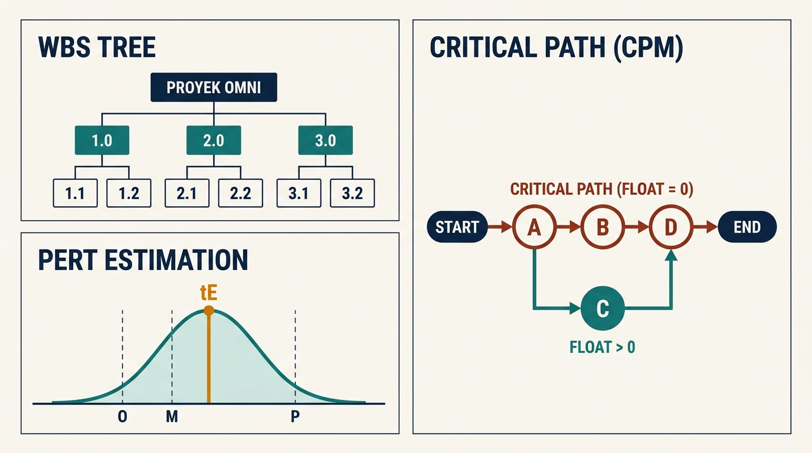
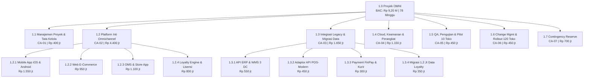
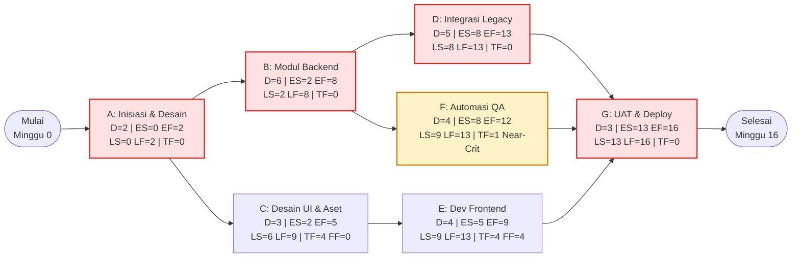
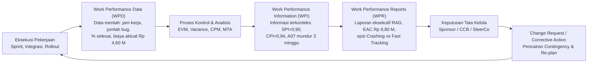
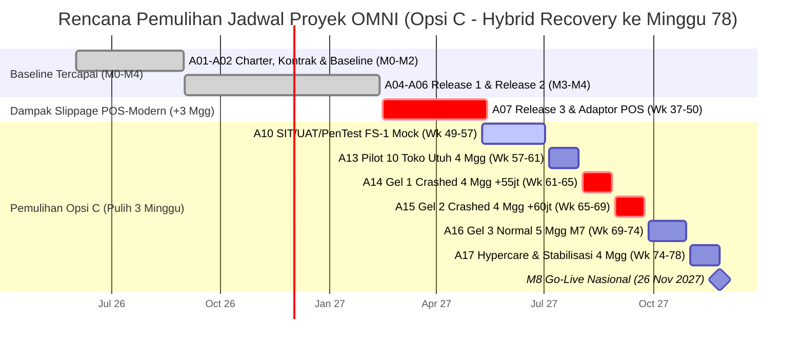

# Modul 02: Project Planning & Execution

---

## 1. Identitas Modul

| Atribut | Keterangan |
|---------|------------|
| **Kelompok Jalur** | Jalur Utama — *Project Management* (Jilid I: *Leadership & Project Delivery*) |
| **Level Kompetensi** | Senior (*Senior Project Manager / Delivery Lead*) |
| **Durasi Pembelajaran** | **12 jam sesi** (4 sesi × 3 jam) + **±6 jam tugas mandiri** |
| **Prasyarat** | Modul 01: *Advanced Project Management* (menguasai *Project Charter*, *Scope Baseline*, dasar EVM, dan *Integrated Change Control*) |
| **Peran Sasaran** | Senior Project Manager, Delivery Manager, Technical Project Manager, Senior Business Analyst, System Analyst / Solution Architect yang memimpin perencanaan & eksekusi |
| **Keluaran Utama (*Deliverables*)** | *Work Breakdown Structure* (WBS) 4-level & *WBS Dictionary*, *Network Diagram* PDM & analisis *Critical Path Method* (CPM) 78 minggu, estimasi probabilistik PERT, Matriks RACI, serta rencana pemulihan jadwal (*Crashing* vs *Fast Tracking*) untuk Proyek OMNI |

---

## 2. Gambaran Modul

Pada level praktisi pemula, perencanaan proyek kerap direduksi menjadi aktivitas administratif: membuat daftar tugas di lembar kerja (*spreadsheet*) dan menggambar batang warna-warni di *Gantt chart*. Namun pada level senior, **perencanaan (*planning*) adalah rekayasa kepastian eksekusi**, dan **eksekusi (*execution*) adalah disiplin mengendalikan deviasi sebelum deviasi tersebut menghancurkan target bisnis**.

Ketika seorang Senior Project Manager memimpin transformasi berskala nasional seperti **Proyek OMNI** di **PT Sinar Nusantara Retail Tbk (SNR)** — dengan anggaran *Budget at Completion* (BAC) **Rp 9,20 M**, tenggat mutlak **26 November 2027 (78 minggu)** sebelum puncak belanja Harbolnas 12.12, integrasi *legacy* di **120 toko** dan **3 pusat distribusi (DC)**, serta ketergantungan lintas proyek terhadap **ERP-Refresh** dan **POS-Modern** — satu kekeliruan dalam memecah lingkup kerja atau mengabaikan satu ketergantungan tersembunyi dapat memicu efek domino bernilai miliaran rupiah.

Modul 02 menjembatani tata kelola strategis dari Modul 01 menuju perangkat teknis perencanaan dan pengendalian eksekusi yang presisi. Anda akan menguasai cara memecah lingkup ke dalam **WBS berbasis keluaran (*deliverable-oriented*)** yang selaras 100% dengan anggaran, memodelkan logika ketergantungan menggunakan **Precedence Diagramming Method (PDM)**, mengukur ketidakpastian durasi secara kuantitatif dengan **PERT (*Program Evaluation and Review Technique*)**, mengidentifikasi jalur paling rapuh melalui **Critical Path Method (CPM)**, mengalokasikan tanggung jawab tanpa ambiguitas melalui **Matriks RACI**, serta mengambil keputusan kompresi jadwal (**Crashing** vs **Fast Tracking**) berbasis analisis biaya–risiko ketika realitas lapangan menyimpang dari rencana.

---

## 3. Capaian Pembelajaran

Setelah menyelesaikan Modul 02, peserta dan pembaca mampu:

1. **Merancang *Work Breakdown Structure* (WBS) 3–4 level beserta *WBS Dictionary*** yang mematuhi *100% Rule*, berbasis *deliverable*, serta terpetakan secara utuh ke *Control Account* dan *Cost Baseline* proyek.
2. **Memodelkan jaringan logika proyek menggunakan *Precedence Diagramming Method* (PDM)** dengan memilih tipe relasi (*FS, SS, FF, SF*), klasifikasi ketergantungan (*Mandatory, Discretionary, External, Internal*), serta *Lead* dan *Lag* secara akurat.
3. **Menghitung estimasi durasi probabilistik menggunakan *Three-Point Estimating* (PERT)** — mencakup *expected duration* (`tE`), standar deviasi (`σ`), varians (`σ²`), interval kepercayaan 68%/95%/99,7%, dan probabilitas pencapaian target (*Z-score*).
4. **Menganalisis *Critical Path Method* (CPM)** melalui *Forward Pass* (`ES`, `EF`), *Backward Pass* (`LS`, `LF`), *Total Float* (`TF`), dan *Free Float* (`FF`) untuk membedakan jalur kritis, *near-critical path*, dan cadangan kelonggaran jadwal.
5. **Menyusun strategi optimasi sumber daya dan pemulihan jadwal** dengan membandingkan *Resource Leveling* vs *Resource Smoothing* serta *Crashing* vs *Fast Tracking* berdasarkan trade-off biaya, mutu, dan risiko *rework*.
6. **Mengendalikan eksekusi proyek secara terukur** menggunakan Matriks RACI yang bebas konflik otoritas, *Milestone Trend Analysis* (MTA), *Rolling Wave Planning*, dan transformasi *Work Performance Data* menjadi keputusan korektif eksekutif.

---

## 4. Rencana Sesi

Rencana pembelajaran dirancang untuk **4 sesi × 3 jam = 12 jam tatap muka/lokakarya** dengan komposisi proporsional **±30% konsep (3,6 jam)**, **±50% workshop studi kasus Proyek OMNI (6,0 jam)**, dan **±20% diskusi/refleksi senior (2,4 jam)**, dilanjutkan **±6 jam tugas mandiri**.

| Sesi | Tema Utama | Konsep (±30%) | Workshop Kasus Proyek OMNI (±50%) | Diskusi & Refleksi (±20%) | Durasi |
|------|------------|---------------|-----------------------------------|---------------------------|--------|
| **Sesi 1** | Dekomposisi Lingkup: WBS, *100% Rule*, *Control Account* & *WBS Dictionary* | 55 menit — Prinsip *deliverable-oriented WBS*, *8/80 rule*, *Control Account*, dan struktur *WBS Dictionary* | 90 menit — Menyusun WBS 4-level Proyek OMNI yang totalnya persis cocok **Rp 9,20 M** (CB-01 s.d. CB-06) + menulis *WBS Dictionary* WP Migrasi Data & Adaptor POS | 35 menit — Bedah *anti-pattern* WBS berbasis departemen/aktivitas dan risiko *missing scope* pada kontrak *Fixed Price* PT NDS | 3 jam |
| **Sesi 2** | Logika Jaringan PDM, Estimasi Durasi & Analisis PERT | 55 menit — Relasi PDM (*FS/SS/FF/SF*), *Lead/Lag*, 4 teknik estimasi, rumus PERT (`tE`, `σ`, `σ²`, *Z-score*) | 90 menit — Memetakan ketergantungan lintas proyek (ERP-Refresh & POS-Modern) serta menghitung PERT paket kerja Migrasi 1,2 Juta Data Loyalty (Risiko R-02) | 35 menit — Mengapa estimasi *single-point* menyesatkan eksekutif dan bagaimana mengomunikasikan rentang probabilistik ke CFO/CEO | 3 jam |
| **Sesi 3** | *Critical Path Method* (CPM), *Float* & Kompresi Jadwal | 55 menit — *Forward/Backward Pass*, *Total Float* vs *Free Float*, *Near-Critical Path*, *Crashing* vs *Fast Tracking* | 90 menit — Menghitung jaringan 78 minggu Proyek OMNI (M0–M8) dan merancang skenario pemulihan keterlambatan 3 minggu akibat API POS-Modern | 35 menit — Debat simulasi SteerCo: *Pure Crashing* vs *Fast Tracking* vs *Hybrid Recovery* dengan *veto* UU PDP dari Legal/InfoSec | 3 jam |
| **Sesi 4** | Optimasi Sumber Daya, RACI, MTA & Pengendalian Eksekusi | 55 menit — *Resource Leveling* vs *Smoothing*, aturan Matriks RACI, *Milestone Trend Analysis*, *Rolling Wave*, dan alur WPD → WPI → WPR | 90 menit — Menyusun Matriks RACI Proyek OMNI (16 tokoh kunci), audit konflik sumber daya 3 *senior architect* IT, dan menyusun *Action Plan* Bulan ke-9 | 35 menit — Refleksi *anti-patterns* lapangan, pengarahan Tugas Mandiri (±6 jam), dan evaluasi kuis situasional | 3 jam |
| **Total** | **4 Sesi Terpadu** | **3 jam 40 menit (30,6%)** | **6 jam 00 menit (50,0%)** | **2 jam 20 menit (19,4%)** | **12 jam** |

---

## 5. Materi



### 5.1 Work Breakdown Structure (WBS), 100% Rule, dan WBS Dictionary

**Work Breakdown Structure (WBS)** adalah dekomposisi hierarkis berbasis keluaran (*deliverable-oriented hierarchical decomposition*) atas seluruh pekerjaan yang harus dijalankan tim proyek untuk mencapai tujuan proyek dan menghasilkan keluaran yang disyaratkan. Dalam praktik manajemen proyek modern (*PMBOK Guide* & *PMI Practice Standard for WBS*), WBS merupakan tulang punggung integrasi seluruh *baseline* proyek: lingkup (*scope*), jadwal (*schedule*), biaya (*cost*), risiko (*risk*), dan tanggung jawab (*accountability*) bermuara pada simpul-simpul WBS.

#### Prinsip Fundamental Penyusunan WBS Level Senior

1. **100% Rule (Aturan 100%):** WBS harus mencakup **100% pekerjaan yang didefinisikan oleh ruang lingkup proyek (*in-scope*)** — termasuk pekerjaan manajemen proyek, pengujian, kepatuhan regulasi, pelatihan, dan penyerahan operasional — serta **tidak boleh memuat satu pun pekerjaan di luar lingkup (*out-of-scope*)**. Aturan ini berlaku secara vertikal di setiap tingkatan: jumlah seluruh elemen anak (*child elements*) harus persis sama dengan 100% elemen induknya (*parent element*). Jika terdapat biaya atau upaya yang tidak terpetakan ke dalam WBS, proyek tersebut memiliki "pekerjaan gelap" (*hidden work*) yang pasti akan merusak akurasi anggaran dan jadwal.
2. **Deliverable-Oriented Decomposition (Berbasis Keluaran, Bukan Kata Kerja):** Setiap elemen WBS harus merepresentasikan **hasil nyata (kata benda / *noun*)** yang dapat diverifikasi — seperti *"Order Management System (OMS)"*, *"240 Unit Tablet/Scanner Terkonfigurasi"*, atau *"Laporan Penetration Testing UU PDP"* — bukan daftar aktivitas kata kerja seperti *"Melakukan rapat koordinasi"* atau *"Mengerjakan coding"*. Daftar aktivitas (*Activity List*) baru diturunkan pada tahap penjadwalan di bawah *Work Package*.
3. **Mutually Exclusive, Collectively Exhaustive (MECE):** Tidak boleh ada tumpang tindih (*overlap*) antar-elemen WBS agar tidak terjadi penghitungan ganda (*double counting*) anggaran maupun kebingungan kepemilikan antar-tim atau antar-vendor.
4. **Work Package (Paket Kerja):** Tingkatan terendah pada setiap cabang WBS tempat biaya dan durasi dapat diestimasi serta dikelola secara andal. Sebagai pedoman praktis (*rule of thumb*), banyak organisasi menerapkan **aturan 8/80 (*8/80 rule*)** — satu *Work Package* idealnya berukuran antara 8 hingga 80 jam kerja (atau 1–2 periode pelaporan / 1–2 sprint dalam proyek *hybrid*). Terlalu besar akan menyembunyikan keterlambatan (*watermeloning*), sedangkan terlalu kecil menimbulkan beban administrasi pelacakan (*micromanagement overhead*).
5. **Control Account (CA) dan Planning Package (PP):**
   - **Control Account (CA)** adalah titik kendali manajemen (*management control point*) tempat lingkup, anggaran, biaya aktual, dan jadwal diintegrasikan serta dibandingkan dengan *Earned Value* (EVM). Setiap *Work Package* hanya boleh berada di bawah **satu** *Control Account*, sementara satu *Control Account* dapat menaungi beberapa *Work Package*.
   - **Planning Package (PP)** adalah komponen WBS di bawah *Control Account* yang ruang lingkup kerjanya sudah diketahui, namun detail aktivitas jadwalnya belum diuraikan karena waktunya masih jauh di masa depan (digunakan bersama *Rolling Wave Planning*).

#### Diagram Struktur Hierarki WBS (*Deliverable-Oriented*)



#### WBS Dictionary (Kamus WBS)

Diagram pohon WBS saja tidak cukup untuk mengikat vendor dan tim lintas fungsi, karena label singkat seperti *"1.3.4 Migrasi 1,2 Juta Data Loyalty"* dapat ditafsirkan secara berbeda oleh *Product Owner*, *Solution Architect*, dan vendor. Oleh karena itu, WBS wajib dilengkapi **WBS Dictionary**, yaitu dokumen pendamping yang merinci setiap *Work Package* mencakup:

- **Kode WBS & Kode Control Account:** Identitas pelacakan biaya dan EVM.
- **Deskripsi Pekerjaan (*Statement of Work*):** Batasan rinci apa yang termasuk dan secara eksplisit apa yang dikecualikan.
- **Pemilik (*Responsible Organization / Owner*):** Pihak tunggal yang bertanggung jawab mengeksekusi paket kerja.
- **Kriteria Penerimaan (*Acceptance Criteria*):** Standar kuantitatif agar keluaran sah dinyatakan selesai (*Definition of Done*).
- **Asumsi, Ketergantungan, Sumber Daya, Estimasi Biaya, dan Referensi Kontrak:** Vital untuk mencegah sengketa *Change Request* dengan vendor *Fixed Price*.

---

### 5.2 Activity Sequencing & Dependency Management

Setelah *Work Package* ditetapkan dalam WBS, langkah berikutnya adalah memecah setiap *Work Package* menjadi aktivitas jadwal (*Schedule Activities*) dan menyusun urutan logisnya menggunakan **Precedence Diagramming Method (PDM)** — metode jaringan berbasis *Activity-on-Node* (AON) yang menjadi standar di perangkat penjadwalan modern seperti MS Project, Primavera P6, dan Jira Plans.

#### Empat Tipe Relasi Logis PDM

| Tipe Relasi | Kepanjangan | Logika Ketergantungan | Contoh Nyata di Proyek OMNI |
|-------------|-------------|-----------------------|-----------------------------|
| **FS** *(paling umum, ±90% jaringan)* | *Finish-to-Start* | Aktivitas B **tidak dapat dimulai** sebelum Aktivitas A **selesai**. | Pengujian *Pilot 10 Toko* tidak dapat dimulai sebelum *SIT, UAT & PenTest UU PDP* dinyatakan lulus. |
| **SS** | *Start-to-Start* | Aktivitas B **tidak dapat dimulai** sebelum Aktivitas A **dimulai** (memungkinkan kerja paralel). | Penulisan *test script* QA dapat dimulai setelah pengembangan modul *OMS* dimulai (misalnya `SS + 2 minggu`). |
| **FF** | *Finish-to-Finish* | Aktivitas B **tidak dapat diselesaikan** sebelum Aktivitas A **selesai**. | Finalisasi dokumentasi SOP operasional *Click & Collect* tidak dapat dinyatakan selesai sebelum konfigurasi final *Store Fulfillment App* selesai. |
| **SF** *(sangat jarang)* | *Start-to-Finish* | Aktivitas B **tidak dapat diselesaikan** sebelum Aktivitas A **dimulai**. | Operasional situs e-commerce lama (2019) tidak dapat dimatikan (*decommission*) sebelum platform OMNI baru mulai beroperasi melayani transaksi produksi. |

#### Empat Kategori Ketergantungan (*Dependency Determination*)

Senior Project Manager harus membedakan ketergantungan berdasarkan **sifat keharusan** dan **sumber kendali** karena kedua dimensi ini menentukan ruang manuver saat melakukan *schedule compression*:

1. **Mandatory Dependencies (*Hard Logic*):** Keharusan fisik, teknis, atau kontraktual yang tidak dapat dilanggar. Contoh: pengujian *Load Test 2.500 TPM* tidak dapat dijalankan sebelum kode aplikasi terpasang di lingkungan *Staging* yang setara produksi. *Hard logic* **tidak dapat di-fast-track** secara paksa.
2. **Discretionary Dependencies (*Soft Logic / Preferred Logic*):** Urutan yang dipilih berdasarkan praktik terbaik (*best practice*) atau preferensi tim untuk menekan risiko, meskipun secara teknis bisa dikerjakan paralel. Contoh: menyelesaikan seluruh desain UI 100% sebelum memulai pembangunan API *backend*. *Soft logic* adalah kandidat utama saat tim mempertimbangkan **Fast Tracking**.
3. **External Dependencies:** Ketergantungan antara aktivitas proyek dan pihak/proyek di luar kendali langsung PM. Contoh: ketersediaan rilis API dari proyek paralel **POS-Modern** (Risiko R-01) atau sertifikasi keamanan PCI-DSS dari **PT FinPay Nusantara**. Ketergantungan eksternal wajib dikelola lewat *interface agreement*, *buffer* jadwal, dan eskalasi tingkat program.
4. **Internal Dependencies:** Ketergantungan antar-aktivitas yang berada sepenuhnya di dalam kendali tim proyek OMNI. Contoh: penyelesaian *Product Backlog* awal sebelum Sprint 1 dimulai.

#### Lead dan Lag

- **Lead (`−`):** Percepatan aktivitas penerus (*successor*) sehingga tumpang tindih dengan aktivitas pendahulu (*predecessor*). Ditulis misalnya **`FS − 2 minggu`** (aktivitas B dimulai 2 minggu sebelum aktivitas A selesai). *Lead* mencerminkan penerapan *Fast Tracking* dan harus diikuti mitigasi risiko *rework*.
- **Lag (`+`):** Penundaan wajib (*waiting time*) antara pendahulu dan penerus tanpa memerlukan tambahan sumber daya. Ditulis misalnya **`FS + 1 minggu`** (jeda 1 minggu setelah migrasi data untuk periode stabilisasi atau menunggu pengiriman fisik tablet ke luar Jawa). *Lag* wajib didokumentasikan alasannya agar tidak disalahartikan sebagai *padding* tersembunyi.

---

### 5.3 Duration & Effort Estimation serta Analisis PERT

Salah satu kesalahan paling fatal dalam penjadwalan adalah mencampuradukkan **Effort** (upaya kerja dalam *person-hours* atau *person-days*) dengan **Duration** (durasi kalender dalam hari atau minggu kerja). Suatu paket kerja dengan *effort* 160 *person-hours* yang dikerjakan 2 insinyur penuh waktu (40 jam/minggu) memerlukan *duration* 2 minggu kerja. Namun hukum **Brooks's Law** mengingatkan bahwa menambah orang pada pekerjaan perangkat lunak yang kompleks tidak selalu memotong durasi secara linear akibat beban komunikasi dan kurva belajar (*ramp-up*).

#### Empat Teknik Estimasi Utama

| Teknik Estimasi | Cara Kerja | Keunggulan | Kelemahan & Kapan Dipakai |
|-----------------|------------|------------|---------------------------|
| **Analogous Estimating** (*Top-Down*) | Menggunakan data historis proyek serupa sebagai pembanding durasi/biaya. | Sangat cepat dan murah. | Akurasi rendah (±25%–50%). Dipakai pada fase inisiasi / *Project Charter* ketika detail teknis belum tersedia. |
| **Parametric Estimating** | Menggunakan model statistik atau rasio produktivitas historis (misalnya 12 jam konfigurasi per toko × 120 toko = 1.440 jam). | Objektif, terukur, dan cepat diskalakan. | Bergantung pada validitas data historis dan asumsi linearitas. Ideal untuk aktivitas berulang seperti *rollout* toko atau migrasi SKU. |
| **Bottom-Up Estimating** | Mengestimasi setiap *Work Package* / aktivitas di level paling detail lalu menjumlahkannya ke atas (*roll-up*). | Akurasi paling tinggi dan membangun komitmen tim pelaksana. | Memakan waktu dan biaya perencanaan besar. Wajib dipakai saat menetapkan *Schedule & Cost Baseline* di M2. |
| **Three-Point Estimating (PERT)** | Mengakomodasi ketidakpastian dengan 3 skenario: *Optimistic* (`O`), *Most Likely* (`M`), dan *Pessimistic* (`P`). | Menangkap risiko ekor (*tail risk*) dan menghasilkan probabilitas penyelesaian terukur. | Membutuhkan keahlian memfasilitasi estimasi jujur agar bebas *optimism bias*. Ideal untuk pekerjaan berisiko tinggi (integrasi *legacy*, migrasi data kotor). |

#### Formula Matematis PERT (*Beta Distribution*)

Pada *Program Evaluation and Review Technique* (PERT) berbasis distribusi Beta (lebih realistis daripada distribusi segitiga `(O + M + P) / 3` karena memberi bobot 4× pada skenario paling mungkin `M`):

```text
Expected Duration (tE)     = (O + 4M + P) / 6
Standar Deviasi (σ)        = (P − O) / 6
Varians (σ²)               = [(P − O) / 6]²

Agregasi Jalur Berurutan (n aktivitas independen):
tE_jalur                   = Σ tE_i
σ²_jalur                   = Σ σ²_i        (PERHATIAN: jumlahkan VARIANS, BUKAN standar deviasi!)
σ_jalur                    = √(Σ σ²_i)

Z-Score untuk Target Durasi (T):
Z                          = (T − tE_jalur) / σ_jalur
```

**Interval Kepercayaan Distribusi Normal (Aturan Empiris):**
- **`tE ± 1σ`** → Tingkat kepercayaan **68,26%** (sering dibulatkan **68%**).
- **`tE ± 2σ`** → Tingkat kepercayaan **95,44%** (sering dibulatkan **95%**).
- **`tE ± 3σ`** → Tingkat kepercayaan **99,73%** (sering dibulatkan **99,7%**).

**Tabel Referensi Cepat Probabilitas Kumulatif Distribusi Normal `P(Durasi ≤ T)`:**

| Nilai `Z` | Probabilitas `P(≤ T)` | Makna Manajerial bagi Senior PM |
|-----------|-----------------------|---------------------------------|
| `−2,00` | **2,28%** | Target hampir mustahil tercapai tanpa perubahan lingkup atau *crashing* besar |
| `−1,00` | **15,87%** | Risiko keterlambatan sangat tinggi (~84% peluang meleset) |
| `−0,67` | **25,25%** | Hanya 1 dari 4 peluang tepat waktu; tidak layak dijadikan komitmen eksekutif |
| `−0,50` | **30,85%** | Peluang gagal masih dominan (~69%) |
| `0,00` | **50,00%** | Taruhan koin 50:50 — titik *expected value* `tE`, belum memiliki *schedule buffer* |
| `+0,50` | **69,15%** | Mulai moderat, cocok untuk target internal tim |
| `+1,00` | **84,13%** | Zona sehat untuk komitmen *milestone* operasional |
| `+1,65` | **95,05%** | Zona komitmen tinggi untuk tenggat kontraktual / *regulatory* |
| `+2,00` | **97,72%** | Kepastian sangat tinggi (cadangan `+2σ`) |

#### Contoh Hitungan Bertahap PERT: Modul Integrasi Payment Gateway FinPay

Misalkan paket kerja integrasi *Payment Gateway* terdiri dari 3 sub-aktivitas berurutan (dalam **hari kerja**):

| Kode | Sub-Aktivitas | `O` | `M` | `P` | `tE = (O+4M+P)/6` | `σ = (P−O)/6` | `σ² = σ²` |
|------|---------------|-----|-----|-----|-------------------|---------------|-----------|
| **P1** | Desain Kontrak API & Keamanan PCI-DSS | 2 | 4 | 6 | `(2+16+6)/6 = 4,00` | `(6−2)/6 = 0,67` | `0,4444` |
| **P2** | Pengembangan & *Sandbox Testing* | 5 | 6 | 13 | `(5+24+13)/6 = 7,00` | `(13−5)/6 = 1,33` | `1,7778` |
| **P3** | Sertifikasi & Uji *Failover* FinPay | 3 | 4 | 11 | `(3+16+11)/6 = 5,00` | `(11−3)/6 = 1,33` | `1,7778` |
| **TOTAL** | **Jalur Integrasi FinPay** | — | — | — | **16,00 hari** | **√4,0000 = 2,00 hari** | **4,0000** |

**Interpretasi Bertahap:**
1. **Durasi Ekspektasi Total (`tE_total`):** `4,00 + 7,00 + 5,00 = 16,00 hari`.
2. **Varians & Standar Deviasi Jalur:** `σ²_total = 0,4444 + 1,7778 + 1,7778 = 4,0000`, sehingga `σ_total = √4,0000 = 2,00 hari`. *(Perhatikan: jika Anda keliru menjumlahkan `σ` secara langsung `0,67 + 1,33 + 1,33 = 3,33`, Anda melebih-lebihkan ketidakpastian karena mengasumsikan seluruh risiko terburuk terjadi serentak!)*
3. **Rentang Interval Kepercayaan:**
   - **68,26% (`±1σ`):** `16 − 2` s.d. `16 + 2` = **14,0 – 18,0 hari**.
   - **95,44% (`±2σ`):** `16 − 4` s.d. `16 + 4` = **12,0 – 20,0 hari**.
   - **99,73% (`±3σ`):** `16 − 6` s.d. `16 + 6` = **10,0 – 22,0 hari**.
4. **Probabilitas Selesai pada Target Tertentu:**
   - Jika Sponsor menuntut selesai dalam **15 hari**: `Z = (15 − 16) / 2 = −0,50` → probabilitas hanya **30,85%** (berisiko tinggi!).
   - Jika PM memasang komitmen **18 hari** (memasukkan *buffer* `+1σ`): `Z = (18 − 16) / 2 = +1,00` → probabilitas meningkat menjadi **84,13%**.
   - Jika ditetapkan **20 hari** (`+2σ`): `Z = (20 − 16) / 2 = +2,00` → probabilitas **97,72%**.

---

### 5.4 Critical Path Method (CPM): Forward Pass, Backward Pass, dan Float

**Critical Path Method (CPM)** adalah teknik analisis jaringan deterministik untuk menentukan durasi minimum proyek dan mengidentifikasi jalur aktivitas yang memiliki fleksibilitas jadwal nol (**Jalur Kritis / *Critical Path***). Setiap keterlambatan sekecil apa pun pada aktivitas di Jalur Kritis akan langsung menunda tanggal penyelesaian seluruh proyek.

> **Konvensi Penomoran Waktu dalam Modul Ini (*Zero-Based Indexing*):**
> Untuk menghindari kesalahan selisih satu satuan (*off-by-one error*), seluruh perhitungan CPM dalam buku ini menggunakan **Konvensi Mulai = 0 (*Week 0 / Day 0 Convention*)** di mana angka `0` berarti "awal Minggu ke-1" dan angka `16` berarti "akhir Minggu ke-16". Rumus menjadi sangat bersih:
> - **Forward Pass:** `ES = max(EF semua pendahulu)` *(atau `0` jika tanpa pendahulu)*; `EF = ES + D`
> - **Backward Pass:** `LF = min(LS semua penerus)` *(atau `Durasi Proyek` jika aktivitas terakhir)*; `LS = LF − D`
> - **Total Float (`TF`):** `TF = LS − ES = LF − EF` *(kelonggaran total aktivitas sebelum menunda akhir proyek)*
> - **Free Float (`FF`):** `FF = min(ES semua penerus langsung) − EF` *(kelonggaran aktivitas sebelum menunda Early Start aktivitas penerus langsungnya)*
>
> *(Catatan perbandingan: beberapa buku ajar lama memakai Konvensi Mulai = 1 di mana `EF = ES + D − 1` dan `LS = LF − D + 1`. Nilai `TF`, `FF`, durasi proyek, dan Jalur Kritis tetap 100% identik di kedua konvensi; yang penting adalah konsistensi!)*

#### Perbedaan Kritis: Total Float (`TF`) vs Free Float (`FF`) & Near-Critical Path

- **Total Float (`TF`):** Waktu maksimum sebuah aktivitas boleh tertunda tanpa menunda **tanggal selesai proyek** (atau *milestone* eksternal yang mengikat). Perlu diingat: `TF` sering kali **dimiliki bersama (*shared*) oleh seluruh aktivitas pada cabang non-kritis yang sama**. Jika aktivitas pertama di cabang tersebut menghabiskan seluruh `TF`, aktivitas berikutnya di cabang yang sama kehilangan seluruh kelonggarannya!
- **Free Float (`FF`):** Waktu maksimum sebuah aktivitas boleh tertunda tanpa menunda **`Early Start (ES)` dari aktivitas penerus langsungnya**. Selalu berlaku **`0 ≤ FF ≤ TF`**. Mengetahui `FF` sangat penting untuk koordinasi antar-tim atau antar-vendor: jika `TF = 4` tetapi `FF = 0`, keterlambatan 1 minggu pada vendor A tidak menunda *Go-Live* proyek, tetapi **langsung mengacaukan jadwal mulai (*mobilization*) vendor B** sehingga memicu klaim *idle time*!
- **Near-Critical Path:** Jalur non-kritis yang memiliki `TF` sangat kecil (lazimnya `TF = 1–2 minggu` pada proyek tahunan). Senior PM wajib memantau *Near-Critical Path* nyaris seketat Jalur Kritis, karena sedikit deviasi saja akan mengubahnya menjadi Jalur Kritis baru (*critical path shift*).

#### Contoh Hitungan Bertahap CPM (Jaringan 7 Aktivitas, Konvensi Minggu-0)

Tinjau proyek pengembangan modul integrasi (durasi dalam **minggu**):

| ID | Aktivitas | Pendahulu | Durasi (`D`) | `ES` | `EF` | `LS` | `LF` | `TF` | `FF` | Status |
|----|-----------|-----------|--------------|------|------|------|------|------|------|--------|
| **A** | Inisiasi & Desain | — | 2 | 0 | 2 | 0 | 2 | **0** | **0** | **Kritis** |
| **B** | Modul Inti *Backend* | A | 6 | 2 | 8 | 2 | 8 | **0** | **0** | **Kritis** |
| **C** | Desain UI & Aset | A | 3 | 2 | 5 | 6 | 9 | **4** | **0** | Non-Kritis (`TF > FF`) |
| **D** | Integrasi API *Legacy* | B | 5 | 8 | 13 | 8 | 13 | **0** | **0** | **Kritis** |
| **E** | Pengembangan *Frontend* | C | 4 | 5 | 9 | 9 | 13 | **4** | **4** | Non-Kritis |
| **F** | Automasi Pengujian | B | 4 | 8 | 12 | 9 | 13 | **1** | **1** | **Near-Critical** |
| **G** | UAT & *Deployment* | D, E, F | 3 | 13 | 16 | 13 | 16 | **0** | **0** | **Kritis** |

**Verifikasi Langkah demi Langkah:**
1. **Forward Pass (kiri ke kanan, ambil `max` pada titik gabung / *merge node*):**
   - `A`: `ES = 0`, `EF = 0 + 2 = 2`.
   - `B`: `ES = EF(A) = 2`, `EF = 2 + 6 = 8`.
   - `C`: `ES = EF(A) = 2`, `EF = 2 + 3 = 5`.
   - `D`: `ES = EF(B) = 8`, `EF = 8 + 5 = 13`.
   - `E`: `ES = EF(C) = 5`, `EF = 5 + 4 = 9`.
   - `F`: `ES = EF(B) = 8`, `EF = 8 + 4 = 12`.
   - `G` (*merge node* dari D, E, F): `ES = max(13, 9, 12) = 13`, `EF = 13 + 3 = 16`. **Durasi Proyek = 16 minggu.**
2. **Backward Pass (kanan ke kiri, ambil `min` pada titik pecah / *burst node*):**
   - `G`: `LF = 16`, `LS = 16 − 3 = 13`.
   - `D`, `E`, `F` (semua hanya menuju G): `LF = LS(G) = 13` → `LS(D) = 8`, `LS(E) = 9`, `LS(F) = 9`.
   - `C` (menuju E): `LF = LS(E) = 9`, `LS = 9 − 3 = 6`.
   - `B` (*burst node* menuju D dan F): `LF = min(LS(D)=8, LS(F)=9) = 8`, `LS = 8 − 6 = 2`.
   - `A` (*burst node* menuju B dan C): `LF = min(LS(B)=2, LS(C)=6) = 2`, `LS = 2 − 2 = 0`.
3. **Analisis Float & Jalur:**
   - **Jalur Kritis (`TF = 0`):** **`A → B → D → G`** = `2 + 6 + 5 + 3 = 16 minggu`.
   - **Near-Critical Path (`TF = 1`):** **`A → B → F → G`** = `2 + 6 + 4 + 3 = 15 minggu`.
   - **Pelajaran Kunci `TF` vs `FF` pada Aktivitas C:** Aktivitas `C` memiliki `TF = 6 − 2 = 4 minggu`, tetapi **`FF = ES(E) − EF(C) = 5 − 5 = 0 minggu`**! Artinya, jika tim desain UI terlambat 1 minggu menyelesaikan `C`, *Go-Live* proyek di minggu ke-16 memang belum bergeser, tetapi tim *Frontend* (`E`) **langsung tertahan 1 minggu** dan sisa *float* bersama cabang `C–E` langsung menyusut dari 4 menjadi 3 minggu.



---

### 5.5 Schedule Compression & Resource Optimization

Ketika tenggat mutlak (*hard deadline*) terancam — baik sejak awal perencanaan maupun akibat keterlambatan saat eksekusi — Senior Project Manager tidak boleh sekadar menyuruh tim "bekerja lebih keras". Diperlukan dua keluarga teknik terstruktur: **Schedule Compression** (mempersingkat jadwal tanpa mengurangi ruang lingkup) dan **Resource Optimization** (menyeimbangkan beban sumber daya).

#### Crashing vs Fast Tracking

| Dimensi | **Crashing** | **Fast Tracking** |
|---------|--------------|-------------------|
| **Mekanisme** | Menambahkan sumber daya (lembur, tim paralel, subkontraktor tambahan, perangkat lebih cepat) pada aktivitas di **Jalur Kritis** untuk memperpendek durasi. | Menjalankan aktivitas/fase yang semula berurutan (*FS*) secara **tumpang tindih/paralel** (*SS* atau *FS dengan Lead*). |
| **Dampak Biaya Langsung** | **Pasti naik** (*trade-off* biaya–waktu yang terukur per minggu). | Biaya langsung awal minimal / Rp 0, tetapi berpotensi memicu **biaya *rework* tinggi** bila asumsi berubah. |
| **Dampak Risiko & Mutu** | Risiko kelelahan tim (*burnout*), beban koordinasi (*Brooks's Law*), dan keterbatasan ketersediaan spesialis. | Risiko **rework**, cacat kualitas, dan gagal uji integrasi meningkat tajam. |
| **Syarat Mutlak** | Hanya efektif pada aktivitas di **Jalur Kritis** yang memiliki batas durasi *crash* (*Crash Duration*) dan *slope* biaya terendah. | Hanya boleh diterapkan pada **Discretionary Dependencies (*soft logic*)** — tidak mungkin pada *hard logic*. |

**Rumus Biaya Percepatan (*Crash Cost Slope*):**

```text
Maksimum Percepatan (Max Crash)  = Durasi Normal (Dn) − Durasi Crash Minimum (Dc)
Crash Cost per Satuan Waktu      = (Biaya Crash [Cc] − Biaya Normal [Cn]) / (Dn − Dc)
```

**Algoritma Crashing Biaya Minimum (Wajib Dikuasai Senior PM):**
1. Identifikasi seluruh jalur dan **Jalur Kritis** saat ini.
2. Pilih aktivitas pada Jalur Kritis dengan **Crash Cost per minggu terendah** yang masih memiliki sisa kapasitas percepatan.
3. Kurangi durasinya **1 satuan waktu demi 1 satuan waktu** (*step-by-step*), lalu **hitung ulang semua jalur**!
4. **PERINGATAN KRUSIAL:** Begitu jalur lain ikut menjadi kritis (*parallel critical paths*), untuk mengurangi 1 minggu berikutnya Anda harus memilih **yang lebih murah** antara:
   - Meng-crash **1 aktivitas bersama** yang berada di semua jalur kritis sekaligus, ATAU
   - Meng-crash **kombinasi aktivitas paralel** (satu di tiap jalur kritis secara serentak).

**Contoh Cepat Menggunakan Jaringan 5.4 (`A–G`, 16 Minggu → Target 13 Minggu):**
Diketahui jalur awal: `P1 (A–B–D–G) = 16 mgg`, `P2 (A–B–F–G) = 15 mgg`, `P3 (A–C–E–G) = 12 mgg`. Data *crash*: `A` (maks 1 mgg, Rp 50 jt/mgg), `B` (maks 2 mgg, Rp 35 jt/mgg), `D` (maks 2 mgg, Rp 20 jt/mgg), `F` (maks 2 mgg, Rp 18 jt/mgg), `G` (maks 1 mgg, Rp 30 jt/mgg).
- **Iterasi 1 (16 → 15 mgg):** Jalur kritis hanya `P1 {A:50, B:35, D:20, G:30}`. Termurah: **Crash `D` 1 mgg (Rp 20 jt)**. Sekarang `P1 = 15` dan `P2 = 15` (**dua jalur kritis paralel!**).
- **Iterasi 2 (15 → 14 mgg):** Harus memangkas `P1` dan `P2` bersamaan. Pilihan: aktivitas bersama `G` (**Rp 30 jt**), aktivitas bersama `B` (Rp 35 jt), aktivitas bersama `A` (Rp 50 jt), atau pasangan `D + F` (`20 + 18 = Rp 38 jt`). Termurah: **Crash `G` 1 mgg (Rp 30 jt)**. Sekarang `P1 = 14`, `P2 = 14` (`G` habis).
- **Iterasi 3 (14 → 13 mgg):** Pilihan tersisa: aktivitas bersama `B` (**Rp 35 jt**), `A` (Rp 50 jt), atau pasangan `D + F` (`20 + 18 = Rp 38 jt`). Termurah: **Crash `B` 1 mgg (Rp 35 jt)**.
- **Total Biaya Percepatan 3 Minggu:** `Rp 20 jt + Rp 30 jt + Rp 35 jt = Rp 85 jt`. *(Bandingkan jika PM ceroboh terus meng-crash `D` saja di iterasi 2 — durasi proyek tidak akan berkurang sama sekali karena tertahan oleh `P2`!)*

#### Resource Leveling vs Resource Smoothing

Saat alokasi SDM diplot ke dalam **Resource Histogram** (grafik batang kebutuhan personel per minggu dibandingkan kapasitas tersedia), sering muncul **overallocation** — misalnya 3 *senior architect* IT SNR dijadwalkan bekerja 150% kapasitas secara bersamaan di Proyek OMNI dan ERP-Refresh.

| Dimensi | **Resource Leveling** | **Resource Smoothing** |
|---------|-----------------------|------------------------|
| **Tujuan** | Menghilangkan *overallocation* ketika sumber daya terbatas (*resource-constrained*) dan tidak bisa ditambah. | Meratakan fluktuasi puncak dan lembah beban kerja agar utilisasi lebih stabil. |
| **Dampak pada Jalur Kritis & Tanggal Selesai** | **Dapat mengubah Jalur Kritis** dan sering kali **memperpanjang durasi proyek**. | **Tidak boleh mengubah Jalur Kritis** maupun menunda tanggal selesai proyek. |
| **Batasan Pergeseran** | Boleh menggeser aktivitas melewati *Total Float*-nya bila perlu. | Aktivitas hanya boleh digeser **di dalam batas *Free Float* dan *Total Float*** yang tersedia. |
| **Contoh di Proyek OMNI** | Jika hanya ada 1 *Lead Solution Architect* (Dimas Prasetyo) untuk desain OMS dan desain API ERP-Refresh secara bersamaan, keduanya harus diurutkan (*leveled*) meski menambah durasi bila tidak dibantu arsitek tambahan. | Menggeser jadwal pelatihan awal toko non-kritis (`A12`, `TF = 4 mgg`) dalam batas *float*-nya agar beban tim *Change Management* tidak menumpuk di satu minggu yang sama dengan persiapan Pilot. |

---

### 5.6 Resource Allocation, Matriks RACI, dan Milestone Management

Jadwal yang sempurna di atas kertas akan lumpuh jika peran eksekusi kabur dan pencapaian antar-tahap tidak dipantau secara ketat. Dua instrumen tata kelola eksekusi yang wajib dipegang Senior PM adalah **Matriks RACI** dan **Milestone Trend Analysis (MTA)**.

#### Matriks RACI (*Responsibility Assignment Matrix*)

Matriks RACI memetakan setiap *deliverable* atau *Work Package* penting terhadap peran pemangku kepentingan:
- **R — Responsible (Pelaksana):** Pihak yang benar-benar mengerjakan dan menghasilkan *deliverable*. Minimal harus ada **satu `R`** pada setiap baris (boleh lebih dari satu jika dikerjakan lintas tim, namun tetap jelas pembagiannya).
- **A — Accountable (Penanggung Jawab Akhir / Pemilik Keputusan):** Pihak yang memiliki otoritas menyetujui (*sign-off*) keluaran dan memikul tanggung jawab akhir atas keberhasilan atau kegagalannya. **ATURAN EMAS MUTLAK: Setiap baris WAJIB memiliki TEPAT SATU `A`!** Nol `A` menciptakan kekosongan kepemilikan (*orphan deliverable*), sedangkan dua atau lebih `A` memicu kebuntuan keputusan (*diffusion of responsibility*: *"jika semua orang accountable, berarti tidak ada seorang pun yang accountable"*).
- **C — Consulted (Dikonsultasikan — Komunikasi Dua Arah):** Pakar atau pemilik fungsi yang masukannya wajib diminta **sebelum** keputusan diambil atau keluaran difinalisasi (contoh: Legal/InfoSec dikonsultasikan pada desain enkripsi UU PDP).
- **I — Informed (Diinformasikan — Komunikasi Satu Arah):** Pihak yang diberi tahu mengenai progres atau keputusan setelah terjadi agar tetap selaras tanpa memperlambat eksekusi.

**Pengecekan Kesehatan Matriks RACI (Audit Vertikal & Horizontal):**
- *Audit Horizontal (per baris):* Pastikan tepat 1 `A`, minimal 1 `R`, tidak penuh `C` (terlalu banyak pihak yang harus dimintai persetujuan akan melumpuhkan kecepatan), dan tidak penuh `I` tanpa pelaksana.
- *Audit Vertikal (per kolom/orang):* Pastikan tidak ada satu tokoh pun yang dibebani terlalu banyak `A` atau `R` secara bersamaan (*single point of failure / bottleneck* organisasi), dan tidak ada kolom yang seluruhnya kosong.

#### Milestone Management & Milestone Trend Analysis (MTA)

**Milestone** adalah titik peristiwa signifikan berdurasi **nol (`D = 0`)** yang menandai penyelesaian fase, persetujuan *Stage-Gate*, atau serah terima ketergantungan lintas proyek (misalnya M0 s.d. M8 pada Proyek OMNI).

**Milestone Trend Analysis (MTA)** adalah teknik visual sederhana namun sangat kuat untuk mendeteksi tren pergeseran jadwal (*slippage*) sejak dini. Pada grafik MTA, sumbu horizontal mencatat **tanggal pelaporan (*reporting date*)** dan sumbu vertikal mencatat **perkiraan tanggal tercapainya milestone (*forecast milestone date*)**:
- **Garis datar (horizontal):** *Milestone* stabil sesuai rencana (*on track*).
- **Garis menanjak (*upward slope*):** Sinyal peringatan dini terjadinya *schedule slippage* yang makin memburuk dari bulan ke bulan — menuntut intervensi *corrective action* segera, bukan menunggu tanggal jatuh tempo tiba.
- **Garis menurun (*downward slope*):** Terjadi percepatan jadwal (misalnya hasil *crashing* yang berhasil).

---

### 5.7 Execution Control: Rolling Wave Planning dan Pengendalian Slippage

Rencana induk (*Project Management Plan*) bukan dokumen mati yang disimpan di laci setelah *kick-off*. Senior PM mengelola ketidakpastian proyek jangka panjang melalui dua mekanisme eksekusi yang saling melengkapi: **Rolling Wave Planning** dan siklus **Work Performance Data → Information → Reports**.

#### Rolling Wave Planning (Perencanaan Gelombang Bergulir)

Pada proyek 18 bulan berpendekatan *hybrid* seperti Proyek OMNI, mustahil dan kontraproduktif merinci aktivitas harian untuk *Wave Rollout* Gelombang 3 (bulan ke-16) saat proyek baru memasuki bulan ke-2. **Rolling Wave Planning** adalah bentuk *progressive elaboration* di mana:
- Pekerjaan **jangka pendek** (misalnya 2–3 bulan ke depan atau 2–3 Sprint mendatang) diuraikan secara detail hingga level *Work Package*, *User Story*, dan aktivitas harian/mingguan.
- Pekerjaan **jangka panjang** (fase mendatang) dipertahankan pada level tinggi sebagai **Planning Package** di WBS, lalu dirinci secara bertahap seiring waktu bergulir dan informasi baru terkumpul (misalnya hasil evaluasi *Pilot 10 Toko* langsung dipakai menyempurnakan rencana detail *Gelombang 1–3*).

#### Alur Data Kinerja ke Keputusan Eksekutif (WPD → WPI → WPR)



1. **Work Performance Data (WPD):** Pengamatan dan pengukuran mentah saat eksekusi berlangsung (contoh: tanggal selesai riil Sprint 10, biaya faktur vendor terbayar `AC = Rp 4,60 M`, 42% data loyalty masih duplikat).
2. **Work Performance Information (WPI):** Data mentah yang telah dianalisis terhadap *baseline* sehingga bermakna (contoh: `SV = −Rp 0,48 M`, `SPI = 0,90`, `CPI = 0,94`, keterlambatan API POS-Modern mendorong Jalur Kritis dari Minggu 78 ke Minggu 81).
3. **Work Performance Reports (WPR):** Representasi fisik/elektronik dari WPI dalam bentuk dasbor status, analisis tren, dan rekomendasi keputusan untuk Sponsor dan *Steering Committee* — menjadi pemicu resmi **Corrective Action** (memperbaiki kinerja yang sudah menyimpang), **Preventive Action** (mencegah penyimpangan yang diperkirakan terjadi), atau **Defect Repair**.

#### Protokol 5 Langkah Mengatasi Schedule Slippage Saat Eksekusi

Ketika *schedule slippage* terdeteksi (misalnya SPI turun ke `0,90` pada Bulan ke-9 Proyek OMNI), Senior PM menjalankan protokol disiplin berikut:
1. **Isolasi Akar Masalah (*Root Cause*):** Bedakan apakah keterlambatan berasal dari *Critical Path*, *Near-Critical Path*, atau jalur non-kritis yang masih punya *float*.
2. **Perbarui Jaringan & Hitung Dampak Riil:** Masukkan *actuals* dan estimasi sisa durasi (*Estimate to Complete*) yang jujur ke model CPM untuk mengetahui proyeksi tanggal selesai terbaru.
3. **Evaluasi Tuas Pemulihan Berurutan:** (a) Eliminasi hambatan (*remove impediments*) dan eskalasi dependensi eksternal; (b) Evaluasi *Fast Tracking* terbatas pada *soft logic* berisiko rendah; (c) Hitung opsi *Crashing* biaya terendah; (d) Hanya jika ketiga tuas di atas gagal, ajukan opsi *descoping* terukur (*MoSCoW* — menunda fitur *Should/Could-Have* ke Fase 2) melalui *Change Control Board* (CCB).
4. **Hitung Dampak Biaya & Cadangan:** Pastikan sumber pendanaan jelas (apakah terserap *Contingency Reserve* di bawah otoritas PM/Sponsor atau membutuhkan *Management Reserve* dari CFO/SteerCo).
5. **Kunci *Recovery Plan* & Pantau Mingguan:** Tetapkan indikator kemajuan mingguan (*inchstones*) agar keterlambatan tidak berulang secara diam-diam.

---

### 5.8 Kesalahan Umum di Lapangan (*Anti-Patterns*)

Seorang Senior Project Manager dikenali dari kemampuannya mencegah jebakan perencanaan dan eksekusi berikut sebelum terjadi:

1. **WBS Berbasis Struktur Departemen, Bukan *Deliverable*:** Membagi WBS menjadi *"1.1 Tim IT, 1.2 Tim Marketing, 1.3 Tim Operasional"* menyebabkan tidak jelasnya keluaran akhir yang terintegrasi, memicu saling lempar tanggung jawab pada integrasi lintas fungsi, dan menyulitkan pengukuran *Earned Value*.
2. **Ilusi Kepastian Tunggal (*Single-Point Estimation Bias*):** Melaporkan kepada Direksi *"migrasi data butuh 20 minggu"* tanpa mengungkap ketidakpastian `σ` atau skenario pesimistis `P`. Ketika realitas bergeser ke 26 minggu, PM dianggap gagal mengelola jadwal, padahal sejak awal probabilitas selesai dalam 20 minggu mungkin di bawah 30%.
3. **Sindrom Pelajar (*Student Syndrome*) & Hukum Parkinson (*Parkinson's Law*):** Ketika *padding* (cadangan tersembunyi) diselipkan diam-diam di setiap aktivitas, tim cenderung menunda mulai bekerja hingga mepet tenggat (*Student Syndrome*) atau pekerjaan otomatis membesar mengisi seluruh waktu yang tersedia (*Parkinson's Law*). Solusi senior: gunakan estimasi realistis tanpa *padding* tersembunyi, lalu konsolidasikan cadangan secara transparan pada *Contingency Reserve* dan *Project Buffer*.
4. **Meng-crash Aktivitas Non-Kritis:** Menyetujui lembur mahal atau penambahan tenaga pada aktivitas yang memiliki *Total Float > 0*. Biaya proyek langsung membengkak, namun tanggal selesai proyek **tidak maju satu hari pun**.
5. **Fast Tracking Membuta pada *Hard Logic*:** Memaksa pengujian UAT atau *rollout* toko berjalan sebelum integrasi inti dan kepatuhan UU PDP stabil demi tampak "tetap sesuai jadwal" di laporan bulanan. Akibatnya terjadi ledakan cacat produksi, *rework* berlipat ganda, dan penundaan jauh lebih parah di ujung proyek.
6. **RACI Tanpa `A` Tunggal (*Multiple Accountables*):** Menempatkan dua atau tiga direktur sebagai `A` pada satu *deliverable* strategis (misalnya *"Persetujuan Go-Live"* diberi `A` untuk COO, CTO, dan Legal sekaligus). Saat terjadi konflik prioritas, keputusan membeku. Seharusnya hanya satu `A` (misalnya Sponsor/COO), sementara Legal dan CTO berperan `C` dengan hak persyaratan kelulusan (*gate criteria*) yang jelas.
7. **Sindrom Laporan Semangka (*Watermelon Reporting*):** Laporan status proyek tampak "hijau" di luar setiap bulan karena memakai estimasi subjektif (*"sekitar 80% selesai"*), padahal di dalamnya "merah pekat" karena aktivitas jalur kritis diam-diam meleset berminggu-minggu. Obat utamanya adalah *WPD → WPI* berbasis bukti keluaran objektif (*binary completion* atau *milestone* terverifikasi) serta pemantauan MTA.

---

## 6. Studi Kasus: Penerapan pada Proyek OMNI

Pada bagian ini, seluruh kerangka perencanaan dan pengendalian eksekusi dari Bagian 5 diterapkan secara utuh dan terverifikasi secara matematis pada **PT Sinar Nusantara Retail Tbk (SNR) — Proyek OMNI** yang dipimpin oleh Senior Project Manager **Fajar Nugroho**.

### 6.1 WBS 4-Level Proyek OMNI (100% Rule = BAC Rp 9,20 M) & WBS Dictionary

Struktur WBS Proyek OMNI dirancang berbasis *deliverable* dalam **7 Control Account (CA-01 s.d. CA-07)** dan **21 Work Package** yang memetakan 100% ruang lingkup *in-scope* serta cocok **persis 100%** dengan rincian komponen anggaran `CB-01` s.d. `CB-06` (`00-studi-kasus-utama.md`), menghasilkan total **BAC = Rp 9.200 jt (Rp 9,20 M)**.

| Kode WBS | Level | Elemen WBS (*Deliverable-Oriented*) | Kode Biaya (`CB`) | Pemilik Utama | Anggaran (Rp jt) | Porsi BAC |
|----------|-------|-------------------------------------|-------------------|---------------|------------------|-----------|
| **1.0** | **L1** | **Proyek OMNI (Omnichannel, Click & Collect, Digital Loyalty)** | **BAC** | **Fajar Nugroho (Senior PM)** | **9.200** | **100,00%** |
| **1.1** | **L2** | **Manajemen Proyek & Tata Kelola (CA-01)** | **CB-04** | **Fajar Nugroho** | **400** | **4,35%** |
| 1.1.1 | L3 | Project Charter, Arsitektur HLD & Kontrak Vendor PT NDS | CB-04 | Fajar Nugroho / Dimas | 120 | 1,30% |
| 1.1.2 | L3 | PMO Governance, Pengendalian Jadwal, Scrum & EVM | CB-04 | Fajar Nugroho / Tania | 180 | 1,96% |
| 1.1.3 | L3 | Manajemen Risiko, Audit Stage-Gate (G1–G4) & Penutupan | CB-04 | Fajar Nugroho / Antonius | 100 | 1,09% |
| **1.2** | **L2** | **Pengembangan Platform Inti Omnichannel (CA-02)** | **CB-01** | **Bambang Hartono (PT NDS)** | **4.400** | **47,83%** |
| 1.2.1 | L3 | Aplikasi Mobile Pelanggan (iOS & Android) | CB-01 | PT NDS / Kevin Halim | 1.550 | 16,85% |
| 1.2.2 | L3 | Web E-Commerce Responsif & Optimasi SEO | CB-01 | PT NDS / Kevin Halim | 950 | 10,33% |
| 1.2.3 | L3 | Order Management System (OMS) & *Store Fulfillment App* | CB-01 | PT NDS / Dimas Prasetyo | 1.100 | 11,96% |
| 1.2.4 | L3 | Digital Loyalty Engine (Silver/Gold/Platinum) & Lisensi | CB-01 | PT NDS / Dewi Lestari | 800 | 8,70% |
| **1.3** | **L2** | **Integrasi Sistem Legacy & Migrasi Data (CA-03)** | **CB-02** | **Dimas Prasetyo (Lead SA)** | **1.650** | **17,93%** |
| 1.3.1 | L3 | API Middleware & Sinkronisasi ERP / WMS 3 DC (≤ 60 detik) | CB-02 | Dimas / Siti Rahmawati | 550 | 5,98% |
| 1.3.2 | L3 | Adaptor API POS-Modern 120 Toko & Pemindai QR | CB-02 | Dimas / Tim POS-Modern | 450 | 4,89% |
| 1.3.3 | L3 | Integrasi *Payment Gateway* PT FinPay (PCI-DSS) & Kurir | CB-02 | Dimas / PT NDS | 300 | 3,26% |
| 1.3.4 | L3 | *Data Cleansing* & Migrasi 1,2 Juta Data *Sinar Member Card* | CB-02 | Nadia Putri / Tim Data | 350 | 3,80% |
| **1.4** | **L2** | **Infrastruktur Cloud, Keamanan & Perangkat Toko (CA-04)** | **CB-03** | **Irwan Pratama (CTO)** | **1.150** | **12,50%** |
| 1.4.1 | L3 | Lingkungan Cloud Region Jakarta (Dev/Staging/Prod/DR) | CB-03 | Tim Cloud IT SNR | 480 | 5,22% |
| 1.4.2 | L3 | Kepatuhan UU PDP, Enkripsi PII & *Penetration Testing* | CB-03 | Rina Kartika / Auditor Ind. | 250 | 2,72% |
| 1.4.3 | L3 | Pengadaan, Konfigurasi & Distribusi 240 Tablet/Scanner | CB-03 | Procurement / Agus Setiawan | 420 | 4,57% |
| **1.5** | **L2** | **Verifikasi Kualitas, Pengujian & Pilot 10 Toko (CA-05)** | **CB-05** | **Lukas Gunawan (QA Lead)** | **450** | **4,89%** |
| 1.5.1 | L3 | *System Integration Testing* (SIT) & Automasi QA | CB-05 | Lukas Gunawan / PT NDS | 140 | 1,52% |
| 1.5.2 | L3 | *User Acceptance Testing* (UAT) & *Load Test* 2.500 TPM | CB-05 | Lukas / Nadia / Kevin | 160 | 1,74% |
| 1.5.3 | L3 | *Pilot* 10 Toko Jabodetabek & Evaluasi Gate 3 (SLA ≤ 2 jam) | CB-05 | Agus Setiawan / Lukas | 150 | 1,63% |
| **1.6** | **L2** | **Manajemen Perubahan, Pelatihan & Rollout 120 Toko (CA-06)** | **CB-04** | **Agus Setiawan (Store Ops)** | **450** | **4,89%** |
| 1.6.1 | L3 | Desain SOP Omnichannel, Skema Insentif & *Change Mgmt* | CB-04 | Agus / Nadia / Ratna | 150 | 1,63% |
| 1.6.2 | L3 | *Training-of-Trainers* (6 RM, 120 SM) & Pelatihan 1.440 Staf | CB-04 | Agus Setiawan / HRD | 180 | 1,96% |
| 1.6.3 | L3 | *Wave Rollout* Gelombang 1–3 (110 Toko) & *Hypercare* | CB-04 | Fajar / Agus / IT Ops | 120 | 1,30% |
| **1.7** | **L2** | **Cadangan Kontinjensi / *Contingency Reserve* (CA-07)** | **CB-06** | **Fajar Nugroho / Ratna** | **700** | **7,61%** |
| 1.7.1 | L3 | Cadangan Risiko Jadwal & Integrasi (R-01, R-02, R-09) | CB-06 | Fajar Nugroho (via CR) | 450 | 4,89% |
| 1.7.2 | L3 | Cadangan Risiko Kepatuhan, Performa & Vendor (R-05–R-08) | CB-06 | Fajar Nugroho (via CR) | 250 | 2,72% |
| *—* | *Di luar BAC* | ***Management Reserve*** *(Otoritas CFO Budi Santoso & SteerCo)* | *MR* | *Budi Santoso (CFO)* | *600* | *—* |
| **TOTAL** | — | ***Total Project Funding Requirement*** | — | **Steering Committee** | **9.800** | — |

**Verifikasi Rekonsiliasi Komponen Biaya (`CB-01` s.d. `CB-06`):**
- `CB-01` = CA-02 = **Rp 4.400 jt** (Rp 4,40 M) — *cocok 100%*
- `CB-02` = CA-03 = **Rp 1.650 jt** (Rp 1,65 M) — *cocok 100%*
- `CB-03` = CA-04 = **Rp 1.150 jt** (Rp 1,15 M) — *cocok 100%*
- `CB-04` = CA-01 (`400 jt`) + CA-06 (`450 jt`) = **Rp 850 jt** (Rp 0,85 M) — *cocok 100%*
- `CB-05` = CA-05 = **Rp 450 jt** (Rp 0,45 M) — *cocok 100%*
- `CB-06` = CA-07 = **Rp 700 jt** (Rp 0,70 M) — *cocok 100%*
- **Total Cost Baseline (BAC) = Rp 9.200 jt (Rp 9,20 M)** + *Management Reserve* Rp 600 jt = **Rp 9.800 jt (Rp 9,80 M)**.

*(Catatan dekomposisi Level 4: Paket kerja kritis seperti `1.3.4` dipecah lebih lanjut ke Level 4 menjadi `1.3.4.1 Audit & Profiling Data`, `1.3.4.2 Deduplikasi & Cleansing`, `1.3.4.3 Re-verifikasi Kontak & Consent UU PDP`, dan `1.3.4.4 Dry-Run Migrasi & Cutover` yang akan dihitung secara PERT pada Sub-bab 6.3).*

#### Cuplikan WBS Dictionary Proyek OMNI (2 Work Package Kritis)

| Field WBS Dictionary | **WP 1.3.2 — Adaptor API POS-Modern 120 Toko** | **WP 1.3.4 — *Data Cleansing* & Migrasi 1,2 Juta Data Loyalty** |
|----------------------|------------------------------------------------|-----------------------------------------------------------------|
| **Control Account & Kode Biaya** | CA-03 / CB-02 (`Rp 450 jt`) | CA-03 / CB-02 (`Rp 350 jt`) |
| **Pemilik Paket Kerja** | Dimas Prasetyo (*Lead SA*) bersama tim PT NDS | Nadia Putri (*Lead BA*) & Tim Data Internal SNR |
| **Deskripsi In-Scope** | Pembangunan adaptor API sinkronisasi stok toko *near-real-time* (jeda ≤ 60 detik) dan endpoint pemindai QR voucher/poin loyalty antara OMS OMNI dan sistem POS-Modern di 120 toko. | Audit, deduplikasi, normalisasi, re-verifikasi kontak aktif, pencatatan persetujuan (*consent*) sesuai UU PDP, dan migrasi saldo poin 1,2 juta *Sinar Member Card* ke *Digital Loyalty Engine*. |
| **Secara Eksplisit Out-of-Scope** | Penggantian perangkat keras mesin kasir POS 120 toko (lingkup Proyek POS-Modern). | Pembuatan *Enterprise Data Warehouse* & analitik AI lanjutan (lingkup Proyek DataHub). |
| **Ketergantungan Kritis** | **Eksternal:** Rilis kontrak & sandbox API dari Proyek POS-Modern (Risiko R-01). | **Internal:** Finalisasi skema *Digital Loyalty Engine* (WP 1.2.4) & ketentuan *consent* UU PDP dari Rina Kartika (WP 1.4.2). |
| **Kriteria Penerimaan (*Acceptance Criteria*)** | Akurasi stok sinkronisasi ≥ 98,0%; latensi sinkronisasi ≤ 60 detik pada beban 2.500 TPM; 0 *Critical/High bug* di SIT; ditandatangani Irwan Pratama & Lukas Gunawan. | Minimal 800.000 profil terverifikasi siap aktif; tingkat duplikasi < 0,5%; 100% rekonsiliasi saldo poin lolos audit keuangan (Budi Santoso) & kepatuhan UU PDP (Rina Kartika). |

---

### 6.2 Tabel Aktivitas Utama & Analisis CPM 78 Minggu Proyek OMNI

Jaringan jadwal induk Proyek OMNI terdiri dari **17 aktivitas makro (A01–A17)** yang memetakan seluruh fase dari **1 Juni 2026 (Minggu 0 / M0)** hingga **26 November 2027 (Minggu 78 / M8)** menggunakan **Konvensi Minggu-0**.

| ID | Aktivitas Utama & Milestone Terkait | WBS | Pendahulu | Durasi (mgg) | `ES` | `EF` | `LS` | `LF` | `TF` | `FF` | Status Jalur |
|----|-------------------------------------|-----|-----------|--------------|------|------|------|------|------|------|--------------|
| **A01** | Inisiasi, *Charter*, HLD & Kontrak NDS (**M0→M1**: 31 Jul 26) | 1.1.1 | — | 9 | 0 | 9 | 0 | 9 | **0** | **0** | **KRITIS** |
| **A02** | *Scope Baseline*, WBS & *Backlog* Awal (**M1→M2**: 31 Agu 26) | 1.1.2 | A01 | 4 | 9 | 13 | 9 | 13 | **0** | **0** | **KRITIS** |
| **A03** | Setup Cloud Dev/Staging Jakarta & CI/CD | 1.4.1 | A01 | 3 | 9 | 12 | 10 | 13 | **1** | **1** | *Near-Critical* |
| **A04** | Release 1 (S1–S6): Core, OMS MVP & API ERP/WMS (**M3**: 20 Nov 26) | 1.2, 1.3.1 | A02, A03 | 12 | 13 | 25 | 13 | 25 | **0** | **0** | **KRITIS** |
| **A05** | *Data Cleansing* & Migrasi 1,2 Juta Loyalty (**Risiko R-02**) | 1.3.4 | A02 | 22 | 13 | 35 | 15 | 37 | **2** | **2** | *Near-Critical* |
| **A06** | Release 2 (S7–S11): App, Web, FinPay & Loyalty (**M4**: 12 Feb 27) | 1.2, 1.3.3 | A04 | 12 | 25 | 37 | 25 | 37 | **0** | **0** | **KRITIS** |
| **A07** | Release 3 (S12–S14): *Click & Collect* & Adaptor POS (**M5**: 23 Apr 27) | 1.2.3, 1.3.2 | A05, A06 | 10 | 37 | 47 | 37 | 47 | **0** | **0** | **KRITIS** |
| **A08** | Pengadaan & Distribusi 240 Tablet/Scanner (**Risiko R-09**) | 1.4.3 | A06 | 14 | 37 | 51 | 41 | 55 | **4** | **4** | Non-Kritis |
| **A09** | Cloud Production, Enkripsi & Kesiapan UU PDP (**Risiko R-05**) | 1.4.1, 1.4.2 | A04 | 18 | 25 | 43 | 29 | 47 | **4** | **4** | Non-Kritis |
| **A10** | SIT, UAT, *Load Test* 2.500 TPM & *PenTest* UU PDP (18 Jun 27) | 1.5.1, 1.5.2 | A07, A09 | 8 | 47 | 55 | 47 | 55 | **0** | **0** | **KRITIS** |
| **A11** | Penyusunan SOP Omnichannel & Skema Insentif Toko | 1.6.1 | A06 | 6 | 37 | 43 | 41 | 47 | **4** | **0** | Non-Kritis (`TF>FF`) |
| **A12** | *Training-of-Trainers* (6 RM & 120 SM) (**Risiko R-03**) | 1.6.2 | A11 | 8 | 43 | 51 | 47 | 55 | **4** | **4** | Non-Kritis |
| **A13** | *Pilot* 10 Toko Jabodetabek & Evaluasi Gate 3 (**M6**: 16 Jul 27) | 1.5.3 | A08, A10, A12 | 4 | 55 | 59 | 55 | 59 | **0** | **0** | **KRITIS** |
| **A14** | *Wave Rollout* Gelombang 1 — 30 Toko Jawa (20 Agu 27) | 1.6.3 | A13 | 5 | 59 | 64 | 59 | 64 | **0** | **0** | **KRITIS** |
| **A15** | *Wave Rollout* Gelombang 2 — 40 Toko Jawa–Bali–Sumatra (24 Sep 27) | 1.6.3 | A14 | 5 | 64 | 69 | 64 | 69 | **0** | **0** | **KRITIS** |
| **A16** | *Wave Rollout* Gelombang 3 — 40 Toko Nasional (**M7**: 29 Okt 27) | 1.6.3 | A15 | 5 | 69 | 74 | 69 | 74 | **0** | **0** | **KRITIS** |
| **A17** | *Hypercare*, Stabilisasi ≥ 99,5% & *Go-Live* Nasional (**M8**: 26 Nov 27) | 1.6.3, 1.1.3 | A16 | 4 | 74 | 78 | 74 | 78 | **0** | **0** | **KRITIS** |

#### Temuan Strategis dari Analisis Jaringan 78 Minggu Proyek OMNI

1. **Jalur Kritis (11 Aktivitas, Total = 78 Minggu):**
   **`A01 (9) → A02 (4) → A04 (12) → A06 (12) → A07 (10) → A10 (8) → A13 (4) → A14 (5) → A15 (5) → A16 (5) → A17 (4) = 78 minggu`**. Tidak ada satu minggu pun *float* pada rantai ini; keterlambatan 3 minggu pada API POS-Modern di `A07` secara otomatis mendorong `M8` dari Minggu 78 (26 Nov 2027) ke **Minggu 81 (17 Des 2027)** — melewati Harbolnas 12.12!
2. **Dua *Near-Critical Path* Berbahaya:**
   - **`A03` (Cloud Dev/Staging, `TF = 1`):** Penundaan 2 minggu dalam persetujuan *security provisioning* Cloud langsung menunda dimulainya Sprint 1 (`A04`).
   - **`A05` (Migrasi 1,2 Juta Data Loyalty R-02, `TF = 2`):** Jalur ini hanya memiliki bantalan 2 minggu sebelum memblokir `A07`. Itulah mengapa ketika data lama ternyata 2× lebih kotor dari asumsi awal, `A05` langsung menghabiskan seluruh *float*-nya dan memicu keterlambatan pada tinjauan Bulan ke-9!
3. **Kelonggaran Terbagi (*Shared Float*) di Cabang Change Management (`A11 → A12`):** Aktivitas `A11` (SOP & Insentif Toko) memiliki `TF = 4 minggu`, tetapi **`FF = 0 minggu`**. Artinya, negosiasi berlarut-larut dengan **Agus Setiawan** (Head of Store Ops) mengenai insentif toko di `A11` akan langsung menggeser jadwal pelatihan 6 Regional Manager & 120 Store Manager di `A12` yang sudah dipesan jauh hari!

```mermaid
flowchart LR
    A01["A01: Charter & Kontrak<br/>D=9 | 0-9 | TF=0"] --> A02["A02: Baseline & WBS<br/>D=4 | 9-13 | TF=0"]
    A01 --> A03["A03: Cloud Dev/Stg<br/>D=3 | 9-12 | TF=1"]
    A02 --> A04["A04: Release 1 S1-S6<br/>D=12 | 13-25 | TF=0"]
    A03 --> A04
    A02 --> A05["A05: Migrasi Loyalty R-02<br/>D=22 | 13-35 | TF=2"]
    A04 --> A06["A06: Release 2 S7-S11<br/>D=12 | 25-37 | TF=0"]
    A04 --> A09["A09: Cloud Prod & UU PDP<br/>D=18 | 25-43 | TF=4"]
    A05 --> A07["A07: Release 3 & POS API<br/>D=10 | 37-47 | TF=0"]
    A06 --> A07
    A06 --> A08["A08: 240 Tablet R-09<br/>D=14 | 37-51 | TF=4"]
    A06 --> A11["A11: SOP & Insentif<br/>D=6 | 37-43 | TF=4 FF=0"]
    A11 --> A12["A12: ToT 6 RM & 120 SM<br/>D=8 | 43-51 | TF=4"]
    A07 --> A10["A10: SIT, UAT, Load, PenTest<br/>D=8 | 47-55 | TF=0"]
    A09 --> A10
    A08 --> A13["A13: Pilot 10 Toko M6<br/>D=4 | 55-59 | TF=0"]
    A10 --> A13
    A12 --> A13
    A13 --> A14["A14: Wave 1 - 30 Toko<br/>D=5 | 59-64 | TF=0"]
    A14 --> A15["A15: Wave 2 - 40 Toko<br/>D=5 | 64-69 | TF=0"]
    A15 --> A16["A16: Wave 3 - 40 Toko M7<br/>D=5 | 69-74 | TF=0"]
    A16 --> A17["A17: Hypercare & Go-Live M8<br/>D=4 | 74-78 | TF=0"]

    style A01 fill:#fee2e2,stroke:#dc2626,stroke-width:2px
    style A02 fill:#fee2e2,stroke:#dc2626,stroke-width:2px
    style A04 fill:#fee2e2,stroke:#dc2626,stroke-width:2px
    style A06 fill:#fee2e2,stroke:#dc2626,stroke-width:2px
    style A07 fill:#fee2e2,stroke:#dc2626,stroke-width:2px
    style A10 fill:#fee2e2,stroke:#dc2626,stroke-width:2px
    style A13 fill:#fee2e2,stroke:#dc2626,stroke-width:2px
    style A14 fill:#fee2e2,stroke:#dc2626,stroke-width:2px
    style A15 fill:#fee2e2,stroke:#dc2626,stroke-width:2px
    style A16 fill:#fee2e2,stroke:#dc2626,stroke-width:2px
    style A17 fill:#fee2e2,stroke:#dc2626,stroke-width:2px
    style A03 fill:#fef3c7,stroke:#d97706,stroke-width:2px
    style A05 fill:#fef3c7,stroke:#d97706,stroke-width:2px
```



---

### 6.3 Analisis PERT pada Paket Kerja Migrasi Data Loyalty (Risiko R-02)

Pada baseline awal, aktivitas **A05 (WP 1.3.4: Migrasi 1,2 Juta Data *Sinar Member Card*)** dialokasikan durasi **22 minggu** (ES = 13, EF = 35, LF = 37, TF = 2 minggu). Namun temuan audit awal bersama **Nadia Putri** (*Lead BA*) dan tim IT menunjukkan ±62% data kontak usang/duplikat lintas 120 toko dan format nomor telepon tidak konsisten. Fajar Nugroho memfasilitasi estimasi **Three-Point (PERT)** pada 4 sub-paket Level 4 yang berjalan berurutan (satuan: **minggu**):

| Kode | Sub-Paket Kerja (Level 4 dari WP 1.3.4) | `O` | `M` | `P` | `tE = (O+4M+P)/6` | `σ = (P−O)/6` | `σ² = σ²` |
|------|-----------------------------------------|-----|-----|-----|-------------------|---------------|-----------|
| **L1** | Audit & *Profiling* 1,2 Juta Data *Sinar Member Card* | 1 | 3 | 5 | `(1+12+5)/6 = 3,00` | `(5−1)/6 = 0,67` | `0,4444` |
| **L2** | Deduplikasi & *Data Cleansing* (62% Data Usang) | 5 | 8 | 17 | `(5+32+17)/6 = 9,00` | `(17−5)/6 = 2,00` | `4,0000` |
| **L3** | Re-verifikasi Kontak Pelanggan & *Consent* UU PDP | 4 | 6 | 14 | `(4+24+14)/6 = 7,00` | `(14−4)/6 = 1,67` | `2,7778` |
| **L4** | *Dry-Run* Migrasi, Rekonsiliasi Poin & *Cutover* | 3 | 4 | 11 | `(3+16+11)/6 = 5,00` | `(11−3)/6 = 1,33` | `1,7778` |
| **TOTAL** | **Paket Kerja Migrasi Data Loyalty (A05)** | — | — | — | **24,00 minggu** | **√9,0000 = 3,00 mgg** | **9,0000** |

#### Analisis Kuantitatif & Implikasi Manajerial bagi Fajar Nugroho

1. **Durasi Ekspektasi (`tE`) = 24,00 minggu** (padahal *baseline* hanya menganggarkan 22 minggu!), dengan **Standar Deviasi Total (`σ`) = 3,00 minggu** (`σ² = 0,4444 + 4,0000 + 2,7778 + 1,7778 = 9,0000`).
2. **Interval Kepercayaan Penyelesaian A05:**
   - **68,26% (`±1σ`):** `21,0 – 27,0 minggu` (EF antara Minggu 34 – Minggu 40).
   - **95,44% (`±2σ`):** `18,0 – 30,0 minggu` (EF antara Minggu 31 – Minggu 43).
   - **99,73% (`±3σ`):** `15,0 – 33,0 minggu` (EF antara Minggu 28 – Minggu 46).
3. **Probabilitas Memenuhi Target Jadwal:**
   - **Target Baseline (`≤ 22 minggu`, EF = 35):** `Z = (22 − 24) / 3 = −0,67` → probabilitas hanya **25,25%**!
   - **Batas Kritis sebelum Menunda A07 (`≤ 24 minggu`, EF = LF = 37):** `Z = (24 − 24) / 3 = 0,00` → probabilitas tepat **50,00%** (seluruh *float* 2 minggu habis!).
   - **Risiko Melewati LF = 37:** Terdapat **50,00% peluang** A05 meleset melewati Minggu 37 dan menggeser Jalur Kritis; bahkan untuk mencapai tingkat keyakinan **84,13% (`+1σ`)**, dibutuhkan **27 minggu** (melampaui batas 3 minggu!).
4. **Keputusan Proaktif Senior PM:** Berbekal bukti kuantitatif PERT ini — bukan sekadar firasat — Fajar Nugroho mengusulkan strategi **migrasi bertahap (*phased opt-in migration*)** kepada Dewi Lestari (VP Marketing) & Rina Kartika (Legal): memigrasikan **800.000 anggota aktif 24 bulan terakhir** sebagai prioritas utama (memenuhi *Success Criteria* Proyek OMNI) melalui skrip deduplikasi otomatis + kampanye *self-service re-verification* di aplikasi, sementara 400.000 data dorman > 2 tahun dimigrasikan secara *on-demand* saat pelanggan mendaftar ulang. Langkah ini memangkas ekor ketidakpastian `P` pada `L2` dan `L3` secara drastis.

---

### 6.4 Matriks RACI Proyek OMNI

Matriks RACI berikut memetakan **12 *deliverable* & keputusan kritis** Proyek OMNI terhadap pemangku kepentingan nyata dari `00-studi-kasus-utama.md`. Perhatikan penerapan ketat **aturan tepat satu `A` per baris**.

| No | *Deliverable* / Keputusan Kritis | Hendra (CEO) | Ratna (COO / Sponsor) | Budi (CFO) | Irwan (CTO) | Dewi (VP Mkt) | Agus (Store Ops) | Siti (SCM) | Rina (Legal/InfoSec) | Antonius (PMO) | Fajar (Sr. PM) | Kevin (PO) | Dimas (Lead SA) | Lukas (QA Lead) | Bambang (PT NDS) |
|----|----------------------------------|--------------|-----------------------|------------|-------------|---------------|------------------|------------|----------------------|----------------|----------------|------------|-----------------|-----------------|------------------|
| 1 | Project Charter & Manfaat Bisnis (M1) | I | **A** | C | C | C | C | I | C | C | **R** | I | C | I | I |
| 2 | Scope Baseline, WBS 4-Level & Jadwal 78 Mgg (M2) | I | **A** | C | C | C | C | C | C | C | **R** | C | C | C | C |
| 3 | Pencairan *Contingency Reserve* Rp 0,70 M (CB-06) | I | **A** | I | I | I | I | I | I | C | **R** | I | I | I | I |
| 4 | Pencairan *Management Reserve* Rp 0,60 M | C | C | **A** | I | I | I | I | I | C | **R** | I | I | I | I |
| 5 | Arsitektur OMS, Cloud & API ERP/WMS/POS | I | I | I | **A** | I | I | C | C | C | I | C | **R** | I | C |
| 6 | Prioritas *Product Backlog* & *Scope* Fitur (14 Sprint) | I | I | I | I | C | C | I | I | I | C | **A/R** | C | I | I |
| 7 | Pembangunan Platform Inti & Adaptor (Kontrak NDS) | I | I | I | C | I | I | I | I | I | **A** | C | C | C | **R** |
| 8 | *Data Cleansing* & Migrasi 1,2 Juta Data Loyalty | I | I | C | C | **A** | I | I | C | I | C | C | C | C | **R** |
| 9 | Audit Kepatuhan UU PDP, PCI-DSS & *PenTest* | I | I | I | C | I | I | I | **A** | I | C | I | C | **R** | C |
| 10 | Pengelolaan Dependensi Lintas Proyek (POS-Modern & ERP) | I | C | I | C | I | I | C | I | **A** | **R** | I | C | I | I |
| 11 | SOP *Click & Collect*, Pelatihan 120 Toko & Pilot (M6) | I | C | I | I | I | **A** | C | I | I | **R** | C | I | C | I |
| 12 | Keputusan *Go-Live* Nasional (Gate 4 / M8) | I | **A** | C | C | C | C | C | C | C | **R** | I | C | C | I |

**Catatan Tata Kelola Penting atas Matriks RACI Proyek OMNI:**
- **Baris 6 (*Product Backlog*):** Kevin Halim (PO) memegang **`A/R`** untuk prioritisasi *backlog* di dalam batas *Scope Baseline*; **Dewi Lestari** (VP Marketing) berperan **`C`** (bukan `A`!), sehingga tambahan fitur gamifikasi atau *flash sale* kompleks di luar *baseline* (Risiko R-04) tidak dapat dipaksakan langsung ke tim pengembang tanpa melalui *Change Control Board* (CCB).
- **Baris 9 (Kepatuhan UU PDP) vs Baris 12 (*Go-Live* Nasional):** **Rina Kartika** (Head of Legal & InfoSec) adalah **`A` tunggal** pada kelulusan Audit UU PDP & *PenTest* (Baris 9). Tanpa *sign-off* Rina di Baris 9, kriteria *Gate 4* pada Baris 12 tidak terpenuhi — sehingga **Ratna Kusuma** tetap menjadi **`A` tunggal** keputusan *Go-Live* tanpa menciptakan konflik dua `A`, sementara *veto power* kepatuhan Rina terlindungi secara struktural!
- **Baris 3 vs Baris 4 (Otoritas Cadangan):** Memisahkan secara tegas `A` atas *Contingency Reserve* (Ratna Kusuma selaku Sponsor) dan *Management Reserve* (Budi Santoso selaku CFO) mencegah kebuntuan birokrasi saat dibutuhkan respons cepat di lapangan.

---

### 6.5 Skenario Schedule Recovery Bulan ke-9: Crashing vs Fast Tracking (3 Minggu Slippage POS-Modern)

#### Konteks Situasi — Akhir Bulan ke-9 (28 Februari 2027, Pasca Sprint 10)

Merujuk data kinerja EVM resmi (`00-studi-kasus-utama.md`):
- `BAC = Rp 9,20 M` | `PV = Rp 4,80 M` | `EV = Rp 4,32 M` | `AC = Rp 4,60 M`
- `SV = −Rp 0,48 M` | `CV = −Rp 0,28 M` | **`SPI = 0,90`** | **`CPI = 0,94`** (`0,9391`)
- `EAC = Rp 9,80 M` *(potensi defisit Rp 0,60 M bila tren dibiarkan)* | `TCPI = 1,06`

Akar krisis jadwal: selain pembersihan data loyalty (yang sudah dimitigasi dengan strategi *phased opt-in*), rilis API proyek paralel **POS-Modern** (Risiko R-01) mundur **3 minggu**, sehingga aktivitas kritis **A07 (Release 3 & Adaptor POS)** bergeser dari selesai **Minggu 47 (23 Apr 2027)** menjadi **Minggu 50 (14 Mei 2027)**. Tanpa tindakan pemulihan, seluruh rantai kritis mundur 3 minggu: **M8 Go-Live Nasional meleset ke Minggu 81 (17 Desember 2027)** — gagal menangkap puncak belanja Harbolnas 12.12! CEO **Hendra Wijaya** dan Sponsor **Ratna Kusuma** menegaskan bahwa tanggal **26 November 2027 (Minggu 78)** tidak dapat ditawar.

#### Analisis Opsi Crashing pada Aktivitas Kritis Tersisa (`A10` s.d. `A17`)

Fajar Nugroho bersama **Dimas Prasetyo**, **Lukas Gunawan**, **Agus Setiawan**, dan **Bambang Hartono** (PT NDS) menyusun tabel biaya percepatan (*Crash Cost*) untuk aktivitas kritis pasca-A07:

| ID | Aktivitas Kritis Tersisa | Durasi Normal (`Dn`) | Durasi Crash Min (`Dc`) | Maks Crash (mgg) | Biaya Normal (`Cn`, Rp jt) | Biaya Crash (`Cc`, Rp jt) | **Crash Cost / Minggu** | Catatan Teknis & Risiko |
|----|--------------------------|----------------------|-------------------------|------------------|----------------------------|---------------------------|-------------------------|-------------------------|
| **A10** | SIT, UAT, *Load Test* & *PenTest* | 8 mgg | 6 mgg | 2 mgg | 300 | 430 | **Rp 65 jt/mgg** | Tambah 4 QA automasi PT NDS + shift malam uji beban; *PenTest* UU PDP tetap penuh |
| **A13** | *Pilot* 10 Toko Jabodetabek (M6) | 4 mgg | 3 mgg | 1 mgg | 150 | 260 | **Rp 110 jt/mgg** | Risiko tinggi: jendela observasi SLA ≤ 2 jam terlalu pendek |
| **A14** | *Wave Rollout* Gel. 1 (30 Toko Jawa) | 5 mgg | 4 mgg | 1 mgg | 40 | 95 | **Rp 55 jt/mgg** | Tambah 2 tim *floor-support* lapangan & lembur instalasi akhir pekan (akses darat Jawa mudah) |
| **A15** | *Wave Rollout* Gel. 2 (40 Toko Jw-Bl-Sm) | 5 mgg | 4 mgg | 1 mgg | 45 | 105 | **Rp 60 jt/mgg** | Tambah 2 tim *floor-support* regional & tiket pesawat tim pelatihan Sumatra–Bali |
| **A16** | *Wave Rollout* Gel. 3 (40 Toko Nasional) | 5 mgg | 4 mgg | 1 mgg | 35 | 115 | **Rp 80 jt/mgg** | Biaya perjalanan & dukungan teknis Kalimantan/Sulawesi lebih mahal |
| **A17** | *Hypercare* & Stabilisasi ≥ 99,5% (M8) | 4 mgg | 4 mgg | **0 mgg** | 40 | — | *Tidak diizinkan* | Memotong *Hypercare* jelang Harbolnas 12.12 mengancam target *uptime* ≥ 99,5% |

*(Catatan konsistensi biaya: Total `Cn` untuk `A14 + A15 + A16` = `40 + 45 + 35` = `Rp 120 jt` sesuai WP 1.6.3, ditambah `A17` = `Rp 40 jt` dari porsi dukungan penutupan WP 1.1.3; `A10` = `140 + 160 = Rp 300 jt` sesuai WP 1.5.1 + 1.5.2; `A13` = `Rp 150 jt` sesuai WP 1.5.3.)*

#### Perbandingan Tiga Skenario Pemulihan 3 Minggu (Minggu 81 → Minggu 78)

| Skenario Strategi | Komposisi Pemulihan 3 Minggu | Tambahan Biaya | Dampak Risiko & Mutu | Kelayakan Eksekutif |
|-------------------|------------------------------|----------------|----------------------|---------------------|
| **Opsi A: *Pure Crashing* (Biaya Terendah)** | 1. Crash **A14** 1 mgg (**Rp 55 jt**)<br/>2. Crash **A15** 1 mgg (**Rp 60 jt**)<br/>3. Crash **A10** 1 mgg (**Rp 65 jt**) | **Rp 180 jt** | Risiko *rework* rendah; namun pemadatan SIT/UAT ke 7 minggu menambah tekanan lembur tim QA & PT NDS. | Layak, terserap *Contingency Reserve* WP 1.7.1 (Rp 450 jt), namun lebih mahal Rp 45 jt dari Opsi C. |
| **Opsi B: *Pure Fast Tracking* (Tanpa Tambah Tim)** | 1. Overlap **A07 → A10** (`FS − 2 mgg`) mulai SIT/UAT penuh sebelum adaptor POS stabil<br/>2. Overlap **A13 → A14** (`FS − 1 mgg`) mulai Gel. 1 sebelum Gate 3 Pilot selesai | **Rp 0** *(awal)*<br/>Potensi *rework* **Rp 180–300 jt** | **SANGAT BERBAHAYA:** Melanggar Stage-Gate 3 Pilot (Agus menolak); perubahan kontrak API POS memicu ulang SIT; risiko gagal *PenTest* UU PDP (veto Rina). | **DITOLAK** — risiko kegagalan produksi di 30+ toko tidak sebanding dengan penghematan semu. |
| **Opsi C: *Hybrid Optimization* (REKOMENDASI SENIOR PM)** | 1. **1 mgg *Controlled Fast Tracking*** pada `A07 → A10` (`FS − 1 mgg`, mulai Minggu 49): uji SIT/UAT *modul non-POS* (Mobile, Web, FinPay, ERP/WMS, Loyalty) memakai *API mock/stub POS* selama 1 minggu terakhir A07 (Minggu 49–50), sementara durasi A10 **tetap 8 mgg penuh** (Wk 49–57) sehingga cakupan *PenTest* & SIT POS final tetap utuh (**+Rp 20 jt** untuk *mock harness* & env tambahan)<br/>2. **2 mgg *Targeted Crashing***: Crash **A14** 1 mgg (**Rp 55 jt**) + Crash **A15** 1 mgg (**Rp 60 jt**) | **Rp 135 jt** | **Optimal:** Pilot 10 Toko (Gate 3) utuh 4 mgg; PenTest UU PDP utuh; *rework* terisolasi lewat *API Contract Testing* bersama tim POS-Modern; hemat **Rp 45 jt** dibanding Opsi A. | **DISETUJUI** — hanya memakai 19,3% dari *Contingency Reserve* (Rp 700 jt) & 30% dari WP 1.7.1 (Rp 450 jt), tanpa menyentuh *Management Reserve* CFO! |

**Verifikasi Jalur Pasca-Pemulihan Opsi C (Cek Jalur Paralel!):**
- Jalur Kritis Pulih: `A07 (37–50)` → `A10 [FS−1] (49–57, 8 mgg)` → `A13 Pilot (57–61, 4 mgg)` → `A14 Gel.1 Crashed (61–65, 4 mgg)` → `A15 Gel.2 Crashed (65–69, 4 mgg)` → `A16 Gel.3 (69–74, 5 mgg)` → `A17 Hypercare (74–78, 4 mgg)` = **TEPAT 78 MINGGU (26 November 2027)!**
- Cek Jalur Paralel Non-Kritis:
  - `A09` (Cloud Prod & UU PDP) selesai Minggu 43 ≤ `ES(A10) = 49` *(aman, sisa float 6 minggu)*.
  - `A08` (240 Tablet/Scanner) selesai Minggu 51 ≤ `ES(A13) = 57` *(aman, sisa float 6 minggu)*.
  - `A12` (ToT 6 RM & 120 SM) selesai Minggu 51 ≤ `ES(A13) = 57` *(aman, sisa float 6 minggu)*.
- **Kesimpulan Finansial untuk Budi Santoso (CFO):** Penggunaan **Rp 135 jt** dari *Contingency Reserve* CB-06 (`Rp 700 jt`) tetap berada di dalam **BAC Rp 9,20 M**. Dipadukan dengan pengendalian ketat *scope creep* Marketing (R-04) dan *fixed-price boundary* PT NDS untuk mengembalikan CPI sisa proyek ke `TCPI = 1,06`, Proyek OMNI dapat memenuhi tenggat **26 November 2027** tanpa mencairkan *Management Reserve* Rp 0,60 M!



---

## 7. Latihan dan Pembahasan

### 7.1 Soal Latihan

Kerjakan keempat latihan berikut secara mandiri sebelum membuka pembahasan pada Sub-bab 7.2. Gunakan **Konvensi Minggu-0** (`EF = ES + D`, `LS = LF − D`).

#### Latihan 1: Membangun Jaringan PDM & Menghitung CPM, Total Float, dan Free Float

Tim proyek sedang merencanakan rilis subsistem *E-Commerce Checkout & Logistics* yang terdiri dari 8 aktivitas berikut (durasi dalam **minggu**):

| ID | Aktivitas | Pendahulu | Durasi (mgg) |
|----|-----------|-----------|--------------|
| **A** | Analisis Kebutuhan & Desain API | — | 3 |
| **B** | Setup *Environment Staging* | A | 2 |
| **C** | Pengembangan Modul Katalog | A | 6 |
| **D** | Pengembangan Modul Keranjang & Promo | B | 5 |
| **E** | Integrasi *Payment Gateway* | C | 4 |
| **F** | Integrasi Logistik & Kurir | C, D | 5 |
| **G** | *Security & Penetration Testing* | E | 3 |
| **H** | UAT & *Go-Live Readiness* | F, G | 2 |

**Tugas Anda:**
1. Lakukan *Forward Pass* dan *Backward Pass* untuk mengisi `ES`, `EF`, `LS`, `LF`, `TF`, dan `FF` seluruh aktivitas.
2. Tentukan durasi total proyek, **Jalur Kritis**, dan **Near-Critical Path**.
3. Jelaskan implikasi praktis jika Aktivitas **D** mengalami keterlambatan 1 minggu terhadap Aktivitas **F** dan terhadap tanggal selesai proyek!

#### Latihan 2: Analisis PERT & Probabilitas Penyelesaian Target

Paket kerja integrasi *real-time inventory* di DC Cikarang terdiri dari 3 aktivitas berurutan dengan estimasi *three-point* (satuan: **hari kerja**):

| Kode | Aktivitas | Optimistic (`O`) | Most Likely (`M`) | Pessimistic (`P`) |
|------|-----------|------------------|-------------------|-------------------|
| **T1** | Adaptasi Skema Database ERP | 3 | 6 | 9 |
| **T2** | Pengembangan Adaptor API POS | 6 | 9 | 18 |
| **T3** | Uji Beban & *Failover* Sinkronisasi | 5 | 8 | 17 |

**Tugas Anda:**
1. Hitung `tE`, `σ`, dan `σ²` untuk masing-masing aktivitas serta total jalur (`tE_total`, `σ²_total`, `σ_total`).
2. Tentukan interval kepercayaan **68,26%**, **95,44%**, dan **99,73%**.
3. Jika Sponsor meminta paket kerja ini selesai maksimal dalam **22 hari kerja**, berapakah probabilitas tercapainya target tersebut? Berapa hari kerja yang harus Anda ajukan jika ingin memiliki tingkat kepastian minimal **84,13%**?

#### Latihan 3: Keputusan Crashing Biaya Terendah untuk Memulihkan 3 Minggu

Sub-proyek integrasi modul toko memiliki 6 aktivitas dengan struktur ketergantungan dan data biaya berikut (durasi dalam **minggu**, biaya dalam **Rp jt**):

| ID | Aktivitas | Pendahulu | Durasi Normal (`Dn`) | Durasi Crash Min (`Dc`) | Biaya Normal (`Cn`) | Biaya Crash (`Cc`) |
|----|-----------|-----------|----------------------|-------------------------|---------------------|--------------------|
| **K** | Arsitektur & Setup | — | 4 | 2 | 80 | 150 |
| **L** | Modul POS Sync | K | 6 | 4 | 120 | 170 |
| **M** | Modul Loyalty | K | 5 | 3 | 100 | 140 |
| **N** | Integrasi & SIT | L | 5 | 3 | 110 | 200 |
| **P** | Migrasi Data | M | 4 | 3 | 90 | 120 |
| **Q** | UAT & Cutover | N, P | 3 | 2 | 70 | 110 |

**Tugas Anda:**
1. Hitung durasi normal proyek, identifikasi seluruh jalur, dan hitung *Crash Cost per minggu* setiap aktivitas.
2. Manajemen membutuhkan percepatan **3 minggu** dari durasi normal dengan **tambahan biaya paling rendah**. Tunjukkan proses *crashing* **iterasi demi iterasi** (minggu ke-1, ke-2, dan ke-3), perhatikan kemunculan jalur kritis paralel!
3. Berapa total biaya tambahan *crashing* dan total biaya proyek yang baru?

#### Latihan 4: Audit Kesalahan Matriks RACI

Seorang Project Coordinator baru menyusun draf Matriks RACI untuk fase *Rollout* Proyek OMNI sebagai berikut:

| No | *Deliverable* | Ratna (Sponsor) | Budi (CFO) | Agus (Store Ops) | Rina (Legal) | Fajar (PM) | Bambang (NDS) |
|----|---------------|-----------------|------------|------------------|--------------|------------|---------------|
| 1 | Persetujuan Perubahan Anggaran > Rp 500 jt | A | A | I | I | R | I |
| 2 | Pelatihan 1.440 Kasir & Staf Toko | I | I | C | I | C | I |
| 3 | Penyelesaian *Bug Critical* Pasca-UAT | I | I | I | A | C | R |
| 4 | Penyusunan SOP *Click & Collect* Toko | C | C | C | C | A/R | C |

**Tugas Anda:** Identifikasi **seluruh kesalahan prinsip RACI** pada keempat baris di atas dan tuliskan usulan perbaikannya!

---

### 7.2 Pembahasan Latihan

#### Pembahasan Latihan 1 (PDM & CPM)

**1. Tabel Hasil Perhitungan Forward Pass, Backward Pass, dan Float (Konvensi Minggu-0):**

| ID | Pendahulu | `D` | `ES` | `EF` | `LS` | `LF` | `TF = LS−ES` | `FF = min(ES_succ)−EF` | Status |
|----|-----------|-----|------|------|------|------|--------------|------------------------|--------|
| **A** | — | 3 | 0 | 3 | 0 | 3 | **0** | **0** | **Kritis** |
| **B** | A | 2 | 3 | 5 | 4 | 6 | **1** | **0** | *Near-Critical* |
| **C** | A | 6 | 3 | 9 | 3 | 9 | **0** | **0** | **Kritis** |
| **D** | B | 5 | 5 | 10 | 6 | 11 | **1** | **0** | *Near-Critical* |
| **E** | C | 4 | 9 | 13 | 9 | 13 | **0** | **0** | **Kritis** |
| **F** | C, D | 5 | 10 | 15 | 11 | 16 | **1** | **1** | *Near-Critical* |
| **G** | E | 3 | 13 | 16 | 13 | 16 | **0** | **0** | **Kritis** |
| **H** | F, G | 2 | 16 | 18 | 16 | 18 | **0** | **0** | **Kritis** |

*Pemeriksaan Titik Kritis (Merge & Burst):*
- *Merge* di **F** (pendahulu C dan D): `ES(F) = max(EF(C)=9, EF(D)=10) = 10` → `EF(F) = 15`.
- *Merge* di **H** (pendahulu F dan G): `ES(H) = max(EF(F)=15, EF(G)=16) = 16` → `EF(H) = 18`.
- *Burst* di **C** (penerus E dan F): `LF(C) = min(LS(E)=9, LS(F)=11) = 9` → `LS(C) = 3`.
- *Burst* di **A** (penerus B dan C): `LF(A) = min(LS(B)=4, LS(C)=3) = 3` → `LS(A) = 0`.
- *Free Float* **B**: `ES(D) − EF(B) = 5 − 5 = 0`. *Free Float* **D**: `ES(F) − EF(D) = 10 − 10 = 0`. *Free Float* **F**: `ES(H) − EF(F) = 16 − 15 = 1`.

**2. Durasi Proyek & Identifikasi Jalur:**
- **Durasi Proyek:** **18 minggu**.
- **Jalur Kritis (`TF = 0`):** **`A → C → E → G → H`** (`3 + 6 + 4 + 3 + 2 = 18 minggu`).
- **Near-Critical Path (`TF = 1`):** **`A → B → D → F → H`** (`3 + 2 + 5 + 5 + 2 = 17 minggu`). *(Jalur ketiga `A → C → F → H` berdurasi 16 minggu).*

**3. Dampak Keterlambatan 1 Minggu pada Aktivitas D:**
Karena **D** memiliki **`FF = 0`** dan **`TF = 1`**, keterlambatan 1 minggu pada D (`EF(D)` menjadi `11`) akan **langsung menunda `Early Start` Aktivitas F** dari Minggu 10 ke Minggu 11 (`EF(F)` bergeser ke Minggu 16). Tanggal selesai proyek (Minggu 18) **belum tertunda**, TETAPI seluruh *float* jalur `A–B–D–F–H` langsung habis (`TF = 0`), sehingga proyek kini memiliki **dua Jalur Kritis paralel** (`A–C–E–G–H` dan `A–B–D–F–H`) yang menggandakan risiko keterlambatan!

---

#### Pembahasan Latihan 2 (PERT & Probabilitas)

**1. Tabel Perhitungan PERT:**

| Kode | `O` | `M` | `P` | `tE = (O+4M+P)/6` | `σ = (P−O)/6` | `σ² = σ²` |
|------|-----|-----|-----|-------------------|---------------|-----------|
| **T1** | 3 | 6 | 9 | `(3+24+9)/6 = 6,00` | `(9−3)/6 = 1,00` | `1,00` |
| **T2** | 6 | 9 | 18 | `(6+36+18)/6 = 10,00` | `(18−6)/6 = 2,00` | `4,00` |
| **T3** | 5 | 8 | 17 | `(5+32+17)/6 = 9,00` | `(17−5)/6 = 2,00` | `4,00` |
| **TOTAL** | — | — | — | **25,00 hari** | **√9,00 = 3,00 hari** | **9,00** |

**2. Interval Kepercayaan:**
- **68,26% (`tE ± 1σ`):** `25 − 3` s.d. `25 + 3` = **22,0 – 28,0 hari kerja**.
- **95,44% (`tE ± 2σ`):** `25 − 6` s.d. `25 + 6` = **19,0 – 31,0 hari kerja**.
- **99,73% (`tE ± 3σ`):** `25 − 9` s.d. `25 + 9` = **16,0 – 34,0 hari kerja**.

**3. Analisis Target Probabilitas:**
- **Target `≤ 22 hari`:** `Z = (22 − 25) / 3 = −1,00` → dari tabel distribusi normal, `P(Z ≤ −1,00) = 15,87%`. Peluang gagal mencapai target mencapai **84,13%** — sangat tidak disarankan untuk disetujui tanpa *crashing* atau penyederhanaan lingkup.
- **Target Kepastian `≥ 84,13%`:** Nilai probabilitas `84,13%` berkorespondensi tepat dengan **`Z = +1,00`**. Maka `T = tE + (1,00 × σ) = 25 + 3 = 28 hari kerja`. PM harus mengajukan **28 hari kerja** (memasukkan *schedule buffer* 3 hari).

---

#### Pembahasan Latihan 3 (Crashing Biaya Minimum 3 Minggu)

**1. Identifikasi Jalur Awal & *Crash Cost per Minggu*:**
- **Jalur 1:** `K (4) → L (6) → N (5) → Q (3) = 18 minggu` (**Jalur Kritis**, `TF = 0`).
- **Jalur 2:** `K (4) → M (5) → P (4) → Q (3) = 16 minggu` (Non-Kritis, `TF = 2`).
- **Total Biaya Normal Proyek:** `80 + 120 + 100 + 110 + 90 + 70 = Rp 570 jt`.

| ID | `Dn` | `Dc` | Maks Crash | `Cn` (Rp jt) | `Cc` (Rp jt) | **Crash Cost / Minggu** |
|----|------|------|------------|--------------|--------------|-------------------------|
| **K** | 4 | 2 | 2 mgg | 80 | 150 | `(150−80)/2 =` **Rp 35 jt/mgg** |
| **L** | 6 | 4 | 2 mgg | 120 | 170 | `(170−120)/2 =` **Rp 25 jt/mgg** |
| **M** | 5 | 3 | 2 mgg | 100 | 140 | `(140−100)/2 =` **Rp 20 jt/mgg** |
| **N** | 5 | 3 | 2 mgg | 110 | 200 | `(200−110)/2 =` **Rp 45 jt/mgg** |
| **P** | 4 | 3 | 1 mgg | 90 | 120 | `(120−90)/1 =` **Rp 30 jt/mgg** |
| **Q** | 3 | 2 | 1 mgg | 70 | 110 | `(110−70)/1 =` **Rp 40 jt/mgg** |

*(Perhatikan jebakan: `M` memiliki biaya termurah Rp 20 jt/mgg, tetapi `M` TIDAK berada di Jalur Kritis pada awal proyek sehingga tidak boleh dipilih di Iterasi 1 dan 2!)*

**2. Eksekusi Crashing Langkah demi Langkah (Target: 18 → 15 Minggu):**
- **Iterasi 1 (18 → 17 minggu):**
  - Jalur Kritis: hanya **Jalur 1** `{K: 35, L: 25, N: 45, Q: 40}`.
  - Pilihan termurah: **Crash `L` 1 minggu** = **+Rp 25 jt** *(sisa kapasitas `L` = 1 mgg)*.
  - Status jalur: Jalur 1 = `17 mgg`, Jalur 2 = `16 mgg`.
- **Iterasi 2 (17 → 16 minggu):**
  - Jalur Kritis: masih hanya **Jalur 1** `{K: 35, L: 25, N: 45, Q: 40}`.
  - Pilihan termurah: **Crash `L` 1 minggu lagi** = **+Rp 25 jt** *(kapasitas `L` habis: 0 mgg tersisa)*.
  - Status jalur: Jalur 1 = `16 mgg`, Jalur 2 = `16 mgg`. **KEDUA JALUR KINI KRITIS PARALEL!**
- **Iterasi 3 (16 → 15 minggu):**
  - Untuk menurunkan durasi proyek menjadi 15 minggu, **Jalur 1 DAN Jalur 2 wajib turun bersamaan**. Evaluasi seluruh kombinasi sah:
    - Opsi (a) Crash aktivitas bersama **`K`** 1 mgg (mengurangi Jalur 1 & 2 sekaligus): **Rp 35 jt**.
    - Opsi (b) Crash aktivitas bersama **`Q`** 1 mgg (mengurangi Jalur 1 & 2 sekaligus): **Rp 40 jt**.
    - Opsi (c) Crash paralel 1 aktivitas di Jalur 1 (`N`: Rp 45 jt, karena `L` sudah habis) + 1 aktivitas di Jalur 2 (`M`: Rp 20 jt): `45 + 20 =` **Rp 65 jt**.
  - Pilihan termurah: **Crash `K` 1 minggu** = **+Rp 35 jt** *(sisa kapasitas `K` = 1 mgg)*.
  - Status jalur: Jalur 1 = `15 mgg`, Jalur 2 = `15 mgg`. Target tercapai!

**3. Ringkasan Biaya Akhir:**
- **Total Tambahan Biaya Crashing (3 minggu):** `Rp 25 jt (L) + Rp 25 jt (L) + Rp 35 jt (K) =` **Rp 85 jt**.
- **Total Biaya Proyek Baru:** `Rp 570 jt + Rp 85 jt =` **Rp 655 jt**.

---

#### Pembahasan Latihan 4 (Audit Kesalahan RACI)

| Baris | Kesalahan Prinsip RACI yang Ditemukan | Perbaikan yang Direkomendasikan |
|-------|---------------------------------------|---------------------------------|
| **1. Persetujuan Perubahan Anggaran > Rp 500 jt** | **Dua `A` sekaligus** (Ratna dan Budi). Melanggar aturan tepat satu `A` sehingga berpotensi memicu kebuntuan otoritas anggaran. | **Budi Santoso (CFO) = `A`** (pemilik otoritas *Management Reserve* & batas finansial korporat), **Ratna Kusuma (Sponsor) = `C`**, **Fajar (PM) = `R`** (penyusun proposal CR). |
| **2. Pelatihan 1.440 Kasir & Staf Toko** | **Tidak ada `A` dan tidak ada `R`!** Hanya berisi `I` dan `C` (*orphan deliverable* — tidak ada yang merasa wajib mengeksekusi maupun bertanggung jawab akhir). | **Agus Setiawan (Store Ops) = `A`**, **Tim Pelatihan / Store Ops & Fajar (PM) = `R`**, Ratna = `I`, Bambang = `C` (jika perlu materi aplikasi). |
| **3. Penyelesaian *Bug Critical* Pasca-UAT** | **Penunjukan `A` yang salah peran (*misaligned accountability*)!** Rina Kartika (Legal/InfoSec) bukan penanggung jawab teknis penyelesaian *bug* perangkat lunak vendor — ia hanya perlu dikonsultasikan jika *bug* terkait keamanan/UU PDP. | **Fajar (PM) atau Lukas (QA Lead) / Irwan (CTO) = `A`** (sesuai tata kelola delivery: **Fajar = `A`** atas kontrak vendor NDS), **Bambang (PT NDS) = `R`** (eksekutor perbaikan), **Rina = `C`** (khusus bug keamanan/UU PDP), Agus = `I`. |
| **4. Penyusunan SOP *Click & Collect* Toko** | **Terlalu banyak `C` (5 orang!)** menciptakan birokrasi persetujuan berlebih (*analysis paralysis*), dan `A` diberikan ke Fajar padahal pemilik proses bisnis operasional 120 toko adalah Agus Setiawan. | **Agus Setiawan (Store Ops) = `A`** (pemilik operasional 120 toko), **Fajar (PM) / Nadia (Lead BA) = `R`**, **Ratna = `C`** (keselarasan insentif), **Bambang = `C`** (kesesuaian fitur *Store Fulfillment App*), **Budi & Rina = `I`** (cukup diinformasikan kecuali ada implikasi pajak/hukum). |

---

## 8. Tugas Modul dan Rubrik Penilaian

### Brief Tugas Mandiri (±6 Jam) — *Schedule & Resource Re-Baseline* Fase 3 & 4 Proyek OMNI

**Konteks Tugas:** Anda berperan sebagai **Fajar Nugroho (Senior PM Proyek OMNI)** pada awal Maret 2027 (tepat setelah rapat tinjauan Bulan ke-9 dengan `SPI = 0,90`, `CPI = 0,94`, dan keterlambatan 3 minggu API POS-Modern). Steering Committee telah menyetujui prinsip **Opsi C (*Hybrid Recovery*, anggaran tambahan Rp 135 jt dari Contingency Reserve CB-06)**, namun meminta paket dokumen perencanaan detail **Fase 3 & 4 (Minggu 49 s.d. Minggu 78)** sebelum mencairkan dana.

**Deliverable yang Harus Dikumpulkan (Format PDF/Markdown Maksimal 8 Halaman):**
1. **Dekomposisi WBS Level 4 & *WBS Dictionary* (2 Paket Kerja):** Pecah `WP 1.5.3 (Pilot 10 Toko)` dan `WP 1.6.3 (Wave Rollout Gelombang 1–3 & Hypercare)` hingga Level 4 beserta alokasi biaya detail yang tepat menyamai anggaran baseline + tambahan *crashing* (`Rp 150 jt + Rp 120 jt + Rp 115 jt crashing A14/A15 = Rp 385 jt`), lengkap dengan minimal 2 entri *WBS Dictionary* penuh.
2. **Jadwal Terperinci & Jaringan PDM *Rolling Wave* (Minggu 49–78):** Susun minimal 12 aktivitas rinci untuk Fase 3 & 4 lengkap dengan relasi PDM (`FS`, minimal 1 `SS` atau `FS − Lead` yang terjustifikasi), perhitungan `ES, EF, LS, LF, TF, FF`, serta diagram jaringan yang membuktikan **M8 tetap tercapai pada Minggu 78 (26 November 2027)**.
3. **Analisis PERT & Mitigasi Risiko Distribusi Tablet (Risiko R-09):** Lakukan estimasi 3-titik PERT (minimal 3 sub-aktivitas) untuk pengiriman & instalasi 240 tablet/scanner ke luar Jawa (Sumatra, Kalimantan, Sulawesi), hitung `tE`, `σ`, interval 95%, dan probabilitas selesai sebelum Gelombang 2 & 3.
4. **Rencana Alokasi Sumber Daya (*Resource Histogram* & RACI Rollout):** Petakan kebutuhan tim *floor-support* dan QA pada Minggu 49–78, tunjukkan cara menerapkan *Resource Smoothing* untuk mencegah *overallocation* saat transisi Gelombang 1 → 2 → 3, serta lengkapi Matriks RACI operasional *rollout* (minimal 6 baris, aturan tepat satu `A` terpenuhi 100%).
5. **Memo Eksekutif Pengendalian Eksekusi (1 Halaman):** Jelaskan indikator *WPD → WPI → WPR* mingguan dan mekanisme *Milestone Trend Analysis* (MTA) yang akan Anda laporkan ke Ratna Kusuma & Budi Santoso agar `TCPI = 1,06` dan tenggat 26 November 2027 tidak kembali meleset.

### Rubrik Penilaian Tugas Modul (Skala 1–4, Bobot Total = 100%)

| Kriteria Penilaian | Bobot | **Skor 4: Sangat Baik (90–100)** | **Skor 3: Baik (75–89)** | **Skor 2: Cukup (60–74)** | **Skor 1: Perlu Perbaikan (< 60)** |
|--------------------|-------|----------------------------------|--------------------------|--------------------------|------------------------------------|
| **1. Akurasi WBS Level 4 & *WBS Dictionary*** | **20%** | Mematuhi *100% Rule* dan *deliverable-oriented* secara penuh; rekonsiliasi angka 100% presisi (`Rp 385 jt`); *WBS Dictionary* memuat kriteria penerimaan kuantitatif & batas *out-of-scope* tegas. | Mematuhi *100% Rule* dan berbasis *deliverable*; angka cocok; *WBS Dictionary* lengkap namun kriteria penerimaan masih agak normatif. | Sebagian elemen masih berbentuk aktivitas (kata kerja) atau ada selisih kecil pada pembagian biaya; *WBS Dictionary* kurang rinci. | Tidak mematuhi *100% Rule*, berbasis departemen, angka biaya tidak cocok dengan baseline Proyek OMNI, atau *WBS Dictionary* tidak ada. |
| **2. Ketepatan PDM, CPM & Bukti Pulih Minggu 78** | **25%** | Seluruh hitungan `ES, EF, LS, LF, TF, FF` 100% benar; relasi `FS`/`Lead` sah secara teknis; Jalur Kritis & *Near-Critical Path* teridentifikasi tepat dan terbukti selesai tepat di Minggu 78. | Hitungan CPM benar dengan maksimal 1 kekeliruan minor pada `FF`; logika jaringan realistis dan selesai pada Minggu 78. | Terdapat beberapa kesalahan pada *Backward Pass* atau *Float*; pemulihan jadwal bergantung pada asumsi *Fast Tracking* yang kurang realistis. | Banyak kesalahan aritmetika CPM, logika ketergantungan tidak valid, atau jadwal akhir tidak mencapai target Minggu 78. |
| **3. Analisis PERT Risiko R-09 & Interpretasi** | **20%** | Rumus `tE`, `σ`, `σ²`, agregasi varians (`Σσ²`), interval 95%, dan *Z-score* 100% akurat; menghasilkan rekomendasi mitigasi logistik konkret yang terhubung dengan hasil probabilitas. | Seluruh perhitungan PERT benar; rekomendasi mitigasi baik namun belum tajam mengaitkan angka *Z-score* dengan keputusan cadangan jadwal. | Rumus `tE` benar tetapi keliru saat mengagregasi standar deviasi jalur (menjumlahkan `σ` bukan `σ²`) atau interpretasi probabilitas kurang tepat. | Perhitungan PERT salah mendasar atau hanya menggunakan estimasi *single-point*. |
| **4. Optimasi Sumber Daya & Audit Matriks RACI** | **20%** | *Resource Smoothing* terukur menghilangkan puncak beban tanpa menggeser Jalur Kritis; Matriks RACI memakai tokoh nyata Proyek OMNI, 100% tepat satu `A` per baris, bebas *bottleneck*. | Alokasi sumber daya logis; RACI memenuhi aturan tepat satu `A` namun masih terdapat sedikit kelebihan `C` pada 1–2 baris. | Optimasi sumber daya masih bersifat naratif umum; ditemukan 1 pelanggaran RACI (misalnya `A` kurang tepat peran atau tanpa `R`). | Tidak ada analisis beban sumber daya; Matriks RACI melanggar aturan tepat satu `A` atau tidak konsisten dengan tokoh Proyek OMNI. |
| **5. Pengendalian Eksekusi (WPD–WPR & MTA) & Kualitas Komunikasi** | **15%** | Memo eksekutif tajam setara laporan SteerCo; kerangka WPD→WPI→WPR & MTA konkret, terukur, terhubung dengan `TCPI = 1,06` dan kepatuhan UU PDP; bahasa ringkas & profesional. | Memo jelas dan terstruktur; indikator pemantauan eksekusi cukup operasional dan konsisten dengan kondisi Bulan ke-9. | Pembahasan kontrol eksekusi masih teoritis dan belum mengaitkan secara spesifik metrik EVM/MTA dengan Proyek OMNI. | Memo tidak terstruktur, tidak menjawab kebutuhan informasi Sponsor/CFO, atau tidak menyertakan mekanisme kontrol slippage. |

---

## 9. Kuis dan Kunci Jawaban

### 9.1 Soal Kuis

Pilih **satu jawaban paling tepat (A, B, C, atau D)** untuk setiap skenario berikut.

**1.** Saat meninjau draf WBS Proyek OMNI dari tim konsultan, Anda mendapati elemen *"1.2 Tim Pengembangan IT"*, *"1.3 Tim Operasional Toko"*, dan *"1.4 Melakukan Rapat Mingguan"*, sementara biaya pelatihan 1.440 kasir belum tercantum di cabang mana pun. Prinsip WBS apa saja yang dilanggar?
- A. Hanya *8/80 Rule* dan *Rolling Wave Planning*
- B. *Deliverable-Oriented Decomposition* dan *100% Rule*
- C. *Resource Smoothing* dan *Control Account Mapping*
- D. *Activity Sequencing* dan *Mandatory Dependency*

**2.** Dalam jaringan PDM Proyek OMNI, penulisan skrip pengujian otomatis QA baru boleh dimulai 2 minggu setelah pembangunan kode OMS dimulai, agar tim QA dapat membaca spesifikasi endpoint awal secara paralel. Tipe relasi ketergantungan yang paling tepat dimodelkan adalah:
- A. `FS + 2 minggu` (*Finish-to-Start dengan Lag*)
- B. `FS − 2 minggu` (*Finish-to-Start dengan Lead*)
- C. `SS + 2 minggu` (*Start-to-Start dengan Lag*)
- D. `FF − 2 minggu` (*Finish-to-Finish dengan Lead*)

**3.** Tiga aktivitas berurutan pada jalur kritis memiliki standar deviasi (`σ`) masing-masing: `σ₁ = 3 hari`, `σ₂ = 4 hari`, dan `σ₃ = 0 hari` (durasi pasti). Berapakah **standar deviasi total (`σ_total`)** jalur tersebut menurut metode PERT?
- A. `7,00 hari`
- B. `5,00 hari`
- C. `3,50 hari`
- D. `25,00 hari`

**4.** Suatu paket kerja migrasi data memiliki estimasi PERT `O = 4 minggu`, `M = 7 minggu`, dan `P = 16 minggu`. Berapakah durasi ekspektasi (`tE`) dan batas atas rentang kepercayaan **95,44% (`+2σ`)** untuk paket kerja tersebut?
- A. `tE = 8,0 minggu`; batas atas `95,44% = 12,0 minggu`
- B. `tE = 9,0 minggu`; batas atas `95,44% = 13,0 minggu`
- C. `tE = 8,0 minggu`; batas atas `95,44% = 10,0 minggu`
- D. `tE = 7,0 minggu`; batas atas `95,44% = 11,0 minggu`

**5.** Aktivitas **X** dalam jadwal proyek memiliki `ES = 10`, `EF = 16`, `LS = 14`, dan `LF = 20`. Aktivitas penerus langsung tunggalnya (**Y**) memiliki `ES = 16`. Pernyataan manakah yang **paling akurat** menggambarkan kondisi Aktivitas X?
- A. `TF = 4` dan `FF = 4`; menunda X selama 2 minggu tidak berdampak pada siapa pun
- B. `TF = 4` dan `FF = 0`; menunda X selama 1 minggu tidak menunda *Go-Live* proyek, tetapi langsung menunda awal pelaksanaan Y
- C. `TF = 0` dan `FF = 4`; X berada pada Jalur Kritis proyek
- D. `TF = 6` dan `FF = 0`; X merupakan *Near-Critical Path*

**6.** Sebuah proyek mengalami keterlambatan 2 minggu dan memiliki dua jalur kritis paralel yang aktif (`Jalur 1: A → B → D` dan `Jalur 2: A → C → D`, keduanya 20 minggu). Data *Crash Cost per minggu*: `A = Rp 45 jt`, `B = Rp 20 jt`, `C = Rp 30 jt`, `D = Rp 55 jt`. Untuk memangkas proyek menjadi **19 minggu** dengan biaya terendah, keputusan terbaik Senior PM adalah:
- A. Meng-crash **B** saja sebesar Rp 20 jt karena biayanya paling murah
- B. Meng-crash **B dan C** bersamaan sebesar Rp 50 jt
- C. Meng-crash **A** sebesar Rp 45 jt karena `A` berada di kedua jalur kritis sekaligus
- D. Meng-crash **D** sebesar Rp 55 jt karena terletak di ujung proyek

**7.** Proyek ERP-Refresh dan Proyek OMNI berbagi **3 *senior architect* IT** yang ternyata dijadwalkan bekerja 160% kapasitas pada Bulan ke-6. Karena tenggat 26 November 2027 Proyek OMNI bersifat mutlak (*hard deadline*) dan tidak boleh bergeser sedikit pun, teknik optimasi sumber daya mana yang pertama kali harus dicoba PM di dalam batas kelonggaran jadwal non-kritis?
- A. *Resource Leveling*, karena menjamin tanggal selesai proyek tidak berubah
- B. *Resource Smoothing*, dengan menggeser aktivitas non-kritis di dalam batas *Float*-nya tanpa menyentuh Jalur Kritis
- C. *Fast Tracking* pada aktivitas *hard logic* arsitektur ERP
- D. Mengurangi ruang lingkup kepatuhan UU PDP secara sepihak

**8.** Pada Matriks RACI Proyek OMNI, Wakil Presiden Marketing (Dewi Lestari) dan Kepala Operasional Toko (Agus Setiawan) sama-sama menuntut ditulis sebagai **`A` (*Accountable*)** pada *deliverable* "Persetujuan Final Fitur *Click & Collect*". Sebagai Senior PM, tindakan yang paling tepat adalah:
- A. Menyetujui keduanya sebagai `A` demi menjaga keharmonisan politik kantor
- B. Menghapus keduanya dari kolom `A` dan membiarkan baris tersebut hanya diisi `R` oleh tim developer
- C. Memfasilitasi kesepakatan bersama Sponsor (Ratna Kusuma) agar hanya ada **tepat satu `A`** sesuai kepemilikan manfaat/domain, sementara pihak lainnya berperan sebagai **`C`** dengan kriteria input yang terdokumentasi jelas
- D. Mengubah peran keduanya menjadi `I` agar tidak menghambat Sprint

**9.** Pada grafik *Milestone Trend Analysis* (MTA) bulanan Proyek OMNI, kurva perkiraan tanggal pencapaian Milestone **M5 (Feature Freeze)** menunjukkan kemiringan menanjak (*upward slope*) secara konsisten selama 3 bulan berturut-turut, meskipun tanggal M5 baru akan tiba 2 bulan lagi. Interpretasi dan respons terbaik Senior PM adalah:
- A. Mengabaikannya hingga tanggal M5 terlewati karena laporan status tim masih menunjukkan progres 70%
- B. Mengenali adanya tren *schedule slippage* struktural yang memburuk dan segera memicu analisis akar masalah serta *corrective action* sebelum *float* habis
- C. Menyimpulkan bahwa jadwal proyek sedang mengalami percepatan sehingga anggaran bisa dipotong
- D. Mengubah garis *baseline* M5 secara diam-diam agar grafik kembali datar

**10.** Pada tinjauan akhir Bulan ke-9 Proyek OMNI, catatan faktur menunjukkan `AC = Rp 4,60 M` dan laporan Jira menunjukkan 10 Sprint selesai. Setelah diolah terhadap *baseline*, tim PMO memperoleh `SPI = 0,90`, `CPI = 0,94`, dan keterlambatan 3 minggu pada Jalur Kritis, yang kemudian dikemas menjadi dasbor eksekutif berisi opsi pemulihan Rp 135 jt untuk disetujui SteerCo. Urutan klasifikasi artefak pengendalian eksekusi tersebut secara berturut-turut adalah:
- A. *Work Performance Reports* → *Work Performance Data* → *Work Performance Information*
- B. *Work Performance Information* → *Work Performance Data* → *Work Performance Reports*
- C. *Work Performance Data* → *Work Performance Information* → *Work Performance Reports*
- D. *Baseline Data* → *Change Requests* → *Lessons Learned Register*

---

### 9.2 Kunci Jawaban dan Pembahasan

| No | Kunci | Pembahasan Lengkap |
|----|-------|--------------------|
| **1** | **B** | Elemen berbasis nama tim/departemen dan kata kerja (*"Melakukan rapat"*) melanggar prinsip **Deliverable-Oriented Decomposition** (harus kata benda hasil nyata), sedangkan hilangnya biaya pelatihan 1.440 kasir (padahal *in-scope*) melanggar **100% Rule**. |
| **2** | **C** | Aktivitas QA dimulai setelah aktivitas OMS **dimulai** (bukan selesai), dengan jeda waktu tunggu 2 minggu agar endpoint awal tersedia → **`SS + 2 minggu`** (*Start-to-Start dengan Lag 2 minggu*). |
| **3** | **B** | Dalam PERT, yang dijumlahkan untuk jalur berurutan adalah **varians (`σ²`)**, bukan standar deviasi! `σ²_total = 3² + 4² + 0² = 9 + 16 + 0 = 25`, sehingga **`σ_total = √25 = 5,00 hari`**. |
| **4** | **A** | `tE = (4 + 4×7 + 16) / 6 = 48 / 6 = 8,0 minggu`. Standar deviasi `σ = (16 − 4) / 6 = 2,0 minggu`. Batas atas interval kepercayaan 95,44% (`tE + 2σ`) = `8,0 + 2(2,0) =` **12,0 minggu**. |
| **5** | **B** | `TF = LS − ES = 14 − 10 = 4` (atau `LF − EF = 20 − 16 = 4`). Namun `FF = ES(Y) − EF(X) = 16 − 16 = 0`. Artinya penundaan X selama 1 minggu tidak menggeser *Go-Live* akhir, tetapi langsung menunda awal pengerjaan Y sebesar 1 minggu. |
| **6** | **C** | Karena kedua jalur sama-sama kritis (20 mgg), meng-crash B saja tidak memperpendek proyek (tertahan Jalur 2 di 20 mgg). Bandingkan opsi valid: (1) aktivitas bersama `A` = **Rp 45 jt**, (2) pasangan paralel `B + C` = `20 + 30 = Rp 50 jt`, (3) aktivitas bersama `D` = Rp 55 jt. Opsi termurah adalah meng-crash **A sebesar Rp 45 jt**. |
| **7** | **B** | **Resource Smoothing** meratakan beban sumber daya dengan hanya menggeser aktivitas di dalam batas *float*-nya sehingga **tidak boleh mengubah Jalur Kritis maupun tanggal selesai proyek**. Sebaliknya, *Resource Leveling* sering kali memperpanjang durasi proyek. *(Jika Resource Smoothing saja tidak cukup menyelesaikan overallocation, barulah PM bernegosiasi menambah kapasitas/vendor eksternal atau eskalasi ke Program Director).* |
| **8** | **C** | Aturan mutlak Matriks RACI adalah **tepat satu `A`** per baris untuk mencegah kebuntuan dan kaburnya akuntabilitas. Memfasilitasi kesepakatan bersama Sponsor agar satu pihak memegang `A` dan pihak lain `C` dengan kriteria jelas menjaga tata kelola tetap sehat sekaligus menghormati kepentingan kedua pemangku kepentingan. |
| **9** | **B** | Kemiringan menanjak (*upward slope*) pada grafik **Milestone Trend Analysis (MTA)** menandakan perkiraan tanggal selesai *milestone* terus mundur dari satu siklus pelaporan ke siklus berikutnya — sinyal kuat *schedule slippage* yang menuntut analisis akar masalah dan tindakan korektif proaktif sebelum terlambat. |
| **10** | **C** | Pengukuran mentah (`AC = Rp 4,60 M`, 10 Sprint selesai) adalah **Work Performance Data (WPD)**; hasil analisis terhadap *baseline* (`SPI = 0,90`, `CPI = 0,94`, slippage 3 mgg) adalah **Work Performance Information (WPI)**; dan paket dasbor rekomendasi keputusan untuk SteerCo adalah **Work Performance Reports (WPR)**. |

---

## 10. Rangkuman, Glosarium, dan Referensi

### 10.1 Rangkuman

1. **WBS Berbasis Keluaran & *100% Rule*:** Perencanaan yang andal dimulai dari dekomposisi berbasis *deliverable* (kata benda) yang mencakup tepat 100% ruang lingkup proyek, terhubung ke *Control Account* untuk pengukuran EVM, dan dirinci secara kontraktual di dalam **WBS Dictionary**. Pada Proyek OMNI, 7 *Control Account* dan 21 *Work Package* terekonsiliasi presisi ke **BAC Rp 9,20 M**.
2. **PDM, Ketergantungan & PERT:** Kualitas jadwal bergantung pada pemodelan logika PDM (*FS, SS, FF, SF*), pembedaan *hard logic* vs *soft logic* dan ketergantungan eksternal (seperti API POS-Modern), serta pengukuran ketidakpastian durasi menggunakan **PERT** (`tE`, `σ`, `σ²`, dan *Z-score*) — dengan disiplin selalu menjumlahkan **varians (`σ²`)** pada jalur berurutan.
3. **CPM, *Float* & *Near-Critical Path*:** Melalui *Forward Pass* dan *Backward Pass* (konvensi Minggu-0), Senior PM memetakan **Jalur Kritis (`TF = 0`)** sepanjang 78 minggu pada Proyek OMNI, mewaspadai **Near-Critical Path** (Cloud Dev/Staging `TF = 1` dan Migrasi Data Loyalty `TF = 2`), serta membedakan **Total Float** dari **Free Float** (seperti pada penyusunan SOP toko `TF = 4, FF = 0`) untuk mencegah benturan mobilisasi antar-tim.
4. **Kompresi Jadwal & Optimasi Sumber Daya:** Untuk memulihkan keterlambatan tanpa mengurangi lingkup, Senior PM membandingkan **Crashing** (menambah biaya demi memotong waktu secara bertahap sambil memeriksa kemunculan jalur kritis paralel) dan **Fast Tracking** (paralelisasi *soft logic* dengan kontrol risiko *rework*), serta membedakan **Resource Smoothing** (menjaga tanggal selesai tetap utuh) dari **Resource Leveling**. Pada kasus keterlambatan 3 minggu Proyek OMNI, **Opsi C (*Hybrid Recovery*)** memulihkan tenggat 26 November 2027 hanya dengan **Rp 135 jt** dari *Contingency Reserve* tanpa mengorbankan Pilot 10 Toko maupun kepatuhan UU PDP.
5. **Tata Kelola Eksekusi:** Matriks **RACI** dengan aturan ketat **tepat satu `A`** mengeliminasi ambiguitas keputusan; **Rolling Wave Planning** menjaga fleksibilitas proyek jangka panjang; sementara **Milestone Trend Analysis (MTA)** dan siklus **WPD → WPI → WPR** memastikan deviasi eksekusi tertangkap dan terkoreksi jauh sebelum menghancurkan *Go-Live*.

---

### 10.2 Glosarium

| No | Istilah Inggris | Padanan & Penjelasan Ringkas (Bahasa Indonesia) |
|----|-----------------|-------------------------------------------------|
| 1 | **100% Rule** | Aturan bahwa WBS wajib memuat 100% pekerjaan dalam ruang lingkup proyek dan 0% pekerjaan di luar ruang lingkup, berlaku di setiap tingkatan hierarki. |
| 2 | **Control Account (CA)** | Titik kendali manajemen di dalam WBS tempat lingkup, anggaran, biaya aktual, dan jadwal diintegrasikan untuk pengukuran kinerja (*Earned Value*). |
| 3 | **Crashing** | Teknik kompresi jadwal dengan menambahkan sumber daya (dan biaya) pada aktivitas di jalur kritis guna mempersingkat durasi dengan biaya tambahan terendah. |
| 4 | **Critical Path** | Rangkaian aktivitas terpanjang pada jaringan proyek yang menentukan durasi minimum proyek dan memiliki *Total Float* sama dengan nol (atau paling kecil). |
| 5 | **Critical Path Method (CPM)** | Metode analisis jaringan jadwal untuk menghitung *Early/Late Start & Finish*, *Float*, serta mengidentifikasi jalur kritis secara deterministik. |
| 6 | **Discretionary Dependency** | Ketergantungan berdasarkan praktik terbaik atau preferensi tim (*soft logic*) yang dapat dipertimbangkan untuk *Fast Tracking* dengan pengelolaan risiko. |
| 7 | **Fast Tracking** | Teknik kompresi jadwal dengan menjalankan aktivitas atau fase yang semula berurutan secara paralel/tumpang tindih, meningkatkan risiko *rework*. |
| 8 | **Free Float (FF)** | Jumlah waktu suatu aktivitas boleh tertunda tanpa menunda *Early Start* dari aktivitas penerus langsungnya (`min(ES penerus) − EF`). |
| 9 | **Lag** | Waktu tunggu wajib yang ditambahkan di antara aktivitas pendahulu dan aktivitas penerus pada jaringan PDM (misalnya `FS + 2 minggu`). |
| 10 | **Lead** | Percepatan tumpang tindih aktivitas penerus sebelum aktivitas pendahulunya selesai sepenuhnya pada jaringan PDM (misalnya `FS − 1 minggu`). |
| 11 | **Mandatory Dependency** | Ketergantungan yang bersifat keharusan teknis, fisik, atau kontraktual (*hard logic*) sehingga tidak dapat diabaikan atau diparalelkan paksa. |
| 12 | **Milestone Trend Analysis (MTA)** | Metode pemantauan visual yang memetakan perkiraan tanggal pencapaian *milestone* terhadap waktu pelaporan untuk mendeteksi tren *slippage* sejak dini. |
| 13 | **Near-Critical Path** | Jalur non-kritis yang memiliki *Total Float* sangat kecil sehingga berisiko tinggi berubah menjadi jalur kritis baru apabila terjadi sedikit deviasi. |
| 14 | **PERT (*Program Evaluation and Review Technique*)** | Metode estimasi durasi tiga titik (`O`, `M`, `P`) berbasis distribusi Beta untuk menghitung durasi ekspektasi (`tE`), standar deviasi (`σ`), dan probabilitas penyelesaian. |
| 15 | **Precedence Diagramming Method (PDM)** | Metode konstruksi diagram jaringan jadwal berbasis simpul (*Activity-on-Node*) yang mendukung empat jenis relasi ketergantungan (`FS, SS, FF, SF`). |
| 16 | **RACI Matrix** | Matriks penetapan peran dan tanggung jawab (*Responsible, Accountable, Consulted, Informed*) dengan aturan wajib tepat satu `A` per baris. |
| 17 | **Resource Leveling** | Teknik optimasi yang menyesuaikan jadwal aktivitas akibat keterbatasan pasokan sumber daya; dapat mengubah jalur kritis dan memperpanjang durasi proyek. |
| 18 | **Resource Smoothing** | Teknik meratakan fluktuasi kebutuhan sumber daya dengan hanya menggeser aktivitas di dalam batas *float*-nya tanpa mengubah jalur kritis atau tanggal selesai. |
| 19 | **Rolling Wave Planning** | Teknik perencanaan iteratif (*progressive elaboration*) di mana pekerjaan jangka pendek dirinci detail, sementara pekerjaan jangka panjang dibiarkan pada level tinggi hingga mendekati waktu eksekusi. |
| 20 | **Total Float (TF)** | Jumlah waktu maksimum suatu aktivitas boleh tertunda dari *Early Start*-nya tanpa menunda tanggal penyelesaian proyek (`LS − ES = LF − EF`). |
| 21 | **WBS Dictionary** | Dokumen pendamping WBS yang memuat rincian teknis, batas *in/out-of-scope*, pemilik, ketergantungan, biaya, dan kriteria penerimaan setiap *Work Package*. |
| 22 | **Work Performance Data / Information / Reports (WPD/WPI/WPR)** | Hierarki pengolahan informasi pengendalian proyek dari data mentah lapangan (WPD), analisis varians terhadap *baseline* (WPI), hingga laporan keputusan eksekutif (WPR). |

---

### 10.3 Referensi

1. Project Management Institute (PMI). (2021). *A Guide to the Project Management Body of Knowledge (PMBOK® Guide)* — Seventh Edition & *The Standard for Project Management*. Newtown Square, PA: PMI.
2. Project Management Institute (PMI). (2017). *A Guide to the Project Management Body of Knowledge (PMBOK® Guide)* — Sixth Edition (Bab 5 *Project Scope Management*, Bab 6 *Project Schedule Management*, Bab 9 *Project Resource Management*). Newtown Square, PA: PMI.
3. Project Management Institute (PMI). (2019). *Practice Standard for Work Breakdown Structures* — Third Edition. Newtown Square, PA: PMI.
4. Project Management Institute (PMI). (2019). *Practice Standard for Scheduling* — Third Edition. Newtown Square, PA: PMI.
5. International Organization for Standardization (ISO). (2020). *ISO 21502:2020 — Project, Programme and Portfolio Management: Guidance on Project Management*. Geneva: ISO.
6. Kerzner, H. (2022). *Project Management: A Systems Approach to Planning, Scheduling, and Controlling* — Thirteenth Edition. Hoboken, NJ: John Wiley & Sons.
7. Meredith, J. R., Shafer, S. M., & Mantel, S. J. (2021). *Project Management in Practice* — Seventh Edition. Hoboken, NJ: John Wiley & Sons.
8. Goldratt, E. M. (1997). *Critical Chain*. Great Barrington, MA: The North River Press. *(Rujukan klasik mengenai Student Syndrome, Parkinson's Law, dan Project Buffer).*
9. Republik Indonesia. (2022). *Undang-Undang Nomor 27 Tahun 2022 tentang Pelindungan Data Pribadi (UU PDP)*.

---

## 11. Lampiran: Template Siap Pakai

Ketiga template berikut dirancang agar dapat langsung disalin ke Notion, Confluence, Excel/Google Sheets, atau dokumen tata kelola proyek di organisasi Anda.

### Lampiran 11.1 — Template WBS Dictionary

```markdown
**WBS DICTIONARY — [NAMA PROYEK]**
**Versi:** 1.0 | **Tanggal Baseline:** [DD MMM YYYY] | **Disetujui Oleh:** [Nama Sponsor & PM]

| Atribut | Detail Isian |
|---------|--------------|
| **Kode WBS** | `[mis. 1.3.2]` |
| **Nama Work Package** | `[Nama Deliverable — Kata Benda]` |
| **Control Account (CA) & Kode Biaya** | `[mis. CA-03 / CB-02]` |
| **Pemilik Paket Kerja (Accountable / Owner)** | `[Nama & Jabatan Tunggal]` |
| **Pelaksana Utama (Responsible)** | `[Tim Internal / Nama Vendor & Referensi Kontrak]` |
| **Deskripsi Pekerjaan (In-Scope)** | `[Uraian konkret keluaran yang harus dihasilkan]` |
| **Pengecualian Eksplisit (Out-of-Scope)** | `[Daftar hal yang TIDAK termasuk untuk mencegah scope creep/sengketa]` |
| **Ketergantungan (Internal & Eksternal)** | `[Predecessor, interface proyek lain, atau pihak ketiga]` |
| **Asumsi & Kendala Utama** | `[Asumsi teknis, akses data, regulasi, atau batas waktu]` |
| **Estimasi Sumber Daya & Effort** | `[Peran × jumlah orang × estimasi jam/minggu]` |
| **Estimasi Biaya Baseline (BAC)** | `[Rp ... jt]` |
| **Tanggal Target Mulai / Selesai** | `[DD MMM YYYY] s.d. [DD MMM YYYY] (Milestone terkait: M-...)` |
| **Kriteria Penerimaan (Acceptance Criteria / DoD)** | `[Metrik terukur: akurasi ≥ X%, 0 bug Critical, lulus audit ..., sign-off ...]` |
| **Risiko Terkait (ID Risk Register)** | `[mis. R-01, R-05]` |
```

---

### Lampiran 11.2 — Template Schedule & Critical Path Tracker (Konvensi Mulai = 0)

| ID | Kode WBS | Nama Aktivitas / *Milestone* | Pemilik | Pendahulu & Tipe (`FS/SS/FF`, `Lead/Lag`) | `O` | `M` | `P` | Durasi (`D` / `tE`) | `ES` | `EF` | `LS` | `LF` | `TF` | `FF` | Kritis? (`TF=0`) | Aktual / *Forecast* Selesai | Varians (mgg) | Status RAG & Aksi Korektif |
|----|----------|------------------------------|---------|-------------------------------------------|-----|-----|-----|---------------------|------|------|------|------|------|------|------------------|-----------------------------|---------------|----------------------------|
| A01 | 1.1.1 | `[Contoh: Charter & Kontrak]` | `[PM]` | `—` | 7 | 9 | 11 | 9 | 0 | 9 | 0 | 9 | 0 | 0 | **YA** | Minggu 9 | 0 | Hijau — Selesai tepat waktu |
| A02 | 1.3.2 | `[Contoh: Adaptor API POS]` | `[SA]` | `A06 (FS), POS-API (Ext)` | 8 | 10 | 14 | 10 | 37 | 47 | 37 | 47 | 0 | 0 | **YA** | Minggu 50 | −3 | Merah — Aktivasi Opsi C Recovery |
| ... | ... | ... | ... | ... | ... | ... | ... | ... | ... | ... | ... | ... | ... | ... | ... | ... | ... | ... |

**Rumus Excel / Google Sheets (Konvensi Mulai = 0):**
- `tE` = `=(O + 4*M + P) / 6`
- `σ` = `=(P - O) / 6` | `σ²` = `=((P - O) / 6)^2`
- `EF` = `=ES + D` | `LS` = `=LF - D`
- `TF` = `=LS - ES` | `FF` = `=MIN(ES_semua_penerus_langsung) - EF`
- `Status Kritis` = `=IF(TF=0, "KRITIS", IF(TF<=2, "NEAR-CRITICAL", "NON-KRITIS"))`

---

### Lampiran 11.3 — Template RACI Matrix & Resource Allocation Sheet

#### Bagian A: Matriks RACI (*Checklist Wajib: Tepat 1 `A` & Minimal 1 `R` per Baris*)

| Kode WBS | *Deliverable* / Keputusan Kunci | Sponsor | CFO | CTO / IT Lead | Business Owner | Legal / InfoSec | Senior PM | Tech Lead / SA | Vendor Lead | Cek Validasi (`Jumlah A = 1?`) |
|----------|---------------------------------|---------|-----|---------------|----------------|-----------------|-----------|----------------|-------------|-------------------------------|
| 1.1.1 | Project Charter & Kontrak | A | C | C | C | C | R | C | I | ✅ `1 A, 1 R` |
| 1.3.2 | Desain & Integrasi API | I | I | A | I | C | C | R | C | ✅ `1 A, 1 R` |
| 1.4.2 | Audit Kepatuhan & *PenTest* | I | I | C | I | A | C | C | R | ✅ `1 A, 1 R` |
| ... | `[Tambahkan deliverable lain]` | | | | | | | | | |

*Legenda:* **R** = *Responsible* (Pelaksana) | **A** = *Accountable* (Pemilik Keputusan Akhir — **wajib tepat 1**) | **C** = *Consulted* (Dimintai masukan 2 arah sebelum final) | **I** = *Informed* (Diinformasikan 1 arah).

#### Bagian B: Resource Allocation & Capacity Check Sheet (Mingguan / *Full-Time Equivalent* — FTE)

| Peran / Sumber Daya Kunci | Kapasitas Tersedia (FTE) | Mgg 1 | Mgg 2 | Mgg 3 | Mgg 4 | Puncak Kebutuhan (FTE) | Status Beban | Strategi Optimasi (*Smoothing / Leveling / Tambah Kapasitas*) |
|---------------------------|--------------------------|-------|-------|-------|-------|------------------------|--------------|---------------------------------------------------------------|
| *Lead Solution Architect* | 1,0 | 0,8 | 1,2 | 1,4 | 0,8 | **1,4** | 🔴 *Overallocated* (+40%) | Terapkan *Resource Smoothing* geser review non-kritis ke Mgg 1 & 4; libatkan SA pendamping vendor |
| *QA & Test Engineer* | 4,0 | 2,5 | 3,5 | 4,0 | 3,5 | **4,0** | 🟢 Optimal (100%) | Pertahankan alokasi sesuai rencana |
| *Tim Floor-Support Toko* | 6,0 | 2,0 | 4,0 | 8,0 | 4,0 | **8,0** | 🔴 *Overallocated* (+33%) | Tambah 2 personel *crashing* sementara pada Mgg 3 (anggaran CB-06) |
| **Total FTE Proyek** | **11,0** | **5,3** | **8,7** | **13,4** | **8,3** | **13,4** | — | — |
