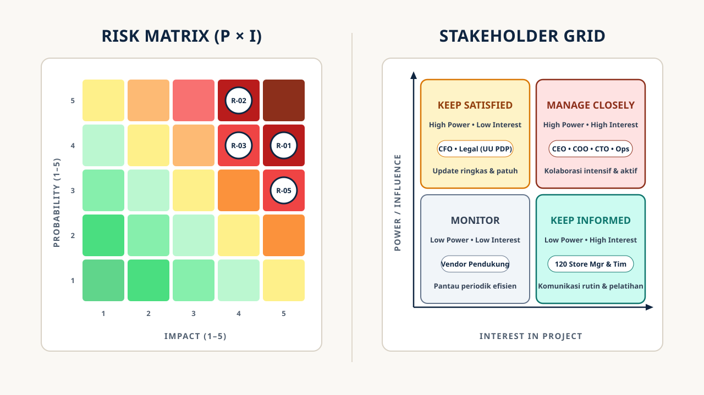
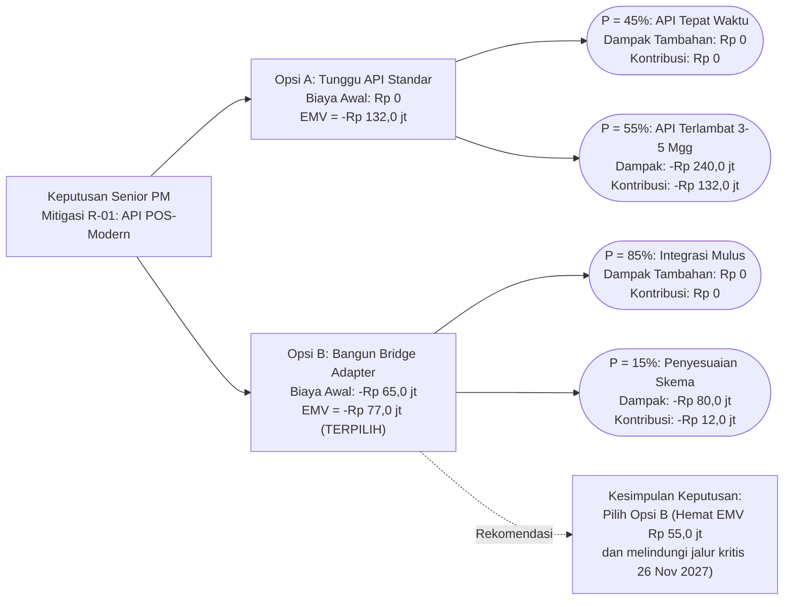
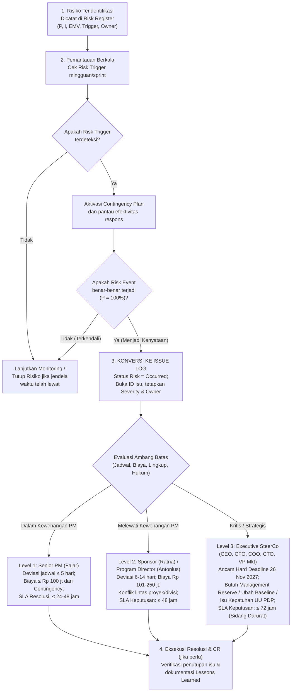
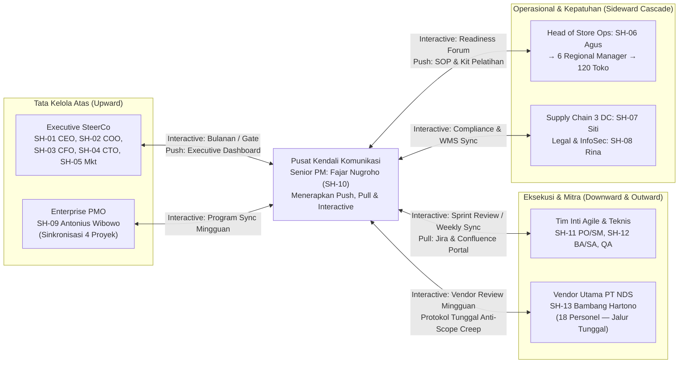
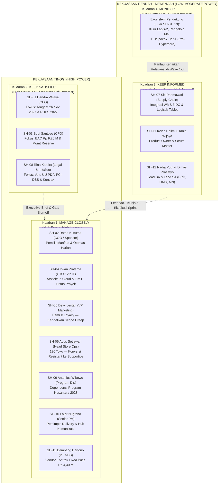

# Modul 03: Risk, Issue & Stakeholder Management

---

## 1. Identitas Modul

| Atribut | Keterangan |
|---------|------------|
| **Kelompok Modul** | Jalur Utama — *Project Management* (Jilid I: *Leadership & Project Delivery*) |
| **Kode & Judul** | Modul 03 — *Risk, Issue & Stakeholder Management* |
| **Tingkat Kedalaman** | **Senior** (berbasis praktik *PMBOK Guide 7th/6th Ed.*, ISO 31000, ISO 21502, dan *PRINCE2*) |
| **Durasi Pembelajaran** | **12 jam sesi tatap muka/daring** (4 sesi × 3 jam) + **±6 jam tugas mandiri** |
| **Prasyarat** | Telah menyelesaikan **Modul 01** (*Advanced Project Management*) dan **Modul 02** (*Project Planning & Execution*), serta membaca [Studi Kasus Utama: Proyek OMNI](00-studi-kasus-utama.md) |
| **Peran Sasaran** | Senior Project Manager, Program Coordinator, PMO Lead, Senior Business Analyst, Delivery Manager, dan Product Owner pada proyek lintas fungsi strategis |
| **Keluaran Utama (*Key Deliverables*)** | 1. *Risk Register* terkalibrasi lengkap dengan perhitungan *Expected Monetary Value* (EMV), *Decision Tree*, dan *Reserve Analysis*<br/>2. *Issue Log* aktif dan *Escalation Matrix* 3 tingkat berbasis *Service Level Agreement* (SLA)<br/>3. *Stakeholder Register*, *Power–Interest Grid*, *Salience Mapping*, dan *Stakeholder Engagement Assessment Matrix* (SEAM)<br/>4. *Communication Management Plan* (matriks 5W+1H) siap pakai pada **Proyek OMNI** |

---

## 2. Gambaran Modul

Pada level pemula hingga menengah, seorang *Project Manager* (PM) umumnya dinilai dari kemampuannya menyusun jadwal, memantau tugas, dan melacak anggaran. Namun, di tingkat **Senior Project Manager**, proyek berskala menengah–besar hampir tidak pernah gagal semata-mata karena salah menghitung rumus *Gantt chart* atau lupa memperbarui *burndown chart*. Mayoritas kegagalan proyek strategis justru bersumber dari tiga area yang saling terkait erat: **ketidakpastian yang tidak dikelola secara kuantitatif (*risk*)**, **masalah nyata yang terlambat dieskalasi (*issue*)**, serta **resistensi manusia, konflik kepentingan politik organisasi, dan miskomunikasi (*stakeholder & communication*)**.

Pada **Proyek OMNI** milik **PT Sinar Nusantara Retail Tbk (SNR)**—proyek *flagship* senilai **Rp 9,20 M** (dengan *Management Reserve* **Rp 0,60 M**, total pendanaan **Rp 9,80 M**) dalam **Program Nusantara 2028**—kompleksitas tersebut tampak nyata sejak hari pertama (*kick-off* 1 Juni 2026 menuju *hard deadline* 26 November 2027). Di sisi teknis dan program, Proyek OMNI bergantung pada rilis API dari proyek paralel **POS-Modern** dan kualitas data 1,2 juta kartu fisik *Sinar Member Card* yang ±62% di antaranya usang atau duplikat. Di sisi manusia dan tata kelola, Fajar Nugroho selaku Senior PM harus menyelaraskan 13 pemangku kepentingan kunci (**SH-01 s.d. SH-13**) dengan agenda yang saling bertabrakan: **Hendra Wijaya (CEO)** menuntut tenggat 26 November 2027 tidak meleset menjelang RUPS 2027; **Budi Santoso (CFO)** menjaga ketat batas anggaran Rp 9,20 M; **Dewi Lestari (VP Marketing)** terus mendorong fitur baru pemicu *scope creep*; **Agus Setiawan (Head of Store Ops)** bersama 120 *Store Manager* mengkhawatirkan lonjakan beban kerja *Click & Collect* dan tergerusnya target penjualan cabang fisik; **Rina Kartika (Legal & InfoSec)** memegang *veto power* atas kepatuhan **UU PDP**; sementara **Bambang Hartono (PT NDS)** sangat sensitif terhadap perubahan lingkup pada kontrak *Fixed Price* Rp 4,40 M.

Modul 03 membekali Anda dengan kerangka kerja, perhitungan matematis, dan taktik kepemimpinan lapangan untuk mengubah ketidakpastian menjadi cadangan terukur, membedakan risiko dari isu secara disiplin, membangun mekanisme eskalasi tanpa drama, serta memetakan dan memengaruhi pemangku kepentingan secara strategis agar proyek tidak hanya selesai tepat waktu, tetapi juga benar-benar diadopsi oleh organisasi.

---

## 3. Capaian Pembelajaran

Setelah menyelesaikan Modul 03 beserta seluruh latihan dan tugas mandirinya, peserta mampu:

1. **Merumuskan dan Mengidentifikasi Risiko Secara Sistematis:** Membedakan *individual project risk* dari *overall project risk* serta ancaman (*threat*) dari peluang (*opportunity*), menyusun pernyataan risiko berstruktur *Cause–Risk Event–Impact*, dan menerapkan teknik identifikasi lintas perspektif (*Risk Breakdown Structure*, SWOT, *Assumption & Constraint Analysis*, *Prompt Lists*, dan *Delphi Technique*).
2. **Melakukan Analisis Risiko Kualitatif dan Kuantitatif Terkalibrasi:** Menilai risiko menggunakan matriks Probabilitas × Dampak 5×5, urgensi, dan kualitas data, lalu menghitung *Expected Monetary Value* (EMV), membangun *Decision Tree Analysis*, menafsirkan analisis sensitivitas dan simulasi Monte Carlo secara konseptual, serta menyusun *Reserve Analysis* untuk menetapkan *Contingency Reserve* dan membedakannya dari *Management Reserve*.
3. **Merancang Strategi Respons Risiko dan Rencana Kontinjensi:** Memilih strategi respons yang tepat untuk ancaman (*Escalate, Avoid, Transfer, Mitigate, Accept*) maupun peluang (*Escalate, Exploit, Share, Enhance, Accept*), serta menetapkan *risk trigger*, *risk owner*, *fallback plan*, *secondary risk*, dan *residual risk*.
4. **Mengelola Transisi Risk-to-Issue dan Tata Kelola Eskalasi:** Memisahkan fungsi *Risk Register* dan *Issue Log*, memicu perpindahan risiko menjadi isu secara tepat waktu, serta menerapkan *Escalation Matrix* 3 tingkat berbasis SLA (Level 1 PM → Level 2 Sponsor/Program Director → Level 3 *Executive Steering Committee*).
5. **Memetakan Pemangku Kepentingan dan Mengelola Resistensi Organisasi:** Menerapkan *Stakeholder Register*, *Power–Interest Grid*, *Salience Model*, *Direction of Influence*, dan *Stakeholder Engagement Assessment Matrix* (SEAM) untuk merancang intervensi terukur dalam menggeser resistensi operasional serta mengendalikan konflik kepentingan lintas divisi.
6. **Menyusun Communication Management Plan yang Efektif:** Menghitung kompleksitas saluran komunikasi dengan rumus $n(n-1)/2$, memilih metode komunikasi (*push, pull, interactive*) secara tepat, dan membangun matriks komunikasi 5W+1H yang menjaga keterlibatan eksekutif, tim inti, vendor, dan operasional tanpa menimbulkan kelelahan informasi (*information overload*).

---

## 4. Rencana Sesi

Modul ini dirancang dalam **4 sesi × 3 jam = 12 jam** dengan komposisi pembelajaran **±30% konsep (±3,5 jam)**, **±50% workshop kasus Proyek OMNI (±6 jam)**, dan **±20% diskusi/refleksi senior (±2,5 jam)**, ditambah **±6 jam tugas mandiri**.

| Sesi | Durasi | Fokus Materi | Komposisi Aktivitas (Konsep / Workshop / Diskusi) | Keluaran Sesi |
|------|--------|--------------|---------------------------------------------------|---------------|
| **Sesi 1** | 3 jam | **Fondasi Risiko, Identifikasi Sistematis & Analisis Kualitatif** | • Konsep (55 mnt): *Individual vs Overall Risk*, *Appetite/Tolerance/Threshold*, *Risk Statement*, RBS, *Prompt Lists*, Delphi, Matriks 5×5.<br/>• Workshop (90 mnt): Audit 10 risiko awal Proyek OMNI (R-01 s.d. R-10), penulisan ulang menjadi kalimat *Cause–Risk Event–Impact*, dan skoring P×I 5×5.<br/>• Diskusi (35 mnt): Menguji bias optimisme tim teknis vs tim bisnis dalam menilai probabilitas. | Draft *Risk Register* kualitatif R-01 s.d. R-10 terstandar |
| **Sesi 2** | 3 jam | **Analisis Risiko Kuantitatif (EMV, Decision Tree, Reserve) & Strategi Respons** | • Konsep (55 mnt): EMV, *Decision Tree*, Tornado/Monte Carlo konseptual, *Contingency vs Management Reserve*, 5 strategi *Threat* & 5 strategi *Opportunity*, *Secondary/Residual Risk*.<br/>• Workshop (90 mnt): Kalibrasi EMV R-01 s.d. R-10 terhadap *Contingency Reserve* Rp 0,70 M, konstruksi *Decision Tree* migrasi data loyalty, dan penetapan *Risk Trigger* & *Risk Owner*.<br/>• Diskusi (35 mnt): Mengapa EMV peluang R-10 tidak boleh dipakai memotong cadangan biaya ancaman. | *Risk Register* kuantitatif terkalibrasi + *Decision Tree* |
| **Sesi 3** | 3 jam | **Risk-to-Issue Transition, Issue Log & Escalation Governance** | • Konsep (50 mnt): *Risk Register vs Issue Log*, pemicu konversi, *workaround vs fallback plan*, *Escalation Matrix* 3 tingkat & SLA, anatomi Memo Eskalasi Eksekutif (*BLUF*).<br/>• Workshop (95 mnt): Simulasi krisis Bulan ke-9 Proyek OMNI (28 Feb 2027) — membangun *Issue Log* IS-01 s.d. IS-04 dan menulis Memo Eskalasi ke SteerCo untuk delay API POS-Modern.<br/>• Diskusi (35 mnt): Simulasi peran (*role-play*) eskalasi antara PM, Program Director, CTO, dan CFO tanpa menciptakan budaya saling menyalahkan (*blame culture*). | *Issue Log* Bulan ke-9, *Escalation Matrix* & Memo Eskalasi |
| **Sesi 4** | 3 jam | **Stakeholder Mapping, Manajemen Resistensi & Communication Plan** | • Konsep (50 mnt): *Power–Interest Grid*, *Salience Model*, *Direction of Influence*, SEAM (C vs D), taktik menangani resistensi & *scope creep*, rumus $n(n-1)/2$, *Push/Pull/Interactive*, matriks 5W+1H.<br/>• Workshop (95 mnt): Pemetaan 13 stakeholder Proyek OMNI (SH-01 s.d. SH-13), rencana konversi Agus Setiawan (*Resistant → Supportive*), protokol pengendalian Dewi Lestari, dan penyusunan *Communication Management Plan*.<br/>• Diskusi & Refleksi (35 mnt): Bedah *anti-patterns* di lapangan, *peer review* rencana komunikasi, dan pengarahan tugas mandiri ±6 jam. | Peta Stakeholder lengkap, SEAM, & *Communication Plan* Proyek OMNI |

---

## 5. Materi



### 5.1 Konsep Dasar Risiko, Selera Risiko, dan *Risk Statement*

Menurut standar **PMI (*PMBOK Guide*)** dan **ISO 31000**, **risiko (*risk*)** adalah *peristiwa atau kondisi tidak pasti yang, apabila terjadi, menimbulkan dampak positif atau negatif terhadap satu atau lebih sasaran proyek* (lingkup, jadwal, biaya, mutu, kepatuhan, atau manfaat bisnis). Definisi ini menuntut Senior PM meninggalkan pemahaman sempit bahwa risiko selalu berarti bahaya.

#### A. *Individual Project Risk* vs *Overall Project Risk*

Senior PM wajib mengelola risiko pada dua tingkatan sekaligus:

1. **Individual Project Risk (Risiko Proyek Individual):** Peristiwa atau kondisi tidak pasti yang spesifik dan terlokalisasi, yang jika terjadi memengaruhi satu atau beberapa sasaran proyek. Contoh di Proyek OMNI: keterlambatan rilis API dari proyek paralel POS-Modern (**R-01**) atau kegagalan *Penetration Testing* (**R-05**). Risiko jenis ini dicatat baris demi baris dalam *Risk Register*.
2. **Overall Project Risk (Risiko Proyek Keseluruhan):** Efek gabungan dari seluruh ketidakpastian pada proyek—termasuk risiko individual, kompleksitas arsitektur, tingkat kematangan organisasi, dan dinamika lingkungan bisnis—terhadap variasi hasil keseluruhan proyek. Contoh di Proyek OMNI: kombinasi tenggat mutlak 26 November 2027, ketergantungan pada 3 proyek paralel lain dalam Program Nusantara 2028, pendekatan *hybrid*, serta adopsi di 120 toko menciptakan tingkat eksposur proyek keseluruhan yang tinggi. *Overall project risk* tidak cukup ditangani dengan mitigasi per baris, melainkan membutuhkan keputusan struktural tingkat sponsor/program seperti pemecahan fase rilis, penetapan *Stage-Gate*, *Management Reserve*, atau perubahan struktur kontrak.

#### B. *Threat* (Ancaman) vs *Opportunity* (Peluang)

- **Threat (Risiko Negatif / Ancaman):** Ketidakpastian yang apabila terjadi akan merugikan sasaran proyek—memperpanjang jadwal, membengkakkan biaya, menurunkan mutu, atau memicu sanksi kepatuhan (misalnya R-01 s.d. R-09).
- **Opportunity (Risiko Positif / Peluang):** Ketidakpastian yang apabila terwujud akan mempercepat jadwal, menghemat biaya, meningkatkan mutu, atau menambah manfaat bisnis (misalnya **R-10**: keberhasilan pilot 10 toko lebih awal membuka kanal *pre-order* anggota Platinum sebelum Harbolnas).

#### C. *Risk Appetite*, *Risk Tolerance*, dan *Risk Threshold*

Keputusan apakah sebuah risiko perlu dimitigasi mati-matian atau cukup diterima bergantung pada tiga parameter sikap organisasi terhadap risiko:

| Istilah | Definisi Konseptual | Contoh Konkret pada PT SNR (Proyek OMNI) |
|---------|---------------------|-------------------------------------------|
| **Risk Appetite** *(Selera Risiko)* | Tingkat ketidakpastian yang **bersedia diterima** suatu organisasi secara umum dalam rangka mengejar imbal hasil atau nilai strategis. Bersifat kualitatif dan strategis. | Direksi SNR memiliki *risk appetite* **moderat** untuk inovasi fitur aplikasi mobile, tetapi **sangat rendah (*risk-averse*)** terhadap kepatuhan hukum (UU PDP, PCI-DSS) dan gangguan operasional toko fisik. |
| **Risk Tolerance** *(Toleransi Risiko)* | Rentang deviasi maksimum yang **masih dapat ditoleransi** organisasi di atas atau di bawah sasaran baseline sebelum intervensi eksekutif diwajibkan. Bersifat terukur. | Deviasi biaya akhir yang masih ditoleransi Direksi adalah **±5%** dari BAC Rp 9,20 M (maksimal Rp 9,66 M); toleransi keterlambatan dari *hard deadline* 26 Nov 2027 adalah **0 hari** (nol toleransi). |
| **Risk Threshold** *(Ambang Batas Risiko)* | Titik batas numerik atau kondisi spesifik yang **memicu tindakan manajemen atau eskalasi otomatis** ketika terlewati. | Jika SPI turun di bawah **0,92**, CPI di bawah **0,95**, atau temuan keamanan kategori *High/Critical* > **0**, Senior PM wajib melakukan eskalasi formal ke Sponsor/SteerCo dalam 48 jam. |

#### D. Format Pernyataan Risiko: *Cause – Risk Event – Impact*

Kesalahan paling umum dalam *Risk Register* pemula adalah menulis risiko secara kabur seperti *"Data jelek"* atau *"Vendor terlambat"*. Pernyataan semacam itu tidak bisa dimitigasi karena tidak membedakan **fakta saat ini (penyebab)**, **peristiwa tidak pasti (risiko)**, dan **akibat bisnisnya (dampak)**. Standar Senior PM mensyaratkan struktur **metalinguistik tiga bagian**:

> **"Karena [*Cause* — fakta/kondisi yang sudah ada saat ini], terdapat risiko bahwa [*Risk Event* — peristiwa tidak pasti yang mungkin terjadi], sehingga jika terjadi maka [*Impact* — dampak terukur pada sasaran proyek]."**

Atau dalam bentuk ringkas operasional **"Jika… karena…, maka…"**:

- **Buruk (Kabur):** *"Kualitas data member buruk."* *(Ini bukan risiko; 62% data usang sudah menjadi fakta!)*
- **Baik (Standar Senior PM — R-02):** *"Karena ±62% dari 1,2 juta data kartu fisik Sinar Member Card di sistem lama bersifat duplikat atau memiliki kontak usang (**Cause**), terdapat risiko bahwa proses pembersihan dan migrasi data ke Digital Loyalty Engine gagal mencapai tingkat kebersihan minimum pada Sprint 10 (**Risk Event**), sehingga mengakibatkan mundurnya Release 2 selama 3–4 minggu, tambahan biaya pembersihan data sebesar Rp 210 jt, dan penurunan kepuasan pelanggan lama (**Impact**)."*

---

### 5.2 Identifikasi Risiko Sistematis

Identifikasi risiko bersifat **iteratif** sepanjang siklus hidup proyek, bukan rapat satu kali saat *kick-off*. Senior PM memadukan minimal lima teknik agar tidak ada titik buta (*blind spots*):

1. **Risk Breakdown Structure (RBS):** Pengelompokan hierarkis sumber risiko (mirip struktur WBS) yang berfungsi sebagai daftar periksa menyeluruh. Contoh RBS Level 1–2 untuk Proyek OMNI:
   - **1. Teknis & Data:** Arsitektur integrasi API, kualitas migrasi data *legacy*, kinerja beban puncak (2.500 TPM), keamanan siber.
   - **2. Manajemen & Tata Kelola:** *Scope creep*, kesalahan estimasi *hybrid*, mekanisme persetujuan CCB, kualitas pelaporan.
   - **3. Komersial & Pengadaan:** Sengketa kontrak *Fixed Price* PT NDS, SLA *Payment Gateway*, keterlambatan logistik 240 tablet ke luar Jawa.
   - **4. Organisasi & Sumber Daya:** Resistensi 120 toko, *turnover* tenaga ahli vendor/internal, perebutan sumber daya antar 4 proyek Program Nusantara 2028.
   - **5. Eksternal & Regulasi:** Ketergantungan proyek paralel POS-Modern/ERP-Refresh, kepatuhan UU PDP & PCI-DSS, lonjakan trafik musiman Harbolnas.
2. **Analisis SWOT (*Strengths, Weaknesses, Opportunities, Threats*):** Menelaah kelemahan internal organisasi untuk menemukan ancaman (*weaknesses → threats*, mis. belum adanya pengalaman *Click & Collect* memicu risiko R-03) dan kekuatan internal untuk menggali peluang (*strengths → opportunities*, mis. kekuatan basis 1,2 juta anggota dan jaringan 120 toko membuka peluang R-10 *pre-order* Platinum).
3. **Assumption & Constraint Analysis (Analisis Asumsi dan Batasan):** Setiap asumsi perencanaan yang belum terbukti adalah benih risiko! Contoh: asumsi bahwa *"API POS-Modern selesai di Bulan ke-7"* langsung melahirkan risiko **R-01** jika asumsi itu meleset; batasan (*constraint*) *"kontrak Fixed Price Rp 4,40 M tanpa fleksibilitas lingkup"* langsung melahirkan risiko sengketa komersial **R-08**.
4. **Prompt Lists (*PESTLE* & *TECOP*):** Daftar pemantik terstruktur untuk memaksa tim melihat di luar masalah teknis harian:
   - **PESTLE:** *Political, Economic, Social, Technological, Legal, Environmental*.
   - **TECOP:** *Technical, Environmental, Commercial, Operational, Political*.
   Penggunaan *Legal* dalam PESTLE langsung menyorot **R-05 (UU PDP)**, sementara *Political/Operational* dalam TECOP menyorot **R-03 (resistensi Store Ops)** dan **R-04 (agenda Marketing)**.
5. **Delphi Technique:** Teknik pengumpulan pendapat pakar secara **anonim dan berulang (2–3 putaran)** melalui fasilitator tanpa tatap muka langsung. Teknik ini sangat krusial di perusahaan hierarkis untuk mencegah *HiPPO effect* (*Highest Paid Person's Opinion*) atau dominasi eksekutif tertentu. Misalnya, melalui Delphi anonim, *Store Manager* senior dan *Lead Engineer* PT NDS berani mengungkap potensi kegagalan migrasi data dan resistensi toko secara jujur tanpa takut dianggap pesimis di hadapan Direktur.

---

### 5.3 Analisis Risiko Kualitatif dan Kuantitatif (EMV, *Decision Tree*, dan *Reserve Analysis*)

Setelah risiko diidentifikasi, tidak semua risiko layak mendapat perhatian dan dana yang sama. Senior PM melakukan penyaringan bertahap: **Analisis Kualitatif** untuk prioritisasi cepat, dilanjutkan **Analisis Kuantitatif** untuk risiko prioritas tinggi guna menghitung kebutuhan cadangan finansial secara objektif.

#### A. Analisis Risiko Kualitatif

Tiga pilar analisis kualitatif tingkat senior:

1. **Matriks Probabilitas × Dampak (5×5):** Mengalikan skor Probabilitas ($P$, skala 1–5) dengan skor Dampak ($I$, skala 1–5) untuk menghasilkan **Skor Risiko (1–25)**. Agar tidak subjektif, definisi tiap angka skala **wajib ditetapkan di awal proyek** dan selaras dengan *Risk Tolerance* organisasi.

| Skala | Probabilitas ($P$) | Dampak Biaya (Relatif ke BAC Rp 9,20 M) | Dampak Jadwal (Jalur Kritis) | Dampak Mutu / Kepatuhan / Operasi |
|-------|--------------------|-----------------------------------------|------------------------------|-----------------------------------|
| **1 — Sangat Rendah** | ≤ 10% | < Rp 50 jt (< 0,5% BAC) | < 1 minggu | Gangguan minor, mudah diperbaiki |
| **2 — Rendah** | 11%–30% | Rp 50 jt – Rp 100 jt (0,5%–1,1%) | 1–2 minggu | Penurunan kecil di area non-inti |
| **3 — Sedang** | 31%–50% | Rp 101 jt – Rp 200 jt (1,1%–2,2%) | 2–4 minggu | Butuh persetujuan Sponsor; penurunan adopsi lokal |
| **4 — Tinggi** | 51%–70% | Rp 201 jt – Rp 350 jt (2,2%–3,8%) | 4–8 minggu | Mengancam milestone utama / target bisnis kunci |
| **5 — Sangat Tinggi** | > 70% | > Rp 350 jt (> 3,8% BAC) | > 8 minggu atau melewati *hard deadline* | Pelanggaran UU PDP/PCI-DSS, *veto Go-Live*, kegagalan sistem |

**Pemetaan Zona Skor Matriks 5×5:**

| Probabilitas \ Dampak | **1** (Sangat Rendah) | **2** (Rendah) | **3** (Sedang) | **4** (Tinggi) | **5** (Sangat Tinggi) |
|-----------------------|:---------------------:|:--------------:|:--------------:|:--------------:|:---------------------:|
| **5 (> 70%)** | 5 (Sedang) | 10 (Tinggi) | 15 (Kritis) | 20 (Kritis) | 25 (Kritis) |
| **4 (51%–70%)** | 4 (Rendah) | 8 (Sedang) | 12 (Tinggi) | 16 (Kritis) | 20 (Kritis) |
| **3 (31%–50%)** | 3 (Rendah) | 6 (Sedang) | 9 (Sedang) | 12 (Tinggi) | 15 (Kritis) |
| **2 (11%–30%)** | 2 (Rendah) | 4 (Rendah) | 6 (Sedang) | 8 (Sedang) | 10 (Tinggi) |
| **1 (≤ 10%)** | 1 (Rendah) | 2 (Rendah) | 3 (Rendah) | 4 (Rendah) | 5 (Sedang) |

- **Zona Kritis (Skor 15–25):** Wajib respons proaktif segera, rencana kontinjensi terdanai, pemantauan mingguan, visibilitas langsung ke Sponsor/SteerCo.
- **Zona Tinggi (Skor 10–14):** Wajib rencana respons aktif, penetapan *trigger* & *risk owner*, pemantauan dua mingguan (*bi-weekly*).
- **Zona Sedang (Skor 5–9):** Rencana mitigasi terukur sesuai kapasitas tim, pemantauan bulanan.
- **Zona Rendah (Skor 1–4):** Ditempatkan dalam *Watchlist*, dipantau berkala per fase/milestone.

2. **Risk Urgency & Proximity (Urgensi dan Kedekatan Waktu):** Dua risiko dengan skor sama (misal sama-sama 12) tidak selalu memiliki prioritas eksekusi yang sama. Jika R-04 (*scope creep* Marketing) sudah mengancam sejak Sprint 3, sementara R-09 (pengiriman tablet) baru terjadi menjelang Wave Rollout Bulan ke-13, maka R-04 memiliki **urgensi lebih tinggi** dan wajib ditangani lebih dulu. Parameter tambahan yang sering dinilai pada level senior adalah **Detectability** (seberapa mudah tanda awal risiko terdeteksi) dan **Manageability** (seberapa besar kendali tim atas risiko tersebut).
3. **Risk Data Quality Assessment (Penilaian Kualitas Data Risiko):** Evaluasi apakah estimasi probabilitas dan dampak dibangun di atas data historis/pengujian nyata (kualitas tinggi) atau sekadar tebakan rapat (kualitas rendah). Apabila kualitas data rendah (misalnya sebelum audit sampel data *Sinar Member Card*), tindakan pertama bukan menetapkan angka palsu, melainkan melakukan *spike* atau audit cepat untuk meningkatkan kualitas data.

#### B. Analisis Risiko Kuantitatif

Analisis kuantitatif menerjemahkan eksposur risiko ke dalam satuan uang (Rp) atau waktu (hari/minggu) untuk mendukung keputusan investasi mitigasi dan penyusunan cadangan anggaran.

##### 1. *Expected Monetary Value* (EMV)

EMV adalah nilai rata-rata tertimbang dampak finansial suatu risiko apabila skenario serupa diulang berkali-kali:

$$\text{EMV} = P \times I$$

Di mana:
- $P$ = Probabilitas terjadinya risiko (desimal $0 \le P \le 1$)
- $I$ = Dampak finansial jika risiko terjadi (**negatif** untuk ancaman/*threat*, **positif** untuk peluang/*opportunity*)

**Contoh:** Pada risiko **R-01** (keterlambatan API POS-Modern), probabilitas $P = 0,55$ (55%) dan estimasi biaya percepatan/dampak $I = -\text{Rp } 240\text{ jt}$. Maka:

$$\text{EMV}_{\text{R-01}} = 0,55 \times (-\text{Rp } 240\text{ jt}) = -\text{Rp } 132,0\text{ jt}$$

##### 2. *Decision Tree Analysis* (Analisis Pohon Keputusan)

Ketika Senior PM harus memilih di antara dua atau lebih opsi strategi yang memiliki biaya awal berbeda dan hasil tidak pasti, **Decision Tree** menghitung EMV bersih masing-masing jalur dari kanan ke kiri (*rollback*).

**Contoh Terapan Proyek OMNI — Pilihan Mitigasi Risiko R-01 (API POS-Modern):**
- **Opsi A (Tunggu Rilis API Standar — Biaya Awal Rp 0):** Peluang API tepat waktu 45% (dampak Rp 0); peluang terlambat 3–5 minggu 55% (biaya lembur & percepatan −Rp 240 jt).
  $$\text{EMV}(\text{Opsi A}) = 0 + [0,45 \times 0 + 0,55 \times (-240)] = -\text{Rp } 132,0\text{ jt}$$
- **Opsi B (Bangun *Mock/Bridge Adapter* Paralel Lebih Awal — Biaya Awal −Rp 65 jt):** Peluang integrasi mulus tanpa mengganggu jalur kritis 85% (dampak tambahan Rp 0); peluang tetap butuh penyesuaian skema saat API final rilis 15% (biaya penyesuaian −Rp 80 jt).
  $$\text{EMV}(\text{Opsi B}) = -65 + [0,85 \times 0 + 0,15 \times (-80)] = -65 - 12 = -\text{Rp } 77,0\text{ jt}$$



Dengan berinvestasi Rp 65,0 jt di muka, Opsi B memangkas eksposur kerugian rata-rata dari −Rp 132,0 jt menjadi −Rp 77,0 jt (**penghematan EMV bersih Rp 55,0 jt**) sekaligus melindungi jalur kritis menuju 26 November 2027.

##### 3. Analisis Sensitivitas (*Tornado Diagram*) & Simulasi Monte Carlo (Konseptual)

- **Sensitivity Analysis (*Tornado Diagram*):** Menguji satu variabel risiko pada satu waktu (sambil menjaga variabel lain konstan) untuk mengetahui risiko mana yang paling dominan menggoyang total biaya atau jadwal proyek. Risiko dengan rentang dampak terlebar ditempatkan di puncak diagram sehingga bentuk batangnya menyerupai corong tornado. Pada Proyek OMNI, analisis sensitivitas menempatkan **R-01 (API POS-Modern)**, **R-02 (Migrasi Data Loyalty)**, dan **R-05 (Kepatuhan UU PDP)** di tiga posisi teratas penggerak ketidakpastian jadwal dan biaya.
- **Monte Carlo Simulation:** Menggunakan komputer untuk menjalankan ribuan iterasi acak (misalnya 10.000 simulasi) berdasarkan distribusi probabilitas (segitiga/PERT: *optimistic, most likely, pessimistic*) pada seluruh aktivitas jadwal dan item biaya sekaligus. Keluarannya berupa kurva probabilitas kumulatif (*S-curve*), misalnya: *"Terdapat probabilitas 50% (P50) Proyek OMNI selesai dengan biaya ≤ Rp 8,90 M, dan probabilitas 80% (P80) selesai dengan biaya ≤ Rp 9,20 M."* Nilai selisih antara P80 (tingkat kepercayaan yang disyaratkan Direksi) dan estimasi dasar tanpa cadangan (Rp 8,50 M) adalah justifikasi ilmiah bagi **Contingency Reserve Rp 0,70 M**.

##### 4. *Reserve Analysis*: *Contingency Reserve* vs *Management Reserve*

Senior PM wajib menjaga pemisahan ketat dua lapis cadangan dana berikut agar tidak melanggar tata kelola keuangan perusahaan:

| Dimensi | Contingency Reserve (*CB-06* Proyek OMNI) | Management Reserve (Di Luar BAC) |
|---------|-------------------------------------------|----------------------------------|
| **Target Ketidakpastian** | ***Known-Unknowns*** — risiko yang **sudah teridentifikasi** di *Risk Register*, namun kepastian terjadinya dan besaran pastinya belum diketahui. | ***Unknown-Unknowns*** — peristiwa **tak terduga** di luar cakupan *Risk Register* (mis. aturan baru pemerintah, krisis pasokan global, kebangkrutan sub-vendor mendadak). |
| **Besaran pada Proyek OMNI** | **Rp 0,70 M (Rp 700 jt)** — terkalibrasi dari total EMV ancaman R-01 s.d. R-09 (~7,6% dari BAC). | **Rp 0,60 M (Rp 600 jt)** — ditetapkan kebijakan korporasi (~6,5% dari BAC). |
| **Posisi terhadap *Cost Baseline* (BAC)** | **Termasuk di dalam BAC** (Rp 8,50 M biaya dasar + Rp 0,70 M = **BAC Rp 9,20 M**). Masuk perhitungan EVM. | **Di luar BAC**, tetapi masuk **Total Project Funding Requirement** (Rp 9,20 M + Rp 0,60 M = **Rp 9,80 M**). Tidak masuk BAC sampai resmi dicairkan. |
| **Otoritas Pencairan** | **Senior PM (Fajar Nugroho)** hingga batas delegasi (mis. ≤ Rp 100 jt per insiden), dan **Project Sponsor (Ratna Kusuma)** untuk nilai di atasnya, tanpa mengubah BAC. | **CFO (Budi Santoso) & Executive Steering Committee** melalui **Formal Change Request** yang disetujui CCB. Saat dicairkan, dana berpindah ke *Cost Baseline* sehingga BAC baru meningkat. |

---

### 5.4 Strategi Respons Risiko, *Secondary/Residual Risk*, dan *Risk Trigger*

Mengidentifikasi dan menghitung risiko tidak ada gunanya jika tidak diterjemahkan menjadi tindakan nyata yang memiliki pemilik (*Risk Owner*) dan pemicu (*Risk Trigger*). PMBOK membedakan 5 strategi untuk **Ancaman (*Threat*)** dan 5 strategi untuk **Peluang (*Opportunity*)**:

#### A. Lima Strategi Respons Ancaman (*Threat*)

| Strategi | Prinsip Kerja | Contoh Penerapan pada Proyek OMNI |
|----------|---------------|-----------------------------------|
| **1. Escalate** *(Eskalasi)* | Risiko berada di luar kewenangan atau batas lingkup proyek; dialihkan ke tingkat Program, Sponsor, atau Direksi. Setelah diterima pihak atas, risiko tidak lagi dikelola aktif oleh PM di proyek. | Jika keterlambatan proyek POS-Modern disebabkan sengketa kontrak korporasi antara CFO SNR dan vendor POS di luar Proyek OMNI, Fajar mengeskalasikan risiko kepemilikan jadwal lintas-program ini kepada **Antonius Wibowo (Program Director)** dan **SteerCo**. |
| **2. Avoid** *(Hindari)* | Mengubah rencana proyek untuk **menghilangkan sepenuhnya** ancaman atau melindungi sasaran dari dampaknya (menurunkan $P \to 0\%$ atau menghilangkan paparan). | Menghilangkan risiko keterlambatan *Go-Live* akibat fitur gamifikasi rumit (**R-04**) dengan secara tegas menetapkan gamifikasi dan integrasi *marketplace* sebagai **Out-of-Scope** Fase 1 di Project Charter & Scope Baseline. |
| **3. Transfer** *(Alihkan)* | Memindahkan dampak finansial ancaman kepada pihak ketiga yang lebih mampu menanggungnya (via kontrak *Fixed Price*, klausul penalti SLA, garansi, atau asuransi), biasanya dengan membayar premi. *(Catatan: risiko tidak hilang, hanya berpindah tanggungan finansialnya!)* | Klausul *Service Level Agreement* dan denda keterlambatan (*liquidated damages*) pada kontrak *Fixed Price* PT NDS, kewajiban kepatuhan PCI-DSS dialihkan ke *Payment Gateway* **PT FinPay Nusantara**, serta asuransi pengiriman logistik 240 unit tablet ke luar Jawa (**R-09**). |
| **4. Mitigate** *(Mitigasi)* | Mengambil tindakan proaktif lebih awal untuk **menurunkan probabilitas** terjadinya ancaman dan/atau **memperkecil dampaknya** hingga batas yang dapat diterima. | Membangun *Bridge Adapter* paralel untuk **R-01**, menjalankan *data profiling* & pembersihan awal untuk **R-02**, menyusun skema insentif *omnichannel sales credit* & *change champions* untuk **R-03**, serta melakukan *load test* dini sejak Sprint 9 untuk **R-06**. |
| **5. Accept** *(Terima)* | Menyadari keberadaan risiko tanpa mengubah rencana proyek dasar karena biaya mitigasi melebihi manfaatnya.<br/>• **Active Accept:** Menyisihkan cadangan dana/waktu (*Contingency Reserve* / *buffer*) dan menyiapkan *Fallback Plan*.<br/>• **Passive Accept:** Tidak melakukan persiapan khusus; cukup dicatat dan ditangani dengan *workaround* bila terjadi. | **Active Accept:** Menyediakan dana cadangan Rp 24 jt dan buffer waktu 5 hari untuk penyesuaian pengiriman minor tablet di wilayah timur (**R-09**).<br/>**Passive Accept:** Risiko gangguan cuaca lokal 1 hari saat sesi pelatihan tatap muka di satu cabang kota kecil. |

#### B. Lima Strategi Respons Peluang (*Opportunity*)

| Strategi | Prinsip Kerja | Contoh Penerapan pada Proyek OMNI |
|----------|---------------|-----------------------------------|
| **1. Escalate** *(Eskalasi)* | Peluang melampaui batas proyek dan memberi nilai di tingkat program/portofolio; diserahkan ke pimpinan program/eksekutif. | Jika pola data perilaku *Click & Collect* berpotensi dimonetisasi untuk analitik AI lintas-perusahaan, peluang ini dieskalasikan ke Program Director untuk dimasukkan ke cakupan **Proyek DataHub (PRJ-04)**. |
| **2. Exploit** *(Eksploitasi)* | Mengambil tindakan tegas agar peluang **pasti terjadi** ($P \to 100\%$). | Menugaskan tim khusus integrasi promosi agar fitur *pre-order* anggota Platinum (**R-10**) dipastikan siap digunakan segera setelah Pilot 10 toko lulus kriteria M6. |
| **3. Share** *(Bagi)* | Mengalokasikan sebagian atau seluruh kepemilikan peluang kepada pihak ketiga yang paling mampu menangkap manfaatnya (kemitraan, *joint venture*, insentif bersama). | Bekerja sama dengan **PT FinPay Nusantara** (mitra *Payment Gateway*) untuk program *co-funded cashback* khusus transaksi perdana aplikasi OMNI bagi anggota Platinum. |
| **4. Enhance** *(Tingkatkan)* | Meningkatkan probabilitas dan/atau memperbesar dampak positif peluang dengan memperkuat pemicu utamanya. | Melakukan pelatihan dini bagi 10 *Store Manager* Pilot dan *early onboarding* 50.000 pelanggan Platinum teraktif agar peluang keberhasilan pilot lebih awal (**R-10**) meningkat dari 35% menjadi > 60%. |
| **5. Accept** *(Terima)* | Memanfaatkan peluang apabila terjadi secara alami tanpa mengalokasikan upaya/biaya proaktif khusus. | Memanfaatkan lonjakan organik unduhan aplikasi apabila kampanye media sosial rutin tim Marketing kebetulan menjadi viral. |

#### C. Konsep Pendukung Krusial: *Secondary Risk*, *Residual Risk*, *Fallback Plan*, *Workaround*, dan *Risk Trigger*

- **Residual Risk (Risiko Residu / Sisa):** Risiko yang **tetap tersisa** setelah rencana respons utama dijalankan. Contoh: meski kita membangun *Bridge Adapter* untuk R-01, masih tersisa probabilitas 15% perlunya penyesuaian skema saat API final rilis. Risiko sisa inilah yang ditutup oleh *Contingency Reserve*.
- **Secondary Risk (Risiko Sekunder):** Risiko **baru** yang muncul justru sebagai efek samping dari tindakan respons kita. Contoh: saat kita menerapkan *Lazy Migration* via OTP untuk memitigasi R-02, muncul *secondary risk* berupa lonjakan keluhan pelanggan lama yang nomor ponselnya sudah tidak aktif sehingga membanjiri *Contact Center*.
- **Risk Trigger (Pemicu Risiko / *Early Warning Indicator*):** Tanda atau gejala terukur yang menandakan bahwa suatu risiko hampir terjadi atau baru saja terjadi, sehingga *Risk Owner* harus segera mengeksekusi rencana kontinjensi. Contoh: *"Deviasi jadwal API POS-Modern melebihi 5 hari kerja pada laporan sinkronisasi program mingguan."*
- **Contingency Plan vs Fallback Plan:** *Contingency Plan* (Rencana Kontinjensi) dijalankan ketika *Risk Trigger* terdeteksi. **Fallback Plan** (Rencana Cadangan Lapis Kedua) adalah rencana darurat yang dijalankan apabila *Contingency Plan* utama ternyata tidak efektif atau gagal meredam dampak.
- **Workaround (Solusi Darurat Tak Terencana):** Respons spontan yang dirancang di tempat untuk mengatasi risiko yang sebelumnya **tidak teridentifikasi** (*unknown-unknown*) atau yang diterima secara pasif (*Passive Accept*) ketika kejadiannya sudah menimpa proyek.

---

### 5.5 *Risk Register* vs *Issue Log* serta *Escalation Matrix & Governance*

Salah satu indikator paling jelas yang membedakan PM junior dan Senior PM adalah disiplin membedakan **Risiko (*Risk*)** dari **Isu (*Issue*)**.

| Dimensi Pembeda | Risk Register (Daftar Risiko) | Issue Log (Catatan Isu) |
|-----------------|-------------------------------|-------------------------|
| **Orientasi Waktu** | **Masa depan** (*mungkin* terjadi; $0\% < P < 100\%$). | **Saat ini** (*sudah* terjadi atau sedang berlangsung; $P = 100\%$). |
| **Sifat Dampak** | Dapat berupa ancaman (**negatif**) maupun peluang (**positif**). | Hampir selalu **negatif** berupa hambatan, konflik, deviasi, atau kegagalan yang menuntut resolusi segera. |
| **Fokus Pengelolaan** | Pencegahan proaktif (*mitigate/avoid*), kesiapan *trigger*, dan alokasi cadangan (*reserve*). | Pemecahan masalah segera (*problem solving*), pengendalian dampak (*damage control*), dan akuntabilitas tindakan korektif. |
| **Pemilik (*Owner*)** | *Risk Owner* (memantau *trigger*) & *Risk Action Owner* (mengeksekusi mitigasi). | *Issue Owner* (bertanggung jawab menuntaskan masalah sesuai tenggat/SLA). |
| **Contoh di Proyek OMNI** | **R-01 (Bulan ke-2):** *Ada kemungkinan 55% API POS-Modern mundur sehingga mengancam integrasi stok.* | **IS-02 (Bulan ke-9):** *API POS-Modern resmi mundur 3 minggu sejak 15 Feb 2027 dan menghambat integrasi Sprint 11.* |

#### Kapan Risiko Berubah Menjadi Isu?

Risiko berpindah dari *Risk Register* ke *Issue Log* tepat pada saat **peristiwa risiko (*Risk Event*) terkonfirmasi telah terjadi ($P = 100\%$)** atau berdampak langsung pada pekerjaan berjalan. Pada saat transisi ini, Senior PM menjalankan empat langkah baku:
1. Mengubah status baris pada *Risk Register* menjadi **Occurred / Realized (Dialihkan ke Issue Log)** dan mencatat referensi ID isu (misal `R-01 → IS-02`).
2. Membuka entri baru pada *Issue Log* dengan deskripsi dampak faktual, tingkat keparahan (*Severity*), *Issue Owner*, rencana aksi korektif (*Action Plan*), dan batas waktu (*Target Resolution Date*).
3. Mengaktifkan *Contingency Plan* / pencairan *Contingency Reserve* (atau *Change Request* jika membutuhkan *Management Reserve* / perubahan baseline).
4. Mengevaluasi apakah isu menembus ambang batas (*threshold*) wewenang PM; jika ya, segera menjalankan **Escalation Matrix** sesuai SLA.



#### Prinsip Emas Eskalasi Senior PM (*Escalation Without Drama*)

Eskalasi **bukan tanda kelemahan** seorang PM; menyembunyikan masalah hingga terlambat diperbaiki (*watermelon reporting* — tampak hijau di luar, merah di dalam) itulah kegagalan fatal Senior PM. Agar eskalasi dihormati eksekutif:
1. **Jangan pernah mengeskalasi masalah kosong** — selalu hadirkan fakta terukur, akar penyebab, minimal 2 opsi solusi (beserta dampak biaya/jadwal/risiko masing-masing), dan 1 rekomendasi tegas (*options & recommendation*).
2. **Terapkan asas *No Surprises*** — informasikan Sponsor (Ratna Kusuma) secara informal terlebih dahulu sebelum isu merah muncul di forum SteerCo bersama CEO dan CFO.
3. **Eskalasi berbasis SLA dan ambang batas objektif** — sehingga pihak yang dieskalasi melihatnya sebagai mekanisme tata kelola proyek yang profesional, bukan serangan personal.

---

### 5.6 Manajemen Pemangku Kepentingan (*Stakeholder Management*) Tingkat Senior

**Pemangku kepentingan (*stakeholder*)** adalah setiap individu, kelompok, atau organisasi yang dapat **memengaruhi**, **terpengaruh oleh**, atau **merasa dirinya terpengaruh** oleh keputusan, aktivitas, atau hasil proyek. Frasa *"merasa dirinya terpengaruh"* amat penting: walau secara objektif *Click & Collect* justru mendatangkan lebih banyak pengunjung ke toko fisik, selama 120 *Store Manager* *merasa* fitur tersebut akan menggerus komisi mereka, persepsi itu adalah realitas politik yang wajib dikelola!

#### A. *Stakeholder Identification* & *Stakeholder Register*

Identifikasi pemangku kepentingan dilakukan sejak penyusunan *Project Charter* dan diperbarui setiap perpindahan fase atau pergantian pejabat. Semua data dirangkum dalam **Stakeholder Register** yang mencakup:
- **Informasi Identifikasi:** Kode, nama, jabatan, unit/organisasi, peran proyek, kontak.
- **Informasi Penilaian:** Kepentingan utama, ekspektasi kunci, tingkat kekuasaan (*Power*), tingkat minat (*Interest*), *Salience*, arah pengaruh (*Direction of Influence*), dan posisi dukungan saat ini vs target.
- **Klasifikasi:** Internal vs Eksternal, Pendukung (*Supporter*) vs Netral (*Neutral*) vs Penentang (*Resistor*).

*(Catatan Kerahasiaan: Penilaian sensitif seperti "resisten" atau "sumber scope creep" disimpan di dokumen kerja internal PM/Sponsor, **tidak** disebarluaskan secara terbuka ke seluruh peserta rapat proyek!)*

#### B. Tiga Kerangka Pemetaan Pemangku Kepentingan (*Stakeholder Mapping*)

1. **Power–Interest Grid (Matriks Kekuasaan–Kepentingan):** Mengelompokkan pemangku kepentingan berdasarkan kewenangan memengaruhi keputusan proyek (*Power*) dan kepedulian terhadap detail/hasil proyek (*Interest*):
   - **High Power, High Interest → *Manage Closely*:** Libatkan intensif dalam keputusan kunci, kolaborasi rutin, selaraskan ekspektasi secara proaktif.
   - **High Power, Low–Moderate Interest → *Keep Satisfied*:** Jangan banjiri detail teknis harian; sampaikan ringkasan eksekutif tepat sasaran pada *milestone* dan *gate* keputusan, serta patuhi ambang batas mereka (anggaran, regulasi, jadwal).
   - **Low–Moderate Power, High Interest → *Keep Informed*:** Berikan informasi rutin, libatkan dalam konsultasi teknis/operasional, dan manfaatkan semangat mereka sebagai *advocate* atau *early tester*.
   - **Low Power, Low Interest → *Monitor*:** Berikan pembaruan minimal yang efisien (*pull communication*) sambil memantau apakah posisi mereka bergeser naik di fase berikutnya.

2. **Salience Model (Mitchell, Agle, & Wood):** Memetakan pemangku kepentingan berdasarkan irisan tiga atribut dinamis—sangat kuat untuk proyek kompleks dan multi-divisi:
   - **Power (Kekuasaan):** Kemampuan memaksakan kehendak (otoritas anggaran, *veto*, kontrak).
   - **Legitimacy (Legitimasi):** Kesesuaian keterlibatan mereka secara struktural, hukum, atau moral dalam proyek.
   - **Urgency (Urgensi):** Kebutuhan mendesak atas perhatian segera (kritis waktu atau sensitivitas operasional).

   Kombinasi ketiganya menghasilkan tujuh profil kunci; empat yang paling sering dihadapi Senior PM adalah:
   - **Definitive Stakeholder (Power + Legitimacy + Urgency):** Prioritas utama mutlak—contoh di Proyek OMNI: **Ratna Kusuma (SH-02, COO/Sponsor)** dan **Agus Setiawan (SH-06)** saat memasuki fase *Pilot* dan *Rollout* 120 toko.
   - **Dominant Stakeholder (Power + Legitimacy):** Memiliki otoritas resmi tetapi tidak mendesak setiap hari—contoh: **Hendra Wijaya (SH-01, CEO)** dan **Budi Santoso (SH-03, CFO)**.
   - **Dangerous Stakeholder (Power + Urgency, tanpa Legitimasi penuh di luar lingkup):** Dapat mengganggu proyek secara sepihak jika tidak diarahkan—misalnya seorang eksekutif non-sponsor yang menekan vendor secara langsung di luar jalur CCB.
   - **Dormant Stakeholder (Hanya Power saat ini):** Terlihat tenang di awal proyek, namun bisa berubah menjadi *Definitive* secara tiba-tiba bila terpicu—contoh: **Rina Kartika (SH-08, Legal & InfoSec)** tampak tenang di Sprint 1–4, tetapi jika UU PDP terabaikan menjelang *Go-Live*, ia langsung menggunakan *veto power*-nya!

3. **Direction of Influence (Arah Pengaruh):** Menentukan pendekatan gaya komunikasi berdasarkan arah relasi hierarkis:
   - **Upward (Ke Atas):** Eksekutif, Sponsor, SteerCo (SH-01 s.d. SH-05).
   - **Downward (Ke Bawah):** Tim inti proyek, *Scrum team*, spesialis teknis (SH-11, SH-12, QA).
   - **Outward (Ke Luar):** Vendor PT NDS (SH-13), PT FinPay Nusantara, agregator kurir, regulator UU PDP, pelanggan.
   - **Sideward (Ke Samping / Sejajar):** Rekan manajer unit bisnis dan sesama PM lintas-program (SH-06 Agus, SH-07 Siti, SH-08 Rina, SH-09 Antonius, PM ERP-Refresh & PM POS-Modern).

#### C. *Stakeholder Engagement Assessment Matrix* (SEAM)

SEAM membandingkan tingkat keterlibatan **Saat Ini (`C` — *Current*)** terhadap tingkat keterlibatan **Yang Diinginkan (`D` — *Desired*)** pada lima spektrum:
1. **Unaware:** Tidak mengetahui proyek maupun dampaknya.
2. **Resistant:** Mengetahui proyek dan secara aktif maupun pasif menentang perubahan.
3. **Neutral:** Mengetahui proyek, tetapi tidak mendukung maupun menolak.
4. **Supportive:** Mengetahui proyek dan mendukung keberhasilannya.
5. **Leading:** Terlibat aktif memastikan keberhasilan proyek dan mengajak pihak lain mendukung.

Tugas utama Senior PM adalah menutup celah (*gap*) antara `C` dan `D` secara terukur—terutama menggeser aktor berdaya tinggi dari **Resistant → Supportive** (seperti Agus Setiawan) atau dari **Neutral → Supportive** (seperti Budi Santoso dan Rina Kartika).

#### D. Taktik Senior Mengatasi Resistensi Organisasi & Konflik Kepentingan

Resistensi hampir **tidak pernah irasional**; di balik setiap penolakan terdapat kepentingan sah yang merasa terancam (*What's In It For Me?* / WIIFM). Senior PM menerapkan pendekatan 4 langkah:
1. **Diagnosis Akar Resistensi (Empati Analitis):** Bedakan apakah penolakan berasal dari *ketakutan kehilangan KPI/insentif* (mis. kekhawatiran toko fisik omzetnya diambil kanal online), *beban kerja tambahan tanpa alat memadai*, *ketidakpastian kompetensi*, atau *kurang dilibatkan sejak desain*.
2. **Co-Creation (Libatkan Penentang dalam Perancangan Solusi):** Orang jauh lebih sulit menentang sistem yang ikut mereka rancang. Undang perwakilan *Store Manager* paling vokal menjadi anggota tim desain SOP *Click & Collect* dan peserta Pilot 10 toko.
3. **Penyelarasan Insentif (*Incentive Realignment*):** Bersama Sponsor (COO) dan CFO, perbaiki akar struktural konflik kepentingan—misalnya menetapkan kebijakan *Omnichannel Sales Attribution* agar pesanan *Click & Collect* tetap dihitung 100% sebagai pencapaian target penjualan toko pemenuh barang.
4. **Mengendalikan *Scope Creep* Eksekutif Tanpa Konfrontasi Personal:** Saat menghadapi eksekutif antusias seperti Dewi Lestari (SH-05), jangan pernah menjawab *"Tidak boleh"* secara mentah. Gunakan teknik **"Yes, And... via Trade-off & Backlog Fase 2"**: akui nilai bisnis idenya, kuantifikasi dampak biaya/jadwalnya (mis. *"+Rp 185 jt dan mundur 3 minggu dari 26 Nov 2027"*), catat resmi dalam *Phase 2 Product Backlog*, lalu kembalikan keputusan *trade-off* ke forum *Change Control Board* (CCB) bersama Sponsor dan CFO.

---

### 5.7 Perencanaan Komunikasi (*Communication Management Plan*)

Penelitian PMI menunjukkan bahwa lebih dari **75%–85% waktu kerja Senior PM** dihabiskan untuk berkomunikasi, dan komunikasi yang buruk merupakan salah satu pemicu utama kegagalan proyek. Komunikasi tingkat senior bukan berarti mengirim lebih banyak email atau memperbanyak rapat, melainkan **menyampaikan informasi yang tepat, kepada audiens yang tepat, dalam format dan waktu yang tepat, melalui kanal yang terkendali**.

#### A. Kompleksitas Saluran Komunikasi: Rumus $n(n-1)/2$

Apabila setiap pemangku kepentingan berkomunikasi bebas secara langsung satu sama lain tanpa tata kelola, jumlah saluran komunikasi potensial ($C$) tumbuh secara **kuadratik** mengikuti jumlah pihak ($n$):

$$C = \frac{n(n - 1)}{2}$$

Perhatikan betapa cepat kompleksitas melonjak pada Proyek OMNI:
- 5 anggota tim inti: $C = \frac{5 \times 4}{2} = 10$ saluran.
- **13 entitas pemangku kepentingan kunci (SH-01 s.d. SH-13):** $C = \frac{13 \times 12}{2} = \mathbf{78}$ saluran.
- Jika dihitung per **15 individu pimpinan/inti** pada tabel SH-01 s.d. SH-13 (SH-11 dan SH-12 masing-masing 2 orang): $C = \frac{15 \times 14}{2} = \mathbf{105}$ saluran.
- Bayangkan bila Senior PM membuka jalur komunikasi langsung bebas dengan **120 Store Manager** ($n = 121$ termasuk PM): $C = \frac{121 \times 120}{2} = \mathbf{7.260}$ saluran—dijamin melumpuhkan proyek!
- Dengan **model komunikasi berjenjang (*cascade*)** melalui Agus Setiawan + 6 Regional Manager ($n = 8$ termasuk PM), jalur aktif inti di kantor pusat menyusut menjadi hanya $\frac{8 \times 7}{2} = \mathbf{28}$ saluran!



#### B. Tiga Metode Komunikasi & Prinsip 5W+1H

1. **Interactive Communication (Komunikasi Interaktif — Dua Arah *Real-Time*):** Rapat SteerCo, *Sprint Review*, negosiasi kontrak vendor, *workshop* desain SOP, eskalasi konflik. Paling efektif membangun kesepakatan bersama pada topik kompleks atau sensitif, tetapi paling mahal dari sisi waktu.
2. **Push Communication (Komunikasi Dorong — Satu Arah ke Penerima Tertentu):** Laporan status mingguan, *Executive RAG Dashboard*, memo eskalasi, notulen keputusan (*Minutes of Meeting* / MoM), surat resmi CR. Menjamin informasi terkirim, **tidak otomatis menjamin dibaca atau dipahami**—harus dilengkapi permintaan konfirmasi untuk keputusan kritis.
3. **Pull Communication (Komunikasi Tarik — Repositori Mandiri):** Portal proyek (Confluence/SharePoint), *dashboard* *real-time* Jira/Power BI, perpustakaan SOP *Click & Collect*, dan modul video pelatihan bagi 1.440 staf toko. Sangat efisien untuk volume informasi besar dan audiens luas.

Seluruh metode ini dituangkan dalam **Matriks Komunikasi 5W+1H** yang menetapkan secara tegas: **Who** (audiens & pengirim), **What** (konten & tingkat detail), **Why** (tujuan komunikasi/keputusan yang diharapkan), **When** (frekuensi & jadwal), **Where/Channel** (media & metode *Push/Pull/Interactive*), dan **How/Format** (templat standar, mis. *1-page RAG*, *BLUF Memo*, *Burnup Chart*).

---

### 5.8 Kesalahan Umum di Lapangan (*Anti-Patterns*)

Pada praktik proyek transformasi digital di Indonesia, banyak PM berpengalaman sekalipun masih terjebak pada pola keliru (*anti-patterns*) berikut:

| No | *Anti-Pattern* di Lapangan | Dampak Nyata pada Proyek | Praktik Senior PM yang Benar |
|----|----------------------------|--------------------------|------------------------------|
| **1** | ***Write-Once, Forget-Forever Risk Register*** — *Risk Register* hanya diisi sekali saat *kick-off* demi lolos audit PMO, lalu tidak pernah dibuka lagi. | Risiko berubah menjadi krisis mendadak tanpa *trigger* aktif; *Contingency Reserve* habis tanpa jejak analisis. | Jadikan peninjauan Top-5 Risiko dan *Risk Trigger* sebagai agenda wajib 15 menit pada rapat mingguan tim dan tinjauan bulanan SteerCo. |
| **2** | **Mencampuradukkan Risiko dengan Isu atau Fakta** — Menulis kejadian yang sudah berlangsung di *Risk Register* dengan probabilitas "90%". | Tim terus "memitigasi" masalah yang sebenarnya sudah butuh pemecahan segera, bukan pemantauan probabilitas. | Begitu terjadi ($P=100\%$), segera pindahkan ke *Issue Log* lengkap dengan *Issue Owner*, SLA, dan rencana aksi korektif. |
| **3** | **Menggunakan *Contingency Reserve* untuk *Scope Creep*** — Mengambil dana CB-06 Rp 0,70 M untuk membiayai fitur gamifikasi tambahan dari Marketing. | Cadangan untuk risiko nyata (data kotor, delay API) terkuras habis; saat risiko benar-benar terjadi, proyek jebol anggaran (*cost overrun*). | Tegakkan aturan besi: *Contingency Reserve* hanya untuk risiko teridentifikasi di *Risk Register*; fitur baru wajib melalui CCB dan pendanaan terpisah atau tukar lingkup (*scope trade-off*). |
| **4** | **Menetralkan Cadangan Biaya dengan EMV Peluang** — Mengurangi *Contingency Reserve* Rp 0,70 M menjadi Rp 0,60 M karena R-10 punya EMV +Rp 0,105 M. | Proyek kekurangan likuiditas cadangan biaya tunai ketika ancaman terjadi, karena peluang biasanya berbentuk *upside* pendapatan pasca-*go-live*. | Hitung *Contingency Reserve* secara konservatif murni dari eksposur ancaman (*Threat EMV*); kelola peluang terpisah sebagai target peningkatan manfaat bisnis. |
| **5** | ***Back-Channel Communication* ke Vendor** — Eksekutif bisnis menghubungi langsung *developer* PT NDS untuk menambah fitur kecil "mumpung sekalian". | Muncul *scope creep* tersembunyi, *velocity* sprint anjlok, dan sengketa tagihan *Change Request* mendadak di akhir fase. | Tetapkan protokol komunikasi tunggal (*Single Point of Contact*): seluruh perubahan kebutuhan wajib masuk ke Product Owner (Kevin) dan disaring PM (Fajar) via CCB sebelum dikerjakan tim PT NDS. |
| **6** | ***Watermelon Reporting* & Takut Mengeskalasi** — Laporan ke SteerCo terus berwarna "Hijau" meski SPI sudah 0,90 dan API mundur 3 minggu, berharap masalah sembuh sendiri. | Kehilangan jendela waktu pemulihan (*recovery window*); kepercayaan CEO dan CFO runtuh permanen saat krisis meledak menjelang *Go-Live*. | Laporkan status **Amber/Red** secara jujur begitu menembus *threshold*, selalu dibarengi akar masalah, opsi mitigasi terukur, dan rekomendasi keputusan. |
| **7** | **Mengabaikan *Resistant Stakeholder* yang Berpengaruh** — Berfokus hanya kepada Sponsor yang suportif dan menganggap operasional toko "tinggal ikut perintah Direksi". | Aplikasi selesai dibangun tepat waktu, tetapi gagal diadopsi di 120 toko: SLA *Click & Collect* meleset, staf toko memperlambat proses, dan manfaat bisnis gagal tercapai. | Libatkan penentang kunci sejak awal (*co-creation*), benahi akar benturan KPI/insentifnya, dan bangun koalisi *change champions* di level manajer lapangan. |

---
## 6. Studi Kasus: Penerapan pada Proyek OMNI

Bagian ini menerapkan seluruh kerangka Modul 03 secara terpadu pada **Proyek OMNI — PT Sinar Nusantara Retail Tbk (SNR)** (*kick-off* 1 Juni 2026, *hard deadline* 26 November 2027, BAC **Rp 9,20 M**, *Contingency Reserve* **Rp 0,70 M**, *Management Reserve* **Rp 0,60 M**, vendor utama **PT Nusantara Digital Solusi / PT NDS**). Seluruh artefak di bawah ini siap dijadikan acuan langsung oleh Senior PM **Fajar Nugroho (SH-10)**.

---

### 6.1 *Risk Register* Lengkap & Kalibrasi EMV Proyek OMNI (R-01 s.d. R-10)

Pada **Milestone M2 (Baseline & Readiness — 31 Agustus 2026)**, Fajar Nugroho bersama Tim Inti, PMO, dan perwakilan bisnis menyelesaikan analisis kualitatif (Matriks 5×5 sesuai Sub-bab 5.3) serta analisis kuantitatif EMV untuk seluruh 10 risiko baseline (**R-01 s.d. R-10**).

| ID | Pernyataan Risiko (*Cause – Event – Impact*) & Kategori | Jenis | $P$ (1–5 / %) | $I$ (1–5 / Rp jt) | Skor $P \times I$ (Zona) | EMV = $P \times I$ (Rp jt) | Strategi & Rencana Respons Utama | *Risk Trigger* | *Risk Owner* |
|----|----------------------------------------------------------|-------|---------------|-------------------|--------------------------|----------------------------|----------------------------------|----------------|--------------|
| **R-01** | **Karena** proyek POS-Modern berjalan paralel dengan jadwal ketat, **ada risiko** rilis API sinkronisasi stok toko mundur 3–5 minggu, **sehingga** mengganggu jalur kritis Release 3 dan memicu biaya percepatan/lembur Rp 240 jt. *(Eksternal / Program)* | Threat | 4 (55%) | 4 (−240) | **16** *(Kritis)* | **−132,0** | **Mitigate & Escalate:** Bangun *Mock/Bridge Adapter* sejak Sprint 6; kunci *Interface Control Document* (ICD) bersama PM POS-Modern; sinkronisasi mingguan di forum Program Nusantara 2028. | Deviasi jadwal *staging API* POS-Modern > 5 hari kerja pada laporan program mingguan. | **Antonius Wibowo (SH-09)** & **Dimas Prasetyo (SH-12)** |
| **R-02** | **Karena** ±62% dari 1,2 juta data kartu fisik *Sinar Member Card* duplikat/usang, **ada risiko** migrasi *Digital Loyalty Engine* gagal bersih di Sprint 10, **sehingga** menunda Release 2 selama 3–4 minggu dan menambah biaya *cleansing* Rp 210 jt. *(Teknis / Data)* | Threat | 4 (60%) | 4 (−210) | **16** *(Kritis)* | **−126,0** | **Mitigate:** Lakukan *data profiling* sampel 100.000 baris di Sprint 4; siapkan opsi *Lazy Migration* (migrasi anggota aktif + verifikasi OTP) dan alat *automated cleansing*. | Tingkat kegagalan validasi skrip ETL uji coba > 25% pada Sprint 7. | **Nadia Putri (SH-12)** & **Kevin Halim (SH-11)** |
| **R-03** | **Karena** staf toko khawatir *Click & Collect* menambah beban kerja dan menggerus omzet fisik, **ada risiko** 120 *Store Manager* & kasir menolak SOP baru, **sehingga** SLA ≤ 2 jam gagal dan butuh biaya *retraining/hypercare* Rp 220 jt. *(Organisasi / Stakeholder)* | Threat | 3 (45%) | 4 (−220) | **12** *(Tinggi)* | **−99,0** | **Mitigate:** Terapkan *Omnichannel Sales Attribution* (omzet BOPIS 100% masuk kredit toko pemenuh); libatkan 10 *Store Manager* vokal dalam *co-creation* SOP Pilot; siapkan insentif Pilot. | Kehadiran sosialisasi *Store Manager* < 80% atau skor kesiapan survei < 3,0/5,0 sebelum M6. | **Agus Setiawan (SH-06)** & **Ratna Kusuma (SH-02)** |
| **R-04** | **Karena** ekspektasi tinggi tim Marketing terhadap fitur kompetitor, **ada risiko** penambahan fitur gamifikasi/*live-shopping* di tengah sprint (*scope creep*), **sehingga** membengkakkan biaya CR Rp 150 jt dan menekan jadwal. *(Lingkup / Tata Kelola)* | Threat | 4 (60%) | 3 (−150) | **12** *(Tinggi)* | **−90,0** | **Avoid & Mitigate:** Kunci daftar *Out-of-Scope* di Charter; alihkan ide baru ke *Phase 2 Parking Lot*; terapkan aturan wajib CCB dan *Feature Freeze* pada M5 (23 Apr 2027). | Muncul > 2 permintaan perubahan non-baseline di luar *Product Backlog* dalam 1 sprint. | **Fajar Nugroho (SH-10)** & **Kevin Halim (SH-11)** |
| **R-05** | **Karena** persyaratan ketat UU No. 27/2022 (UU PDP) dan integrasi pembayaran PCI-DSS, **ada risiko** ditemukan celah *Critical/High* pada *PenTest* atau audit privasi, **sehingga** Rina Kartika memveto *Go-Live* dengan biaya remediasi & audit ulang Rp 400 jt. *(Legal / Keamanan)* | Threat | 2 (20%) | 5 (−400) | **10** *(Tinggi)* | **−80,0** | **Mitigate & Transfer:** Tanamkan *Privacy-by-Design* sejak Sprint 1; lakukan *pre-PenTest* di Sprint 11; alihkan kepatuhan kartu pembayaran ke PT FinPay Nusantara (PCI-DSS *certified*). | Ditemukan ≥ 1 temuan *High/Critical* pada *security scan* otomatis Sprint 10–11. | **Rina Kartika (SH-08)** & **Irwan Pratama (SH-04)** |
| **R-06** | **Karena** lonjakan trafik belanja Harbolnas 12.12 hingga 2.500 TPM dan sinkronisasi stok 120 toko, **ada risiko** terjadi *downtime* atau *latency* tinggi saat uji beban, **sehingga** butuh *tuning* arsitektur & *cloud burst* Rp 240 jt. *(Teknis / Arsitektur)* | Threat | 2 (25%) | 4 (−240) | **8** *(Sedang)* | **−60,0** | **Mitigate:** Terapkan arsitektur *auto-scaling* AWS/GCP Jakarta + *caching layer* stok; jalankan *progressive load test* (500 → 1.500 → 2.500 TPM) sejak Release 2. | Waktu respons API > 1,5 detik atau *error rate* > 1% pada simulasi 1.500 TPM. | **Dimas Prasetyo (SH-12)** & **Irwan Pratama (SH-04)** |
| **R-07** | **Karena** 3 *senior architect* IT SNR terbagi ke 4 proyek dan pasar talenta digital ketat, **ada risiko** *turnover* insinyur kunci PT NDS atau tim internal, **sehingga** *velocity* turun dan timbul biaya *onboarding* Rp 140 jt. *(Sumber Daya)* | Threat | 3 (35%) | 3 (−140) | **9** *(Sedang)* | **−49,0** | **Mitigate & Transfer:** Wajibkan *key-person clause* & masa transisi 14 hari tanpa biaya pada kontrak PT NDS; terapkan *pair programming* & dokumentasi arsitektur di Confluence. | Pengajuan *resign* personel inti atau *velocity* sprint turun > 20% dua sprint berturut-turut. | **Bambang Hartono (SH-13)** & **Tania Wijaya (SH-11)** |
| **R-08** | **Karena** kontrak *Fixed Price* Rp 4,40 M memiliki ruang tafsir pada detail integrasi, **ada risiko** sengketa lingkup dengan PT NDS memicu lonjakan biaya *Change Request* Rp 160 jt. *(Komersial / Vendor)* | Threat | 2 (25%) | 3 (−160) | **6** *(Sedang)* | **−40,0** | **Mitigate & Avoid:** Dokumentasikan *Acceptance Criteria* rinci per *User Story* dan tanda tangan *BRD Sign-off*; larang instruksi langsung dari user ke developer PT NDS. | PT NDS menerbitkan surat keberatan ruang lingkup (*Out-of-Scope Notice*) pada review sprint. | **Fajar Nugroho (SH-10)** & **Rina Kartika (SH-08)** |
| **R-09** | **Karena** jaringan 52 toko tersebar di luar Jawa (Sumatra, Kalimantan, Sulawesi, Bali–Nusra), **ada risiko** pengiriman 240 tablet/scanner terlambat saat Wave 2–3, **sehingga** muncul biaya ekspres udara & unit cadangan Rp 80 jt. *(Pengadaan / Logistik)* | Threat | 2 (30%) | 2 (−80) | **4** *(Rendah)* | **−24,0** | **Transfer & Active Accept:** Pesan perangkat 8 minggu lebih awal (*lead time* aman) dengan asuransi pengiriman & klausul SLA vendor; siapkan 10% unit *buffer* (24 unit) di 3 DC. | Konfirmasi jadwal kirim vendor perangkat mundur > 7 hari dari jadwal Wave 1/2. | **Siti Rahmawati (SH-07)** & **Fajar Nugroho (SH-10)** |
| **SUBTOTAL** | **Total Eksposur Ancaman (*Total Threat EMV*: R-01 s.d. R-09)** | **Threat** | — | — | — | **−700,0** | **Dasar Kalibrasi *Contingency Reserve* (CB-06) = Rp 0,70 M (7,6% dari BAC Rp 9,20 M)** | — | **Fajar Nugroho (SH-10)** |
| **R-10** | **Karena** pilot 10 toko Jabodetabek terfokus pada cabang berkapasitas tinggi, **ada peluang** pilot lulus kriteria SLA ≤ 2 jam 2 minggu lebih awal, **sehingga** kanal *pre-order* anggota Platinum dapat dibuka sebelum Harbolnas dengan tambahan margin +Rp 300 jt. *(Bisnis / Peluang)* | **Opportunity** | 3 (35%) | +4 (+300) | **12** *(Tinggi)* | **+105,0** | **Enhance & Exploit:** Siapkan modul kampanye *pre-order* Platinum di Sprint 13–14; pilih 10 toko pilot dengan kinerja inventori tertinggi & dampingi penuh saat M6. | Pilot 10 toko mencapai akurasi stok ≥ 98% dan SLA ≤ 2 jam pada akhir minggu ke-2 Pilot. | **Dewi Lestari (SH-05)** & **Kevin Halim (SH-11)** |

#### Catatan Kalibrasi Cadangan (*Reserve Analysis* Proyek OMNI)

1. **Verifikasi Penjumlahan EMV Ancaman:**
   $$\text{Total Threat EMV} = (-132,0) + (-126,0) + (-99,0) + (-90,0) + (-80,0) + (-60,0) + (-49,0) + (-40,0) + (-24,0) = -\mathbf{Rp\ 700,0\ jt} \ (= -\mathbf{Rp\ 0,70\ M})$$
   Angka ini terkalibrasi tepat dengan alokasi **CB-06 Contingency Reserve = Rp 0,70 M** (7,6% dari BAC Rp 9,20 M) dalam struktur anggaran induk Proyek OMNI.
2. **Mengapa EMV Peluang R-10 (+Rp 105,0 jt) Tidak Mengurangi *Contingency Reserve*?**
   Meskipun secara matematis *Net EMV* = −Rp 700,0 jt + Rp 105,0 jt = −Rp 595,0 jt, CFO (**Budi Santoso**) dan Senior PM (**Fajar Nugroho**) menetapkan *Contingency Reserve* tetap **Rp 0,70 M**. Alasannya: R-10 menghasilkan **tambahan pendapatan/margin komersial** pasca-pilot (bukan pengurangan biaya tunai proyek), sehingga tidak bisa dipakai membayar lembur teknis atau *data cleansing* di tengah proyek.
3. **Posisi *Management Reserve* (Rp 0,60 M):** Disimpan di luar BAC (6,5% dari BAC; menjadikan *Total Project Funding Requirement* **Rp 9,80 M**) di bawah kendali CFO & SteerCo khusus untuk *unknown-unknowns* di luar R-01 s.d. R-10.
4. **Identifikasi *Secondary Risk* & *Residual Risk* Utama:**
   - Pada **R-01**, setelah *Bridge Adapter* dipasang, tersisa **Residual Risk** probabilitas 15% penyesuaian skema saat API final rilis (EMV sisa −Rp 12 jt) dan **Secondary Risk** bertambahnya beban pemeliharaan kode temporer yang harus dibersihkan sebelum *Go-Live*.
   - Pada **R-02**, opsi *Lazy Migration* (aktivasi OTP) menimbulkan **Secondary Risk** lonjakan panggilan ke *Contact Center* dari anggota lama yang ganti nomor HP, sehingga perlu disiapkan *Fallback Plan* berupa skrip bantuan verifikasi di kasir 120 toko.

---

### 6.2 *Issue Log* Bulan ke-9 (28 Februari 2027) & *Escalation Matrix* 3 Tingkat

Memasuki titik tinjauan resmi **akhir Bulan ke-9 (28 Februari 2027 — pasca-Sprint 10)**, kinerja EVM Proyek OMNI menunjukkan tekanan serius: **BAC = Rp 9,20 M**, **PV = Rp 4,80 M**, **EV = Rp 4,32 M**, **AC = Rp 4,60 M**, menghasilkan **SV = −Rp 0,48 M (SPI = 0,90)**, **CV = −Rp 0,28 M (CPI = 0,94)**, **EAC = Rp 9,80 M**, dan **TCPI = 1,06**. Tekanan ini terjadi karena dua risiko kritis (**R-02** dan **R-01**) telah **berubah status menjadi isu nyata ($P = 100\%$)**, disertai dua isu tata kelola dan operasional yang mencuat bersamaan (**IS-03** dan **IS-04**).

#### A. *Issue Log* Aktif Proyek OMNI (Per 28 Februari 2027)

| ID Isu | Asal Risiko | Deskripsi Isu Faktual & Dampak Terukur | Tingkat Keparahan | Status & Level Eskalasi | *Issue Owner* | Rencana Aksi Korektif & Kebutuhan Keputusan | Target Selesai |
|--------|-------------|----------------------------------------|-------------------|-------------------------|---------------|---------------------------------------------|----------------|
| **IS-01** | **R-02** *(Occurred)* | **Data 1,2 Juta *Sinar Member Card* 2× Lebih Kotor dari Asumsi:** 744.000 baris gagal validasi ETL (duplikat lintas toko, nomor HP tidak aktif, tanpa bukti *consent* UU PDP). Release 2 (M4, target 12 Feb 2027) mundur 2 minggu; menyumbang deviasi SV & CV Bulan ke-9. | **Kritis** | *In Progress* — **Level 2** *(Sponsor & Legal)* | **Nadia Putri & Dimas Prasetyo (SH-12)** | Ajukan keputusan **Lazy Migration** (migrasi 450.000 anggota aktif 24 bulan terakhir + verifikasi mandiri OTP untuk sisanya); cairkan **Rp 55 jt** dari *Contingency Reserve* (CB-06) untuk modul OTP & kampanye aktivasi; minta validasi kepatuhan UU PDP dari Rina Kartika (SH-08). | 14 Mar 2027 |
| **IS-02** | **R-01** *(Occurred)* | **Keterlambatan Rilis API Proyek POS-Modern Selama 3 Minggu:** Tim POS-Modern terkendala sertifikasi *firmware* terminal kasir sehingga API *staging* mundur dari 15 Feb ke 8 Mar 2027. Mengancam **Gate 2 / Feature Freeze (M5, 23 Apr 2027)** pada jalur kritis menuju 26 Nov 2027. | **Kritis** | *Escalated* — **Level 2 → Level 3** *(PMO, CTO & SteerCo)* | **Dimas Prasetyo (SH-12)** & **Fajar Nugroho (SH-10)** | Aktivasi **Bridge Adapter** sementara (dana Rp 65 jt dari CB-06) agar pengembangan & uji *Store Fulfillment App* di Sprint 11–12 tidak terhenti; eskalasi ke Antonius (SH-09) & Irwan (SH-04) untuk penugasan 2 *senior backend engineer* lintas-program dan *fast-tracking* SIT parsial. | 21 Mar 2027 |
| **IS-03** | **R-04 & R-08** *(Occurred)* | **Permintaan Fitur *Gamification Spin-the-Wheel* di Luar Kontrak & Klaim CR PT NDS Rp 185 jt:** Tim Marketing (SH-05) meminta langsung fitur gamifikasi ke tim developer PT NDS tanpa CCB; Bambang Hartono (SH-13) mengirim pemberitahuan potensi *Change Request* Rp 185 jt dan penundaan Sprint 12 selama 2 minggu. | **Tinggi** | *Escalated* — **Level 2** *(Sponsor / CCB)* | **Fajar Nugroho (SH-10)** & **Kevin Halim (SH-11)** | Hentikan pengerjaan fitur tidak resmi (*Stop-Work Notice* ke PT NDS); masukkan *Spin-the-Wheel* ke *Phase 2 Backlog (2028)* melalui sidang CCB dipimpin Ratna Kusuma (SH-02); terbitkan ulang aturan protokol komunikasi tunggal anti-*back-channel*. | 7 Mar 2027 |
| **IS-04** | **R-03** *(Occurred)* | **Penolakan 3 Regional Manager Luar Jabodetabek Terhadap Jadwal Pelatihan & SLA *Click & Collect* ≤ 2 Jam:** 3 dari 6 Regional Manager menilai staf toko tidak mampu mengejar SLA 2 jam saat akhir pekan dan keberatan karena penjualan daring tidak masuk kuota penjualan cabang. | **Tinggi** | *Open* — **Level 2** *(COO / Sponsor)* | **Agus Setiawan (SH-06)** & **Fajar Nugroho (SH-10)** | Susun surat keputusan bersama COO (SH-02) & CFO (SH-03) tentang **100% Omnichannel Sales Attribution** bagi toko pemenuh pesanan BOPIS; terapkan masa transisi SLA bertahap (≤ 3 jam pada 2 minggu pertama Pilot, lalu ≤ 2 jam); rekrut 3 Regional Manager tersebut sebagai pengarah desain SOP. | 19 Mar 2027 |

#### B. *Escalation Matrix* 3 Tingkat Proyek OMNI (Berbasis SLA)

| Tingkat Eskalasi | Pemegang Otoritas | Ambang Batas Pemicu (*Escalation Triggers*) | Kewenangan Keputusan | SLA Tanggapan / Keputusan |
|------------------|-------------------|---------------------------------------------|----------------------|---------------------------|
| **Level 1 — Operasional Proyek** | **Fajar Nugroho (SH-10)** — Senior Project Manager *(didukung SH-11, SH-12, SH-13)* | • Deviasi jadwal ≤ 5 hari kerja (tidak menembus *milestone* kunci)<br/>• Dampak biaya ≤ Rp 100 jt dari *Contingency Reserve* (CB-06)<br/>• Konflik teknis internal atau penyesuaian urutan *sprint backlog* tanpa mengubah lingkup | Realokasi tugas tim, aktivasi *Contingency Plan* ≤ Rp 100 jt, penerbitan *work instruction* teknis, penegakan protokol harian. | **≤ 24 jam** (tanggapan awal); **≤ 48 jam** (rencana resolusi). |
| **Level 2 — Sponsor & Program** | **Ratna Kusuma (SH-02)** (Project Sponsor / COO) & **Antonius Wibowo (SH-09)** (Program Director / PMO) *(melibatkan Irwan SH-04 / Rina SH-08 sesuai domain)* | • Deviasi jadwal 6–14 hari atau mengancam *milestone* M3–M7<br/>• Penggunaan *Contingency Reserve* Rp 101 jt – Rp 250 jt<br/>• SPI < 0,92 atau CPI < 0,95<br/>• Konflik lintas proyek (*POS-Modern / ERP-Refresh*), sengketa CR vendor, atau resistensi antar-divisi | Persetujuan pencairan CB-06 > Rp 100 jt, keputusan CCB minor, realokasi sumber daya IT lintas program, penerbitan kebijakan operasional (mis. *sales attribution*). | **≤ 24 jam** (penerimaan eskalasi); **≤ 48 jam** (keputusan formal). |
| **Level 3 — Strategis / Eksekutif** | **Executive Steering Committee** — Ketua: **Hendra Wijaya (SH-01)**; Anggota: Ratna (SH-02), Budi (SH-03), Irwan (SH-04), Dewi (SH-05) | • Mengancam **Hard Deadline 26 Nov 2027** atau deviasi jadwal > 14 hari pada jalur kritis<br/>• Membutuhkan pencairan **Management Reserve (Rp 0,60 M)** atau perubahan BAC Rp 9,20 M<br/>• Perubahan lingkup utama / *Stage-Gate* M1, M5, M6, M8<br/>• Potensi pelanggaran UU PDP/PCI-DSS atau sengketa kontrak hukum PT NDS | Perubahan Baseline (Scope/Schedule/Cost), pencairan *Management Reserve*, penghentian/penjadwalan ulang program, keputusan strategis *Go/No-Go* nasional. | **≤ 72 jam** melalui **Sidang Darurat SteerCo (*Emergency SteerCo*)** atau rapat bulanan terjadwal. |

---

### 6.3 Pemetaan 13 Pemangku Kepentingan (SH-01 s.d. SH-13) & *Stakeholder Engagement Assessment Matrix*

#### A. Peta *Power–Interest Grid* Proyek OMNI (13 Stakeholder Kunci)



#### B. Tabel Pemetaan Lengkap & *Stakeholder Engagement Assessment Matrix* (SEAM: `C` vs `D`)

| Kode | Nama & Peran | Kuadran *Power–Interest* | Profil *Salience* | Arah Pengaruh | Unaware | Resistant | Neutral | Supportive | Leading | Fokus Strategi Penutupan Kesenjangan (`C → D`) |
|------|--------------|--------------------------|-------------------|---------------|---------|-----------|---------|------------|---------|-----------------------------------------------|
| **SH-01** | **Hendra Wijaya** — CEO (Ketua SteerCo) | *Keep Satisfied* | Dominant | *Upward* | | | | **C** | **D** | Sajikan ringkasan progres menuju 26 Nov 2027 & nilai strategis RUPS 2027; bangun optimisme berbasis data agar aktif menyokong kebijakan lintas divisi. |
| **SH-02** | **Ratna Kusuma** — COO (*Project Sponsor*) | *Manage Closely* | **Definitive** | *Upward* | | | | | **C / D** | Pertahankan kemitraan 1-on-1 mingguan; gunakan otoritasnya untuk menengahi konflik Store Ops (SH-06) dan Marketing (SH-05). |
| **SH-03** | **Budi Santoso** — CFO (Otoritas Dana) | *Keep Satisfied* | Dominant | *Upward* | | | **C** | **D** | | Tunjukkan disiplin EVM, penolakan *scope creep*, dan pemisahan ketat *Contingency* vs *Management Reserve* untuk meraih kepercayaan penuh. |
| **SH-04** | **Irwan Pratama** — CTO / VP IT | *Manage Closely* | **Definitive** | *Upward* | | | | **C** | **D** | Libatkan dalam desain *Bridge Adapter* dan forum pembagian 3 *senior architect* antar proyek agar proaktif mengamankan integrasi ERP/POS. |
| **SH-05** | **Dewi Lestari** — VP Marketing & CX | *Manage Closely* | **Definitive** *(berisiko Dangerous bila bypass CCB)* | *Upward* | | | | **C / D**\* | | **\*Catatan Khusus:** Antusias pada visi (*Supportive*), tetapi pemicu *scope creep*. Salurkan energinya ke *Phase 2 Backlog* & kepemimpinan peluang **R-10**. |
| **SH-06** | **Agus Setiawan** — Head of Store Ops (120 Toko) | *Manage Closely* | **Definitive** *(kritis saat Pilot/Rollout)* | *Sideward* | | **C** | | **D** | | **PRIORITAS UTAMA:** Atasi kekhawatiran beban kerja & omzet melalui *100% Sales Attribution*, *co-creation* SOP, Pilot 10 toko, dan insentif tim toko. |
| **SH-07** | **Siti Rahmawati** — Head of Supply Chain (3 DC) | *Keep Informed* | Legitimate + Urgent *(saat integrasi WMS)* | *Sideward* | | | **C** | **D** | | Libatkan lebih awal dalam desain sinkronisasi stok ≤ 60 detik di DC Cikarang, Surabaya, Medan, dan jadwalkan pengiriman tablet jauh sebelum Wave 1. |
| **SH-08** | **Rina Kartika** — Head of Legal & InfoSec | *Keep Satisfied* | **Dormant** *(berubah Definitive di Gate UU PDP)* | *Sideward* | | | **C** | **D** | | Terapkan *early compliance check* (UU PDP, *consent*, *pre-PenTest*) sejak Sprint 4 agar menjadi mitra pencegah masalah, bukan pemblokir di akhir. |
| **SH-09** | **Antonius Wibowo** — Program Director / PMO | *Manage Closely* | **Definitive** | *Sideward / Upward* | | | | **C** | **D** | Penyelarasan mingguan matriks dependensi 4 proyek Program Nusantara 2028; jadikan sekutu utama dalam penyelesaian isu POS-Modern. |
| **SH-10** | **Fajar Nugroho** — Senior Project Manager | *Manage Closely* | Definitive *(Internal Lead)* | *Hub* | | | | | **C / D** | Menjaga integritas tata kelola *hybrid*, objektivitas pelaporan RAG, dan keseimbangan kepentingan seluruh pihak. |
| **SH-11** | **Kevin Halim & Tania Wijaya** — PO & Scrum Master | *Keep Informed* | Legitimate + Urgent | *Downward* | | | | | **C / D** | Berdayakan Kevin menyaring permintaan Dewi di *backlog*, dan dukung Tania menjaga stabilitas *velocity* 14 sprint & menghilangkan hambatan. |
| **SH-12** | **Nadia Putri & Dimas Prasetyo** — Lead BA & Lead SA | *Keep Informed* | Legitimate + Urgent | *Downward* | | | | **C** | **D** | Libatkan sebagai penasihat teknis utama pada opsi mitigasi data loyalty (IS-01) dan arsitektur *Bridge Adapter* (IS-02). |
| **SH-13** | **Bambang Hartono** — Delivery Director PT NDS | *Manage Closely* | Dominant / Contractual | *Outward* | | | **C** | **D** | | Bangun relasi kemitraan adil berbasis *Acceptance Criteria* jelas, lindungi timnya dari permintaan *back-channel*, dan jaga ketepatan pembayaran *milestone*. |

*(Tambahan populasi lapangan: **120 Store Manager** di bawah Agus Setiawan berada pada posisi awal `C = Unaware / Resistant` dan ditargetkan mencapai `D = Supportive` secara bertahap per gelombang Pilot → Wave 1–3.)*

#### C. Rencana Aksi Taktis Khusus untuk Dua Titik Panas Politik Organisasi

1. **Menggeser Agus Setiawan (SH-06) & 120 Store Manager dari *Resistant* → *Supportive*:**
   - **Langkah 1 — Hilangkan Ketakutan Kanibalisasi Omzet (Minggu 1–2):** Fajar bersama Ratna Kusuma (COO) dan Budi Santoso (CFO) menerbitkan kebijakan **100% Omnichannel Sales Attribution**—setiap transaksi *Click & Collect* yang diambil di Toko X dicatat 100% sebagai pencapaian target penjualan Toko X, ditambah bonus *foot-traffic* untuk penjualan tambahan (*cross-sell*) saat pelanggan mengambil barang di toko.
   - **Langkah 2 — *Co-Creation* SOP & Uji Lapangan Nyata (Bulan ke-7–10):** Undang Agus Setiawan menunjuk 6 Regional Manager dan 10 *Store Manager* senior (sengaja memasukkan 3 orang yang paling skeptis) untuk ikut merancang alur *Store Fulfillment App* dan menguji simulasi waktu pengemasan langsung di lantai toko.
   - **Langkah 3 — Kurangi Friksi Beban Kerja dengan Teknologi & Transisi SLA:** Pastikan *Store Fulfillment App* terintegrasi *barcode scanner* (memangkas input manual kupon 45 detik yang selama ini membebani kasir) dan berlakukan masa adaptasi SLA bertahap (≤ 3 jam selama 2 minggu awal Pilot, lalu ≤ 2 jam penuh).
   - **Langkah 4 — *Change Champions* & Pelatihan Berjenjang (CB-04 Rp 0,85 M):** Jalankan *Training-of-Trainers* bagi 6 Regional Manager & 120 Store Manager sebelum pelatihan 1.440 kasir/staf, dengan menunjuk 10 Store Manager Pilot sukses sebagai duta testimoni (*peer-to-peer advocacy*) bagi Wave 1–3.

2. **Mengendalikan *Scope Creep* Dewi Lestari (SH-05) Tanpa Mematahkan Dukungan:**
   - **Aturan 1 — *Validate, Quantify, Park*:** Setiap ide baru dari tim Marketing (seperti *gamification*, *live-shopping*, atau *flash sale* kompleks) disambut secara konstruktif, langsung dihitung estimasi biaya CR dan dampaknya terhadap *hard deadline* 26 Nov 2027, lalu dicatat transparan di **Phase 2 Innovation Backlog (2028)**.
   - **Aturan 2 — *Zero-Sum Trade-off* untuk Kebutuhan Mendesak:** Jika Dewi bersikeras suatu fitur wajib masuk Fase 1, Kevin Halim (PO) dan Fajar menerapkan prinsip *trade-off*: *"Fitur mana dari backlog Fase 1 dengan bobot story point setara yang bersedia Ibu tunda ke Fase 2 agar anggaran Rp 9,20 M dan tanggal 26 Nov 2027 tetap utuh?"*
   - **Aturan 3 — Pagar Protokol Tunggal ke Vendor PT NDS:** Menegakkan kesepakatan tertulis bersama Bambang Hartono (SH-13) bahwa segala instruksi pekerjaan yang tidak melewati *ticket* Product Backlog disetujui PO & PM **tidak diakui sebagai dasar penagihan CR**.
   - **Aturan 4 — Alihkan Ambisi ke Peluang Terstruktur (R-10):** Berikan panggung strategis kepada Dewi sebagai *Risk Owner* peluang **R-10** (*pre-order* anggota Platinum pasca-Pilot), sehingga dorongan inovasinya tersalurkan menjadi nilai bisnis nyata tanpa merusak baseline.

---

### 6.4 *Communication Management Plan* Proyek OMNI

#### A. Audit Kompleksitas Saluran Komunikasi

Berdasarkan rumus $C = \frac{n(n-1)}{2}$:
- Jaringan **13 entitas pemangku kepentingan kunci** (SH-01 s.d. SH-13): $C = \frac{13 \times 12}{2} = \mathbf{78}$ saluran potensial (atau **105 saluran** jika dihitung per 15 individu pimpinan/inti).
- Jika dibiarkan terbuka ke **120 Store Manager** + PM ($n = 121$): $C = \frac{121 \times 120}{2} = \mathbf{7.260}$ saluran.
- Untuk mencegah kebisingan dan kebocoran *back-channel*, Fajar menerapkan arsitektur **Hub-and-Spoke Terkendali & Operational Cascade** (melalui 6 Regional Manager: hanya $8 \times 7 / 2 = \mathbf{28}$ saluran koordinasi inti di tingkat regional).

#### B. Matriks Komunikasi 5W+1H Proyek OMNI

| Audiens (*Who*) | Konten Informasi (*What*) | Tujuan (*Why*) | Frekuensi (*When*) | Media & Metode (*Where / Method*) | Format & Penanggung Jawab (*How / Owner*) |
|-----------------|---------------------------|----------------|--------------------|-----------------------------------|-------------------------------------------|
| **Executive SteerCo** (SH-01 CEO, SH-02 COO, SH-03 CFO, SH-04 CTO, SH-05 VP Mkt) | Status RAG proyek, tren EVM (SPI/CPI/EAC), Top-5 Risiko & Isu Level 3, status *Stage-Gate* (M1, M5, M6, M8), keputusan CCB/Reserve | Keputusan strategis cepat, persetujuan *Gate*, menjaga keyakinan menjelang RUPS 2027 | Bulanan (Jumat pekan ke-4) + *Ad-hoc* ≤ 72 jam jika eskalasi Level 3 | Rapat tatap muka (*Interactive*) + *Pre-read* email H−2 (*Push*) | *Executive Deck* maks. 6 slide (*BLUF* + 1-halaman RAG Dashboard) — **Fajar Nugroho (SH-10)** |
| **Project Sponsor** (SH-02 Ratna) & **Program Director** (SH-09 Antonius) | Kemajuan milestone, risiko/isu Level 2, dependensi ERP-Refresh/POS-Modern, dinamika politik Store Ops & Marketing | Penyelarasan taktis (*No Surprises*), pelepasan hambatan lintas proyek, persetujuan CB-06 > Rp 100 jt | Mingguan (Senin pagi, 45 menit) | Tatap muka / video call (*Interactive*) + *Action Log* (*Push*) | Ringkasan 1 halaman + *Dependency & Issue Tracker* — **Fajar Nugroho (SH-10)** |
| **Legal, Compliance & InfoSec** (SH-08 Rina) & **CFO** (SH-03 Budi) | Status audit UU PDP, *consent management*, hasil *PenTest*, laporan realisasi biaya & saldo CB-06 / Management Reserve | Memastikan kepatuhan penuh (hindari *veto Go-Live*) dan transparansi disiplin fiskal | Dua mingguan (*bi-weekly*) + tinjauan wajib tiap *Release/Gate* | Rapat terfokus (*Interactive*) + laporan formal (*Push*) | *Compliance Checklist* & *Cost/Reserve Burn Report* — **Fajar (SH-10)** & **Dimas (SH-12)** |
| **Tim Inti Agile & Teknis** (SH-11 PO/SM, SH-12 BA/SA, QA Lead Lukas) | Prioritas *Product Backlog*, *velocity*, *burndown*, blokir teknis, *Risk Trigger* mingguan, *Defect Log* | Menjaga ritme 14 Sprint, kualitas teknis, dan deteksi dini pemicu risiko | Harian (*Daily Stand-up* 15 mnt), Mingguan (*Risk Sync*), per 2 minggu (*Sprint Review/Retro*) | *Interactive* + repositori Jira/Confluence (*Pull*) | *Scrum Board*, *Velocity/Burndown Chart*, *Live Risk & Issue Board* — **Tania (SH-11)** & **Fajar (SH-10)** |
| **Vendor Utama PT NDS** (SH-13 Bambang Hartono) | Kinerja SLA/kualitas kode, status *milestone* kontrak Rp 4,40 M, verifikasi *Acceptance Criteria*, log *Change Request* | Menjamin mutu *delivery* kontrak *Fixed Price* dan mencegah sengketa lingkup/CR | Mingguan (*Vendor Governance Sync*) + bulanan (*Invoice & Milestone Sign-off*) | Rapat formal (*Interactive*) + MoM bertanda tangan (*Push*) | *Vendor Scorecard*, *Deliverable Sign-off Sheet*, *CR Log* — **Fajar (SH-10)** |
| **Store Ops (SH-06 Agus, 6 Regional Mgr, 120 Store Mgr, 1.440 Staf)** & **Supply Chain (SH-07 Siti — 3 DC)** | Progres Pilot 10 toko, panduan SOP *Click & Collect*, jadwal pengiriman tablet & pelatihan, kebijakan *Sales Attribution*, panduan *Hypercare* | Membangun adopsi operasional, menekan resistensi, dan menjamin kesiapan 120 toko & 3 DC | Dua mingguan untuk Agus/Siti/6 RM; bulanan (*Townhall/Kit*) untuk 120 Toko; harian saat Wave Rollout | Forum kesiapan (*Interactive*), *Newsletter/Kit* (*Push*), Portal SOP & Video LMS (*Pull*) | *Rollout Readiness Scorecard*, *SOP Quick-Card* 1 halaman, Video Tutorial 5 menit — **Agus (SH-06)** & **Fajar (SH-10)** |

---

## 7. Latihan dan Pembahasan

### 7.1 Soal Latihan

Kerjakan keempat latihan berikut menggunakan data resmi **Proyek OMNI** pada [Studi Kasus Utama](00-studi-kasus-utama.md) dan artefak Bagian 6:

1. **Latihan 1 — Analisis Kuantitatif EMV & *Decision Tree* (Migrasi Data Loyalty R-02):**
   Menjelang akhir Bulan ke-8, audit data membuktikan bahwa 62% dari 1,2 juta data kartu fisik *Sinar Member Card* rusak/duplikat sehingga mengancam *Milestone* M4 dan target 800.000 anggota terverifikasi. Fajar Nugroho dan Nadia Putri merumuskan tiga opsi mitigasi:
   - **Opsi 1 (Pembersihan Manual Internal):** Biaya tambahan awal **Rp 40 jt**. Probabilitas selesai bersih tepat waktu = **35%** (dampak tambahan Rp 0); probabilitas gagal & menunda Release 2 = **65%** (biaya lembur, pengerjaan ulang & keterlambatan = **−Rp 220 jt**).
   - **Opsi 2 (Sewa Alat *Automated Data Cleansing* + 2 Spesialis Data Eksternal 4 Minggu):** Biaya tambahan awal **Rp 95 jt**. Probabilitas selesai bersih ≥ 95% tepat waktu = **80%** (dampak tambahan Rp 0); probabilitas tersisa anomali minor = **20%** (biaya pembersihan parsial tambahan = **−Rp 50 jt**).
   - **Opsi 3 (Migrasi Bertahap / *Lazy Migration* via OTP):** Migrasikan hanya 450.000 anggota aktif 24 bulan terakhir, sisanya verifikasi mandiri via OTP saat login pertama. Biaya tambahan awal **Rp 55 jt** (modul OTP & kampanye aktivasi). Probabilitas adopsi mulus & target 800.000 tercapai = **70%** (dampak tambahan Rp 0); probabilitas keluhan pelanggan lama melonjak sehingga butuh *Contact Center* sementara & promo aktivasi = **30%** (biaya tambahan = **−Rp 120 jt**).

   **Tugas Anda:** (a) Hitung EMV bersih masing-masing opsi dengan langkah lengkap; (b) Tentukan opsi terbaik berdasarkan EMV finansial murni; dan (c) Evaluasi *secondary risk*, kepatuhan **UU PDP**, serta preferensi stakeholder (Dewi Lestari & Rina Kartika) untuk merumuskan rekomendasi Senior PM yang utuh.

2. **Latihan 2 — Konversi *Risk-to-Issue* & Penyusunan Memo Eskalasi SteerCo (Delay API POS-Modern):**
   Pada 28 Februari 2027 (Bulan ke-9, SPI = 0,90; CPI = 0,94; EAC = Rp 9,80 M), tim proyek paralel **POS-Modern** mengonfirmasi secara tertulis bahwa rilis API sinkronisasi stok mundur 3 minggu karena kendala sertifikasi *firmware* kasir, mengancam *Feature Freeze* (M5, 23 Apr 2027) dan jalur kritis menuju 26 Nov 2027.
   **Tugas Anda:** (a) Jelaskan mengapa kondisi ini tidak lagi cukup dikelola di *Risk Register* melainkan wajib berpindah ke *Issue Log* (IS-02); (b) Tentukan tingkat eskalasi & SLA sesuai *Escalation Matrix* Proyek OMNI; dan (c) Susun **Memo Eskalasi Eksekutif 1 Halaman** (format *BLUF — Bottom Line Up Front*) dari Fajar Nugroho kepada Executive SteerCo yang memuat situasi faktual, dampak terukur, 2 opsi solusi beserta konsekuensinya, dan 1 rekomendasi keputusan tegas.

3. **Latihan 3 — Rencana *Stakeholder Engagement* Menghadapi Resistensi 120 *Store Manager*:**
   Menjelang persiapan Pilot 10 toko, survei kesiapan awal menunjukkan 68% dari 120 *Store Manager* bersikap skeptis/menolak (*Resistant*) terhadap *Click & Collect*, dan 3 Regional Manager menolak jadwal pelatihan akhir pekan.
   **Tugas Anda:** Susun rencana intervensi *Stakeholder Engagement* 4 tahap (memadukan diagnosis akar resistensi, penyelaras insentif, *co-creation*, dan indikator keberhasilan terukur) untuk menggeser Agus Setiawan (SH-06) dan 120 *Store Manager* dari *Resistant* menjadi *Supportive* sebelum Gelombang 1 (19 Juli 2027).

4. **Latihan 4 — Membedakan *Contingency Reserve* (Rp 0,70 M) vs *Management Reserve* (Rp 0,60 M):**
   Klasifikasikan lima kejadian berikut di Proyek OMNI: apakah didanai dari **Contingency Reserve (CB-06)**, **Management Reserve**, atau **tidak boleh menggunakan keduanya** (harus ditolak / didanai anggaran bisnis terpisah)? Sertakan otoritas persetujuan serta dampaknya terhadap BAC Rp 9,20 M untuk setiap kasus:
   - *(a)* Biaya **Rp 55 jt** modul OTP *Lazy Migration* untuk mengatasi data loyalty kotor (IS-01 / eks R-02).
   - *(b)* Perubahan mendadak regulasi otentikasi keamanan transaksi digital oleh regulator nasional di Bulan ke-11 yang belum pernah ada sebelumnya, menuntut modifikasi keamanan senilai **Rp 280 jt**.
   - *(c)* Permintaan VP Marketing (Dewi Lestari) menambah fitur *live-shopping* senilai **Rp 190 jt** agar sama dengan kompetitor.
   - *(d)* Biaya **Rp 140 jt** *cloud burst* dan *tuning* arsitektur setelah simulasi *load test* 2.500 TPM menunjukkan *latency* tinggi (teridentifikasi di R-06).
   - *(e)* Kebangkrutan mendadak sub-vendor penyedia layanan pesan notifikasi SMS OTP di Bulan ke-12 yang memaksa migrasi darurat ke penyedia baru senilai **Rp 175 jt**.

---

### 7.2 Pembahasan Latihan

#### Pembahasan Latihan 1 — EMV & *Decision Tree* Migrasi Data Loyalty (R-02)

**(a) Perhitungan EMV Bersih per Opsi:**

Rumus: $\text{EMV} = \text{Biaya Awal} + \sum (P_i \times \text{Dampak Tambahan}_i)$

| Opsi Mitigasi | Biaya Awal (Rp jt) | Cabang 1 (Lancar) | Cabang 2 (Terkendala) | Perhitungan EMV Bersih (Rp jt) | Peringkat EMV |
|---------------|--------------------|-------------------|-----------------------|--------------------------------|---------------|
| **Opsi 1:** Manual Internal | −40,0 | $0,35 \times 0 = 0$ | $0,65 \times (-220) = -143,0$ | $-40,0 + (-143,0) = \mathbf{-183,0}$ | 3 (Terburuk) |
| **Opsi 2:** *Automated Tool* + 2 Spesialis | −95,0 | $0,80 \times 0 = 0$ | $0,20 \times (-50) = -10,0$ | $-95,0 + (-10,0) = \mathbf{-105,0}$ | 2 |
| **Opsi 3:** *Lazy Migration* + OTP | −55,0 | $0,70 \times 0 = 0$ | $0,30 \times (-120) = -36,0$ | $-55,0 + (-36,0) = \mathbf{-91,0}$ | **1 (Terbaik)** |

- Verifikasi rinci:
  - **Opsi 1:** $0,65 \times (-220) = -143,0$; ditambah biaya awal $-40,0 = \mathbf{-Rp\ 183,0\ jt}$.
  - **Opsi 2:** $0,20 \times (-50) = -10,0$; ditambah biaya awal $-95,0 = \mathbf{-Rp\ 105,0\ jt}$.
  - **Opsi 3:** $0,30 \times (-120) = -36,0$; ditambah biaya awal $-55,0 = \mathbf{-Rp\ 91,0\ jt}$.

**(b) Keputusan Berdasarkan EMV Finansial Murni:**
**Opsi 3 (*Lazy Migration* + OTP)** unggul dengan EMV **−Rp 91,0 jt**, menghemat eksposur rata-rata sebesar **Rp 14,0 jt** dibanding Opsi 2 (−Rp 105,0 jt) dan **Rp 92,0 jt** dibanding Opsi 1 (−Rp 183,0 jt). Selain itu, biaya tunai awalnya (Rp 55 jt) masih berada di bawah batas delegasi Level 1 Senior PM (≤ Rp 100 jt dari *Contingency Reserve* CB-06).

**(c) Evaluasi Senior PM (*Secondary Risk*, UU PDP & Stakeholder):**
- **Keunggulan UU PDP (Menyenangkan Rina Kartika, SH-08):** Opsi 3 secara struktural jauh lebih patuh terhadap **UU No. 27 Tahun 2022 (UU PDP)** karena kita tidak memigrasikan paksa ±750.000 data kontak lama tanpa persetujuan eksplisit (*explicit consent*); pelanggan yang mendaftar ulang via OTP otomatis memberikan persetujuan digital sah.
- **Risiko Sekunder (*Secondary Risk*) & Mitigasi CX (Menjaga Dewi Lestari, SH-05):** Opsi 3 memiliki risiko sekunder lonjakan keluhan dari pelanggan lama yang ganti nomor HP (probabilitas 30%). Mitigasi sekundernya: sediakan jalur verifikasi alternatif di kasir 120 toko menggunakan KTP/kartu fisik lama, berikan bonus 500 poin aktivasi digital, dan kunci dana cadangan taktis Rp 36 jt di CB-06 sebagai *fallback* dukungan *Contact Center*.
- **Catatan Pembanding Opsi 2:** Apabila SteerCo sangat memprioritaskan kepastian jadwal tertinggi (probabilitas lancar 80% vs 70%) tanpa friksi aktivasi pelanggan, Opsi 2 tetap menjadi alternatif kuat dengan selisih EMV tipis (Rp 14 jt). Rekomendasi akhir Senior PM: **pilih Opsi 3** disertai *pre-cleansing* otomatis cepat atas 450.000 data aktif agar mutu data tinggi, patuh UU PDP, dan efisien anggaran.

---

#### Pembahasan Latihan 2 — Konversi *Risk-to-Issue* & Memo Eskalasi SteerCo

**(a) Alasan Konversi ke *Issue Log* (IS-02):**
Probabilitas keterlambatan API POS-Modern telah berubah dari ketidakpastian 55% (**R-01**) menjadi kepastian **100%** (resmi mundur 3 minggu per 28 Feb 2027) dan langsung memukul jalur kritis serta menurunkan SPI ke 0,90. Status R-01 ditutup sebagai *Occurred → IS-02*, lalu penanganan beralih dari pemantauan probabilitas menjadi tindakan korektif terukur dengan *Issue Owner* dan SLA.

**(b) Tingkat Eskalasi & SLA:**
Isu ini melewati ambang batas Level 1 (deviasi > 5 hari) dan bahkan menembus ambang **Level 3 Executive SteerCo** karena (1) keterlambatan 3 minggu (> 14 hari) berada pada jalur kritis menuju *hard deadline* 26 Nov 2027, (2) SPI = 0,90 (< 0,92) dan EAC menyentuh Rp 9,80 M, serta (3) membutuhkan sinkronisasi lintas proyek di Program Nusantara 2028. Oleh karena itu, Fajar melakukan *pre-briefing* ke Level 2 (**Ratna Kusuma** & **Antonius Wibowo**, SLA ≤ 48 jam) dan mengajukan keputusan formal ke **Sidang Darurat SteerCo** (Level 3, SLA ≤ 72 jam).

**(c) Contoh Memo Eskalasi Eksekutif 1 Halaman (Format *BLUF*):**

> **MEMO ESKALASI EKSEKUTIF — PROYEK OMNI (IS-02)**
> **Kepada:** Executive Steering Committee (Hendra Wijaya, Ratna Kusuma, Budi Santoso, Irwan Pratama, Dewi Lestari) & Antonius Wibowo (Program Director)
> **Dari:** Fajar Nugroho — Senior Project Manager Proyek OMNI | **Tanggal:** 1 Maret 2027 | **SLA Keputusan:** ≤ 72 jam (4 Maret 2027)
>
> **1. RINGKASAN KEPUTUSAN YANG DIMINTA (*BLUF*):**
> Proyek OMNI meminta persetujuan SteerCo untuk **mengaktifkan Opsi B (*Bridge Adapter* + *Fast-Tracking* SIT Parsial + Pinjaman 2 *Senior Engineer* Lintas-Program)** senilai **Rp 65 jt dari *Contingency Reserve* (CB-06, tidak menambah BAC Rp 9,20 M)** guna menyerap keterlambatan 3 minggu API proyek **POS-Modern** dan melindungi **Hard Deadline 26 November 2027**.
>
> **2. SITUASI FAKTUAL & DAMPAK (Per 28 Feb 2027):**
> - Proyek paralel POS-Modern resmi mundur 3 minggu akibat sertifikasi *firmware* kasir (API *staging* baru siap 8 Mar 2027).
> - Bersama isu kualitas data loyalty (IS-01), kinerja EVM Bulan ke-9 berada pada **SPI = 0,90 (SV −Rp 0,48 M)** dan **CPI = 0,94 (CV −Rp 0,28 M; proyeksi EAC Rp 9,80 M bila tanpa koreksi)**.
> - Tanpa intervensi, **Gate 2 / Feature Freeze (M5, 23 Apr 2027)** akan bergeser 3 minggu ke 14 Mei 2027, memangkas jendela Pilot 10 toko dan mengancam kesiapan Harbolnas 26 Nov 2027.
>
> **3. PERBANDINGAN OPSI SOLUSI:**
> - **Opsi A (Tunggu API Final POS-Modern — Tanpa *Bridge*):** Biaya langsung awal Rp 0, tetapi proyek mundur 3 minggu di jalur kritis, memicu *crashing* lembur besar saat Fase 3 (proyeksi biaya lembur −Rp 240 jt, melampaui BAC) dan risiko tinggi *Go-Live* melewati 26 Nov 2027. *(Tidak direkomendasikan)*
> - **Opsi B (Aktifkan *Bridge Adapter* + 2 *Senior Backend Engineer* 4 Minggu + *Fast-Track* SIT Parsial):** Biaya **Rp 65 jt** (didanai dari sisa CB-06 Rp 700 jt; **BAC tetap Rp 9,20 M**); memangkas keterlambatan efektif dari 3 minggu menjadi **0 hari** pada M5; proyeksi SPI pulih ke ≥ 0,97 pada akhir April 2027. *Residual risk:* 15% penyesuaian skema saat API final (cadangan sisa Rp 12 jt telah disiapkan). *(DIREKOMENDASIKAN)*
>
> **4. KEPUTUSAN YANG DIMINTA HARI INI:**
> 1. Persetujuan pencairan Rp 65 jt dari CB-06 *Contingency Reserve* (Sponsor/CFO — BAC tidak berubah).
> 2. Otorisasi CTO (Irwan Pratama) & Program Director (Antonius Wibowo) untuk penugasan sementara 2 *senior backend engineer* dari proyek ERP-Refresh selama 4 minggu (2–27 Mar 2027).

---

#### Pembahasan Latihan 3 — Rencana *Stakeholder Engagement* 120 *Store Manager*

Pendekatan terstruktur 4 tahap untuk menggeser Agus Setiawan (SH-06) dan 120 *Store Manager* dari *Resistant → Supportive*:

1. **Tahap 1 — Diagnosis Empatik & Penyelarasan Insentif (Maret 2027):**
   - *Akar resistensi:* (1) takut omzet online tidak dihitung ke KPI toko fisik, (2) takut beban kerja akhir pekan melonjak tanpa tambahan staf, (3) cemas dinilai gagal jika SLA ≤ 2 jam tidak tercapai.
   - *Intervensi struktural:* Bersama COO (Ratna) dan CFO (Budi), tetapkan surat edaran **100% Omnichannel Sales Attribution** untuk seluruh pesanan *Click & Collect* yang dipenuhi toko, plus bonus tim toko bagi pencapaian SLA ≥ 95% selama periode Pilot & Gelombang 1–3.
2. **Tahap 2 — *Co-Creation* SOP & Koalisi Pemimpin Lapangan (April–Mei 2027):**
   - Libatkan Agus Setiawan dan 3 Regional Manager yang menolak dalam *workshop* penyederhanaan SOP; tunjukkan langsung bukti waktu kerja bahwa pemindaian QR loyalty & *Store Fulfillment App* justru **menghemat 45 detik antrean kasir per transaksi** dibanding input voucher manual lama.
   - Jadwalkan pelatihan pada hari kerja non-puncak (Selasa–Kamis pagi) secara bergilir (*batch*) agar tidak mengganggu pelayanan akhir pekan.
3. **Tahap 3 — Bukti Nyata di Pilot 10 Toko & *Peer Advocacy* (Juni–Juli 2027):**
   - Terapkan masa adaptasi SLA bertahap (≤ 3 jam pada minggu 1–2 Pilot, lalu ≤ 2 jam pada minggu 3–4) dengan pendampingan langsung tim proyek di toko.
   - Rekam testimoni video singkat dari 10 *Store Manager* Pilot yang berhasil menaikkan *cross-sell* pengunjung pengambil barang untuk diputar ke 110 *Store Manager* Gelombang 1–3.
4. **Tahap 4 — Pemantauan Metrik Adopsi Terukur (Pra-Wave 1 s.d. M7):**
   - *Indikator keberhasilan:* (a) Skor survei kesiapan 120 *Store Manager* naik dari 32% mendukung menjadi **≥ 85% *Supportive*** sebelum 19 Juli 2027; (b) Tingkat kehadiran pelatihan 1.440 staf mencapai **≥ 95%**; (c) Pencapaian SLA *Click & Collect* ≤ 2 jam pada Pilot mencapai **≥ 95%**.

---

#### Pembahasan Latihan 4 — Klasifikasi *Contingency Reserve* vs *Management Reserve*

| Kasus | Sumber Pendanaan | Alasan & Dasar Klasifikasi | Otoritas Persetujuan | Dampak terhadap BAC (Rp 9,20 M) |
|-------|------------------|----------------------------|----------------------|---------------------------------|
| **(a) Rp 55 jt modul OTP data loyalty (IS-01)** | **Contingency Reserve (CB-06)** | *Known-unknown*: risiko kualitas data 1,2 jt anggota sudah teridentifikasi di *Risk Register* (**R-02**, EMV −Rp 126 jt). | **Senior PM (Fajar Nugroho)** sesuai batas delegasi Level 1 (≤ Rp 100 jt), dilaporkan ke Sponsor. | **BAC tetap Rp 9,20 M** (dana sudah masuk dalam CB-06 di dalam BAC). |
| **(b) Rp 280 jt perubahan regulasi otentikasi mendadak Bulan ke-11** | **Management Reserve (Rp 0,60 M)** | *Unknown-unknown*: aturan baru regulator yang belum ada saat perencanaan dan di luar lingkup R-05 awal; wajib dipatuhi agar legal *Go-Live*. | **CFO (Budi Santoso) & Executive SteerCo** melalui *Formal Change Request* (CCB Level 3). | **BAC naik menjadi Rp 9,48 M** (Rp 280 jt dipindahkan dari *Management Reserve* ke *Cost Baseline*; sisa MR = Rp 320 jt). |
| **(c) Rp 190 jt fitur *live-shopping* dari Marketing** | **TIDAK BOLEH keduanya** *(Tolak ke Fase 2 atau pendanaan terpisah)* | Ini adalah ***scope creep*** (perluasan lingkup baru yang eksplisit *Out-of-Scope*), bukan risiko teridentifikasi maupun krisis tak terduga. | **CCB / SteerCo** (rekomendasi PM: tolak dari Fase 1, parkir ke *Phase 2 Backlog* 2028; jika dipaksa, butuh tambahan anggaran bisnis baru di luar cadangan risiko). | **BAC tetap Rp 9,20 M** bila ditolak ke Fase 2 (atau bertambah via anggaran bisnis baru bila disetujui khusus). |
| **(d) Rp 140 jt *cloud burst* & *tuning* beban 2.500 TPM** | **Contingency Reserve (CB-06)** | *Known-unknown*: risiko gangguan performa uji beban 2.500 TPM sudah teridentifikasi di *Risk Register* (**R-06**). | **Project Sponsor (Ratna Kusuma)** — Level 2 karena nominal berada pada rentang Rp 101–250 jt. | **BAC tetap Rp 9,20 M** (memakai porsi CB-06). |
| **(e) Rp 175 jt migrasi darurat akibat kebangkrutan sub-vendor SMS OTP** | **Management Reserve (Rp 0,60 M)** | *Unknown-unknown*: kebangkrutan mendadak pihak ketiga non-utama yang tidak teridentifikasi dalam *Risk Register* baseline, namun kritis bagi operasional. | **CFO (Budi Santoso) & Executive SteerCo** via *Formal Change Request* (Level 3). | **BAC naik sebesar Rp 175 jt** dari baseline saat itu karena pencairan *Management Reserve* mengubah *Cost Baseline*. |

---

## 8. Tugas Modul dan Rubrik Penilaian

### Brief Tugas Mandiri (±6 Jam)

**Peran Anda:** Anda bertindak sebagai **Fajar Nugroho (Senior Project Manager Proyek OMNI)** pada titik tinjauan kritis **Akhir Bulan ke-9 (28 Februari 2027)** ketika SPI = 0,90, CPI = 0,94, dan *hard deadline* 26 November 2027 tersisa 9 bulan.

**Keluaran yang Harus Dikumpulkan (*Paket Manajemen Risiko, Isu & Stakeholder Proyek OMNI*):**
Susun satu dokumen profesional (PDF/Markdown, ±8–12 halaman) yang mencakup lima komponen terintegrasi berikut:

1. **Pembaruan *Risk Register* & Analisis Kualitatif (R-01 s.d. R-10 + 2 Risiko Baru):** Perbarui status 10 risiko awal per Bulan ke-9 (tandai yang telah menjadi isu, sesuaikan probabilitas/dampak risiko tersisa menjelang Fase 3–4), dan identifikasi **2 risiko baru** yang realistis muncul saat memasuki fase *UAT* dan *Wave Rollout* 120 toko (gunakan format *Cause–Risk Event–Impact* dan Matriks 5×5).
2. **Analisis Kuantitatif EMV, *Decision Tree*, & Rekonsiliasi Cadangan:** Hitung ulang saldo sisa **Contingency Reserve (CB-06)** setelah pencairan penanganan IS-01 (Rp 55 jt) dan IS-02 (Rp 65 jt), bandingkan dengan sisa eksposur EMV ancaman yang masih terbuka, lalu susun **1 Decision Tree** baru untuk memilih opsi percepatan uji beban 2.500 TPM (**R-06**) atau logistik 240 tablet luar Jawa (**R-09**).
3. ***Issue Log* Aktif, *Escalation Matrix* & 1 Memo Eskalasi Eksekutif:** Sajikan *Issue Log* per Bulan ke-9 lengkap dengan rencana korektif, *Issue Owner*, dan SLA, ditambah **1 Memo Eskalasi 1 Halaman (format BLUF)** yang ditujukan kepada SteerCo untuk isu paling kritis pilihan Anda.
4. **Pemetaan 13 Pemangku Kepentingan, SEAM & Strategi Penanganan Konflik:** Buat peta *Power–Interest Grid* dan *Salience* untuk SH-01 s.d. SH-13, tabel SEAM (`C` vs `D`), serta rencana aksi konkret 90 hari untuk menuntaskan resistensi Store Ops (SH-06) dan menertibkan *scope creep* Marketing (SH-05).
5. ***Communication Management Plan* (5W+1H) & Perhitungan Saluran:** Tampilkan analisis saluran komunikasi $n(n-1)/2$ untuk proyek Anda dan matriks komunikasi 5W+1H khusus menghadapi fase kritis **Pilot 10 Toko hingga Go-Live Nasional 120 Toko**.

### Rubrik Penilaian (4 Skala — Bobot Total 100%)

| Kriteria Penilaian | Bobot | Skor 4: Sangat Baik (90–100) | Skor 3: Baik (75–89) | Skor 2: Cukup (60–74) | Skor 1: Perlu Perbaikan (< 60) |
|--------------------|-------|------------------------------|----------------------|-----------------------|--------------------------------|
| **1. Kualitas *Risk Register*, *Risk Statement* & Matriks 5×5** | **20%** | Seluruh risiko memakai format *Cause–Event–Impact* tajam; konsisten dengan data Proyek OMNI; 2 risiko baru sangat kontekstual; *trigger* & *owner* spesifik dan terukur. | Mayoritas risiko terstruktur baik; 2 risiko baru relevan; *trigger* dan *owner* jelas meski beberapa dampak belum terkuantifikasi tajam. | Format pernyataan risiko masih campuran (sebagian kabur); *trigger* terlalu umum; konsistensi data kasus kurang rapi. | Risiko ditulis dangkal (hanya 2–3 kata), bercampur dengan isu/fakta, atau tidak merujuk konteks Proyek OMNI. |
| **2. Ketepatan Analisis Kuantitatif (EMV, *Decision Tree* & *Reserve*)** | **25%** | Seluruh perhitungan EMV, *rollback Decision Tree*, dan rekonsiliasi saldo CB-06 **100% akurat**; membedakan *Contingency* vs *Management Reserve* secara tepat dan menganalisis *secondary/residual risk*. | Perhitungan EMV & *Decision Tree* akurat (atau hanya salah pembulatan minor); pemahaman cadangan tepat namun analisis *secondary risk* masih ringkas. | Rumus EMV dipakai tetapi ada kesalahan hitung material atau mencampurkan EMV peluang untuk memangkas cadangan ancaman. | Tidak memuat perhitungan kuantitatif valid, gagal membedakan *Contingency* vs *Management Reserve*, atau salah konsep mendasar. |
| **3. Kelengkapan *Issue Log*, *Escalation Matrix* & Memo Eskalasi** | **20%** | Transisi *Risk-to-Issue* tepat; *Escalation Matrix* 3 tingkat memiliki ambang batas & SLA objektif; Memo Eskalasi *BLUF* ringkas, menyajikan ≥ 2 opsi terukur dan 1 rekomendasi eksekutif siap diputuskan. | *Issue Log* dan *Escalation Matrix* lengkap dan konsisten; Memo Eskalasi jelas namun opsi perbandingan atau tautan ke EVM kurang tajam. | *Issue Log* terisi tetapi SLA/ambang batas kabur; Memo Eskalasi hanya melaporkan masalah tanpa opsi solusi dan rekomendasi jelas. | Tidak membedakan risiko vs isu; tidak ada *Escalation Matrix* atau memo eskalasi bersifat emosional/menyalahkan pihak lain. |
| **4. Ketajaman *Stakeholder Mapping*, SEAM & Strategi Konflik** | **20%** | Seluruh 13 stakeholder (SH-01 s.d. SH-13) dipetakan akurat pada *Power–Interest*, *Salience*, dan SEAM; strategi untuk Agus (SH-06) & Dewi (SH-05) praktis, menyentuh akar insentif/tata kelola, dan terukur. | 13 stakeholder lengkap dan tepat kuadran; strategi untuk Agus dan Dewi masuk akal namun indikator keberhasilan atau tahapan waktu belum rinci. | Sebagian stakeholder terlewat atau penempatan kuadran kurang konsisten; strategi menghadapi resistensi terlalu normatif ("sosialisasi lebih sering"). | Pemetaan tidak lengkap, mengabaikan dinamika politik SH-05/SH-06/SH-08, atau menyarankan pendekatan koersif tanpa analisis kepentingan. |
| **5. Kualitas *Communication Plan* (5W+1H) & Kesiapan Lapangan** | **15%** | Perhitungan $n(n-1)/2$ tepat; arsitektur komunikasi mencegah *back-channel* dan *overload*; matriks 5W+1H lengkap (Push/Pull/Interactive), selaras dengan fase Pilot & Rollout 120 toko; penyajian siap cetak. | Perhitungan saluran benar; matriks 5W+1H mencakup seluruh kelompok utama dan metode komunikasi cukup proporsional. | Matriks komunikasi generik, metode *Push/Pull/Interactive* belum dibedakan jelas, atau frekuensi rapat tidak realistis bagi eksekutif. | Tidak ada perhitungan saluran, matriks 5W+1H tidak lengkap, dan dokumen sulit dibaca/tidak terstruktur. |
| **TOTAL BOBOT** | **100%** | **Nilai Akhir = $\sum (\text{Bobot} \times \text{Nilai Kriteria})$; Nilai Lulus Modul ≥ 70** | | | |

---

## 9. Kuis dan Kunci Jawaban

### 9.1 Soal Kuis

Pilih **satu jawaban paling tepat** (A, B, C, atau D) dari sudut pandang **Senior Project Manager**:

**1.** Pada rapat identifikasi risiko Proyek OMNI, seorang anggota tim menuliskan baris berikut di *Risk Register*: *"Data member loyalty saat ini 62% duplikat dan tidak akurat."* Sebagai Senior PM, koreksi paling tepat terhadap catatan tersebut adalah:
- A. Membiarkannya tetap seperti itu karena angka 62% sudah bersifat kuantitatif dan objektif.
- B. Menulis ulang dalam format *Cause–Risk Event–Impact*, karena 62% data duplikat adalah *penyebab (fakta saat ini)*, bukan peristiwa risiko yang belum terjadi maupun dampaknya terhadap sasaran proyek.
- C. Langsung menghapusnya dari *Risk Register* karena data kotor termasuk *unknown-unknown* yang cukup ditangani oleh *Management Reserve*.
- D. Memindahkannya ke *Communication Plan* karena masalah data merupakan tanggung jawab tim Marketing.

**2.** Anda memimpin sesi identifikasi risiko Proyek OMNI yang dihadiri Direktur, manajer toko senior, dan insinyur PT NDS. Anda khawatir para manajer lapangan dan insinyur tidak berani mengungkapkan risiko resistensi toko serta kelemahan arsitektur karena segan terhadap eksekutif di ruangan (*HiPPO effect*). Teknik identifikasi risiko paling efektif untuk mengatasi bias tersebut adalah:
- A. *Brainstorming* terbuka di ruang rapat besar bersama seluruh anggota Steering Committee.
- B. Analisis *Earned Value Management* (EVM) menggunakan data AC dan EV bulan berjalan.
- C. *Delphi Technique* — mengumpulkan masukan pakar secara anonim dalam beberapa putaran melalui fasilitator hingga tercapai konsensus objektif.
- D. *Monte Carlo Simulation* pada jadwal induk 18 bulan sebelum risiko diidentifikasi.

**3.** Dalam analisis kuantitatif suatu proyek, terdapat dua risiko ancaman terbuka dan satu risiko peluang:
- Ancaman X: Probabilitas 40%, Dampak biaya −Rp 200 jt.
- Ancaman Y: Probabilitas 25%, Dampak biaya −Rp 160 jt.
- Peluang Z: Probabilitas 50%, Potensi tambahan margin pendapatan pasca-*go-live* +Rp 100 jt.

Berapakah **Total Threat EMV** (dasar penetapan *Contingency Reserve* yang konservatif) dan **Net EMV** keseluruhan secara berturut-turut?
- A. Total Threat EMV = −Rp 120 jt; Net EMV = −Rp 70 jt *(Contingency Reserve tetap disarankan Rp 120 jt)*.
- B. Total Threat EMV = −Rp 70 jt; Net EMV = −Rp 120 jt *(Contingency Reserve cukup Rp 70 jt)*.
- C. Total Threat EMV = −Rp 360 jt; Net EMV = −Rp 260 jt *(Contingency Reserve harus Rp 360 jt)*.
- D. Total Threat EMV = −Rp 120 jt; Net EMV = −Rp 170 jt *(Contingency Reserve dipotong menjadi Rp 50 jt)*.

**4.** Untuk menangani risiko **R-05** terkait keamanan transaksi kartu pembayaran (standar PCI-DSS), PT SNR memutuskan tidak membangun mesin pemrosesan kartu kredit sendiri, melainkan menggunakan *Payment Gateway* tersertifikasi PCI-DSS (**PT FinPay Nusantara**) dengan perjanjian SLA dan klausul ganti rugi kontrak. Strategi respons risiko ancaman yang diterapkan pada aspek pemrosesan pembayaran ini terutama adalah:
- A. *Passive Accept* — menerima risiko tanpa menyiapkan rencana kontinjensi.
- B. *Escalate* — menyerahkan seluruh tanggung jawab proyek ke CEO.
- C. *Enhance* — meningkatkan probabilitas terjadinya insiden keamanan.
- D. *Transfer* — mengalihkan sebagian besar eksposur teknis/finansial kepada pihak ketiga spesialis melalui kontrak.

**5.** Risiko **R-10** pada Proyek OMNI mencatat peluang bahwa apabila Pilot 10 toko selesai 2 minggu lebih awal, SNR dapat membuka kanal *pre-order* anggota Platinum sebelum Harbolnas (+Rp 300 jt margin). Tim proyek memutuskan memfokuskan dukungan teknis penuh pada 10 toko pilot dengan akurasi stok tertinggi dan menyiapkan kampanye *pre-order* lebih awal agar probabilitas peluang tersebut naik dari 35% menjadi 65%. Strategi respons peluang yang sedang dijalankan adalah:
- A. *Avoid*
- B. *Enhance*
- C. *Transfer*
- D. *Accept*

**6.** Untuk memitigasi risiko kualitas data loyalty (**R-02**), Proyek OMNI menerapkan *Lazy Migration* (verifikasi mandiri via OTP saat pelanggan login pertama kali). Namun, penerapan *Lazy Migration* ternyata menimbulkan risiko baru berupa lonjakan panggilan komplain ke *Contact Center* dari pelanggan lama yang nomor ponselnya sudah tidak aktif. Dalam terminologi manajemen risiko, risiko baru yang lahir akibat tindakan respons tersebut disebut:
- A. *Residual Risk*
- B. *Overall Project Risk*
- C. *Secondary Risk*
- D. *Passive Risk*

**7.** Pada Bulan ke-11 Proyek OMNI, pemerintah secara mendadak menerbitkan peraturan teknis keamanan baru yang wajib dipenuhi sebelum *Go-Live* dan belum pernah ada saat perencanaan proyek maupun di dalam *Risk Register* (membutuhkan biaya implementasi tambahan Rp 250 jt). Tindakan tata kelola anggaran yang paling benar menurut standar Senior PM adalah:
- A. Mengambil Rp 250 jt langsung dari *Contingency Reserve* (CB-06) tanpa mengubah BAC dan tanpa persetujuan CFO.
- B. Memotong anggaran pelatihan 120 toko (CB-04) secara sepihak agar total biaya tetap Rp 9,20 M.
- C. Meminta PT NDS mengerjakan secara gratis di bawah kontrak *Fixed Price* tanpa diskusi ruang lingkup.
- D. Mencatatnya ke *Issue Log* sebagai *unknown-unknown*, lalu mengajukan *Formal Change Request* ke CFO & Executive SteerCo untuk mencairkan Rp 250 jt dari **Management Reserve** (sehingga BAC baru naik sebesar Rp 250 jt).

**8.** **Rina Kartika (SH-08, Head of Legal, Compliance & InfoSec)** tidak hadir dalam rapat *Daily Stand-up* maupun *Sprint Review* harian, tetapi memiliki wewenang mutlak (*veto power*) untuk menahan *Go-Live* Proyek OMNI jika kepatuhan UU PDP atau *Penetration Testing* belum bersih. Pada *Power–Interest Grid* dan *Salience Model*, profil serta pendekatan terbaik terhadap Rina Kartika adalah:
- A. *Keep Satisfied* (*Dormant Stakeholder* yang dapat berubah menjadi *Definitive* di *gate* kepatuhan) — libatkan lebih awal pada *milestone* kepatuhan, *Privacy-by-Design*, dan *pre-PenTest* agar tidak memblokir di detik terakhir.
- B. *Monitor* (*Low Power, Low Interest*) — cukup kirimkan berita proyek menjelang hari *Go-Live* agar tidak mengganggu kerjanya.
- C. *Keep Informed* — undang ke seluruh rapat harian tim teknis agar selalu mengikuti perkembangan kode.
- D. *Resistant Stakeholder* — minta CEO mencabut kewenangan *veto* legalnya agar jadwal 26 Nov 2027 tidak terganggu.

**9.** Pada *Stakeholder Engagement Assessment Matrix* (SEAM), **Agus Setiawan (SH-06, Head of Store Ops)** berada di posisi *Current* = **Resistant** dan *Desired* = **Supportive**, karena khawatir *Click & Collect* menambah beban staf toko dan menggerus target omzet cabang fisik. Intervensi paling tepat bagi Senior PM untuk menutup kesenjangan tersebut adalah:
- A. Meminta CEO mengeluarkan surat perintah sanksi disiplin bagi *Store Manager* yang menolak menjalankan SOP *Click & Collect*.
- B. Berkolaborasi dengan Sponsor (COO) & CFO merumuskan kebijakan *100% Omnichannel Sales Attribution* bagi toko pemenuh BOPIS, melibatkan perwakilan *Store Manager* vokal dalam *co-creation* SOP Pilot, dan menerapkan masa adaptasi SLA bertahap.
- C. Menghapus fitur *Click & Collect* dari Proyek OMNI tanpa persetujuan SteerCo agar Agus Setiawan senang.
- D. Memindahkan seluruh tanggung jawab komunikasi dengan 120 toko kepada vendor PT NDS agar PM tidak terlibat konflik internal.

**10.** Pada awal Fase 1, kelompok koordinasi inti Proyek OMNI terdiri dari **10 orang**. Memasuki Fase 2, ditambahkan **3 pemangku kepentingan baru** ke dalam lingkaran koordinasi interaktif tersebut sehingga menjadi **13 orang**. Berapa **pertambahan** jumlah saluran komunikasi potensial akibat penambahan 3 orang tersebut (berdasarkan rumus $n(n-1)/2$), dan metode komunikasi apa yang paling efisien untuk mendistribusikan buku panduan SOP serta video pelatihan kepada **1.440 staf toko**?
- A. Bertambah 3 saluran; gunakan metode *Interactive Communication* tatap muka 1-on-1 untuk seluruh 1.440 staf.
- B. Bertambah 78 saluran; gunakan metode *Push Communication* berupa email berlampiran 50 MB setiap hari.
- C. Bertambah 33 saluran (dari 45 menjadi 78 saluran); gunakan kombinasi *Pull Communication* (portal SOP & video LMS mandiri) didukung *cascade* pelatihan melalui 6 Regional Manager & 120 Store Manager.
- D. Bertambah 12 saluran (dari 33 menjadi 45 saluran); biarkan 1.440 staf menghubungi Senior PM secara langsung setiap ada pertanyaan.

---

### 9.2 Kunci Jawaban dan Pembahasan

| No | Kunci | Pembahasan Ringkas |
|----|-------|--------------------|
| **1** | **B** | Data 62% duplikat sudah merupakan **fakta saat ini (*Cause*)**, bukan peristiwa ketidakpastian masa depan. Pernyataan risiko yang benar harus menghubungkan *Cause* (data lama 62% duplikat) → *Risk Event* (migrasi gagal bersih sesuai jadwal Sprint 10) → *Impact* (Release 2 mundur & tambahan biaya *cleansing*). |
| **2** | **C** | **Delphi Technique** menggunakan putaran kuesioner anonim melalui fasilitator sehingga menghilangkan tekanan hierarki (*HiPPO effect*) dan memunculkan risiko sensitif secara jujur. *Brainstorming* terbuka (A) justru rentan dominasi eksekutif; EVM (B) dan Monte Carlo (D) bukan teknik identifikasi risiko. |
| **3** | **A** | $\text{EMV}_X = 0,40 \times (-200) = -80\text{ jt}$; $\text{EMV}_Y = 0,25 \times (-160) = -40\text{ jt}$; maka **Total Threat EMV** $= -80 + (-40) = \mathbf{-Rp\ 120\ jt}$. $\text{EMV}_Z = 0,50 \times (+100) = +50\text{ jt}$; maka **Net EMV** $= -120 + 50 = \mathbf{-Rp\ 70\ jt}$. Secara konservatif, *Contingency Reserve* tetap ditetapkan Rp 120 jt karena peluang margin pasca-*go-live* tidak dapat dipakai menutup biaya tunai ancaman selama proyek berjalan. |
| **4** | **D** | Menggunakan *Payment Gateway* tersertifikasi PCI-DSS dengan SLA dan klausul ganti rugi kontrak adalah contoh klasik strategi **Transfer** (mengalihkan tanggungan kepatuhan teknis & finansial kepada pihak ketiga spesialis). *(Catatan: organisasi tetap mengelola residual risk integrasi dan ketersediaan layanan.)* |
| **5** | **B** | Strategi **Enhance** bertujuan menaikkan probabilitas terjadinya peluang (dari 35% → 65%) dan/atau memperbesar dampak positifnya dengan memperkuat pemicu utamanya. *Exploit* menargetkan kepastian $P \to 100\%$, sedangkan *Avoid* dan *Transfer* adalah strategi untuk ancaman (*threat*). |
| **6** | **C** | Risiko baru yang muncul secara langsung akibat pelaksanaan suatu rencana respons risiko disebut **Secondary Risk**. Sementara *Residual Risk* (A) adalah sisa risiko awal yang tetap tertinggal setelah respons dijalankan. |
| **7** | **D** | Perubahan regulasi mendadak yang tidak teridentifikasi sebelumnya adalah ***unknown-unknown***. Pendanaannya diambil dari **Management Reserve** (di luar BAC) melalui *Formal Change Request* yang disetujui CFO & SteerCo; saat dicairkan, dana berpindah ke *Cost Baseline* sehingga BAC meningkat sebesar Rp 250 jt. |
| **8** | **A** | Rina memiliki **kekuasaan tinggi** (*veto power* legal/keamanan) namun tidak membutuhkan detail harian sprint (**Keep Satisfied** / **Dormant Stakeholder** yang langsung menjadi **Definitive** jika kepatuhan dilanggar). Melibatkannya lebih awal pada desain UU PDP dan *pre-PenTest* mencegah kejutan fatal menjelang *Go-Live*. |
| **9** | **B** | Resistensi operasional bersumber pada ancaman nyata terhadap KPI/omzet dan beban kerja. Solusi level senior menyelesaikan akar kepentingan (*incentive realignment* via *100% Sales Attribution*) sekaligus membangun kepemilikan melalui *co-creation* dan transisi SLA. Pendekatan paksa (A) memicu sabotase pasif; menghapus lingkup sepihak (C) melanggar Charter. |
| **10** | **C** | Saluran awal ($n=10$): $10 \times 9 / 2 = \mathbf{45}$ saluran. Saluran baru ($n=13$): $13 \times 12 / 2 = \mathbf{78}$ saluran. Pertambahan $= 78 - 45 = \mathbf{33}$ saluran baru. Untuk audiens besar (1.440 staf toko), **Pull Communication** (portal SOP & video LMS) yang dipadukan *cascade* berjenjang adalah metode paling skalabel dan hemat biaya. |

---

## 10. Rangkuman, Glosarium, dan Referensi

### 10.1 Rangkuman

1. **Risiko bukan hanya bahaya, dan harus dikelola pada dua level:** Senior PM menyeimbangkan penanganan *Individual Project Risk* (baris per baris di *Risk Register* berformat *Cause–Risk Event–Impact*) dan *Overall Project Risk* (keputusan struktural tata kelola) dengan berpedoman pada *Risk Appetite*, *Risk Tolerance*, dan *Risk Threshold* organisasi.
2. **Kuantifikasi menjembatani risiko dengan disiplin anggaran:** Matriks Probabilitas × Dampak 5×5 menyaring prioritas kualitatif, sedangkan **EMV ($P \times I$)**, **Decision Tree**, analisis sensitivitas, dan simulasi Monte Carlo menerjemahkan ketidakpastian menjadi angka rupiah yang objektif. **Contingency Reserve** (Rp 0,70 M, masuk BAC) menutup *known-unknowns* di bawah otoritas PM/Sponsor, sedangkan **Management Reserve** (Rp 0,60 M, di luar BAC) menutup *unknown-unknowns* di bawah otoritas CFO/SteerCo via *Change Request*.
3. **Strategi respons harus hidup bersama *Trigger*, *Owner*, dan kesadaran efek samping:** Ancaman dikelola melalui *Escalate, Avoid, Transfer, Mitigate,* atau *Accept* (*Active/Passive*); peluang melalui *Escalate, Exploit, Share, Enhance,* atau *Accept*. Setiap respons wajib memeriksa *Residual Risk* dan *Secondary Risk*, serta menyiapkan *Fallback Plan*.
4. **Disiplin transisi *Risk-to-Issue* dan *Escalation Matrix* mencegah krisis terlambat:** Begitu risiko terjadi ($P = 100\%$), ia berpindah ke *Issue Log* dengan *Issue Owner*, rencana korektif, dan SLA eskalasi 3 tingkat (Level 1 PM → Level 2 Sponsor/PMO → Level 3 SteerCo). Eskalasi profesional selalu menerapkan asas *No Surprises* dan format *BLUF* (*fakta + opsi terukur + rekomendasi*).
5. **Keberhasilan adopsi ditentukan oleh politik pemangku kepentingan dan arsitektur komunikasi:** *Power–Interest Grid*, *Salience Model*, dan *SEAM* (`C` vs `D`) memandu Senior PM mengubah resistensi menjadi dukungan melalui empati analitis, *co-creation*, dan penyelarasan insentif. Sementara itu, *Communication Management Plan* (5W+1H dengan kombinasi *Push, Pull,* dan *Interactive*) menjinakkan ledakan saluran komunikasi $n(n-1)/2$ dan menutup celah *back-channel* pemicu *scope creep*.

---

### 10.2 Glosarium

| Istilah Inggris | Padanan & Penjelasan Ringkas dalam Bahasa Indonesia |
|-----------------|-----------------------------------------------------|
| **Communication Channels ($n(n-1)/2$)** | Jumlah jalur komunikasi potensial antar-individu/pihak dalam jaringan proyek; tumbuh kuadratik seiring bertambahnya pemangku kepentingan. |
| **Contingency Plan** | Rencana tindakan yang telah disiapkan sebelumnya untuk dijalankan segera saat *Risk Trigger* suatu risiko teridentifikasi terjadi. |
| **Contingency Reserve** | Cadangan biaya/waktu di **dalam** *Cost Baseline* (BAC) untuk menutup risiko teridentifikasi (*known-unknowns*); di Proyek OMNI sebesar Rp 0,70 M. |
| **Decision Tree Analysis** | Diagram pohon keputusan kuantitatif yang membandingkan EMV bersih berbagai opsi strategis dengan memperhitungkan biaya awal dan probabilitas hasil. |
| **Delphi Technique** | Teknik konsensus pakar secara anonim dan berulang untuk mengidentifikasi risiko atau estimasi tanpa bias dominasi jabatan (*HiPPO effect*). |
| **Escalation Matrix** | Matriks tata kelola berjenjang yang menetapkan ambang batas pemicu, pemegang otoritas, dan SLA penyelesaian ketika isu melampaui kewenangan PM. |
| **Expected Monetary Value (EMV)** | Nilai eksposur finansial rata-rata tertimbang suatu risiko, dihitung dengan rumus $\text{EMV} = P \times I$ (negatif untuk ancaman, positif untuk peluang). |
| **Fallback Plan** | Rencana cadangan lapis kedua yang dijalankan apabila *Contingency Plan* utama terbukti tidak efektif meredam dampak risiko. |
| **Individual vs Overall Project Risk** | Risiko individual adalah peristiwa tidak pasti yang spesifik; risiko proyek keseluruhan adalah efek gabungan seluruh ketidakpastian terhadap hasil total proyek. |
| **Issue Log** | Dokumen pencatatan dan pelacakan masalah nyata yang **sudah terjadi** ($P = 100\%$), lengkap dengan *Issue Owner*, tingkat keparahan, tindakan korektif, dan target selesai. |
| **Management Reserve** | Cadangan dana di **luar** BAC (masuk *Total Project Funding Requirement*) di bawah otoritas CFO/SteerCo untuk risiko tak terduga (*unknown-unknowns*); di Proyek OMNI Rp 0,60 M. |
| **Monte Carlo Simulation** | Simulasi berbasis komputer ribuan iterasi acak menggunakan distribusi probabilitas untuk memprediksi rentang biaya atau tanggal penyelesaian proyek (mis. P50, P80). |
| **Power–Interest Grid** | Matriks 2×2 pemetaan pemangku kepentingan berdasarkan kekuasaan dan minat menjadi 4 kuadran: *Manage Closely, Keep Satisfied, Keep Informed,* dan *Monitor*. |
| **Push / Pull / Interactive Communication** | Tiga metode komunikasi: *Push* (kirim satu arah ke penerima tertentu), *Pull* (repositori yang diakses mandiri), dan *Interactive* (pertukaran dua arah *real-time*). |
| **Residual Risk** | Sisa risiko yang tetap tertinggal setelah rencana respons risiko utama selesai dijalankan. |
| **Risk Appetite / Tolerance / Threshold** | Berturut-turut: selera umum organisasi terhadap risiko; batas deviasi maksimum yang dapat diterima; dan titik batas spesifik pemicu tindakan/eskalasi. |
| **Risk Breakdown Structure (RBS)** | Representasi hierarkis sumber risiko proyek berdasarkan kategori (teknis, komersial, organisasi, eksternal, dll.) untuk memastikan identifikasi menyeluruh. |
| **Risk Register** | Dokumen hidup berisi daftar risiko teridentifikasi, analisis P×I & EMV, strategi respons, *Risk Trigger*, *Risk Owner*, dan status terkini. |
| **Risk Trigger** | Tanda peringatan dini (*early warning indicator*) terukur yang menunjukkan bahwa risiko hampir atau sedang terjadi sehingga memicu eksekusi *Contingency Plan*. |
| **Salience Model** | Kerangka klasifikasi pemangku kepentingan berdasarkan tiga atribut: *Power* (kekuasaan), *Legitimacy* (legitimasi), dan *Urgency* (urgensi). |
| **Secondary Risk** | Risiko baru yang muncul secara langsung sebagai dampak sampingan dari pelaksanaan rencana respons terhadap risiko awal. |
| **Stakeholder Engagement Assessment Matrix (SEAM)** | Matriks perbandingan tingkat keterlibatan pemangku kepentingan saat ini (`C`) terhadap target (`D`) pada 5 level: *Unaware, Resistant, Neutral, Supportive, Leading*. |
| **Workaround** | Respons darurat tak terencana untuk menangani risiko yang sebelumnya tidak teridentifikasi (*unknown-unknown*) atau diterima secara pasif saat kejadiannya sudah berlangsung. |

---

### 10.3 Referensi

1. Project Management Institute (PMI). (2021). *A Guide to the Project Management Body of Knowledge (PMBOK® Guide) – Seventh Edition and The Standard for Project Management*. Newtown Square, PA: PMI.
2. Project Management Institute (PMI). (2017). *PMBOK® Guide – Sixth Edition* (Bab 10: Project Communications Management, Bab 11: Project Risk Management, Bab 13: Project Stakeholder Management). Newtown Square, PA: PMI.
3. Project Management Institute (PMI). (2019). *The Standard for Risk Management in Portfolios, Programs, and Projects*. Newtown Square, PA: PMI.
4. International Organization for Standardization (ISO). (2018). *ISO 31000:2018 — Risk Management Guidelines*. Geneva: ISO.
5. International Organization for Standardization (ISO). (2020). *ISO 21502:2020 — Project, Programme and Portfolio Management — Guidance on Project Management*. Geneva: ISO.
6. PeopleCert / AXELOS. (2023). *PRINCE2® 7 Managing Successful Projects* (Praktik *Risk*, *Issues*, dan *People/Stakeholders*). London: PeopleCert.
7. Hillson, D. (2019). *Capturing Upside Risk: Finding and Managing Opportunities in Projects*. Boca Raton, FL: CRC Press.
8. Mitchell, R. K., Agle, B. R., & Wood, D. J. (1997). "Toward a Theory of Stakeholder Identification and Salience: Defining the Principle of Who and What Really Counts." *Academy of Management Review*, 22(4), 853–886.
9. Republik Indonesia. (2022). *Undang-Undang Nomor 27 Tahun 2022 tentang Pelindungan Data Pribadi (UU PDP)*. Lembaran Negara Republik Indonesia Tahun 2022 Nomor 196.

---

## 11. Lampiran: Template Siap Pakai

Salin dan sesuaikan ketiga templat berikut ke Excel/Google Sheets, Confluence, atau dokumen tata kelola proyek Anda.

### 11.1 Template *Risk Register* & *EMV Calculator*

```markdown
**RISK REGISTER & EMV CALCULATOR — [NAMA PROYEK]**
- **Tanggal Pembaruan:** [DD-MM-YYYY] | **Versi:** [v1.0] | **Pemilik Dokumen:** [Nama Senior PM]
- **Cost Baseline (BAC):** Rp [X,XX] M | **Contingency Reserve:** Rp [X,XX] M | **Management Reserve:** Rp [X,XX] M

| ID | Kategori (RBS) | Pernyataan Risiko (Karena [Cause], ada risiko [Event], sehingga [Impact]) | Jenis (Threat / Opp) | P (1–5) | P (%) | I (1–5) | Dampak Biaya (Rp jt) | Skor P×I | Zona | EMV = P × I (Rp jt) | Strategi Respons | Rencana Respons & Fallback Plan | Risk Trigger | Risk Owner | Secondary / Residual Risk | Status (Open/Occurred/Closed) |
|----|----------------|---------------------------------------------------------------------------|----------------------|:-------:|:-----:|:-------:|---------------------:|:--------:|------|--------------------:|------------------|---------------------------------|--------------|------------|---------------------------|-------------------------------|
| R-01 | [Teknis/Komersial/...] | Karena ..., ada risiko ..., sehingga ... | Threat | 4 | 55% | 4 | -240,0 | 16 | Kritis | -132,0 | Mitigate | [Aksi proaktif + fallback] | [Indikator terukur] | [Nama & Jabatan] | [Risiko sisa/sekunder] | Open |
| ... | | | | | | | | | | | | | | | | |
| **TOTAL** | **Total Threat EMV (Dasar Contingency Reserve)** | | **Threat** | — | — | — | — | — | — | **-[Total]** | — | — | — | — | — | — |
| **OPP** | **Total Opportunity EMV (Dikelola Terpisah)** | | **Opp** | — | — | — | — | — | — | **+[Total]** | — | — | — | — | — | — |

**Ringkasan Rekonsiliasi Cadangan (*Reserve Burn Tracker*)**
| Jenis Cadangan | Alokasi Awal (Rp jt) | Terpakai s.d. Periode Ini (Rp jt) | Sisa Saldo (Rp jt) | Sisa Threat EMV Terbuka (Rp jt) | Status Kecukupan (Hijau/Kuning/Merah) |
|----------------|---------------------:|----------------------------------:|-------------------:|--------------------------------:|---------------------------------------|
| **Contingency Reserve (Masuk BAC)** | | | | | |
| **Management Reserve (Di Luar BAC)** | | | | | |
```

---

### 11.2 Template *Issue Log* & *Escalation Matrix*

```markdown
**ISSUE LOG AKTIF — [NAMA PROYEK]**
- **Periode Pelaporan:** [DD-MM-YYYY] | **Senior PM:** [Nama]

| ID Isu | Ref. Risiko (jika ada) | Tanggal Muncul | Deskripsi Fakta & Dampak Terukur (Jadwal/Biaya/Mutu) | Keparahan (Kritis/Tinggi/Sedang/Rendah) | Level Eskalasi (L1/L2/L3) | Issue Owner | Rencana Aksi Korektif & Keputusan Dibutuhkan | Target Selesai | Status (Open/In Progress/Escalated/Closed) |
|--------|------------------------|----------------|------------------------------------------------------|-----------------------------------------|---------------------------|-------------|----------------------------------------------|----------------|--------------------------------------------|
| IS-01 | R-02 | DD-MM-YYYY | [Fakta objektif & angka dampak] | Kritis | L2 | [Nama] | [Tindakan konkret & opsi keputusan] | DD-MM-YYYY | In Progress |

---

**ESCALATION MATRIX & SLA GOVERNANCE — [NAMA PROYEK]**

| Level | Otoritas Eskalasi | Ambang Batas Jadwal | Ambang Batas Biaya | Ambang Batas Lingkup / Kepatuhan / Konflik | SLA Tanggapan Awal | SLA Keputusan / Resolusi |
|-------|-------------------|---------------------|--------------------|--------------------------------------------|--------------------|--------------------------|
| **Level 1** | Senior Project Manager | Deviasi ≤ [5] hari kerja | ≤ Rp [100] jt (dari Contingency Reserve) | Masalah teknis/operasional internal tanpa ubah baseline | ≤ 24 jam | ≤ 48 jam |
| **Level 2** | Project Sponsor / Program Director | Deviasi [6–14] hari kerja | Rp [101–250] jt (Contingency Reserve) | Konflik antar-divisi/proyek paralel, klaim CR minor | ≤ 24 jam | ≤ 48 jam |
| **Level 3** | Executive Steering Committee | > [14] hari atau ancam Hard Deadline | > Rp [250] jt atau cairkan Management Reserve | Perubahan Baseline, isu hukum/regulasi, veto Go-Live | ≤ 24 jam | ≤ 72 jam (Sidang Darurat) |

**Checklist Memo Eskalasi Eksekutif 1 Halaman (*BLUF*)**
1. **Keputusan yang Diminta (1–2 kalimat di baris teratas):** Apa yang harus disetujui dan kapan tenggatnya?
2. **Fakta & Dampak Terukur:** Kaitan langsung ke jadwal jalur kritis, EVM (SPI/CPI/EAC), dan sasaran bisnis.
3. **Minimal 2 Opsi Solusi:** Tabel perbandingan Biaya, Jadwal, Risiko Sekunder, dan Kelayakan tiap opsi.
4. **Rekomendasi Tegas PM & Langkah Pertama (48 jam ke depan):** Siapa melakukan apa segera setelah disetujui.
```

---

### 11.3 Template *Stakeholder Register*, *Engagement Matrix* & *Communication Plan*

```markdown
**STAKEHOLDER REGISTER & ENGAGEMENT ASSESSMENT MATRIX (SEAM) — [NAMA PROYEK]**
*(Dokumen Kerja Internal PM & Sponsor — Klasifikasi Penilaian Bersifat Rahasia)*

| Kode | Nama & Jabatan | Peran di Proyek | Kepentingan Utama & WIIFM | Kuadran Power–Interest | Profil Salience (P/L/U) | Arah Pengaruh | Unaware | Resistant | Neutral | Supportive | Leading | Strategi Engagement & Aksi Kunci | Pemilik Aksi |
|------|----------------|-----------------|---------------------------|------------------------|-------------------------|---------------|:-------:|:---------:|:-------:|:----------:|:-------:|----------------------------------|--------------|
| SH-01 | [Nama — Jabatan] | [Peran] | [Apa kepentingan utamanya?] | [Manage Closely / Keep Satisfied / Keep Informed / Monitor] | [Definitive / Dominant / Dormant / ...] | [Upward / Downward / Sideward / Outward] | | C | | D | | [Aksi konkret menutup celah C -> D] | [Nama] |

---

**COMMUNICATION MANAGEMENT PLAN (5W+1H) — [NAMA PROYEK]**
- **Jumlah Pihak Koordinasi Inti (n):** [X] pihak -> **Potensi Saluran n(n-1)/2:** [Y] saluran
- **Aturan Protokol Komunikasi Tunggal:** [Jelaskan jalur resmi perubahan lingkup & larangan back-channel ke vendor]

| Kelompok Audiens (*Who*) | Informasi Utama (*What*) | Tujuan & Keputusan (*Why*) | Frekuensi & Jadwal (*When*) | Kanal & Metode (*Where*: Push / Pull / Interactive) | Format Standar (*How*) | Penanggung Jawab (*Owner*) |
|--------------------------|--------------------------|----------------------------|-----------------------------|-----------------------------------------------------|------------------------|----------------------------|
| Executive SteerCo | Status RAG, EVM, Top-5 Risiko/Isu, Keputusan Gate | Pengambilan keputusan strategis & dukungan eksekutif | Bulanan + Ad-hoc Level 3 | Interactive (Rapat) + Push (Pre-read H-2) | Executive Deck maks. 6 slide | Senior PM |
| Tim Inti & Vendor | Progres sprint, blokir, Risk Trigger, Acceptance Criteria | Eksekusi harian, mutu deliverable, kepatuhan kontrak | Harian / Mingguan / per Sprint | Interactive + Pull (Jira/Confluence) | Scrum Board, Scorecard, MoM | Scrum Master & Senior PM |
| Pengguna / Operasional | SOP baru, jadwal pelatihan, kesiapan rollout, kanal bantuan | Adopsi sistem & pencegahan resistensi lapangan | Dua mingguan / per Gelombang | Push (Kit/Newsletter) + Pull (LMS/SOP) + Interactive (Forum) | Quick-Card 1 hal. & Video | Change Lead & Senior PM |
```
