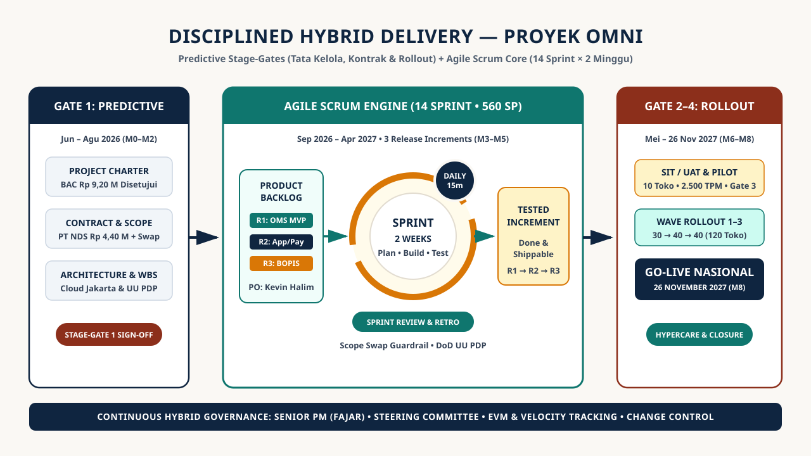
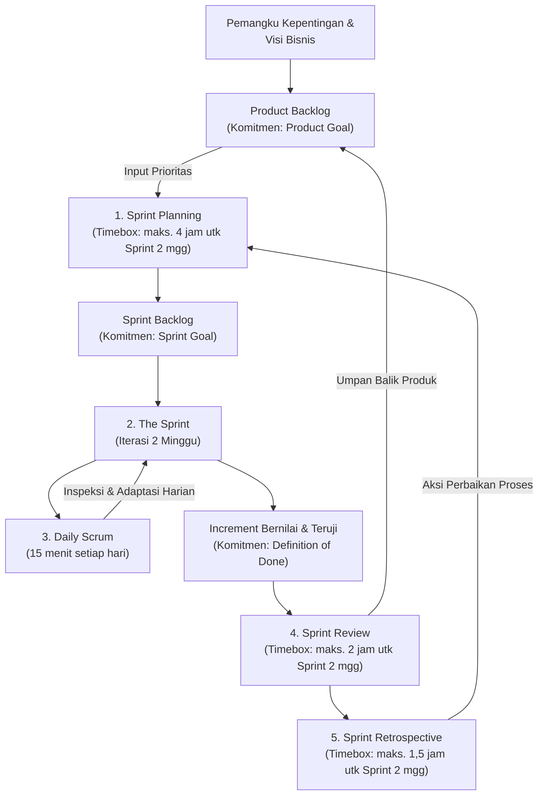
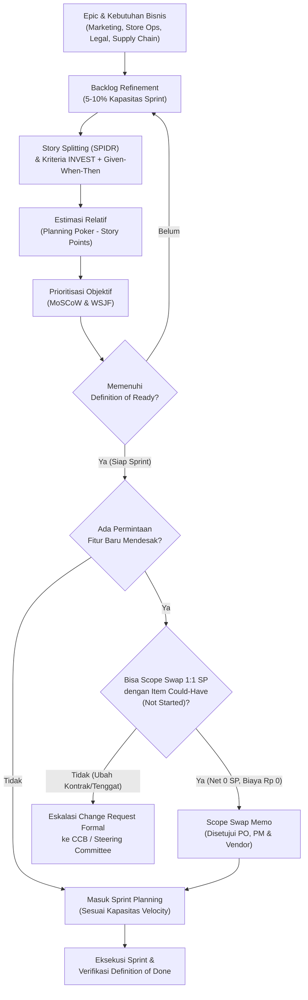
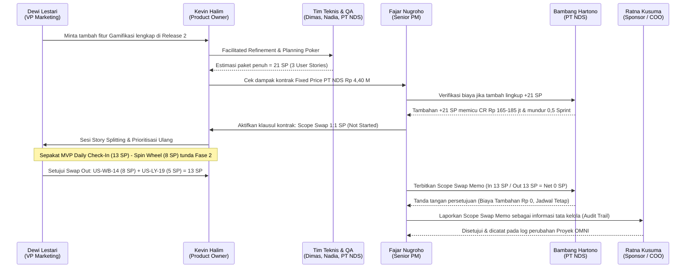

# Modul 04: Agile, Scrum & Hybrid Project Management

## 1. Identitas Modul

| Atribut | Keterangan |
|---------|------------|
| **Kelompok Modul** | Jalur Utama — Project Management (Jilid I: *Leadership & Project Delivery*) |
| **Kode & Urutan** | Modul 04 dari 12 |
| **Level Kompetensi** | Senior (*Advanced Practitioner*) |
| **Durasi Pembelajaran** | **12 jam sesi** (4 sesi × 3 jam) + **±6 jam tugas mandiri** |
| **Prasyarat** | Telah menyelesaikan Modul 01 (*Advanced Project Management*), Modul 02 (*Project Planning & Execution*), dan Modul 03 (*Risk, Issue & Stakeholder Management*) serta memahami dokumen rujukan [00-studi-kasus-utama.md](00-studi-kasus-utama.md) |
| **Peran Sasaran** | Senior Project Manager, Agile Delivery Lead, Scrum Master, Product Owner, Program Coordinator, serta Senior Business Analyst / System Analyst yang memimpin atau berkolaborasi dalam proyek transformasi digital |
| **Keluaran Utama (*Key Deliverables*)** | (1) *Hybrid Operating Model* & pembagian akuntabilitas peran; (2) *Product Backlog* prioritas berstandar INVEST & *Given–When–Then*; (3) *Release Plan*, proyeksi *Velocity*, dan analisis *Agile EVM*; (4) *Definition of Ready* (DoR) & *Definition of Done* (DoD) berkepatuhan regulasi; serta (5) protokol *Scope Swap* pada kontrak vendor |

---

## 2. Gambaran Modul

Pada organisasi korporat modern, hampir tidak ada proyek transformasi digital berskala besar yang dapat diselesaikan secara murni menggunakan pendekatan *Predictive* (*Waterfall*) maupun murni menggunakan *Agile* tanpa tata kelola korporat. Di satu sisi, kebutuhan pengalaman pelanggan pada aplikasi *mobile*, situs *e-commerce*, dan program *loyalty* terus berkembang seiring perubahan pasar sehingga menuntut iterasi cepat dan umpan balik nyata. Di sisi lain, Direksi tetap menuntut kepastian anggaran, tanggal peluncuran komersial yang tidak bisa ditawar, kontrak vendor yang sah secara hukum, kepatuhan regulasi data pribadi, serta orkestrasi peluncuran fisik di ratusan lokasi operasional.

Di titik persimpangan inilah kompetensi seorang **Senior Project Manager** benar-benar diuji. Banyak proyek gagal bukan karena timnya tidak mengenal Scrum, melainkan karena organisasi terjebak dalam **Fake Agile** atau **Water-Scrum-Fall** yang disfungsional: tim pengembang menjalankan rapat harian dan sprint dua mingguan, namun tata kelola eksekutif tetap menuntut kepastian lingkup 100% sejak hari pertama, kontrak vendor mengunci spesifikasi secara kaku, dan pengujian keamanan baru dilakukan di ujung proyek.

Modul 04 membekali Anda untuk melampaui pengetahuan mekanis tentang upacara Scrum menuju penguasaan **Agile Delivery yang empiris** sekaligus **Disciplined Hybrid Governance**. Melalui kelanjutan studi kasus **PT Sinar Nusantara Retail Tbk (SNR) — Proyek OMNI**, Anda akan mempraktikkan cara menyelaraskan 14 Sprint pengembangan perangkat lunak dengan 4 *Stage-Gate* eksekutif, anggaran *Cost Baseline* Rp 9,20 M, kontrak *Fixed Price* PT Nusantara Digital Solusi (NDS) senilai Rp 4,40 M, kepatuhan UU No. 27 Tahun 2022 tentang Pelindungan Data Pribadi (UU PDP), dan tenggat mutlak **26 November 2027**.

---

## 3. Capaian Pembelajaran

Setelah menyelesaikan Modul 04 beserta seluruh latihan dan tugas mandirinya, Anda diharapkan mampu:

1. **Mengevaluasi dan memilih pendekatan *delivery*** (*Predictive*, *Agile*, atau *Hybrid*) secara ilmiah berbasis karakteristik kompleksitas proyek menggunakan *Stacey Matrix* dan *Cynefin Framework*.
2. **Merancang operasionalisasi kerangka kerja Scrum (Scrum Guide 2020)** secara utuh — meliputi 3 *Accountabilities*, 3 *Artifacts* beserta 3 *Commitments*, dan 5 *Events* — sekaligus memosisikan peran **Senior Project Manager** secara harmonis tanpa berbenturan dengan *Product Owner* dan *Scrum Master*.
3. **Menyusun dan mengelola *Product Backlog* berstandar senior** menggunakan struktur *Epic–Feature–User Story*, kriteria **INVEST** & **DEEP**, *Acceptance Criteria* berformat *Given–When–Then*, serta teknik prioritisasi **MoSCoW** dan **WSJF**.
4. **Menganalisis kinerja iterasi dan meramalkan penyelesaian *Release*** secara kuantitatif berbasis estimasi relatif (*Story Points*, *Planning Poker*), *Velocity*, *Sprint Burndown*, *Release Burnup*, serta metrik aliran Kanban (*WIP Limit*, *Cycle Time*, *Throughput*, *CFD*, dan *Little's Law*).
5. **Merancang arsitektur *Disciplined Hybrid Governance*** yang menyatukan *Predictive Stage-Gate* (anggaran, kepatuhan regulasi, *wave rollout*) dengan *Agile Iterative Delivery*, termasuk menerjemahkan progres *Story Points* ke dalam pelaporan **Agile EVM** bagi *Steering Committee*.
6. **Mengelola mekanisme komersial dan perubahan lingkup (*Scope Swap*)** dalam kontrak vendor *Fixed Price* (seperti kontrak PT NDS Rp 4,40 M) untuk menyerap dinamika bisnis tanpa memicu *scope creep* maupun pembengkakan biaya.

---

## 4. Rencana Sesi

Pembelajaran tatap muka atau lokakarya daring dilaksanakan dalam **4 sesi × 3 jam (total 12 jam / 720 menit)** dengan komposisi pedagogis **±30% konsep (215 menit)**, **±50% *workshop* studi kasus Proyek OMNI (360 menit)**, dan **±20% diskusi/refleksi senior (145 menit)**.

| Sesi | Fokus Topik | Konsep (±30%) | Workshop Kasus Proyek OMNI (±50%) | Diskusi & Refleksi (±20%) | Output Sesi |
|------|-------------|---------------|-----------------------------------|---------------------------|-------------|
| **Sesi 1** (3 jam / 180 mnt) | *Agile Mindset*, *Empiricism*, *Stacey Matrix*, *Cynefin Framework*, & Arsitektur Scrum 2020 | **55 mnt:** 4 Nilai & 12 Prinsip Agile, 3 pilar *Empiricism*, pemetaan *Cynefin/Stacey*, peran PM vs PO vs SM dalam Scrum 2020 | **90 mnt:** Pemetaan komponen Proyek OMNI ke *Cynefin Framework* & perancangan batas peran Fajar Nugroho (PM), Kevin Halim (PO), dan Tania Wijaya (SM) | **35 mnt:** Debat kritis: "Apakah Senior PM masih relevan di tim Scrum?" & identifikasi gejala *Fake Agile* | Peta *Cynefin* Proyek OMNI & *Role Clarity Charter* |
| **Sesi 2** (3 jam / 180 mnt) | *Product Backlog Management*, *User Story* (INVEST & *Given–When–Then*), Prioritisasi, & Estimasi Relatif | **55 mnt:** Hirarki *Epic–Story*, prinsip INVEST & DEEP, Gherkin (*Given–When–Then*), MoSCoW, WSJF, *Story Points* & *Planning Poker* | **90 mnt:** Menulis ulang *requirement* fitur *Click & Collect* dan *Digital Loyalty* menjadi *User Stories* INVEST + *Given–When–Then*, simulasi *Planning Poker*, & skoring WSJF | **35 mnt:** Kalibrasi perbedaan estimasi antar-peran (BA, SA, QA, Vendor) & kiat memecah *Epic* raksasa (*Story Splitting*) | Cuplikan *Product Backlog* Prioritas & Skor WSJF Proyek OMNI |
| **Sesi 3** (3 jam / 180 mnt) | *Velocity*, *Release Planning*, *Burndown/Burnup*, Kanban *Flow Metrics*, & *Little's Law* | **50 mnt:** Kalibrasi *Velocity*, *Release Burnup* vs *Burndown*, metrik Kanban (*Lead/Cycle Time*, *WIP Limit*, *CFD*), dan *Little's Law* | **90 mnt:** Analisis data *Velocity* Sprint 1–10 Proyek OMNI, proyeksi 3 skenario *Release 3*, dampak *scope creep* +40 SP, & optimasi *WIP Limit* antrean bug integrasi POS | **40 mnt:** Membaca sinyal bahaya pada *Burnup* & *CFD* sebelum keterlambatan meledak di *Steering Committee* | Proyeksi *Release Forecast* Sprint 11–14 & Kebijakan *WIP Limit* |
| **Sesi 4** (3 jam / 180 mnt) | *Disciplined Hybrid Governance*, Kontrak Vendor Agile, *Agile EVM*, & *Anti-Patterns* | **55 mnt:** *Water-Scrum-Fall* vs *Disciplined Hybrid*, klausul *Change for Free / Scope Swap*, *Agile EVM*, DoR/DoD kepatuhan UU PDP, & 8 *Anti-Patterns* | **90 mnt:** Simulasi negosiasi *Scope Swap* Sprint 8 (gamifikasi Dewi Lestari vs kontrak PT NDS Rp 4,40 M), penyusunan DoD Proyek OMNI, & dasbor *Agile EVM* Bulan ke-9 | **35 mnt:** Refleksi lintas modul (Modul 01–04), *briefing* Tugas Modul (±6 jam), & evaluasi formatif | Protokol *Scope Swap*, DoR/DoD Proyek OMNI, & *Hybrid Governance Blueprint* |
| **Total** | **4 Sesi Lengkap** | **215 mnt (29,9%)** | **360 mnt (50,0%)** | **145 mnt (20,1%)** | **720 menit (12 jam)** |

---

## 5. Materi



### 5.1 Agile Mindset, Agile Manifesto, dan Empiricism

Kesalahan paling umum saat organisasi beralih ke *Agile* adalah menganggap *Agile* semata-mata sebagai seperangkat alat — papan Jira, rapat berdiri 15 menit, atau kartu *Story Points*. Padahal, secara fundamental **Agile adalah sebuah pola pikir (*mindset*)** yang berakar pada kemampuan organisasi merespons perubahan pasar dan ketidakpastian secara cepat, terukur, serta berorientasi pada penciptaan nilai pelanggan (*customer value*). Alat dan kerangka kerja seperti Scrum atau Kanban hanyalah mekanisme untuk mewujudkan pola pikir tersebut.

#### Empat Nilai Agile Manifesto (2001)

Dirumuskan oleh 17 praktisi rekayasa perangkat lunak pada tahun 2001, *Manifesto for Agile Software Development* menetapkan empat pasangan nilai yang menuntut kecermatan dalam membacanya:

1. ***Individuals and interactions* lebih utama daripada *processes and tools*.** Proses dan perangkat lunak manajemen proyek tetap penting untuk menjaga ketertiban, namun solusi terbaik lahir dari komunikasi langsung antar-manusia yang kompeten — misalnya diskusi tatap muka 15 menit antara *Lead SA* (Dimas Prasetyo) dan *Lead BA* (Nadia Putri) jauh lebih efektif daripada 40 komentar tiket yang saling menyalahkan.
2. ***Working software* lebih utama daripada *comprehensive documentation*.** Dokumen tebal setebal 300 halaman tidak menghasilkan omzet sepeser pun bagi perusahaan; perangkat lunak yang benar-benar berjalan dan teruji di tangan pengguna adalah ukuran kemajuan utama. Dokumentasi tetap dibuat, tetapi secukupnya (*just enough, just in time*) untuk kepatuhan hukum, audit, dan pemeliharaan sistem.
3. ***Customer collaboration* lebih utama daripada *contract negotiation*.** Kontrak melindungi kedua belah pihak secara hukum, tetapi keberhasilan produk digital membutuhkan kolaborasi aktif dengan perwakilan bisnis dan pengguna di sepanjang proyek, bukan sikap defensif "ini tidak tertulis di lampiran kontrak".
4. ***Responding to change* lebih utama daripada *following a plan*.** Perencanaan tetap wajib — seperti ungkapan Dwight D. Eisenhower, *"Plans are nothing; planning is everything."* Namun saat realitas pasar atau temuan teknis berubah, tim harus berani beradaptasi alih-alih memaksakan rencana usang yang tidak lagi relevan.

> **Prinsip Pembacaan Senior:** Kalimat penutup Agile Manifesto sering dilupakan: *"Meskipun item di sisi kanan memiliki nilai, kami lebih menghargai item di sisi kiri."* Pada proyek korporat berisiko tinggi seperti Proyek OMNI, mengabaikan sisi kanan (dokumentasi kepatuhan UU PDP, kontrak vendor, rencana anggaran) adalah kecerobohan; sebaliknya, mendewakan sisi kanan sambil mengorbankan sisi kiri adalah birokrasi mati.

#### Dua Belas Prinsip Agile Manifesto dalam Empat Klaster Praktis

Agar mudah diterapkan oleh seorang Senior PM, 12 prinsip Agile Manifesto dapat dikelompokkan ke dalam empat klaster operasional:

| Klaster | Ringkasan Prinsip Agile Manifesto | Penerapan Nyata pada Proyek Korporat |
|---------|-----------------------------------|--------------------------------------|
| **1. Fokus Nilai Pelanggan** | (P1) Kepuasan pelanggan melalui pengiriman perangkat lunak bernilai secara dini dan berkelanjutan; (P2) Menyambut perubahan kebutuhan bahkan di tahap akhir demi keunggulan kompetitif pelanggan | Merilis versi fungsional secara bertahap (Release 1–3) dan memvalidasi umpan balik kasir/pelanggan sejak awal, bukan menunggu bulan ke-18 |
| **2. Eksekusi Iteratif & Berkelanjutan** | (P3) Mengirimkan perangkat lunak yang bekerja dalam interval singkat (2 minggu–2 bulan); (P7) Perangkat lunak yang bekerja adalah ukuran utama kemajuan; (P8) Proses mendukung ritme kerja berkelanjutan (*sustainable pace*) | Sprint 2 mingguan yang selalu menghasilkan *Increment* teruji; melarang lembur kronis (*death march*) yang justru merusak kualitas kode dan memicu *turnover* |
| **3. Kolaborasi & Pemberdayaan Tim** | (P4) Bisnis dan tim teknis bekerja sama setiap hari; (P5) Bangun proyek di sekitar individu termotivasi, beri kepercayaan dan dukungan; (P6) Percakapan tatap muka adalah cara paling efektif; (P11) Arsitektur dan desain terbaik lahir dari tim yang *self-organizing* | Keterlibatan harian *Product Owner* bersama pengembang PT NDS; peran Senior PM menyingkirkan hambatan organisasi (*impediments*), bukan mendikte baris kode |
| **4. Keunggulan Teknis & Adaptasi** | (P9) Perhatian berkelanjutan pada keunggulan teknis dan desain yang baik meningkatkan ketangkasan; (P10) *Simplicity* — seni memaksimalkan pekerjaan yang **tidak** perlu dilakukan; (P12) Secara berkala tim berefleksi dan menyelaraskan cara kerja | Menerapkan *automated testing*, *CI/CD pipeline*, membuang fitur *over-engineering* yang minim ROI, serta menjalankan *Sprint Retrospective* yang melahirkan aksi perbaikan nyata |

#### Empiricism (*Empirical Process Control*) dan Lima Nilai Scrum

Berbeda dengan manufaktur tradisional yang menggunakan *Defined Process Control* (masukan sama + langkah baku = keluaran pasti identik), pengembangan produk digital penuh dengan variabel tak terduga sehingga membutuhkan **Empiricism** — keyakinan bahwa pengetahuan lahir dari pengalaman nyata dan keputusan diambil berdasarkan fakta yang teramati. *Empiricism* berdiri di atas tiga pilar yang saling mengunci:

1. **Transparency (*Transparansi*):** Seluruh proses dan hasil kerja harus terlihat secara jujur oleh mereka yang mengerjakan maupun yang menerima hasil kerja. Jika pengujian integrasi POS masih gagal 40%, papan pelacakan harus menampilkan warna merah apa adanya, bukan "hijau semangka" (*watermelon status*: hijau di luar untuk menyenangkan Direksi, merah di dalam).
2. **Inspection (*Inspeksi*):** Artefak dan progres menuju tujuan harus diperiksa secara berkala untuk mendeteksi variansi atau masalah yang tidak diinginkan (misalnya melalui *Daily Scrum* dan *Sprint Review*). Inspeksi tanpa transparansi adalah ilusi.
3. **Adaptation (*Adaptasi*):** Jika inspeksi menemukan penyimpangan dari batas yang dapat diterima, proses atau produk harus segera disesuaikan secepat mungkin. Inspeksi tanpa adaptasi hanyalah rapat rutin yang membuang waktu.

Ketiga pilar *Empiricism* hanya dapat hidup bila tim menumbuhkan **5 Nilai Scrum (*Scrum Values*)**: ***Commitment*** (komitmen mencapai tujuan dan saling mendukung), ***Focus*** (fokus pada pekerjaan Sprint terbaik), ***Openness*** (keterbukaan atas progres dan tantangan nyata), ***Respect*** (saling menghargai kompetensi dan kemandirian rekan tim), serta ***Courage*** (keberanian menyampaikan kabar buruk lebih dini dan menolak lingkup tidak realistis).

---

### 5.2 Memilih Pendekatan Delivery secara Ilmiah: Stacey Matrix & Cynefin Framework

Salah satu kesalahan terbesar organisasi modern adalah dogma metodologi: memaksakan Agile untuk pembangunan gedung fisik yang regulasinya kaku, atau sebaliknya memaksakan *Waterfall* untuk membangun aplikasi *mobile* baru yang perilaku penggunanya belum teruji. Senior PM wajib memilih pendekatan *delivery* berdasarkan **tingkat ketidakpastian dan kompleksitas domain masalah** menggunakan dua kerangka ilmiah utama: **Stacey Matrix** dan **Cynefin Framework**.

#### Stacey Complexity Matrix

Dikembangkan oleh Ralph Stacey dan dipopulerkan dalam manajemen proyek oleh Ken Schwaber, *Stacey Matrix* memetakan pekerjaan pada dua sumbu:
- **Sumbu Vertikal — Ketidakpastian Kebutuhan (*Requirements Uncertainty*):** Sejauh mana para pemangku kepentingan sepakat dan yakin mengenai *apa* yang harus dibangun.
- **Sumbu Horizontal — Ketidakpastian Teknologi/Solusi (*Technical Uncertainty*):** Sejauh mana tim menguasai *bagaimana* cara membangunnya dengan teknologi yang tersedia.

Pemetaan tersebut menghasilkan empat zona keputusan:
1. **Simple (*Clear / Close to Certainty*):** Kebutuhan jelas dan disepakati; teknologi sudah mapan serta berulang. **Pendekatan optimal: *Predictive (Waterfall)*.** Contoh di Proyek OMNI: pengadaan dan distribusi fisik 240 unit tablet/scanner ke 120 toko serta penyusunan jadwal pelatihan gelombang (*Wave Rollout*).
2. **Complicated:** Kebutuhan cukup dapat didefinisikan atau teknologi memiliki banyak ketergantungan teknis yang membutuhkan keahlian spesialis untuk menganalisisnya sebelum eksekusi. **Pendekatan optimal: *Predictive* dengan *Stage-Gate* ketat atau *Hybrid*.** Contoh di Proyek OMNI: desain arsitektur keamanan UU PDP, konfigurasi infrastruktur *Cloud* Jakarta, dan migrasi basis data 1,2 juta *Sinar Member Card*.
3. **Complex:** Kebutuhan masih berkembang (*emergent*), preferensi pengguna belum pasti, atau integrasi lintas sistem menimbulkan efek samping yang baru terlihat setelah diuji langsung. Hubungan sebab-akibat hanya jelas bila dilihat ke belakang (*retrospectively*). **Pendekatan optimal: *Agile (Scrum/Kanban)*.** Contoh di Proyek OMNI: pengalaman antarmuka aplikasi *mobile*, alur operasional *Click & Collect* (BOPIS) bagi kasir dan pelanggan, serta mekanisme *Digital Loyalty*.
4. **Chaos (*Anarchy*):** Tidak ada kesepakatan kebutuhan maupun kejelasan teknis; situasi krisis akut. **Pendekatan optimal:** Tindakan stabilisasi darurat jangka pendek untuk memindahkan situasi kembali ke zona *Complex* atau *Complicated* (bukan menjalankan proyek formal biasa).

#### Cynefin Framework (Dave Snowden)

*Cynefin Framework* melengkapi *Stacey Matrix* dengan panduan pengambilan keputusan bagi pemimpin (*sense-making framework*) dalam lima domain:

| Domain Cynefin | Karakteristik Hubungan Sebab–Akibat | Pola Keputusan Pemimpin | Praktik & Pendekatan Delivery | Contoh pada Proyek OMNI |
|----------------|-------------------------------------|-------------------------|-------------------------------|-------------------------|
| **Clear (dahulu Simple)** | Jelas, stabil, dan diketahui semua orang (*known knowns*) | **Sense – Categorize – Respond** | *Best Practice* (SOP baku, *Predictive/Checklist*) | Instalasi standar tablet toko, pengisian dokumen kontrak baku, aktivasi akun kasir per gelombang |
| **Complicated** | Dapat diketahui lewat analisis pakar (*known unknowns*) | **Sense – Analyze – Respond** | *Good Practice* (Arsitek spesialis, *Predictive* / *Hybrid*) | Perancangan integrasi API ERP–WMS–OMS, audit kepatuhan UU PDP & *Penetration Testing*, pembersihan data 1,2 juta anggota |
| **Complex** | Baru terlihat setelah dicoba (*unknown unknowns*) | **Probe – Sense – Respond** | *Emergent Practice* (**Agile / Scrum** — eksperimen aman, iterasi cepat, umpan balik) | Desain UX *mobile app*, skema penebusan poin *Digital Loyalty*, alur *Store Fulfillment App* pada Pilot 10 toko |
| **Chaotic** | Tidak ada pola sebab–akibat yang terbaca saat krisis (*unknowables*) | **Act – Sense – Respond** | *Novel Practice* (Tindakan cepat *command* untuk menahan pendarahan, lalu stabilisasi) | *System outage* massal saat beban puncak 2.500 TPM atau insiden kebocoran data keamanan saat *Go-Live* |
| **Confused (Disorder)** | Belum jelas masalah masuk domain yang mana | Pecah masalah dan tempatkan tiap bagian ke 4 domain di atas | *Discovery Workshop* / *Technical Spike* | Fase inisiasi awal sebelum *Gate 1* saat Marketing, Store Ops, dan IT masih saling berdebat tentang lingkup OMNI |

#### Perbandingan Komprehensif: Predictive vs Agile vs Hybrid

Seorang Senior PM harus mampu menjelaskan secara rasional kepada *Steering Committee* mengapa sebuah proyek menggunakan pendekatan tertentu. Tabel berikut membandingkan ketiga paradigma tersebut secara menyeluruh:

| Dimensi Manajemen | Predictive (*Waterfall*) | Agile (*Scrum / Kanban*) | Disciplined Hybrid *(Pilihan Proyek OMNI)* |
|-------------------|--------------------------|--------------------------|--------------------------------------------|
| **Segitiga Kendala (*Iron Triangle*)** | **Lingkup tetap (*fixed*)**; jadwal & biaya menyesuaikan lingkup | **Waktu & biaya tetap (*timeboxed*)**; lingkup fleksibel sesuai prioritas nilai | **Anggaran & tenggat utama tetap**; fitur inti (*Must-Have*) dikunci, fitur pendukung fleksibel via *Scope Swap* |
| **Kejelasan Kebutuhan** | Harus terinci lengkap di awal (*upfront BRD/Scope Baseline*) | Berkembang bertahap (*emergent*) lewat *Backlog Refinement* | Kebutuhan tingkat *Epic*/arsitektur/regulasi ditetapkan di awal; detail *User Story* dielaborasikan per Sprint |
| **Struktur Pengiriman (*Delivery*)** | Sekuensial per fase; nilai bisnis baru diterima penuh di akhir (*big bang*) | Inkremental setiap 1–4 minggu; nilai bisnis divalidasi terus-menerus | *Stage-Gate* makro di level program/eksekutif + siklus Sprint 2 mingguan di level pembangunan produk |
| **Pengelolaan Perubahan** | Ketat melalui *Change Control Board* (CCB) dan *Change Request* formal | Diakomodasi alami melalui prioritisasi ulang *Product Backlog* antar-Sprint | Perubahan di dalam kapasitas Sprint/Release dikelola PO (*Scope Swap*); perubahan anggaran/tenggat/regulasi masuk CCB |
| **Manajemen Risiko** | Analisis risiko formal di awal (*Risk Register*, cadangan kontinjensi) | Mitigasi inheren lewat siklus pendek, demo awal, dan integrasi kontinu | Kombinasi *Risk Register* & *Contingency Reserve* (Rp 0,70 M) dengan validasi empiris tiap akhir Sprint |
| **Pelaporan Eksekutif** | *Gantt Chart*, *Milestone*, dan *Earned Value Management* (EVM) | *Velocity*, *Sprint Burndown*, *Release Burnup*, dan demo produk nyata | *Milestone Stage-Gate* + **Agile EVM** (mengonversi *Burnup/Velocity* ke SPI/CPI) + demo *Increment* per Release |
| **Kontrak Vendor Utama** | *Fixed Price / Fixed Scope* berbasis spesifikasi kaku | *Time & Materials* (T&M) atau tim terdedikasi (*Dedicated Squad*) | *Fixed Price per Milestone/Release* dilengkapi klausul *Scope Swap* (*Change for Free*) & batas perubahan |
| **Kapan Paling Tepat** | Domain *Clear/Complicated*, biaya perubahan mahal, regulasi sangat kaku | Domain *Complex*, produk digital inovatif, pasar dinamis, tim internal stabil | Proyek transformasi korporat yang menggabungkan pembangunan perangkat lunak (*Complex*) dengan integrasi *legacy*, kepatuhan hukum, & *rollout* fisik (*Complicated/Clear*) |

---

### 5.3 Scrum Framework Mendalam (Scrum Guide 2020)

**Scrum** adalah kerangka kerja (*framework*) ringan yang membantu individu, tim, dan organisasi menghasilkan nilai melalui solusi adaptif untuk masalah yang kompleks. Berdasarkan **Scrum Guide 2020** (Ken Schwaber & Jeff Sutherland), Scrum sengaja dirancang tidak lengkap secara preskriptif — ia mendefinisikan struktur dasar (3 *Accountabilities*, 3 *Artifacts* dengan 3 *Commitments*, dan 5 *Events*) serta membiarkan tim mengisi praktik teknis di dalamnya.



#### Tiga Accountabilities dalam Scrum — dan Posisi Strategis Senior Project Manager

Scrum Guide 2020 mengganti istilah *"Roles"* menjadi ***Accountabilities*** (akuntabilitas) dalam satu **Scrum Team** yang lintas fungsi (*cross-functional*), *self-managing*, dan biasanya berukuran ≤ 10 orang per tim (untuk proyek besar seperti Proyek OMNI, dibentuk dua *squad* paralel yang terkoordinasi pada satu *Product Backlog* terpadu):

1. **Product Owner (PO):** Akuntabel dalam **memaksimalkan nilai produk** yang dihasilkan Scrum Team. PO adalah satu individu (bukan komite!) yang berwenang menetapkan dan mengomunikasikan *Product Goal*, membuat serta mengurutkan item *Product Backlog*, dan memastikan *Product Backlog* transparan serta dipahami tim. Keputusan PO harus dihormati seluruh organisasi; siapapun yang ingin mengubah prioritas harus meyakinkan PO, bukan langsung memerintah *developer*.
2. **Scrum Master (SM):** Akuntabel dalam **menegakkan penerapan Scrum** sesuai Scrum Guide dan meningkatkan efektivitas Scrum Team. SM melayani tim melalui *coaching* kemandirian, menyingkirkan hambatan (*impediments*) di luar jangkauan tim, memastikan seluruh *Scrum Events* berjalan produktif sesuai *timebox*, serta membantu PO dan organisasi memahami praktik empiris. SM **bukan** sekretaris rapat dan bukan mandor tim.
3. **Developers:** Seluruh anggota Scrum Team yang berkomitmen menciptakan aspek apa pun dari *Increment* yang dapat digunakan pada setiap Sprint (mencakup *software engineer*, *UI/UX designer*, *QA engineer*, *database engineer*, hingga *DevOps*). Mereka menyusun rencana Sprint (*Sprint Backlog*), menjaga kualitas sesuai *Definition of Done*, dan saling menjaga akuntabilitas harian.

##### Lalu, di Mana Posisi Senior Project Manager dalam Lingkungan Scrum dan Hybrid?

Dalam buku teks Scrum murni untuk pengembangan satu produk perangkat lunak internal, jabatan *Project Manager* memang tidak disebutkan. Namun dalam proyek transformasi korporat bernilai miliaran rupiah seperti **Proyek OMNI** (melibatkan 4 proyek paralel dalam Program Nusantara 2028, kontrak vendor Rp 4,40 M, kepatuhan UU PDP, pengadaan 240 tablet, dan pelatihan 1.440 karyawan di 120 toko), **keberadaan Senior Project Manager bersifat vital**. Kuncinya adalah **pemisahan wewenang yang tegas** agar tidak terjadi tumpang tindih (*role collision*):

| Area Tanggung Jawab | Senior Project Manager *(Fajar Nugroho)* | Product Owner *(Kevin Halim)* | Scrum Master *(Tania Wijaya)* |
|---------------------|------------------------------------------|-------------------------------|-------------------------------|
| **Fokus Utama** | Integrasi keseluruhan proyek (*end-to-end*): jadwal induk, anggaran BAC Rp 9,20 M, kontrak vendor, risiko lintas unit, kepatuhan, dan *wave rollout* 120 toko | Memaksimalkan nilai bisnis produk digital, memprioritaskan *Product Backlog*, dan mewakili suara pelanggan/bisnis | Menjaga kesehatan proses Scrum, kelancaran aliran kerja tim, *coaching* Agile, dan menghilangkan hambatan operasional Sprint |
| **Wewenang Keputusan** | Eskalasi *Steering Committee*, persetujuan *Stage-Gate*, pengelolaan *Contingency Reserve*, penegakan kontrak/SLA PT NDS, koordinasi dependensi ERP-Refresh & POS-Modern | Urutan prioritas fitur, isi *User Story*, penerimaan (*acceptance*) fitur bisnis, serta keputusan *Scope Swap* fungsional | Fasilitasi *Scrum Events*, perlindungan tim dari gangguan luar Sprint, desain perbaikan retrospektif, dan kebijakan *WIP Limit* |
| **Yang TIDAK Boleh Dilakukan** | **Jangan** mengintervensi prioritas harian backlog sepihak, **jangan** memimpin *Daily Scrum* seperti laporan absensi, dan **jangan** mendikte estimasi *Story Points* | **Jangan** memaksa tim menerima *backlog* melebihi kapasitas Sprint atau mencampuri cara teknis *Developers* menulis kode | **Jangan** bertindak sebagai atasan langsung yang memberi perintah tugas atau mengambil alih kepemilikan *Product Backlog* |

#### Tiga Artifacts, Tiga Commitments, dan Definition of Ready (DoR)

Setiap artefak Scrum memiliki **komitmen (*commitment*)** spesifik yang memperkuat transparansi dan memberikan tolok ukur objektif atas kemajuan:

1. **Product Backlog → Komitmen: *Product Goal*.** Daftar terurut dan dinamis dari segala sesuatu yang dibutuhkan untuk meningkatkan produk; merupakan satu-satunya sumber pekerjaan bagi Scrum Team. *Product Goal* mendeskripsikan kondisi masa depan produk yang menjadi target jangka menengah/panjang tim.
2. **Sprint Backlog → Komitmen: *Sprint Goal*.** Terdiri dari *Sprint Goal* (mengapa Sprint ini bernilai), sekumpulan item *Product Backlog* terpilih (apa yang dibangun), dan rencana eksekusi konkret (bagaimana membangunnya). *Sprint Goal* memberi fleksibilitas: jika satu tugas teknis menemui kendala, tim tetap dapat bernegosiasi detail lingkup selama *Sprint Goal* tercapai.
3. **Increment → Komitmen: *Definition of Done (DoD)*.** Batu loncatan konkret menuju *Product Goal*. Setiap *Increment* bersifat aditif terhadap *Increment* sebelumnya dan **wajib terverifikasi penuh** memenuhi standar kualitas **DoD**. Item yang baru "selesai *coding* tapi belum diuji QA atau belum lolos cek keamanan" **bukan** *Increment* dan tidak boleh dihitung dalam *Velocity*.

Sebagai praktik komplementer industri (di luar teks wajib Scrum Guide 2020, namun sangat krusial di proyek *enterprise*), tim senior juga menerapkan **Definition of Ready (DoR)** — daftar syarat minimum agar sebuah *User Story* layak ditarik ke dalam *Sprint Planning* (misalnya: *Acceptance Criteria* jelas, ketergantungan API teridentifikasi, desain UI siap, dan sudah diestimasi). DoR mencegah tim membuang 4 hari pertama Sprint hanya untuk menebak maksud fitur; namun DoR harus diperlakukan sebagai panduan kolaborasi, bukan "gerbang birokrasi kaku" untuk menolak berdiskusi.

#### Lima Events (Ceremonies) Scrum

Seluruh acara dalam Scrum dibatasi waktu (*timeboxed*) untuk menciptakan keteraturan dan mengurangi kebutuhan rapat *ad-hoc* di luar kerangka Scrum. Tabel berikut merangkum 5 *Events* beserta *timebox* untuk **Sprint 2 minggu** (standar Proyek OMNI) dan perbandingan terhadap Sprint 4 minggu (batas maksimum Scrum Guide 2020):

| Event Scrum | Tujuan Utama | Timebox (Sprint 2 Mgg / 4 Mgg) | Peserta Utama | Input Utama | Output Utama | Kesalahan Umum di Lapangan |
|-------------|--------------|-------------------------------|---------------|-------------|--------------|----------------------------|
| **1. The Sprint** | Wadah (*container*) bagi seluruh acara lain untuk mengubah ide menjadi nilai (*Increment*) yang dapat diinspeksi | Tetap 2 minggu *(maks. 1 bulan)* | Seluruh Scrum Team | *Product Backlog* terurut | *Increment* memenuhi DoD | Mengubah durasi Sprint seenaknya; memaksa masuknya permintaan darurat yang merusak *Sprint Goal* |
| **2. Sprint Planning** | Menjawab 3 hal: (1) Mengapa Sprint ini bernilai? (2) Apa yang dapat diselesaikan? (3) Bagaimana cara mengerjakannya? | Maks. **4 jam** *(maks. 8 jam utk 4 mgg)* | Scrum Team (dapat mengundang ahli bisnis/SA) | *Product Backlog* siap (memenuhi DoR), kapasitas tim, *Velocity* historis, DoD | *Sprint Goal* + *Sprint Backlog* + rencana kerja awal | PO mendikte jumlah SP melebihi kapasitas tim; tidak merumuskan *Sprint Goal* sehingga Sprint hanya berisi daftar tugas terpisah |
| **3. Daily Scrum** | Menginspeksi progres menuju *Sprint Goal* dan mengadaptasi *Sprint Backlog* untuk 24 jam ke depan | Maks. **15 menit** (waktu & tempat sama tiap hari) | *Developers* (PO & SM hadir sebagai pendukung bila diperlukan) | *Sprint Backlog*, papan tugas, hambatan harian | Rencana kerja 24 jam ke depan & daftar eskalasi *impediment* | Berubah menjadi rapat laporan status searah ke Senior PM/SM; melebar menjadi sesi *debugging* teknis 45 menit |
| **4. Sprint Review** | Menginspeksi hasil *Increment* bersama pemangku kepentingan dan mengadaptasi *Product Backlog* | Maks. **2 jam** *(maks. 4 jam utk 4 mgg)* | Scrum Team + *Stakeholders* kunci (Sponsor, Marketing, Store Ops, Legal) | *Increment* yang memenuhi DoD, *Release Burnup*, perubahan kondisi pasar | Umpan balik produk nyata & pembaruan *Product Backlog* | Hanya presentasi *PowerPoint* tanpa demo perangkat lunak hidup; mencampuradukkan demo fitur yang belum lulus DoD |
| **5. Sprint Retrospective** | Merencanakan cara meningkatkan kualitas dan efektivitas proses, interaksi, alat, serta DoD tim | Maks. **1,5 jam** *(maks. 3 jam utk 4 mgg)* | Internal Scrum Team (ruang aman psikologis) | Pengalaman Sprint berjalan, metrik aliran, insiden kualitas | Minimal 1–2 aksi perbaikan proses konkret yang masuk ke *Sprint Backlog* berikutnya | Menjadi ajang saling menyalahkan (*blame game*); daftar perbaikan hanya dicatat di dokumen tanpa pernah dieksekusi |

---

### 5.4 Product Backlog Management, Estimasi Agile, dan Release Forecasting

Kualitas keluaran tim Agile sangat ditentukan oleh kualitas masukan di dalam *Product Backlog*. *Product Backlog* yang kabur, berantakan, atau berisi daftar keinginan tak terurut akan melumpuhkan bahkan tim *developer* paling andal sekalipun.

#### Hierarki Kebutuhan, User Story, dan Acceptance Criteria (Given–When–Then)

Pada proyek skala menengah–besar, kebutuhan diorganisasi secara berjenjang agar mudah dipantau dari tingkat direksi hingga tingkat pengembang:
- **Initiative / Theme:** Tujuan strategis tingkat program/proyek (contoh: *Omnichannel Store Fulfillment*).
- **Epic:** Kumpulan besar kemampuan bisnis yang terlalu besar untuk diselesaikan dalam 1 Sprint dan biasanya memakan beberapa Sprint (contoh: *EP-03: Click & Collect / BOPIS 120 Toko*).
- **Feature:** Pengelompokan fungsional di bawah *Epic* yang dapat dirilis sebagai satu nilai kohesif (contoh: *Pickup QR Verification di Kasir*).
- **User Story:** Unit kebutuhan terkecil yang bernilai langsung bagi pengguna akhir dan dapat diselesaikan tuntas (lulus DoD) dalam **satu Sprint**.
- **Task:** Pecahan langkah teknis internal *Developers* (*backend API*, *UI screen*, *unit test*, *script* migrasi) yang dilakukan untuk menuntaskan *User Story*.

Setiap *User Story* yang baik memadukan konsep **3C** (*Card* — ringkasan singkat; *Conversation* — dialog kolaboratif antara PO, BA, SA, QA, dan *Developers*; *Confirmation* — bukti pengujian objektif) dengan format baku:

> **"As a `[peran/persona pengguna]`, I want `[tindakan/kemampuan spesifik]`, so that `[manfaat bisnis/nilai terukur]`."**

Bagian *Confirmation* dituangkan sebagai **Acceptance Criteria (AC)** menggunakan sintaks **Gherkin (*Given–When–Then*)** agar bebas tafsir dan dapat langsung diubah menjadi kasus uji otomatis (*automated test cases*):
- **Given (*Kondisi Awal*):** Prasyarat sistem, status pengguna, atau data awal sebelum aksi terjadi.
- **When (*Pemicu/Aksi*):** Tindakan spesifik yang dilakukan pengguna atau sistem.
- **Then (*Hasil yang Diharapkan*):** Keluaran terukur yang wajib terjadi — mencakup *happy path*, skenario pengecualian (*negative/edge cases*), serta persyaratan non-fungsional (waktu respons, keamanan, kepatuhan).

#### Prinsip INVEST (User Story) dan DEEP (Product Backlog)

| Prinsip **INVEST** (Kualitas *User Story*) | Penjelasan Praktis | Prinsip **DEEP** (Kualitas *Product Backlog*) | Penjelasan Praktis |
|--------------------------------------------|--------------------|-----------------------------------------------|--------------------|
| **I — Independent** | Sebisa mungkin tidak terkunci ketat pada urutan *story* lain agar fleksibel diprioritaskan | **D — Detailed Appropriately** | Item di urutan atas (untuk 1–2 Sprint ke depan) sangat rinci & memenuhi DoR; item urutan bawah cukup berupa *Epic* garis besar |
| **N — Negotiable** | Bukan kontrak teknis mati; detail solusi dibahas bersama saat *refinement* | **E — Estimated** | Setiap item memiliki estimasi ukuran relatif sesuai tingkat rinciannya (*T-Shirt Size* di bawah, *Story Points* di atas) |
| **V — Valuable** | Memberikan nilai bisnis/pengguna yang jelas (hindari memotong *story* secara horizontal seperti "buat tabel database saja") | **E — Emergent** | Backlog hidup dan berevolusi seiring pembelajaran dari *Sprint Review*, data pengguna, dan perubahan pasar |
| **E — Estimable** | Cukup dipahami sehingga tim dapat memperkirakan kompleksitasnya; jika terlalu kabur, buat *Technical Spike* dulu | **P — Prioritized** | Diurutkan secara tegas dari nilai bisnis tertinggi/risiko paling kritis di puncak hingga terendah di dasar (tidak ada dua item yang sama-sama "Prioritas 1") |
| **S — Small** | Cukup kecil untuk tuntas dalam satu Sprint (idealnya 2–5 hari kerja, mis. 1–8 SP) | | |
| **T — Testable** | Memiliki *Acceptance Criteria* objektif agar QA dapat menyatakan *Pass/Fail* tanpa debat | | |

#### Backlog Refinement dan Teknik Story Splitting (SPIDR)

**Backlog Refinement** (dahulu disebut *grooming*) adalah aktivitas berkelanjutan — idealnya mengalokasikan **5%–10% kapasitas Sprint** — bagi PO, BA, SA, dan *Developers* untuk memecah *Epic* besar, memperjelas *Acceptance Criteria*, mengidentifikasi ketergantungan lintas sistem, dan mengestimasi item untuk 1–2 Sprint mendatang. Jika sebuah *User Story* terlalu besar (misalnya ≥ 13 SP), tim memecahnya secara vertikal menggunakan pola **SPIDR**:
- **S (*Spike*):** Pisahkan riset teknis berbatas waktu (mis. 2 hari) untuk menghilangkan ketidakpastian integrasi API *legacy* sebelum membangun fitur penuh.
- **P (*Paths*):** Pisahkan alur utama (*happy path*, mis. pembayaran QRIS sukses) dari alur alternatif/pengecualian (*partial refund* atau pembatalan pesanan).
- **I (*Interfaces*):** Pisahkan berdasarkan antarmuka/kanal (mis. alur *Click & Collect* versi *Web* terlebih dahulu, lalu adaptasi *Mobile App* iOS/Android).
- **D (*Data*):** Mulai dari subset data sederhana (mis. migrasi anggota aktif 12 bulan terakhir dulu sebelum arsip data duplikat 5 tahun).
- **R (*Rules*):** Implementasikan aturan bisnis dasar terlebih dahulu, baru tambahkan aturan khusus (mis. poin *tier Silver* dasar sebelum *multiplier* khusus ulang tahun *Platinum*).

#### Teknik Prioritisasi: MoSCoW, Value vs Effort, dan WSJF

Untuk mencegah prioritas backlog dikuasai oleh **HiPPO (*Highest Paid Person's Opinion*)**, Product Owner dan Senior PM menggunakan kerangka prioritisasi objektif:

1. **MoSCoW:** Mengelompokkan item ke dalam empat kategori komitmen:
   - **Must-Have (M):** Wajib ada agar produk legal, aman, dan layak beroperasi saat *Go-Live* (ideal maksimal ≤ 60% dari total kapasitas upaya agar tersedia ruang adaptasi).
   - **Should-Have (S):** Penting secara bisnis, namun tidak melumpuhkan peluncuran jika sementara ditangani dengan *workaround* manual (~20% kapasitas).
   - **Could-Have (C):** Fitur pemanis (*nice-to-have*) yang menjadi **penyangga utama (*contingency buffer*)** untuk ditukar (*Scope Swap*) atau ditunda bila terjadi gangguan jadwal (~20% kapasitas).
   - **Won't-Have (this time) (W):** Disepakati secara eksplisit **tidak masuk** dalam rilis berjalan (tetap dicatat untuk fase berikutnya agar pemangku kepentingan merasa didengar).
2. **Value vs Effort Matrix:** Memetakan fitur pada 4 kuadran: *Quick Wins* (Nilai Tinggi, Upaya Rendah → kerjakan pertama), *Major Strategic Bets* (Nilai Tinggi, Upaya Tinggi → pecah bertahap), *Fill-Ins* (Nilai Rendah, Upaya Rendah → kerjakan hanya jika ada kapasitas sisa), dan *Time Sinks* (Nilai Rendah, Upaya Tinggi → tolak/buang).
3. **WSJF (*Weighted Shortest Job First*):** Dikembangkan dari prinsip ekonomi aliran Donald Reinertsen dan banyak digunakan pada *Scaled Agile Framework (SAFe)*. WSJF memprioritaskan pekerjaan yang menghasilkan nilai ekonomi tertinggi per satuan waktu tunggu dengan rumus:

$$\text{Cost of Delay (CoD)} = \text{User/Business Value} + \text{Time Criticality} + \text{Risk Reduction / Opportunity Enablement}$$

$$\text{WSJF} = \frac{\text{Cost of Delay (CoD)}}{\text{Job Size (atau Duration)}}$$

Setiap komponen dinilai secara relatif dalam satu kolom menggunakan skala Fibonacci termodifikasi (`1, 2, 3, 5, 8, 13, 20`). Berikut ilustrasi penerapan **WSJF pada empat kandidat fitur Proyek OMNI** menjelang Release 2–3:

| ID | Fitur Kandidat Proyek OMNI | Business Value (BV) | Time Criticality (TC) | Risk Reduction (RR) | Total CoD (`BV+TC+RR`) | Job Size | Skor WSJF (`CoD / Size`) | Urutan Prioritas |
|----|----------------------------|---------------------|-----------------------|---------------------|------------------------|----------|--------------------------|------------------|
| **F-01** | *Consent Management* & Enkripsi PII (UU PDP) | 5 | 13 | 13 | **31** | 5 | **6,20** | **#1** *(Wajib cegah veto Legal)* |
| **F-02** | *Click & Collect* Pickup QR & Notifikasi SLA ≤ 2 Jam | 13 | 8 | 5 | **26** | 5 | **5,20** | **#2** *(Nilai pelanggan tinggi, ukuran ringkas)* |
| **F-03** | Adaptor Sinkronisasi Stok POS ≤ 60 Detik | 13 | 13 | 8 | **34** | 8 | **4,25** | **#3** *(CoD tertinggi, tetapi ukuran besar)* |
| **F-04** | Gamifikasi *Spin Wheel* & *Leaderboard* Marketing | 8 | 3 | 2 | **13** | 13 | **1,00** | **#4** *(Kandidat kuat tunda / Scope Swap)* |

Perhatikan pelajaran strategis dari tabel di atas: meskipun *F-04 (Gamifikasi)* disuarakan paling vokal oleh VP Marketing, analisis WSJF membuktikan secara transparan bahwa menunda kepatuhan UU PDP (*F-01*, WSJF 6,20) atau *Click & Collect* (*F-02*, WSJF 5,20) memiliki biaya keterlambatan ekonomi dan risiko penundaan *Go-Live* yang jauh lebih destruktif.



#### Estimasi Relatif (Story Points, Planning Poker), Velocity, dan Release Forecasting

Manusia secara psikologis sangat buruk dalam memperkirakan durasi absolut (*"tugas ini pasti selesai dalam 14,5 jam"*), namun jauh lebih akurat dalam melakukan **perbandingan relatif** (*"tugas B kira-kira dua kali lebih rumit dibandingkan tugas A"*). Oleh sebab itu, tim Agile menggunakan **Story Points (SP)** — satuan ukuran relatif yang memadukan tiga faktor: **volume upaya (*effort*)**, **kompleksitas teknis**, dan **tingkat ketidakpastian/risiko**.

Tim menetapkan satu *reference story* (misalnya sebuah fitur CRUD katalog sederhana = **2 SP** atau **3 SP**), lalu membandingkan *story* lainnya menggunakan deret **Fibonacci termodifikasi (`1, 2, 3, 5, 8, 13, 20, 40`)**. Jarak antar-angka yang kian melebar mencerminkan realitas bahwa semakin besar sebuah pekerjaan, semakin rendah presisi estimasinya (jika hasil estimasi ≥ 20 SP, itu adalah sinyal wajib untuk memecah *story* tersebut). Teknik kolaboratif **Planning Poker** dilakukan dengan cara setiap anggota *Developers* memilih kartu secara tertutup lalu membukanya bersamaan untuk mencegah bias jangkar (*anchoring bias* — yakni kecenderungan anggota junior sekadar mengikuti angka senior). Perbedaan angka ekstrem (misalnya 3 vs 13) memicu diskusi teknis berharga yang sering membongkar risiko tersembunyi (seperti kebutuhan enkripsi UU PDP atau keterbatasan API *legacy*).

##### Velocity dan Rumus Proyeksi Penyelesaian Release

**Velocity** adalah jumlah total *Story Points* dari *User Stories* yang **benar-benar selesai dan lulus 100% Definition of Done** dalam satu Sprint. Item yang baru selesai 80% pada akhir Sprint diberi nilai **0 SP** pada Sprint tersebut (tidak ada kredit parsial) dan dikembalikan ke *Product Backlog* untuk diprioritaskan ulang. Setelah tim melewati 3–4 Sprint awal (*calibration period*), rata-rata *Velocity* menjadi alat peramalan empiris yang sangat andal:

$$\text{Average Velocity} = \frac{\sum_{i=1}^{n} \text{Completed SP}_i}{n}$$

$$\text{Perkiraan Sisa Sprint} = \left\lceil \frac{\text{Remaining Backlog (SP)}}{\text{Projected Velocity (SP/Sprint)}} \right\rceil$$

$$\text{Kapasitas Tersisa (SP)} = \text{Sisa Sprint} \times \text{Projected Velocity (SP/Sprint)}$$

> **Peringatan Profesional:** *Velocity* adalah **metrik kapasitas lokal untuk peramalan**, bukan KPI produktivitas individu maupun alat pembanding antar-tim. Dua squad berbeda memiliki skala kalibrasi *Story Points* yang berbeda. Begitu manajemen menjadikan *Velocity* sebagai target bonus atau membandingkan Squad Alpha (25 SP) vs Squad Beta (40 SP), tim akan langsung melakukan *point inflation* (fitur 3 SP dinaikkan menjadi 8 SP) sehingga seluruh keandalan peramalan hancur.

##### Sprint Burndown Chart vs Release Burnup Chart

- **Sprint Burndown Chart:** Memantau sisa pekerjaan (*Story Points* atau jam tugas tersisa) dari hari ke-1 hingga hari ke-10 dalam satu Sprint dibandingkan garis tren ideal. Berguna di tingkat operasional tim (*Developers* & SM) untuk mendeteksi hambatan harian (misalnya kurva mendatar 4 hari berturut-turut menandakan tiket macet di pengujian/dependensi).
- **Release Burnup Chart:** Menampilkan **dua kurva sekaligus** sepanjang seluruh Sprint dalam satu *Release* atau proyek: (1) **Garis Total Lingkup (*Total Scope Line*)** di bagian atas, dan (2) **Garis Akumulasi Pekerjaan Selesai (*Cumulative Completed SP*)** yang menanjak dari bawah ke atas.

Mengapa Senior PM wajib menggunakan **Release Burnup Chart** saat melapor ke eksekutif? Karena pada *Release Burndown*, ketika tim menyelesaikan 40 SP namun pemangku kepentingan menyisipkan 40 SP fitur baru, grafik tampak datar dan tim disalahkan seolah "tidak bekerja". Sebaliknya, pada *Release Burnup*, garis atas yang melompat naik langsung **memvisualisasikan *scope creep* secara tak terbantahkan** di samping garis bawah yang membuktikan bahwa tim tetap bekerja produktif. Titik perpotongan proyeksi garis bawah (menggunakan rentang *Velocity* pesimistis, rata-rata, dan optimistis — *cone of uncertainty*) dengan garis lingkup atas langsung menunjukkan rentang tanggal penyelesaian *Release* secara jujur.

---

### 5.5 Kanban & Flow Metrics sebagai Pelengkap Scrum

Banyak tim di proyek korporat — seperti tim QA *Defect Triage*, tim dukungan *API Integration*, *DevOps*, atau tim *Hypercare* pasca-*Go-Live* — menghadapi aliran pekerjaan mendesak yang tidak selalu cocok dikunci dalam Sprint 2 mingguan. Di sinilah **Kanban** berperan baik sebagai metode mandiri maupun sebagai pelengkap Scrum (**Scrumban**).

Kanban bertumpu pada visualisasi seluruh tahapan aliran kerja di papan (*To Do → In Analysis → In Development → Code Review → QA Verification → Done*) dan **pembatasan jumlah pekerjaan aktif secara bersamaan (*Work in Progress Limit / WIP Limit*)**. Secara kontra-intuitif, memulai terlalu banyak pekerjaan sekaligus tidak membuat proyek selesai lebih cepat; sebaliknya, *multitasking* memicu *context switching* (hilangnya 20%–40% efisiensi kognitif setiap kali berpindah konteks), penumpukan antrean *code review*, dan lonjakan *defect*. Prinsip emas Kanban berbunyi: **"Stop starting, start finishing."**

#### Empat Metrik Aliran Utama (*Flow Metrics*) dan Little's Law

1. **Work in Progress (WIP):** Jumlah item pekerjaan yang sudah dimulai tetapi belum selesai (*Done*) pada satu titik waktu.
2. **Throughput ($\lambda$):** Jumlah item pekerjaan yang selesai tuntas per satuan waktu (misalnya tiket/minggu atau *story*/Sprint).
3. **Lead Time vs Cycle Time:**
   - **Lead Time:** Total waktu kalender sejak permintaan masuk ke sistem (*backlog/tiket dibuka*) hingga benar-benar dirilis dan diterima pengguna (perspektif pelanggan).
   - **Cycle Time:** Waktu aktual sejak tim *mulai aktif mengerjakan* item tersebut (*In Progress*) hingga dinyatakan selesai (*Done*) (perspektif efisiensi proses tim).
4. **Cumulative Flow Diagram (CFD):** Grafik area bertumpuk yang menampilkan jumlah kumulatif item di setiap kolom status dari waktu ke waktu. Cara membaca CFD bagi Senior PM:
   - **Jarak vertikal** antar-pita status menunjukkan besarnya **WIP** pada tahap tersebut. Jika pita kolom *"QA Verification"* melebar drastis sementara pita *"Done"* landai, terjadi ***bottleneck* (penyumbatan) di QA**.
   - **Jarak horizontal** antara garis masuk (*In Progress*) dan garis selesai (*Done*) menunjukkan rata-rata **Cycle Time**.
   - **Kemiringan (*slope*)** kurva *"Done"* menunjukkan rata-rata **Throughput**.

Hubungan matematis antara ketiga variabel aliran tersebut dirumuskan dalam **Little's Law** (John Little, 1961), yang berlaku pada sistem antrean dalam kondisi stabil (rata-rata laju kedatangan ≈ laju penyelesaian dalam periode pengamatan dengan satuan waktu yang konsisten):

$$\text{Average Cycle Time} = \frac{\text{Average WIP}}{\text{Average Throughput}}$$

Atau dapat disusun ulang untuk merancang batas kapasitas antrean:

$$\text{WIP Limit Maksimal} = \text{Average Throughput} \times \text{Target Cycle Time}$$

**Implikasi manajerial yang sangat kuat bagi Senior PM:** Jika *Throughput* tim relatif konstan dalam jangka pendek (karena jumlah personel tidak bisa ditambah seketika), satu-satunya tuas tercepat untuk memangkas **Cycle Time** hingga separuhnya adalah **menurunkan WIP Limit hingga separuhnya**. Memasukkan tiket baru secara terus-menerus ke tim yang sudah penuh hanya memperpanjang waktu tunggu setiap tiket tanpa menambah keluaran akhir.

---

### 5.6 Hybrid Project Management & Kontrak Vendor di Dunia Korporat

#### Water-Scrum-Fall yang Disfungsional vs Disciplined Hybrid Governance

Di lapangan, istilah "Hybrid" sering disalahgunakan untuk membenarkan praktik setengah matang yang dikenal sebagai **Water-Scrum-Fall** disfungsional. Seorang Senior PM harus mampu membedakan keduanya secara tajam:

| Karakteristik | Water-Scrum-Fall *(Disfungsional / Anti-Pattern)* | Disciplined Hybrid Governance *(Praktik Senior)* |
|---------------|---------------------------------------------------|--------------------------------------------------|
| **Perencanaan Awal** | Menulis BRD & spesifikasi teknis kaku 100% selama 4–5 bulan sebelum satu baris kode pun ditulis | Menetapkan *Project Charter*, arsitektur inti (*High-Level Architecture*), batasan regulasi, dan *Epic Roadmap* dalam 6–8 minggu (*Gate 1–2*), lalu merinci *User Stories* secara iteratif |
| **Integrasi & Pengujian** | *Developer* hanya membuat kode selama Sprint, lalu seluruh pengujian integrasi, keamanan, dan UAT dibuang ke "fase *testing* raksasa" di akhir proyek | Pengujian unit, integrasi API, otomasi QA, dan cek UU PDP melekat pada **DoD di setiap Sprint**; Fase SIT/UAT/Pilot akhir difokuskan pada validasi *end-to-end* lintas sistem & kesiapan operasional 120 toko |
| **Tata Kelola Perubahan** | Setiap perubahan kecil dari *Sprint Review* ditolak atau memicu birokrasi *Change Request* berminggu-minggu | Otonomi dua lapis: PO mengelola prioritas & *Scope Swap* dalam batas Release/kontrak; *Steering Committee* / CCB hanya memutuskan perubahan yang menyentuh *Cost Baseline*, tenggat *Hard Deadline*, atau kepatuhan hukum |
| **Pelaporan Eksekutif** | Melaporkan "% selesai" fiktif berdasarkan daftar tugas *Gantt* tanpa memperlihatkan perangkat lunak yang benar-benar berjalan | Menggabungkan *Stage-Gate Milestone* dan **Agile EVM** dengan demo *Increment* nyata pada setiap penutupan Release |
| **Relasi dengan Vendor** | Hubungan adversarial berbasis tudingan "tidak ada di dokumen tender"; vendor menimbun margin lewat *Change Request* mahal | Kontrak *Fixed Price per Release* dengan mekanisme transparan (*Scope Swap*, kriteria terima berbasis DoD, dan *shared risk register*) |

#### Arsitektur Hybrid Delivery Proyek OMNI

Proyek OMNI adalah contoh buku teks penerapan **Disciplined Hybrid Governance**: lapisan terluar bersifat **Predictive Stage-Gate** (mengamankan anggaran Rp 9,20 M, kontrak PT NDS Rp 4,40 M, kepatuhan UU PDP, dan kesiapan 120 toko), sedangkan mesin pembangunan perangkat lunaknya bersifat **Agile Scrum** (14 Sprint × 2 minggu dalam 3 Release).

```mermaid
flowchart LR
    subgraph F1["FASE 1: Predictive Initiation (Jun - Agu 2026)"]
        G0["M0 Kick-off<br/>(1 Jun 2026)"] --> G1["GATE 1 (31 Jul 2026)<br/>Charter, Arsitektur &<br/>Kontrak PT NDS Rp 4,40 M"]
        G1 --> M2["M2 Baseline & Cloud<br/>(31 Agu 2026)<br/>Product Backlog 560 SP"]
    end

    subgraph F2["FASE 2: Agile Scrum Core (14 Sprint x 2 Mgg)"]
        R1["Release 1 (S1-S6)<br/>Core, OMS, ERP/WMS<br/>230 SP - M3: 20 Nov 2026"]
        R2["Release 2 (S7-S11)<br/>App, Web, FinPay, Loyalty<br/>210 SP - M4: 12 Feb 2027*"]
        R3["Release 3 (S12-S14)<br/>Click & Collect, POS Sync<br/>120 SP"]
        R1 --> R2 --> R3
    end

    subgraph F3["FASE 3: Predictive Verification & Pilot (Apr - Jul 2027)"]
        G2["GATE 2 (23 Apr 2027)<br/>Feature Freeze &<br/>Release 3 Selesai"] --> SIT["SIT, UAT, Load Test<br/>2.500 TPM & PenTest UU PDP"]
        SIT --> G3["GATE 3 (16 Jul 2027)<br/>Pilot 10 Toko Jabodetabek<br/>(SLA ≤ 2 Jam)"]
    end

    subgraph F4["FASE 4: Predictive Wave Rollout (Jul - Nov 2027)"]
        W1["Gelombang 1: 30 Toko Jawa<br/>Gelombang 2: 40 Toko<br/>Gelombang 3: 40 Toko (M7)"] --> G4["GATE 4 (26 Nov 2027)<br/>Go-Live Nasional 120 Toko<br/>& Hypercare Closure"]
    end

    M2 --> R1
    R3 --> G2
    G3 --> W1
```



#### Menjembatani Kontrak Vendor Fixed-Price dengan Agile Delivery

Salah satu dilema tersulit bagi Senior PM di Indonesia (baik BUMN maupun swasta terbuka seperti PT SNR Tbk) adalah **kebijakan pengadaan (*procurement*) yang mewajibkan kontrak *Fixed Price*** demi kepastian anggaran CFO, sementara tim teknis menggunakan Scrum yang lingkup rincinya terus berevolusi. Kontrak *Fixed Price* tradisional dengan spesifikasi kaku menciptakan insentif rusak: vendor kehilangan semangat inovasi karena setiap revisi menggerus marginnya, sementara klien frustrasi karena terpaksa menerima fitur usang atau membayar *Change Request* berlipat.

Senior PM dapat menjembatani ketegangan ini melalui empat struktur kontrak ramah-Agile:

1. **Fixed-Price per Release / Milestone with Scope Swap (Model Proyek OMNI — PT NDS Rp 4,40 M):** Harga total kontrak (Rp 4,40 M) dan jumlah kapasitas (mis. 14 Sprint / 560 SP terkalibrasi, diikat dalam 4–5 termin pembayaran *milestone* berbasis kelulusan DoD tiap Release + UAT + Go-Live) dikunci, namun **isi rinci fitur pada Sprint yang belum berjalan boleh ditukar 1:1 dalam satuan Story Points** tanpa biaya tambahan selama tidak melampaui total kapasitas dan tidak mengubah arsitektur fundamental.
2. **Money for Nothing, Change for Free (Jeff Sutherland):**
   - ***Change for Free:*** Klien berhak menyisipkan fitur baru prioritas tinggi tanpa biaya tambahan asalkan mengeluarkan item *Product Backlog* lain yang belum dikerjakan (*Not Started*) dengan estimasi *Story Points* setara.
   - ***Money for Nothing:*** Jika pada Sprint ke-11 atau ke-12 klien menilai nilai bisnis produk sudah cukup matang dan fitur sisa bernilai rendah, klien berhak menghentikan kontrak lebih dini dengan membayar sebagian kecil nilai sisa (lazimnya **20%** dari sisa nilai kontrak) sebagai kompensasi margin & penugasan ulang tim vendor — klien menghemat 80% sisa biaya, sementara vendor tetap memperoleh margin bersih tanpa biaya produksi tambahan.
3. **Capped Time & Materials (T&M) with Not-to-Exceed (NTE) & Shared Risk/Reward:** Pembayaran berbasis laju aktual tim terdedikasi (*dedicated squad rate* per Sprint) dengan batas pagu atas (*cap*), dilengkapi klausul pembagian penghematan atau risiko pembengkakan (misalnya 50:50 jika melewati pagu akibat kinerja bersama).
4. **Pre-Allocated Change Budget / Innovation Buffer:** Menyisihkan 10%–15% dari nilai kontrak di awal sebagai kuota perubahan resmi yang hanya dapat dicairkan atas persetujuan PO dan Sponsor tanpa harus mengulang tender atau menerbitkan adendum hukum setiap bulan.

#### Agile Earned Value Management (Agile EVM) & Pelaporan Steering Committee

Direktur Keuangan (Budi Santoso) dan CEO (Hendra Wijaya) tidak dapat mengambil keputusan strategis hanya dari angka *"Velocity Sprint 10 = 31 SP"*. Senior PM bertugas menjadi **penerjemah bilingual**: mengonversi metrik empiris Scrum ke dalam bahasa **EVM (Modul 01)** yang dipahami *Steering Committee*.

Rumus dasar **Agile EVM** pada komponen pengembangan perangkat lunak:

$$\text{Nilai per Story Point} = \frac{\text{BAC}_{\text{Agile}}}{\text{Total Baseline SP}}$$

$$\text{Percent Complete (Agile)} = \frac{\text{Completed SP}}{\text{Total Baseline SP}} \times 100\%$$

$$\text{EV}_{\text{Agile}} = \text{Completed SP} \times \text{Nilai per Story Point}$$

$$\text{PV}_{\text{Agile}} = \text{Planned SP (s.d. Sprint } t\text{)} \times \text{Nilai per Story Point}$$

$$\text{SPI}_{\text{Agile}} = \frac{\text{Completed SP}}{\text{Planned SP (s.d. Sprint } t\text{)}} = \frac{\text{EV}_{\text{Agile}}}{\text{PV}_{\text{Agile}}}$$

$$\text{CPI}_{\text{Agile}} = \frac{\text{EV}_{\text{Agile}}}{\text{AC}_{\text{Agile}}}$$

**Rekonsiliasi dengan Data Resmi Bulan ke-9 Proyek OMNI (28 Februari 2027):**
Pada kontrak PT NDS (`CB-01` = Rp 4,40 M = Rp 4.400 jt) untuk total baseline **560 SP**, biaya referensi per *Story Point* adalah `Rp 4.400 jt / 560 SP` = **Rp 7,86 jt/SP** (presisi: Rp 7,8571 jt/SP). Hingga akhir Sprint 10:
- **Planned SP** = 400 SP → $\text{PV}_{\text{NDS}} = 400 \times 7,8571 = \textbf{Rp 3.142,86 jt}$ (~Rp 3,14 M).
- **Completed SP** = 360 SP → $\text{EV}_{\text{NDS}} = 360 \times 7,8571 = \textbf{Rp 2.828,57 jt}$ (~Rp 2,83 M).
- **$\text{SPI}_{\text{Agile}}$** = `360 / 400` = **0,90** — **identik** dengan SPI agregat seluruh Proyek OMNI pada akhir Bulan ke-9 (`EV Rp 4,32 M / PV Rp 4,80 M = 0,90`)!
- Selisih $\text{SV}_{\text{NDS}} = 2.828,57 - 3.142,86 = \textbf{−Rp 314,29 jt}$ (−Rp 0,31 M), sementara sisa −Rp 0,17 M dari total SV proyek (−Rp 0,48 M) berasal dari keterlambatan paket integrasi *legacy* (`CB-02`, dampak penundaan API POS-Modern).

Dengan pendekatan **Agile EVM** ini, Fajar Nugroho dapat menunjukkan kepada CFO Budi Santoso secara langsung bagaimana penurunan *Velocity* di Sprint 8–10 berkorelasi dengan deviasi Rp 0,48 M, sekaligus memaparkan opsi pemulihan yang terukur.

---

### 5.7 Kesalahan Umum di Lapangan (*Anti-Patterns*)

Memahami teori saja tidak cukup; kematangan seorang Senior PM terlihat dari kepekaannya mendeteksi **anti-patterns** sebelum merusak proyek:

| No | Anti-Pattern | Gejala di Lapangan | Dampak Destruktif | Pencegahan oleh Senior PM |
|----|--------------|--------------------|-------------------|---------------------------|
| **1** | **Fake Agile / Cargo Cult Agile** | Menjalankan semua ritual Scrum dan memakai istilah *Sprint/Epic*, tetapi seluruh keputusan tetap *command-and-control* dan tidak ada adaptasi setelah *Review* | Tim sinis, *overhead* rapat membengkak tanpa manfaat kecepatan maupun kualitas | Fokus pada hasil empiris (*working Increment* & *feedback loop*), lindungi kemandirian tim, dan edukasi *Steering Committee* |
| **2** | **Zombie Scrum** | Tim tampak hidup menjalankan Sprint rutin, tetapi produk tidak pernah dirilis ke pengguna nyata, *Stakeholder* absen di *Sprint Review*, dan *Retrospective* mati rasa | Biaya hangus besar untuk fitur yang tidak diinginkan pasar (*build trap*) | Wajibkan kehadiran perwakilan bisnis (Marketing, Store Ops) pada demo *Increment* nyata dan kaitkan setiap *Release* dengan metrik bisnis |
| **3** | **Water-Scrum-Fall Disfungsional** | *Backlog* dibekukan total 4 bulan di awal, lalu QA, keamanan, dan integrasi ditumpuk di fase *Hardening* akhir | Ledakan cacat (*defect explosion*) menjelang *Go-Live* yang memaksa penundaan jadwal | Terapkan *shift-left testing*, integrasi kontinu (CI/CD), dan masukkan standar QA/keamanan ke dalam **DoD setiap Sprint** |
| **4** | **Weaponized Velocity** | Manajemen membandingkan *Velocity* antar-tim atau menuntut *"naikkan Velocity 25% bulan depan!"* | Inflasi *Story Points*, penurunan mutu kode, pemotongan QA diam-diam, dan hancurnya akurasi *forecast* | Tegaskan *Velocity* hanya milik tim untuk *forecasting*; ukur kinerja bisnis dari *Outcome* (akurasi stok, SLA, *defect escape rate*) |
| **5** | **Mini-Waterfall di Dalam Sprint** | Hari 1–3 analisis, Hari 4–8 *coding*, Hari 9–10 QA dibanjiri puluhan tiket sekaligus | Tiket gagal lulus QA di akhir Sprint → *carryover* kronis dan lembur akhir pekan | Pecah *User Story* lebih kecil (≤ 5 SP), terapkan *WIP Limit*, dan biasakan QA menulis skenario uji sejak Hari ke-1 bersama *Developers* |
| **6** | **Daily Scrum sebagai Laporan Status ke PM** | Setiap orang berbicara menghadap Senior PM sambil membela diri *"kemarin saya kerja ini, hari ini itu"* | Hilangnya kolaborasi lintas *Developers* dan masalah teknis disembunyikan dari atasan | Biarkan *Developers* berbicara satu sama lain berfokus pada papan *Sprint Goal*; Senior PM hadir sebagai pendengar pasif atau cukup berkoordinasi lewat SM |
| **7** | **Senior PM Merangkap "Super-PO" & "Mandor SM"** | PM mengacak-acak urutan backlog seenaknya sekaligus memerintahkan tugas rinci ke tiap *developer* | PO kehilangan otoritas di mata bisnis, SM tidak berfungsi, dan PM menjadi *bottleneck* tunggal | Hormati *Role Clarity Charter*: PM memegang integrasi lintas proyek, anggaran, & vendor; PO memegang nilai/prioritas produk; SM memegang efektivitas proses |
| **8** | **Mengabaikan NFR & Kepatuhan dalam DoD** | Kepatuhan UU PDP, uji performa (2.500 TPM), dan *Penetration Testing* dianggap "urusan nanti sebelum Go-Live" | Veto mendadak dari *Legal/InfoSec* (Rina Kartika) di Gate 3 yang memaksa *re-architecture* mahal | Masukkan kriteria keamanan, *privacy-by-design*, dan ambang performa ke dalam DoD sejak Sprint 1 serta jadwalkan *Security Check* tiap *Release* |

---

## 6. Studi Kasus: Penerapan pada Proyek OMNI

Sebagai kelanjutan langsung dari *baseline* pada [00-studi-kasus-utama.md](00-studi-kasus-utama.md), bagian ini memperlihatkan bagaimana **Fajar Nugroho (Senior PM)** bersama **Kevin Halim (Product Owner)**, **Tania Wijaya (Scrum Master)**, tim inti internal SNR, dan **Bambang Hartono (PT NDS)** mengoperasionalkan **Disciplined Hybrid Delivery** pada Proyek OMNI dari Sprint 1 hingga titik tinjauan resmi **akhir Bulan ke-9 (28 Februari 2027 — pasca-Sprint 10)**.

### 6.1 Model Operasi Hybrid Proyek OMNI & Pembagian Peran

Untuk mengelola skala 18 personel vendor PT NDS ditambah tim inti internal SNR secara efektif tanpa melanggar ukuran ideal Scrum Team, tim pembangunan perangkat lunak pada Fase 2 dibagi menjadi **dua *cross-functional Squad* yang berbagi satu *Product Backlog* terpadu**:
- **Squad Alpha (*Core Commerce, OMS, ERP/POS Sync & Click & Collect*):** Fokus pada katalog 18.500 SKU, *Order Management System* (OMS), middleware sinkronisasi stok ≤ 60 detik, adaptor POS-Modern, dan *Store Fulfillment App*.
- **Squad Beta (*Mobile App, Web E-Commerce, Payment & Digital Loyalty*):** Fokus pada aplikasi iOS/Android, Web responsif, integrasi *Payment Gateway* PT FinPay Nusantara (PCI-DSS), *Digital Loyalty Engine*, serta modul kepatuhan *consent* UU PDP.

Agar tidak terjadi konflik kewenangan antara struktur korporat *Predictive* dan tim *Agile*, Fajar Nugroho mengesahkan **Matriks Model Operasi & Pembagian Peran Proyek OMNI** sejak *Gate 1 (31 Juli 2026)*:

| Tokoh & Peran | Akuntabilitas Utama dalam Model Hybrid | Forum Utama yang Dipimpin / Diikuti | Batas Tegas Wewenang (*Guardrails*) |
|---------------|----------------------------------------|--------------------------------------|--------------------------------------|
| **Fajar Nugroho** *(Senior PM)* | Integrasi menyeluruh proyek (anggaran BAC Rp 9,20 M, jadwal 18 bulan menuju 26 Nov 2027, kontrak PT NDS Rp 4,40 M, risiko R-01 s.d. R-10, dependensi ERP-Refresh & POS-Modern, serta *Wave Rollout* 120 toko) | Memimpin *Weekly Project Sync*, *Vendor Governance Review*, & pelaporan *Steering Committee* bulanan; hadir sebagai pengamat strategis pada *Sprint Review* | Tidak mengacak prioritas harian *Product Backlog* tanpa Kevin; tidak memimpin *Daily Scrum* atau mendikte estimasi SP |
| **Kevin Halim** *(Product Owner)* | Memaksimalkan nilai bisnis produk OMNI; mengelola satu *Product Backlog* lintas Squad Alpha & Beta; menyelaraskan kebutuhan Dewi Lestari (Marketing), Agus Setiawan (Store Ops), dan Siti Rahmawati (Supply Chain) | Memimpin *Backlog Refinement* & *Sprint Review*; menyepakati *Sprint Goal* di *Sprint Planning*; menerbitkan usulan *Scope Swap* | Tidak boleh menyetujui tambahan biaya kontrak PT NDS atau menggeser tanggal *Stage-Gate* tanpa Fajar & Sponsor (Ratna Kusuma) |
| **Tania Wijaya** *(Scrum Master)* | Menegakkan ritme Scrum 2 mingguan di Squad Alpha & Beta; memfasilitasi *Scrum Events*; mengelola papan *Kanban Defect Triage* & *WIP Limit*; melatih kemandirian tim & menyingkirkan *impediments* | Memfasilitasi *Sprint Planning*, *Cross-Squad Sync* (2×/minggu), *Sprint Retrospective*, dan *Agile Coaching* bisnis | Tidak bertindak sebagai manajer lini pemberi instruksi teknis dan tidak mengambil alih keputusan prioritas fitur dari Kevin |
| **Nadia Putri** *(Lead BA)* & **Dimas Prasetyo** *(Lead SA)* | Nadia membantu Kevin mengurai *Epic* menjadi *User Stories* berstandar INVEST & *Given–When–Then* serta memvalidasi SOP toko; Dimas menjaga integritas arsitektur OMS, API, cloud, dan standar *security-by-design* | Aktif dalam *Backlog Refinement*, *Architecture Review Board* bersama CTO (Irwan Pratama), dan sinkronisasi teknis lintas proyek | Memastikan seluruh *User Story* memenuhi DoR sebelum *Sprint Planning*, tanpa menciptakan "fase analisis tertutup" berbulan-bulan |
| **Lukas Gunawan** *(QA & Test Lead)* | Menegakkan standar pengujian *shift-left* di setiap Sprint, mengelola papan Kanban bug, mengoordinasikan SIT/UAT, uji beban 2.500 TPM, dan audit *Penetration Testing* bersama Rina Kartika | Menjaga gerbang mutu **Definition of Done (DoD)** tiap Sprint; memimpin *Defect Triage* harian saat mendekati rilis | Berwenang menahan klaim *"Done"* pada setiap *User Story* yang belum lulus uji otomatis, regresi, atau kriteria keamanan |
| **Bambang Hartono** *(Delivery Director PT NDS)* | Memastikan stabilitas kapasitas 18 personel vendor (developer, QA, DevOps), kepatuhan SLA kualitas kode, serta eksekusi transparan klausul *Fixed Price with Scope Swap* Rp 4,40 M | Menghadiri *Sprint Review*, *Bi-weekly Vendor Governance*, dan menandatangani *Scope Swap Memo* / berita acara *Milestone* | Tidak boleh melakukan rotasi insinyur kunci (mitigasi R-07) tanpa pemberitahuan 14 hari kerja dan *knowledge transfer* terverifikasi |

#### Irama Tata Kelola Terpadu (*Hybrid Governance Cadence*)

- **Harian:** *Daily Scrum* (15 menit per squad, dipimpin *Developers*) + *QA/Integration Kanban Standup* (10 menit oleh Lukas Gunawan & DevOps untuk blokir API).
- **Mingguan:** *Cross-Squad Dependency & Risk Sync* (45 menit dipimpin Fajar & Tania untuk memantau R-01 POS-Modern & R-02 Data Loyalty) + *Backlog Refinement* (2 jam oleh Kevin, Nadia, Dimas, dan perwakilan *Developers*).
- **Dua Mingguan (Akhir Sprint):** *Joint Sprint Review* (2 jam dengan demo perangkat lunak nyata di hadapan Ratna, Dewi, Agus, Siti, dan Rina) + *Sprint Retrospective* (1,5 jam per squad).
- **Bulanan & Stage-Gate:** *Executive Steering Committee* (dipimpin CEO Hendra Wijaya — membahas **Agile EVM**, *Release Burnup*, isu program bersama Antonius Wibowo, dan persetujuan **Gate 1–4**).

---

### 6.2 Cuplikan Product Backlog Prioritas Proyek OMNI

Berikut cuplikan representatif *Product Backlog* terpadu Proyek OMNI yang telah memenuhi prinsip **DEEP** (item Release 2–3 dirinci ke tingkat *User Story* terukur dan diprioritaskan dengan MoSCoW):

| ID Story | Epic | Ringkasan *User Story* | SP | MoSCoW | Target Release / Sprint |
|----------|------|------------------------|----|--------|-------------------------|
| `US-OM-04` | EP-01: OMS & Sync Stok | Sinkronisasi stok *near-real-time* (≤ 60 detik) antara ERP pusat, WMS 3 DC, dan katalog web/app | 8 | **Must** | R1 (S4) — *Selesai* |
| `US-PG-02` | EP-02: Commerce & Payment | *Checkout* multi-metode pembayaran (QRIS, VA, Kartu Kredit/Debit, e-Wallet) via PT FinPay sesuai PCI-DSS | 8 | **Must** | R2 (S7) — *Selesai* |
| `US-LY-05` | EP-03: Digital Loyalty | Migrasi, deduplikasi, dan verifikasi OTP pelanggan *Sinar Member Card* lama ke akun digital berbasis QR | 8 | **Must** | R2 (S9–S10) — *Selesai* |
| `US-DP-01` | EP-05: UU PDP & Security | Manajemen persetujuan (*consent management*) eksplisit, enkripsi data PII, dan fitur permintaan hapus akun (UU PDP) | 5 | **Must** | R2 (S10) — *Selesai* |
| `US-LY-11` | EP-03: Digital Loyalty | Penebusan poin & voucher otomatis lintas kanal (App/Web/POS) dengan kalkulasi *tier Silver/Gold/Platinum* | 8 | **Must** | R2 (S11) — *Prioritas #1* |
| `US-GM-01` | EP-03: Digital Loyalty *(Scope Swap S8)* | MVP *Daily Check-In* & *Streak Bonus Point* 7 hari berturut-turut untuk retensi MAU | 13 | **Should** | R2 (S11) — *Masuk via Swap* |
| `US-CC-01` | EP-04: Click & Collect (BOPIS) | Pencarian ketersediaan stok per toko berbasis lokasi GPS dan reservasi stok otomatis saat *checkout Click & Collect* | 8 | **Must** | R3 (S12) |
| `US-CC-02` | EP-04: Click & Collect (BOPIS) | *Store Fulfillment App* (tablet/scanner toko): antrean picking, pemindaian barcode SKU, dan timer peringatan SLA ≤ 2 jam | 8 | **Must** | R3 (S12–S13) |
| `US-CC-03` | EP-04: Click & Collect (BOPIS) | Verifikasi serah terima pesanan *Click & Collect* via QR unik pelanggan di kasir & pemotongan stok POS ≤ 60 detik | 5 | **Must** | R3 (S13) |
| `US-WB-14` | EP-02: Commerce & Payment | Tabel perbandingan spesifikasi hingga 4 SKU berdampingan di Web *(Ditukar keluar / Swap Out di S8)* | 8 | **Could** | *Ditunda ke Fase 2 (2028)* |
| `US-LY-19` | EP-03: Digital Loyalty | Kustomisasi tema visual kartu loyalty digital musiman (Imlek/Lebaran/Natal) *(Ditukar keluar / Swap Out di S8)* | 5 | **Could** | *Ditunda ke Fase 2 (2028)* |

#### Spesifikasi Detail User Story Kunci dengan Acceptance Criteria (*Given–When–Then*)

##### 1. `US-CC-01` — Pencarian Stok Toko & Reservasi *Click & Collect* (8 SP | Release 3 — Sprint 12)
> **User Story:** *As a* pelanggan aplikasi mobile SNR, *I want* melihat ketersediaan stok barang secara real-time di toko terdekat dan memesan dengan opsi *Click & Collect*, *so that* saya dapat mengambil pesanan di toko dalam ≤ 2 jam tanpa ongkos kirim dan tanpa risiko barang habis saat tiba.

**Acceptance Criteria (*Given–When–Then*):**
- **Skenario 1 (*Happy Path* — Reservasi Stok Berhasil):**
  - **Given** pelanggan telah masuk ke aplikasi mobile, mengaktifkan izin lokasi, dan memilih SKU `HL-4021` (jumlah = 2 unit) sementara Toko SNR Pondok Indah memiliki stok tersedia (*available-to-promise*) = 5 unit.
  - **When** pelanggan memilih metode **"Ambil di Toko (Click & Collect — SNR Pondok Indah)"** dan menyelesaikan pembayaran melalui FinPay QRIS.
  - **Then** OMS segera mengunci (*soft-lock* menjadi *hard-reserve*) 2 unit pada stok Toko Pondok Indah dalam waktu **≤ 60 detik**, sisa stok publik berubah menjadi 3 unit, pesanan masuk ke *Store Fulfillment App* toko tujuan, dan pelanggan menerima notifikasi estimasi siap ambil **≤ 2 jam**.
- **Skenario 2 (*Edge Case* — *Race Condition* / Stok Menipis di Bawah Ambang Aman):**
  - **Given** sisa stok SKU `HL-4021` di Toko Pondok Indah tinggal 1 unit (di bawah *safety buffer* toko = 2 unit untuk mencegah *overselling* dengan pembeli fisik di rak).
  - **When** pelanggan mencoba memilih opsi *Click & Collect* untuk Toko Pondok Indah.
  - **Then** sistem menonaktifkan opsi *Click & Collect* untuk toko tersebut dengan label *"Stok Terbatas — Pembelian Langsung di Toko"* dan otomatis merekomendasikan 3 toko terdekat lain yang memiliki stok ≥ 2 unit atau opsi pengiriman reguler dari DC Cikarang.
- **Skenario 3 (*Negative Case* — Pembayaran Kedaluwarsa):**
  - **Given** pelanggan memilih *Click & Collect* (2 unit dikunci *soft-lock* sementara) tetapi tidak menyelesaikan pembayaran dalam 15 menit.
  - **When** batas waktu *payment gateway* berakhir (*expired*).
  - **Then** OMS otomatis membatalkan pesanan dan melepaskan kembali 2 unit ke stok publik Toko Pondok Indah dalam ≤ 60 detik.

##### 2. `US-CC-02` — Pemenuhan Pesanan & Peringatan SLA ≤ 2 Jam pada *Store Fulfillment App* (8 SP | Release 3 — Sprint 12–13)
> **User Story:** *As a* staf gudang/kasir toko SNR, *I want* menerima notifikasi pesanan *Click & Collect*, memindai barcode barang yang diambil, dan melihat hitung mundur SLA 2 jam pada tablet toko, *so that* pesanan pelanggan selalu siap tepat waktu dan kesalahan ambil barang (*wrong SKU*) dapat dicegah.

**Acceptance Criteria (*Given–When–Then*):**
- **Skenario 1 (*Happy Path* — Pemindaian & Kesiapan Ambil):**
  - **Given** terdapat pesanan *Click & Collect* berstatus `Paid` pada tablet *Store Fulfillment App* Toko SNR Pondok Indah.
  - **When** petugas menekan *"Mulai Siapkan"*, memindai barcode seluruh SKU sesuai pesanan dengan *scanner* tablet, lalu menekan *"Siap Diambil"*.
  - **Then** status pesanan berubah menjadi `Ready for Pickup`, sistem mengirim kode QR pengambilan unik ke aplikasi & email pelanggan dalam ≤ 10 detik, dan waktu proses tercatat untuk laporan kepatuhan SLA (target ≥ 95% pesanan ≤ 2 jam).
- **Skenario 2 (*Exception* — Eskalasi Peringatan SLA & Barang Fisik Rusak):**
  - **Given** pesanan belum berstatus `Ready for Pickup` ketika waktu berjalan telah mencapai **90 menit** (sisa 30 menit menuju batas SLA 2 jam).
  - **When** timer mencapai menit ke-90.
  - **Then** sistem memicu notifikasi kuning/merah ke dashboard *Store Manager* dan menandai tiket sebagai *At Risk*; apabila petugas melaporkan fisik barang rusak (*damaged item*), sistem menyediakan alur pengalihan pesanan ke toko terdekat atau *refund* otomatis dengan persetujuan *Store Manager*.

##### 3. `US-LY-05` — Aktivasi & Migrasi Akun *Digital Loyalty* Berbasis Kepatuhan UU PDP (8 SP | Release 2 — Sprint 9–10)
> **User Story:** *As a* pemegang kartu fisik *Sinar Member Card* lama, *I want* menautkan data keanggotaan lama saya ke aplikasi mobile SNR dengan verifikasi OTP dan persetujuan privasi yang jelas, *so that* saldo poin dan tingkatan keanggotaan (*Silver/Gold/Platinum*) saya terbawa utuh secara aman tanpa duplikasi akun.

**Acceptance Criteria (*Given–When–Then*):**
- **Skenario 1 (*Happy Path* — Klaim Akun & *Consent* UU PDP):**
  - **Given** nomor telepon atau nomor kartu lama pelanggan cocok dengan rekaman terbersihkan di basis data migrasi dan pelanggan belum memiliki akun digital.
  - **When** pelanggan memasukkan kode OTP 6 digit (berlaku 3 menit) dan mencentang kotak persetujuan eksplisit (*un-prechecked opt-in*) pemrosesan data pribadi sesuai kebijakan privasi UU PDP.
  - **Then** sistem menggabungkan saldo poin historis yang tervalidasi, menerbitkan kartu QR digital sesuai *tier*, mengenkripsi kolom PII (*Personal Identifiable Information* — nomor HP, email, tanggal lahir) menggunakan AES-256, dan merekam *timestamp*, versi kebijakan, serta alamat IP pada tabel *Audit Consent Log*.
- **Skenario 2 (*Edge Case* — Data Duplikat Lintas Toko):**
  - **Given** nomor HP pelanggan terdeteksi tertaut pada 2 kartu fisik lama dari cabang berbeda akibat data kotor (kasus 62% data lama SNR).
  - **When** pelanggan memverifikasi kepemilikan melalui OTP dan tanggal lahir.
  - **Then** sistem menampilkan ringkasan kedua nomor kartu, menggabungkan total poin aktif ke satu akun *Single Customer View* tanpa kehilangan poin, dan menonaktifkan kartu duplikat secara permanen dalam log audit.

---

### 6.3 Rencana Release 1–3 (14 Sprint), Data Velocity Sprint 1–10, dan Analisis Dampak Gangguan

Total baseline lingkup pengembangan perangkat lunak Proyek OMNI ditetapkan sebesar **560 Story Points (SP)** yang dibagi dalam **14 Sprint × 2 minggu** melintasi 3 *Release* utama (selaras dengan linimasa pada [00-studi-kasus-utama.md](00-studi-kasus-utama.md)):

| Release | Cakupan Sprint | Fokus Kemampuan Bisnis (*Product Increment*) | Target Baseline SP | Milestone Terkait |
|---------|----------------|----------------------------------------------|--------------------|-------------------|
| **Release 1** | Sprint 1–6 (6 Sprint) | Fondasi arsitektur *Cloud*, katalog 18.500 SKU, OMS MVP, dan *sandbox* integrasi ERP-Refresh & WMS 3 DC | **230 SP** | **M3** (20 Nov 2026) |
| **Release 2** | Sprint 7–11 (5 Sprint) | Aplikasi Mobile & Web Beta, *Payment Gateway* PT FinPay (PCI-DSS), *Digital Loyalty Engine* + migrasi 1,2 juta data member, & modul UU PDP | **210 SP** | **M4** (12 Feb 2027* — *baseline*) |
| **Release 3** | Sprint 12–14 (3 Sprint) | *Click & Collect* (BOPIS) *end-to-end*, *Store Fulfillment App* (tablet/scanner), adaptor API POS-Modern (≤ 60 detik), & *hardening* uji beban 2.500 TPM | **120 SP** | **M5 / Gate 2** (23 Apr 2027 — *Feature Freeze*) |
| **TOTAL** | **14 Sprint** | **Platform Omnichannel Lengkap Siap SIT, UAT & Pilot 10 Toko** | **560 SP** | **Tenggat Akhir M8: 26 Nov 2027** |

#### Log Kinerja Velocity Aktual Sprint 1–10 (Status Resmi Akhir Bulan ke-9: 28 Februari 2027)

*Catatan Rekonsiliasi Jadwal:* Pada jadwal *baseline*, Release 2 (Sprint 7–11) direncanakan rampung 12 Februari 2027 (termasuk jeda libur akhir tahun). Namun akibat dua gangguan kritis — kualitas data 1,2 juta anggota *Sinar Member Card* yang ternyata **2 kali lebih kotor** dari asumsi awal (**R-02**) serta penundaan antarmuka API proyek paralel **POS-Modern** selama **3 minggu** (**R-01**) — per **akhir Bulan ke-9 (28 Februari 2027)** proyek baru menuntaskan **Sprint 10** (mundur ±2 minggu dari rencana M4; Sprint 11 bergeser ke awal Maret 2027). Berikut data historis *Velocity* gabungan Squad Alpha & Squad Beta:

| Sprint | Release | Planned SP | Actual Completed SP | Kumulatif Planned SP | Kumulatif Actual SP | Deviasi Kumulatif (SP) | Catatan Operasional & Dinamika Lapangan |
|--------|---------|------------|---------------------|----------------------|---------------------|------------------------|-----------------------------------------|
| **S1** | R1 | 30 | **28** | 30 | 28 | −2 | Fase *forming* tim gabungan SNR–PT NDS; penyelarasan CI/CD & lingkungan *cloud* Jakarta |
| **S2** | R1 | 36 | **34** | 66 | 62 | −4 | Kalibrasi *Planning Poker* dan penyesuaian skema master data 18.500 SKU |
| **S3** | R1 | 40 | **38** | 106 | 100 | −6 | Ritme Scrum mulai matang; integrasi *sandbox* ERP berjalan mulus |
| **S4** | R1 | 40 | **41** | 146 | 141 | −5 | Tim mencapai ritme stabil; otomatisasi pengujian API mempercepat *Cycle Time* |
| **S5** | R1 | 42 | **42** | 188 | 183 | −5 | Kinerja puncak R1; *WMS Sync* DC Cikarang & Surabaya lulus uji awal |
| **S6** | R1 | 42 | **43** | 230 | 226 | −4 | **Penutupan R1 (M3 lulus tepat waktu!)** — 226 dari 230 SP selesai; hanya 4 SP *carryover* minor |
| **S7** | R2 | 42 | **40** | 272 | 266 | −6 | Awal R2 kuat: integrasi QRIS & VA PT FinPay selesai memenuhi standar PCI-DSS |
| **S8** | R2 | 43 | **34** | 315 | 300 | −15 | **Mulai terganggu:** ditemukan inkonsistensi masif data *Sinar Member Card* (**R-02**); permintaan gamifikasi Dewi Lestari (**R-04**) berhasil diredam via *Scope Swap* (biaya Rp 0) |
| **S9** | R2 | 42 | **29** | 357 | 329 | −28 | **Titik terendah Velocity:** *rework* skrip pembersihan data 1,2 juta anggota menyita kapasitas; keterlambatan API POS-Modern (**R-01**) mulai memblokir *story* sinkronisasi |
| **S10** | R2 | 43 | **31** | **400** | **360** | **−40** | Dampak lanjutan blokir API POS-Modern (mundur 3 minggu); Dimas Prasetyo membangun *API Mock/Stub* sementara agar tim tetap bergerak |
| **Total S1–S10** | **R1–R2** | **400 SP** | **360 SP** | **400 SP** | **360 SP** | **−40 SP** | **$\text{SPI}_{\text{Agile}} = 360 / 400 = \mathbf{0,90}$** *(identik dengan EVM SPI Bulan ke-9!)* |

#### Ringkasan Metrik Empiris Pasca-Sprint 10 & Implikasi Strategis

Dari data 10 Sprint di atas, Tania Wijaya dan Fajar Nugroho menarik temuan objektif berikut untuk rapat *Steering Committee* akhir Bulan ke-9:
1. **Sisa Pekerjaan Baseline (*Remaining Backlog*):** `560 − 360` = **200 SP** untuk **4 Sprint tersisa** (Sprint 11–14) sebelum **Gate 2 / Feature Freeze (23 April 2027)**.
2. **Tiga Tolok Ukur *Velocity*:**
   - Rata-rata keseluruhan (S1–S10): `360 / 10` = **36,0 SP/Sprint**.
   - Rata-rata 3 Sprint terakhir (S8–S10 — kondisi terganggu): `(34 + 29 + 31) / 3 = 94 / 3` = **31,33 SP/Sprint**.
   - Rata-rata periode stabil (S4–S7 — kondisi normal tanpa blokir eksternal): `(41 + 42 + 43 + 40) / 4 = 166 / 4` = **41,5 SP/Sprint**.
3. **Kesenjangan Kapasitas Nyata:** Menyelesaikan 200 SP dalam 4 Sprint menuntut *Velocity* **50,0 SP/Sprint** — padahal rekor tertinggi tim sepanjang sejarah proyek hanya 43 SP/Sprint. Memaksa tim lembur untuk mengejar 50 SP akan memicu *anti-pattern* kelelahan dan meledakkan cacat di Fase UAT.
4. **Keputusan Pemulihan Terukur (*Hybrid Recovery Plan*):**
   - **Langkah 1 (Eliminasi Blokir):** Eskalasi lintas program melalui Antonius Wibowo (PMO) untuk mengunci rilis kontrak API POS-Modern di awal Sprint 11 serta menuntaskan skrip migrasi data loyalty, sehingga *Velocity* pulih ke rentang stabil **41,5 SP/Sprint** (kapasitas 4 Sprint = `4 × 41,5` = **166 SP**).
   - **Langkah 2 (De-scoping Terkendali berbasis MoSCoW):** Kevin Halim dan Ratna Kusuma menunda sementara **34 SP** item berkategori *Could-Have / Should-Have* non-kritis (`200 − 166 = 34 SP`, misalnya analitik tampilan promo lanjutan dan laporan kustomisasi tambahan) ke *Post-Go-Live Backlog* (Desember 2027) tanpa menyentuh fitur wajib *Click & Collect*, *Digital Loyalty*, maupun kepatuhan UU PDP. Dengan demikian, **Gate 2 (23 April 2027)** dan *Hard Deadline* **26 November 2027** tetap terlindungi.

---

### 6.4 Definition of Ready (DoR) & Definition of Done (DoD) Proyek OMNI

Untuk memastikan tidak ada *story* mentah masuk ke Sprint dan tidak ada "utang kepatuhan" yang tertunda hingga detik terakhir di hadapan Rina Kartika (Legal & InfoSec), Proyek OMNI memberlakukan DoR dan DoD resmi berikut:

#### A. Definition of Ready (DoR) — Syarat Masuk *Sprint Planning*
1. **Format & Nilai Jelas:** Ditulis dalam format *User Story* yang memenuhi prinsip **INVEST** dan tertaut pada *Epic* serta prioritas MoSCoW yang disetujui Kevin Halim (PO).
2. **Teruji Secara Objektif:** Memiliki minimal 2–3 skenario *Acceptance Criteria* berformat **Given–When–Then** (mencakup *happy path* dan *edge/negative case*) yang telah ditinjau oleh Nadia Putri (BA) dan Lukas Gunawan (QA).
3. **Terestimasi & Berukuran Tepat:** Telah diestimasi melalui *Planning Poker* oleh *Developers* dengan ukuran **≤ 8 SP** (maksimal 13 SP hanya untuk *story* pengecualian yang telah dibedah alur teknisnya).
4. **Ketergantungan & Desain Siap:** *Wireframe/UI mockup* disetujui, spesifikasi kontrak API (*OpenAPI/Swagger*) bersama proyek ERP-Refresh atau POS-Modern telah terdefinisi (atau *mock endpoint* tersedia), dan tidak ada blokir eksternal yang belum memiliki pemilik.
5. **Klasifikasi Data & Privasi:** Setiap *story* yang menyentuh data pelanggan telah ditandai apakah memproses data PII sehingga persyaratan UU PDP langsung tercantum dalam *Acceptance Criteria*.

#### B. Definition of Done (DoD) — Syarat Mutlak Klaim *Increment* & *Velocity*
Sebuah *User Story* **hanya** diakui sebagai *Done* (dan boleh dihitung ke dalam *Velocity* serta pembayaran termin PT NDS) apabila memenuhi seluruh 8 kriteria berikut:
1. **Kode & Reviu Rekan (*Peer Code Review*):** Seluruh kode telah digabungkan (*merged*) ke cabang utama (*main/release branch*) dan lulus *code review* oleh minimal satu *senior engineer* tanpa pelanggaran standar *linting*.
2. **Pengujian Otomatis Lulus:** *Unit test* lulus 100% dengan *code coverage* minimal **≥ 80%** pada logika bisnis inti; *automated API integration test* lulus pada lingkungan *Staging*.
3. **Verifikasi QA & Bebas Cacat Kritis:** Seluruh skenario *Given–When–Then* lulus verifikasi QA (Lukas Gunawan); **0 cacat Critical**, **0 cacat High**, dan seluruh cacat Medium terdokumentasi di papan Kanban dengan rencana resolusi.
4. **Kepatuhan UU PDP (*Privacy-by-Design*):** Seluruh data PII terenkripsi saat penyimpanan (*AES-256*) dan saat transmisi (*TLS 1.3*), mekanisme *consent opt-in* tercatat pada *Audit Log*, serta bebas dari penyimpanan data rahasia di *log* aplikasi.
5. **Keamanan & Kesiapan *Penetration Testing*:** Lulus pemindaian keamanan statis/dinamis otomatis (*SAST/DAST*) pada *CI/CD pipeline* tanpa celah *OWASP Top 10* berkategori *Critical/High* dan patuh standar PCI-DSS untuk modul pembayaran.
6. **Ambang Performa (*Performance Baseline*):** Waktu respons API kritikal memenuhi *p95 < 400 ms* pada pengujian simulasi lokal sebagai prasyarat kelulusan uji beban puncak **2.500 TPM** di Fase 3.
7. **Dokumentasi & Kesiapan Operasional:** Spesifikasi API (*Swagger*), *release notes*, serta dampak perubahan SOP kasir/toko telah diperbarui dan ditinjau oleh Dimas Prasetyo & Nadia Putri.
8. **Penerimaan Bisnis (*PO Acceptance*):** Didemonstrasikan secara langsung pada lingkungan *Staging* dan dinyatakan diterima (*Accepted*) oleh Kevin Halim (Product Owner).

---

### 6.5 Mekanisme Scope Swap di Sprint 8: Kasus Gamifikasi Dewi Lestari

**Konteks Kejadian (Awal Sprint 8 — Desember 2026):**
Menjelang *Sprint Planning* Sprint 8, **Dewi Lestari** (VP Marketing & CX) mengunjungi tim proyek dengan membawa hasil riset kompetitor. Ia mendesak agar Proyek OMNI segera menambahkan paket fitur **"Daily Check-In Spin Wheel & Badge Gamification"** ke dalam Release 2 dengan alasan fitur tersebut krusial untuk mengejar target **500.000 MAU** di tahun pertama.

Jika Proyek OMNI dikelola dengan pola *Waterfall* kaku atau *Fake Agile*, hanya ada dua ujung yang buruk: (a) permintaan langsung ditolak mentah-mentah sehingga merusak dukungan *Steering Committee* dari Marketing, atau (b) fitur dipaksakan masuk ke backlog PT NDS sehingga Bambang Hartono menerbitkan *Change Request* berbayar mahal dan menggeser jadwal.

**Eksekusi Disciplined Hybrid — Klausul *Change for Free / Scope Swap*:**



**Rincian Neraca *Scope Swap Memo #SSM-004* (Disahkan Sprint 8):**

| Arah Perubahan | ID Story | Deskripsi Fitur | Kategori MoSCoW | Story Points | Status Sebelumnya |
|----------------|----------|-----------------|-----------------|--------------|-------------------|
| **SWAP IN (+)** | `US-GM-01` | MVP *Daily Check-In* & *Streak Bonus Point* 7 Hari *(hasil pemecahan dari paket awal 21 SP)* | Should-Have | **+13 SP** | Permintaan baru Marketing |
| **SWAP OUT (−)** | `US-WB-14` | Tabel perbandingan 4 SKU berdampingan di Web *(ditunda ke Fase 2 tahun 2028)* | Could-Have | **−8 SP** | *Not Started* (Rencana R2 S11) |
| **SWAP OUT (−)** | `US-LY-19` | Kustomisasi tema kartu digital musiman Imlek/Lebaran/Natal *(ditunda ke Fase 2 tahun 2028)* | Could-Have | **−5 SP** | *Not Started* (Rencana R2 S11) |
| **NET CHANGE** | — | **Pertukaran Seimbang 1:1 Story Point tanpa Mengubah Arsitektur Inti** | — | **0 SP** | **Biaya CR PT NDS = Rp 0** |

**Hasil Nyata:** Dewi Lestari memperoleh fitur retensi harian yang paling berdampak bagi target 500.000 MAU; Bambang Hartono (PT NDS) tetap terlindungi margin dan kapasitas kerjanya; CFO Budi Santoso senang karena tidak ada penggerusan *Contingency Reserve* Rp 0,70 M (menghemat potensi CR Rp 165–185 jt); dan Fajar Nugroho berhasil membuktikan keunggulan nyata tata kelola *Disciplined Hybrid*.

---

## 7. Latihan dan Pembahasan

### 7.1 Soal Latihan

Kerjakan seluruh 4 latihan berikut secara mandiri terlebih dahulu sebelum memeriksa pembahasan pada Sub-bab 7.2.

#### Latihan 1: Proyeksi Penyelesaian Release & Analisis Dampak *Scope Creep* (+40 SP)
Berdasarkan data *Velocity* aktual Proyek OMNI pada Sprint 1–10 (`28, 34, 38, 41, 42, 43, 40, 34, 29, 31` SP; total selesai = **360 SP** dari baseline **560 SP**, tersisa **4 Sprint** yakni S11–S14 menuju Gate 2 tanggal 23 April 2027):
1. Hitung proyeksi jumlah Sprint yang dibutuhkan untuk menuntaskan sisa *backlog* (**200 SP**) menggunakan tiga asumsi *Velocity*: (a) rata-rata keseluruhan S1–S10, (b) rata-rata 3 Sprint terakhir S8–S10, dan (c) rata-rata periode stabil S4–S7.
2. Misalkan mekanisme *Scope Swap* **tidak diterapkan**, sehingga masuk permintaan fitur baru total **+40 SP** tanpa penukaran (sisa *backlog* membengkak menjadi **240 SP**). Hitung ulang proyeksi jumlah Sprint pada ketiga asumsi *Velocity* tersebut serta hitung berapa **defisit kapasitas (SP)** jika proyek tetap dipaksa berhenti di Sprint 14 dengan asumsi *Velocity* pemulihan stabil (S4–S7).
3. Sebagai Fajar Nugroho (Senior PM), rumuskan **3 rekomendasi tindakan konkret** yang harus diajukan bersama Kevin Halim kepada *Steering Committee*.

#### Latihan 2: Rekayasa Ulang *User Story* Buruk ke Standar INVEST & *Given–When–Then*
Pada sesi *discovery*, Anda menerima dua draf *User Story* mentah berikut yang jelas melanggar prinsip INVEST:
- **Draf Buruk A (dari Marketing):** *"Sebagai sistem, saya harus punya modul promosi lengkap dengan voucher, flash sale, dan notifikasi push biar penjualan naik."*
- **Draf Buruk B (dari Store Ops):** *"Kasir perlu halaman admin database untuk ubah status pesanan Click & Collect secara manual di SQL kalau pelanggan datang."*

Tugas Anda:
1. Identifikasi minimal **3 pelanggaran prinsip INVEST** pada masing-masing draf di atas.
2. Tulis ulang **satu *User Story* prioritas hasil pemecahan** untuk masing-masing draf (gunakan format *"As a… I want… So that…"*) agar memenuhi seluruh kriteria INVEST, berikan estimasi indikatif *Story Points*, dan susun **minimal 2 skenario *Acceptance Criteria* (*Given–When–Then*)** per *story* (termasuk minimal satu *edge/negative case* atau kepatuhan NFR).

#### Latihan 3: Optimalisasi Alur Kerja QA & Integrasi dengan *Little's Law* dan CFD
Pada Sprint 9 Proyek OMNI, papan Kanban **Tim Defect Triage & Integrasi API** (dikelola Lukas Gunawan) mencatat rata-rata **24 tiket** dalam status aktif (*WIP* = 24 tiket di kolom *In Progress + Code Review + QA*) dengan rata-rata penyelesaian (*Throughput*) sebesar **8 tiket/minggu**.
1. Hitung rata-rata **Cycle Time** saat ini (dalam minggu dan hari kerja, asumsi 5 hari kerja/minggu). Mengapa angka ini berbahaya bagi ritme Sprint 2 mingguan?
2. Jika Tania Wijaya mengusulkan pembatasan **WIP Limit = 12 tiket** dan *Throughput* diasumsikan tetap 8 tiket/minggu, hitung **Cycle Time** baru dan persentase penurunannya.
3. Menjelang fase SIT (April 2027), Lukas Gunawan menetapkan SLA internal **Cycle Time ≤ 1,0 minggu (5 hari kerja)**. Dengan dukungan skrip pengujian otomatis, *Throughput* tim meningkat menjadi **10 tiket/minggu**. Berapa **WIP Limit maksimal** yang boleh ditetapkan agar SLA tercapai?
4. Jelaskan **2 pola visual pada *Cumulative Flow Diagram* (CFD)** yang menandakan adanya *bottleneck* di kolom *QA Verification*.

#### Latihan 4: Keputusan *Hybrid Governance* — Konflik Jadwal *Stage-Gate SteerCo* vs *Sprint Review*
**Skenario Situasional:** Menjelang **Gate 2 (Feature Freeze, Jumat 23 April 2027)**, jadwal rapat bulanan *Steering Committee* (dipimpin CEO Hendra Wijaya & CFO Budi Santoso) jatuh pada **Senin, 19 April 2027** — yakni **5 hari kerja sebelum Sprint 14 berakhir**. Sekretaris Direksi mengirim memo yang menuntut Fajar Nugroho menyerahkan *"Berita Acara 100% Lingkup Release 3 Selesai & Siap SIT"* pada rapat 19 April tersebut agar termin pembayaran PT NDS bisa segera diproses. Pada saat yang sama:
- Squad Alpha & Beta baru menjadwalkan *Sprint Review* Sprint 14 pada Jumat, 23 April 2027.
- Rina Kartika (Legal & InfoSec) baru saja menemukan 1 celah penting pada pencatatan *revocation consent* (pencabutan izin data pribadi UU PDP) pada modul *Digital Loyalty* yang membutuhkan waktu perbaikan dan pengujian ulang selama **3 hari kerja** (selesai 22 April 2027).

Sebagai Fajar Nugroho, bagaimana Anda menangani konflik tata kelola ini? Uraikan keputusan Anda pada empat aspek: **(a) Integritas DoD & UU PDP**, **(b) Opsi Mekanisme Keputusan Gate 2 bagi SteerCo**, **(c) Pengelolaan Termin Pembayaran PT NDS**, dan **(d) Koordinasi dengan PO, SM, serta Legal**.

---

### 7.2 Pembahasan Latihan

#### Pembahasan Latihan 1: Proyeksi Release & Analisis *Scope Creep*

**1. Perhitungan Tiga Asumsi *Velocity* Dasar:**
- **Rata-rata Keseluruhan (S1–S10):** $\frac{28+34+38+41+42+43+40+34+29+31}{10} = \frac{360}{10} = \mathbf{36,0\text{ SP/Sprint}}$.
- **Rata-rata 3 Sprint Terakhir (S8–S10):** $\frac{34+29+31}{3} = \frac{94}{3} = \mathbf{31,33\text{ SP/Sprint}}$.
- **Rata-rata Periode Stabil (S4–S7):** $\frac{41+42+43+40}{4} = \frac{166}{4} = \mathbf{41,5\text{ SP/Sprint}}$.

**2. Tabel Perbandingan Proyeksi (Sisa Baseline 200 SP vs Skenario *Scope Creep* 240 SP):**

| Skenario Velocity | Laju (SP/Sprint) | Proyeksi Sisa 200 SP (Baseline) | Deviasi vs 4 Sprint Tersisa | Proyeksi Sisa 240 SP (+40 SP Creep) | Deviasi vs 4 Sprint Tersisa |
|-------------------|------------------|----------------------------------|-----------------------------|-------------------------------------|-----------------------------|
| **Optimistis / Pemulihan (S4–S7)** | **41,50** | `200 / 41,5 = 4,82` → **5 Sprint** | Terlambat 1 Sprint (2 mgg) | `240 / 41,5 = 5,78` → **6 Sprint** | Terlambat 2 Sprint (4 mgg) |
| **Dasar / Rata-rata (S1–S10)** | **36,00** | `200 / 36,0 = 5,56` → **6 Sprint** | Terlambat 2 Sprint (4 mgg) | `240 / 36,0 = 6,67` → **7 Sprint** | Terlambat 3 Sprint (6 mgg) |
| **Pesimistis / Terganggu (S8–S10)** | **31,33** | `200 / 31,33 = 6,38` → **7 Sprint** | Terlambat 3 Sprint (6 mgg) | `240 / 31,33 = 7,66` → **8 Sprint** | Terlambat 4 Sprint (8 mgg) |

**Perhitungan Defisit Kapasitas pada Skenario +40 SP (Batas 4 Sprint dengan Velocity Pemulihan 41,5 SP/Sprint):**
- Kapasitas realistis maksimum dalam 4 Sprint = $4 \times 41,5 = \mathbf{166\text{ SP}}$.
- Total pekerjaan dengan *scope creep* = **240 SP**.
- **Defisit kapasitas** = $240 - 166 = \mathbf{74\text{ SP}}$ (setara hampir 2 Sprint penuh yang mustahil dikejar hanya dengan lembur tanpa mengorbankan kualitas!). Bahkan pada kondisi baseline 200 SP tanpa *scope creep*, masih ada kesenjangan $200 - 166 = \mathbf{34\text{ SP}}$ yang wajib dikelola secara strategis.

**3. Tiga Rekomendasi Konkret Fajar Nugroho & Kevin Halim ke *Steering Committee*:**
1. **Bekukan Tambahan Lingkup Non-Swap (*Strict Scope Freeze / 1:1 Swap Only*):** Menunjukkan secara visual pada *Release Burnup Chart* bahwa +40 SP memicu defisit 74 SP dan menggerus jendela UAT/PenTest hingga mengancam *Hard Deadline* 26 November 2027. Segala permintaan baru hanya boleh masuk via *Scope Swap* 1:1 atau masuk *Backlog Fase 2 (2028)*.
2. **Eksekusi *MoSCoW De-scoping* Sebesar ≥ 34 SP:** Menunda item *Could-Have* dan *Should-Have* ber-WSJF terendah senilai 34–40 SP ke *Post-Go-Live Release* (Desember 2027) agar sisa lingkup *Must-Have* masuk dalam kapasitas 166 SP (4 Sprint × 41,5 SP/Sprint) sehingga **Gate 2 (23 April 2027)** tetap tercapai.
3. **Intervensi Lintas Program untuk Memulihkan *Velocity* ke 41,5 SP/Sprint:** Mengeskalasi keterlambatan API POS-Modern (R-01) melalui Antonius Wibowo (PMO) untuk mengunci jadwal *endpoint* final di minggu pertama Sprint 11 dan menugaskan 1 *data engineer* tambahan khusus menuntaskan anomali data loyalty (R-02) agar *Developers* kembali fokus pada fitur inti.

---

#### Pembahasan Latihan 2: Rekayasa Ulang *User Story* (INVEST & *Given–When–Then*)

**1. Identifikasi Pelanggaran INVEST:**
- **Draf Buruk A (Marketing):**
  - *Bukan Small (terlalu raksasa — masih setingkat Epic):* Menggabungkan 3 fitur besar sekaligus (voucher, *flash sale*, notifikasi *push*).
  - *Bukan Valuable dari sudut pengguna:* Memakai persona *"Sebagai sistem"* (bukan pengguna bisnis/pelanggan) sehingga manfaat fungsionalnya kabur.
  - *Bukan Estimable & Testable:* Frasa *"modul promosi lengkap"* dan *"biar penjualan naik"* terlalu ambigu untuk diestimasi maupun diuji lulus/gagal oleh QA.
- **Draf Buruk B (Store Ops):**
  - *Bukan Negotiable:* Langsung mendikte solusi teknis berbahaya (*"ubah manual di SQL"*) alih-alih menyatakan kebutuhan bisnis.
  - *Bukan Valuable / Aman:* Akses SQL langsung oleh kasir melanggar keamanan data, integritas stok OMS, dan kepatuhan UU PDP.
  - *Bukan Testable & Independent:* Tidak ada kriteria verifikasi keberhasilan maupun kejelasan alur validasi identitas pelanggan.

**2. Penulisan Ulang Standar Senior:**
- **Hasil Pecahan Draf A → `US-PR-01` (Penebusan Kode Voucher Diskon di Keranjang Belanja | Estimasi: 5 SP):**
  - **User Story:** *As a* pelanggan aplikasi mobile SNR, *I want* memasukkan dan menerapkan kode voucher promosi aktif pada halaman keranjang belanja, *so that* saya langsung melihat potongan harga secara transparan sebelum membayar.
  - **Acceptance Criteria:**
    - *Skenario 1 (Happy Path):* **Given** pelanggan memiliki total belanja Rp 500.000 di keranjang dan kode voucher `OMNI50` (diskon Rp 50.000, minimal belanja Rp 300.000, masih berlaku). **When** pelanggan mengetik `OMNI50` dan menekan *"Terapkan"*. **Then** sistem memvalidasi kuota voucher dalam ≤ 2 detik, memotong total tagihan menjadi Rp 450.000, dan menampilkan rincian diskon sebelum masuk ke *Payment Gateway*.
    - *Skenario 2 (Negative Case — Kedaluwarsa / Batas Penggunaan):* **Given** kode voucher `OMNI50` sudah pernah digunakan pelanggan yang sama (batas 1× per akun) atau masa berlakunya habis. **When** pelanggan menekan *"Terapkan"*. **Then** sistem menolak penerapan voucher, mempertahankan total tagihan Rp 500.000, dan menampilkan pesan spesifik *"Voucher sudah pernah digunakan atau masa berlaku berakhir"*.
- **Hasil Pecahan Draf B → `US-CC-03` (Konfirmasi Serah Terima *Click & Collect* via QR Kasir | Estimasi: 5 SP):**
  - **User Story:** *As a* kasir toko SNR, *I want* memindai kode QR pengambilan milik pelanggan pada *Store Fulfillment App* untuk mengonfirmasi penyerahan barang *Click & Collect*, *so that* status pesanan dan stok POS diperbarui otomatis dengan jejak audit tanpa akses manual ke basis data.
  - **Acceptance Criteria:**
    - *Skenario 1 (Happy Path):* **Given** pesanan berstatus `Ready for Pickup` di Toko SNR Pondok Indah dan pelanggan menunjukkan QR pengambilan valid di aplikasi mobile. **When** kasir memindai QR melalui tablet toko dan menekan *"Konfirmasi Diserahkan"*. **Then** status pesanan berubah menjadi `Completed`, stok fisik di POS tersinkronisasi dalam **≤ 60 detik**, dan sistem mencatat ID kasir beserta *timestamp* pada log audit.
    - *Skenario 2 (Edge/Security Case — QR Tidak Valid atau Salah Toko):* **Given** pelanggan memindai QR milik pesanan yang ditujukan ke Toko SNR Kelapa Gading (bukan Pondok Indah) atau pesanan sudah pernah diambil. **When** kasir memindai QR tersebut. **Then** sistem memblokir konfirmasi serah terima, menampilkan peringatan merah berisi lokasi toko yang benar atau waktu pengambilan sebelumnya, serta mencegah penyerahan ganda (*double-pickup*).

---

#### Pembahasan Latihan 3: Perhitungan *Little's Law* dan Pembacaan CFD

1. **Cycle Time Awal (Sprint 9):**
   $$\text{Cycle Time} = \frac{\text{WIP}}{\text{Throughput}} = \frac{24\text{ tiket}}{8\text{ tiket/minggu}} = \mathbf{3,0\text{ minggu}}\text{ (atau } 3,0 \times 5 = \mathbf{15\text{ hari kerja}}\text{)}$$
   **Mengapa berbahaya?** Karena durasi 1 Sprint Proyek OMNI adalah **2 minggu (10 hari kerja)**. *Cycle Time* 3,0 minggu berarti rata-rata tiket cacat/integrasi tidak akan pernah tuntas dalam Sprint yang sama, menyebabkan penumpukan *carryover* kronis, hilangnya *feedback loop*, dan kegagalan memenuhi DoD.

2. **Cycle Time Setelah Pembatasan WIP Limit = 12 Tiket (Throughput Tetap 8 Tiket/Minggu):**
   $$\text{Cycle Time Baru} = \frac{12\text{ tiket}}{8\text{ tiket/minggu}} = \mathbf{1,5\text{ minggu}}\text{ (atau } \mathbf{7,5\text{ hari kerja}}\text{)}$$
   **Persentase Penurunan:** $\frac{3,0 - 1,5}{3,0} \times 100\% = \mathbf{50\%}$. Tanpa menambah satu orang pun dan bahkan sebelum *Throughput* naik, pembatasan WIP memangkas waktu penyelesaian tiket hingga separuhnya sehingga tiket dapat tuntas di dalam Sprint 2 mingguan.

3. **WIP Limit Maksimal untuk Mencapai SLA Cycle Time ≤ 1,0 Minggu (Throughput = 10 Tiket/Minggu):**
   $$\text{WIP Limit Maksimal} = \text{Throughput} \times \text{Target Cycle Time} = 10\text{ tiket/minggu} \times 1,0\text{ minggu} = \mathbf{10\text{ tiket}}$$
   Dengan batas maksimal 10 tiket aktif di seluruh kolom kerja, tim wajib membantu menyelesaikan tiket yang sedang macet (*swarming*) sebelum menarik tiket ke-11.

4. **Dua Pola Visual *Bottleneck* QA pada *Cumulative Flow Diagram* (CFD):**
   - **Pelebaran Pita Vertikal (*Widening Band*) pada Kolom *QA Verification*:** Garis batas masuk QA terus naik curam sementara garis batas keluar menuju *Done* landai, menunjukkan tumpukan antrean tiket yang belum teruji (WIP di QA meledak).
   - **Pola Tangga Datar (*Flat-Line Staircase*) pada Kurva *Done*:** Garis *Done* mendatar berkepanjangan selama beberapa hari lalu tiba-tiba melonjak tajam tepat di hari terakhir Sprint — indikasi kuat terjadinya *mini-waterfall* atau *batch testing* yang berisiko tinggi menimbulkan cacat lolos (*escaped defects*).

---

#### Pembahasan Latihan 4: Keputusan *Hybrid Governance* (Konflik Jadwal *SteerCo* vs *Sprint Review*)

Seorang Senior PM **tidak boleh** memalsukan laporan "100% selesai" sebelum *Increment* benar-benar lulus DoD dan UU PDP — itu merupakan pelanggaran *Transparency* dan *Anti-Pattern* *Watermelon Status* yang bisa berujung pada kegagalan audit Legal. Langkah tata kelola *Disciplined Hybrid* yang tepat:

1. **Menjaga Integritas DoD & Kepatuhan UU PDP (Non-Negotiable):** Fajar menolak menandatangani status "100% Selesai" pada 19 April. Temuan *revocation consent* UU PDP dari Rina Kartika adalah cacat kepatuhan kritis (risiko veto **R-05**) yang wajib dituntaskan dan diverifikasi QA (Lukas Gunawan) hingga 22 April sesuai DoD.
2. **Mengusulkan Mekanisme *Conditional Gate 2 Approval* (Persetujuan Bersyarat) pada Rapat SteerCo 19 April:**
   - Pada rapat *Steering Committee* 19 April 2027, Fajar menyajikan **Status Transparan Berbasis Fakta**: progres terverifikasi per 19 April (misalnya ~94% lingkup Release 3 telah lulus DoD dan siap demo pendahuluan) disertai **Daftar Terbuka 1 Item Kritis (*Open Punch-List*)** yakni perbaikan *revocation consent* UU PDP (target selesai 22 April) serta 2 *story* akhir Sprint 14.
   - Fajar meminta *Steering Committee* menerbitkan **Conditional Gate 2 Sign-Off** dengan delegasi verifikasi akhir kepada **Ratna Kusuma (Sponsor)** dan **Rina Kartika (Head of Legal/InfoSec)** pasca-*Sprint Review* Jumat, 23 April 2027. Jika seluruh kriteria lulus pada 23 April, proyek otomatis melaju ke SIT/UAT (26 April 2027) tanpa harus menunggu jadwal rapat Direksi bulan berikutnya!
3. **Menjaga Disiplin Komersial Termin Kontrak PT NDS:** Fajar menjelaskan kepada CFO Budi Santoso dan Bambang Hartono bahwa **Berita Acara Serah Terima (BAST) Termin Release 3** disiapkan secara administratif sejak 19 April agar alur keuangan siap, tetapi **tanda tangan pencairan baru dilepas pada 23 April** setelah *Sprint Review* mengonfirmasi 0 temuan UU PDP/Critical/High. Hal ini menjaga akuntabilitas finansial sekaligus memotivasi PT NDS menuntaskan perbaikan 3 hari tepat waktu.
4. **Penyelarasan Operasional Tim Agile & Legal:** Tania Wijaya memfasilitasi *swarming* Squad Beta bersama Rina Kartika & Lukas Gunawan pada 19–22 April agar celah UU PDP segera diuji ulang tanpa menunggu akhir minggu; Kevin Halim memastikan tidak ada fitur baru masuk di sisa 5 hari Sprint 14 (*hard code freeze* kecuali perbaikan *defect*).

---

## 8. Tugas Modul dan Rubrik Penilaian

### Brief Tugas Mandiri (±6 Jam)

**Peran Anda:** **Fajar Nugroho** — Senior Project Manager Proyek OMNI (PT Sinar Nusantara Retail Tbk).
**Konteks Waktu:** **1 Maret 2027** (tepat setelah penutupan Bulan ke-9 dan Sprint 10; SPI = 0,90; selesai 360 SP dari 560 SP; tersisa 4 Sprint menuju Gate 2 tanggal 23 April 2027).

Susun dokumen terpadu bertajuk **"Paket Tata Kelola & Pemulihan Hybrid Delivery Proyek OMNI (Sprint 11–14 Menuju Gate 2)"** yang terdiri atas **5 komponen wajib**:

1. **Hybrid Operating Model & Matriks Batas Peran (Bobot 20%):** Rancang peta pembagian wewenang antara Senior PM (Fajar), PO (Kevin), SM (Tania), QA Lead (Lukas), dan Delivery Director PT NDS (Bambang) lengkap dengan *Governance Cadence* harian hingga *Stage-Gate*, serta identifikasi 3 potensi *anti-pattern* yang paling mengancam Proyek OMNI beserta langkah pencegahannya.
2. **Pembaruan *Product Backlog* Prioritas Release 2–3 (Bobot 25%):** Susun minimal **8 *User Stories*** realistis untuk Sprint 11–14 (mencakup *Click & Collect*, *Digital Loyalty*, Adaptor POS-Modern, dan kepatuhan UU PDP), lengkap dengan estimasi *Story Points*, prioritas MoSCoW, skoring **WSJF** (minimal untuk 5 fitur utama), serta **2 *User Story* terinci dengan minimal 3 skenario *Given–When–Then*** (wajib memuat *happy path*, *edge case*, dan kriteria SLA/UU PDP).
3. **Rencana Pemulihan *Velocity*, *Release Burnup*, & *Kanban WIP* (Bobot 25%):** Lakukan proyeksi penyelesaian sisa **200 SP** pada 3 skenario *Velocity*, susun paket *MoSCoW De-scoping / Scope Swap* sebesar **≥ 34 SP** (sebutkan daftar item yang ditunda ke Fase 2 beserta justifikasi bisnisnya), serta tetapkan kebijakan **WIP Limit** menggunakan *Little's Law* bagi tim QA & Integrasi agar *Cycle Time* ≤ 5 hari kerja.
4. **Dokumen DoR & DoD Proyek OMNI (Bobot 15%):** Susun standar operasional *Definition of Ready* (minimal 5 kriteria) dan *Definition of Done* (minimal 8 kriteria) yang secara spesifik mengintegrasikan kepatuhan **UU PDP**, uji beban **2.500 TPM**, *Penetration Testing*, dan kesiapan SOP 120 toko.
5. **Memo Eksekutif *Agile EVM* & Strategi Kontrak PT NDS (Bobot 15%):** Susun ringkasan eksekutif 1 halaman bagi *Steering Committee* yang menerjemahkan progres 360/400 SP ke dalam **Agile EVM** (terhubung dengan data EVM Bulan ke-9: EV Rp 4,32 M, PV Rp 4,80 M, AC Rp 4,60 M, SPI 0,90, CPI 0,94) dan memaparkan mekanisme perlindungan kontrak PT NDS Rp 4,40 M (klausul *Scope Swap* & *Conditional Gate*) agar tidak memicu *Change Request* tak terkendali.

### Rubrik Penilaian Tugas Modul (Skala 4 Tingkat)

| Kriteria Penilaian | Bobot | Skor 4: Sangat Baik (90–100) | Skor 3: Baik (75–89) | Skor 2: Cukup (60–74) | Skor 1: Perlu Perbaikan (< 60) |
|--------------------|-------|------------------------------|----------------------|-----------------------|--------------------------------|
| **1. Hybrid Operating Model & Batas Peran** | **20%** | Pembagian peran PM–PO–SM–Vendor bebas tumpang tindih, selaras penuh dengan *Cynefin* & Scrum 2020; *cadence* & pencegahan *anti-pattern* sangat konkret untuk Proyek OMNI | Pembagian peran jelas dan konsisten, *cadence* lengkap, namun pencegahan *anti-pattern* masih bersifat umum | Terdapat sebagian kerancuan peran (mis. PM mencampuri backlog harian PO atau SM menjadi sekretaris status) | Model operasi mencerminkan *Water-Scrum-Fall* atau *Waterfall* murni yang bertentangan dengan konteks kasus |
| **2. Kualitas Product Backlog, WSJF & Given–When–Then** | **25%** | Seluruh 8+ *story* memenuhi INVEST & DEEP; hitungan WSJF akurat dan logis; *Given–When–Then* tajam mencakup *happy path*, *edge case*, SLA ≤ 2 jam/≤ 60 detik, dan UU PDP | Mayoritas *story* memenuhi INVEST; hitungan WSJF benar; *Given–When–Then* memadai namun masih kurang spesifik pada *edge case* atau NFR | Beberapa *story* masih terlalu besar (setingkat *Epic*), ambigu, atau *Acceptance Criteria* belum teruji objektif | *Backlog* berupa daftar fitur generik tanpa format *User Story*, tanpa *Story Points*, atau salah menghitung WSJF |
| **3. Analisis Velocity, Release Plan, De-scoping & Little's Law** | **25%** | Seluruh hitungan proyeksi 3 skenario, kapasitas 166 SP, paket *de-scoping* ≥ 34 SP, dan *Little's Law* 100% akurat serta terintegrasi melindungi Gate 2 & 26 Nov 2027 | Hitungan utama benar; rencana pemulihan & *WIP Limit* masuk akal meski rincian item *de-scoping* kurang mendalam | Terdapat kesalahan hitung minor pada proyeksi Sprint atau solusi pemulihan masih bergantung pada asumsi lembur tidak realistis | Salah rumus *Velocity* / *Little's Law*; tidak ada solusi kuantitatif untuk menutup defisit kapasitas |
| **4. Ketajaman DoR & DoD Enterprise** | **15%** | DoR dan DoD sangat aplikatif, objektif (terukur), dan secara eksplisit mengunci syarat UU PDP, *PenTest*, PCI-DSS, 2.500 TPM, serta dokumentasi SOP 120 toko | DoR dan DoD lengkap serta relevan, namun beberapa kriteria mutu atau keamanan belum memuat ambang batas terukur | Hanya memuat standar *coding/testing* dasar tanpa mengaitkannya dengan kepatuhan UU PDP, performa, atau operasional toko | DoR dan DoD tertukar maknanya atau terlalu dangkal untuk standar proyek korporat |
| **5. Memo Eksekutif Agile EVM & Strategi Kontrak Vendor** | **15%** | Mampu menerjemahkan *Story Points* ke *Agile EVM* selaras 100% dengan angka Bulan ke-9 (SPI 0,90; CPI 0,94; kontrak PT NDS Rp 4,40 M); bahasa eksekutif ringkas & meyakinkan | Rekonsiliasi *Agile EVM* dan strategi *Scope Swap* kontrak benar, namun narasi keputusan untuk Direksi kurang tajam | Menyebutkan metrik EVM dan kontrak secara terpisah tanpa menjembatani korelasinya secara kuantitatif | Terdapat kontradiksi angka dengan dokumen studi kasus utama atau gagal menawarkan solusi komersial realistis |
| **TOTAL BOBOT** | **100%** | **Nilai Akhir** = $\sum (\text{Skor Kriteria} \times \text{Bobot})$ *(Lulus modul ≥ 70)* | | | |

---

## 9. Kuis dan Kunci Jawaban

### 9.1 Soal Kuis

Pilihlah **satu jawaban paling tepat (A, B, C, atau D)** untuk setiap skenario berikut.

**1.** Pada awal Proyek OMNI, tim inti masih berdebat mengenai desain pengalaman pengguna (*UX*) alur *Click & Collect* dan interaksi kasir yang belum pernah dijalankan SNR sebelumnya. Berdasarkan **Cynefin Framework**, domain apa yang paling tepat menggambarkan tantangan ini dan bagaimana pola respons pemimpinnya?
- A. Domain *Clear* — terapkan *Sense–Categorize–Respond* menggunakan SOP baku ritel konvensional.
- B. Domain *Complex* — terapkan *Probe–Sense–Respond* melalui eksperimen iteratif, purwarupa, dan umpan balik nyata dalam Sprint.
- C. Domain *Complicated* — terapkan *Sense–Analyze–Respond* dengan membekukan seluruh desain UX selama 4 bulan sebelum *coding*.
- D. Domain *Chaotic* — terapkan *Act–Sense–Respond* dengan memerintahkan seluruh 120 toko langsung menjalankan prosedur darurat.

**2.** Mengacu pada **Scrum Guide 2020**, pasangan **Artifact → Commitment** manakah yang sepenuhnya akurat?
- A. *Product Backlog* → *Release Plan*; *Sprint Backlog* → *Velocity*; *Increment* → *Definition of Ready*.
- B. *Product Backlog* → *Sprint Goal*; *Sprint Backlog* → *Definition of Done*; *Increment* → *Product Goal*.
- C. *Product Backlog* → *Product Goal*; *Sprint Backlog* → *Sprint Goal*; *Increment* → *Definition of Done*.
- D. *Product Backlog* → *Project Charter*; *Sprint Backlog* → *Burnup Chart*; *Increment* → *User Acceptance Test*.

**3.** Di tengah Sprint 10 Proyek OMNI, VP Marketing (Dewi Lestari) mendatangi langsung salah satu *senior developer* PT NDS dan memintanya "menyelipkan fitur pop-up kupon kecil" agar segera tayang minggu depan tanpa memberi tahu Product Owner. Tindakan paling tepat yang harus dilakukan dalam tata kelola Scrum/Hybrid adalah:
- A. *Developer* mengarahkan Dewi Lestari kepada Kevin Halim (*Product Owner*) agar permintaan dievaluasi prioritasnya di *Product Backlog*, sementara Tania Wijaya (*Scrum Master*) mengingatkan kembali aturan perlindungan *Sprint Goal* kepada pemangku kepentingan.
- B. *Developer* langsung mengerjakan fitur tersebut secara lembur demi menjaga hubungan baik dengan anggota *Steering Committee*.
- C. Fajar Nugroho (*Senior PM*) segera mengeluarkan *Change Request* berbayar ke PT NDS dan membatalkan *Sprint Goal* Sprint 10 seketika.
- D. Tania Wijaya (*Scrum Master*) menilai nilai bisnis fitur tersebut dan memasukkannya langsung ke papan tugas *Daily Scrum* keesokan harinya.

**4.** Selama 4 Sprint terakhir, Squad Alpha memiliki *Velocity* berturut-turut `22, 24, 23, 25 SP`, sedangkan Squad Beta memiliki *Velocity* `38, 40, 39, 41 SP`. Seorang anggota Direksi melihat laporan tersebut dan meminta Fajar Nugroho memberi teguran kepada Squad Alpha karena dianggap "kalah produktif hampir 40% dari Squad Beta". Respons paling tepat dari seorang Senior PM adalah:
- A. Menetapkan target wajib agar Squad Alpha menaikkan *Velocity* menjadi minimal 38 SP pada Sprint berikutnya.
- B. Mengganti separuh anggota Squad Alpha dengan personel baru dari PT NDS karena terbukti memiliki kinerja rendah.
- C. Menyamakan konversi 1 *Story Point* = 8 jam kerja di kedua tim lalu menghitung ulang bonus bulanan berdasarkan total SP.
- D. Menjelaskan bahwa *Story Points* dan *Velocity* bersifat relatif-lokal per tim sehingga **tidak dapat dibandingkan lintas tim**; sajikan ukuran *outcome* bisnis, mutu (*defect rate*), dan ketepatan komitmen rilis masing-masing squad.

**5.** Sebuah *User Story* di akhir Sprint 11 berestimasi **8 SP**. Saat *Sprint Review*, kode fitur tersebut sudah 100% selesai ditulis oleh *Developers*, tetapi baru lulus 75% skenario pengujian QA dan belum melalui verifikasi enkripsi PII sesuai *Definition of Done*. Berapa *Story Points* yang boleh dicatat ke dalam *Velocity* Sprint 11?
- A. 6 SP (75% × 8 SP) agar progres upaya *Developers* tetap tercermin pada grafik *Burndown*.
- B. **0 SP** — tidak ada kredit parsial dalam Scrum; *story* dikembalikan ke *Product Backlog* untuk diprioritaskan ulang oleh *Product Owner* hingga lulus 100% DoD.
- C. 8 SP penuh dengan catatan kekurangan QA dipindahkan sebagai tiket terpisah pada Sprint 12.
- D. 4 SP sebagai kompromi antara *Developers* dan QA Lead selama *Product Owner* menyetujui.

**6.** Tim *Defect Triage & API Integration* Proyek OMNI menggunakan papan Kanban dengan **WIP rata-rata = 18 tiket** dan **Throughput rata-rata = 6 tiket/minggu**. Manajemen menginginkan **Cycle Time** rata-rata turun dari kondisi saat ini menjadi **1,5 minggu**, sementara jumlah anggota tim dan *Throughput* jangka pendek belum berubah (tetap 6 tiket/minggu). Berdasarkan **Little's Law**, perubahan kebijakan apa yang harus diterapkan?
- A. Menambah WIP Limit menjadi 27 tiket agar seluruh *developer* selalu sibuk bekerja paralel.
- B. Mempertahankan WIP = 18 tiket namun memindahkan rapat *Daily Scrum* menjadi dua kali sehari.
- C. Menurunkan **WIP Limit menjadi maksimal 9 tiket** (`6 tiket/minggu × 1,5 minggu = 9 tiket`) sehingga *Cycle Time* turun 50% dari 3,0 minggu menjadi 1,5 minggu.
- D. Menghentikan pencatatan *Cycle Time* dan menggantinya dengan pelaporan jumlah baris kode per hari.

**7.** Mengapa **Release Burnup Chart** lebih direkomendasikan daripada *Release Burndown Chart* saat Senior PM melaporkan status proyek *Hybrid* kepada *Steering Committee*?
- A. Karena *Release Burnup Chart* memisahkan secara eksplisit **kurva akumulasi pekerjaan selesai** dan **kurva total lingkup**, sehingga pertambahan lingkup (*scope creep*) langsung terlihat objektif tanpa menutupi progres nyata tim.
- B. Karena *Release Burnup Chart* secara otomatis menghitung *Critical Path* dan alokasi biaya *Management Reserve*.
- C. Karena *Release Burnup Chart* tidak memerlukan estimasi *Story Points* maupun data *Velocity* historis.
- D. Karena *Release Burnup Chart* selalu menghasilkan garis miring ke atas sehingga terlihat lebih optimistis di hadapan Direksi.

**8.** Sebuah organisasi mengklaim menjalankan *Hybrid Project Management*. Mereka menghabiskan 5 bulan menyusun spesifikasi kaku di awal, menjalankan Sprint 2 mingguan di tengah tanpa melibatkan QA maupun perwakilan bisnis, lalu menumpuk seluruh integrasi, *testing*, dan *bug fixing* pada "fase stabilisasi 3 bulan" di akhir proyek. Praktik ini merupakan contoh klasik dari:
- A. *Disciplined Hybrid Governance* yang selaras dengan *Cynefin Framework*.
- B. *Scrumban* dengan optimalisasi aliran *Little's Law*.
- C. *Shift-Left Quality Engineering* berbasis *Empiricism*.
- D. *Water-Scrum-Fall* disfungsional — *anti-pattern* yang menyembunyikan risiko integrasi dan memicu ledakan cacat menjelang *Go-Live*.

**9.** Dalam kontrak *Fixed Price* Rp 4,40 M antara PT SNR dan PT NDS, kedua pihak sepakat menyertakan klausul **"Change for Free" (*Scope Swap*)** dan **"Money for Nothing"**. Apa syarat utama agar PT SNR dapat menggunakan hak *Change for Free* pada Sprint 12?
- A. PT SNR boleh menambahkan fitur baru apa pun kapan saja selama tim PT NDS bersedia bekerja lembur pada akhir pekan.
- B. Fitur baru yang masuk harus diimbangi dengan penukaran keluar (*swap out*) item *Product Backlog* yang **belum mulai dikerjakan (*Not Started*)** dengan estimasi *Story Points* setara tanpa mengubah arsitektur fundamental.
- C. PT SNR harus membatalkan seluruh Release 3 dan membayar denda penalti 50% terlebih dahulu.
- D. Permintaan perubahan cukup disampaikan secara lisan saat *Daily Scrum* tanpa perlu dicatat atau disepakati *Product Owner* dan vendor.

**10.** Pada komponen pengembangan perangkat lunak Proyek OMNI (nilai kontrak PT NDS Rp 4,40 M = Rp 4.400 jt untuk baseline **560 SP**), pada akhir Sprint 10 direncanakan selesai **400 SP**, tetapi realisasi yang lulus DoD baru mencapai **360 SP** dengan biaya aktual komponen tersebut Rp 3.000 jt. Berapa **$\text{SPI}_{\text{Agile}}$** dan perkiraan **$\text{EV}_{\text{Agile}}$** komponen tersebut?
- A. $\text{SPI}_{\text{Agile}} = 1,11$ dan $\text{EV}_{\text{Agile}} \approx \text{Rp 3.142,86 jt}$.
- B. $\text{SPI}_{\text{Agile}} = 0,64$ dan $\text{EV}_{\text{Agile}} \approx \text{Rp 2.500,00 jt}$.
- C. $\text{SPI}_{\text{Agile}} = 0,90$ dan $\text{EV}_{\text{Agile}} \approx \text{Rp 2.828,57 jt}$.
- D. $\text{SPI}_{\text{Agile}} = 0,94$ dan $\text{EV}_{\text{Agile}} \approx \text{Rp 3.000,00 jt}$.

---

### 9.2 Kunci Jawaban dan Pembahasan

1. **Kunci: B.** Desain pengalaman pengguna (*UX*) dan interaksi operasional omnichannel yang belum pernah diuji sebelumnya mengandung ketidakpastian kebutuhan dan perilaku manusia sehingga masuk ke domain **Complex** (*Cynefin Framework*). Pola keputusannya adalah *Probe–Sense–Respond* melalui eksperimen bertahap dan umpan balik empiris. Domain *Clear* (A) hanya untuk prosedur berulang standar; membekukan UX 4 bulan di awal (C) berisiko tinggi menghasilkan produk yang ditolak pengguna; *Chaotic* (D) hanya berlaku saat krisis darurat.
2. **Kunci: C.** Menurut **Scrum Guide 2020**, tiga artefak Scrum beserta komitmen resminya adalah: *Product Backlog* → **Product Goal**, *Sprint Backlog* → **Sprint Goal**, dan *Increment* → **Definition of Done (DoD)**. Opsi A, B, dan D mencampuradukkan atau menukar komitmen resmi Scrum.
3. **Kunci: A.** Dalam Scrum, **Product Owner (Kevin Halim)** adalah satu-satunya otoritas atas isi dan urutan *Product Backlog*; tidak seorang pun (termasuk eksekutif) boleh memotong jalur dan memberi tugas langsung ke *Developers* di tengah Sprint. **Scrum Master (Tania Wijaya)** bertugas melindungi proses dan melatih pemangku kepentingan agar menghormati batas Sprint. Opsi B merusak *Sprint Goal*; opsi C terlalu reaktif sebelum nilai/ukuran dinilai; opsi D salah peran karena SM tidak memprioritaskan fitur bisnis.
4. **Kunci: D.** *Story Points* adalah ukuran relatif internal yang dikalibrasi secara unik oleh tiap tim. Membandingkan *Velocity* antar-tim adalah *anti-pattern* klasik (**Weaponized Velocity**) yang pasti memicu *point inflation* dan merusak kualitas. Senior PM harus mengedukasi eksekutif dan mengarahkan perhatian pada nilai bisnis, mutu, serta keandalan pemenuhan komitmen rilis.
5. **Kunci: B.** Scrum menegakkan prinsip biner atas *Increment*: sebuah *User Story* baru dihitung ke dalam *Velocity* apabila memenuhi **100% Definition of Done** (termasuk QA dan keamanan UU PDP). Memberikan kredit parsial (A, D) menciptakan ilusi progres (*false transparency*), sedangkan mengklaim 8 SP penuh dengan utang QA (C) merusak integritas DoD dan menumpuk *technical debt*.
6. **Kunci: C.** Kondisi awal memiliki $\text{Cycle Time} = 18 / 6 = \mathbf{3,0\text{ minggu}}$. Menggunakan rumus *Little's Law* ($\text{WIP} = \text{Throughput} \times \text{Cycle Time}$), untuk menurunkan *Cycle Time* menjadi 1,5 minggu pada *Throughput* tetap 6 tiket/minggu, batas maksimalnya adalah $6 \times 1,5 = \mathbf{9\text{ tiket}}$. Menambah WIP (A) justru memperburuk *Cycle Time* menjadi 4,5 minggu!
7. **Kunci: A.** Keunggulan utama *Release Burnup Chart* bagi audiens eksekutif adalah kemampuannya menampilkan garis total lingkup dan garis akumulasi selesai secara terpisah. Ketika terjadi *scope creep*, garis atas naik sehingga penyebab mundurnya tanggal perpotongan terlihat transparan dan objektif. Opsi B, C, dan D keliru secara konseptual.
8. **Kunci: D.** Menulis spesifikasi kaku di awal, memisahkan QA/bisnis selama Sprint, dan membuang seluruh pengujian serta integrasi ke fase besar di akhir proyek adalah definisi persis dari **Water-Scrum-Fall disfungsional**. *Disciplined Hybrid* (A) justru mengintegrasikan QA dan kepatuhan ke dalam DoD setiap Sprint.
9. **Kunci: B.** Esensi klausul komersial **Change for Free (*Scope Swap*)** adalah substitusi adil 1:1 berbasis *Story Points* (atau kapasitas setara) terhadap item *backlog* yang **belum mulai dikerjakan (*Not Started*)**, disepakati formal oleh PO, PM, dan vendor, sehingga tidak menambah total upaya kontrak. Opsi A melanggar prinsip *sustainable pace* dan kontrak; C & D bertentangan dengan praktik tata kelola.
10. **Kunci: C.** Verifikasi hitungan:
    - $\text{SPI}_{\text{Agile}} = \frac{\text{Completed SP}}{\text{Planned SP}} = \frac{360}{400} = \mathbf{0,90}$.
    - Nilai per *Story Point* = $\frac{\text{Rp 4.400 jt}}{560\text{ SP}} = \mathbf{\text{Rp 7,8571 jt/SP}}$.
    - $\text{EV}_{\text{Agile}} = 360 \times 7,85714... = \mathbf{\text{Rp 2.828,57 jt}}$ (~Rp 2,83 M).
    *(Sebagai tambahan, $\text{CPI}_{\text{Agile}} = 2.828,57 / 3.000 = 0,943$.)* Opsi A membalik rumus SPI; opsi B memakai total 560 SP sebagai pembagi SPI; opsi D menyamakan EV dengan AC.

---

## 10. Rangkuman, Glosarium, dan Referensi

### 10.1 Rangkuman

1. **Agile adalah *Mindset*, Bukan Sekadar Ritual:** Empat nilai dan 12 prinsip *Agile Manifesto* bertumpu pada tiga pilar *Empiricism* (**Transparency, Inspection, Adaptation**) — menyampaikan nilai bisnis lebih awal, memvalidasi asumsi dengan perangkat lunak nyata, dan beradaptasi berdasarkan bukti lapangan.
2. **Pemilihan Metodologi Harus Ilmiah:** Gunakan *Stacey Matrix* dan *Cynefin Framework* untuk mencocokkan pendekatan dengan tingkat ketidakpastian. Proyek transformasi korporat seperti Proyek OMNI memadukan domain *Clear/Complicated* (kontrak, UU PDP, *wave rollout* 120 toko → *Predictive Stage-Gate*) dan domain *Complex* (UX aplikasi, *Click & Collect*, *Digital Loyalty* → *Agile Scrum*).
3. **Harmoni Peran Senior PM, PO, dan SM:** Dalam *Disciplined Hybrid*, **Senior PM** (Fajar Nugroho) bertanggung jawab atas integrasi menyeluruh, anggaran BAC, kontrak vendor, risiko lintas program, dan *Stage-Gate*; **Product Owner** (Kevin Halim) memegang penuh prioritas nilai *Product Backlog*; dan **Scrum Master** (Tania Wijaya) menjaga efektivitas proses empiris serta kemandirian tim.
4. **Disiplin Backlog dan Estimasi Empiris:** *Product Backlog* berstandar **DEEP** berisi *User Stories* berstandar **INVEST** dengan *Acceptance Criteria* **Given–When–Then**, diprioritaskan secara objektif melalui **MoSCoW** dan **WSJF**, serta diestimasi menggunakan *Story Points* dan *Planning Poker*. *Velocity* adalah alat peramalan lokal tim — **jangan pernah dijadikan KPI adu produktivitas antar-tim**.
5. **Mengelola Aliran dengan Kanban & *Little's Law*:** Membatasi *Work in Progress* (*WIP Limit*) adalah cara paling cepat dan berbiaya nol untuk memangkas *Cycle Time* ($\text{Cycle Time} = \text{WIP} / \text{Throughput}$), mencegah *multitasking*, dan mendeteksi *bottleneck* QA lebih dini melalui *Cumulative Flow Diagram* (CFD).
6. **Menjembatani Dunia Agile dan Tata Kelola Korporat:** Hindari *Water-Scrum-Fall* dengan menanamkan kualitas, pengujian otomatis, dan kepatuhan UU PDP langsung ke dalam **Definition of Done (DoD)** setiap Sprint; gunakan **Scope Swap (*Change for Free*)** untuk mengelola kontrak vendor *Fixed Price* (PT NDS Rp 4,40 M) secara kolaboratif; serta terjemahkan *Release Burnup* ke dalam **Agile EVM** agar *Steering Committee* mengambil keputusan strategis berbasis fakta.

---

### 10.2 Glosarium

| Istilah (Bahasa Inggris) | Padanan / Penjelasan dalam Bahasa Indonesia |
|--------------------------|---------------------------------------------|
| **Acceptance Criteria (AC)** | Kriteria penerimaan terukur (lazim berformat *Given–When–Then*) yang harus dipenuhi agar *User Story* dinyatakan lulus oleh QA dan diterima oleh *Product Owner*. |
| **Agile EVM (*Agile Earned Value Management*)** | Metode menerjemahkan metrik progres Agile (*Completed Story Points* vs *Planned Story Points*) ke dalam indikator kinerja biaya dan jadwal korporat (EV, PV, SPI, CPI). |
| **Backlog Refinement** | Aktivitas berkelanjutan (5%–10% kapasitas Sprint) untuk merinci, memecah, memperjelas *Acceptance Criteria*, dan mengestimasi item *Product Backlog* bagi Sprint mendatang. |
| **Change for Free (*Scope Swap*)** | Klausul kontrak Agile yang memperbolehkan klien menukar masuk fitur baru tanpa biaya tambahan asalkan mengeluarkan fitur lain yang *Not Started* bernilai *Story Points* setara. |
| **Cumulative Flow Diagram (CFD)** | Grafik area bertumpuk dalam Kanban yang memvisualisasikan distribusi WIP per tahap, *Cycle Time*, *Throughput*, dan lokasi *bottleneck* dari waktu ke waktu. |
| **Cycle Time** | Durasi waktu aktual sejak sebuah item mulai aktif dikerjakan tim (*In Progress*) hingga benar-benar selesai (*Done*). |
| **Cynefin Framework** | Kerangka penginderaan (*sense-making*) yang membagi masalah ke dalam 5 domain (*Clear, Complicated, Complex, Chaotic, Confused*) untuk menentukan gaya keputusan dan pendekatan *delivery*. |
| **Definition of Done (DoD)** | Komitmen formal atas kualitas *Increment* (kode, tes otomatis, 0 cacat kritikal, keamanan/UU PDP, dokumentasi) yang wajib terpenuhi sebelum *story* dihitung selesai. |
| **Definition of Ready (DoR)** | Kesepakatan kriteria kesiapan minimum (format INVEST, *Given–When–Then*, estimasi, dependensi jelas) sebelum sebuah *User Story* ditarik ke *Sprint Planning*. |
| **Empiricism** | Prinsip kendali proses berbasis fakta pengalaman nyata melalui tiga pilar yang saling terkait: *Transparency*, *Inspection*, dan *Adaptation*. |
| **Epic** | Kumpulan kebutuhan bisnis berskala besar yang belum cukup kecil untuk 1 Sprint sehingga perlu dipecah menjadi beberapa *Feature* dan *User Stories*. |
| **Increment** | Hasil kerja nyata, terintegrasi, dan teruji yang memenuhi *Definition of Done* pada setiap akhir Sprint sebagai langkah aditif menuju *Product Goal*. |
| **INVEST** | Enam kriteria kualitas *User Story*: *Independent, Negotiable, Valuable, Estimable, Small, Testable*. |
| **Lead Time** | Total waktu sejak permintaan diajukan oleh bisnis/pelanggan hingga solusi tersebut selesai dirilis ke tangan pengguna (mencakup waktu antre + *Cycle Time*). |
| **Little's Law** | Hukum teori antrean yang menyatakan hubungan matematis pada sistem stabil: $\text{Average Cycle Time} = \text{Average WIP} / \text{Average Throughput}$. |
| **Planning Poker** | Teknik estimasi relatif berbasis konsensus menggunakan kartu deret Fibonacci termodifikasi secara tertutup untuk mencegah bias jangkar (*anchoring bias*). |
| **Release Burnup Chart** | Grafik pelacakan rilis yang menampilkan kurva akumulasi *Story Points* selesai secara terpisah dari kurva total lingkup untuk memproyeksikan selesai dan menampakkan *scope creep*. |
| **Story Points (SP)** | Satuan estimasi ukuran relatif yang merepresentasikan gabungan volume upaya, kompleksitas teknis, dan ketidakpastian sebuah *User Story*. |
| **Velocity** | Jumlah total *Story Points* dari *User Stories* yang lulus 100% *Definition of Done* dalam satu Sprint; digunakan khusus untuk peramalan kapasitas lokal tim. |
| **Water-Scrum-Fall** | *Anti-pattern* manajemen proyek hibrida disfungsional: analisis kaku berbulan-bulan di awal, Sprint terbatas pada *coding*, dan penumpukan pengujian/integrasi di akhir proyek. |
| **WIP Limit (*Work in Progress Limit*)** | Batas maksimum jumlah item yang boleh dikerjakan secara bersamaan pada suatu tahap kerja untuk mengurangi *context switching* dan mempercepat *Cycle Time*. |
| **WSJF (*Weighted Shortest Job First*)** | Metode prioritisasi ekonomi aliran yang mengurutkan pekerjaan berdasarkan rasio *Cost of Delay* dibagi *Job Size*. |

---

### 10.3 Referensi

1. Schwaber, K., & Sutherland, J. (2020). *The Scrum Guide: The Definitive Guide to Scrum: The Rules of the Game*. Scrum.org & ScrumInc.
2. Project Management Institute (PMI) & Agile Alliance. (2017). *Agile Practice Guide*. Newtown Square, PA: Project Management Institute.
3. Project Management Institute (PMI). (2021). *A Guide to the Project Management Body of Knowledge (PMBOK® Guide) — Seventh Edition and The Standard for Project Management*. PMI.
4. Beck, K., et al. (2001). *Manifesto for Agile Software Development* (agilemanifesto.org).
5. Snowden, D. J., & Boone, M. E. (2007). "A Leader's Framework for Decision Making." *Harvard Business Review*, 85(11), 68–76.
6. Cohn, M. (2005). *Agile Estimating and Planning*. Upper Saddle River, NJ: Prentice Hall.
7. Vacanti, D. S. (2015). *Actionable Agile Metrics for Predictability: An Introduction*. ActionableAgile Press.
8. Reinertsen, D. G. (2009). *The Principles of Product Development Flow: Second Generation Lean Product Development*. Redondo Beach, CA: Celeritas Publishing.
9. Sutherland, J. (2014). *Scrum: The Art of Doing Twice the Work in Half the Time* (pembahasan kontrak *Money for Nothing, Change for Free*). Crown Business.
10. Republik Indonesia. (2022). *Undang-Undang Nomor 27 Tahun 2022 tentang Pelindungan Data Pribadi (UU PDP)*.

---

## 11. Lampiran: Template Siap Pakai

Salin dan sesuaikan tiga template siap pakai berikut untuk digunakan pada Proyek OMNI maupun proyek nyata di organisasi Anda.

### 11.1 Template *Product Backlog* & *User Story Card*

```text
=== PRODUCT BACKLOG & USER STORY CARD ===
Proyek / Produk : [Nama Proyek]
Product Owner   : [Nama PO]
Tanggal Update  : [DD MMM YYYY]

A. Daftar Product Backlog Terurut (DEEP)
| Rank | ID Story | Epic | Ringkasan User Story | BV | TC | RR | Size | WSJF | MoSCoW | Target Release | Status DoR |
|------|----------|------|----------------------|----|----|----|------|------|--------|----------------|------------|
| 1    | US-XX-01 | EP-01| ...                  | 13 | 13 | 8  | 8    | 4,25 | Must   | R1 / S3        | Ready      |
| 2    | US-XX-02 | EP-02| ...                  | 8  | 5  | 3  | 5    | 3,20 | Should | R2 / S7        | Refining   |

B. Kartu Rinci User Story (INVEST + Given-When-Then)
- ID & Judul Story : [US-XX-01 — Judul Singkat]
- Epic / Release   : [EP-XX / Release X — Sprint X]
- Estimasi (SP)    : [1 / 2 / 3 / 5 / 8]
- Prioritas MoSCoW : [Must / Should / Could / Won't]
- Klasifikasi Data : [Non-PII / PII — Wajib Enkripsi & Consent UU PDP]
- Dependensi       : [API Sistem X / Desain UI / Vendor Y]

Pernyataan User Story:
As a [persona pengguna], I want [aksi/kemampuan spesifik], so that [nilai bisnis terukur].

Acceptance Criteria (Format Gherkin):
1. Skenario 1 (Happy Path):
   - Given [kondisi awal sistem & pengguna]
   - When  [tindakan yang dilakukan]
   - Then  [hasil terukur yang diharapkan]
2. Skenario 2 (Edge / Negative Case):
   - Given [kondisi pengecualian / batas gagal]
   - When  [tindakan pemicu]
   - Then  [penanganan kesalahan / perlindungan data]
3. Skenario 3 (Non-Functional / Kepatuhan):
   - Given [kondisi beban / privasi / keamanan]
   - When  [eksekusi transaksi]
   - Then  [waktu respons <= X ms / enkripsi / audit log tercatat]

Ceklis Cepat INVEST:
[ ] Independent  [ ] Negotiable  [ ] Valuable  [ ] Estimable  [ ] Small (<= 8 SP)  [ ] Testable
```

---

### 11.2 Template *Sprint Planning*, *Velocity Log* & *Release Burnup / Agile EVM Tracker*

```text
=== SPRINT PLANNING, VELOCITY & RELEASE BURNUP / AGILE EVM TRACKER ===
Proyek           : [Nama Proyek]
Total Baseline   : [___] SP  |  BAC Komponen Agile : Rp [___] jt  |  Nilai/SP : Rp [___] jt
Total Sprint     : [___] Sprint × [2] Minggu  |  Target Feature Freeze : [DD MMM YYYY]

A. Sprint Charter (Diisi pada Sprint Planning)
- Nomor & Tanggal Sprint : Sprint [__] ([DD MMM] – [DD MMM YYYY])
- Sprint Goal (1 kalimat): [Tujuan nilai bisnis tunggal yang ingin dicapai]
- Kapasitas Efektif Tim  : [__] Hari-Orang (memperhitungkan cuti/libur/refinement 10%)
- Komitmen Story Points  : [__] SP (acu rata-rata Velocity 3–4 Sprint terakhir)
- Risiko & Dependensi    : [Daftar blokir eksternal & penanggung jawab eskalasi]

B. Log Velocity, Release Burnup & Agile EVM
| Sprint | Planned SP | Actual Done SP (100% DoD) | Kumulatif Planned | Kumulatif Actual | Total Scope (Burnup Top) | Sisa SP | SPI Agile (Act/Plan) | EV Agile (Rp jt) | AC Agile (Rp jt) | CPI Agile | Catatan Gangguan / Scope Swap |
|--------|------------|---------------------------|-------------------|------------------|--------------------------|---------|----------------------|------------------|------------------|-----------|-------------------------------|
| S1     |            |                           |                   |                  |                          |         |                      |                  |                  |           |                               |
| S2     |            |                           |                   |                  |                          |         |                      |                  |                  |           |                               |

C. Kalkulator Proyeksi Release (Diperbarui Setiap Akhir Sprint)
- Sisa Backlog (Remaining SP)                : [___] SP
- Rata-rata Velocity Keseluruhan             : [___] SP/Sprint  -> Proyeksi Sisa = [___] Sprint
- Rata-rata Velocity 3 Sprint Terakhir       : [___] SP/Sprint  -> Proyeksi Sisa = [___] Sprint
- Rata-rata Velocity Stabil (Target Pulih)   : [___] SP/Sprint  -> Proyeksi Sisa = [___] Sprint
- Defisit / Surplus Kapasitas vs Sisa Sprint : [___] SP
- Rekomendasi Aksi (De-scoping / Swap / CR)  : [Jelaskan keputusan terukur]
```

---

### 11.3 Template *Hybrid Governance Charter*, *Scope Swap Memo* & *Definition of Done (DoD) Checklist*

```text
=== HYBRID GOVERNANCE CHARTER, SCOPE SWAP MEMO & DoD CHECKLIST ===

A. Matriks Batas Wewenang Hybrid (Governance Guardrails)
| Jenis Keputusan | Pemilik Keputusan (Accountable) | Konsultasi Wajib (Consulted) | Batas Otonomi / Eskalasi |
|-----------------|----------------------------------|------------------------------|--------------------------|
| Urutan Prioritas Product Backlog | Product Owner | BA, SA, Bisnis | Bebas selama dalam batas Release |
| Scope Swap 1:1 SP (Item Not Started) | Product Owner & Senior PM | Vendor Delivery Director | Net 0 SP & Biaya Rp 0 (lapor Sponsor) |
| Tambahan Lingkup / Biaya / Geser Gate | Steering Committee / CCB | Senior PM, CFO, Legal | Wajib Change Request formal |
| Veto Kepatuhan Regulasi / Keamanan | Head of Legal & InfoSec | QA Lead, Senior PM, CTO | Tidak dapat dilewati tanpa mitigasi tertulis |

B. Formulir Scope Swap Memo (Change for Free)
- Nomor Memo : SSM-[___]  |  Tanggal : [DD MMM YYYY]  |  Kontrak Vendor : [No. Kontrak]
- Pemohon    : [Nama & Unit]  |  Target Release/Sprint : [R__ / S__]

| Arah | ID Story | Ringkasan Fitur | Prioritas MoSCoW | SP | Status Sebelumnya |
|------|----------|-----------------|------------------|----|-------------------|
| IN (+)  |       |                 |                  | +  | Permintaan Baru   |
| OUT (-) |       |                 |                  | -  | Not Started       |
| NET     | —     | Dampak Biaya Kontrak = Rp 0; Dampak Jadwal Gate = 0 Hari | — | 0 | — |

Tanda Tangan Persetujuan:
[ ] Product Owner   [ ] Senior Project Manager   [ ] Vendor Delivery Director   [ ] Sponsor (Mengetahui)

C. Checklist Definition of Done (DoD) — Gerbang Klaim Increment
[ ] 1. Kode tergabung ke cabang utama & lulus Peer Code Review (0 isu kritikal linting).
[ ] 2. Unit test lulus 100% (coverage >= 80%) & automated API integration test lulus di Staging.
[ ] 3. Seluruh Acceptance Criteria (Given-When-Then) lulus verifikasi QA Lead.
[ ] 4. 0 cacat Critical, 0 cacat High; cacat Medium tercatat di Kanban dengan rencana perbaikan.
[ ] 5. Kepatuhan UU PDP terpenuhi (enkripsi PII AES-256/TLS 1.3, consent log tercatat, tanpa bocor di log).
[ ] 6. Lulus pemindaian keamanan otomatis SAST/DAST (0 temuan OWASP Critical/High) & standar PCI-DSS.
[ ] 7. Waktu respons API memenuhi baseline performa (mis. p95 < 400 ms menuju target beban puncak).
[ ] 8. Dokumentasi API (Swagger), release notes, & pembaruan SOP operasional telah ditinjau.
[ ] 9. Increment didemokan langsung di Staging dan dinyatakan Accepted oleh Product Owner.
```
