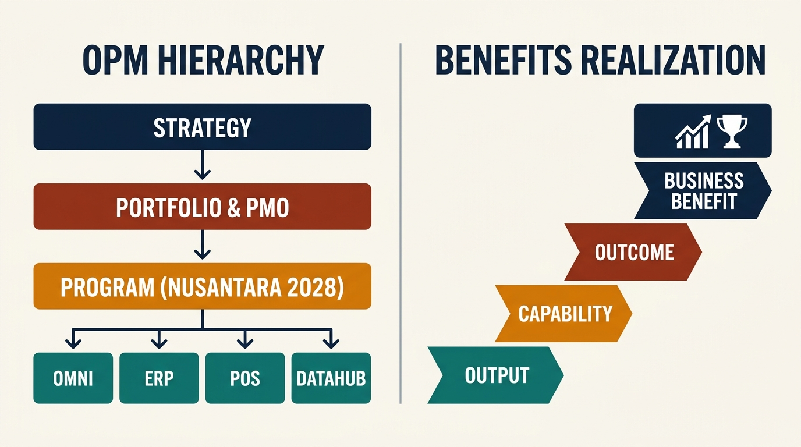
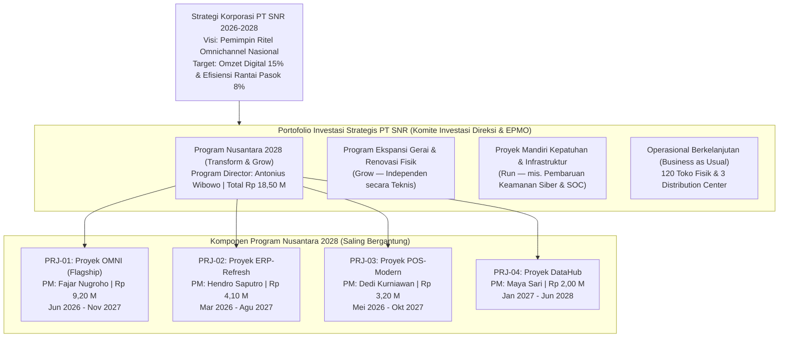
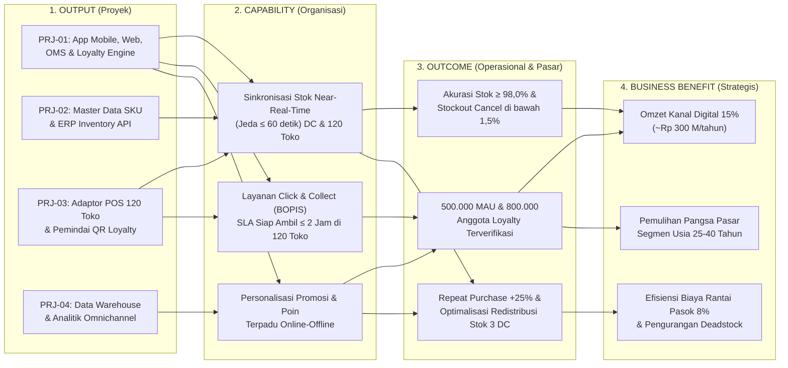
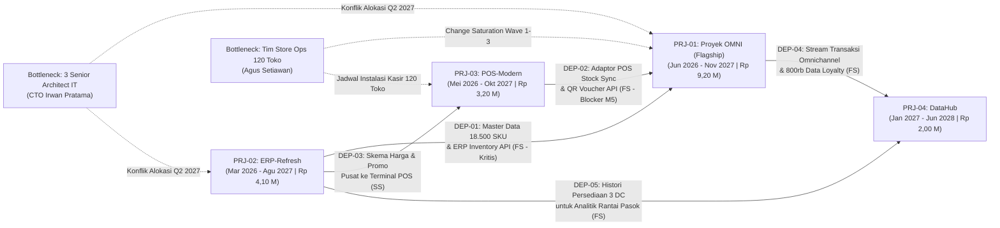
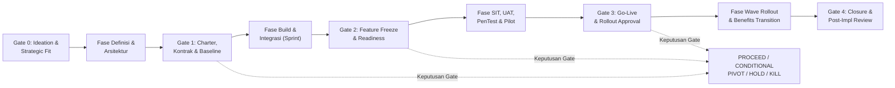

# Modul 05: Program Management & PMO

## 1. Identitas Modul

| Atribut | Keterangan |
|---------|------------|
| **Kelompok Jalur** | Jalur Utama — Project Management (Jilid I: *Leadership & Project Delivery*) |
| **Level Kompetensi** | Senior (setara standar *Program Management Professional* / PgMP & *PMO Certified Practitioner* / PMO-CP) |
| **Durasi Pembelajaran** | **12 jam sesi terstruktur** (4 sesi × 3 jam) + **±6 jam tugas mandiri** |
| **Prasyarat** | Telah menyelesaikan **Modul 01** (*Advanced Project Management*), **Modul 02** (*Project Planning & Execution*), **Modul 03** (*Risk, Issue & Stakeholder Management*), dan **Modul 04** (*Agile, Scrum & Hybrid Project Management*) |
| **Peran Sasaran** | Senior Project Manager, Program Manager, PMO Lead / Manager, Delivery Director, Head of IT Delivery, serta Senior BA/SA yang terlibat dalam tata kelola lintas proyek |
| **Keluaran Utama** | 1) *Program Benefits Realization Map & Benefits Register*, 2) *Cross-Project Dependency Matrix & Resource Capacity Plan*, 3) *PMO Executive RAG Dashboard*, dan 4) *Portfolio Prioritization Matrix (Weighted Scoring & Capital Rationing)* pada konteks **Program Nusantara 2028** |

---

## 2. Gambaran Modul

Pada Modul 01 hingga Modul 04, Anda telah menguasai disiplin memimpin satu proyek kompleks secara *end-to-end*—mulai dari menyusun *Project Charter*, mengendalikan jalur kritis, mengelola risiko dan pemangku kepentingan, hingga memadukan pendekatan *Predictive* dan *Agile* pada **Proyek OMNI** (Rp 9,20 M). Namun, pada kenyataannya di korporasi berskala menengah dan besar, hampir tidak ada inisiatif transformasi strategis yang benar-benar berdiri sendiri.

Perhatikan kenyataan di **PT Sinar Nusantara Retail Tbk (SNR)**: keberhasilan **Proyek OMNI** senilai Rp 9,20 M bergantung langsung pada ketersediaan *Master Data* SKU dan API inventori dari **Proyek ERP-Refresh** (Rp 4,10 M) serta adaptor sinkronisasi stok toko dan pemindai QR dari **Proyek POS-Modern** (Rp 3,20 M), sekaligus menjadi sumber data transaksi bagi **Proyek DataHub** (Rp 2,00 M). Keempatnya menyatu dalam **Program Nusantara 2028** senilai total **Rp 18,50 M**. Jika seorang Senior Project Manager hanya berfokus menyelesaikan *deliverable* (keluaran) proyeknya sendiri tepat waktu tanpa memahami orkestrasi lintas proyek, perebutan kapasitas sumber daya bersama (*shared resources*), serta realisasi manfaat bisnis pasca-*Go-Live*, maka organisasi dapat terjebak dalam paradoks klasik: *"proyek dinyatakan sukses secara teknis, tetapi bisnis tetap gagal mencapai target pertumbuhan dan efisiensi."*

Modul 05 mengangkat sudut pandang Anda dari level eksekusi taktis proyek (*doing projects right*) menuju level orkestrasi strategis program, PMO, dan portofolio (*doing the right programs and realizing sustained business value*). Anda akan mempelajari bagaimana *Program Director* **Antonius Wibowo** memimpin tata kelola Program Nusantara 2028, mendeteksi dan membongkar proyek semangka (*Watermelon Project*) lewat pelaporan *Red–Amber–Green* (RAG) berbasis data objektif, menengahi konflik sumber daya antar-PM, membangun *Project Management Office* (PMO) yang bernilai strategis tanpa menjadi "polisi birokrasi", serta membantu Direksi dan CFO **Budi Santoso** memprioritaskan investasi portofolio ketika anggaran perusahaan terbatas (*Capital Rationing*).

---

## 3. Capaian Pembelajaran

Setelah menyelesaikan Modul 05, peserta mampu:

1. **Membedakan dan menyelaraskan** mandat strategis, ukuran keberhasilan, serta mekanisme kendali antara *Project*, *Program*, dan *Portfolio* dalam kerangka *Organizational Project Management* (OPM).
2. **Merancang** *Benefits Realization Plan* dan *Benefits Register* secara menyeluruh—membedakan *Output*, *Capability*, *Outcome*, dan *Business Benefit*—lengkap dengan penetapan *Benefit Owner* dan rencana keberlanjutan (*Benefits Sustainment*) pasca-penutupan proyek.
3. **Mengelola** ketergantungan lintas proyek (*Cross-Project Dependencies*) dan kapasitas sumber daya terbatas bersama (*Shared Bottleneck Resources*) menggunakan peta ketergantungan terpadu serta teknik resolusi konflik prioritas antar-PM.
4. **Menerapkan** tata kelola program berbasis *Stage-Gate Framework*, batas wewenang perubahan (*Change Authority Thresholds*), dan audit kesehatan proyek (*Health Check*) untuk mengeksekusi keputusan *Proceed, Pivot, Hold*, atau *Kill* secara objektif.
5. **Mengevaluasi dan merancang** model *Project Management Office* (PMO) yang sesuai dengan tingkat maturitas organisasi (*Supportive, Controlling, Directive* hingga *Value-Driven EPMO / VMO*), sekaligus menyusun *Executive RAG Dashboard* yang kebal terhadap bias *Watermelon Reporting*.
6. **Menggunakan** teknik prioritisasi dan penyeimbangan portofolio—khususnya *Weighted Scoring Model*, *Cost of Delay / Weighted Shortest Job First* (WSJF), dan *Portfolio Balancing*—untuk menghasilkan keputusan alokasi investasi optimal di bawah keterbatasan modal (*Capital Rationing*).

---

## 4. Rencana Sesi

Pembelajaran tatap muka atau lokakarya daring dilaksanakan dalam **4 sesi × 3 jam = 12 jam** dengan komposisi pedagogis **±30% konsep (3,5 jam)**, **±50% workshop kasus Program Nusantara 2028 & Proyek OMNI (6,0 jam)**, dan **±20% diskusi/refleksi eksekutif (2,5 jam)**.

| Sesi | Durasi | Topik Utama | Konsep (±30%) | Workshop Kasus (±50%) | Diskusi & Refleksi (±20%) |
|------|--------|-------------|---------------|-----------------------|---------------------------|
| **Sesi 1** | 3 jam | **OPM, Program Lifecycle & Benefits Realization Management (BRM)** | 55 menit: Hierarki Project–Program–Portfolio; siklus hidup program; rantai *Output → Capability → Outcome → Benefit*; peran *Benefit Owner* | 90 menit: Menyusun *Benefits Realization Map* & *Benefits Register* Program Nusantara 2028 (omzet digital 15%, akurasi stok ≥ 98%, efisiensi rantai pasok 8%) | 35 menit: Bedah kasus kegagalan realisasi manfaat pasca-*Go-Live* & akuntabilitas COO vs PM |
| **Sesi 2** | 3 jam | **Cross-Project Dependencies, Shared Resources & Program Governance** | 50 menit: Klasifikasi dependensi lintas proyek; *Integrated Program Roadmap*; *Stage-Gate Framework*; *Change Authority Thresholds* | 90 menit: Membangun *Cross-Project Dependency Matrix* PRJ-01..PRJ-04 & simulasi negosiasi alokasi 3 *senior architect* IT bersama CTO dan antar-PM | 40 menit: Debat terpandu keputusan *Kill / Pivot / Proceed* saat proyek komponen terlambat di jalur kritis |
| **Sesi 3** | 3 jam | **PMO Operating Model, Maturitas & Executive RAG Reporting** | 55 menit: Tipe PMO (*Supportive, Controlling, Directive*), EPMO & VMO; Model Maturitas Level 1–5; KPI vs OKR; kriteria RAG objektif & anti-*Watermelon* | 90 menit: Audit *Health Check* Bulan ke-9 Program Nusantara 2028, mendiagnosis *Watermelon Project* PRJ-03 POS-Modern, dan menyusun *PMO Executive Dashboard* | 35 menit: Refleksi *Anti-Patterns*: bagaimana mencegah PMO menjadi "polisi template" di organisasi peserta |
| **Sesi 4** | 3 jam | **Portfolio Management, Weighted Scoring, WSJF & Capital Rationing** | 50 menit: *Strategic Alignment*; *Weighted Scoring Model*; *Cost of Delay / WSJF*; *Portfolio Balancing* (*Run–Grow–Transform*, Risiko vs Nilai); *Capital Rationing* | 90 menit: Simulasi *Investment Committee* SNR Tahun 2027—menghitung skor tertimbang 4 inisiatif baru di bawah pagu CFO Rp 3,50 M & mempresentasikan rekomendasi ke Direksi | 40 menit: *Executive Q&A* ala C-Level, kuis cepat pemantapan konsep, dan *briefing* tugas mandiri ±6 jam |
| **Total** | **12 jam** | **4 Sesi Terpadu** | **3,5 jam (29%)** | **6,0 jam (50%)** | **2,5 jam (21%)** |

---

## 5. Materi



### 5.1 Hierarki Manajemen Organisasi (OPM): Project vs. Program vs. Portfolio

Dalam kerangka *Organizational Project Management* (OPM — manajemen proyek organisasional yang menyelaraskan strategi korporasi dengan eksekusi proyek) menurut *Project Management Institute* (PMI), strategi bisnis diwujudkan melalui tiga lapisan pengelolaan yang berbeda sifat, horizon waktu, serta mandat kepemimpinannya: **Portfolio** (portofolio), **Program** (program), dan **Project** (proyek).

1. **Project (Proyek):** Usaha sementara (*temporary endeavor*) yang memiliki awal dan akhir yang jelas untuk menghasilkan produk, layanan, atau hasil unik (*unique deliverable / output*). Fokus utama Project Manager adalah mengendalikan ruang lingkup, jadwal, biaya, mutu, dan risiko agar *output* terserahkan sesuai *baseline*. Contoh: **Proyek OMNI** (Rp 9,20 M) membangun aplikasi mobile, web e-commerce, OMS, *Click & Collect*, dan *Digital Loyalty Engine* sebelum 26 November 2027.
2. **Program (Program):** Sekelompok proyek terkait, subprogram, dan aktivitas program yang dikelola secara terkoordinasi untuk memperoleh **manfaat (*benefits*) dan tingkat kendali yang tidak mungkin dicapai apabila proyek-proyek tersebut dikelola secara terpisah** (*The Standard for Program Management*, PMI). Kunci pembeda sebuah program adalah adanya **ketergantungan antarkomponen (*interdependencies*)** dan **sinergi manfaat bisnis bersama**. Contoh: **Program Nusantara 2028** (Rp 18,50 M) mengorkestrasi PRJ-01 OMNI, PRJ-02 ERP-Refresh, PRJ-03 POS-Modern, dan PRJ-04 DataHub. Jika Proyek OMNI berjalan tanpa adaptor POS-Modern dan *Master Data* ERP-Refresh, janji stok real-time dan efisiensi rantai pasok 8% mustahil terwujud.
3. **Portfolio (Portofolio):** Kumpulan program, proyek, subportofolio, dan kegiatan operasional yang dikelola sebagai satu kesatuan untuk mencapai **tujuan strategis organisasi** (*The Standard for Portfolio Management*, PMI). Komponen-komponen di dalam portofolio **tidak harus saling bergantung secara teknis**, tetapi mereka **bersaing memperebutkan sumber daya, kapasitas talenta, dan anggaran modal (*capital budget*) perusahaan yang terbatas**. Fokus utama *Portfolio Manager* atau Komite Investasi Eksekutif adalah memilih bauran inisiatif yang tepat (*doing the right work*), menyeimbangkan risiko dan nilai, serta memastikan keselarasan terhadap rencana strategis korporasi (*Strategic Plan*).



*Gambar 5.1 — Hierarki OPM PT Sinar Nusantara Retail: Penyelarasan Strategi Korporasi ke Portofolio, Program Nusantara 2028, dan Empat Proyek Komponen.*

Tabel berikut merangkum perbedaan fundamental antara *Project*, *Program*, dan *Portfolio* yang wajib dikuasai oleh seorang praktisi senior.

| Dimensi Pembeda | Project (Proyek) | Program (Program) | Portfolio (Portofolio) |
|-----------------|------------------|-------------------|------------------------|
| **Pertanyaan Inti** | *"Apakah kita mengeksekusi pekerjaan ini dengan benar?"* (*Doing projects right*) | *"Apakah sinergi antarproyek ini mewujudkan manfaat bisnis yang dijanjikan?"* (*Realizing coordinated benefits*) | *"Apakah kita menginvestasikan uang dan talenta pada inisiatif yang paling tepat?"* (*Doing the right things*) |
| **Ruang Lingkup (*Scope*)** | Spesifik, terdefinisi pada *Scope Baseline* / *Product Backlog*; berubah lewat kontrol perubahan ketat | Luas dan berkembang secara bertahap seiring penyesuaian kebutuhan manfaat bisnis | Menyeluruh tingkat korporasi atau unit bisnis; berubah mengikuti pergeseran strategi perusahaan |
| **Hubungan Antarkomponen** | Aktivitas dan paket kerja (WBS) di dalam satu proyek | Proyek-proyek yang **saling bergantung** dan mengejar manfaat bisnis terpadu | Program, proyek, dan operasional yang **tidak harus terkait teknis**, tetapi berbagi pagu anggaran & sumber daya |
| **Sikap terhadap Perubahan** | Mengendalikan perubahan secara ketat untuk melindungi *baseline* | Mengharapkan dan mengorkestrasi perubahan lintas komponen guna memaksimalkan *benefits* | Memantau perubahan lingkungan makro, regulasi, dan pasar untuk *rebalancing* portofolio |
| **Horizon Waktu** | Sementara (*temporary*), berakhir saat *deliverable* diserahterimakan dan proyek ditutup | Lebih panjang daripada proyek tunggal; berakhir setelah manfaat inti beralih ke operasional (*transitioned*) | Berkelanjutan (*continuous / ongoing*) seumur strategi perusahaan, dievaluasi berkala (kuartalan/tahunan) |
| **Definisi Keberhasilan** | Ketepatan lingkup, jadwal, biaya (*on-time, on-budget*), mutu teknis, dan kepuasan pelanggan | Realisasi manfaat bisnis (*benefits realization*), ROI program, dan keberlanjutan kapabilitas baru | Kinerja agregat portofolio, pencapaian target strategis korporasi, dan keseimbangan risiko vs imbal hasil |
| **Pemimpin Utama** | Project Manager (contoh: Fajar Nugroho) | Program Manager / Program Director (contoh: Antonius Wibowo) | Portfolio Manager / VP Strategy / Komite Investasi Direksi (Hendra Wijaya, Budi Santoso, dkk.) |

---

### 5.2 Program Lifecycle & Benefits Realization Management (BRM)

Salah satu kesalahan paling mahal di dunia manajemen proyek adalah menganggap pekerjaan selesai begitu sistem berstatus *Go-Live* dan berita acara serah terima (*User Acceptance Test* / UAT *Sign-Off*) ditandatangani. Faktanya, **proyek berhenti pada *output*, sedangkan nilai bisnis baru mulai tumbuh setelah *output* dipakai secara konsisten oleh operasional**. Di sinilah letak jantung *Program Management*, yaitu **Benefits Realization Management (BRM)** — disiplin terstruktur untuk mengidentifikasi, merencanakan, merealisasikan, mengalihkan, dan mempertahankan manfaat bisnis dari investasi program.

#### Siklus Hidup Program (*Program Life Cycle*)
Merujuk *The Standard for Program Management* (PMI), setiap program melewati tiga fase besar:
1. **Program Definition (Definisi Program):** Memastikan keselarasan visi program dengan strategi organisasi, menyusun *Program Business Case*, *Program Charter*, *Program Roadmap*, dan *Benefits Realization Plan*, serta mendapatkan otorisasi pendanaan dari *Program Steering Committee*.
2. **Program Delivery (Eksekusi & Penghantaran Program):** Menginisiasi, mengoordinasikan, memantau, dan menutup proyek-proyek komponen secara bertahap (*incremental delivery*) sambil mulai mengalirkan kapabilitas dan manfaat awal (*early benefits*) ke unit bisnis.
3. **Program Closure (Penutupan Program):** Memastikan seluruh proyek komponen selesai, manfaat bisnis telah resmi dialihkan ke operasional (*Benefits Transition*) beserta rencana keberlanjutannya (*Sustainment Plan*), sumber daya dibebaskan, dan pelajaran program (*Lessons Learned*) diarsipkan di PMO.

#### Rantai Nilai BRM: Output vs. Capability vs. Outcome vs. Business Benefit
Seorang Senior PM maupun Program Director wajib membedakan empat tingkatan kausalitas nilai berikut agar laporan eksekutif tidak mencampuradukkan aktivitas teknis dengan dampak bisnis:

- **Output (Keluaran Proyek):** Produk, sistem, dokumen, atau artefak konkret yang dibangun dan diserahkan oleh proyek. *Contoh:* Aplikasi mobile OMNI iOS/Android terbit, adaptor API POS-Modern terpasang di 120 toko, dan 1.440 staf toko selesai mengikuti pelatihan.
- **Capability (Kapabilitas Baru):** Kemampuan operasional baru yang kini dimiliki organisasi karena adanya *output* proyek yang telah terintegrasi dengan proses kerja (*SOP*) dan manusia (*people*). *Contoh:* Jaringan 120 toko SNR kini mampu menerima pesanan *Click & Collect* secara daring dan menyiapkan barang di rak dalam waktu **≤ 2 jam** dengan informasi stok *near-real-time* (jeda ≤ 60 detik).
- **Outcome (Hasil Perilaku / Perubahan Operasional):** Perubahan nyata dan terukur pada kinerja operasional atau perilaku pelanggan setelah kapabilitas digunakan secara rutin. *Contoh:* Akurasi stok lintas kanal melonjak dari **88,6% menjadi ≥ 98,0%**, tingkat pembatalan pesanan akibat *stockout* turun dari **11,4% menjadi < 1,5%**, dan pelanggan mencapai **500.000 *Monthly Active Users* (MAU)** serta **800.000 anggota loyalty terverifikasi** dengan *repeat purchase* +25%.
- **Business Benefit (Manfaat Bisnis Strategis):** Dampak finansial atau nilai strategis bersih yang dapat dibukukan pada laporan keuangan atau posisi kompetitif perusahaan. *Contoh:* Kontribusi omzet kanal digital naik dari **3,5% (~Rp 64,75 M) menjadi 15% (~Rp 300 M/tahun)** dalam 18 bulan pasca-*Go-Live*, serta **efisiensi biaya rantai pasok sebesar 8%** per tahun.



*Gambar 5.2 — Peta Realisasi Manfaat (Benefits Realization Map) Program Nusantara 2028: Menautkan Output Empat Proyek hingga Manfaat Bisnis Terukur.*

#### Lima Tahap Siklus Hidup Manfaat (*Benefits Management Life Cycle*)
1. **Benefits Identification:** Menetapkan daftar manfaat strategis dan operasional yang diharapkan, menyusun *Benefits Register* awal, serta memvalidasi keterkaitannya dengan sasaran korporasi.
2. **Benefits Analysis & Planning:** Memetakan ketergantungan *Output → Capability → Outcome → Benefit*, menetapkan *baseline*, target kuantitatif, jadwal pencapaian (*timing*), **Benefit Owner** (harus berasal dari pimpinan bisnis/operasional yang berwenang mengubah proses harian—seperti COO, VP Marketing, atau Head of Supply Chain—**bukan** Project Manager!), dan menyusun *Benefits Realization Plan*.
3. **Benefits Delivery:** Memantau indikator awal (*leading indicators*) selama proyek berjalan dan meninjau ulang validitas *Business Case* setiap kali terjadi perubahan ruang lingkup, keterlambatan jadwal, atau perubahan kondisi pasar.
4. **Benefits Transition:** Mengalihkan tanggung jawab pemanfaatan kapabilitas secara resmi dari tim program ke unit bisnis operasional (*handover* SOP, pelatihan, dukungan *hypercare*, serta pemindahan *ownership* KPI ke kartu skor kinerja unit bisnis).
5. **Benefits Sustainment:** Memastikan manfaat tidak menguap (*benefit leakage*) dalam 6–24 bulan setelah program ditutup. Di PT SNR, PMO bersama CFO dan COO melakukan *Post-Implementation Benefits Review* (audit pasca-implementasi) pada bulan ke-3, ke-6, ke-12, dan ke-18 pasca-*Go-Live* untuk memverifikasi bahwa target omzet digital 15% dan efisiensi rantai pasok 8% benar-benar tercapai dan dipertahankan.

---

### 5.3 Cross-Project Dependency Management & Resource Capacity Planning

Pada program multiproyek, kegagalan paling sering bukan berasal dari buruknya manajemen internal masing-masing proyek, melainkan dari **celah antarproyek (*white spaces between projects*)**. Celah ini terwujud dalam dua bentuk kritis: ketergantungan lintas proyek (*Cross-Project Dependencies*) dan perebutan sumber daya bersama yang langka (*Shared Bottleneck Resources*).

#### Lima Tipe Ketergantungan Lintas Proyek
1. **Ketergantungan Teknis & Antarmuka (*Technical / Interface Dependency*):** Proyek A tidak dapat menyelesaikan integrasi atau pengujian sebelum Proyek B menyerahkan API, skema integrasi, atau lingkungan *sandbox*. *Contoh:* Release 3 Proyek OMNI (*Click & Collect*) bergantung keras pada rilis API sinkronisasi stok toko dari PRJ-03 POS-Modern.
2. **Ketergantungan Data & *Master Data* (*Data Dependency*):** Kualitas keluaran suatu proyek bergantung pada pembakuan data dari proyek lain. *Contoh:* OMS pada PRJ-01 OMNI membutuhkan *Master Data* 18.500 SKU yang bersih dari PRJ-02 ERP-Refresh; sebaliknya PRJ-04 DataHub bergantung pada skema log transaksi produksi PRJ-01 OMNI.
3. **Ketergantungan Sumber Daya Bersama (*Shared Resource Dependency*):** Beberapa proyek membutuhkan keahlian spesialis langka atau tim operasional yang sama pada jendela waktu yang beririsan. *Contoh:* PRJ-01 OMNI dan PRJ-02 ERP-Refresh sama-sama memperebutkan **3 *senior architect* IT** di bawah CTO Irwan Pratama, sementara PRJ-01 OMNI dan PRJ-03 POS-Modern sama-sama membutuhkan waktu 120 Store Manager di bawah Agus Setiawan (*Store Operations*) untuk instalasi kasir dan pelatihan *Click & Collect*.
4. **Ketergantungan Operasional & Kesiapan Bisnis (*Operational / Change Readiness Dependency*):** Unit bisnis memiliki batas daya serap perubahan (*change saturation*). Jika 120 toko dipaksa menerima pergantian terminal kasir POS-Modern dan *rollout* *Click & Collect* OMNI pada minggu yang persis sama tanpa koordinasi gelombang (*wave coordination*), antrean toko akan lumpuh dan memicu resistensi massal.
5. **Ketergantungan Regulasi & Komersial (*Regulatory / Contractual Dependency*):** Kepatuhan UU PDP dan uji keamanan *Penetration Testing* lintas aplikasi (OMNI + POS + DataHub) harus lulus serempak agar *veto power* Head of Legal & InfoSec (Rina Kartika) dapat dicabut sebelum *Go-Live*.



*Gambar 5.3 — Peta Ketergantungan Lintas Proyek (Cross-Project Dependency Map) dan Titik Bottleneck Sumber Daya pada Program Nusantara 2028.*

#### Integrated Program Roadmap & Kapasitas Sumber Daya Lintas Proyek
Untuk mengendalikan ketergantungan tersebut, *Program Director* memelihara dua instrumen hidup (*living artifacts*):
1. **Integrated Program Roadmap (Peta Jalan Program Terpadu):** Garis waktu makro yang menampilkan *milestone* antarmuka (*handoff milestones*) antarproyek—bukan ratusan tugas mikro WBS—sehingga setiap pergeseran 1 minggu pada proyek hulu (misalnya PRJ-03) langsung terlihat dampaknya pada proyek hilir (PRJ-01).
2. **Program Resource Capacity Planning:** Memetakan pasokan (*supply*) jam kerja efektif peran langka (arsitek IT, DBA, *security engineer*, *trainer* toko) dibandingkan permintaan agregat (*aggregate demand*) dari seluruh proyek aktif. Jika utilisasi melampaui **85% kapasitas efektif**, risiko kelelahan (*burnout*) dan antrean keterlambatan meningkat eksponensial.

#### Protokol Resolusi Konflik Prioritas Antar-PM
Ketika Fajar Nugroho (PM OMNI) dan Hendro Saputro (PM ERP-Refresh) memperebutkan 3 *senior architect* IT pada Mei–Juni 2027, konflik tidak boleh diselesaikan dengan cara "siapa yang paling keras melobi CTO". Program Director menerapkan **hierarki resolusi objektif 4 langkah**:
1. **Evaluasi Jalur Kritis Program (*Program Critical Path*) & *Float*:** Proyek dengan *Total Float* = 0 dan tenggat mutlak (*hard deadline* 26 Nov 2027 sebelum Harbolnas 12.12) mendapat prioritas utama dibanding proyek yang masih memiliki *float* 3 minggu.
2. **Analisis *Cost of Delay* (Biaya Keterlambatan):** Menghitung kerugian finansial jika proyek A mundur 1 minggu dibandingkan proyek B mundur 1 minggu.
3. **Teknik Dekoupling & Penyeimbangan (*Decoupling & Resource Leveling*):** Memisahkan ketergantungan teknis lewat *API Contract-First / Mock Service* (sehingga tim OMNI tetap bisa mengembangkan kode meski API POS-Modern belum selesai), menjadwal ulang pekerjaan ber-*float* positif, dan menerapkan *time-boxing* (misalnya arsitek fokus 4 hari di OMNI, 1 hari tinjauan desain ERP, menghindari *context switching* per jam).
4. **Penambahan Kapasitas Terarah (*Targeted Augmentation*):** Jika defisit kapasitas pada jalur kritis tetap tak teratasi setelah *leveling*, Program Director mengajukan persetujuan ke SteerCo untuk menyewa *specialist contractor* jangka pendek dari *Contingency Reserve* atau *Program Management Reserve*.

---

### 5.4 Program Governance & Stage-Gate Framework

Tata kelola program (*Program Governance*) adalah kerangka kebijakan, struktur pengambilan keputusan, batas kewenangan, dan mekanisme pengawasan yang memastikan program tetap selaras dengan strategi perusahaan, mengelola risiko secara proaktif, serta menggunakan dana secara akuntabel.

#### Struktur Tata Kelola Berlapis
Pada PT Sinar Nusantara Retail, tata kelola Program Nusantara 2028 berjalan dalam tiga lapis:
- **Lapisan Strategis — *Executive Steering Committee* (SteerCo):** Diketuai CEO **Hendra Wijaya** dengan anggota COO **Ratna Kusuma**, CFO **Budi Santoso**, CTO **Irwan Pratama**, dan VP Marketing **Dewi Lestari**. Bersidang bulanan (atau *ad-hoc* jika ada eskalasi *RED*) untuk menyetujui *Stage-Gate*, perubahan *baseline* mayor, pencairan *Management Reserve*, dan keputusan *Kill/Pivot*.
- **Lapisan Orkestrasi Program — *Program Director & Enterprise PMO*:** Dipimpin **Antonius Wibowo** bersama *Program Change Control Board* (PCCB). Mengadakan *Program Sync* mingguan bersama seluruh PM (PRJ-01 s.d. PRJ-04), menengahi konflik lintas proyek, menjalankan audit kesehatan (*Health Check*), dan menyaring laporan status agar objektif sebelum naik ke SteerCo.
- **Lapisan Eksekusi Proyek — *Project Delivery Teams*:** Masing-masing PM (seperti **Fajar Nugroho** pada Proyek OMNI) memimpin tim lintas fungsi dan vendor (PT NDS) sesuai otoritas harian yang didelegasikan dalam *Project Charter*.

#### Change Authority Thresholds (Matriks Batas Wewenang Perubahan)
Tanpa batas wewenang yang tegas, SteerCo akan tenggelam dalam keputusan teknis remeh, atau sebaliknya PM mengambil risiko finansial di luar mandatnya. Tabel berikut menjadi standar *Change Authority Thresholds* Program Nusantara 2028:

| Dimensi Dampak Perubahan | Tingkat 1: Project Manager (mis. Fajar Nugroho) | Tingkat 2: Program Director / PCCB (Antonius Wibowo) | Tingkat 3: Executive Steering Committee (CEO, COO, CFO, CTO) |
|--------------------------|--------------------------------------------------|------------------------------------------------------|--------------------------------------------------------------|
| **Dampak Biaya (*Cost*)** | ≤ Rp 100 jt (memakai *Contingency Reserve* proyek yang telah dialokasikan, total BAC tetap) | > Rp 100 jt s.d. Rp 350 jt (atau realokasi anggaran antarproyek komponen tanpa mengubah pagu Program Rp 18,50 M) | > Rp 350 jt, pencairan *Management Reserve* (Rp 0,60 M di OMNI), atau kenaikan total pagu Program > Rp 18,50 M |
| **Dampak Jadwal (*Schedule*)** | Deviasi ≤ 1 minggu pada aktivitas non-kritis (*float* > 0); tidak mengubah tanggal *milestone* kontrak | Deviasi > 1 s.d. 3 minggu pada *milestone* antarmuka antarproyek; *hard deadline* program tetap utuh | Deviasi > 3 minggu atau pergeseran *hard deadline* Go-Live Nasional (26 Nov 2027) |
| **Dampak Ruang Lingkup & Manfaat** | Penyesuaian minor *user story* / *backlog* tanpa mengubah *Scope Baseline* dan target manfaat | Perubahan lingkup lintas komponen yang berdampak < 5% target manfaat dan masih selaras *Business Case* | Perubahan *Scope Baseline* mayor, pengurangan fitur inti (*Click & Collect* / Loyalty), atau deviasi manfaat > 5% |
| **Kepatuhan & Keamanan** | Tidak berwenang melonggarkan standar kepatuhan | Rekomendasi teknis mitigasi bersama Head of Legal & InfoSec | Wajib persetujuan *veto* Rina Kartika & SteerCo untuk segala pengecualian (*waiver*) risiko UU PDP / PCI-DSS |

#### Stage-Gate Framework & Kriteria Keputusan (Proceed / Pivot / Hold / Kill)
*Stage-Gate* (atau *Phase-Gate*) adalah titik pemeriksaan formal di antara fase program di mana SteerCo menilai apakah investasi masih layak dilanjutkan berdasarkan bukti objektif—bukan berdasarkan emosi atau *sunk cost fallacy* (keengganan menghentikan proyek hanya karena uang sudah terlanjur banyak dikeluarkan).



*Gambar 5.4 — Kerangka Stage-Gate Program Nusantara 2028 beserta Empat Opsi Keputusan Tata Kelola pada Setiap Gerbang.*

Pada setiap gerbang, SteerCo secara sadar memilih satu dari empat keputusan berikut:
1. **Proceed (Lanjutkan):** Seluruh kriteria kelulusan terpenuhi; dana fase berikutnya dicairkan (*staged funding*). *Contoh:* Gate 1 disetujui setelah arsitektur ditandatangani CTO dan kontrak PT NDS efektif.
2. **Proceed with Conditions / Pivot (Ubah Arah / Lingkup):** Dasar bisnis masih kuat, tetapi jalur eksekusi, arsitektur, atau cakupan harus diubah. *Contoh:* Jika adaptor API POS-Modern gagal diuji pada Gate 2, SteerCo dapat melakukan *Pivot* sementara memakai integrasi *micro-batch* 5 menit untuk 28 toko *legacy* sembari mengejar *firmware patch*, agar target 26 Nov 2027 tetap aman.
3. **Hold / Pause (Tunda Sementara):** Terdapat ketergantungan eksternal kritis, perubahan regulasi, atau *bottleneck* kapasitas yang harus diselesaikan sebelum pembakaran anggaran dilanjutkan.
4. **Kill / Terminate (Hentikan):** *Business Case* sudah tidak layak (misalnya biaya EAC melonjak > 40% sehingga NPV menjadi negatif, atau asumsi pasar berubah drastis). **Kemampuan menghentikan proyek yang tidak lagi menciptakan nilai adalah ciri kedewasaan tata kelola program tingkat tinggi**, bukan tanda kegagalan PMO.

#### Audit & Health Check Proyek Independen
PMO secara berkala (minimal per kuartal atau saat proyek masuk status *AMBER* dua bulan berturut-turut) menjalankan **Project Health Check**—tinjauan independen berbasis bukti (*evidence-based*) oleh auditor PMO yang tidak terlibat dalam pekerjaan harian proyek. Audit memeriksa 6 area: (1) validitas perhitungan EVM dan progres fisik riil (*physical % complete*), (2) keaktifan mitigasi risiko puncak, (3) kualitas kode/cacat (*defect density*) dan kesiapan kepatuhan UU PDP, (4) kesehatan relasi vendor & kontrak, (5) kejelasan dependensi lintas proyek, serta (6) tingkat kesiapan adopsi bisnis (*change readiness*).

---

### 5.5 Project Management Office (PMO): Tipe, Evolusi Nilai & Model Maturitas

**Project Management Office (PMO)** adalah unit organisasi yang menstandarkan proses tata kelola terkait proyek serta memfasilitasi pembagian sumber daya, metodologi, alat, dan teknik. Namun, tidak semua PMO memiliki mandat yang sama. Kesalahan terbesar banyak perusahaan adalah membentuk PMO tanpa menyepakati mandat kekuasaan dan ekspektasi nilainya.

#### Tiga Tipe Klasik PMO & Evolusi Modern (EPMO dan VMO)

| Tipe PMO | Tingkat Kendali | Peran & Tanggung Jawab Utama | Cocok untuk Organisasi | Risiko Jika Salah Diterapkan |
|----------|-----------------|------------------------------|------------------------|------------------------------|
| **1. Supportive PMO** *(Pendukung)* | Rendah | Bertindak sebagai konsultan internal: menyediakan *template*, *best practices*, pelatihan, repositori *lessons learned*, dan *coaching* PM | Organisasi terdesentralisasi dengan unit bisnis otonom dan PM yang sudah matang | Diabaikan oleh unit bisnis; inkonsistensi pelaporan ke Direksi |
| **2. Controlling PMO** *(Pengendali)* | Menengah | Mewajibkan kepatuhan terhadap kerangka kerja, standar pelaporan RAG/EVM, *Stage-Gate*, dan audit *Health Check*; PM tetap melapor ke unit masing-masing | Organisasi menengah–besar yang butuh visibilitas portofolio & disiplin tata kelola (seperti **PT SNR saat ini**) | Terjebak menjadi **"polisi birokrasi"** jika fokus pada formulir alih-alih solusi hambatan |
| **3. Directive PMO** *(Pengarah Langsung)* | Tinggi | Mengambil alih langsung kendali proyek; seluruh PM berada di bawah struktur organisasi PMO dan ditugaskan ke proyek strategis | Organisasi berisiko tinggi (perbankan inti, migas, konstruksi, transformasi krusial) yang menuntut standardisasi mutlak | Kurang lincah (*rigid*); konflik kepemilikan dengan kepala unit bisnis operasional |
| **4. Strategic Enterprise PMO (EPMO)** | Strategis (C-Level) | Melapor langsung ke CEO/COO; menyelaraskan strategi korporasi ke portofolio, mengelola *Benefits Realization*, prioritisasi investasi, dan kapasitas SDM korporasi | Korporasi yang menjalankan transformasi multi-tahun lintas direktorat | Terputus dari realitas tim lapangan jika tidak membangun jembatan ke praktisi delivery |
| **5. Agile PMO / Value Management Office (VMO)** | Adaptif & Berbasis Nilai | Berevolusi dari kendali *output* dan kepatuhan rencana menuju aliran nilai (*value stream*), OKR, pendanaan berbasis produk (*Lean Portfolio Management*), dan menghilangkan hambatan lintas tim *Agile/Hybrid* | Organisasi produk digital atau *Hybrid Enterprise* yang mengutamakan kecepatan adaptasi pasar | Kehilangan disiplin audit keuangan dan kontrak jika mengabaikan fondasi tata kelola korporat |

#### Model Maturitas PMO (*PMO Maturity Model* — Level 1 s.d. Level 5)
Untuk membangun atau mentransformasi PMO secara bertahap (terinspirasi *OPM3* PMI dan *P3M3* AXELOS), organisasi perlu memetakan tingkat kematangannya saat ini:

- **Level 1 — Ad-Hoc (Awal / Tidak Terstruktur):** Tidak ada PMO formal; keberhasilan proyek bergantung pada "pahlawan individu" (*heroic PM*); setiap departemen memakai format jadwal dan pelaporan berbeda; proyek sering molor tanpa peringatan dini.
- **Level 2 — Repeatable / Basic PMO (Dasar):** PMO *Supportive* mulai dibentuk; tersedia *template* dasar (*Charter*, *Risk Register*, status mingguan); mulai ada inventarisasi daftar proyek aktif, tetapi kepatuhan masih bersifat sukarela.
- **Level 3 — Standardized / Defined PMO (Terstandarisasi):** PMO *Controlling* beroperasi penuh di tingkat korporasi; *Stage-Gate*, kriteria RAG objektif, *Integrated Change Control*, dan pelaporan EVM diterapkan seragam pada proyek strategis (posisi **Enterprise PMO PT SNR** di bawah Antonius Wibowo pada awal 2027).
- **Level 4 — Managed / Quantitatively Controlled EPMO (Terukur):** Keputusan portofolio dan kapasitas sumber daya berbasis data kuantitatif (*Weighted Scoring*, *Capacity Forecasting*, *Benefits Tracking* pasca-*Go-Live*); PMO aktif memprediksi risiko keterlambatan lintas program sebelum terjadi.
- **Level 5 — Optimized / Value-Driven VMO (Teroptimalisasi):** PMO menjadi mitra strategis Direksi dalam perumusan strategi; proses perbaikan berkelanjutan otomatis berjalan; organisasi mampu melakukan *rebalancing* portofolio dan aliran nilai (*value streams*) secara lincah mengikuti dinamika pasar.

#### Membangun & Mentransformasi PMO Tanpa Menjadi "Polisi Birokrasi"
Banyak PMO dibubarkan dalam 2–3 tahun pertama karena dianggap hanya menambah beban administrasi (*overhead*) tanpa mempercepat hasil. Untuk membangun PMO yang dicintai eksekutif sekaligus dipercaya para PM, terapkan 5 prinsip berikut:
1. **Mulai dari Masalah Nyata (*Pain-Driven Charter*):** Jangan langsung merilis buku SOP 200 halaman. Jika keluhan utama Direksi SNR adalah keterlambatan lintas proyek dan proyek semangka, jadikan **visibilitas dependensi** dan **RAG objektif** sebagai *Quick Win* 90 hari pertama.
2. **Proporsionalitas (*Right-Sized Governance / Tailoring*):** Bedakan kedalaman tata kelola berdasarkan ukuran dan risiko proyek (Tier 1 Strategis > Rp 3 M seperti Proyek OMNI memakai *Stage-Gate* & EVM penuh; Tier 3 Kecil < Rp 500 jt cukup memakai *1-page charter* dan *Kanban board*).
3. **Pelayanan Sebelum Kepatuhan (*Serve First, Govern Second*):** PMO harus membantu PM membuka kebuntuan eskalasi ke Direksi, memfasilitasi negosiasi sumber daya antar-direktorat, dan mengotomatisasi dasbor—sehingga PM melihat PMO sebagai pelindung (*enabler*), bukan auditor yang mencari kesalahan.
4. **Ukur Kinerja PMO dari Nilai Bisnis, Bukan Jumlah Laporan:** KPI PMO sejati bukanlah *"98% proyek mengumpulkan laporan Jumat sore"*, melainkan *"% program mencapai target manfaat bisnis"*, *"penurunan keterlambatan akibat dependensi lintas proyek"*, dan *"peningkatan akurasi prediksi biaya/jadwal portofolio"*.
5. **Amankan Sponsor Eksekutif yang Tegas:** Tanpa mandat nyata dari CEO/COO (seperti Hendra Wijaya dan Ratna Kusuma), PMO tidak akan mampu menembus ego sektoral antar-VP.

---

### 5.6 Executive Reporting, KPI, OKR & RAG Status Governance

Komunikasi eksekutif pada level program dan portofolio menuntut pergeseran dari laporan aktivitas (*"apa yang sedang dikerjakan tim minggu ini"*) menjadi laporan keputusan (*"apakah manfaat dan tenggat aman, di mana deviasi kritis, dan keputusan apa yang dibutuhkan Direksi hari ini"*).

#### KPI vs. OKR serta Leading vs. Lagging Indicators
- **KPI (*Key Performance Indicator*):** Metrik operasional berkelanjutan yang mengukur kesehatan proses atau capaian target terstandar. *Contoh:* SPI ≥ 0,95, CPI ≥ 0,95, *system uptime* ≥ 99,5%, akurasi stok ≥ 98,0%.
- **OKR (*Objectives and Key Results*):** Kerangka penetapan sasaran aspiratif berjangka pendek–menengah (kuartalan/tahunan) yang memicu terobosan strategis. *Contoh pada Program Nusantara 2028 Q3 2027:* **Objective:** *"Membuktikan kesiapan operasional Click & Collect yang dicintai pelanggan dan staf toko sebelum rollout nasional."* **KR 1:** Pilot 10 toko mencapai SLA persiapan ≤ 2 jam pada ≥ 95% pesanan; **KR 2:** Tingkat pembatalan *stockout* di 10 toko pilot turun dari 11,4% menjadi < 2,0%; **KR 3:** Skor kesiapan (*adoption score*) 10 Store Manager mencapai ≥ 4,2/5,0.
- **Lagging Indicators (Indikator Tertinggal / Hasil Akhir):** Mengukur hasil yang sudah terjadi—akurat untuk pertanggungjawaban, tetapi terlambat untuk pencegahan. *Contoh:* Omzet digital 15% pasca-*Go-Live*, deviasi biaya akhir proyek, atau total pembatalan pesanan bulan lalu.
- **Leading Indicators (Indikator Pendorong / Peringatan Dini):** Mengukur sinyal prediktif sebelum masalah membesar menjadi kegagalan. *Contoh:* Tren *Sprint Velocity* menurun 3 sprint berturut-turut, tingkat *defect leakage* di SIT, % penyelesaian *data cleansing* anggota loyalty per minggu, atau rasio kehadiran staf toko dalam sesi *Training-of-Trainers*. Dasbor eksekutif senior **wajib memadukan keduanya**.

#### Fenomena *Watermelon Project* & Kriteria Objektif Status RAG
Salah satu patologi paling berbahaya dalam pelaporan manajemen proyek adalah **Watermelon Project (Proyek Semangka)**: proyek yang di bagian luar (laporan bulanan ke Direksi) tampak **HIJAU (*Green*)**, namun begitu dibelah bagian dalamnya ternyata **MERAH (*Red*)** membara—jadwal di jalur kritis sudah mundur berminggu-minggu, kualitas pengujian buruk, atau anggaran membengkak tersembunyi. Penyebab utamanya ada dua: (1) **budaya takut eskalasi (*shoot the messenger culture*)** di mana status merah dianggap aib PM, dan (2) **ketiadaan ambang batas kuantitatif RAG**, sehingga PM bebas menilai status "hijau" berdasarkan perasaan subyektif atau metrik aktivitas yang menyesatkan (seperti menghitung % pemasangan perangkat keras sambil menyembunyikan kegagalan perangkat lunak).

Solusinya adalah **Matriks Kriteria Objektif Status RAG** yang mengikat seluruh proyek di bawah Enterprise PMO PT SNR:

| Dimensi Kinerja | **GREEN (Hijau — Terkendali)** | **AMBER (Kuning — Waspada / Koreksi PM–PD)** | **RED (Merah — Kritis / Eskalasi SteerCo)** |
|-----------------|-------------------------------|-----------------------------------------------|---------------------------------------------|
| **Jadwal (*Schedule*)** | SPI ≥ 0,95 **DAN** deviasi jalur kritis ≤ 1 minggu | 0,85 ≤ SPI < 0,95 **ATAU** deviasi jalur kritis > 1 s.d. 3 minggu | SPI < 0,85 **ATAU** deviasi jalur kritis > 3 minggu / mengancam *hard deadline* |
| **Biaya (*Cost*)** | CPI ≥ 0,95 **DAN** proyeksi EAC ≤ BAC + 5% | 0,88 ≤ CPI < 0,95 **ATAU** proyeksi EAC > BAC + 5% s.d. +10% | CPI < 0,88 **ATAU** proyeksi EAC > BAC + 10% (atau melampaui Total Funding) |
| **Lingkup & Mutu (*Scope/Quality*)** | 0 CR berdampak *baseline* belum diputuskan; 0 *defect Critical*; kepatuhan 100% | CR berdampak ≤ 5% BAC dalam kajian CCB; *defect High* terbuka > 5 | *Scope creep* tak terkendali; ≥ 1 *defect Critical* / isu kepatuhan UU PDP tak bermitigasi |
| **Risiko & Dependensi (*Risk/Dep*)** | Tidak ada risiko *High* tak bermitigasi; seluruh dependensi lintas proyek *on-track* | Risiko *High* bermitigasi aktif; dependensi mundur ≤ 2 minggu (terserap *float* / *workaround*) | Risiko *Critical* aktif **ATAU** dependensi jalur kritis mundur > 2 minggu dan memblokir proyek lain |
| **Manfaat (*Benefits*)** | Indikator *leading* ≥ 95% target; *Business Case* utuh | Proyeksi deviasi manfaat 5%–15%, masih dapat dipulihkan | Proyeksi deviasi manfaat > 15% atau ROI jatuh di bawah *hurdle rate* perusahaan |

**Aturan Emas Agregasi Overall RAG (Anti-Watermelon Rule):**
1. **Prinsip Tautan Terlemah (*Weakest-Link Rule*):** Jika **minimal 1 dimensi berstatus RED**, maka **Overall RAG WAJIB RED**. Status merah tidak boleh "dinetralkan" menjadi kuning atau hijau oleh dimensi lain yang hijau.
2. **Aturan Kuning:** Jika 0 dimensi RED, tetapi terdapat **≥ 2 dimensi AMBER** (atau 1 dimensi AMBER di jalur kritis tanpa rencana pemulihan terverifikasi), maka **Overall RAG = AMBER**.
3. **Aturan Hijau:** **GREEN** hanya diberikan jika seluruh dimensi GREEN, atau maksimal 1 dimensi non-kritis AMBER dengan deviasi ringan (< 3%) dan rencana pemulihan sudah disetujui PMO.
4. **Wajib *Path-to-Green*:** Setiap status AMBER atau RED pada dasbor eksekutif wajib disertai satu kolom ringkas berisi **Akar Masalah**, **Rencana Pemulihan (*Path-to-Green*)**, **Pemilik Aksi**, **Target Tanggal Pulih**, dan **Keputusan yang Diminta dari Direksi (*Ask from SteerCo*)**.

---

### 5.7 Portfolio Management, Prioritisasi & Strategic Alignment

Pada tingkat korporasi, permintaan ide proyek dari seluruh direktorat hampir selalu melebihi ketersediaan anggaran modal (*CapEx/OpEx*) dan kapasitas tim teknologi sebesar 2 hingga 4 kali lipat. Tanpa mekanisme seleksi portofolio yang objektif, organisasi akan jatuh ke jebakan **HIPPO (*Highest Paid Person's Opinion*)** atau **penuh-sesak proyek setengah jadi (*overcommitted portfolio*)** yang membuat semua proyek strategis melambat bersamaan.

#### 1. Weighted Scoring Model (Model Penilaian Tertimbang)
*Weighted Scoring Model* mengevaluasi seluruh kandidat inisiatif terhadap serangkaian kriteria strategis yang telah disepakati Direksi dan diberi bobot (total bobot = 100% atau 1,00).

$$\text{Skor Tertimbang}_i = \sum_{j=1}^{n} \left( w_j \times s_{i,j} \right)$$

di mana $w_j$ adalah bobot kriteria ke-$j$ ($\sum w_j = 1{,}00$), dan $s_{i,j}$ adalah skor kandidat inisiatif ke-$i$ pada kriteria ke-$j$ (umumnya skala 1–5 atau 1–10).

Untuk keputusan alokasi di bawah keterbatasan anggaran (*Capital Rationing*), praktisi senior melengkapinya dengan **Indeks Efisiensi Nilai per Rupiah (*Value-to-Cost Ratio*)** dan **Ambang Kelulusan Strategis (*Strategic Hurdle Score*, misalnya ≥ 3,00 dari 5,00)** agar proyek bernilai rendah tidak ikut lolos hanya demi menghabiskan sisa anggaran (*budget-filling*).

$$\text{Value-to-Cost Ratio}_i = \frac{\text{Skor Tertimbang}_i}{\text{Kebutuhan Anggaran}_i}$$

#### 2. Cost of Delay & WSJF (*Weighted Shortest Job First*)
Pada lingkungan portofolio *Agile / Lean Portfolio Management* (LPM) atau saat memprioritaskan epik lintas tim dalam suatu program, metode **WSJF** (dipopulerkan oleh Donald Reinertsen dan *Scaled Agile Framework* / SAFe) memaksimalkan nilai ekonomi yang mengalir lebih cepat dengan membagi **Biaya Keterlambatan (*Cost of Delay* / CoD)** terhadap **Ukuran/Durasi Pekerjaan (*Job Size / Duration*)**:

$$\text{WSJF} = \frac{\text{Cost of Delay (CoD)}}{\text{Job Size (Durasi Relatif)}}$$

$$\text{Cost of Delay} = \text{User-Business Value} + \text{Time Criticality} + \text{Risk Reduction / Opportunity Enablement (RR/OE)}$$

Keempat komponen dinilai secara relatif menggunakan deret Fibonacci termodifikasi (`1, 2, 3, 5, 8, 13, 20`). Pekerjaan dengan **WSJF tertinggi** dikerjakan terlebih dahulu.

**Contoh Penerapan WSJF pada Backlog Lintas Program Nusantara 2028 (Q1 2027):**

| Kandidat Epik Lintas Program | User-Business Value | Time Criticality | RR / OE | Total CoD | Job Size | Skor WSJF (CoD / Size) | Urutan Prioritas |
|------------------------------|--------------------:|-----------------:|--------:|----------:|---------:|-----------------------:|:----------------:|
| **Epik A:** Patch API Sinkronisasi Stok POS-Modern *(Blocker OMNI)* | 13 | 20 | 13 | **46** | 3 | **15,33** | **#1 (Kerjakan Segera)** |
| **Epik B:** Otomasi *Data Cleansing* 1,2 Juta Anggota Loyalty | 8 | 13 | 8 | **29** | 5 | **5,80** | **#2** |
| **Epik C:** Dasbor Analitik Prediktif Stok DataHub | 8 | 3 | 5 | **16** | 8 | **2,00** | **#3** |
| **Epik D:** Modul Gamifikasi *Spin-the-Wheel* Marketing | 5 | 2 | 1 | **8** | 5 | **1,60** | **#4 (Tunda)** |

Perhatikan betapa jernihnya logika ekonomi WSJF: meskipun Epik B dan Epik C sama-sama memiliki *Business Value* = 8, Epik A dan Epik B jauh lebih kritis secara waktu (*Time Criticality*) menjelang tenggat Harbolnas 12.12 serta berukuran lebih ringkas, sehingga menunda Epik A menyebabkan kerugian program terbesar per minggu.

#### 3. Portfolio Balancing & Capital Rationing
Memilih proyek semata-mata berdasarkan skor tertinggi atau NPV terbesar tetap bisa berbahaya jika seluruh anggaran menumpuk pada satu jenis risiko saja. *Portfolio Balancing* menyeimbangkan bauran investasi pada dua sumbu utama:
1. **Kerangka *Run – Grow – Transform*:**
   - **Run the Business (Operasional & Kepatuhan — ideal ±30%–40%):** Menjaga keandalan sistem inti, keamanan siber, dan kepatuhan regulasi (UU PDP, PCI-DSS). Tanpa porsi ini, fondasi perusahaan rentan lumpuh.
   - **Grow the Business (Pertumbuhan & Efisiensi — ideal ±40%–50%):** Meningkatkan pendapatan, efisiensi biaya, dan pangsa pasar pada model bisnis inti (contoh: *ERP-Refresh*, *POS-Modern*, *Smart Supply Chain*).
   - **Transform the Business (Inovasi & Model Baru — ideal ±15%–25%):** Menciptakan kapabilitas dan kanal pertumbuhan baru berisiko lebih tinggi namun bernilai strategis besar (contoh: *Proyek OMNI* sebagai mesin omnichannel baru).
2. **Matriks Risiko vs. Nilai (*Risk–Reward Bubble Chart*):** Memetakan ukuran anggaran (luas gelembung) terhadap probabilitas keberhasilan (sumbu X) dan nilai bisnis (sumbu Y): *Pearls* (peluang tinggi, nilai tinggi — wajib didanai), *Oysters* (peluang rendah/menengah, nilai terobosan sangat tinggi — didanai terukur lewat *pilot*), *Bread & Butter* (peluang tinggi, nilai moderat — jaga secukupnya), dan *White Elephants* (peluang rendah, nilai rendah — wajib dihentikan/*kill*).
3. **Capital Rationing (Penjatahan Modal):** Ketika total anggaran usulan melebihi pagu CFO, PMO memformulasikan optimasi kombinasi (*knapsack optimization*): memilih kombinasi proyek berstatus lolos ambang (*above hurdle*) yang memaksimalkan total nilai tertimbang **tanpa melampaui pagu dana maupun batas kapasitas sumber daya kritis (misalnya arsitek IT)**. Sisa dana di bawah pagu tidak dipaksakan untuk proyek berperingkat rendah, melainkan disimpan sebagai *Portfolio Management Reserve* atau membiayai fase *pilot* terkendali.

---

### 5.8 Kesalahan Umum di Lapangan (*Anti-Patterns*)

1. ***Watermelon Reporting* (Pelaporan Semangka):** PM melabeli status proyek *GREEN* berbulan-bulan karena takut dimarahi sponsor atau hanya mengukur metrik aktivitas permukaan (*% instalasi perangkat*), lalu tiba-tiba mengubah status menjadi *RED* dua minggu sebelum *Go-Live* ketika opsi pemulihan sudah habis. **Obat:** Kriteria RAG objektif berbasis EVM/jalur kritis, audit *Health Check* PMO independen, dan budaya kepemimpinan yang mengapresiasi eskalasi dini (*bad news early is good news*).
2. ***Bureaucratic / "Template Police" PMO*:** PMO hanya sibuk mengejar kelengkapan tanda tangan dan 15 formulir mingguan tanpa memahami realitas bisnis, tidak membantu membuka hambatan lintas direktorat, dan memperlakukan proyek Rp 300 jt dengan birokrasi yang sama beratnya dengan proyek Rp 10 M. **Obat:** Terapkan *Right-Sized Governance* (berjenjang sesuai Tier risiko/nilai) dan ukur KPI PMO dari kelancaran aliran nilai.
3. ***Output Obsession & Post-Go-Live Abandonment* (Melupakan Realisasi Manfaat):** Tim proyek dibubarkan merayakan *Go-Live* sistem baru tanpa pernah menetapkan *Benefit Owner* bisnis, tanpa menyelaraskan insentif staf operasional (seperti kekhawatiran 120 Store Manager SNR terhadap *Click & Collect*), dan tanpa audit manfaat 6–18 bulan kemudian. **Obat:** Tetapkan *Benefit Owner* dari lini bisnis sejak *Program Definition* dan wajibkan *Benefits Transition & Sustainment Plan*.
4. ***Pseudo-Program* (Program Semu):** Mengelompokkan 10 proyek yang sama sekali tidak saling terkait hanya demi membuat jabatan "Program Director" atau menggabungkan anggaran agar terlihat besar. Akibatnya, rapat program menjadi buang-buang waktu karena antar-PM tidak saling membutuhkan. **Obat:** Kelompokkan menjadi *Program* hanya jika ada ketergantungan kuat dan manfaat bisnis terpadu; jika tidak terkait teknis, kelola di tingkat *Portfolio*.
5. ***Shadow Dependencies & Local Optimization* (Ketergantungan Tersembunyi & Optimasi Lokal):** Setiap PM mengoptimalkan jadwal proyeknya sendiri (misalnya PM POS-Modern mengejar kuantitas instalasi fisik kasir di toko mudah agar terlihat cepat, sambil menunda modul API yang dibutuhkan Proyek OMNI). **Obat:** Penetapan *handoff milestones* yang terikat pada KPI bersama antar-PM dalam *Integrated Program Roadmap*.
6. ***HIPPO Prioritization & Budget-Filling*:** Menyetujui inisiatif berdasar senioritas pengusul paling vokal atau mendanai proyek skor rendah di akhir tahun sekadar agar anggaran tidak hangus (*use-it-or-lose-it*). **Obat:** Terapkan *Weighted Scoring Model*, ambang batas kelulusan (*hurdle score*), dan tinjauan kapasitas sumber daya sebelum menyetujui proyek baru.

---

## 6. Studi Kasus: Penerapan pada Program Nusantara 2028 & Proyek OMNI

Pada bagian ini, seluruh kerangka kerja Modul 05 diterapkan secara konkret pada **PT Sinar Nusantara Retail Tbk (SNR)** di bawah koordinasi Program Director / Head of Enterprise PMO **Antonius Wibowo** dan Senior PM Proyek OMNI **Fajar Nugroho** pada titik tinjauan resmi **Akhir Bulan ke-9 Proyek OMNI (28 Februari 2027)**.

### 6.1 Peta Benefits Realization & Benefits Register Program Nusantara 2028

Program Nusantara 2028 menginvestasikan **Rp 18,50 M** (2026–2028) pada empat proyek komponen (PRJ-01 OMNI Rp 9,20 M; PRJ-02 ERP-Refresh Rp 4,10 M; PRJ-03 POS-Modern Rp 3,20 M; PRJ-04 DataHub Rp 2,00 M). Tidak satu pun manfaat strategis korporasi dapat dicapai sendirian oleh satu proyek. Tabel berikut adalah **Benefits Register** resmi Program Nusantara 2028 yang ditandatangani oleh Executive Steering Committee:

| Kode | Manfaat Bisnis / Outcome Kunci | Kategori | Proyek Kontributor | *Benefit Owner* (Bisnis) | Baseline (Awal 2026) | Target Program Nusantara 2028 | Indikator *Leading* (Selama Delivery) | Jadwal Realisasi & *Sustainment* |
|------|--------------------------------|----------|--------------------|--------------------------|----------------------|-------------------------------|---------------------------------------|----------------------------------|
| **BEN-01** | Pertumbuhan kontribusi omzet kanal digital terhadap total penjualan nasional | *Financial / Revenue* | PRJ-01 (utama), PRJ-02, PRJ-03, PRJ-04 | **Ratna Kusuma** (COO) & **Dewi Lestari** (VP Mkt) | 3,5% total omzet (~Rp 64,75 M/thn) | **15% total omzet** (~Rp 300 M/thn) dalam 18 bln pasca-*Go-Live* | *Conversion rate* beta app, kecepatan *checkout*, jumlah *pre-order* Pilot 10 toko | Mulai Q4 2027; penuh Q2 2029 (audit kuartalan 18 bln) |
| **BEN-02** | Efisiensi biaya rantai pasok (logistik 3 DC, redistribusi stok, penurunan *deadstock*) | *Financial / Cost Efficiency* | PRJ-02 (utama), PRJ-01, PRJ-04 | **Siti Rahmawati** (Head of Supply Chain) | Baseline biaya rantai pasok FY 2025 | **Efisiensi biaya rantai pasok 8%** per tahun | Akurasi *Master Data* 18.500 SKU di ERP, *sync latency* WMS 3 DC ≤ 60 detik | Bertahap Q4 2027; penuh FY 2028 (audit CFO tiap semester) |
| **BEN-03** | Peningkatan akurasi stok lintas kanal & penurunan pembatalan *stockout* | *Operational Outcome* | PRJ-01, PRJ-02, PRJ-03 | **Agus Setiawan** (Head of Store Ops) & **Siti Rahmawati** | Akurasi 88,6%; pembatalan *stockout* 11,4% | Akurasi **≥ 98,0%**; pembatalan *stockout* **< 1,5%** | Uji integrasi API POS–OMS–ERP, tingkat sukses sinkronisasi real-time Pilot 10 toko | Tercapai penuh Nov 2027 (*Wave 3*); dipantau harian via DataHub |
| **BEN-04** | Adopsi layanan *Click & Collect* (BOPIS) nasional berkinerja tinggi di 120 toko | *Service Capability* | PRJ-01, PRJ-03 | **Agus Setiawan** (Head of Store Ops) | 0 toko memiliki layanan *Click & Collect* | **120 toko aktif (100%)**; SLA siap ambil **≤ 2 jam** pada ≥ 95% pesanan | % kelulusan pelatihan 1.440 staf toko, SLA uji coba Pilot 10 toko, skema *shared KPI* insentif toko | *Ramp-up* Jul–Okt 2027; penuh Nov 2027; masuk KPI tahunan Store Manager |
| **BEN-05** | Revitalisasi basis anggota loyalty & peningkatan frekuensi belanja ulang (*repeat purchase*) | *Customer / Retention* | PRJ-01 (utama), PRJ-03, PRJ-04 | **Dewi Lestari** (VP Marketing & CX) | 1,2 jt kartu fisik (62% data usang/duplikat); 0 MAU | **800.000 anggota terverifikasi**; **500.000 MAU** thn ke-1; *repeat purchase* **+25%** | % keberhasilan *data cleansing* & verifikasi OTP pelanggan lama; transaksi QR voucher di Pilot | Mulai Q4 2027; target MAU & *repeat* dievaluasi Nov 2028 |
| **BEN-06** | Kepatuhan hukum data pelanggan & ketahanan sistem beban puncak belanja | *Compliance & Resilience* | PRJ-01, PRJ-02, PRJ-03, PRJ-04 | **Rina Kartika** (Head of Legal/InfoSec) & **Irwan Pratama** (CTO) | Belum teraudit UU PDP; *uptime* ~96% / 150 TPM | **100% patuh UU PDP**; 0 temuan *Critical/High* PenTest; *uptime* **≥ 99,5%** & lulus **2.500 TPM** | Penutupan temuan *audit readiness* UU PDP, hasil *load test* bertahap per *release* | Wajib sebelum Gate 3 (Jul 2027) & diaudit ulang tahunan |

> **Catatan Tata Kelola Manfaat (Anti-*Benefit Leakage*):** Untuk menetralkan risiko **R-03** (resistensi 120 Store Manager dan kasir), COO Ratna Kusuma bersama Agus Setiawan menetapkan kebijakan *Benefits Sustainment* sejak Q2 2027: setiap transaksi *Click & Collect* yang dipenuhi oleh toko fisik **diakui 100% ke dalam target omzet cabang tersebut** dan memberikan poin bonus SLA jika disiapkan ≤ 2 jam. Tanpa perubahan kebijakan insentif operasional ini, *output* teknis Proyek OMNI tidak akan pernah berubah menjadi *business benefit*.

---

### 6.2 Cross-Project Dependency Matrix & Resolusi Bottleneck Sumber Daya

Enterprise PMO memelihara **Cross-Project Dependency Matrix** yang ditinjau setiap pekan dalam *Program Sync*. Berikut cuplikan status ketergantungan kritis per **28 Februari 2027**:

| ID Dep | Proyek Pemberi (*Provider*) | Proyek Penerima (*Consumer*) | Deskripsi Artefak / Antarmuka Wajib | Tipe | Tanggal Wajib (*Need-By*) | Status 28 Feb 2027 | Dampak & Rencana Mitigasi Aktif |
|--------|-----------------------------|------------------------------|-------------------------------------|------|---------------------------|--------------------|---------------------------------|
| **DEP-01** | **PRJ-02** ERP-Refresh | **PRJ-01** Proyek OMNI | Rilis *Master Data* 18.500 SKU bersih & API Inventori Pusat (*Staging* & *Prod*) | Data & Teknis | 20 Nov 2026 (*Staging*) / 15 Apr 2027 (*Prod*) | **GREEN** (*Staging* selesai; *Prod* on-track) | Tetap dikawal pada *Program Sync*; kontrak skema JSON sudah dibekukan (*schema freeze*) |
| **DEP-02** | **PRJ-03** POS-Modern | **PRJ-01** Proyek OMNI | Rilis Adaptor API Sinkronisasi Stok 120 Toko (≤ 60 dtk) & API Pemindai QR Voucher | Teknis *(Jalur Kritis)* | 15 Feb 2027 *(Baseline)* → **Mundur 3 mgg ke 8 Mar 2027** | **RED (Blocker Aktif)** | **Aksi:** Fajar (OMNI) mengaktifkan *Mock API Contract-First* untuk Sprint 12; Antonius (PD) memicu *Task Force* 14 hari pada PRJ-03 & membekukan instalasi fisik non-kritis agar *engineer* POS fokus menuntaskan API |
| **DEP-03** | **PRJ-02** ERP-Refresh | **PRJ-03** POS-Modern | Sinkronisasi struktur kode promo & tarif harga pusat ke *firmware* kasir POS baru | Data & Teknis | 30 Mar 2027 | **GREEN** | Pengujian *sandbox* ERP–POS dijadwalkan minggu ke-2 Maret 2027 |
| **DEP-04** | **PRJ-01** Proyek OMNI | **PRJ-04** DataHub | Spesifikasi final *event stream* transaksi omnichannel & skema 800 rb profil loyalty | Data | 30 Apr 2027 (pasca-M5 *Feature Freeze*) | **AMBER** | Tertahan *data cleansing* 1,2 jt anggota lama yang 2× lebih kotor; *buffer* PRJ-04 masih 4 minggu |
| **DEP-05** | **PRJ-02** ERP-Refresh | **PRJ-04** DataHub | Ekstrak histori pergerakan inventori 3 DC (Cikarang, Surabaya, Medan) untuk model rantai pasok | Data | 31 Mei 2027 | **GREEN** | Pipeline ETL awal sudah diuji pada data historis DC Cikarang |
| **DEP-06** | **Shared IT** (CTO Irwan) | **PRJ-01** & **PRJ-02** | Kapasitas **3 *Senior Architect* IT** selama jendela kritis SIT/Load Test OMNI & *Cutover* ERP (Mei–Jun 2027) | Sumber Daya | 1 Mei – 30 Jun 2027 | **AMBER (Potensi Defisit 50 jam/mgg)** | Antonius & Irwan menyiapkan *Resource Leveling Plan* & opsi *specialist cloud architect* sementara dari *Contingency* (diuji mendalam pada Latihan 3) |
| **DEP-07** | **Store Ops** (Agus S.) | **PRJ-01** & **PRJ-03** | Penjadwalan gelombang (*wave*) instalasi kasir POS-Modern **minimal 3 minggu sebelum** pelatihan & *rollout* *Click & Collect* OMNI di toko yang sama | Operasional (*Change Saturation*) | Jun – Okt 2027 | **AMBER** | PMO menggabungkan jadwal *Wave 1–3* (30 + 40 + 40 toko) menjadi satu *Master Store Rollout Calendar* agar tidak ada toko mengalami dua *cutover* di pekan yang sama |
| **DEP-08** | **Legal/InfoSec** (Rina K.) | **PRJ-01, 03, 04** | Pengujian *Penetration Testing* terpadu & audit kepatuhan UU PDP sebelum *Gate 3* | Regulasi (*Veto Power*) | 18 Jun 2027 | **AMBER** | Audit pra-sertifikasi (*pre-assessment*) dijadwalkan lebih awal pada akhir April 2027 agar cacat *High/Critical* tertangani sebelum Pilot |

---

### 6.3 Dashboard Eksekutif PMO Bulan ke-9 (28 Februari 2027) & Intervensi SteerCo

Berikut adalah **PMO Executive Dashboard** resmi Program Nusantara 2028 per **28 Februari 2027** (akhir Bulan ke-9 Proyek OMNI, setelah Sprint 10 selesai) yang dipresentasikan oleh Program Director **Antonius Wibowo** kepada Executive Steering Committee. Seluruh status RAG mengacu ketat pada matriks objektif Sub-bab 5.6 dan konsisten 100% dengan *Snapshot EVM* resmi Proyek OMNI.

#### Ringkasan Kinerja EVM & Status RAG Program Nusantara 2028 (Per 28 Februari 2027)

| Kode & Nama Proyek (PM) | BAC (Rp M) | PV (Rp M) | EV (Rp M) | AC (Rp M) | SV (Rp M) | CV (Rp M) | SPI | CPI | EAC (Rp M) | Jadwal | Biaya | Lingkup/ Mutu | Risiko/ Dep | **Overall RAG** |
|-------------------------|-----------:|----------:|----------:|----------:|----------:|----------:|----:|----:|-----------:|:------:|:-----:|:-------------:|:-----------:|:---------------:|
| **PRJ-01: Proyek OMNI** *(Fajar Nugroho)* | 9,20 | 4,80 | 4,32 | 4,60 | −0,48 | −0,28 | **0,90** | **0,94** | 9,80 *(+6,5%)* | **AMBER** | **AMBER** | **AMBER** | **AMBER** | **AMBER** |
| **PRJ-02: ERP-Refresh** *(Hendro Saputro)* | 4,10 | 2,70 | 2,65 | 2,68 | −0,05 | −0,03 | **0,98** | **0,99** | 4,15 *(+1,1%)* | **GREEN** | **GREEN** | **GREEN** | **AMBER** | **GREEN** |
| **PRJ-03: POS-Modern** *(Dedi Kurniawan)* | 3,20 | 1,80 | 1,44 | 1,68 | −0,36 | −0,24 | **0,80** | **0,86** | 3,73 *(+16,7%)* | **RED** | **RED** | **AMBER** | **RED** | **RED** |
| **PRJ-04: DataHub** *(Maya Sari)* | 2,00 | 0,25 | 0,24 | 0,24 | −0,01 | 0,00 | **0,96** | **1,00** | 2,00 *(+0,0%)* | **GREEN** | **GREEN** | **GREEN** | **AMBER** | **GREEN** |
| **TOTAL PROGRAM NUSANTARA 2028** | **18,50** | **9,55** | **8,65** | **9,20** | **−0,90** | **−0,55** | **0,91** | **0,94** | **19,68** *(+6,4%)* | **AMBER** | **AMBER** | **AMBER** | **RED** | **RED** *(Eskalasi PRJ-03)* |

*Catatan Verifikasi Perhitungan Agregat Program:*
- Total BAC = $9{,}20 + 4{,}10 + 3{,}20 + 2{,}00 = \mathbf{Rp\ 18{,}50\ M}$.
- Total PV = $4{,}80 + 2{,}70 + 1{,}80 + 0{,}25 = \mathbf{Rp\ 9{,}55\ M}$; Total EV = $4{,}32 + 2{,}65 + 1{,}44 + 0{,}24 = \mathbf{Rp\ 8{,}65\ M}$; Total AC = $4{,}60 + 2{,}68 + 1{,}68 + 0{,}24 = \mathbf{Rp\ 9{,}20\ M}$.
- $\text{SPI}_{\text{Program}} = 8{,}65 / 9{,}55 = \mathbf{0{,}91}$ (0,9058); $\text{CPI}_{\text{Program}} = 8{,}65 / 9{,}20 = \mathbf{0{,}94}$ (0,9402).
- $\text{EAC}_{\text{Program}}$ (*bottom-up* jumlah EAC komponen $= 9{,}80 + 4{,}15 + 3{,}73 + 2{,}00$ maupun *top-down* $18{,}50 / 0{,}9402$) = **Rp 19,68 M** (proyeksi defisit **Rp 1,18 M** atau +6,4% dari total BAC Rp 18,50 M).
- **Mengapa Overall Program berstatus RED padahal SPI Program 0,91 dan CPI Program 0,94 masih di zona AMBER?** Karena berdasarkan *Anti-Watermelon Rule* PMO SNR, **PRJ-03 POS-Modern** berada pada jalur kritis program (*DEP-02*) dengan SPI 0,80 (RED), CPI 0,86 (RED), dan secara langsung menghambat proyek unggulan **PRJ-01 OMNI**. Menyamarkan status program menjadi *AMBER* akan menyembunyikan risiko ancaman terhadap tenggat mutlak 26 November 2027.

#### Pembongkaran *Watermelon Project* pada PRJ-03 POS-Modern & 4 Keputusan SteerCo
Pada Januari 2027, laporan rutin PM POS-Modern sempat menampilkan status **GREEN** karena 50 dari 120 toko telah menerima perangkat fisik terminal kasir baru (41,7%). Namun, *PMO Health Check* mendadak yang dipimpin Antonius Wibowo pada awal Februari 2027 membongkar fakta tersembunyi: tim perangkat lunak vendor POS tertinggal **3 minggu** dalam membangun adaptor API sinkronisasi stok real-time dan pemindai QR voucher, sementara biaya lembur *firmware patch* untuk 28 toko lama melonjakkan AC hingga CPI anjlok ke **0,86** (EAC Rp 3,73 M, +16,7% dari BAC Rp 3,20 M).

Berdasarkan dasbor objektif 28 Februari 2027, **Program Director Antonius Wibowo** mengajukan dan memperoleh **4 Keputusan Eksekutif SteerCo**:
1. **Deklarasi *Recovery Mode* PRJ-03 POS-Modern (Target Pulih: 31 Maret 2027):** CTO Irwan Pratama menugaskan 2 *senior backend engineer* internal untuk mendampingi vendor POS secara harian (*war room*) dan membekukan sementara instalasi fisik di toko gelombang akhir agar sumber daya terkonsentrasi menuntaskan adaptor API sebelum 8 Maret 2027.
2. **Dekoupling Teknis & Pemulihan PRJ-01 Proyek OMNI (Fajar Nugroho):** Menyetujui penggunaan *Mock API Contract-First* pada Sprint 12, menyetujui penggunaan *Contingency Reserve* internal OMNI sebesar Rp 180 jt (otoritas Program Director) untuk menambah 2 *data engineer* temporer menuntaskan pembersihan 1,2 juta data loyalty lama, serta **membekukan 3 *Change Request* fitur gamifikasi baru** dari Marketing hingga pasca-M8 (*Go-Live* Nasional) demi menjaga TCPI 1,06 tetap realistis tanpa menyentuh *Management Reserve* Rp 0,60 M.
3. **Perlindungan Jalur Kritis Terhadap Konflik Sumber Daya Q2 2027:** Menyetujui alokasi prioritas 3 *senior architect* IT untuk fase SIT/Load Test PRJ-01 OMNI pada Mei–Juni 2027 dan menugaskan PMO menyusun jadwal *resource leveling* bersama PM PRJ-02 ERP-Refresh.
4. **Disiplin Pagu Program:** CFO Budi Santoso menunda pencairan *Management Reserve* Proyek OMNI (Rp 0,60 M) hingga evaluasi *Gate 2* (23 April 2027) dan mewajibkan vendor POS-Modern menyerap sebagian biaya *rework firmware* sesuai klausul penalti keterlambatan kontrak.

---

### 6.4 Studi Prioritisasi Portofolio Tahun 2027 (*Weighted Scoring* & *Capital Rationing* Rp 3,50 M)

Pada Rapat Komite Investasi Q1 2027, di luar Program Nusantara 2028 yang sedang berjalan (Rp 18,50 M), empat unit bisnis mengajukan **4 usulan inisiatif investasi baru** dengan total kebutuhan dana **Rp 6,30 M**. Demi menjaga kesehatan arus kas dan rasio belanja modal terhadap laba bersih perusahaan (FY 2025: Rp 114,7 M), CFO **Budi Santoso** menetapkan batas **Capital Rationing maksimal Rp 3,50 M** untuk seluruh inisiatif baru Tahun 2027.

Enterprise PMO mengevaluasi keempat usulan menggunakan **Weighted Scoring Model** 5 kriteria (skala 1–5; *Strategic Hurdle Score* minimum ≥ 3,00):
- **K1 — Kesesuaian Strategis (*Strategic Alignment*):** Bobot **30%** (0,30)
- **K2 — Dampak Finansial / ROI & Efisiensi (*Financial Value*):** Bobot **25%** (0,25)
- **K3 — Kepatuhan, Keamanan & Mitigasi Risiko (*Compliance & Risk*):** Bobot **20%** (0,20)
- **K4 — Sinergi dengan Program Nusantara 2028 (*Program Synergy*):** Bobot **15%** (0,15)
- **K5 — Kesiapan Eksekusi & Ketersediaan Kapasitas Tim (*Feasibility & Resource Fit*):** Bobot **10%** (0,10)

#### Matriks Penilaian Tertimbang Portofolio 2027

| Kode & Nama Inisiatif Baru (Pengusul) | Kategori | Anggaran (Rp M) | K1 Strategi (30%) | K2 Finansial (25%) | K3 Risiko/ Kepatuhan (20%) | K4 Sinergi (15%) | K5 Kapasitas (10%) | **Total Skor Tertimbang** | **Rasio Nilai/Rp (Poin/M)** | Peringkat |
|---------------------------------------|----------|----------------:|------------------:|-------------------:|---------------------------:|-----------------:|-------------------:|--------------------------:|----------------------------:|:---------:|
| **INI-03: Pembaruan Keamanan Siber & SOC 24/7 (*Zero-Trust & UU PDP Shield*)** *(CTO & Legal)* | *Run / Compliance* | 1,50 | 4 *(1,20)* | 3 *(0,75)* | 5 *(1,00)* | 5 *(0,75)* | 4 *(0,40)* | **4,10** | **2,73** | **#1** |
| **INI-02: Otomasi *Replenishment* & Prediksi Permintaan AI di 3 DC (*Smart Supply Chain*)** *(Supply Chain)* | *Grow / Transform* | 1,60 | 4 *(1,20)* | 5 *(1,25)* | 3 *(0,60)* | 4 *(0,60)* | 3 *(0,30)* | **3,95** | **2,47** | **#2** |
| **INI-01: Integrasi *Marketplace* (*Shopee, Tokopedia, TikTok Shop*) — *Quick-Connect*** *(VP Marketing)* | *Grow* | 1,80 | 5 *(1,50)* | 4 *(1,00)* | 2 *(0,40)* | 4 *(0,60)* | 2 *(0,20)* | **3,70** | **2,06** | **#3** |
| **INI-04: Kios Interaktif AR/VR Katalog Furnitur di 20 Toko *Flagship*** *(Marketing & Store Ops)* | *Transform* | 1,40 | 3 *(0,90)* | 2 *(0,50)* | 2 *(0,40)* | 2 *(0,30)* | 3 *(0,30)* | **2,40** *(Di bawah hurdle 3,00)* | **1,71** | **#4 (Gugur)** |

*Verifikasi Perhitungan Skor Tertimbang:*
- **INI-03:** $(0{,}30 \times 4) + (0{,}25 \times 3) + (0{,}20 \times 5) + (0{,}15 \times 5) + (0{,}10 \times 4) = 1{,}20 + 0{,}75 + 1{,}00 + 0{,}75 + 0{,}40 = \mathbf{4{,}10}$.
- **INI-02:** $(0{,}30 \times 4) + (0{,}25 \times 5) + (0{,}20 \times 3) + (0{,}15 \times 4) + (0{,}10 \times 3) = 1{,}20 + 1{,}25 + 0{,}60 + 0{,}60 + 0{,}30 = \mathbf{3{,}95}$.
- **INI-01:** $(0{,}30 \times 5) + (0{,}25 \times 4) + (0{,}20 \times 2) + (0{,}15 \times 4) + (0{,}10 \times 2) = 1{,}50 + 1{,}00 + 0{,}40 + 0{,}60 + 0{,}20 = \mathbf{3{,}70}$.
- **INI-04:** $(0{,}30 \times 3) + (0{,}25 \times 2) + (0{,}20 \times 2) + (0{,}15 \times 2) + (0{,}10 \times 3) = 0{,}90 + 0{,}50 + 0{,}40 + 0{,}30 + 0{,}30 = \mathbf{2{,}40}$.

#### Analisis Kombinasi *Capital Rationing* (Pagu Maksimal Rp 3,50 M) & Keputusan Komite Investasi

| Kombinasi Kandidat Lolos *Hurdle* (Skor ≥ 3,00) | Total Biaya (Rp M) | Sisa Pagu (Rp M) | Total Skor Tertimbang | Keseimbangan Portofolio & Catatan Kapasitas |
|-------------------------------------------------|-------------------:|-----------------:|----------------------:|---------------------------------------------|
| **Kombinasi 1: INI-03 + INI-02** *(DIREKOMENDASIKAN)* | **3,10** | **0,40** | **8,05** *(Tertinggi)* | **Seimbang (*Run/Compliance* + *Grow/Transform*)**: melindungi Proyek OMNI dari risiko *veto* UU PDP sekaligus langsung memperkuat target efisiensi rantai pasok 8%; **tidak** memperebutkan tim OMS/PT NDS |
| Kombinasi 2: INI-03 + INI-01 | 3,30 | 0,20 | 7,80 | Skor lebih rendah; INI-01 memperebutkan tim OMS/API yang sedang kritis di PRJ-01 OMNI serta melanggar keputusan *Out-of-Scope* OMNI Fase 1 |
| Kombinasi 3: INI-02 + INI-01 | 3,40 | 0,10 | 7,65 | Skor terendah di antara 3 pasang; meninggalkan celah risiko keamanan siber & UU PDP tanpa perlindungan SOC 24/7 |
| *3 Inisiatif (INI-03 + INI-02 + INI-01)* | *4,90* | *−1,40* | *—* | **Tidak layak** — melampaui pagu CFO Rp 3,50 M |

**Keputusan Final Komite Investasi (CEO Hendra Wijaya & CFO Budi Santoso):**
1. **Menyetujui INI-03 (Rp 1,50 M) dan INI-02 (Rp 1,60 M)** dengan total investasi **Rp 3,10 M** dan menyisihkan **Rp 0,40 M** sebagai *Portfolio Contingency Buffer* Tahun 2027.
2. **Menunda INI-01 (*Marketplace Quick-Connect*) ke Fase 2 Tahun 2028**, konsisten 100% dengan ketetapan *Out-of-Scope* Proyek OMNI agar tim OMS/API tidak terpecah menjelang *hard deadline* 26 November 2027.
3. **Menolak INI-04 (Kios AR/VR)** karena skor tertimbang 2,40 berada di bawah ambang kelulusan strategis 3,00 dan berisiko menjadi *White Elephant*.

---

## 7. Latihan dan Pembahasan

### 7.1 Soal Latihan

Kerjakan keempat latihan berbasis skenario **PT Sinar Nusantara Retail — Program Nusantara 2028** di bawah ini secara mandiri sebelum mencocokkan dengan pembahasan pada Sub-bab 7.2.

#### Latihan 1: *Weighted Scoring Model* & *Capital Rationing* Tinjauan Tengah Tahun (Q3 2027)
Pada Juli 2027, berkat efisiensi operasional semester I, CFO **Budi Santoso** membuka pagu realokasi investasi tambahan sebesar **Rp 2,60 M** untuk inisiatif percepatan semester II 2027. Empat usulan masuk ke Enterprise PMO (total permintaan Rp 3,90 M). Direksi menetapkan 5 kriteria pembobotan: **K1 Kesesuaian Strategis (35%)**, **K2 Dampak Finansial/Manfaat (25%)**, **K3 Urgensi Menjelang Harbolnas 12.12 (20%)**, **K4 Mitigasi Risiko (10%)**, dan **K5 Kesiapan Eksekusi (10%)**, serta **Ambang Kelulusan Strategis (*Hurdle Score*) ≥ 3,00** (skala 1–5):

| Kandidat Inisiatif H2 2027 | Anggaran (Rp M) | K1 (35%) | K2 (25%) | K3 (20%) | K4 (10%) | K5 (10%) |
|----------------------------|----------------:|---------:|---------:|---------:|---------:|---------:|
| **Opsi A:** Otomasi *Barcode RFID* Gudang DC Cikarang | 1,40 | 4 | 5 | 3 | 4 | 3 |
| **Opsi B:** Program *Omnichannel Staff Incentive & Gamified Training* 120 Toko | 0,80 | 5 | 4 | 5 | 4 | 5 |
| **Opsi C:** Integrasi *WhatsApp Business API* Notifikasi Status *Click & Collect* | 0,60 | 4 | 4 | 5 | 3 | 5 |
| **Opsi D:** *Redesign* Total Aplikasi Internal HRIS Kantor Pusat | 1,10 | 2 | 2 | 1 | 3 | 4 |

**Pertanyaan:**
1. Hitung **Skor Tertimbang**, **Rasio Nilai per Rupiah (Poin/Rp M)**, dan peringkat keempat opsi.
2. Evaluasi seluruh kombinasi anggaran yang muat dalam pagu **Rp 2,60 M**. Mengapa kombinasi berjumlah skor mentah tertinggi (**B + C + D** = Rp 2,50 M) **salah** secara tata kelola portofolio?
3. Susun rekomendasi alokasi portofolio paling optimal untuk diajukan kepada CFO Budi Santoso!

#### Latihan 2: Diagnosis *Watermelon Project*, Status RAG Objektif & Intervensi Program Director
Menjelang rapat *Gate 2* (April 2027), PM proyek **PRJ-03 POS-Modern** menyerahkan laporan bulanan berstatus **GREEN** dengan ringkasan eksekutif: *"Pemasangan fisik terminal kasir sudah mencapai 68 dari 120 toko (56,7%), serapan anggaran terkendali baru Rp 1,92 M dari Rp 3,20 M (60%), dan semangat tim sangat baik."*

Namun, audit *Health Check* mendadak oleh tim PMO **Antonius Wibowo** menemukan fakta berikut:
- $\text{BAC} = \text{Rp } 3{,}20\text{ M}$; $\text{PV} = \text{Rp } 2{,}15\text{ M}$; $\text{EV} = \text{Rp } 1{,}72\text{ M}$; $\text{AC} = \text{Rp } 1{,}92\text{ M}$.
- Modul sinkronisasi stok *near-real-time* POS–OMS masih gagal pada 45% skenario pengujian beban puncak (*edge cases*), menyebabkan deviasi jalur kritis **+4 minggu** yang langsung mengancam *Feature Freeze* Proyek OMNI.
- Ditemukan **1 *defect Critical*** terkait potensi kebocoran token QR voucher loyalty yang belum memiliki tanggal perbaikan (*fix date*).

**Pertanyaan:**
1. Hitung SV, CV, SPI, CPI, EAC, dan TCPI proyek PRJ-03, lalu jelaskan **tiga gejala *Watermelon Project*** yang terjadi pada laporan PM tersebut.
2. Tetapkan status **RAG per dimensi** (Jadwal, Biaya, Lingkup/Mutu, Risiko/Dependensi) serta **Overall RAG** berdasarkan Matriks Kriteria Objektif PMO SNR (Sub-bab 5.6). Perhatikan secara cermat anomali pada dimensi Biaya!
3. Rancang **rencana intervensi 14 hari** dan **rekomendasi keputusan SteerCo (*Proceed / Pivot / Hold / Kill*)** dari sudut pandang Program Director Antonius Wibowo.

#### Latihan 3: Resolusi Konflik Sumber Daya Kunci — 3 *Senior Architect* IT (Q2 2027)
Selama 6 minggu puncak pada Mei–Juni 2027, PT SNR hanya memiliki **3 *Senior Enterprise/Solution Architect* IT** di bawah CTO **Irwan Pratama** (masing-masing berkapasitas **40 jam/minggu** → total kapasitas **120 jam/minggu**). Permintaan paralel lintas program mencapai **170 jam/minggu**:
- **PRJ-01 Proyek OMNI** (Fajar Nugroho): butuh **80 jam/minggu** untuk SIT/UAT, *Load Testing* 2.500 TPM, dan *security hardening* UU PDP (*Total Float* = **0 minggu**, *hard deadline* 26 Nov 2027).
- **PRJ-02 ERP-Refresh** (Hendro Saputro): butuh **70 jam/minggu** untuk *Data Cutover Rehearsal* dan *Performance Tuning* ERP (*Total Float* = **3 minggu**, target selesai Agu 2027).
- **PRJ-04 DataHub** (Maya Sari): butuh **20 jam/minggu** untuk tinjauan arsitektur skema *Data Lake* (*Total Float* = **6 minggu**, target selesai Jun 2028).

**Pertanyaan:**
1. Hitung defisit kapasitas dan rasio utilisasi permintaan saat ini, lalu jelaskan risiko jika ketiga proyek dipaksa berjalan paralel tanpa penyesuaian.
2. Terapkan hierarki resolusi konflik 4 langkah (Sub-bab 5.3) untuk menentukan prioritas dan menyusun **matriks alokasi jam kerja baru (≤ 120 jam/minggu)** yang adil, realistis, dan tidak memicu *context switching* ekstrem.
3. Jelaskan bagaimana *Contingency Reserve* dan opsi *targeted augmentation* dapat menutup sisa kebutuhan tanpa mengorbankan tenggat ketiga proyek.

#### Latihan 4: Pemetaan Rantai *Output → Capability → Outcome → Business Benefit* & *Sustainment*
Dalam notula rapat Direksi dan laporan vendor Program Nusantara 2028, tercampur 8 pernyataan berikut:
1. *"Adaptor API POS-Modern terpasang dan beroperasi di 120 toko."*
2. *"Kontribusi omzet kanal digital meningkat menjadi 15% (~Rp 300 M/tahun)."*
3. *"Petugas di 120 toko mampu memproses dan menyiapkan pesanan Click & Collect dalam waktu ≤ 2 jam."*
4. *"Tingkat pembatalan pesanan online akibat kehabisan stok turun dari 11,4% menjadi < 1,5%."*
5. *"Aplikasi Mobile iOS & Android Proyek OMNI lulus UAT dan terbit di App Store / Play Store."*
6. *"Penghematan biaya rantai pasok perusahaan sebesar 8% per tahun dari optimalisasi 3 DC."*
7. *"Skor kepuasan pelanggan (NPS) omnichannel naik +18 poin dengan 500.000 MAU aktif."*
8. *"Tim pemasaran memiliki kemampuan menjalankan kampanye voucher tersegmentasi secara otomatis berbasis profil 800.000 anggota terverifikasi."*

**Pertanyaan:**
1. Klasifikasikan kedelapan pernyataan tersebut ke dalam 4 tahap rantai nilai BRM (**Output, Capability, Outcome, Business Benefit**).
2. Tentukan **Benefit Owner** yang tepat (dari struktur organisasi PT SNR) untuk manfaat nomor 2 dan nomor 6, lalu jelaskan mengapa **Fajar Nugroho (Senior PM)** tidak boleh ditunjuk sebagai *Benefit Owner*.
3. Identifikasi **dua ancaman *benefit leakage*** terbesar pada bulan ke-3 hingga ke-12 pasca-*Go-Live* dan rancang mekanisme *Benefits Sustainment* untuk mencegahnya.

---

### 7.2 Pembahasan Latihan

#### Pembahasan Latihan 1: *Weighted Scoring Model* & *Capital Rationing* (Pagu Rp 2,60 M)

**1. Perhitungan Skor Tertimbang, Rasio Nilai/Rp, dan Peringkat:**
- **Opsi A (RFID DC Cikarang — Rp 1,40 M):**
  $(0{,}35 \times 4) + (0{,}25 \times 5) + (0{,}20 \times 3) + (0{,}10 \times 4) + (0{,}10 \times 3) = 1{,}40 + 1{,}25 + 0{,}60 + 0{,}40 + 0{,}30 = \mathbf{3{,}95}$
  Rasio Nilai/Rp = $3{,}95 / 1{,}40 = \mathbf{2{,}82\text{ poin/M}}$ (**Peringkat #3**, lolos *hurdle* ≥ 3,00).
- **Opsi B (*Store Incentive & Training* 120 Toko — Rp 0,80 M):**
  $(0{,}35 \times 5) + (0{,}25 \times 4) + (0{,}20 \times 5) + (0{,}10 \times 4) + (0{,}10 \times 5) = 1{,}75 + 1{,}00 + 1{,}00 + 0{,}40 + 0{,}50 = \mathbf{4{,}65}$
  Rasio Nilai/Rp = $4{,}65 / 0{,}80 = \mathbf{5{,}81\text{ poin/M}}$ (**Peringkat #1**, lolos *hurdle*).
- **Opsi C (*WhatsApp Business API Click & Collect* — Rp 0,60 M):**
  $(0{,}35 \times 4) + (0{,}25 \times 4) + (0{,}20 \times 5) + (0{,}10 \times 3) + (0{,}10 \times 5) = 1{,}40 + 1{,}00 + 1{,}00 + 0{,}30 + 0{,}50 = \mathbf{4{,}20}$
  Rasio Nilai/Rp = $4{,}20 / 0{,}60 = \mathbf{7{,}00\text{ poin/M}}$ (**Peringkat #2**, lolos *hurdle*).
- **Opsi D (*Redesign* HRIS Kantor Pusat — Rp 1,10 M):**
  $(0{,}35 \times 2) + (0{,}25 \times 2) + (0{,}20 \times 1) + (0{,}10 \times 3) + (0{,}10 \times 4) = 0{,}70 + 0{,}50 + 0{,}20 + 0{,}30 + 0{,}40 = \mathbf{2{,}10}$
  Rasio Nilai/Rp = $2{,}10 / 1{,}10 = \mathbf{1{,}91\text{ poin/M}}$ (**Peringkat #4 — GUGUR**, di bawah *Strategic Hurdle* 3,00).

**2. Evaluasi Kombinasi Anggaran (≤ Rp 2,60 M) & Mengapa Kombinasi B + C + D Salah:**
- Mengambil ketiga opsi yang lolos *hurdle* (B + C + A) membutuhkan $0{,}80 + 0{,}60 + 1{,}40 = \text{Rp } 2{,}80\text{ M}$ (melampaui pagu sebesar Rp 0,20 M).
- Kombinasi layak dari kandidat yang **lolos *hurdle***:
  - **B + C:** Biaya **Rp 1,40 M** (sisa Rp 1,20 M), Total Skor = $4{,}65 + 4{,}20 = \mathbf{8{,}85}$ *(tertinggi di antara kandidat lolos!)*.
  - **A + B:** Biaya **Rp 2,20 M** (sisa Rp 0,40 M), Total Skor = $3{,}95 + 4{,}65 = \mathbf{8{,}60}$.
  - **A + C:** Biaya **Rp 2,00 M** (sisa Rp 0,60 M), Total Skor = $3{,}95 + 4{,}20 = \mathbf{8{,}15}$.
- **Mengapa B + C + D (Rp 2,50 M; jumlah skor mentah 10,95) adalah jebakan fatal?** Karena Opsi D memiliki skor tertimbang **2,10** (jauh di bawah ambang kelulusan 3,00; kesesuaian strategi 2 dan urgensi Harbolnas 1). Memasukkan Opsi D semata-mata agar angka penjumlahan skor terlihat besar dan pagu Rp 2,60 M habis terpakai adalah anti-pola ***Budget-Filling***—membuang Rp 1,10 M modal langka dan memecah fokus tim IT pada proyek yang tidak menopang Program Nusantara 2028.

**3. Rekomendasi Optimal kepada CFO Budi Santoso:**
- **Rekomendasi Utama:** Danai penuh **Opsi B (Rp 0,80 M)** dan **Opsi C (Rp 0,60 M)** dengan total **Rp 1,40 M** (nilai tertimbang **8,85**; langsung menuntaskan risiko resistensi 120 toko R-03 dan mempercepat adopsi *Click & Collect* menjelang Harbolnas 12.12).
- **Optimalisasi Sisa Pagu Rp 1,20 M (Pendekatan Senior *Phasing / Value Engineering*):** Ajukan kepada CFO dua pilihan bernilai tinggi: (a) kembalikan sisa Rp 1,20 M ke *Portfolio Reserve* / penyangga risiko Program Nusantara 2028, **atau** (b) jalankan **Opsi A Fase Pilot (RFID Zona *Fast-Moving* DC Cikarang)** yang lingkupnya dipangkas menjadi **Rp 1,00 M** (sehingga total = **Rp 2,40 M** ≤ Rp 2,60 M, menyisakan *buffer* Rp 0,20 M) untuk membuktikan ROI sebelum ekspansi penuh di 2028. **Tolak Opsi D.**

---

#### Pembahasan Latihan 2: Diagnosis *Watermelon Project* & Intervensi Program Director

**1. Perhitungan EVM PRJ-03 POS-Modern (April 2027) & 3 Gejala *Watermelon Project*:**
- $\text{SV} = \text{EV} - \text{PV} = 1{,}72 - 2{,}15 = \mathbf{-\text{Rp } 0{,}43\text{ M}}$ *(terlambat signifikan)*
- $\text{CV} = \text{EV} - \text{AC} = 1{,}72 - 1{,}92 = \mathbf{-\text{Rp } 0{,}20\text{ M}}$ *(over-budget)*
- $\text{SPI} = 1{,}72 / 2{,}15 = \mathbf{0{,}80}$ *(baru menuntaskan 80% nilai rencana)*
- $\text{CPI} = 1{,}72 / 1{,}92 = \mathbf{0{,}8958 \approx 0{,}90}$
- $\text{EAC} = \text{BAC} / \text{CPI} = 3{,}20 / 0{,}89583 = \mathbf{\text{Rp } 3{,}57\text{ M}}$ *(potensi pembengkakan **+Rp 0,37 M** atau **+11,6%** di atas BAC Rp 3,20 M!)*
- $\text{TCPI}_{\text{BAC}} = (3{,}20 - 1{,}72) / (3{,}20 - 1{,}92) = 1{,}48 / 1{,}28 = \mathbf{1{,}16}$ *(hampir mustahil mengejar BAC tanpa intervensi struktural)*

**Tiga Gejala *Watermelon Project* yang Terbongkar:**
1. **Metrik Aktivitas Menyesatkan (*Vanity Progress*):** PM menonjolkan pemasangan fisik 68/120 terminal kasir (56,7%), padahal komponen bernilai kritis secara arsitektur (API sinkronisasi stok) gagal uji integrasi di 45% *edge cases*.
2. **Ilusi Serapan Anggaran (*Spend vs. Value Confusion*):** PM menyebut serapan Rp 1,92 M (60% dari BAC) sebagai "terkendali", padahal nilai kerja yang sungguh-sungguh dihasilkan (EV) baru Rp 1,72 M (53,8% BAC) → proyek sejatinya merugi Rp 0,20 M per titik tinjauan.
3. **Penyembunyian Cacat Kritis & Dampak Lintas Proyek:** PM tidak melaporkan 1 *defect Critical* kebocoran token QR voucher maupun keterlambatan +4 minggu di jalur kritis yang langsung memblokir Proyek OMNI.

**2. Penetapan Status RAG Objektif (Berdasarkan Matriks Sub-bab 5.6):**
- **Jadwal:** **RED** — SPI = 0,80 (< 0,85) **dan** deviasi jalur kritis +4 minggu (> 3 minggu).
- **Biaya:** **RED** — *Perhatikan nuansa penting ini!* Meskipun CPI = 0,90 masih berada di rentang AMBER (0,88–0,95), proyeksi **EAC = Rp 3,57 M (+11,6% di atas BAC)** melampaui batas RED (> +10% BAC). Sesuai prinsip kehati-hatian matriks PMO (*ATAU*), dimensi Biaya berstatus **RED**.
- **Lingkup & Mutu:** **RED** — terdapat **1 *defect Critical*** kebocoran token QR (keamanan & potensi *veto* Rina Kartika) tanpa *fix date*, serta kegagalan 45% *edge cases*.
- **Risiko & Dependensi:** **RED** — dependensi jalur kritis DEP-02 mundur > 2 minggu (+4 minggu) dan memblokir *Feature Freeze* PRJ-01 OMNI.
- **Overall RAG PRJ-03:** **RED** (4 dari 4 dimensi berstatus RED; eskalasi wajib ke SteerCo).

**3. Rencana Intervensi 14 Hari & Rekomendasi SteerCo (Program Director Antonius Wibowo):**
- **Keputusan SteerCo yang Direkomendasikan: *PIVOT* Teknis + *RECOVERY MODE* (bukan *Kill* karena POS-Modern esensial bagi operasional 120 toko, dan bukan *Proceed* biasa).**
- **Aksi Intervensi 14 Hari (War Room):**
  1. *Hari 1–2:* Hentikan sementara *rollout* fisik terminal kasir baru di toko non-pilot; alihkan seluruh *senior developer* vendor POS + 2 *engineer* pendamping dari CTO untuk menambal *defect Critical* token QR dan menstabilkan API stok.
  2. *Hari 3–7:* Terapkan **Pivot Arsitektur Sementara (Plan B Terkendali)** jika sinkronisasi *event-driven* real-time pada 28 toko lama gagal lulus uji beban: aktifkan adaptor *micro-batch sync* (tiap 60 detik via *message queue*) pada tahap Pilot 10 toko agar **Gate 2 Proyek OMNI tidak meleset**, sementara perbaikan permanen berjalan paralel.
  3. *Hari 8–14:* Audit forensik kontrak vendor POS-Modern bersama Legal (Rina Kartika) untuk menerapkan penalti SLA / *rework* atas biaya vendor (menekan EAC kembali di bawah Rp 3,40 M), serta mewajibkan laporan *burn-up* teknis harian terverifikasi QA Lead (bukan narasi subyektif PM).

---

#### Pembahasan Latihan 3: Resolusi Konflik 3 *Senior Architect* IT (Mei–Juni 2027)

**1. Analisis Defisit Kapasitas:**
- Total Kapasitas Tersedia = $3 \text{ arsitek} \times 40 \text{ jam/minggu} = \mathbf{120\text{ jam/minggu}}$ (kapasitas efektif sehat pada 85% = 102 jam/minggu).
- Total Permintaan Paralel = $80\ (\text{OMNI}) + 70\ (\text{ERP}) + 20\ (\text{DataHub}) = \mathbf{170\text{ jam/minggu}}$.
- **Defisit Kapasitas** = $170 - 120 = \mathbf{50\text{ jam/minggu}}$ (tingkat utilisasi permintaan = $170 / 120 = \mathbf{141{,}7\%}$).
- **Risiko Jika Dipaksa Paralel:** *Context switching* antarsistem menurunkan produktivitas efektif hingga 20%–30%, memicu cacat arsitektur keamanan UU PDP, *burnout* arsitek senior (*risiko turnover R-07*), dan menyebabkan **seluruh tiga proyek terlambat bersamaan**.

**2. Penerapan Hierarki Resolusi 4 Langkah & Matriks Alokasi Baru (≤ 120 jam/minggu):**
- **Urutan Prioritas Objektif:** (1) **PRJ-01 OMNI** (*Float* = 0 mgg, *hard deadline* 26 Nov 2027, *Cost of Delay* tertinggi menjelang Harbolnas 12.12); (2) **PRJ-02 ERP-Refresh** (*Float* = 3 mgg, target Agu 2027); (3) **PRJ-04 DataHub** (*Float* = 6 mgg, target Jun 2028).
- **Rancangan Alokasi Terdedikasi (*Time-Boxed*, Mengurangi *Context Switching*) untuk 6 Minggu Mei–Juni 2027:**

| Personel | Alokasi Utama (Hari Kerja) | PRJ-01 OMNI (Jam/mgg) | PRJ-02 ERP-Refresh (Jam/mgg) | PRJ-04 DataHub (Jam/mgg) | Total (Jam/mgg) |
|----------|----------------------------|----------------------:|-----------------------------:|-------------------------:|----------------:|
| **Arsitek #1** *(Lead SA — Dimas Prasetyo)* | **100% Dedikasi Penuh OMNI** (SIT, *Load Test* 2.500 TPM, *Hardening* UU PDP) | 40 | 0 | 0 | **40** |
| **Arsitek #2** *(Integration Architect)* | **75% OMNI (Sen–Rab + Kam pagi)** & **25% ERP Interface Review (Kam siang–Jum)** | 30 | 10 | 0 | **40** |
| **Arsitek #3** *(ERP & Data Architect)* | **90% ERP-Refresh (Sen–Jum pagi)** & **10% *Gate Review* Skema DataHub (Jum siang)** | 0 | 36 | 4 | **40** |
| **Total Pasokan Internal** | — | **70** *(kurang 10 jam)* | **46** *(kurang 24 jam)* | **4** *(kurang 16 jam)* | **120 (100%)** |

**3. Menutup Sisa Defisit 50 Jam/Minggu Tanpa Mengorbankan Tenggat Ketiga Proyek:**
1. **Untuk PRJ-04 DataHub (selisih 16 jam/mgg):** Terapkan ***Resource Leveling*** dengan memanfaatkan *Total Float* 6 minggu—geser sesi tinjauan mendalam *Data Lake* ke Juli 2027 (pasca-puncak SIT OMNI), cukup lakukan *lightweight architecture checkpoint* 4 jam/minggu pada Mei–Juni. **Dampak jadwal akhir DataHub: 0 hari.**
2. **Untuk PRJ-02 ERP-Refresh (selisih 24 jam/mgg):** Terapkan ***Resource Leveling* parsial** (pakai 2 dari 3 minggu *float* untuk menggeser sebagian *Performance Tuning* non-kritis ke akhir Juni) **ditambah delegasi** tugas rutin *Cutover Rehearsal* kepada *Senior System Engineer* internal ERP di bawah supervisi Arsitek #3. **Dampak tenggat Agu 2027: tetap aman (sisa *float* 1 minggu).**
3. **Untuk PRJ-01 Proyek OMNI (selisih 10 jam/mgg):** Aktifkan ***Targeted Augmentation*** jangka pendek (6 minggu) dengan menyewa **1 *External Performance & Security Architect*** spesialis *Cloud/Load Testing* (biaya estimasi ±Rp 90 jt, **masih dalam wewenang PM Fajar Nugroho ≤ Rp 100 jt** dari *Contingency Reserve* CB-06 Rp 700 jt) untuk mendampingi Dimas Prasetyo pada simulasi 2.500 TPM. Hasilnya: kapasitas riil OMNI mencapai **80+ jam/minggu**, jalur kritis terlindungi, dan 3 arsitek internal tidak mengalami *over-allocation*.

---

#### Pembahasan Latihan 4: Klasifikasi BRM, *Benefit Owner*, & *Benefits Sustainment*

**1. Klasifikasi 8 Pernyataan pada Rantai Nilai BRM:**

| Tahap Rantai Nilai BRM | Nomor & Ringkasan Pernyataan | Alasan Klasifikasi |
|------------------------|------------------------------|--------------------|
| **Output** *(Keluaran Teknis Proyek)* | **No. 1** (Adaptor API POS-Modern terpasang di 120 toko)<br/>**No. 5** (Aplikasi Mobile OMNI lulus UAT & terbit di *store*) | Merupakan artefak/perangkat lunak konkret yang diserahterimakan proyek; belum membuktikan pemanfaatan atau nilai ekonomi |
| **Capability** *(Kapabilitas Baru Organisasi)* | **No. 3** (Petugas 120 toko mampu menyiapkan pesanan *Click & Collect* ≤ 2 jam)<br/>**No. 8** (Tim pemasaran mampu menjalankan kampanye voucher tersegmentasi otomatis) | Gabungan teknologi (*output*) + SOP + keterampilan manusia yang menciptakan kemampuan operasional baru |
| **Outcome** *(Perubahan Perilaku / Kinerja Operasional)* | **No. 4** (Pembatalan *stockout* turun dari 11,4% ke < 1,5%)<br/>**No. 7** (NPS omnichannel naik +18 poin & 500.000 MAU aktif) | Perubahan nyata dan terukur pada kinerja layanan serta perilaku adopsi pelanggan |
| **Business Benefit** *(Dampak Finansial / Strategis)* | **No. 2** (Omzet kanal digital naik ke 15% atau ~Rp 300 M/tahun)<br/>**No. 6** (Penghematan biaya rantai pasok 8% per tahun) | Nilai finansial dan strategis akhir yang tercatat pada laporan laba-rugi korporasi |

**2. Penetapan *Benefit Owner* & Alasan Mengapa Bukan PM Fajar Nugroho:**
- **No. 2 (Omzet digital 15%):** *Benefit Owner* = **Ratna Kusuma (COO)** bersama **Dewi Lestari (VP Marketing & CX)**.
- **No. 6 (Efisiensi rantai pasok 8%):** *Benefit Owner* = **Siti Rahmawati (Head of Supply Chain & Warehouse)** dengan verifikasi finansial CFO **Budi Santoso**.
- **Mengapa bukan Fajar Nugroho (Senior PM)?** Karena peran PM bersifat sementara (*temporary*) dan berakhir saat proyek ditutup (Nov 2027), serta PM **tidak memiliki kewenangan struktural** atas anggaran pemasaran, skema komisi staf toko, kebijakan diskon, maupun rotasi persediaan di 3 DC dalam 18 bulan pasca-*Go-Live*.

**3. Dua Ancaman *Benefit Leakage* & Mekanisme *Benefits Sustainment*:**
1. **Ancaman 1 — Kembalinya Kebiasaan Lama di Toko Fisik (*Process Reversion*):** Tanpa pengawasan pasca-*hypercare*, staf toko yang sibuk di akhir pekan mengabaikan notifikasi tablet *Store Fulfillment App* sehingga SLA *Click & Collect* melorot > 2 jam dan pelanggan kecewa. **Sustainment:** Masukkan metrik SLA ≤ 2 jam dan kredit omzet *Click & Collect* ke dalam KPI bulanan Store Manager, serta integrasikan dasbor pemantauan otomatis per toko di PRJ-04 DataHub.
2. **Ancaman 2 — Degradasi Kualitas Data Stok & Loyalty (*Data Entropy*):** Jika *cycle count* stok rak toko dan validasi data anggota baru tidak disiplin, akurasi stok akan turun lagi di bawah 95% dan memicu *stockout* berulang. **Sustainment:** Tetapkan *Data Stewardship SOP* bulanan di bawah Store Ops & Supply Chain, serta jalankan **Post-Implementation Benefits Review** oleh Enterprise PMO dan CFO pada Bulan ke-3, ke-6, ke-12, dan ke-18 pasca-*Go-Live* untuk membandingkan realisasi finansial terhadap *Benefits Register*.

---

## 8. Tugas Modul dan Rubrik Penilaian

### 8.1 Brief Tugas Mandiri (±6 Jam)

**Peran Anda:** Anda ditunjuk mendampingi Program Director **Antonius Wibowo** sebagai **Senior Program & PMO Lead** untuk menyusun **Executive Program & Portfolio Governance Pack — Program Nusantara 2028 (Kuartal I 2027)** yang akan dipresentasikan dalam Rapat Direksi dan Komite Investasi PT Sinar Nusantara Retail Tbk.

**Deliverable Wajib (1 Dokumen Terpadu 8–12 halaman atau Slide Deck Eksekutif + Lampiran Perhitungan):**
1. **Bagian A — Program Benefits Realization Plan (25%):** Susun *Benefits Realization Map* dan *Benefits Register* yang memuat minimal 5 manfaat terukur Program Nusantara 2028 (mencakup target omzet digital 15%, akurasi stok ≥ 98%, efisiensi rantai pasok 8%, adopsi loyalty, dan kepatuhan UU PDP), lengkap dengan pemetaan *Output → Capability → Outcome → Benefit*, penunjukan *Benefit Owner*, indikator *leading/lagging*, serta rencana *Benefits Sustainment* 18 bulan pasca-*Go-Live*.
2. **Bagian B — Cross-Project Dependency & Resource Resolution Plan (25%):** Susun matriks minimal 6 ketergantungan kritis antarproyek (PRJ-01 OMNI, PRJ-02 ERP-Refresh, PRJ-03 POS-Modern, PRJ-04 DataHub) dan rancangan penyeimbangan beban kerja untuk **dua *bottleneck* utama**: 3 *senior architect* IT (Mei–Juni 2027) serta *Master Store Rollout Calendar* 120 toko (Store Ops) agar tidak terjadi *change saturation*.
3. **Bagian C — PMO Executive RAG Dashboard & Anti-Watermelon Governance (25%):** Susun 1 halaman *Executive RAG Dashboard* Bulan ke-9 (28 Februari 2027) yang konsisten 100% dengan angka EVM (PRJ-01 SPI 0,90 / CPI 0,94; agregat Rp 18,50 M), lengkap dengan *Path-to-Green* untuk proyek *AMBER/RED*, batas wewenang eskalasi (*Change Authority Thresholds*), dan rancangan evolusi PMO PT SNR dari Level 3 (*Controlling*) menuju Level 4 (*Value-Driven EPMO*) dalam 12 bulan tanpa menjadi birokrasi kaku.
4. **Bagian D — Portfolio Prioritization & Capital Rationing Proposal (25%):** Evaluasi minimal 4 kandidat inisiatif baru di luar Program Nusantara 2028 di bawah pagu ketat CFO **Rp 3,50 M** menggunakan *Weighted Scoring Model* (minimal 5 kriteria berbobot 100% + *hurdle score*), analisis keseimbangan *Run–Grow–Transform*, perhitungan rasio nilai per rupiah, serta rekomendasi keputusan yang tajam untuk SteerCo.

### 8.2 Rubrik Penilaian (4 Skala — Total Bobot 100%)

| Kriteria Penilaian | Bobot | Skor 4: Sangat Baik (90–100) | Skor 3: Baik (75–89) | Skor 2: Cukup (60–74) | Skor 1: Perlu Perbaikan (< 60) |
|--------------------|------:|------------------------------|----------------------|-----------------------|--------------------------------|
| **1. Ketajaman *Benefits Realization Management*** | **25%** | Rantai *Output → Capability → Outcome → Benefit* sangat tajam & konsisten dengan target SNR; *Benefit Owner* berasal dari lini bisnis tepat; *Sustainment Plan* operasional & anti-*benefit leakage* sangat realistis | Rantai BRM benar dan lengkap; *Benefit Owner* tepat; rencana *sustainment* ada namun kurang detail pada mekanisme audit pasca-*Go-Live* | Masih mencampuradukkan sebagian *output* dengan *outcome/benefit*; *sustainment* bersifat normatif | Tidak membedakan *output* dan *benefit*; menunjuk PM sebagai *Benefit Owner*; tidak ada rencana *sustainment* |
| **2. Pengelolaan Dependensi & Kapasitas Sumber Daya** | **25%** | Seluruh dependensi kritis PRJ-01..PRJ-04 terpetakan dengan tanggal, *float*, dan mitigasi konkret (*Mock API, Wave Calendar*); solusi defisit 3 arsitek matematis, realistis, dan bebas *over-allocation* | Dependensi utama teridentifikasi baik; rencana penyeimbangan arsitek & Store Ops masuk akal meski beberapa detail *float* atau biaya kurang rinci | Daftar dependensi masih umum; solusi konflik sumber daya hanya menyarankan "lembur" atau "tambah staf" tanpa analisis kapasitas | Dependensi antarproyek tidak lengkap atau keliru arah; tidak menyelesaikan konflik sumber daya kunci |
| **3. Objektivitas RAG Dashboard & Desain PMO** | **25%** | Seluruh hitungan EVM & agregasi Rp 18,50 M terverifikasi 100%; menerapkan *Anti-Watermelon Rule* ketat; *Path-to-Green* & *Ask from SteerCo* tajam; peta transformasi PMO menghindari jebakan birokrasi | Perhitungan EVM & RAG sebagian besar akurat; *Path-to-Green* jelas; rancangan evolusi PMO relevan meski kurang kontekstual ke kultur SNR | Ada kesalahan kecil pada agregasi atau aturan RAG (cenderung "memutihkan" status merah); usulan PMO terlalu administratif | Kesalahan fatal hitungan EVM/anggaran; status RAG subyektif (*Watermelon*); tidak menjawab evolusi PMO |
| **4. Akurasi Prioritisasi Portofolio & *Capital Rationing*** | **20%** | Seluruh kalkulasi *Weighted Scoring*, rasio nilai/Rp, dan kombinasi pagu Rp 3,50 M 100% akurat; menerapkan *hurdle score*, keseimbangan *Run–Grow–Transform*, dan proteksi kapasitas OMNI | Kalkulasi *Weighted Scoring* tepat dan mematuhi pagu Rp 3,50 M; analisis keseimbangan portofolio memadai meski kurang tajam menyoroti *resource fit* | Terdapat sedikit kekeliruan bobot/hitungan atau tidak mempertimbangkan *hurdle score* dan keseimbangan portofolio | Perhitungan salah, melampaui pagu CFO, atau memilih inisiatif berdasarkan opini subyektif (*HIPPO*) |
| **5. Kualitas Komunikasi Eksekutif & Konsistensi Studi Kasus** | **5%** | Sangat ringkas, terstruktur ala C-Level, siap dipresentasikan ke Direksi; 100% konsisten dengan nama tokoh, tanggal, dan angka *Studi Kasus Utama* | Struktur jelas dan profesional; hampir seluruh detail studi kasus konsisten | Cukup terbaca namun terlalu panjang/operasional untuk audiens Direksi; beberapa angka/tokoh kurang konsisten | Tidak terstruktur, tidak sesuai format eksekutif, dan banyak menyimpang dari data *Studi Kasus Utama* |

---

## 9. Kuis dan Kunci Jawaban

### 9.1 Soal Kuis

Pilihlah **satu jawaban yang paling tepat** (A, B, C, atau D) untuk setiap skenario level senior berikut.

**Soal 1.**
Direksi sebuah perusahaan ritel memiliki 5 inisiatif tahun berjalan: pembangunan aplikasi e-commerce, pembaruan ERP inventori, pembaruan POS toko, renovasi lobi kantor pusat, dan peningkatan sistem penggajian HRIS. Tiga inisiatif pertama saling bergantung secara teknis dan bersama-sama mengejar target omzet omnichannel 15%, sedangkan dua sisanya independen namun memperebutkan pagu anggaran modal yang sama. Bagaimana pengelompokan yang paling tepat menurut standar PMI OPM?
- A. Kelima inisiatif digabungkan menjadi satu *Program* besar agar mudah dikendalikan satu Program Director.
- B. Tiga inisiatif omnichannel dikelola sebagai satu **Program**, sedangkan keseluruhan lima inisiatif (termasuk dua proyek independen) dikelola di tingkat **Portfolio**.
- C. Masing-masing dari lima inisiatif cukup dikelola sebagai proyek terpisah tanpa Program karena semua sudah memiliki Project Manager.
- D. Renovasi lobi dan HRIS dimasukkan ke dalam Program sebagai subproyek agar tidak mengganggu rapat Komite Investasi.

**Soal 2.**
Pada Proyek OMNI PT SNR, tim proyek berhasil meluncurkan aplikasi mobile tepat waktu (26 Nov 2027) dengan deviasi biaya hanya +1,5%, tetapi 6 bulan setelah *Go-Live* kontribusi omzet digital baru mencapai 5% (jauh dari target 15%) karena 70% Store Manager enggan memproses pesanan *Click & Collect* dengan cepat. Dalam perspektif *Program Management & BRM*, apa akar kegagalan utama kasus ini?
- A. Kegagalan *Scope Verification* oleh tim QA pada fase UAT.
- B. Proyek gagal menghasilkan *Output* perangkat lunak sesuai spesifikasi kontrak PT NDS.
- C. Kegagalan ***Benefits Transition & Sustainment*** karena tidak adanya keselarasan insentif operasional dan peran aktif *Benefit Owner* dari lini bisnis.
- D. Project Manager lupa memperpanjang kontrak vendor PT NDS untuk 12 bulan tambahan.

**Soal 3.**
Siapakah pihak yang paling tepat ditunjuk sebagai **Benefit Owner** untuk target *"Efisiensi biaya rantai pasok sebesar 8% per tahun"* pada Program Nusantara 2028?
- A. Fajar Nugroho (Senior Project Manager Proyek OMNI) karena proyeknya adalah *flagship*.
- B. Bambang Hartono (Delivery Director vendor PT NDS) sebagai pengembang perangkat lunak OMS.
- C. Antonius Wibowo (Head of PMO) karena ia pembuat *Benefits Register*.
- D. **Siti Rahmawati (Head of Supply Chain & Warehouse)** bersama dukungan pengawasan COO/CFO, karena ia memimpin operasional 3 DC dan berwenang mengubah proses bisnis harian pasca-*Go-Live*.

**Soal 4.**
Pada Bulan ke-9 Program Nusantara 2028, PM PRJ-03 POS-Modern melaporkan status keseluruhan proyek **GREEN** karena instalasi fisik kasir sudah mencapai 50 toko. Padahal, hasil audit PMO menunjukkan SPI = 0,80, CPI = 0,86, dan modul API sinkronisasi stok mundur 3 minggu sehingga menghambat Proyek OMNI. Fenomena apakah yang terjadi, dan status *Overall RAG* apakah yang wajib ditetapkan berdasarkan *Anti-Watermelon Rule*?
- A. *Gold Plating*; status *Overall RAG* = **AMBER** karena kemajuan perangkat keras mengimbangi keterlambatan perangkat lunak.
- B. ***Watermelon Project***; status *Overall RAG* = **RED** karena dimensi Jadwal, Biaya, dan Dependensi Kritis telah menembus ambang batas merah.
- C. *Scope Creep*; status *Overall RAG* = **GREEN dengan catatan** selama PM berjanji mengejar ketertinggalan bulan depan.
- D. *Optimism Bias*; status *Overall RAG* = **AMBER** sampai tenggat akhir proyek terlewati.

**Soal 5.**
Pada sebuah rapat *Stage-Gate* pertengahan tahun, analisis ulang *Business Case* sebuah proyek inovasi AR/VR menunjukkan lonjakan biaya vendor sebesar +55% akibat perubahan teknologi, sehingga proyeksi NPV menjadi negatif (−Rp 1,2 M), padahal Rp 900 jt sudah terlanjur dibelanjakan. Sponsor proyek mendesak agar proyek tetap dilanjutkan *"supaya uang Rp 900 jt yang sudah keluar tidak sia-sia."* Sikap apakah yang paling tepat dari Program Director dan SteerCo?
- A. Menyetujui keputusan **Proceed** karena membatalkan proyek akan terlihat buruk di laporan tahunan Direksi.
- B. Melakukan **Hold** tanpa batas waktu sambil menunggu harga vendor turun sendiri.
- C. Menolak jebakan ***Sunk Cost Fallacy*** dan merekomendasikan keputusan **Kill (Terminate)** jika tidak ada opsi *Pivot* yang mampu mengembalikan kelayakan *Business Case*, lalu mengalihkan sisa anggaran ke inisiatif bernilai positif.
- D. Mengurangi standar pengujian keamanan dan mutu agar biaya bisa dipotong kembali ke anggaran awal.

**Soal 6.**
Pada Kuartal II 2027, tiga proyek dalam Program Nusantara 2028 memperebutkan 3 *senior architect* IT dengan total permintaan 170 jam/minggu melawan kapasitas 120 jam/minggu. PRJ-01 OMNI memiliki *Total Float* = 0 minggu (tenggat mutlak sebelum Harbolnas 12.12), PRJ-02 ERP-Refresh memiliki *Float* = 3 minggu, dan PRJ-04 DataHub memiliki *Float* = 6 minggu. Langkah resolusi konflik prioritas pertama yang paling tepat oleh Program Director adalah:
- A. Membagi rata 40 jam/minggu kepada masing-masing proyek agar semua PM merasa adil.
- B. Meminta ketiga arsitek lembur wajib 57 jam/minggu selama 6 minggu berturut-turut.
- C. Menyelaraskan prioritas berdasarkan **jalur kritis program, *float*, dan *Cost of Delay***—melindungi PRJ-01 OMNI terlebih dahulu, melakukan *resource leveling* memanfaatkan *float* PRJ-04 & PRJ-02, serta menutup sisa defisit kritis lewat *targeted augmentation* jika perlu.
- D. Menyerahkan keputusan sepenuhnya kepada PM mana yang lebih dulu mengirim tiket permintaan ke CTO.

**Soal 7.**
Sebuah perusahaan baru saja membentuk PMO 6 bulan lalu. Para PM mengeluh bahwa PMO hanya mewajibkan pengisian 12 formulir mingguan yang sama beratnya untuk proyek kecil maupun besar, tidak pernah membantu membuka kebuntuan eskalasi antar-direktorat, dan mengukur kinerjanya sendiri dari *"persentase ketepatan pengumpulan template"*. Kondisi ini mencerminkan kegagalan PMO tipe apa dan bagaimana langkah perbaikan paling strategis?
- A. *Supportive PMO* yang terlalu longgar; solusinya ubah paksa menjadi *Directive PMO* dan berikan sanksi disiplin kepada PM yang terlambat.
- B. ***Bureaucratic / "Template Police" Controlling PMO***; solusinya terapkan ***Right-Sized Governance* (berjenjang sesuai Tier risiko/nilai)**, otomasi pelaporan, bantu buka hambatan lintas unit, dan ubah KPI PMO menjadi realisasi nilai bisnis.
- C. *Agile VMO* yang terlalu bebas; solusinya hapus seluruh *Stage-Gate* dan biarkan setiap tim berjalan sendiri.
- D. *Maturity Level 5 PMO*; keluhan PM adalah hal wajar pada tahap optimasi tinggi.

**Soal 8.**
Di bawah kerangka *Lean Portfolio Management*, sebuah tim lintas program harus memilih urutan eksekusi dua epik berikut menggunakan metode **WSJF**:
- **Epik X:** *Business Value* = 13, *Time Criticality* = 13, *RR/OE* = 8, *Job Size* = 8.
- **Epik Y:** *Business Value* = 8, *Time Criticality* = 13, *RR/OE* = 5, *Job Size* = 3.

Manakah pernyataan perhitungan dan keputusan prioritas yang paling tepat?
- A. Kerjakan **Epik X** terlebih dahulu karena *Cost of Delay*-nya lebih tinggi (34 dibanding 26).
- B. Kerjakan **Epik Y** terlebih dahulu karena skor **WSJF Epik Y = 8,67** lebih tinggi daripada **WSJF Epik X = 4,25**.
- C. Kerjakan **Epik X** terlebih dahulu karena *Business Value*-nya (13) lebih tinggi daripada Epik Y (8).
- D. Kerjakan keduanya secara paralel 50%–50% karena skor *Time Criticality*-nya sama-sama 13.

**Soal 9.**
Manakah pasangan indikator berikut yang secara tepat menunjukkan **Leading Indicator** dan **Lagging Indicator** pada Program Nusantara 2028?
- A. *Leading:* Kontribusi omzet digital 15% di akhir 2028; *Lagging:* Jumlah staf toko yang lulus pelatihan *Click & Collect*.
- B. *Leading:* Total laba bersih FY 2028; *Lagging:* Tingkat pembatalan *stockout* bulan lalu.
- C. *Leading:* Persentase progres mingguan *data cleansing* anggota loyalty & kelulusan uji SLA Pilot 10 toko; *Lagging:* Kontribusi omzet kanal digital 15% dan efisiensi biaya rantai pasok 8% pasca-*Go-Live*.
- D. *Leading:* Total anggaran final yang sudah dibayarkan saat penutupan proyek; *Lagging:* Tren *Sprint Velocity* selama Fase 2.

**Soal 10.**
CFO menetapkan pagu *Capital Rationing* sebesar **Rp 3,00 M** dan *Strategic Hurdle Score* minimum **3,00** untuk memilih di antara 3 usulan portofolio baru:
- Usulan P: Biaya Rp 1,60 M, Skor Tertimbang = **4,20**
- Usulan Q: Biaya Rp 1,30 M, Skor Tertimbang = **3,80**
- Usulan R: Biaya Rp 1,10 M, Skor Tertimbang = **2,30**

Keputusan portofolio manakah yang paling tepat menurut prinsip *Strategic Alignment* dan *Capital Rationing*?
- A. Danai **P + Q** (total **Rp 2,90 M**, total skor **8,00**), sisihkan Rp 0,10 M ke *Portfolio Reserve*, dan **tolak R** karena di bawah *hurdle score* 3,00.
- B. Danai **P + R** (Rp 2,70 M) karena meninggalkan cadangan dana lebih besar daripada P + Q.
- C. Danai **Q + R** (Rp 2,40 M) karena paling hemat biaya.
- D. Danai **P + Q + R** sekaligus (Rp 4,00 M) lalu potong ruang lingkup masing-masing sebesar 25% secara sepihak.

---

### 9.2 Kunci Jawaban dan Pembahasan

1. **Jawaban: B.** Menurut standar PMI OPM, **Program** hanya mengelompokkan proyek-proyek yang saling bergantung untuk meraih manfaat terpadu (3 inisiatif omnichannel), sedangkan **Portfolio** mengelola seluruh program dan proyek independen perusahaan yang bersaing memperebutkan pagu modal dan kapasitas organisasi. Menggabungkan proyek tak terkait ke dalam Program (opsi A dan D) adalah *anti-pattern Pseudo-Program*.
2. **Jawaban: C.** *Output* proyek (aplikasi mobile) telah selesai tepat waktu dan sesuai anggaran, namun tidak terkonversi menjadi *outcome* dan *business benefit* akibat lemahnya manajemen perubahan operasional, tidak selarasnya KPI/insentif 120 Store Manager, serta tidak berjalannya **Benefits Transition & Sustainment** oleh *Benefit Owner*.
3. **Jawaban: D.** **Benefit Owner** wajib berasal dari pimpinan unit bisnis/operasional yang berwenang atas proses harian dan laporan kinerja setelah proyek ditutup (Siti Rahmawati selaku Head of Supply Chain, didukung COO/CFO). PM (Fajar), vendor (Bambang), maupun Head of PMO (Antonius) tidak mengendalikan operasi harian 3 DC pasca-penutupan proyek.
4. **Jawaban: B.** Menampilkan status hijau di luar berdasarkan metrik permukaan (jumlah perangkat kasir terpasang) sambil menyembunyikan keterlambatan jalur kritis (SPI 0,80), pembengkakan biaya (CPI 0,86), dan blokir lintas proyek adalah definisi klasik **Watermelon Project**. Berdasarkan *Anti-Watermelon Rule* (*Weakest-Link Principle*), keberadaan dimensi RED mewajibkan status *Overall RAG* = **RED**.
5. **Jawaban: C.** Uang Rp 900 jt yang telah dibelanjakan adalah *sunk cost* (biaya hangus yang tidak dapat dikembalikan oleh keputusan masa depan). Tata kelola *Stage-Gate* yang matang menilai kelayakan investasi berdasarkan nilai bersih ke depan (*forward-looking NPV/Benefit*). Jika tidak ada skenario *Pivot* yang layak, keputusan **Kill** justru menyelamatkan modal perusahaan untuk dialihkan ke portofolio yang lebih produktif.
6. **Jawaban: C.** Resolusi konflik sumber daya di level program harus objektif berdasarkan **Program Critical Path, Float, dan Cost of Delay**—bukan bagi rata yang membuat semua proyek gagal (opsi A), memaksa lembur kronis yang merusak kualitas (opsi B), atau politik lobi (opsi D).
7. **Jawaban: B.** Mewajibkan birokrasi seragam tanpa proporsionalitas risiko dan mengukur kinerja PMO dari pengumpulan formulir adalah *anti-pattern* **Bureaucratic / "Template Police" Controlling PMO**. Perbaikan strategisnya adalah *Right-Sized Governance* (berjenjang per Tier), layanan penghilang hambatan (*enabler*), dan KPI berbasis nilai bisnis.
8. **Jawaban: B.** Hitungan WSJF:
   - $\text{CoD}_X = 13 + 13 + 8 = 34$; $\text{WSJF}_X = 34 / 8 = \mathbf{4{,}25}$.
   - $\text{CoD}_Y = 8 + 13 + 5 = 26$; $\text{WSJF}_Y = 26 / 3 = \mathbf{8{,}67}$.
   Meski CoD Epik X lebih besar secara absolut, Epik Y jauh lebih ringkas (*Job Size* 3 vs 8) sehingga menghasilkan aliran nilai per satuan waktu lebih dari dua kali lipat lebih tinggi. Memecah fokus 50%–50% (opsi D) malah memperlambat keduanya.
9. **Jawaban: C.** **Leading indicators** memberi peringatan dini selama eksekusi agar tim masih sempat bertindak (progres mingguan *data cleansing*, uji SLA Pilot), sedangkan **Lagging indicators** mengukur dampak hasil akhir setelah periode berjalan (omzet digital 15% dan efisiensi rantai pasok 8% pasca-*Go-Live*).
10. **Jawaban: A.** Kedua kandidat yang lolos ambang batas kelulusan (*hurdle* ≥ 3,00) adalah P (4,20) dan Q (3,80). Total biaya P + Q = Rp 2,90 M ≤ Rp 3,00 M dengan total nilai tertimbang maksimum **8,00**. Usulan R (2,30) gugur karena di bawah ambang strategis, dan memotong lingkup 25% secara sepihak (opsi D) merusak integritas manfaat seluruh inisiatif.

---

## 10. Rangkuman, Glosarium, dan Referensi

### 10.1 Rangkuman

1. **Hierarki OPM:** *Project* berfokus menghasilkan *output* tepat lingkup, jadwal, dan biaya (*doing projects right*); *Program* mengorkestrasi proyek-proyek yang saling bergantung untuk mewujudkan manfaat bisnis terpadu (*realizing coordinated benefits*); sedangkan *Portfolio* memilih dan menyeimbangkan bauran investasi korporasi di tengah sumber daya terbatas (*doing the right things*).
2. **Benefits Realization Management (BRM):** Nilai bisnis mengalir melalui rantai **Output → Capability → Outcome → Business Benefit**. Keberhasilan program tidak berhenti di *Go-Live*; wajib ada **Benefit Owner** dari lini bisnis serta rencana **Benefits Transition & Sustainment** (termasuk penyelarasan insentif operasional dan *Post-Implementation Benefits Review*) agar tidak terjadi *benefit leakage*.
3. **Dependensi & Kapasitas Lintas Proyek:** Kegagalan program umumnya muncul di celah antarproyek (*white spaces*). Program Director mengendalikannya melalui *Integrated Program Roadmap*, *Cross-Project Dependency Matrix*, teknik dekoupling (*Mock API / Contract-First*), dan resolusi konflik sumber daya berbasis jalur kritis, *float*, dan *Cost of Delay*.
4. **Program Governance & Stage-Gate:** Tata kelola yang sehat menetapkan *Change Authority Thresholds* berjenjang (PM vs Program Director vs SteerCo), audit *Health Check* independen, dan keberanian mengambil keputusan **Proceed, Pivot, Hold, atau Kill** di setiap gerbang tanpa terjebak *sunk cost fallacy*.
5. **PMO & Pelaporan RAG Objektif:** PMO berevolusi dari *Supportive / Controlling / Directive* menuju *Value-Driven EPMO / VMO* melalui 5 tingkat maturitas. Kunci agar PMO dihormati—bukan dicap "polisi birokrasi"—adalah *Right-Sized Governance*, fokus pada layanan penghilang hambatan, dan penerapan **Kriteria RAG Objektif (*Anti-Watermelon Rule*)** yang memadukan *leading* dan *lagging indicators*.
6. **Portfolio Prioritization:** Keputusan investasi di bawah keterbatasan anggaran (*Capital Rationing*) dilakukan secara transparan melalui **Weighted Scoring Model** (dilengkapi *hurdle score* & nilai per rupiah), **WSJF** (untuk urutan aliran nilai *Agile/Lean*), serta **Portfolio Balancing** (*Run–Grow–Transform* dan Risiko vs Nilai).

### 10.2 Glosarium

| Istilah Inggris | Padanan & Penjelasan dalam Bahasa Indonesia |
|-----------------|---------------------------------------------|
| **Benefit Leakage** | *Kebocoran manfaat* — hilangnya atau tidak tercapainya manfaat bisnis yang telah direncanakan setelah sistem *Go-Live* karena rendahnya adopsi atau kembalinya kebiasaan kerja lama |
| **Benefit Owner** | *Pemilik manfaat* — pimpinan unit bisnis/operasional yang bertanggung jawab memastikan kapabilitas proyek digunakan dan menghasilkan manfaat bisnis berkelanjutan pasca-penutupan proyek |
| **Benefits Realization Management (BRM)** | *Manajemen realisasi manfaat* — proses terpadu mengidentifikasi, merencanakan, menghantarkan, mengalihkan, dan mempertahankan manfaat bisnis dari suatu program atau portofolio |
| **Benefits Register** | *Daftar manfaat* — artefak formal yang merinci seluruh manfaat program, *baseline*, target kuantitatif, *benefit owner*, proyek kontributor, dan jadwal verifikasinya |
| **Capital Rationing** | *Penjatahan modal* — pembatasan pagu anggaran investasi perusahaan sehingga manajemen harus memilih kombinasi proyek dengan nilai tertinggi dalam batas dana tersedia |
| **Change Authority Threshold** | *Batas wewenang perubahan* — ambang batas kuantitatif biaya, jadwal, dan lingkup yang menentukan apakah suatu perubahan diputuskan oleh PM, Program Director, atau Steering Committee |
| **Change Saturation** | *Kejenuhan perubahan* — kondisi ketika unit operasional menerima terlalu banyak perubahan sistem/proses secara bersamaan sehingga kinerja turun dan resistensi meningkat |
| **Cost of Delay (CoD)** | *Biaya keterlambatan* — dampak kerugian ekonomi atau peluang yang hilang per satuan waktu apabila suatu fitur, proyek, atau keputusan ditunda |
| **Cross-Project Dependency** | *Ketergantungan lintas proyek* — keterkaitan teknis, data, sumber daya, operasional, atau regulasi di mana kemajuan satu proyek bergantung pada keluaran proyek lain |
| **Enterprise PMO (EPMO)** | *Kantor Manajemen Proyek Tingkat Korporasi* — PMO strategis yang melapor ke eksekutif puncak untuk menyelaraskan strategi perusahaan, portofolio investasi, dan realisasi manfaat |
| **Health Check (Project Audit)** | *Pemeriksaan kesehatan proyek* — tinjauan independen berbasis bukti objektif oleh PMO untuk memverifikasi kondisi riil jadwal, biaya, mutu, risiko, dan kesiapan bisnis proyek |
| **Hurdle Score / Hurdle Rate** | *Ambang batas kelulusan* — skor strategis minimum atau tingkat pengembalian minimum yang wajib dipenuhi suatu kandidat inisiatif agar layak dipertimbangkan didanai |
| **Lagging Indicator** | *Indikator hasil akhir* — metrik yang mengukur capaian setelah suatu peristiwa selesai terjadi (misalnya omzet tahunan atau biaya final proyek) |
| **Leading Indicator** | *Indikator pendorong / peringatan dini* — metrik prediktif selama proses berlangsung yang memberi sinyal dini apakah target akhir kemungkinan tercapai atau meleset |
| **Organizational Project Management (OPM)** | *Manajemen proyek organisasional* — kerangka penyelarasan strategi korporasi melalui integrasi manajemen Portofolio, Program, dan Proyek |
| **Portfolio Balancing** | *Penyeimbangan portofolio* — pengaturan komposisi investasi lintas kategori (*Run–Grow–Transform*), tingkat risiko, dan horizon waktu agar selaras dengan profil risiko organisasi |
| **Stage-Gate Framework** | *Kerangka gerbang bertahap* — mekanisme tata kelola berbasis titik keputusan formal antar-fase (*Proceed, Pivot, Hold, Kill*) untuk mengendalikan risiko dan pencairan dana bertahap |
| **Sunk Cost Fallacy** | *Sesat pikir biaya hangus* — bias psikologis untuk terus melanjutkan proyek yang tidak lagi layak secara ekonomi semata-mata karena banyak biaya atau waktu telah terlanjur dikeluarkan |
| **Value Management Office (VMO)** | *Kantor Manajemen Nilai* — evolusi modern PMO di lingkungan *Agile/Hybrid* yang berfokus pada optimalisasi aliran nilai bisnis (*value streams*), OKR, dan kelincahan portofolio |
| **Watermelon Project** | *Proyek semangka* — proyek yang dilaporkan berstatus Hijau (*Green*) di luar kepada eksekutif, padahal kondisi riil di dalamnya Merah (*Red*) pada jadwal kritis, biaya, atau mutu |
| **Weighted Shortest Job First (WSJF)** | *Prioritisasi pekerjaan terpendek berbobot nilai* — metode pengurutan prioritas berbasis rasio *Cost of Delay* dibagi ukuran/durasi pekerjaan (*Job Size*) |

### 10.3 Referensi

1. Project Management Institute (PMI). (2024). *The Standard for Program Management* (5th ed.). Newtown Square, PA: PMI.
2. Project Management Institute (PMI). (2017). *The Standard for Portfolio Management* (4th ed.). Newtown Square, PA: PMI.
3. Project Management Institute (PMI). (2021). *A Guide to the Project Management Body of Knowledge (PMBOK® Guide)* (7th ed.). Newtown Square, PA: PMI.
4. Project Management Institute (PMI). (2025). *Project Management Offices: A Practice Guide* (PMO-CP Reference). Newtown Square, PA: PMI.
5. AXELOS. (2020). *Managing Successful Programmes (MSP®)* (5th ed.). London: The Stationery Office (TSO).
6. Reinertsen, D. G. (2009). *The Principles of Product Development Flow: Second Generation Lean Product Development*. Redondo Beach, CA: Celeritas Publishing. *(Rujukan primer Cost of Delay & WSJF)*.
7. Scaled Agile, Inc. (2024). *SAFe® 6.0 Framework — Lean Portfolio Management & WSJF*. Tersedia di: https://scaledagileframework.com
8. Letavec, C. J. (2014). *Strategic Benefits Realization: Optimizing Value Through Programs, Portfolios and Organizational Change Management*. Plantation, FL: J. Ross Publishing.
9. Kendall, G. I., & Rollins, S. C. (2003). *Advanced Project Portfolio Management and the PMO: Multiplying ROI at Warp Speed*. Boca Raton, FL: J. Ross Publishing.
10. Undang-Undang Republik Indonesia Nomor 27 Tahun 2022 tentang Pelindungan Data Pribadi (UU PDP) *(konteks kepatuhan tata kelola program PT SNR)*.

---

## 11. Lampiran: Template Siap Pakai

### 11.1 Template Benefits Realization Plan & Benefits Register

```markdown
#### BENEFITS REALIZATION PLAN & REGISTER
- **Nama Program / Portofolio:** [Isi Nama Program]
- **Sponsor Eksekutif:** [Nama & Jabatan] | **Program Director:** [Nama]
- **Periode Program:** [Bulan/Tahun – Bulan/Tahun] | **Total Investasi:** Rp [X,XX] M
- **Versi & Tanggal Tinjauan:** v1.0 — [DD MMM YYYY]

##### A. Peta Kausalitas Manfaat (Value Chain)
| ID | Output (Proyek Sumber) | Capability (Proses + SDM + Sistem) | Outcome (Perilaku / Operasional) | Business Benefit (Nilai Finansial / Strategis) |
|----|------------------------|------------------------------------|----------------------------------|------------------------------------------------|
| B-01 | [Deliverable proyek] | [Kemampuan baru organisasi] | [Perubahan metrik operasional] | [Dampak Rp / % efisiensi / pangsa pasar] |

##### B. Benefits Register & Rencana Keberlanjutan (Sustainment)
| ID | Deskripsi Manfaat | Benefit Owner (Bisnis) | Baseline | Target | Indikator Leading | Indikator Lagging | Tanggal Mulai Realisasi | Jadwal Audit Pasca-Go-Live | Risiko Benefit Leakage & Mitigasi |
|----|-------------------|------------------------|----------|--------|-------------------|-------------------|-------------------------|----------------------------|-----------------------------------|
| B-01 | [...] | [Jabatan Bisnis, bukan PM] | [...] | [...] | [...] | [...] | [Bulan/Thn] | Bln ke-3, 6, 12, 18 | [Mis. penyesuaian KPI & insentif staf] |
```

---

### 11.2 Template Cross-Project Dependency Matrix & PMO Executive RAG Dashboard

```markdown
#### CROSS-PROJECT DEPENDENCY MATRIX & PMO EXECUTIVE RAG DASHBOARD
- **Periode Pelaporan:** [DD MMM YYYY] | **Disusun oleh:** [Head of PMO / Program Director]

##### A. Cross-Project Dependency Matrix
| ID | Provider (Proyek Pemberi) | Consumer (Proyek Penerima) | Artefak / Antarmuka Wajib | Tipe (Teknis/Data/Resource/Ops) | Need-By Date | Float | Status RAG | Mitigasi / Workaround & PIC |
|----|---------------------------|----------------------------|---------------------------|---------------------------------|--------------|-------|------------|-----------------------------|
| DEP-01 | [PRJ-XX] | [PRJ-YY] | [API / Data / Kapasitas] | [Tipe] | [DD/MM/YY] | [X mgg] | [G/A/R] | [Aksi konkret & PIC] |

##### B. PMO Executive RAG Dashboard (Anti-Watermelon Standard)
> **Aturan Agregasi:** ≥ 1 dimensi RED → Overall RED | ≥ 2 dimensi AMBER → Overall AMBER | Semua GREEN → Overall GREEN.

| Kode & Proyek (PM) | BAC (Rp M) | PV | EV | AC | SPI | CPI | EAC (Rp M) | Jadwal | Biaya | Lingkup/Mutu | Risiko/Dep | Overall RAG | Tren (vs Bln Lalu) |
|--------------------|-----------:|---:|---:|---:|----:|----:|-----------:|:------:|:-----:|:------------:|:----------:|:-----------:|:------------------:|
| PRJ-01 [...] | | | | | | | | [G/A/R] | [G/A/R] | [G/A/R] | [G/A/R] | **[G/A/R]** | [Naik/Tetap/Turun] |
| **TOTAL PROGRAM** | **Rp ... M** | | | | | | **Rp ... M** | | | | | **[G/A/R]** | |

##### C. Path-to-Green & Keputusan yang Diminta dari SteerCo (Wajib untuk Status AMBER / RED)
| Proyek | Akar Masalah (Berbasis Bukti) | Rencana Pemulihan (Path-to-Green) | PIC & Target Tanggal Pulih | Keputusan yang Diminta dari Direksi (Ask) |
|--------|-------------------------------|-----------------------------------|----------------------------|-------------------------------------------|
| [PRJ-XX] | [Fakta objektif] | [Langkah korektif terukur] | [Nama — DD MMM YYYY] | [Persetujuan dana / eskalasi vendor / pivot] |
```

---

### 11.3 Template Portfolio Weighted Scoring Model & Stage-Gate Checklist

```markdown
#### PORTFOLIO WEIGHTED SCORING MODEL & STAGE-GATE REVIEW CHECKLIST
- **Siklus Investasi:** [Tahun / Kuartal] | **Pagu Capital Rationing CFO:** Rp [X,XX] M
- **Strategic Hurdle Score Minimum:** [3,00 / 5,00] | **Skala Skor:** 1 (Sangat Rendah) – 5 (Sangat Tinggi)

##### A. Matriks Prioritisasi Portofolio (Weighted Scoring)
| Kode & Usulan Inisiatif | Kategori (Run/Grow/Transform) | Biaya (Rp M) | K1 Strategi (30%) | K2 Finansial (25%) | K3 Risiko/Kepatuhan (20%) | K4 Sinergi (15%) | K5 Kapasitas (10%) | Total Skor | Nilai/Rp (Poin/M) | Status (Lolos/Gugur) |
|-------------------------|-------------------------------|-------------:|------------------:|-------------------:|--------------------------:|-----------------:|-------------------:|-----------:|------------------:|----------------------|
| INI-01 [...] | [...] | | | | | | | =SUM(w*s) | =Skor/Biaya | [≥ 3,00?] |

###### Ringkasan Optimasi Pagu & Portfolio Balancing
- **Kombinasi Terpilih (≤ Pagu CFO):** [INI-XX + INI-YY] = Rp [X,XX] M (Total Skor: [X,XX]; Sisa Pagu / Reserve: Rp [X,XX] M)
- **Komposisi Portofolio:** Run [X]% | Grow [X]% | Transform [X]%
- **Verifikasi Kapasitas Bottleneck:** [Apakah memperebutkan tim kritis proyek berjalan? Ya/Tidak + mitigasi]

##### B. Stage-Gate Governance Checklist (Gate [1/2/3/4])
| No | Kriteria Verifikasi Gerbang | Bukti Objektif yang Diperiksa | Status (Lulus/Syarat/Gagal) | Catatan Auditor PMO |
|----|-----------------------------|-------------------------------|-----------------------------|---------------------|
| 1 | Keselarasan *Business Case* & Realisasi Manfaat | Pembaruan *Benefits Register* & ROI/NPV terkini | [ ] | |
| 2 | Kinerja Baseline Jadwal & Biaya (EVM) | SPI, CPI, EAC, dan kecukupan *Contingency / MR* | [ ] | |
| 3 | Kesiapan Antarmuka & Dependensi Lintas Proyek | Konfirmasi *sign-off* seluruh *Provider/Consumer* | [ ] | |
| 4 | Mutu Teknis, Keamanan & Kepatuhan Regulasi | Hasil SIT/UAT, *Load Test*, *PenTest*, Audit UU PDP | [ ] | |
| 5 | Kesiapan Operasional & Manajemen Perubahan | Progres pelatihan, SOP, dan persetujuan *Benefit Owner* | [ ] | |

- **Keputusan Resmi Steering Committee:** [ ] **PROCEED**  [ ] **PROCEED WITH CONDITIONS / PIVOT**  [ ] **HOLD**  [ ] **KILL**
- **Tanda Tangan Persetujuan:** Ketua SteerCo (__________) | CFO (__________) | Program Director (__________)
```
