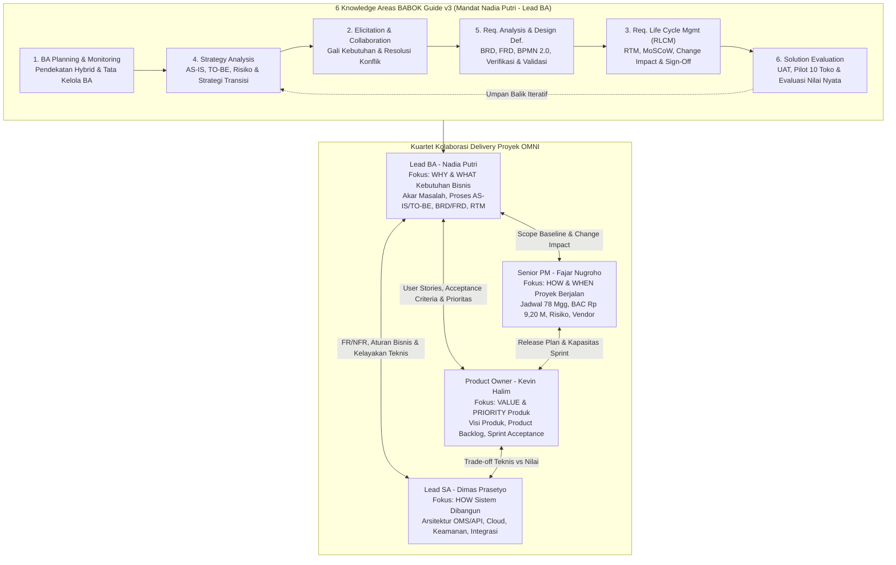
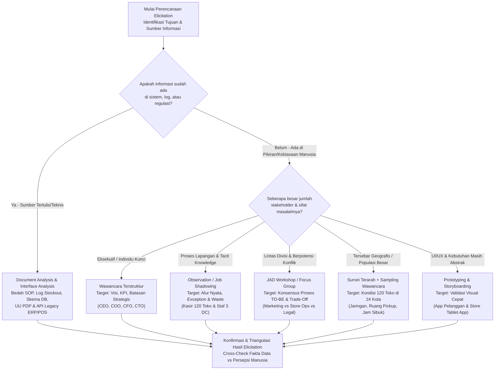
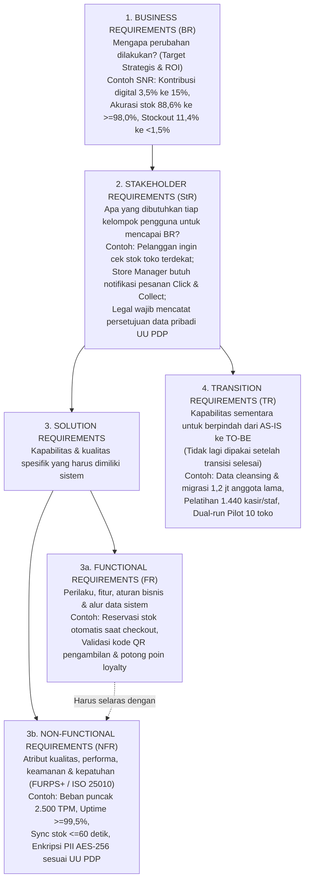
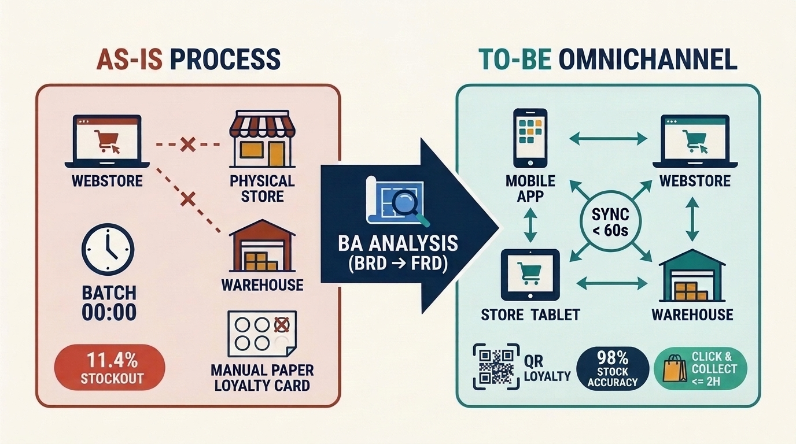
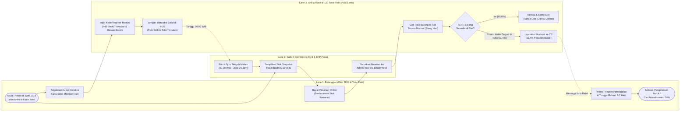
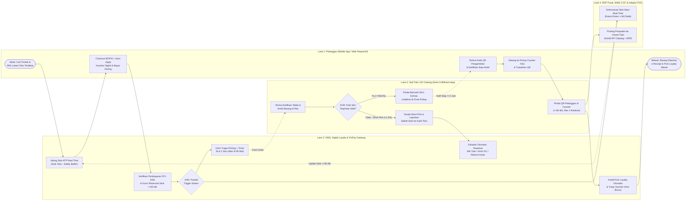
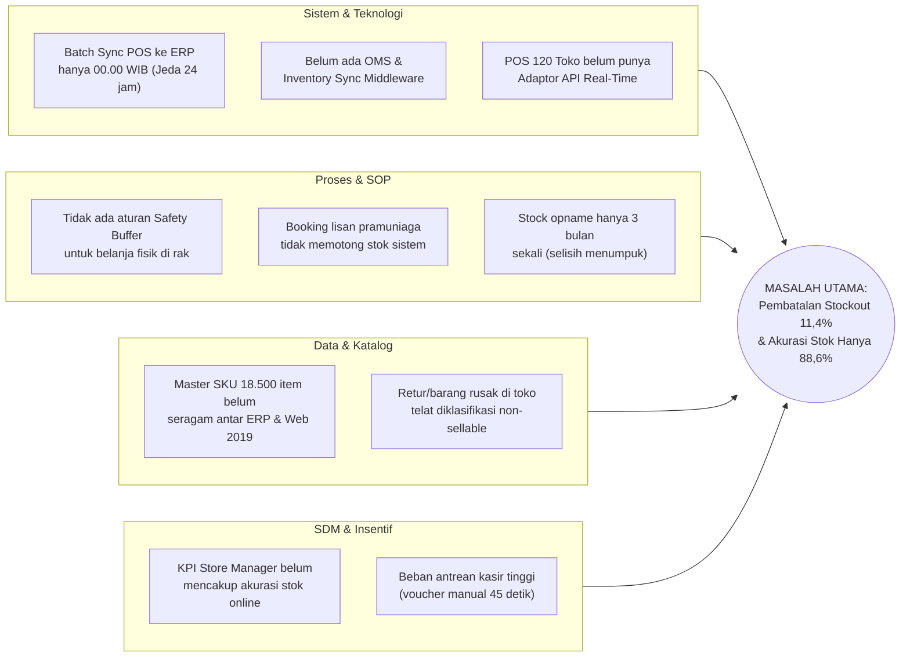
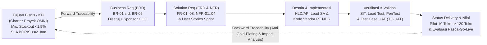

# Modul 06: Advanced Business Analysis

## 1. Identitas Modul

| Atribut | Keterangan |
|---------|------------|
| **Kelompok Jalur** | Jalur Alternatif — Business & System Analysis (Jilid II: *Business & System Analysis*) |
| **Level Kompetensi** | Senior (setara standar IIBA *Certified Business Analysis Professional* / CBAP® & *PMI Professional in Business Analysis* / PMI-PBA®) |
| **Durasi Pembelajaran** | **12 jam sesi terstruktur** (4 sesi × 3 jam) + **±6 jam tugas mandiri** |
| **Prasyarat** | Pengalaman kerja ±3 tahun atau lebih sebagai Business Analyst, System Analyst, Product Owner, atau Project Manager; telah memahami **00 — Studi Kasus Utama: PT Sinar Nusantara Retail (SNR) — Proyek OMNI** |
| **Peran Sasaran** | Senior Business Analyst, Lead BA, Business Process Analyst, Product Owner, System Analyst, serta Senior Project Manager yang ingin memperdalam penguasaan kebutuhan bisnis & rekayasa proses |
| **Keluaran Utama** | 1) *Business Requirements Document* (BRD) ringkas & terukur, 2) *Functional & Non-Functional Requirements Document* (FRD/NFR) fitur *Click & Collect* & *Digital Loyalty*, 3) Pemetaan Proses Bisnis *AS-IS* vs. *TO-BE* berbasis BPMN 2.0 & *Gap Analysis*, serta 4) *Requirements Traceability Matrix* (RTM) *end-to-end* pada **Proyek OMNI** |

---

## 2. Gambaran Modul

Survei industri manajemen proyek global (*PMI Pulse of the Profession* dan *Standish Group CHAOS Report*) secara konsisten menunjukkan satu fakta mengejutkan: hampir **40% hingga 50% kegagalan dan pengerjaan ulang (*rework*) pada proyek teknologi informasi bukan disebabkan oleh buruknya kode program, melainkan oleh pengumpulan kebutuhan yang tidak akurat, ambigu, tidak lengkap, atau tidak selaras dengan akar masalah bisnis**. Sebuah proyek bisa dieksekusi dengan sempurna dari sisi jadwal dan anggaran—tepat 78 minggu dan tepat **Rp 9,20 M**—namun tetap berakhir sia-sia jika sistem yang dibangun ternyata tidak menjawab kebutuhan nyata pelanggan dan operasional lapangan.

Perhatikan kompleksitas nyata pada **Proyek OMNI di PT Sinar Nusantara Retail Tbk (SNR)**. Di atas kertas, tujuan proyek tampak sederhana: membangun aplikasi mobile, situs web responsif, *Click & Collect*, dan *Digital Loyalty* sebelum **26 November 2027**. Namun begitu kita turun ke lapangan bersama **Nadia Putri** (Lead Business Analyst), tabir kerumitan langsung terbuka:
- **VP Marketing & CX (Dewi Lestari)** menginginkan pengalaman belanja semewah *e-commerce* besar dengan gamifikasi, promo kilat, dan *push notification* personal;
- **Head of Store Operations (Agus Setiawan)** mencemaskan 1.440 kasir dan staf gudang di **120 toko** yang kewalahan melayani pesanan *Click & Collect* dalam SLA **≤ 2 jam** tanpa insentif yang adil;
- **Head of Supply Chain (Siti Rahmawati)** mewaspadai dampak sinkronisasi stok *near-real-time* (≤ 60 detik) terhadap stabilitas distribusi rutin di **3 Distribution Center** (Cikarang, Surabaya, Medan);
- **Head of Legal & InfoSec (Rina Kartika)** memegang *veto power* atas kepatuhan **UU No. 27 Tahun 2022 tentang Pelindungan Data Pribadi (UU PDP)** dan standar **PCI-DSS** untuk migrasi **1,2 juta data *Sinar Member Card*** yang 62% di antaranya usang atau duplikat;
- Sementara **Delivery Director PT Nusantara Digital Solusi (Bambang Hartono)** terikat kontrak *Fixed Price* **Rp 4,40 M** yang menuntut spesifikasi presisi dan bebas tafsir ganda.

Seorang Business Analyst tingkat pemula (*junior*) sering kali terjebak berperan sekadar sebagai "notulis rapat" (*order-taker*) yang mencatat semua keinginan pemangku kepentingan tanpa menyaring akar masalah, kelayakan proses, maupun keterkaitan nilai bisnis. Sebaliknya, **Senior Business Analyst** adalah **arsitek nilai dan penjembatan strategis** yang menggali kebutuhan laten (*tacit knowledge*), membedah pemborosan proses bisnis saat ini (*AS-IS*), merancang proses masa depan (*TO-BE*) berbasis notasi standar **BPMN 2.0**, menuliskan spesifikasi presisi dalam **BRD**, **FRD**, **NFR**, dan **User Stories** di lingkungan *Hybrid Delivery*, menengahi konflik lintas divisi dengan data objektif, serta mengawal ketertelusuran kebutuhan hingga lulus *User Acceptance Test* (UAT) melalui **Requirements Traceability Matrix (RTM)**.

Modul 06 menjadi fondasi utama Jilid II (*Business & System Analysis*). Seluruh artefak analisis bisnis yang Anda hasilkan di modul ini akan langsung menjadi masukan bagi pemodelan sistem UML/ERD pada **Modul 07**, perancangan arsitektur integrasi API/Cloud pada **Modul 08**, serta pengelolaan *Product Roadmap* pada **Modul 09**.

---

## 3. Capaian Pembelajaran

Setelah menyelesaikan Modul 06, peserta mampu:

1. **Menerapkan** peran strategis Senior Business Analyst berdasarkan **6 *Knowledge Areas* BABOK® Guide v3** serta menyelaraskan pembagian tanggung jawab kolaboratif antara Senior BA, Senior PM, Product Owner (PO), dan Solution Architect (SA) di proyek *Hybrid Delivery*.
2. **Merancang dan mengeksekusi** strategi *Requirement Elicitation* tingkat lanjut (wawancara eksekutif vs. operasional, *JAD Workshop*, observasi/*job shadowing*, *document analysis*, *interface analysis*, dan *prototyping*) untuk mengungkap *tacit knowledge* serta menengahi konflik kebutuhan antar-divisi secara berbasis data.
3. **Mengklasifikasikan dan menyusun** kebutuhan bisnis, pemangku kepentingan, fungsional (**FR**), non-fungsional (**NFR** berbasis FURPS+ / ISO 25010), dan transisi (**TR**) secara presisi, bebas ambigu, dan teruji (**SMART / INVEST**) ke dalam **BRD**, **FRD**, **SRS**, maupun **User Stories**.
4. **Memodelkan dan merekayasa ulang** proses bisnis *AS-IS* menuju *TO-BE* menggunakan notasi standar **BPMN 2.0** (*pool, lane, event, task, gateway, message flow*) serta mengidentifikasi pemborosan (*waste*) menggunakan **Value Stream Mapping (VSM)**.
5. **Menganalisis** akar masalah operasional (*overselling*, kebocoran kupon, data kotor) menggunakan **5 Whys** dan **Diagram Fishbone (Ishikawa)**, kemudian menuangkan kesenjangan proses, sistem, data, regulasi, dan SDM ke dalam **Gap Analysis** yang dapat dieksekusi.
6. **Membangun dan mengaudit** **Requirements Traceability Matrix (RTM)** *end-to-end*, menerapkan prioritisasi **MoSCoW**, mengelola *requirements sign-off*, serta melaksanakan **Change Impact Analysis** saat muncul permintaan perubahan di tengah sprint.

---

## 4. Rencana Sesi

Pembelajaran tatap muka atau lokakarya daring dilaksanakan dalam **4 sesi × 3 jam = 12 jam** dengan komposisi pedagogis **±30% konsep (3,5 jam)**, **±50% workshop kasus Proyek OMNI (6,0 jam)**, dan **±20% diskusi/refleksi praktisi (2,5 jam)**.

| Sesi | Durasi | Topik Utama | Konsep (±30%) | Workshop Kasus Proyek OMNI (±50%) | Diskusi & Refleksi (±20%) |
|------|--------|-------------|---------------|-----------------------------------|---------------------------|
| **Sesi 1** | 3 jam | **Peran Senior BA (BABOK v3) & Strategi *Requirement Elicitation* Lanjutan** | 55 menit: 6 *Knowledge Areas* BABOK v3; batas peran BA–PM–PO–SA; teknik *elicitation* lanjutan & penggalian *tacit knowledge* | 90 menit: Merancang *Elicitation Plan* lintas 6 stakeholder SNR, simulasi wawancara *job shadowing* kasir toko, dan fasilitasi *JAD Workshop* konflik Marketing vs. Store Ops vs. Legal | 35 menit: Debriefing teknik menghadapi stakeholder dominan & *order-taker trap* |
| **Sesi 2** | 3 jam | **Klasifikasi Kebutuhan, Penulisan BRD/FRD/NFR Presisi & User Stories Hybrid** | 55 menit: Hierarki kebutuhan BABOK; BRD vs. FRD vs. SRS vs. *User Stories*; kualitas SMART/INVEST; NFR (FURPS+ / ISO 25010) & *Transition Requirements* | 90 menit: Menyusun ringkasan BRD (`BR-01..06`), merombak kebutuhan ambigu menjadi FR/NFR terukur (2.500 TPM, ≥ 99,5% uptime, UU PDP), serta menulis *Acceptance Criteria* Gherkin | 35 menit: *Peer-review* ambiguitas spesifikasi & diskusi klausul kontrak *Fixed Price* PT NDS |
| **Sesi 3** | 3 jam | **Business Process Modeling (BPMN 2.0), VSM, Root Cause & Gap Analysis** | 50 menit: Notasi BPMN 2.0 (*pool, swimlane, gateway, message flow*); *Value Stream Mapping* (8 *waste*); *5 Whys* & *Fishbone*; *Gap Analysis* 5 dimensi | 90 menit: Membedah akar masalah *overselling 11,4%* dengan Fishbone, memetakan proses *AS-IS* (batch 00.00 WIB & kupon 45 detik) menuju *TO-BE Click & Collect* SLA ≤ 2 jam, dan menyusun *Gap Analysis* 120 toko | 40 menit: Diskusi realitas operasional toko (resistensi staf, *buffer stock*, insentif omzet cabang) |
| **Sesi 4** | 3 jam | **Requirements Traceability Matrix (RTM), MoSCoW, Sign-Off & BA Anti-Patterns** | 50 menit: Struktur RTM *forward & backward*; prioritisasi MoSCoW; *Requirements Sign-Off* & *Change Impact Analysis*; 6 *Anti-Patterns* Senior BA | 90 menit: Membangun RTM *end-to-end* (`BR → FR/NFR → SA → TC-UAT`), mengaudit RTM cacat (*orphan & gold plating*), dan menyimulasikan *Impact Analysis* atas *Change Request* Marketing di Sprint 9 | 40 menit: Kuis pemantapan CBAP/PMI-PBA, refleksi anti-pola lapangan, dan *briefing* tugas mandiri ±6 jam |
| **Total** | **12 jam** | **4 Sesi Terpadu** | **3,5 jam (29%)** | **6,0 jam (50%)** | **2,5 jam (21%)** |

---

## 5. Materi

### 5.1 Peran Strategis Senior Business Analyst (BABOK® Guide v3) & Kolaborasi Lintas Peran

Menurut **IIBA (*International Institute of Business Analysis*) BABOK® Guide v3**, *Business Analysis* adalah praktik memungkinkan perubahan dalam suatu organisasi dengan **mendefinisikan kebutuhan (*needs*) dan merekomendasikan solusi (*solutions*) yang memberikan nilai (*value*) kepada para pemangku kepentingan**. Definisi ini mengandung pesan strategis yang sangat penting: **seorang Senior Business Analyst tidak dibayar untuk menulis dokumen tebal semata, melainkan untuk memastikan setiap rupiah investasi proyek benar-benar menyelesaikan masalah bisnis yang tepat dan menciptakan nilai terukur**.

Di proyek transformasi berskala besar seperti **Proyek OMNI (Rp 9,20 M)**, disiplin analisis bisnis dijalankan melalui **6 Area Pengetahuan (*Knowledge Areas*) BABOK® Guide v3** yang saling berinteraksi secara iteratif (bukan sekadar urutan linear sekali jalan):

1. **Business Analysis Planning and Monitoring (BAPM):** Merencanakan pendekatan analisis bisnis (prediktif, adaptif, atau *hybrid*), memetakan keterlibatan pemangku kepentingan (*stakeholder engagement*), menentukan tata kelola persetujuan kebutuhan (*requirements governance*), manajemen informasi/versi dokumen, serta memantau kinerja pekerjaan BA. *Di Proyek OMNI:* Nadia Putri menetapkan pendekatan *Hybrid BA*—BRD & NFR dikunci di Gerbang 1–2 untuk kepastian kontrak PT NDS, sementara detail fitur *mobile/web* diperinci bertahap setiap *Sprint Backlog Refinement*.
2. **Elicitation and Collaboration (EC):** Mempersiapkan, mengeksekusi, dan mengonfirmasi hasil penggalian informasi dari pemangku kepentingan, dokumen *legacy*, maupun pengamatan lapangan, sekaligus menjaga kolaborasi berkelanjutan agar tidak terjadi kesenjangan pemahaman antara bisnis dan TI.
3. **Requirements Life Cycle Management (RLCM):** Mengelola dan memelihara kebutuhan sejak lahir hingga pensiun—mencakup ketertelusuran (*traceability*), pemeliharaan (*maintain*), prioritisasi (*prioritize*), penilaian dampak perubahan (*assess requirements changes*), dan persetujuan formal (*approve requirements*).
4. **Strategy Analysis (SA):** Menganalisis kondisi saat ini (*current state*), mendefinisikan kondisi masa depan yang dituju (*future state*), menilai risiko strategis, serta merumuskan strategi perubahan (*change strategy*) termasuk lingkup solusi dan kesiapan transisi organisasi.
5. **Requirements Analysis and Design Definition (RADD):** Menstrukturkan, memodelkan (BPMN, *data flow*, *use case*, *wireframe*), menspesifikasikan, memverifikasi mutu (*verify*), memvalidasi keselarasan nilai bisnis (*validate*), dan mendefinisikan arsitektur kebutuhan serta opsi desain solusi bersama tim teknis.
6. **Solution Evaluation (SE):** Mengukur kinerja solusi nyata (saat Pilot 10 toko maupun pasca-*Go-Live*), menganalisis celah kinerja, mengidentifikasi keterbatasan solusi (*solution limitations*) maupun hambatan organisasi (*enterprise limitations* seperti KPI toko atau budaya kerja), lalu merekomendasikan tindakan peningkatan nilai.

#### Kolaborasi & Batas Tanggung Jawab: Senior BA vs. Senior PM vs. Product Owner vs. Solution Architect

Salah satu sumber gesekan paling sering pada proyek *Hybrid Delivery* adalah tumpang tindih peran antara **Lead BA (Nadia Putri)**, **Senior PM (Fajar Nugroho)**, **Product Owner (Kevin Halim)**, dan **Lead SA / Solution Architect (Dimas Prasetyo)**. Keempat peran ini membentuk **Kuartet Kepemimpinan Delivery** dengan fokus komplementer:



*Gambar 5.1 — Peta 6 Knowledge Areas BABOK® Guide v3 dan Pola Kolaborasi Kuartet Delivery (Senior BA, Senior PM, Product Owner, dan Solution Architect) pada Proyek OMNI.*

Tabel berikut memperjelas batas keputusan harian keempat peran tersebut agar tidak terjadi *finger-pointing* maupun celah tanggung jawab:

| Dimensi Kerja | Senior PM (*Fajar Nugroho*) | Lead BA (*Nadia Putri*) | Product Owner (*Kevin Halim*) | Lead SA (*Dimas Prasetyo*) |
|---------------|-----------------------------|-------------------------|-------------------------------|----------------------------|
| **Pertanyaan Kunci** | *"Apakah proyek tepat waktu, sesuai anggaran, dan terkendali risikonya?"* | *"Apakah kita memecahkan masalah bisnis yang benar dengan proses & aturan yang presisi?"* | *"Fitur apa yang memberi nilai pelanggan tertinggi untuk dibangun lebih dulu?"* | *"Bagaimana arsitektur sistem, data, dan integrasi memenuhi FR & NFR secara andal?"* |
| **Artefak Utama** | *Project Charter*, WBS, Jadwal Induk, *Risk Register*, Laporan EVM | BRD, FRD/NFR, Diagram BPMN *AS-IS/TO-BE*, *Gap Analysis*, RTM | *Product Vision*, *Product Backlog*, *Release Plan*, *Sprint Goal* | *High-Level Design* (HLD), *System Architecture*, *API Contract*, ERD/UML |
| **Otoritas Keputusan** | Baseline jadwal/biaya, eskalasi vendor, koordinasi CCB | Kelengkapan, konsistensi, keterujian kebutuhan, dan *traceability* | Urutan prioritas *backlog* dan penerimaan (*accept/reject*) *Increment* | Pemilihan pola arsitektur, *tech stack*, keamanan teknis, dan performa |
| **Sisi Kolaborasi dengan BA** | Meminta *Change Impact Analysis* dari BA saat ada CR masuk | Berperan sebagai jembatan bisnis–teknis dan fasilitator konsensus | Mengandalkan BA membedah *Epic* kompleks, aturan bisnis, & proses lintas divisi | Memvalidasi kelayakan teknis & biaya dari NFR (mis. jeda ≤ 60 detik, 2.500 TPM) |

> **Prinsip Emas Senior BA:** Di proyek Agile murni yang kecil, peran PO dan BA kerap dirangkap. Namun pada proyek transformasi korporasi *Hybrid* seperti Proyek OMNI—yang melibatkan integrasi 4 sistem *legacy* (ERP, WMS 3 DC, POS 120 toko, Payment Gateway), regulasi ketat (UU PDP & PCI-DSS), dan vendor *Fixed Price*—duet **PO + Lead BA** sangat krusial. PO menjaga arah pasar dan prioritas nilai pelanggan bersama VP Marketing, sementara Lead BA memastikan kedalaman proses operasional 120 toko, aturan bisnis lintas sistem, kepatuhan legal, dan kelengkapan spesifikasi kontraktual tidak ada yang terlewat.

---

### 5.2 *Requirement Elicitation* Tingkat Lanjut, *Tacit Knowledge* & Resolusi Konflik

*Elicitation* secara harfiah berarti "memunculkan atau menarik keluar"—bukan sekadar "mengumpulkan" (*gathering*). Perbedaan kata ini sangat fundamental. Istilah *requirement gathering* memberi kesan keliru seolah kebutuhan bisnis sudah tergeletak rapi seperti buah matang yang tinggal dipetik dari pohon. Kenyataannya, sebagian besar kebutuhan bisnis paling kritis tersembunyi di bawah permukaan sebagai **tacit knowledge** (pengetahuan implisit yang tertanam dalam kebiasaan kerja harian, pengecualian kasus lapangan, dan asumsi tak terucap para pekerja operasional).

Jika Nadia Putri hanya bertanya kepada kasir toko SNR di ruang rapat kantor pusat, *"Apa yang Bapak/Ibu butuhkan di sistem baru?"*, jawaban yang muncul hampir pasti dangkal: *"Yang penting aplikasinya cepat dan tidak error."* Padahal ketika Nadia melakukan pengamatan langsung di kasir, ia baru menemukan fakta bahwa 30% transaksi hari Sabtu mengalami komplain akibat kode voucher cetak terlipat, pemisahan retur tunai vs. kartu kredit membutuhkan otorisasi manual manajer toko, dan stok rak sering berbeda 2–3 unit karena barang disimpan sementara di area *holding* pelanggan (*booking* lisan pramuniaga).

#### Ragam Teknik *Elicitation* Tingkat Lanjut dan Penerapannya

Seorang Senior BA memilih teknik *elicitation* secara sadar sesuai tingkat jabatan narasumber, jenis pengetahuan yang dicari, dan ketersediaan waktu—bukan memakai wawancara untuk segala hal:

1. **Wawancara Terstruktur vs. Semi-Terstruktur (*Executive vs. Operational Interviews*):**
   - *Wawancara Eksekutif* (CEO Hendra Wijaya, COO Ratna Kusuma, CFO Budi Santoso, CTO Irwan Pratama): Durasi singkat (30–45 menit), fokus pada tujuan strategis, ambang batas investasi, stabilitas arsitektur *legacy*, metrik sukses (*KPI*), dan *non-negotiable constraints* (mis. tenggat mutlak 26 Nov 2027 dan pagu BAC Rp 9,20 M). Gunakan pertanyaan terbuka berbasis dampak (*"Risiko bisnis apa yang paling mengkhawatirkan Ibu jika akurasi stok di bawah 98% saat Harbolnas?"*).
   - *Wawancara Operasional* (Store Manager, Supervisor DC Cikarang, Staf Finance Rekonsiliasi): Durasi 60–90 menit, fokus pada alur kerja nyata, frekuensi transaksi, volume puncak, dan *exception handling* (*"Apa yang terjadi jika pelanggan Click & Collect membatalkan pesanan setelah barang sudah dikemas petugas toko?"*).
2. **Focus Group & *Joint Application Design* (JAD) Workshop:**
   - Lokakarya terstruktur lintas departemen (2–4 jam) yang dipandu fasilitator netral (Senior BA) untuk membangun kesepahaman bersama dan menyelesaikan konflik kebutuhan secara langsung di satu meja. Sangat efektif saat menyatukan perspektif yang saling bertentangan antara Marketing (Dewi), Store Ops (Agus), Supply Chain (Siti), Legal (Rina), dan SA (Dimas).
3. **Document Analysis (Analisis Dokumen & Data Historis):**
   - Membedah SOP eksisting, laporan penjualan & *stockout* 12 bulan terakhir, tiket keluhan *call center*, struktur basis data *Sinar Member Card*, ketentuan kontrak vendor PT FinPay Nusantara, serta pasal-pasal **UU No. 27 Tahun 2022 (UU PDP)**. Teknik ini ideal dilakukan **sebelum** wawancara agar BA hadir dengan pertanyaan tajam, bukan membuang waktu stakeholder menanyakan hal dasar.
4. **Observation / *Job Shadowing* (Observasi Lapangan):**
   - Duduk atau berdiri langsung di samping pengguna saat bekerja (*passive observation* tanpa menyela, lalu *active observation* dengan klarifikasi setelah transaksi selesai). Di Proyek OMNI, observasi langsung di 4 toko percontohan (toko mal ramai Jakarta, toko besar Surabaya, toko menengah Medan, toko kecil luar Jawa) membongkar mengapa input kupon manual memakan waktu **45 detik per transaksi** dan mengapa antrean kasir mengular saat akhir pekan.
5. **Interface Analysis (Analisis Antarmuka Sistem & Organisasi):**
   - Memetakan seluruh titik pertukaran data, format pesan, frekuensi sinkronisasi, kepemilikan data (*system of record*), dan batasan teknis antar-sistem (Mobile App ↔ OMS ↔ ERP pusat ↔ WMS 3 DC ↔ Adaptor POS 120 toko ↔ Payment Gateway ↔ Agregator Kurir). Kunci mencegah kegagalan integrasi di *white spaces* lintas proyek (PRJ-02 ERP-Refresh & PRJ-03 POS-Modern).
6. **Prototyping & *Storyboarding* (Low-Fidelity hingga Interactive Mockup):**
   - Menghadirkan visualisasi layar (*wireframe* atau prototipe klik interaktif) untuk memancing reaksi konkret pengguna (*"I know it when I see it"*). Sangat ampuh bagi pemangku kepentingan non-teknis seperti Store Manager dan tim Marketing untuk memvalidasi tampilan *Store Fulfillment App* (berapa klik untuk mengonfirmasi pengambilan barang *Click & Collect*) sebelum satu baris kode pun ditulis oleh PT NDS.
7. **Survei / Kuesioner Terarah (*Targeted Survey*):**
   - Digunakan untuk menjangkau populasi besar yang tersebar geografis—misalnya menyurvei **120 Store Manager di 24 kota** terkait stabilitas jaringan internet toko, ketersediaan area *pickup counter*, dan jam sibuk lokal.



*Gambar 5.2 — Matriks Keputusan Pemilihan Teknik Requirement Elicitation Berdasarkan Karakter Sumber Informasi dan Pemangku Kepentingan.*

#### Teknik Mengungkap *Tacit Knowledge* dan Menyelesaikan Konflik Lintas Divisi

Untuk menggali *tacit knowledge* yang tak terucap, Senior BA menerapkan empat teknik proaktif:
- **Teknik "Tunjukkan, Jangan Hanya Ceritakan" (*Show Me, Don't Tell Me*):** Minta staf toko memperagakan transaksi retur atau klaim kupon terakhir yang gagal langsung di layar POS, lalu catat setiap *workaround* (misalnya catatan tulis tangan di buku kas atau grup WhatsApp antar-toko untuk cek stok).
- **Eksplorasi *Edge Cases* & Skenario Gagal (*Unhappy Paths*):** Lebih dari 60% bug produksi lahir dari skenario tidak normal. Selalu tanyakan: *"Bagaimana jika koneksi internet toko putus saat pelanggan hendak mengambil pesanan? Bagaimana jika hanya 2 dari 3 barang pesanan yang tersedia di rak? Bagaimana jika pelanggan tidak mengambil barang setelah 48 jam?"*
- **Pendekatan *5 Whys* & *Laddering*:** Saat stakeholder mengajukan solusi spesifik (*"Buatkan tombol cetak ulang resi 5 kali"*), gali naik ke tujuan bisnis (*"Mengapa perlu cetak ulang?"*) untuk menemukan kebutuhan sejati (*"Pelanggan sering kehilangan bukti transaksi saat klaim garansi—solusinya bisa e-receipt di aplikasi"*).
- **Triangulasi Data:** Bandingkan klaim verbal dengan data historis. Ketika Marketing mengklaim pelanggan meminta fitur *live-shopping*, BA memeriksa data *analytics* situs web dan keluhan pelanggan: ternyata 74% *cart abandonment* disebabkan lambatnya muat halaman mobile dan kekecewaan *stockout 11,4%*, bukan ketiadaan *live-shopping*.

#### Protokol Resolusi Konflik Kebutuhan (Kasus Marketing vs. Store Ops vs. Legal SNR)

Ketika tiga divisi membawa kebutuhan yang saling bertabrakan—misalnya Marketing menuntut *auto-enroll* seluruh 1,2 juta anggota lama ke promo *push notification* dan janji pengambilan *Click & Collect* dalam 30 menit, Store Ops menolak karena staf kasir tidak sanggup di bawah 2 jam, dan Legal memveto pengiriman promo tanpa persetujuan eksplisit UU PDP—Senior BA menggunakan **Kerangka Resolusi 4 Langkah (O-C-O-E)**:

1. **Objektivikasi (*Separate People from Requirements*):** Pindahkan debat dari preferensi pribadi menjadi data & kriteria terukur (kapasitas kerja staf per jam, pasal sanksi UU PDP, dan potensi dampak konversi).
2. **Klasifikasi Hirarki Batasan (*Constraint Hierarchy*):** Terapkan urutan prioritas mutlak korporasi: **(1) Kepatuhan Hukum & Keamanan (*Non-Negotiable* — UU PDP/PCI-DSS)** → **(2) Kelayakan Operasional & Keandalan Sistem** → **(3) Target Bisnis Utama & Kontrak Baseline** → **(4) Preferensi Pengalaman Tambahan**.
3. **Perancangan Opsi Kompromi Terukur (*Option Generation*):** Alih-alih jawaban biner "ya/tidak", sajikan 2–3 skenario bernilai tambah—misalnya SLA resmi **≤ 2 jam** di *Wave 1* dengan notifikasi proaktif *"Pesanan Anda siap diambil"* (sering selesai 45–60 menit pada jam normal), sementara pendaftaran ulang anggota lama memakai kampanye *re-consent* berinsentif poin bonus untuk mematuhi UU PDP sekaligus membersihkan 62% data usang.
4. **Eskalasi Berbasis Rekomendasi (*Escalate with Trade-Off Matrix*):** Jika konsensus di level kepala divisi buntu, Senior BA bersama Senior PM membawa **matriks opsi + dampak biaya/jadwal/risiko** kepada Sponsor (**Ratna Kusuma, COO**) atau Steering Committee untuk keputusan final yang didokumentasikan dalam *Decision Log*.

---

### 5.3 Klasifikasi Kebutuhan, Spesifikasi Presisi (BRD, FRD, SRS, User Stories) & Kriteria Kualitas

Kebutuhan yang ditulis campur aduk antara visi bisnis, fitur antarmuka, kecepatan server, dan rencana pelatihan akan membuat vendor, pengembang, dan penguji (*QA*) kebingungan. **BABOK® Guide v3** mengklasifikasikan kebutuhan ke dalam **4 kategori baku** (dengan *Solution Requirements* terbagi dua menjadi *Functional* dan *Non-Functional*):



*Gambar 5.3 — Hierarki Klasifikasi Kebutuhan Menurut BABOK® Guide v3 pada Proyek OMNI.*

#### Perbandingan Artefak Spesifikasi di Lingkungan *Hybrid Delivery*: BRD vs. FRD vs. SRS vs. User Stories

Pada lingkungan kerja modern—khususnya **Hybrid Delivery** seperti Proyek OMNI—tim sering berdebat apakah masih perlu menulis BRD dan FRD jika tim pengembang sudah memakai Agile Scrum (*User Stories*). Jawabannya bukan "salah satu", melainkan **penyesuaian tingkat kedalaman (*right-sized documentation*) sesuai fungsi tata kelola dan kontrak**:

| Dimensi | BRD (*Business Requirements Document*) | FRD (*Functional Requirements Document*) | SRS (*Software Requirements Specification*) | *User Stories* + *Acceptance Criteria* |
|---------|----------------------------------------|------------------------------------------|---------------------------------------------|----------------------------------------|
| **Fokus Utama** | **WHY & WHAT (Bisnis):** Tujuan bisnis, ruang lingkup, manfaat, aturan bisnis tingkat tinggi, pemangku kepentingan | **WHAT (Fungsional & Perilaku):** Rincian fitur, alur layar, validasi input, aturan bisnis detail, integrasi antarmuka, NFR | **HOW (Teknis Perangkat Lunak):** Spesifikasi teknis sistem (standar IEEE 830 / ISO 29148), skema API, protokol, batas perangkat keras/lunak | **WHO, WHAT & WHY (Iteratif Agile):** Nilai bagi pengguna dalam potongan inkremental kecil siap bangun per sprint |
| **Audiens Primer** | Eksekutif (CEO, COO, CFO), Sponsor, Steering Committee, PMO, Legal | BA, Product Owner, Solution Architect, Developer Vendor (PT NDS), QA Lead | System Analyst, Solution Architect, Backend/Mobile Engineer, Security/DevOps | Scrum Team (PO, Dev, QA, UI/UX) dalam ritual *Backlog Refinement* & *Sprint Planning* |
| **Pemilik / Penyusun** | Lead BA (Nadia Putri) — disetujui Sponsor (Ratna Kusuma) | Lead BA (Nadia Putri) bersama PO (Kevin Halim) & SA (Dimas) | Lead SA (Dimas Prasetyo) bersama Tim Arsitektur Vendor PT NDS | Product Owner (Kevin Halim) dibantu Lead BA (Nadia Putri) |
| **Kapan Dikunci di Proyek OMNI?** | **Gate 1 (M1 — 31 Jul 2026):** Menjadi dasar lingkup kontrak *Fixed Price* Rp 4,40 M dengan PT NDS | **M2 & Awal Tiap Release (R1–R3):** Mengunci aturan kritis (*OMS, Loyalty, UU PDP, Click & Collect*) | **Desain Detail per Release:** Menjadi *API Contract* lintas proyek ERP-Refresh & POS-Modern | **Just-in-Time (1–2 Sprint sebelum eksekusi):** Rincian *UI flow* dan kriteria uji Gherkin pada Sprint 1–14 |

#### Spesifikasi *Non-Functional Requirements* (NFR) dengan Kerangka FURPS+ dan ISO/IEC 25010

Kesalahan terbesar banyak BA adalah menghabiskan 90% halaman dokumen untuk fitur fungsional (*tombol, layar, laporan*) dan hanya menyisakan satu paragraf klise untuk NFR: *"Sistem harus cepat, aman, dan mudah digunakan."* Padahal pada proyek berskala nasional, **NFR adalah pendorong utama biaya arsitektur cloud, batas kelulusan keamanan, dan penentu apakah sistem roboh saat Harbolnas 12.12**.

Gunakan standar **ISO/IEC 25010** atau **FURPS+** (*Functionality, Usability, Reliability, Performance, Supportability + Design/Implementation/Interface/Physical/Legal Constraints*) untuk memastikan setiap dimensi NFR diukur dengan angka objektif:

| Kategori NFR (ISO 25010 / FURPS+) | Contoh Spesifikasi Lemah (Jangan Ditiru) | Spesifikasi Presisi & Teruji (Standar Proyek OMNI) | Metode Verifikasi |
|-----------------------------------|------------------------------------------|----------------------------------------------------|-------------------|
| **Performance Efficiency** | *"Checkout aplikasi harus cepat bahkan saat ramai."* | Sistem wajib memproses **≥ 2.500 transaksi/menit (TPM)** dengan waktu respons API *checkout* **p95 ≤ 2,0 detik** dan halaman katalog **≤ 1,5 detik** pada jaringan 4G. | *Load & Stress Testing* (k6 / JMeter) sebelum Gate 3 |
| **Reliability & Availability** | *"Sistem tidak boleh sering down."* | Ketersediaan sistem (*uptime*) **≥ 99,5%** per bulan (maksimal *unplanned downtime* ~3,6 jam/bulan), dengan **RPO ≤ 15 menit** dan **RTO ≤ 1 jam** pada *Cloud Region* Jakarta. | *Chaos / Failover Testing* & Monitoring SLA Produksi |
| **Data Freshness & Interoperability** | *"Stok toko selalu update otomatis."* | Jeda sinkronisasi mutasi stok antara POS 120 toko, WMS 3 DC, ERP pusat, dan OMS tidak boleh melebihi **≤ 60 detik** pada **≥ 99% transaksi**. | *End-to-End Integration Test* (SIT) & Log Latensi API |
| **Security & Compliance** | *"Data pelanggan harus aman dan patuh aturan."* | Seluruh data PII (*Personally Identifiable Information*) terenkripsi **AES-256** (*at rest*) dan **TLS 1.3** (*in transit*); persetujuan (*consent*) & hak hapus data patuh **UU No. 27/2022 (UU PDP)**; pemrosesan kartu via tokenisasi **PCI-DSS** PT FinPay; lulus *PenTest* independen dengan **0 temuan Critical/High**. | Audit Kepatuhan Legal (Rina Kartika) & *Independent PenTest* |
| **Usability & Accessibility** | *"Aplikasi kasir gampang dipakai pegawai toko."* | Petugas toko baru (tanpa pengalaman sebelumnya) setelah pelatihan 2 jam mampu memproses pemindaian dan serah terima pesanan *Click & Collect* dalam **≤ 60 detik** dengan maksimal **4 ketukan layar** dan tingkat kesalahan **< 2%**. | *Usability Testing* & Evaluasi Pilot 10 Toko |
| **Maintainability & Auditability** | *"Perubahan promo dan poin tercatat."* | Setiap perubahan manual stok, penyesuaian poin loyalty, dan akses data PII wajib terekam dalam *immutable audit log* (ID pengguna, *timestamp* WIB, nilai lama–baru) dengan retensi **5 tahun**. | Audit Log & *Security Review* |

#### Kriteria Kualitas Penulisan Kebutuhan: SMART, INVEST, dan Format Gherkin

Setiap pernyataan kebutuhan dalam BRD/FRD wajib lulus uji **8 Atribut Kualitas BABOK / IEEE 29148** (ringkasnya terangkum dalam prinsip **SMART** — *Specific, Measurable, Achievable, Relevant, Time-bound/Testable*): **Atomik** (satu kebutuhan = satu pernyataan, hindari gabungan "dan/atau" yang mengaburkan status uji), **Lengkap**, **Konsisten** (tidak bertentangan dengan kebutuhan lain), **Ringkas**, **Layak**, **Bebas Ambigu** (hindari kata karet: *cepat, ramah pengguna, fleksibel, memadai, jika memungkinkan, dsb.*), **Terprioritas**, dan **Dapat Diuji (*Testable/Verifiable*)**.

Sementara ketika kebutuhan dipecah menjadi *User Stories* untuk 14 Sprint Agile PT NDS, terapkan kriteria **INVEST** (*Independent, Negotiable, Valuable, Estimable, Small, Testable*) dan lengkapi dengan *Acceptance Criteria* berformat **Behavior-Driven Development (BDD / Gherkin — Given–When–Then)**:

> **Contoh User Story + Acceptance Criteria (Gherkin) — Proyek OMNI:**
> - **Story (`US-142`, tertaut ke `FR-03`):** *Sebagai pelanggan SNR yang berbelanja melalui aplikasi mobile, saya ingin memesan barang dengan opsi Click & Collect pada toko terdekat yang memiliki stok tersedia, agar saya dapat mengambil barang dalam ≤ 2 jam tanpa membayar ongkos kirim.*
> - **Scenario 1 (Happy Path — Stok Tersedia & Reservasi Berhasil):**
>   - **Given** pelanggan memilih SKU `HL-2041` (qty 2) di Toko SNR Pondok Indah yang tercatat memiliki stok tersedia (*Available-to-Promise* / ATP) = 5 unit (setelah dikurangi *safety buffer* toko 2 unit),
>   - **When** pelanggan menyelesaikan pembayaran via QRIS PT FinPay Nusantara dengan status `PAID`,
>   - **Then** OMS secara otomatis mengunci (*soft-to-hard reserve*) 2 unit pada toko tersebut dalam waktu **≤ 60 detik**, mengirim notifikasi ke *Store Fulfillment App* dengan hitung mundur SLA **2 jam**, dan menampilkan status *"Menunggu Disiapkan Toko"* pada aplikasi pelanggan.
> - **Scenario 2 (Exception Path — Stok Berubah Saat Checkout):**
>   - **Given** saat pelanggan berada di halaman pembayaran, stok ATP SKU `HL-2041` di Toko SNR Pondok Indah berkurang menjadi 1 unit akibat transaksi kasir fisik,
>   - **When** pelanggan menekan tombol *"Bayar Sekarang"*,
>   - **Then** sistem menolak pemesanan sebelum pendebitan dana, menampilkan pesan jelas *"Stok di Pondok Indah tersisa 1 unit"*, dan menawarkan 2 opsi: mengurangi jumlah menjadi 1 unit atau mengalihkan pengambilan ke toko terdekat berikutnya yang berjarak ≤ 10 km dengan stok mencukupi.

---

### 5.4 *Business Process Modeling & Improvement* (BPMN 2.0, AS-IS vs. TO-BE, & *Value Stream Mapping*)

Mengotomatiskan proses bisnis yang rusak hanya akan menghasilkan **proses rusak yang berjalan lebih cepat**. Oleh karena itu, sebelum Lead SA (Dimas Prasetyo) merancang arsitektur OMS dan vendor PT NDS mulai membangun layar aplikasi, Lead BA (Nadia Putri) wajib memetakan proses saat ini (**AS-IS**), mengidentifikasi titik pemborosan (*waste*) serta hambatan (*bottleneck*), lalu merancang proses masa depan (**TO-BE**) yang ramping dan terkendali.



*Gambar 5.4 — Ilustrasi Alur Transformasi Proses Bisnis AS-IS Menuju TO-BE serta Keterkaitannya dengan Penyusunan BRD, FRD, dan RTM pada Proyek OMNI.*

#### Penguasaan Notasi Standar **BPMN 2.0** (*Business Process Model and Notation*)

**BPMN 2.0** (standar OMG / ISO 19510) adalah bahasa visual universal yang dipahami oleh pimpinan bisnis (COO, Store Ops) sekaligus insinyur sistem (SA, Developer). Seorang Senior BA wajib menguasai 5 kelompok elemen inti BPMN 2.0:

1. **Swimlanes (*Pool* & *Lane*):**
   - **Pool** mewakili entitas organisasi atau sistem mandiri (misalnya *Pelanggan*, *PT SNR Internal*, *PT FinPay Nusantara*).
   - **Lane** membagi *Pool* berdasarkan peran, divisi, atau aplikasi internal (misalnya *Mobile App/OMS*, *Store Fulfillment App / Staf Toko*, *ERP & POS Adaptor*). Perpindahan alur antar-*Lane* menunjukkan serah terima (*handoff*)—yang sering menjadi sumber keterlambatan dan kesalahan!
2. **Events (Lingkaran — Pemicu & Penutup):**
   - *Start Event* (garis tipis): pemicu proses (mis. pesanan diterima, jadwal *timer* 00.00 WIB).
   - *Intermediate Event* (garis ganda): peristiwa di tengah proses (mis. *Timer Event* batas SLA 90 menit untuk eskalasi, *Message Event* konfirmasi pembayaran).
   - *End Event* (garis tebal): kondisi akhir proses (pesanan selesai diambil, pesanan dibatalkan & *refund*).
3. **Activities / Tasks (Persegi Panjang Bersudut Membulat):**
   - Menunjukkan pekerjaan spesifik dengan kata kerja aktif (*Verb + Noun*): *User Task* (dikerjakan manusia, mis. "Ambil & Pindai Barang di Rak"), *Service Task* (otomatis oleh sistem, mis. "Kunci Reservasi Stok via API"), atau *Sub-Process* (proses kompleks yang dapat diperluas).
4. **Gateways (Belah Ketupat — Percabangan & Penggabungan Logika):**
   - **Exclusive Gateway (XOR — tanda `X`):** Hanya **satu** jalur yang diambil sesuai kondisi (mis. *Apakah stok fisik di rak ditemukan? Ya / Tidak*).
   - **Parallel Gateway (AND — tanda `+`):** Seluruh jalur keluar dijalankan **bersamaan secara paralel** dan harus menunggu semuanya selesai saat digabung (mis. setelah pembayaran sukses, sistem *secara bersamaan* mengirim tugas kemas ke tablet toko **DAN** menghitung poin loyalty **DAN** menerbitkan e-invoice).
   - **Inclusive Gateway (OR — tanda `O`):** Satu, sebagian, atau seluruh jalur dapat aktif sesuai syarat (mis. pesanan gabungan: sebagian barang diambil di toko, sebagian dikirim dari DC Cikarang).
5. **Connecting Objects:**
   - *Sequence Flow* (panah garis penuh): urutan langkah di dalam satu *Pool*.
   - *Message Flow* (panah garis putus-putus): komunikasi/pertukaran data lintas *Pool* (mis. aplikasi pelanggan mengirim pembayaran ke *Payment Gateway* FinPay).

#### Pemetaan Proses **AS-IS** Proyek OMNI (Kondisi Awal 2026: Batch 00.00 WIB, Overselling & Voucher Manual)

Diagram berikut memvisualisasikan proses *AS-IS* belanja dan penebusan promo di SNR sebelum Proyek OMNI. Perhatikan bagaimana jeda sinkronisasi *batch* tengah malam dan entri voucher manual menciptakan pembatalan **11,4%** serta antrean kasir **+45 detik**:



*Gambar 5.5 — Diagram Proses Bisnis AS-IS PT SNR (Swimlane Bergaya BPMN 2.0): Akar Kemunculan Overselling 11,4%, Akurasi Stok 88,6%, dan Antrean Kupon Manual 45 Detik.*

#### Pemetaan Proses **TO-BE** Proyek OMNI (*Click & Collect* BOPIS Real-Time ≤ 60 Detik & SLA ≤ 2 Jam)

Melalui serangkaian *JAD Workshop* antara Lead BA (Nadia Putri), Store Ops (Agus Setiawan), Supply Chain (Siti Rahmawati), Marketing (Dewi Lestari), Legal (Rina Kartika), dan Lead SA (Dimas Prasetyo), proses direkayasa ulang menjadi alur **TO-BE** berikut:



*Gambar 5.6 — Diagram Proses Bisnis TO-BE Click & Collect (BOPIS) & Digital Loyalty PT SNR: Sinkronisasi Real-Time ≤ 60 Detik, SLA Siap Ambil ≤ 2 Jam, Penguncian Poin Otomatis, dan Kredit Omzet Cabang.*

Perhatikan satu detail brilian yang lahir dari kepekaan bisnis Senior BA pada *Lane 4 (`E2`)*: **penjualan *Click & Collect* secara otomatis dibukukan sebagai kredit target omzet toko tempat barang diambil**. Tanpa aturan bisnis ini, 120 Store Manager di bawah Agus Setiawan akan memandang pesanan online sebagai "beban kerja tambahan yang mencuri omzet toko fisik" (Risiko `R-03`), sehingga berpotensi memperlambat penyiapan barang secara pasif!

#### *Value Stream Mapping* (VSM) & Identifikasi Pemborosan (*8 Lean Wastes*)

*Value Stream Mapping* mengukur perbandingan antara **Value-Added Time (VAT — waktu kerja yang benar-benar memberi nilai bagi pelanggan)** dengan **Total Lead Time (termasuk waktu tunggu, antrean, dan pengerjaan ulang)**. Rasio efisiensi proses dihitung melalui **Process Cycle Efficiency (PCE)**:

$$\text{PCE} = \frac{\text{Total Value-Added Time (VAT)}}{\text{Total Lead Time}} \times 100\%$$

Pada analisis VSM operasional kasir & pemenuhan pesanan web SNR kondisi *AS-IS*:
- **Proses Penebusan Kupon & Poin di Kasir:** Pemindaian barang (30 detik VAT) + pengecekan kartu member fisik & ketik nomor manual (20 detik *non-value-added*) + input manual kode voucher & verifikasi syarat kertas (45 detik *waste*) = Total 95 detik (**PCE hanya 31,6%**). Di proses *TO-BE*, pindai 1 kode QR Loyalty App otomatis menerapkan poin + voucher dalam 5 detik → Total waktu turun ke 35 detik (**PCE melonjak menjadi 85,7%**), menghemat ±40 detik/transaksi di 120 toko!
- **Proses Pemenuhan Pesanan Online:** Waktu tunggu *batch sync* rata-rata 12 jam (hingga 24 jam) + pengecekan manual admin toko 2 jam + panggilan batal & *refund* 3–7 hari untuk 11,4% pesanan = pemborosan raksasa dalam kategori **Waiting**, **Defects (*overselling*)**, **Over-processing (entri ulang manual)**, dan **Motion (staf bolak-balik cek rak tanpa data akurat)**. Di proses *TO-BE*, jeda stok ≤ 60 detik dan *picking* terpandu tablet memangkas total waktu tunggu pelanggan menjadi **≤ 2 jam**.

---

### 5.5 *Root Cause Analysis* (5 Whys & Fishbone) serta *Gap Analysis*

Salah satu ciri pembeda paling tajam antara *Junior BA* dan *Senior BA* adalah kemampuannya menahan diri untuk tidak langsung melompat ke solusi (*solution jumping*) sebelum membongkar akar masalah sejati (*root cause*).

#### 1. Teknik *5 Whys* (Contoh Kasus: Mengapa Pembatalan *Stockout* SNR Mencapai 11,4%?)
1. **Mengapa** 11,4% pesanan web SNR dibatalkan setelah pelanggan membayar? → Karena barang yang dipesan di situs web ternyata sudah habis saat staf toko mengecek rak.
2. **Mengapa** situs web masih menampilkan barang tersebut sebagai "Tersedia"? → Karena situs web membaca data stok dari ERP pusat yang baru diperbarui satu kali sehari lewat *batch sync* pukul 00.00 WIB.
3. **Mengapa** pembaruan stok masih bergantung pada *batch* tengah malam, bukan *real-time*? → Karena sistem POS lama di 120 toko belum memiliki adaptor API *event-driven* dan infrastruktur *middleware* OMS belum tersedia.
4. **Mengapa** tetap muncul selisih stok 2–3 unit meski pada pagi hari setelah *batch sync* selesai? → Karena tidak ada kebijakan *safety buffer stock* untuk barang yang sedang ada di keranjang belanja fisik pengunjung toko serta praktik *booking* lisan pramuniaga yang tidak tercatat di POS.
5. **Mengapa** praktik *booking* lisan dan selisih rak terjadi terus-menerus tanpa koreksi? → Karena SOP *stock opname* hanya dilakukan kuartalan dan tidak ada KPI akurasi inventori harian bagi Store Manager.

**Kesimpulan Akar Masalah:** Membangun API *real-time* saja **tidak cukup**! Tanpa pembenahan *safety buffer* di OMS, SOP pencatatan *holding* barang, *cycle count* berkala, dan KPI akurasi stok toko, target akurasi stok **≥ 98,0%** dan *stockout* **< 1,5%** tetap tidak akan tercapai.

#### 2. Diagram *Fishbone* (Ishikawa) — Analisis Multi-Dimensi *Overselling* 11,4%

Untuk memetakan seluruh penyebab secara sistematis dalam lokakarya lintas divisi, Nadia Putri menyusun Diagram Fishbone (*6M/5P*: *Technology/System, Process, People, Data, Policy/Measurement, Environment/Channel*):



*Gambar 5.7 — Diagram Fishbone (Ishikawa) Akar Penyebab Tingginya Pembatalan Stockout (11,4%) dan Rendahnya Akurasi Stok (88,6%) di PT SNR.*

#### 3. *Gap Analysis* (Analisis Kesenjangan 5 Dimensi)

Setelah *AS-IS*, akar masalah, dan *TO-BE* jelas, Senior BA menyusun **Gap Analysis** yang tidak hanya mencakup perangkat lunak, melainkan **5 dimensi transformasi** (*DOTMLP* / *People–Process–Technology–Data–Compliance*):
1. **Proses Bisnis:** Apa langkah kerja lama yang dihapus, diubah, atau ditambahkan?
2. **Teknologi & Integrasi:** Kapabilitas sistem, perangkat keras (240 tablet/scanner toko), dan antarmuka API apa yang belum ada?
3. **Data & Kualitas Informasi:** Berapa besar volume data kotor yang harus dibersihkan (*1,2 juta anggota loyalty, 62% usang/duplikat*) sebelum migrasi?
4. **SDM, Struktur & Insentif:** Keterampilan apa yang kurang (*1.440 kasir & staf gudang*), perubahan SOP apa yang diperlukan, dan bagaimana penyelarasan KPI cabang?
5. **Regulasi & Tata Kelola:** Persyaratan hukum baru apa yang wajib dipenuhi (*UU PDP No. 27/2022, PCI-DSS*) sebelum *Go-Live*?

Setiap kesenjangan (*gap*) wajib terhubung ke **kebutuhan proyek (FR/NFR/TR)** atau **paket kerja WBS**—jika sebuah kesenjangan tidak memiliki pemilik dan aksi konkret, kesenjangan itu akan berubah menjadi risiko operasional saat *Go-Live*.

---

### 5.6 *Requirements Traceability Matrix* (RTM), Prioritisasi MoSCoW, *Sign-Off* & *Change Impact Analysis*

#### 1. *Requirements Traceability Matrix* (RTM) *End-to-End*

**RTM** adalah tabel kendali induk yang memetakan hubungan dua arah (*bidirectional traceability*) dari setiap tujuan bisnis hingga verifikasi pengujian dan penyerahan ke produksi:
- **Forward Traceability (Ke Depan):** *Business Objective → Business Requirement (BR) → Functional/Non-Functional Requirement (FR/NFR) & User Story → Desain Sistem (SA/API/ERD) → Test Case (SIT/UAT) → Status Delivery.* Fungsinya: memastikan **tidak ada satu pun tujuan bisnis yang terlupakan atau belum diuji**.
- **Backward Traceability (Ke Belakang):** *Test Case / Fitur di Kode → FR/NFR → BR → Business Objective.* Fungsinya: membongkar **gold plating** (fitur tambahan tak diminta yang membakar jam kerja tim) dan **orphan requirements** (kebutuhan tanpa induk nilai bisnis yang jelas).



*Gambar 5.8 — Alur Bidirectional Requirements Traceability Matrix (RTM) End-to-End pada Proyek OMNI.*

#### 2. Prioritisasi **MoSCoW** untuk Menjaga Tenggat 26 November 2027 & Kontrak Rp 4,40 M

Ketika seluruh divisi berteriak *"Semua fitur saya prioritas tinggi!"*, Senior BA menggunakan teknik **MoSCoW** yang dikaitkan dengan ambang batas alokasi upaya (*effort budget*):
- **Must Have (M — target ≤ 60% kapasitas total):** Kebutuhan mutlak tanpa tawar-menawar agar sistem layak legal dan fungsional (*Minimum Usable Subset*). Jika satu saja gagal, proyek tidak bisa *Go-Live* (mis. sinkronisasi stok ≤ 60 detik, alur inti *Click & Collect*, pembayaran FinPay PCI-DSS, dan *consent* UU PDP).
- **Should Have (S — target ~20% kapasitas):** Kebutuhan penting bernilai tinggi yang memiliki *workaround* sementara jika terpaksa mundur ke rilis pasca-*Go-Live* (mis. penukaran poin parsial lintas kategori atau notifikasi pengingat otomatis H+1 pengambilan barang).
- **Could Have (C — target ~20% kapasitas / *contingency buffer*):** Pemanis pengalaman pengguna yang berdampak rendah jika ditunda saat jadwal terancam oleh *hard deadline* 26 Nov 2027 (mis. *badge* visual khusus ulang tahun anggota Platinum atau *wishlist sharing* ke media sosial).
- **Won't Have This Time (W — eksplisit di luar rilis saat ini):** Fitur yang disepakati **tidak** masuk Proyek OMNI Fase 1 agar tidak menjadi *scope creep* (mis. integrasi Shopee/Tokopedia, *live-shopping*, dan mesin rekomendasi AI DataHub). Menuliskan kategori **W** secara eksplisit dalam BRD sangat ampuh melindungi tim dari perdebatan berulang!

#### 3. *Requirements Sign-Off* dan *Change Impact Analysis*

*Sign-Off* bukan sekadar formalitas tanda tangan untuk "cuci tangan" jika terjadi kesalahan di kemudian hari. *Sign-Off* adalah **kesepakatan bersama bahwa seluruh pemangku kepentingan kunci telah membaca, memahami makna yang sama, dan menyetujui bahwa spesifikasi yang tertulis mencerminkan *baseline* proyek**. Untuk mencegah fenomena *"penandatanganan buta"*, Senior BA memfasilitasi *Structured Walkthrough* (tinjauan terpandu berbasis skenario proses & prototipe layar) sebelum meminta persetujuan Sponsor (Ratna Kusuma), Pemilik Bisnis (Agus Setiawan, Dewi Lestari, Siti Rahmawati), Legal (Rina Kartika), CTO (Irwan Pratama), dan Vendor (Bambang Hartono).

Apabila setelah *baseline* dikunci muncul usulan perubahan (misalnya *Change Request* Marketing di Sprint 9 untuk menambah fitur *"Flash Sale Countdown & Antrean Virtual Khusus Harbolnas"*), Senior BA **wajib melakukan *Change Impact Analysis* berbasis RTM** sebelum dibawa ke *Change Control Board* (CCB):
1. **Identifikasi Elemen Terdampak lewat RTM:** Kebutuhan `BR`, `FR`, `NFR` (apakah lonjakan *flash sale* melebihi batas uji beban **2.500 TPM**?), desain API SA, dan *Test Case UAT* mana saja yang berubah?
2. **Dampak Lintas Sistem & Program:** Apakah perubahan memengaruhi PRJ-02 ERP-Refresh atau PRJ-03 POS-Modern?
3. **Dampak Biaya, Jadwal, dan Kontrak PT NDS:** Berapa estimasi *story points* / hari kerja tambahan dan biaya *Change Request* di luar kontrak *Fixed Price* Rp 4,40 M? Apakah mengancam jalur kritis menuju **26 November 2027**?
4. **Opsi Trade-Off bagi CCB:** Rekomendasikan skenario rasional—misalnya *Swap Scope* (menukar fitur *Could Have* bernilai setara), *Defer to Phase 2* (pasca-26 Nov 2027), atau *Approve with Contingency Reserve* (jika ROI melebihi biaya dan tidak menggeser *hard deadline*).

---

### 5.7 Kesalahan Umum di Lapangan (*Anti-Patterns* Senior Business Analysis)

Pengalaman di berbagai proyek transformasi ritel dan perbankan menunjukkan 6 pola kesalahan klasik (*anti-patterns*) yang harus dihindari oleh seorang Senior Business Analyst:

| No | *Anti-Pattern* | Gejala di Lapangan | Dampak Nyata pada Proyek | Solusi Senior BA |
|----|----------------|--------------------|--------------------------|------------------|
| **1** | ***Solution Jumping*** (Melompat ke Solusi) | Stakeholder berkata *"Kita butuh fitur gamifikasi roda putar"*, lalu BA langsung menulis spesifikasi layar tanpa menanyakan masalah bisnisnya. | Tim menghabiskan Rp 400 jt membangun fitur kosmetik sementara akar masalah (*overselling* 11,4% & *cart abandonment* 74%) tetap tidak terpecahkan. | Mulai dari *5 Whys*, *Fishbone*, dan data historis untuk memvalidasi *Business Need* sebelum merancang solusi. |
| **2** | ***Ambiguous & Untestable NFR*** | Menulis *"Aplikasi harus cepat, responsif, aman, dan tersedia setiap saat"* tanpa angka metrik. | Sengketa kontrak saat UAT: PT NDS mengklaim 300 TPM sudah "cepat", sementara SNR butuh 2.500 TPM untuk Harbolnas! | Kuantifikasi seluruh NFR dengan standar ISO 25010/FURPS+ lengkap dengan metode pengujiannya (*Load Test*, *PenTest*). |
| **3** | ***Shelfware BRD*** (Dokumen Pajangan) | Menulis BRD 250 halaman berbulan-bulan yang tidak pernah dibaca developer, tidak diperbarui saat sprint berubah, dan akhirnya usang di lemari. | Kode produk menyimpang jauh dari dokumen; RTM mati; audit Legal/UAT menemukan ketidaksesuaian besar menjelang *Go-Live*. | Terapkan *Right-Sized Living Documentation*: BRD strategis ringkas & presisi di *Gate 1*, dilengkapi *User Stories* + RTM dinamis yang diperbarui setiap perubahan CCB disetujui. |
| **4** | ***Order-Taker BA*** (Notulis Pasif) | BA mencatat mentah-mentah semua permintaan VP Marketing dan Store Ops yang saling bertolak belakang tanpa memfasilitasi penyelarasan. | Konflik tersembunyi meledak di tengah *development* atau saat *Pilot 10 Toko*, menyebabkan *rework* mahal. | Bertindak sebagai *Trusted Advisor* dan fasilitator netral; angkat konflik ke *JAD Workshop* sejak awal dengan kerangka prioritas objektif. |
| **5** | **Mengabaikan *Transition Requirements*** | BRD/FRD merinci fitur sistem masa depan dengan sempurna, tetapi lupa menspesifikasikan pembersihan data lama, *cutover*, SOP darurat, dan pelatihan staf. | Proyek OMNI terlambat di Bulan ke-9 (SPI 0,90) karena 1,2 juta data loyalty ternyata 2× lebih kotor dari asumsi, dan kasir bingung memakai aplikasi saat *rollout*. | Definisikan `TR` secara eksplisit di BRD sejak awal (aturan *data cleansing*, *re-consent* UU PDP, jadwal *wave training* 1.440 staf). |
| **6** | **Buta terhadap *Tacit Knowledge* & *Unhappy Paths*** | Hanya mewawancarai manajer kantor pusat dan hanya mendokumentasikan alur ideal (*happy path*). | Sistem gagal menangani kondisi lapangan nyata: internet toko mati, barang *short-pick*, pembatalan parsial, atau retur barang BOPIS di toko berbeda. | Wajibkan *Job Shadowing* di toko fisik dan sisihkan minimal 40% waktu spesifikasi untuk *exception handling* & *edge cases*. |

---

## 6. Studi Kasus: Penerapan pada Proyek OMNI

Pada bagian ini, kita mengikuti hasil kerja nyata **Nadia Putri (Lead Business Analyst)** dalam menyusun paket artefak analisis bisnis inti **Proyek OMNI** di **PT Sinar Nusantara Retail Tbk (SNR)** sebelum *Gate 1* dan *Release 2–3* (berkolaborasi erat dengan Fajar Nugroho [Senior PM], Kevin Halim [PO], Dimas Prasetyo [Lead SA], Agus Setiawan [Store Ops], Dewi Lestari [Marketing], Siti Rahmawati [Supply Chain], Rina Kartika [Legal/InfoSec], dan Bambang Hartono [PT NDS]).

### 6.1 Ringkasan *Business Requirements Document* (BRD) Proyek OMNI

**Dokumen:** `OMNI-BRD-v1.2 (Baseline Gate 1)` | **Penyusun:** Nadia Putri (Lead BA) | **Sponsor Penyetuju:** Ratna Kusuma (COO) | **Baseline Anggaran & Tenggat:** Rp 9,20 M | Go-Live ≤ 26 November 2027.

| Kode BR | Pernyataan Kebutuhan Bisnis (*Business Requirement*) | Akar Masalah yang Diatasi | Metrik Keberhasilan Terukur | Pemilik Bisnis | Prioritas (MoSCoW) |
|---------|------------------------------------------------------|---------------------------|-----------------------------|----------------|--------------------|
| **BR-01** | **Sinkronisasi Inventori Lintas Kanal *Near-Real-Time*:** Mewujudkan visibilitas stok tunggal yang akurat antara ERP pusat, WMS 3 DC (Cikarang, Surabaya, Medan), dan POS di 120 toko guna menekan *overselling*. | *Batch sync* 00.00 WIB menyebabkan akurasi stok 88,6% & pembatalan *stockout* 11,4%. | Akurasi stok **≥ 98,0%**; pembatalan *stockout* **< 1,5%**; jeda sinkronisasi **≤ 60 detik**. | Siti Rahmawati (SCM) & Agus Setiawan (Store Ops) | **Must Have** |
| **BR-02** | **Layanan *Click & Collect* (BOPIS) Nasional:** Menyediakan kapabilitas belanja daring dengan pengambilan langsung di 120 toko SNR secara cepat dan terukur tanpa merugikan target omzet cabang fisik. | Ketiadaan layanan BOPIS membuat SNR kalah bersaing di segmen usia 25–40 tahun (−4%/thn). | **120 toko aktif (100%)**; SLA barang siap ambil **≤ 2 jam** pada **≥ 95%** pesanan; omzet BOPIS terkredit ke KPI cabang. | Agus Setiawan (Store Ops) & Ratna Kusuma (COO) | **Must Have** |
| **BR-03** | **Pengalaman Belanja Mobile & Web Omnichannel:** Menghadirkan aplikasi mobile (iOS & Android) dan web responsif yang cepat, ramah seluler, serta terintegrasi pembayaran & kurir modern. | Web 2019 tidak ramah mobile (*cart abandonment* 74%), kontribusi digital baru 3,5% (~Rp 64,75 M). | Kontribusi digital **15%** (~Rp 300 M/thn dalam 18 bln pasca-Go-Live); **500.000 MAU** di tahun pertama. | Dewi Lestari (VP Marketing) & Kevin Halim (PO) | **Must Have** |
| **BR-04** | **Transformasi *Digital Loyalty Engine* Terpadu:** Menggantikan kartu fisik & kupon manual menjadi mesin poin omnichannel 3 tingkatan (*Silver, Gold, Platinum*) dengan penebusan otomatis bebas kebocoran. | Poin web–toko terputus; input voucher manual lambat (+45 detik/transaksi) & rawan kebocoran kupon; 62% data dari 1,2 jt anggota usang. | **800.000 anggota terverifikasi**; *repeat purchase* **+25%**; waktu penebusan di kasir **≤ 10 detik**; kebocoran kupon **< 0,1%**. | Dewi Lestari (VP Marketing) | **Must Have** |
| **BR-05** | **Kepatuhan Penuh Regulasi Data & Keamanan Transaksi:** Memastikan seluruh siklus hidup data pribadi pelanggan dan transaksi pembayaran patuh hukum Indonesia dan standar keamanan global. | Belum ada mekanisme *consent* UU PDP & audit keamanan independen (risiko veto Legal `R-05`). | **100% patuh UU No. 27/2022 (UU PDP)** & **PCI-DSS** (via PT FinPay); **0 temuan Critical/High** *PenTest*. | Rina Kartika (Head of Legal & InfoSec) | **Must Have** |
| **BR-06** | **Kesiapan Transisi Operasional 120 Toko & Migrasi Data:** Memastikan perpindahan mulus dari operasi lama ke omnichannel melalui pembersihan data, perangkat tablet toko, SOP baru, dan pelatihan massal. | Resistensi staf toko (`R-03`) & tingginya kerusakan data anggota lama (`R-02`). | **1.440 kasir/staf**, 120 Store Manager, & 6 Regional Manager lulus sertifikasi SOP; Pilot 10 toko lulus SLA sebelum *Wave 1–3*. | Agus Setiawan (Store Ops) & Fajar Nugroho (PM) | **Must Have** |

*Ruang Lingkup Eksplisit `Won't Have This Time (W)` pada BRD v1.2:* Penggantian ERP inti (PRJ-02), penggantian perangkat keras POS (PRJ-03), integrasi *marketplace* pihak ketiga (Shopee/Tokopedia/TikTok Shop — Fase 2 tahun 2028), *live-shopping*, dan mesin rekomendasi AI *Data Warehouse* (PRJ-04 DataHub).

---

### 6.2 Spesifikasi FRD, NFR & *Transition Requirements* Terukur (*Click & Collect* & *Digital Loyalty*)

Berikut adalah cuplikan spesifikasi presisi dalam `OMNI-FRD-v2.0` yang menjadi pegangan langsung tim pengembang PT NDS, Lead SA (Dimas Prasetyo), dan QA Lead (Lukas Gunawan):

#### A. *Functional Requirements* (FR-01 s.d. FR-08)

| Kode FR | Induk BR | Spesifikasi Fungsional Presisi & Aturan Bisnis (*Business Rules*) | MoSCoW |
|---------|----------|-------------------------------------------------------------------|--------|
| **FR-01** | BR-01 | **Kalkulasi *Available-to-Promise* (ATP) & *Safety Buffer*:** OMS wajib menghitung stok layak jual per SKU per toko dengan rumus $\text{ATP} = \text{Stok Fisik POS} - \text{Pesanan Terkunci (Reserved)} - \text{Safety Buffer Toko}$. *Business Rule:* Nilai *safety buffer* dapat dikonfigurasi per kategori SKU (default: 2 unit untuk kategori *fast-moving*, 1 unit untuk *furniture* besar) guna mencegah tabrakan dengan pengunjung fisik di rak. | **M** |
| **FR-02** | BR-01, BR-02 | **Pencarian Stok Berbasis Lokasi (*Geo-Location Store Finder*):** Aplikasi mobile dan web wajib menampilkan daftar hingga 5 toko SNR terdekat (berdasarkan GPS/kode pos) beserta indikator status stok *real-time* (*"Tersedia Siap Ambil ≤ 2 Jam"*, *"Stok Terbatas"*, atau *"Habis — Tersedia Kirim dari DC"*). | **M** |
| **FR-03** | BR-02 | **Reservasi Stok Otomatis & Pembayaran BOPIS:** Saat pelanggan mengonfirmasi *checkout Click & Collect*, sistem melakukan *soft-lock* stok selama **15 menit** menunggu status pembayaran `PAID` dari PT FinPay Nusantara (QRIS/VA/Kartu/e-Wallet). Begitu `PAID` diterima, status berubah menjadi *hard-reserve* dalam **≤ 60 detik**; jika kedaluwarsa/gagal, stok otomatis dilepas kembali ke *pool* ATP. | **M** |
| **FR-04** | BR-02 | **Alur *Store Fulfillment App* & Pemantauan SLA ≤ 2 Jam:** Aplikasi tablet toko wajib menampilkan antrean pesanan BOPIS terurut berdasarkan sisa waktu SLA (2 jam jam operasional toko), membunyikan peringatan visual/audio saat sisa waktu mencapai **30 menit** (menit ke-90) dengan eskalasi otomatis ke Store Manager, serta mewajibkan pemindaian *barcode* SKU fisik sebelum status berubah menjadi *"Siap Diambil"*. | **M** |
| **FR-05** | BR-02 | **Serah Terima Berbasis Kode QR, *Short-Pick*, & Kredit Omzet Cabang:** (a) Pengambilan barang wajib memindai kode QR unik sekali pakai (atau OTP 6 digit cadangan) di *Store Fulfillment App*; (b) Jika barang fisik di rak rusak/hilang (*short-pick*), petugas memilih alasan terstruktur dan sistem otomatis menawarkan pelanggan: alih toko terdekat, kirim bebas ongkir dari DC, atau *refund* instan; (c) Transaksi selesai otomatis membukukan nilai penjualan ke *cost center* toko pengambil. | **M** |
| **FR-06** | BR-04 | **Mesin Poin & Tingkatan *Digital Loyalty* Omnichannel:** Setiap transaksi selesai (online maupun kasir 120 toko via QR *Member ID*) otomatis menghitung poin dalam **≤ 60 detik** untuk 3 tier (*Silver*: belanja Rp 0–Rp 4,99 jt/thn, 1× poin; *Gold*: Rp 5–Rp 14,99 jt/thn, 1,5× poin; *Platinum*: ≥ Rp 15 jt/thn, 2× poin). Poin memiliki masa berlaku 12 bulan berjalan (*rolling*) dan otomatis dibatalkan proporsional apabila terjadi *refund*/retur. | **M** |
| **FR-07** | BR-04 | **Validasi & Penebusan Voucher Otomatis (Anti-Kebocoran):** Kasir POS (via adaptor QR) maupun keranjang belanja mobile/web memvalidasi kelayakan voucher secara *real-time* terhadap mesin aturan (*minimum spend*, kategori SKU, kuota global, batas 1× pakai per akun, masa berlaku). Status voucher langsung dikunci menjadi `REDEEMED` saat pembayaran berhasil sehingga tidak dapat digandakan lintas kanal. | **M** |
| **FR-08** | BR-05 | **Manajemen Persetujuan (*Consent*) & Hak Subjek Data UU PDP:** Aplikasi dan web wajib menampilkan layar persetujuan granular (*wajib untuk pemrosesan transaksi* vs. *opsional untuk promosi/marketing*, default **unchecked**), mencatat *timestamp* & versi kebijakan privasi ke *consent ledger*, serta menyediakan menu mandiri bagi pelanggan untuk mengunduh salinan data, mencabut persetujuan promosi, atau mengajukan penghapusan akun (*right to erasure*) dengan SLA pemrosesan **≤ 3×24 jam** sesuai UU PDP. | **M** |

#### B. *Non-Functional Requirements* (NFR-01 s.d. NFR-04) & *Transition Requirements* (TR-01 s.d. TR-03)

| Kode | Kategori | Spesifikasi Kuantitatif & Kriteria Penerimaan | MoSCoW |
|------|----------|-----------------------------------------------|--------|
| **NFR-01** | *Performance & Scalability* | Sistem (Mobile API, Web, OMS, Loyalty) wajib lulus uji beban (*Load Test*) **2.500 TPM** berkelanjutan selama 60 menit (simulasi Harbolnas 12.12) dengan *error rate* **< 0,1%**, waktu respons API *checkout* **p95 ≤ 2,0 detik**, dan jeda sinkronisasi inventori ERP/WMS/POS **≤ 60 detik** pada ≥ 99% event. | **M** |
| **NFR-02** | *Availability & Resilience* | Ketersediaan layanan produksi **≥ 99,5% uptime** per bulan pada *cloud infrastructure* Region Jakarta (*multi-AZ*), dengan **RPO ≤ 15 menit**, **RTO ≤ 1 jam**, serta mekanisme antrean pesan (*message queue*) sehingga jika internet toko terputus sementara, mutasi POS otomatis tersinkronisasi saat koneksi pulih. | **M** |
| **NFR-03** | *Security & Compliance* | Enkripsi data PII **AES-256** (*at rest*) dan **TLS 1.3** (*in transit*); autentikasi staf toko menggunakan *Role-Based Access Control* (RBAC) + MFA untuk akses admin; tidak menyimpan nomor kartu kredit (*PAN/CVV*) di server SNR (tokenisasi penuh **PCI-DSS** via PT FinPay); lolos *Penetration Testing* independen dengan **0 temuan Critical/High** sebelum *Gate 3*. | **M** |
| **NFR-04** | *Usability & Store Ergonomics* | Alur penyiapan dan serah terima *Click & Collect* pada tablet toko selesai dalam **≤ 60 detik** per pelanggan (maksimal **4 ketukan layar**); penebusan QR loyalty & voucher di kasir memakan waktu **≤ 10 detik** (turun dari 45 detik *AS-IS*); aplikasi mobile mendukung minimal Android 11+ dan iOS 15+. | **M** |
| **TR-01** | *Data Migration & Cleansing* | Seluruh **1,2 juta rekaman *Sinar Member Card*** lama wajib melalui proses *profiling*, deduplikasi (pencocokan nomor ponsel/email/NIK terenkripsi), standardisasi format, dan klasifikasi status (aktif vs. dorman). Hanya data yang valid dan melewati kampanye aktivasi/*re-consent* UU PDP yang dipromosikan menjadi akun digital aktif (target **≥ 800.000 anggota terverifikasi**), dengan tingkat rekonsiliasi saldo poin **100% akurat** (selisih Rp 0). | **M** |
| **TR-02** | *Workforce Readiness & Training* | Tersedia SOP omnichannel bergambar & modul *e-learning* singkat; tuntasnya program *Training-of-Trainers* bagi **6 Regional Manager** dan **120 Store Manager**, diikuti pelatihan praktik & uji simulasi (*hands-on*) bagi **1.440 kasir dan staf gudang toko** dengan tingkat kelulusan minimal **≥ 90%** sebelum masing-masing toko masuk jadwal *Wave Rollout 1–3*. | **M** |
| **TR-03** | *Hardware Cutover & Pilot Gate* | Distribusi, konfigurasi MDM (*Mobile Device Management*), dan pengujian jaringan untuk **240 unit tablet/scanner** (2 unit/toko) di 120 toko selesai paling lambat H-14 sebelum *Wave* tiap wilayah; pelaksanaan **Pilot 10 toko Jabodetabek** (21 Jun – 16 Jul 2027) wajib mencapai SLA BOPIS ≤ 2 jam pada ≥ 95% pesanan dan akurasi stok ≥ 98,0% sebagai syarat kelulusan *Gate 3*. | **M** |

---

### 6.3 *Gap Analysis* *AS-IS* vs. *TO-BE* di 120 Toko & 3 DC

Nadia Putri memetakan kesenjangan lintas 5 dimensi agar Fajar Nugroho (PM) dapat memastikan seluruh kesenjangan memiliki anggaran dan paket kerja pada WBS Proyek OMNI:

| Dimensi | Kondisi Saat Ini (*AS-IS* — Awal 2026) | Kondisi Target (*TO-BE* — 26 Nov 2027) | Kesenjangan Utama (*Gap*) | Tindakan Penutupan & Pemilik |
|---------|----------------------------------------|----------------------------------------|---------------------------|------------------------------|
| **1. Proses Bisnis** | Penjualan online hanya kirim kurir; tidak ada BOPIS; cek stok fisik manual; penebusan voucher diketik kasir (+45 detik); belum ada SOP *short-pick*. | Proses *Click & Collect* terstandar SLA ≤ 2 jam; pemindaian *barcode* & QR otomatis (≤ 10 detik di kasir); penanganan *short-pick* otomatis. | Belum ada SOP omnichannel, zona *pickup counter* di 120 toko, maupun alur eskalasi SLA 90 menit. | Susun SOP Omnichannel & desain *pickup counter* modular di 120 toko (`TR-02`, Agus Setiawan & Nadia Putri). |
| **2. Teknologi & Integrasi** | Web 2019 *mobile-unfriendly*; tanpa aplikasi mobile; *batch sync* POS–ERP pukul 00.00 WIB; kapasitas hanya 150 TPM / 96% uptime. | Aplikasi iOS/Android + Web responsif; OMS *near-real-time* ≤ 60 detik; *Store Fulfillment App*; kapasitas 2.500 TPM & uptime ≥ 99,5%. | Belum ada OMS, *Inventory Sync API*, adaptor POS (dependensi `PRJ-03`), aplikasi tablet toko, dan 240 perangkat tablet/scanner. | Kontrak pengembangan PT NDS (CB-01), Integrasi Legacy (CB-02), Pengadaan 240 tablet & Cloud Jakarta (CB-03 — Dimas & Bambang). |
| **3. Data** | 1,2 juta kartu member fisik dengan **62% data kontak usang/duplikat**; master 18.500 SKU belum sinkron antara web dan ERP. | Basis data tunggal ≥ 800.000 anggota digital terverifikasi; *single source of truth* master 18.500 SKU dari ERP-Refresh (`PRJ-02`). | Kotornya data kontak/duplikasi lintas toko 2× lebih parah dari estimasi awal (pemicu keterlambatan Bulan ke-9, `R-02`). | Jalankan *pipeline* deduplikasi otomatis + kampanye *re-consent* berinsentif poin + validasi master SKU (`TR-01`, Nadia & Dewi). |
| **4. SDM & Insentif** | 1.440 kasir & 120 Store Manager hanya terbiasa transaksi tatap muka; KPI cabang hanya menghitung struk POS fisik. | Seluruh 120 toko terlatih mengoperasikan BOPIS & QR loyalty; KPI omzet cabang otomatis mengakui penjualan *Click & Collect*. | Resistensi tinggi Store Ops (`R-03`) karena khawatir beban kerja meningkat sementara target penjualan toko tergerus kanal online. | Ubah kebijakan pembukuan KPI omzet cabang (`FR-05c`), program *Change Champions* & *Training-of-Trainers* (`TR-02`, Ratna & Agus). |
| **5. Kepatuhan & Keamanan** | Pengumpulan data pelanggan tanpa catatan *consent* terstruktur; belum diaudit UU PDP maupun *PenTest* independen. | 100% patuh UU No. 27/2022 (UU PDP) dengan *consent ledger*, hak hapus ≤ 3×24 jam, tokenisasi PCI-DSS FinPay, dan 0 temuan *Critical/High*. | Ketiadaan *Privacy by Design*, enkripsi PII AES-256, dan prosedur operasional pemenuhan hak subjek data (*DSAR*). | Implementasi modul *Consent Management* (`FR-08`), *security hardening* (`NFR-03`), & audit pra-Go-Live (Rina Kartika & Dimas). |

---

### 6.4 *Requirements Traceability Matrix* (RTM) *End-to-End* Proyek OMNI

Berikut adalah **RTM Terpadu Proyek OMNI** (8 jalur ketertelusuran inti) yang dikelola oleh Nadia Putri dan digunakan bersama Lukas Gunawan (QA Lead) serta Fajar Nugroho (PM) hingga *Gate 3 (UAT & Pilot 10 Toko)*:

| ID RTM | Tujuan Bisnis (*Charter*) | Kode BR | Kode FR / NFR / TR | Referensi Desain SA & Sprint Target | Kode & Skenario Uji (*Test Case UAT / Verifikasi*) | Status Delivery (Snapshot Akhir Bln ke-9 / 28 Feb 2027) |
|--------|---------------------------|---------|--------------------|-------------------------------------|----------------------------------------------------|---------------------------------------------------------|
| **RTM-01** | Akurasi stok ≥ 98,0%; pembatalan *stockout* < 1,5% | `BR-01` | `FR-01` (ATP & Buffer), `NFR-01` (Sync ≤ 60 dtk) | `HLD-OMS-01`, `API-INV-SYNC` (Release 1 & 3 — S4, S12) | `TC-UAT-01`: Transaksi POS toko & DC memperbarui ATP aplikasi dalam ≤ 60 dtk; *buffer* 2 unit mencegah *oversell*. | **In Progress (Amber)** — OMS selesai di R1, menunggu adaptor API final `PRJ-03 POS-Modern` (mundur 3 mgg). |
| **RTM-02** | 120 toko aktif BOPIS; SLA siap ambil ≤ 2 jam (≥ 95%) | `BR-02` | `FR-02` (Geo-Finder), `FR-03` (Reservasi & FinPay) | `HLD-APP-02`, `API-PAY-FINPAY` (Release 2 & 3 — S8, S12) | `TC-UAT-02`: *Soft-lock* 15 mnt saat bayar QRIS; *hard-reserve* ≤ 60 dtk saat `PAID`; stok dilepas otomatis saat *timeout*. | **In Progress (Green)** — Integrasi FinPay lulus SIT di R2; *checkout* BOPIS masuk Sprint 12. |
| **RTM-03** | SLA siap ambil ≤ 2 jam; adopsi staf toko tinggi | `BR-02` | `FR-04` (Store App & Alert 90 mnt), `NFR-04` (≤ 60 dtk / 4 klik) | `HLD-STO-01`, *Prototype Store Tablet v2* (Release 3 — S13) | `TC-UAT-03`: Pindai *barcode* SKU, eskalasi otomatis menit ke-90 ke Store Manager, serah terima QR ≤ 60 dtk pada Pilot 10 toko. | **Scheduled (Green)** — Prototipe disetujui Agus Setiawan; pembangunan dimulai Sprint 13. |
| **RTM-04** | Adopsi Store Ops tanpa konflik omzet cabang | `BR-02` | `FR-05` (QR Serah Terima, *Short-Pick*, Kredit KPI Toko) | `HLD-ERP-03`, `API-POST-SALES` (Release 3 — S14) | `TC-UAT-04`: Simulasi *short-pick* menawarkan alih toko/refund instan; transaksi BOPIS tercatat di laporan omzet toko pengambil. | **Scheduled (Green)** — Aturan akuntansi kredit cabang disetujui CFO & COO; siap bangun di Sprint 14. |
| **RTM-05** | 800.000 anggota terverifikasi; *repeat purchase* +25% | `BR-04` | `FR-06` (Mesin Poin 3 Tier), `TR-01` (Migrasi 1,2 jt Data) | `HLD-LOY-01`, `ETL-MIG-01` (Release 2 — S9–S11) | `TC-UAT-05`: Akumulasi poin web & toko sinkron ≤ 60 dtk; rekonsiliasi saldo migrasi 100% akurat (selisih Rp 0). | **Delayed (Amber)** — Mesin poin selesai R2, namun *data cleansing* 1,2 jt anggota butuh +2 sprint karena 62% data lebih kotor dari asumsi (`R-02`). |
| **RTM-06** | Hilangkan antrean kupon 45 detik & kebocoran voucher | `BR-04` | `FR-07` (Auto-Voucher), `NFR-04` (Kasir ≤ 10 dtk) | `HLD-LOY-02`, `API-POS-VOUCHER` (Release 2 & 3 — S10, S13) | `TC-UAT-06`: Percobaan penebusan ganda voucher yang sama di aplikasi dan kasir ditolak instan; waktu proses kasir ≤ 10 detik. | **In Progress (Green)** — *Rule engine* lulus uji di R2; uji fisik pemindai QR POS dijadwalkan di R3. |
| **RTM-07** | 100% patuh UU PDP & PCI-DSS; 0 temuan *PenTest* | `BR-05` | `FR-08` (Consent & Erasure ≤ 3×24 jam), `NFR-03` (AES-256/PCI) | `HLD-SEC-01`, *Consent Ledger* (Release 2 — S11 & Fase 3) | `TC-UAT-07` & `TC-SEC-01`: Uji opt-in *unchecked*, eksekusi hapus data PII, audit tokenisasi FinPay, & *PenTest* independen (0 *Critical/High*). | **Verified Stage 1 (Green)** — *Consent Ledger* lulus review Rina Kartika di R2; *PenTest* penuh terjadwal Mei 2027. |
| **RTM-08** | Sistem tangguh Harbolnas 12.12 (≥ 99,5% uptime) | `BR-03`, `BR-06` | `NFR-01` (2.500 TPM), `NFR-02` (RPO/RTO), `TR-02`, `TR-03` | `HLD-INF-01` (Cloud Jakarta Multi-AZ) & *Training Plan* | `TC-PERF-01`: *Load test* 2.500 TPM selama 60 mnt (*error* < 0,1%, p95 ≤ 2 dtk); *failover* < 1 jam; sertifikasi 1.440 staf ≥ 90%. | **In Progress (Green)** — Infrastruktur Cloud Jakarta siap; *Load Test* skala penuh & Pilot 10 toko terjadwal Mei–Jul 2027 (Gate 3). |

---
## 7. Latihan dan Pembahasan

### 7.1 Soal Latihan

Kerjakan seluruh 4 latihan praktik berikut sebelum membuka Bagian 7.2 (*Pembahasan Latihan*). Seluruh skenario merujuk pada baseline **Proyek OMNI di PT Sinar Nusantara Retail Tbk (SNR)**.

#### Latihan 1: Merombak 5 Pernyataan Kebutuhan Ambigu Menjadi Spesifikasi FR & NFR Presisi (Bobot 25%)
Dalam catatan rapat awal (*raw elicitation notes*) dengan para pemangku kepentingan SNR, seorang Business Analyst junior menuliskan 5 pernyataan kebutuhan mentah berikut untuk dimasukkan ke kontrak vendor **PT NDS**:
1. *"Aplikasi mobile OMNI harus sangat cepat, modern, dan tidak boleh lemot saat promo besar."* (Dewi Lestari — VP Marketing)
2. *"Stok di aplikasi dan di 120 toko harus selalu sinkron setiap saat agar pelanggan tidak kecewa."* (Siti Rahmawati — Head of Supply Chain)
3. *"Kasir dan petugas toko harus mudah memakai aplikasi Click & Collect serta cepat melayani pengambilan barang."* (Agus Setiawan — Head of Store Ops)
4. *"Data pribadi pelanggan dan pembayaran kartu kredit harus dijaga seaman mungkin sesuai hukum yang berlaku."* (Rina Kartika — Head of Legal & InfoSec)
5. *"Sistem harus bisa menghitung poin loyalty untuk semua transaksi dan mencegah kecurangan voucher."* (Kevin Halim — Product Owner)

**Tugas Anda:** Identifikasi kelemahan ambiguitas pada masing-masing pernyataan di atas, klasifikasikan apakah tergolong **FR** atau **NFR** (sebutkan kategori ISO 25010 / FURPS+ jika NFR), lalu **tulis ulang** kelima pernyataan tersebut menjadi spesifikasi presisi, atomik, terukur (*SMART*), dan dilengkapi metode verifikasi/pengujian yang sesuai dengan baseline Proyek OMNI!

---

#### Latihan 2: Menyusun *Gap Analysis* & *Transition Requirements* Migrasi 1,2 Juta Data Loyalty & Pelatihan 1.440 Staf Toko (Bobot 25%)
Pada tinjauan Bulan ke-9 (28 Februari 2027), Senior PM **Fajar Nugroho** melaporkan bahwa proyek mengalami keterlambatan (`SPI = 0,90`; `CPI = 0,94`), salah satunya akibat **Risiko `R-02`** (kualitas data 1,2 juta anggota *Sinar Member Card* lama yang **62% usang/duplikat** ternyata 2× lebih kotor dari asumsi awal) dan potensi **Risiko `R-03`** (resistensi 120 Store Manager dan 1.440 kasir/staf gudang menjelang *Wave Rollout* 1–3).

**Tugas Anda:**
1. Buat tabel *Gap Analysis* singkat (4 baris utama: Kualitas Data & Duplikasi, Kepatuhan *Consent* UU PDP Data Lama, Kesiapan Perangkat & Jaringan 120 Toko, serta Kesiapan Kompetensi & SOP 1.440 Staf) yang membandingkan kondisi *AS-IS*, *TO-BE*, kesenjangan, dan aksi mitigasi.
2. Rumuskan **4 *Transition Requirements* (`TR`)** yang spesifik, terukur, dan memiliki kriteria keluar (*exit criteria*) jelas sebelum proyek diizinkan melewati *Gate 3 (Pilot 10 Toko)* dan *Wave Rollout 1–3* menuju tenggat 26 November 2027.

---

#### Latihan 3: Resolusi Konflik Kebutuhan Lintas Divisi (Marketing vs. Store Ops vs. Legal UU PDP) (Bobot 25%)
Dalam *JAD Workshop* persiapan *Release 2 & 3*, terjadi kebuntuan tajam antara tiga kepala divisi SNR:
- **Dewi Lestari (VP Marketing):** Menuntut agar (a) seluruh 1,2 juta nomor ponsel anggota lama langsung didaftarkan otomatis (*auto-opt-in*) ke aplikasi baru dan dikirimi promo WhatsApp/*Push Notification* sejak hari pertama peluncuran untuk mengejar target 500.000 MAU; serta (b) janji layanan *Click & Collect* diiklankan **"Siap Ambil dalam 30 Menit"** agar lebih unggul dari kompetitor.
- **Agus Setiawan (Head of Store Ops):** Menolak keras SLA 30 menit karena pada jam sibuk akhir pekan di 120 toko, staf gudang dan kasir juga melayani ribuan pengunjung fisik; ia juga khawatir jika pesanan online hanya mengambil barang dari rak tanpa masuk target penjualan toko, para Store Manager akan kehilangan bonus kuartalan.
- **Rina Kartika (Head of Legal & InfoSec):** Menegaskan siap menggunakan hak veto (*hold Go-Live*) apabila SNR memindahkan dan mengirim promosi komersial kepada data pelanggan lama tanpa dasar hukum pemrosesan dan persetujuan eksplisit sesuai **UU No. 27 Tahun 2022 (UU PDP)**.

**Tugas Anda:** Sebagai **Senior Business Analyst (Nadia Putri)** yang memfasilitasi forum, gunakan **Kerangka Resolusi 4 Langkah (O-C-O-E)** untuk:
1. Menetapkan hierarki batasan (*Constraint Hierarchy*) yang objektif atas ketiga tuntutan tersebut.
2. Merumuskan **paket solusi kompromi terukur** (aturan bisnis spesifik untuk *re-consent* loyalty, SLA BOPIS, dan insentif cabang) yang memenuhi kepatuhan hukum, kelayakan operasional, sekaligus tetap mendukung target komersial Marketing.
3. Menentukan keputusan apa yang cukup disepakati di level kepala divisi dan poin mana yang perlu dieskalasi ke **Sponsor (Ratna Kusuma — COO)** atau **CFO (Budi Santoso)**.

---

#### Latihan 4: Audit *Requirements Traceability Matrix* (RTM) yang Cacat & *Change Impact Analysis* (Bobot 25%)
Menjelang *Gate 2 (Feature Freeze — 23 April 2027)*, Anda diminta mengaudit potongan draf RTM yang disusun oleh analis vendor berikut:

| ID | Induk BR | Kode FR/NFR | Deskripsi Singkat | Desain SA | Test Case UAT |
|----|----------|-------------|-------------------|-----------|---------------|
| **X-01** | `BR-02` | `FR-04` | Notifikasi tablet toko & pemindaian SKU BOPIS | `HLD-STO-01` | *(Kosong — belum dibuat)* |
| **X-02** | *(Kosong)* | `FR-19` | Fitur *Live-Shopping Video Stream* & *Mini-Game Roda Putar* di halaman utama aplikasi | `HLD-APP-09` (Sprint 11) | `TC-UAT-19` |
| **X-03** | `BR-01` | `FR-01` | Kalkulasi ATP & sinkronisasi stok toko ke aplikasi | `HLD-OMS-01` | `TC-UAT-01` *(hanya uji 10 transaksi bersamaan)* |
| **X-04** | `BR-05` | *(Kosong)* | Kepatuhan UU PDP & audit keamanan PCI-DSS sebelum *Go-Live* | *(Kosong)* | *(Kosong)* |

Selain audit di atas, **Dewi Lestari** baru saja mengajukan *Change Request* (`CR-07`) di Sprint 10 agar ditambahkan fitur **"Flash Sale Countdown 10.000 Pengunjung Serentak dengan Antrean Virtual (*Waiting Room*)"** untuk persiapan Harbolnas 12.12.

**Tugas Anda:**
1. Identifikasi **4 temuan cacat ketertelusuran** pada baris `X-01` s.d. `X-04` (sebutkan jenis temuan BA seperti *missing test coverage*, *gold plating / orphan requirement*, *missing NFR/load verification*, dan *untraced business requirement*) beserta tindakan korektifnya.
2. Lakukan **Change Impact Analysis** ringkas atas `CR-07` terhadap komponen RTM, NFR (khususnya beban 2.500 TPM), kontrak *Fixed Price* PT NDS Rp 4,40 M, dan *hard deadline* 26 Nov 2027, lalu tuliskan rekomendasi objektif Anda untuk **CCB**.

---

### 7.2 Pembahasan Latihan

#### Pembahasan Latihan 1: Transformasi 5 Kebutuhan Ambigu Menjadi Spesifikasi Presisi

| No | Kelemahan Pernyataan Mentah | Klasifikasi | Spesifikasi Presisi (SMART & Teruji — Proyek OMNI) | Metode Verifikasi |
|----|-----------------------------|-------------|-----------------------------------------------------|-------------------|
| **1** | Kata *"sangat cepat, modern, tidak boleh lemot"* dan *"promo besar"* bersifat subjektif dan memicu sengketa kontrak PT NDS saat UAT. | **NFR** (*Performance Efficiency* — ISO 25010) | **NFR-01a:** Sistem (Mobile API, Web, OMS) wajib memproses beban puncak **≥ 2.500 transaksi/menit (TPM)** berkelanjutan selama 60 menit (simulasi Harbolnas 12.12) dengan tingkat galat (*error rate*) **< 0,1%**, waktu muat katalog **≤ 1,5 detik**, dan waktu respons API *checkout* **p95 ≤ 2,0 detik** pada koneksi 4G. | *Load & Stress Test* otomatis (k6/JMeter) di lingkungan *Staging* setara produksi sebelum Gate 3. |
| **2** | Kata *"selalu sinkron setiap saat"* secara teknis mustahil (*zero latency*) tanpa biaya arsitektur eksponensial dan tidak menetapkan batas toleransi jeda maupun aturan *buffer*. | **NFR** (*Interoperability / Data Freshness*) + **FR** (*Aturan ATP*) | **NFR-01b & FR-01:** Jeda sinkronisasi mutasi stok antara POS 120 toko, WMS 3 DC, ERP pusat, dan OMS wajib **≤ 60 detik** pada **≥ 99%** transaksi; OMS menghitung stok layak jual dengan rumus $\text{ATP} = \text{Stok POS} - \text{Reserved} - \text{Safety Buffer}$ (default 2 unit *fast-moving*) untuk mencapai akurasi stok **≥ 98,0%** dan *stockout* **< 1,5%**. | *System Integration Test* (SIT) lintas POS–ERP–OMS dengan pengukuran *timestamp lag* + audit stok Pilot 10 toko. |
| **3** | Kata *"mudah dipakai"* dan *"cepat melayani"* tidak dapat diukur; menggabungkan 2 kebutuhan berbeda (*usability* & SLA operasional). | **NFR** (*Usability*) + **FR** (*Workflow SLA*) | **NFR-04 & FR-04:** Petugas toko setelah pelatihan 2 jam wajib mampu menyelesaikan pemindaian QR dan serah terima *Click & Collect* pada *Store Fulfillment App* dalam **≤ 60 detik** dengan maksimal **4 ketukan layar** dan *error rate* **< 2%**; sistem melacak SLA penyiapan barang **≤ 2 jam** (target tercapai pada **≥ 95%** pesanan) dengan peringatan eskalasi otomatis pada menit ke-90. | *Usability Testing* bersama sampel 20 kasir/staf toko & evaluasi metrik SLA selama Pilot 10 toko. |
| **4** | Kata *"seaman mungkin"* dan *"hukum yang berlaku"* tidak menyebut regulasi, standar enkripsi, maupun kriteria kelulusan audit. | **NFR** (*Security & Compliance*) + **FR** (*Consent*) | **NFR-03 & FR-08:** Seluruh data PII wajib dienkripsi **AES-256** (*at rest*) dan **TLS 1.3** (*in transit*); data kartu pembayaran tidak disimpan di server SNR (tokenisasi penuh **PCI-DSS** via PT FinPay); sistem mencatat persetujuan granular (*opt-in unchecked*) dan memproses permintaan penghapusan data **≤ 3×24 jam** sesuai **UU No. 27/2022 (UU PDP)**; lulus *PenTest* independen dengan **0 temuan Critical/High**. | Audit Kepatuhan Legal (Rina Kartika), sertifikasi *PCI-DSS Attestation* FinPay, dan laporan resmi *Independent PenTest*. |
| **5** | Pernyataan terlalu umum (non-atomik): tidak mendefinisikan formula poin, tingkatan, jeda pembaruan, penanganan retur, maupun mekanisme anti-kecurangan kupon. | **FR** (*Functional — Loyalty & Voucher Rules*) | **FR-06 & FR-07:** (a) Setiap transaksi lunas online/kasir otomatis menghitung poin dalam **≤ 60 detik** sesuai 3 tier (*Silver* 1×, *Gold* 1,5×, *Platinum* 2×) dengan masa berlaku 12 bulan *rolling* dan pembatalan proporsional saat retur; (b) Validasi voucher berjalan *real-time* (cek *min. spend*, SKU, kuota, batas 1×/akun) dan langsung mengunci status `REDEEMED` saat pembayaran sukses sehingga kebocoran kupon **< 0,1%**. | Uji fungsional UAT (`TC-UAT-05` & `TC-UAT-06`), termasuk skenario negatif (*race condition* klaim ganda serentak di web dan kasir). |

---

#### Pembahasan Latihan 2: *Gap Analysis* & *Transition Requirements* Migrasi Data & Kesiapan Toko

**1. Tabel *Gap Analysis* Transisi Operasional & Data:**

| Area Kesenjangan | Kondisi *AS-IS* | Kondisi *TO-BE* | Kesenjangan (*Gap*) | Aksi Penutupan |
|------------------|-----------------|-----------------|---------------------|----------------|
| **Kualitas & Duplikasi 1,2 Jt Data Member** | 62% kontak usang/duplikat lintas cabang; format nomor HP/email tak seragam; saldo poin tersebar lokal. | Basis data tunggal bersih dengan ≥ 800.000 anggota terverifikasi dan saldo poin terakumulasi akurat 100%. | Tingkat kerusakan data 2× lebih tinggi dari asumsi awal; risiko kegagalan pencocokan akun & komplain poin hilang. | Jalankan *staging ETL profiling*, aturan deduplikasi berjenjang (*deterministic + fuzzy match*), dan rekonsiliasi saldo total poin pra-*cutover*. |
| **Kepatuhan *Consent* UU PDP Data Lama** | Data kartu fisik lama dikumpulkan sebelum UU PDP 2022 berlaku; tidak ada jejak persetujuan digital. | Seluruh akun digital aktif memiliki catatan *consent* terverifikasi dengan *timestamp* pada *Consent Ledger*. | Data historis tidak boleh langsung dimigrasi aktif untuk kampanye pemasaran tanpa dasar persetujuan ulang. | Pisahkan *staging vault* dorman vs. akun aktif; jalankan kampanye migrasi *"Aktivasi Aplikasi & Verifikasi OTP"* (*re-consent*) berinsentif bonus poin. |
| **Perangkat & Jaringan 120 Toko (24 Kota)** | Toko hanya punya terminal POS lama; stabilitas Wi-Fi di toko luar Jawa (Sumatra, Kalimantan, Sulawesi) bervariasi. | 240 tablet/scanner terpasang (2/toko) terkelola MDM dengan konektivitas stabil + cadangan kuota seluler 4G. | Keterlambatan pengadaan perangkat luar Jawa (`R-09`) dan potensi *dead zone* Wi-Fi di area gudang rak toko. | Pengadaan bertahap berbasis prioritas *Wave 1–3* (tiba H-14), survei sinyal 120 toko, dan kartu SIM 4G *failover* per tablet. |
| **Kompetensi & SOP 1.440 Staf Toko** | Staf hanya terlatih proses kasir konvensional; resistensi tinggi (`R-03`) akibat takut beban kerja naik. | 6 Regional Manager, 120 Store Manager, dan 1.440 kasir/staf mahir SOP BOPIS & QR Loyalty. | Belum ada materi pelatihan terstandar, jadwal pelatihan tanpa mengganggu jam buka toko, dan insentif adopsi. | Terapkan model *Training-of-Trainers* (ToT), modul video mikro 15 menit, simulasi *sandbox*, dan uji sertifikasi wajib sebelum aktivasi cabang. |

**2. Empat *Transition Requirements* (`TR`) Terukur beserta *Exit Criteria*:**
- **`TR-01A` (Data Cleansing & Rekonsiliasi Saldo Poin):** Sebelum migrasi produksi *Release 2*, seluruh 1,2 juta rekaman *Sinar Member Card* wajib diproses melalui skrip pembersihan terotomatisasi dan diklasifikasikan ke 3 status (*Valid Siap Aktivasi*, *Duplikat Tergabung*, *Invalid/Dorman Diarsipkan*). *Exit Criteria:* Duplikasi nomor ponsel aktif = **0%**, akurasi rekonsiliasi agregat saldo poin hasil penggabungan = **100%** (selisih Rp 0), ditandatangani bersama oleh Lead BA, Marketing, dan Finance.
- **`TR-01B` (Migrasi Terkendali Berbasis *Re-Consent* UU PDP):** Data anggota lama yang bersih dimuat ke status `PENDING_ACTIVATION` (terenkripsi AES-256) dan hanya berubah menjadi `ACTIVE` setelah pelanggan menyelesaikan verifikasi OTP serta menyetujui kebijakan privasi UU PDP di aplikasi/kasir. Data `PENDING_ACTIVATION` yang tidak diaktivasi setelah 12 bulan pasca-*Go-Live* wajib dianonimkan/dihapus otomatis. *Exit Criteria:* Persetujuan tertulis **Rina Kartika (Legal/InfoSec)** pada *Gate 3*.
- **`TR-02` (Sertifikasi Operasional *Wave-Based Training*):** Program pelatihan dilakukan berjenjang mengikuti *Wave 1 (30 toko), Wave 2 (40 toko),* dan *Wave 3 (40 toko)* setelah **Pilot 10 toko**. Setiap peserta wajib lulus simulasi praktik *Store Fulfillment App* (termasuk skenario *short-pick* dan koneksi terputus). *Exit Criteria:* Minimal **≥ 90%** dari 1.440 kasir/staf dan **100%** dari 120 Store Manager lulus asesmen praktik paling lambat H-7 sebelum tanggal *go-live* gelombang tokonya.
- **`TR-03` (Kriteria Kelulusan Pilot 10 Toko & Rencana *Rollback*):** Selama Pilot 10 toko Jabodetabek (4 minggu: 21 Jun – 16 Jul 2027), sistem harus beroperasi pada transaksi nyata pelanggan dengan dukungan *war room* khusus. *Exit Criteria Gate 3:* SLA BOPIS ≤ 2 jam tercapai pada **≥ 95%** pesanan, akurasi stok toko pilot **≥ 98,0%**, waktu proses QR kasir **≤ 10 detik**, dan **0 insiden *Severity-1*** selama 14 hari berturut-turut; tersedia prosedur *fallback* (penonaktifan sementara opsi BOPIS per toko via *feature flag*) apabila terjadi gangguan lokal.

---

#### Pembahasan Latihan 3: Resolusi Konflik Marketing vs. Store Ops vs. Legal (Kerangka O-C-O-E)

1. **Penerapan *Constraint Hierarchy* (Objektif & Non-Politis):**
   - **Tingkat 1 — Hukum & Keamanan (*Non-Negotiable*):** Posisi **Rina Kartika (Legal — UU PDP)** adalah mutlak. Mengirim pesan promosi atau memproses data pribadi tanpa persetujuan eksplisit melanggar UU No. 27/2022 (risiko denda administratif hingga 2% pendapatan tahunan SNR ≈ Rp 37 M dan sanksi penghentian operasional!). Oleh karena itu, opsi *auto-opt-in* wajib ditolak secara tegas.
   - **Tingkat 2 — Kelayakan Operasional & Kualitas Layanan:** Posisi **Agus Setiawan (Store Ops)** didukung data lapangan: menjanjikan 30 menit lalu gagal 40% di akhir pekan justru menghancurkan kepercayaan pelanggan lebih parah daripada menjanjikan **≤ 2 jam** lalu mengirim notifikasi siap ambil dalam 45 menit (*under-promise, over-deliver*).
   - **Tingkat 3 — Pertumbuhan Komersial & Target MAU:** Tujuan **Dewi Lestari (Marketing)** untuk mencapai 500.000 MAU dan 800.000 anggota terverifikasi tetap vital, tetapi harus dicapai lewat cara yang legal dan realistis secara operasional.

2. **Paket Solusi Kompromi Terukur (*Win–Win–Win*):**
   - **Resolusi Loyalty & UU PDP (*Marketing × Legal*):** Ganti *auto-opt-in* dengan kampanye **"Migrasi Member 1 Menit + Bonus 50.000 Poin & Voucher Rp 25.000"** melalui saluran sah saat pelanggan bertransaksi di kasir 120 toko (dengan bantuan kasir memindai kartu lama → kirim tautan aktivasi), spanduk dalam toko, serta pemberitahuan transaksional migrasi layanan. Saat mendaftar, layar menampilkan 2 kotak centang terpisah (persetujuan akun/transaksi dan persetujuan opsional promo marketing — *unchecked by default*). Hasilnya: Legal 100% patuh UU PDP, 62% data sampah tersaring alami, dan Marketing memperoleh 800.000 anggota aktif yang jauh lebih berkualitas.
   - **Resolusi SLA BOPIS (*Marketing × Store Ops*):** Tetapkan **SLA resmi kontraktual & aplikasi = ≤ 2 jam** (sesuai *Project Charter* & *Success Criteria*) dengan **notifikasi real-time begitu petugas toko selesai memindai barang**. Pada hari kerja sepi, pelanggan sering menerima notifikasi dalam 30–45 menit (kejutan positif bagi CX), sementara pada Sabtu–Minggu ramai staf toko tetap memiliki ruang bernapas aman tanpa mengorbankan kualitas layanan pengunjung fisik. Tambahkan aturan *cut-off* jam operasional (pesanan masuk < 2 jam sebelum toko tutup dijadwalkan ambil pagi esok hari).
   - **Resolusi Insentif Cabang (*Store Ops × Finance/COO*):** Masukkan aturan bisnis **`FR-05c`**: seluruh omzet penjualan *Click & Collect* dibukukan **100% ke target omzet toko pengambil**, dilengkapi dasbor kinerja *Store Manager* yang memberi poin bonus tambahan bagi cabang dengan pencapaian SLA BOPIS ≥ 95% dan akurasi stok ≥ 98,0%.

3. **Batas Eskalasi Keputusan:**
   - **Diputuskan di Forum Kepala Divisi (JAD Workshop):** Alur layar *re-consent*, jam *cut-off* operasional BOPIS, dan desain kampanye aktivasi di kasir.
   - **Wajib Dieskalasi ke Sponsor (Ratna Kusuma — COO) & CFO (Budi Santoso):** (a) Persetujuan resmi perubahan kebijakan akuntansi internal kredit omzet cabang (`FR-05c`) & struktur bonus Store Manager; (b) Anggaran promosi insentif migrasi poin (apakah berasal dari anggaran pemasaran operasional Dewi, bukan membebani BAC Proyek OMNI Rp 9,20 M).

---

#### Pembahasan Latihan 4: Audit RTM Cacat & *Change Impact Analysis* `CR-07`

**1. Empat Temuan Audit pada Draf RTM:**
- **Baris `X-01` (*Missing Test Verification / Forward Traceability Putus*):** `FR-04` sudah dirancang di `HLD-STO-01`, tetapi kolom *Test Case UAT* kosong. *Risiko:* Fitur kritis *Store Fulfillment App* bisa lolos ke produksi tanpa diuji alur SLA 90 menit dan *barcode scanning*-nya. *Aksi:* Wajib berkoordinasi dengan QA Lead (**Lukas Gunawan**) untuk membuat `TC-UAT-03` sebelum *Sprint 13* selesai.
- **Baris `X-02` (*Gold Plating & Orphan Requirement / Scope Creep Tersembunyi*):** `FR-19` (*Live-Shopping & Mini-Game Roda Putar*) **tidak memiliki induk `BR`**, melanggar *Out-of-Scope* di BRD, namun sudah telanjur masuk desain `HLD-APP-09` Sprint 11! Ini adalah pemborosan kapasitas sprint yang berbahaya saat proyek sedang terlambat (`SPI 0,90`). *Aksi:* Hentikan pengembangan `FR-19` segera, eskalasi ke Fajar Nugroho (PM) dan Kevin Halim (PO) untuk mencabut dari *backlog* Rilis 2, dan investigasi mengapa item lolos tanpa persetujuan CCB.
- **Baris `X-03` (*Incomplete NFR Traceability & Inadequate Test Coverage*):** `BR-01` hanya ditautkan ke `FR-01` tanpa menautkan `NFR-01` (sinkronisasi ≤ 60 detik & 2.500 TPM), dan skenario uji `TC-UAT-01` hanya menguji 10 transaksi bersamaan. *Risiko:* Sistem lulus UAT kecil namun roboh atau mengalami *race condition overselling* saat ribuan pengguna belanja serentak. *Aksi:* Tautkan `NFR-01` secara eksplisit dan tambahkan *Concurrency & Load Test* (`TC-PERF-01`) pada skala 2.500 TPM.
- **Baris `X-04` (*Untraced Mandatory Compliance Requirement / Gap Total*):** `BR-05` (UU PDP & PCI-DSS — berstatus *veto power* dari Rina Kartika!) belum dipecah sama sekali menjadi `FR`/`NFR`, tidak punya desain SA, dan tidak punya kasus uji. *Risiko:* Penundaan mutlak *Go-Live* 26 November 2027 (`R-05`). *Aksi:* Segera pecah ke `FR-08` (*Consent & Erasure*) dan `NFR-03` (AES-256, PCI-DSS FinPay, *PenTest*), tetapkan jadwal desain bersama Dimas Prasetyo, dan kunci `TC-UAT-07` & `TC-SEC-01` bersama Rina Kartika.

**2. *Change Impact Analysis* atas `CR-07` (*Flash Sale Countdown 10.000 Pengunjung Serentak & Waiting Room*):**
- **Dampak Kebutuhan & NFR:** Membutuhkan perubahan drastis pada `NFR-01`—lonjakan *burst traffic* 10.000 pengguna serentak dalam beberapa detik (*thundering herd problem*) melampaui baseline kapasitas arsitektur **2.500 TPM** yang dirancang Dimas Prasetyo dan berisiko membuat *inventory lock* OMS serta adaptor `PRJ-03 POS-Modern` macet total.
- **Dampak Desain & Kontrak PT NDS:** Memerlukan komponen arsitektur baru (*CDN Virtual Waiting Room*, *Redis Distributed Lock* skala tinggi, dan UI *countdown* mobile/web) di luar kontrak *Fixed Price* Rp 4,40 M. Estimasi tambahan biaya CR dari PT NDS (Bambang Hartono) + biaya infrastruktur cloud ekstra diperkirakan **Rp 350 jt – Rp 500 jt** dengan durasi desain–bangun–uji **4–6 minggu**.
- **Dampak Jadwal & Risiko Jalur Kritis:** Karena proyek di Bulan ke-9 sudah mengalami *schedule variance* (`SPI = 0,90`) akibat keterlambatan data loyalty dan API POS-Modern, memasukkan `CR-07` di Sprint 10–14 akan langsung **menjebol *Feature Freeze* (23 Apr 2027) dan mengancam *Hard Deadline* 26 November 2027**.
- **Rekomendasi Objektif Senior BA kepada CCB:** **TOLAK masuk ke Fase 1 / TUNDA (*Defer*) ke Rilis Pasca-Go-Live (Q1 2028 — Fase 2)** sebagai fitur *Won't Have This Time*. Untuk Harbolnas 12.12 tahun 2027, sarankan *workaround* berisiko rendah menggunakan kapabilitas baseline yang sudah ada: **promo diskon terjadwal berbasis kuota voucher otomatis (`FR-07`) dengan pembukaan bertahap per tier (*Early Access Platinum* 2 jam lebih awal — memanfaatkan Peluang `R-10`)** untuk meratakan trafik di bawah ambang aman 2.500 TPM tanpa biaya tambahan CR maupun ancaman tenggat!

---

## 8. Tugas Modul dan Rubrik Penilaian

### 8.1 Brief Tugas Mandiri (±6 Jam)

**Konteks Tugas:** Anda berperan sebagai **Lead Business Analyst (Nadia Putri)** yang sedang menyiapkan paket dokumen baseline analisis bisnis untuk tinjauan **Gate 1 & Persiapan Release 3** Proyek OMNI di **PT Sinar Nusantara Retail Tbk (SNR)**.

Susun **1 berkas laporan profesional terpadu** (format Markdown/PDF/DOCX, panjang ideal 10–15 halaman atau setara) yang terdiri atas **4 komponen artefak yang saling terhubung secara konsisten**:

1. **Komponen 1 — Mini-BRD Proyek OMNI (Bobot 20%):**
   - Latar belakang masalah (*burning platform* dengan angka baseline SNR), tujuan bisnis & metrik keberhasilan kuantitatif, klasifikasi *In-Scope* vs. *Out-of-Scope* (*Won't Have This Time*), daftar minimal 6 `BR` terprioritas (**MoSCoW**), serta ringkasan asumsi & batasan utama (anggaran Rp 9,20 M, 120 toko, 3 DC, tenggat 26 Nov 2027, UU PDP).
2. **Komponen 2 — Spesifikasi FRD, NFR & *Transition Requirements* Fitur *Click & Collect* & *Digital Loyalty* (Bobot 25%):**
   - Minimal **8 *Functional Requirements* (`FR`)** presisi lengkap dengan *business rules* dan penanganan *unhappy paths* (mis. *short-pick*, pembatalan parsial, koneksi toko putus, kedaluwarsa reservasi).
   - Minimal **4 *Non-Functional Requirements* (`NFR`)** kuantitatif mengikuti ISO 25010/FURPS+ (mencakup performa 2.500 TPM, sync ≤ 60 detik, uptime ≥ 99,5%, keamanan UU PDP & PCI-DSS, serta *usability* tablet/kasir).
   - Minimal **3 *Transition Requirements* (`TR`)** (migrasi 1,2 juta data loyalty 62% kotor, pelatihan 1.440 staf, Pilot 10 toko).
   - Minimal **2 *User Stories*** bergaya Agile lengkap dengan *Acceptance Criteria* berformat **Gherkin (Given–When–Then)** (1 *happy path* + 1 *exception path* per story).
3. **Komponen 3 — Pemodelan Proses Bisnis *AS-IS* vs. *TO-BE* (BPMN 2.0), VSM & *Gap Analysis* (Bobot 25%):**
   - Minimal **1 diagram proses *AS-IS*** dan **1 diagram proses *TO-BE*** *Click & Collect* & *Digital Loyalty* menggunakan swimlane bergaya BPMN 2.0 (minimal 4 *lane*, memakai *Events, Tasks, XOR/AND Gateways,* dan *Message Flows*).
   - Perhitungan singkat *Value Stream Mapping* (**PCE *AS-IS* vs. *TO-BE***) dan identifikasi minimal 4 jenis pemborosan (*waste*) yang dihilangkan.
   - Tabel *Gap Analysis* 5 dimensi (*Process, Technology, Data, People/Incentive, Compliance*).
4. **Komponen 4 — *Requirements Traceability Matrix* (RTM) *End-to-End* & Simulasi *Change Impact Analysis* (Bobot 30% — dibagi 15% RTM + 15% *Impact Analysis* & Kualitas Dokumen):**
   - Tabel RTM minimal **8 baris** terhubung utuh (`Tujuan Bisnis → BR → FR/NFR/TR → Desain SA/Sprint → Test Case UAT → Status`) tanpa satu pun *orphan requirement* atau *missing test case*.
   - Satu simulasi singkat **Change Impact Analysis** (1 halaman) atas permintaan perubahan realistis dari pemangku kepentingan SNR (mis. permintaan retur lintas cabang atau integrasi *e-wallet* tambahan) lengkap dengan rekomendasi opsi ke CCB.

---

### 8.2 Rubrik Penilaian (4 Skala — Total Bobot 100%)

| Kriteria Penilaian | Bobot | Skor 4: Sangat Baik (90–100) | Skor 3: Baik (75–89) | Skor 2: Cukup (60–74) | Skor 1: Perlu Perbaikan (< 60) |
|--------------------|------:|------------------------------|----------------------|-----------------------|--------------------------------|
| **1. Kelengkapan & Keselarasan Mini-BRD (MoSCoW & Scope)** | **20%** | Seluruh angka baseline Proyek OMNI 100% akurat; ≥ 6 `BR` terukur kuat; batas *In-Scope/Won't Have* tajam; alokasi MoSCoW proporsional dan selaras strategi SNR. | Mayoritas data konsisten; ≥ 6 `BR` jelas dengan MoSCoW baik, namun batas *Won't Have* atau keterkaitan metrik bisnis masih dapat dipertajam. | BRD memuat tujuan umum, tetapi beberapa `BR` masih berupa fitur teknis, tidak terukur, atau tidak konsisten dengan baseline kasus. | Dokumen dangkal, salah data studi kasus, tidak memisahkan *BR* dari solusi teknis, dan tidak menerapkan MoSCoW. |
| **2. Presisi FRD, NFR (ISO 25010), TR & Gherkin** | **25%** | Seluruh ≥ 8 FR, ≥ 4 NFR, ≥ 3 TR atomik, bebas kata karet, memuat *business rules* + *unhappy paths* tajam, serta Gherkin 100% dapat diuji oleh QA/vendor. | Sebagian besar FR/NFR/TR terukur dan valid; terdapat 1–2 ketidaklengkapan kecil pada *edge cases*, *transition exit criteria*, atau skenario negatif Gherkin. | Masih ditemukan kata ambigu (*cepat, aman, mudah*) di beberapa FR/NFR; *Transition Requirements* atau skenario gagal belum memadai. | Spesifikasi sangat kabur, NFR tidak terkuantifikasi, mengabaikan UU PDP/migrasi data, dan tidak layak dijadikan acuan vendor. |
| **3. Kualitas Pemodelan BPMN 2.0 (*AS-IS/TO-BE*), VSM & *Gap Analysis*** | **25%** | Diagram *AS-IS* & *TO-BE* rapi dengan 4 *lane*, notasi *gateway* XOR/AND & *message flow* akurat; hitungan PCE VSM benar; *Gap Analysis* 5 dimensi tajam hingga aspek insentif toko. | Diagram *AS-IS/TO-BE* mudah dipahami dan relevan dengan kasus; minor ketidaktepatan simbol *gateway* atau *Gap Analysis* baru kuat di 3–4 dimensi. | Diagram masih terlalu linier (tanpa *exception flow* / *short-pick*), VSM tanpa kuantifikasi, atau *Gap Analysis* hanya fokus pada fitur IT. | Diagram tidak menggunakan swimlane/logika proses yang benar, *AS-IS* dan *TO-BE* rancu, atau *Gap Analysis* tidak terhubung ke aksi. |
| **4. Integritas RTM *End-to-End*** | **15%** | ≥ 8 baris RTM terhubung dua arah (*forward & backward*) 100% konsisten kode `BR–FR/NFR–TR–Desain–TC-UAT`; nol *orphan*, nol *missing test case*. | RTM terhubung cukup baik pada sebagian besar baris, terdapat 1–2 ketidakkonsistenan penomoran kecil atau cakupan NFR di uji belum lengkap. | RTM baru memetakan BR ke FR saja tanpa keterkaitan desain SA, NFR, maupun skenario uji UAT yang spesifik. | RTM terputus-putus, banyak kode fiktif yang tidak cocok dengan bagian BRD/FRD, atau hilang sama sekali. |
| **5. Ketajaman *Change Impact Analysis* & Profesionalisme Artefak** | **15%** | Analisis dampak CR mengkaji tuntas RTM, NFR, biaya kontrak PT NDS, jadwal jalur kritis, & menyajikan opsi rekomendasi rasional bagi CCB; tata bahasa & visual siap terbit. | Analisis dampak CR cukup komprehensif pada lingkup, biaya, dan jadwal dengan rekomendasi masuk akal; format dokumen rapi dan jelas. | Analisis dampak masih normatif (sekadar menyetujui/menolak tanpa data dampak RTM, biaya, atau jadwal); beberapa kesalahan format. | Tidak ada analisis dampak berbasis RTM, mengabaikan batas kontrak/tenggat, dan struktur penulisan tidak profesional. |
| **TOTAL** | **100%** | **Nilai Lulus Modul: ≥ 70** | | | |

---

## 9. Kuis dan Kunci Jawaban

### 9.1 Soal Kuis

Pilih **satu jawaban yang paling tepat** untuk setiap skenario situasional setara ujian sertifikasi **CBAP® / PMI-PBA®** berikut ini.

**1.** Pada awal Proyek OMNI, VP Marketing (**Dewi Lestari**) datang menemui Lead BA (**Nadia Putri**) dan langsung berkata: *"Nadia, tolong tulis di BRD bahwa kita wajib membuat fitur mini-game roda putar berhadiah di halaman depan aplikasi mobile supaya penjualan naik."* Jika Nadia langsung menyalin permintaan tersebut ke spesifikasi fungsional tanpa menggali akar masalah penjualan maupun membandingkannya dengan data *cart abandonment* 74% dan *stockout* 11,4%, anti-pola analisis bisnis apa yang baru saja dilakukan?
- A. *Scope Creep Verification*
- B. *Solution Jumping* dan *Order-Taker BA*
- C. *Backward Traceability Failure*
- D. *Progressive Elaboration*

**2.** Dalam lingkungan *Hybrid Delivery* Proyek OMNI (kontrak *Fixed Price* Rp 4,40 M dengan PT NDS dan 14 Sprint Scrum), bagaimana pembagian tanggung jawab yang paling tepat antara **Lead BA (Nadia Putri)**, **Product Owner (Kevin Halim)**, **Senior PM (Fajar Nugroho)**, dan **Lead SA (Dimas Prasetyo)**?
- A. Senior PM menulis seluruh *User Stories* dan *API Contract*, sementara Lead BA hanya fokus menguji aplikasi saat UAT.
- B. Product Owner menggantikan penuh peran Lead BA dan Lead SA agar tidak ada dokumen BRD maupun FRD yang dibuat.
- C. Lead BA memastikan kejelasan kebutuhan bisnis, proses *AS-IS/TO-BE*, aturan bisnis lintas divisi, dan RTM; Product Owner mengelola prioritas nilai *Product Backlog*; Senior PM mengendalikan baseline jadwal, biaya, risiko, dan kontrak; sedangkan Lead SA merancang arsitektur teknis OMS/API.
- D. Lead SA menyetujui *Business Requirements* di BRD atas nama Direksi, sementara Senior PM menetapkan aturan kepatuhan UU PDP menggantikan tim Legal.

**3.** Ketika Nadia mewawancarai beberapa kasir senior di ruang rapat kantor pusat SNR, mereka hanya menjawab bahwa *"proses promo di kasir selama ini aman-aman saja."* Namun data historis menunjukkan antrean kasir melambat hingga 45 detik per transaksi dan terjadi kebocoran kupon. Teknik *elicitation* apakah yang **paling efektif** untuk mengungkap *tacit knowledge* dan *workaround* lapangan yang sesungguhnya di 120 toko?
- A. *Observation / Job Shadowing* langsung di meja kasir toko saat jam sibuk, dikombinasikan dengan *Document Analysis* log transaksi POS.
- B. Mengirim ulang kuesioner pilihan ganda yang sama kepada para Store Manager lewat email.
- C. Meminta vendor PT NDS langsung merancang layar kasir berdasarkan praktik terbaik proyek ritel lain.
- D. Mengadakan wawancara tertutup bersama CFO untuk membahas dampak kebocoran kupon pada laporan laba rugi.

**4.** Menurut klasifikasi kebutuhan **BABOK® Guide v3**, persyaratan berikut: *"Seluruh 1,2 juta rekaman kartu fisik Sinar Member Card (62% usang/duplikat) harus dibersihkan, dideduplikasi, direkonsiliasi saldo poinnya dengan akurasi 100%, serta diaktivasi ulang melalui kampanye persetujuan UU PDP sebelum peluncuran nasional"* termasuk ke dalam kategori kebutuhan apa?
- A. *Business Requirement* (BR)
- B. *Functional Requirement* (FR)
- C. *Non-Functional Requirement* (NFR)
- D. *Transition Requirement* (TR)

**5.** Dalam audit draf spesifikasi Proyek OMNI untuk kontrak PT NDS, manakah di antara pernyataan **Non-Functional Requirement (NFR)** berikut yang paling memenuhi kriteria **SMART, ISO/IEC 25010, dan dapat diuji secara objektif (*Testable*)**?
- A. *"Aplikasi OMNI harus berjalan sangat cepat, responsif, dan stabil bahkan pada saat trafik promo Harbolnas sangat ramai."*
- B. *"Sistem OMS dan API checkout wajib memproses beban puncak minimal 2.500 transaksi per menit (TPM) selama 60 menit berkelanjutan dengan tingkat galat < 0,1% dan waktu respons p95 ≤ 2,0 detik, yang diverifikasi melalui uji beban sebelum Gate 3."*
- C. *"Keamanan data pelanggan wajib dijaga dengan standar terbaik di kelasnya sehingga tidak mungkin diretas oleh pihak tidak bertanggung jawab."*
- D. *"Aplikasi tablet toko harus ramah pengguna, intuitif, dan disukai oleh mayoritas kasir di 120 toko."*

**6.** Pada diagram proses bisnis **TO-BE** berbasis **BPMN 2.0** untuk alur *Click & Collect* Proyek OMNI, setelah status pembayaran pelanggan dinyatakan `PAID` oleh *Payment Gateway* PT FinPay Nusantara, OMS harus menjalankan dua aktivitas **secara bersamaan**: (1) mengirim instruksi *picking* beserta *timer* SLA 2 jam ke *Store Fulfillment App* **DAN** (2) memperbarui status reservasi stok ke adaptor POS/ERP. Simbol *gateway* BPMN 2.0 apakah yang paling tepat digunakan untuk memodelkan percabangan tersebut?
- A. *Exclusive Gateway* (XOR — tanda `X`)
- B. *Event-Based Gateway*
- C. *Parallel Gateway* (AND — tanda `+`)
- D. *Complex Gateway*

**7.** Hasil *Value Stream Mapping* (VSM) pada layanan kasir *AS-IS* di toko SNR mencatat total waktu layanan pelanggan di kasir (*Total Lead Time*) adalah **100 detik**, yang terdiri atas pemindaian & pembayaran barang bernilai tambah (**35 detik**), pencarian data member fisik manual (**20 detik**), serta entri kode voucher kertas manual & verifikasi syarat (**45 detik**). Setelah proyek OMNI menerapkan pemindaian QR terpadu, total waktu turun menjadi **40 detik** (pemindaian barang tetap 35 detik, pindai QR loyalty+voucher hanya 5 detik *non-value-added* minimal). Berapakah kenaikan **Process Cycle Efficiency (PCE)** dari kondisi *AS-IS* ke *TO-BE*?
- A. Dari 20,0% naik menjadi 45,0%
- B. Dari 35,0% naik menjadi 65,0%
- C. Dari 45,0% naik menjadi 87,5%
- D. Dari 35,0% naik menjadi 87,5%

**8.** Pada sesi *JAD Workshop*, terjadi konflik tajam: Marketing ingin mengirim promosi otomatis ke seluruh 1,2 juta anggota lama sejak hari pertama tanpa persetujuan ulang; Store Ops menolak SLA BOPIS 30 menit karena risiko kegagalan operasional; dan Legal (**Rina Kartika**) menegaskan kewajiban kepatuhan **UU No. 27/2022 (UU PDP)**. Sebagai Senior Business Analyst yang menerapkan *Constraint Hierarchy*, keputusan fasilitasi manakah yang paling profesional?
- A. Menetapkan kepatuhan UU PDP sebagai batasan mutlak (menolak *auto-opt-in*), menggantinya dengan kampanye *re-consent* berinsentif poin untuk aktivasi anggota, serta menyepakati SLA BOPIS realistis ≤ 2 jam dengan notifikasi proaktif begitu barang siap.
- B. Mengadakan pemungutan suara (*voting*) sederhana di antara peserta rapat sehingga suara terbanyak menentukan apakah UU PDP akan diterapkan di Fase 1 atau Fase 2.
- C. Memenuhi seluruh tuntutan Marketing karena Marketing adalah pemilik target omzet digital 15%, lalu mencatat potensi pelanggaran UU PDP sebagai risiko biasa di *Risk Register*.
- D. Menunda seluruh keputusan hingga *Sprint 14* selesai sambil membiarkan tim developer PT NDS mengkodekan asumsi sementara sesuai kontrak *Fixed Price*.

**9.** Saat mengaudit **Requirements Traceability Matrix (RTM)** Proyek OMNI menjelang *Gate 2*, Lead BA menemukan sebuah fitur bernama `FR-22: Integrasi Feed Instagram di Profil Pelanggan` yang sudah memiliki kode program dan skenario uji UAT, tetapi **kolom induk Business Requirement (`BR`) kosong** dan fitur tersebut tidak pernah tercantum di BRD maupun *Change Request* yang disetujui CCB. Melalui mekanisme ketertelusuran apa temuan tersebut terdeteksi, dan disebut apakah gejala tersebut?
- A. Terdeteksi melalui *Forward Traceability*; disebut *Missing Test Coverage*.
- B. Terdeteksi melalui *Strategy Analysis*; disebut *Watermelon Requirement*.
- C. Terdeteksi melalui *Backward Traceability*; disebut *Orphan Requirement* / *Gold Plating*.
- D. Terdeteksi melalui *Solution Evaluation*; disebut *Technical Debt*.

**10.** Pada **Bulan ke-9** (saat `SPI = 0,90` karena migrasi data loyalty dan keterlambatan API POS-Modern), VP Marketing mengajukan *Change Request* untuk menambahkan fitur *live-shopping* di dalam aplikasi sebelum tenggat mutlak **26 November 2027**. Sebelum rekomendasi dibawa ke *Change Control Board* (CCB), langkah **pertama dan paling esensial** yang wajib dilakukan oleh Senior Business Analyst adalah:
- A. Langsung meminta tim PT NDS memulai pengembangan prototipe *live-shopping* selama 1 sprint agar VP Marketing puas, lalu menghitung biayanya belakangan.
- B. Melakukan *Change Impact Analysis* berbasis RTM untuk menilai dampak perubahan terhadap kebutuhan lain (`BR/FR/NFR` termasuk kapasitas 2.500 TPM), desain SA, jadwal jalur kritis menuju 26 Nov 2027, dan biaya di luar kontrak *Fixed Price* Rp 4,40 M, lalu menyiapkan opsi keputusan (*Defer to Phase 2* / *Scope Swap*) bagi CCB.
- C. Menolak permintaan secara sepihak lewat email tanpa analisis tertulis karena tidak menyukai tambahan pekerjaan dokumentasi.
- D. Memotong ruang lingkup pengujian keamanan *PenTest* dan kepatuhan UU PDP agar kapasitas sprint cukup untuk membangun *live-shopping*.

---

### 9.2 Kunci Jawaban dan Pembahasan

| No | Kunci | Pembahasan Lengkap |
|----|-------|--------------------|
| **1** | **B** | **Benar:** Langsung menerima usulan fitur (*mini-game*) tanpa menggali *business need* dan memverifikasinya terhadap akar masalah nyata (*cart abandonment* 74% & *stockout* 11,4%) adalah kombinasi klasik ***Solution Jumping*** (melompat ke solusi) dan ***Order-Taker BA*** (notulis pasif).<br/>*Mengapa opsi lain salah:* **A** (*Scope Creep Verification*) bukan istilah anti-pola; **C** merujuk kegagalan audit RTM di akhir, bukan di tahap *elicitation*; **D** (*Progressive Elaboration*) adalah praktik sehat merinci kebutuhan secara bertahap seiring bertambahnya informasi, bukan menerima fitur tanpa validasi nilai. |
| **2** | **C** | **Benar:** Pada tata kelola *Hybrid Delivery* Proyek OMNI, **Lead BA** memegang kedalaman analisis bisnis, proses *AS-IS/TO-BE*, aturan bisnis lintas divisi, dan RTM; **PO** memimpin prioritas nilai *backlog*; **Senior PM** memimpin integrasi jadwal, biaya, risiko, dan kontrak; sedangkan **Lead SA** memimpin arsitektur teknis OMS/API.<br/>*Mengapa opsi lain salah:* **A** mencampuradukkan peran PM dengan BA/SA dan mereduksi BA menjadi sekadar penguji; **B** meniadakan BRD/FRD yang justru krusial untuk kontrak *Fixed Price* Rp 4,40 M dan kepatuhan UU PDP; **D** menyalahi batas wewenang—Sponsor (COO) menyetujui BRD dan Head of Legal (Rina) memegang otoritas kepatuhan UU PDP. |
| **3** | **A** | **Benar:** ***Observation / Job Shadowing*** langsung di meja kasir saat jam sibuk adalah teknik paling ampuh membongkar *tacit knowledge*, hambatan fisik, dan *workaround* nyata yang tidak terungkap dalam wawancara ruang rapat, sementara *Document Analysis* log POS memvalidasi frekuensi dan besaran kebocoran secara objektif.<br/>*Mengapa opsi lain salah:* **B** hanya mengulang bias persepsi subjektif lewat survei; **C** mengabaikan konteks proses dan POS unik SNR; **D** hanya melihat angka agregat keuangan tanpa memahami mekanisme operasional di kasir. |
| **4** | **D** | **Benar:** Menurut **BABOK® Guide v3**, ***Transition Requirements (TR)*** adalah kapabilitas sementara yang dibutuhkan untuk memindahkan organisasi dari kondisi *AS-IS* ke *TO-BE*—seperti pembersihan/migrasi data lama, aktivasi *re-consent*, dan pelatihan—dan tidak lagi dibutuhkan setelah transisi selesai.<br/>*Mengapa opsi lain salah:* **A** (*BR*) adalah tujuan strategis tingkat tinggi (mis. 800.000 anggota terverifikasi); **B** (*FR*) adalah perilaku operasional sistem permanen (mis. kalkulasi poin harian); **C** (*NFR*) adalah atribut kualitas permanen sistem (mis. uptime ≥ 99,5% atau enkripsi AES-256). |
| **5** | **B** | **Benar:** Opsi B memenuhi standar **SMART** dan **ISO/IEC 25010 (*Performance Efficiency*)**: spesifik, kuantitatif (**2.500 TPM**, **60 menit**, **error < 0,1%**, **p95 ≤ 2,0 detik**), relevan dengan beban puncak Harbolnas, serta memiliki metode dan waktu verifikasi objektif (*Load Test* sebelum *Gate 3*).<br/>*Mengapa opsi lain salah:* **A**, **C**, dan **D** seluruhnya dipenuhi kata karet subjektif (*sangat cepat, standar terbaik, tidak mungkin diretas, ramah pengguna, disukai*) yang mustahil diuji secara objektif dan berpotensi memicu sengketa kontrak PT NDS. |
| **6** | **C** | **Benar:** Dalam standar **BPMN 2.0**, ***Parallel Gateway* (AND — simbol `+`)** digunakan untuk memicu dua atau lebih jalur aktivitas yang wajib berjalan **bersamaan secara paralel** tanpa kondisi pilihan (mengirim tugas *picking* ke tablet toko **DAN** memperbarui reservasi stok ke POS/ERP).<br/>*Mengapa opsi lain salah:* **A** (*Exclusive Gateway* / XOR) hanya memilih satu jalur berdasarkan kondisi Ya/Tidak; **B** (*Event-Based Gateway*) memilih satu jalur berdasarkan peristiwa eksternal mana yang terjadi lebih dulu; **D** (*Complex Gateway*) hanya untuk logika sinkronisasi sangat kompleks seperti "minimal 3 dari 5 jalur selesai". |
| **7** | **D** | **Benar:** Rumus $\text{PCE} = (\text{VAT} / \text{Total Lead Time}) \times 100\%$. Pada kondisi *AS-IS*: $\text{PCE}_{\text{AS-IS}} = (35 / 100) \times 100\% = \mathbf{35{,}0\%}$. Pada kondisi *TO-BE*: $\text{PCE}_{\text{TO-BE}} = (35 / 40) \times 100\% = \mathbf{87{,}5\%}$. Penghapusan waktu *non-value-added* (60 detik) melonjakkan efisiensi siklus lebih dari dua kali lipat!<br/>*Mengapa opsi lain salah:* **A**, **B**, dan **C** keliru mengidentifikasi komponen *Value-Added Time* (35 detik) atau salah membagi pembilang dan penyebut. |
| **8** | **A** | **Benar:** Menerapkan ***Constraint Hierarchy*** menempatkan kepatuhan hukum (**UU PDP** — *non-negotiable*) di posisi tertinggi, lalu menyeimbangkan kelayakan operasional (SLA **≤ 2 jam** dengan notifikasi proaktif) serta merancang solusi kompromi kreatif (kampanye *re-consent* berinsentif poin) yang tetap menjawab tujuan pertumbuhan Marketing.<br/>*Mengapa opsi lain salah:* **B** tidak sah karena kepatuhan undang-undang tidak dapat diputuskan melalui *voting* rapat; **C** mengekspos SNR pada sanksi denda hingga 2% omzet dan veto *Go-Live* Legal; **D** menciptakan *rework* mahal di akhir sprint dan merusak kontrak PT NDS. |
| **9** | **C** | **Benar:** Penelusuran dari produk/fitur/uji kembali ke tujuan bisnis induknya adalah ***Backward Traceability***. Kebutuhan atau fitur yang berdiri sendiri tanpa induk nilai bisnis (`BR`) dan tanpa persetujuan perubahan resmi disebut ***Orphan Requirement*** sekaligus indikasi ***Gold Plating*** (penambahan fitur tak diminta yang memboroskan anggaran dan kapasitas sprint).<br/>*Mengapa opsi lain salah:* **A** (*Forward Traceability*) menelusuri dari `BR` ke depan menuju *Test Case* (bukan sebaliknya); **B** dan **D** tidak tepat baik dari sisi mekanisme audit maupun klasifikasi temuan. |
| **10** | **B** | **Benar:** Sesuai area pengetahuan *Requirements Life Cycle Management* (**BABOK v3**), langkah wajib pertama Senior BA saat menerima *Change Request* pasca-*baseline* adalah melakukan ***Change Impact Analysis* berbasis RTM** (dampak ke NFR 2.500 TPM, desain SA, jadwal kritis, dan biaya kontrak *Fixed Price* Rp 4,40 M) untuk membekali CCB dengan rekomendasi objektif (seperti *Defer to Phase 2* atau *Scope Swap*).<br/>*Mengapa opsi lain salah:* **A** melanggar *Integrated Change Control* dan memicu klaim biaya liar PT NDS; **C** tidak profesional dan tidak transparan bagi stakeholder; **D** mengorbankan kepatuhan hukum dan keamanan kritis yang memicu veto *Go-Live* dari Rina Kartika. |

---

## 10. Rangkuman, Glosarium, dan Referensi

### 10.1 Rangkuman

1. **Peran Strategis Senior BA (BABOK® Guide v3):** Senior Business Analyst adalah arsitek nilai dan penjembatan bisnis–teknologi yang bekerja melalui **6 Knowledge Areas** (*BAPM, Elicitation & Collaboration, RLCM, Strategy Analysis, RADD,* dan *Solution Evaluation*). Dalam proyek *Hybrid* seperti Proyek OMNI, Senior BA berkolaborasi erat dengan Senior PM (jadwal/biaya/risiko), PO (prioritas nilai produk), dan Lead SA (arsitektur teknis) tanpa saling tumpang tindih.
2. ***Requirement Elicitation* & Resolusi Konflik:** Penggalian kebutuhan bukan sekadar wawancara ruang rapat. Senior BA memadukan *Document Analysis*, *Interface Analysis*, *Wawancara Eksekutif vs. Operasional*, *Job Shadowing* lapangan (kasir & gudang toko), *JAD Workshop*, dan *Prototyping* untuk membongkar *tacit knowledge* serta menengahi konflik lintas divisi dengan **Kerangka O-C-O-E** dan **Constraint Hierarchy** (Hukum/Keamanan → Kelayakan Operasional → Target Bisnis).
3. **Klasifikasi Kebutuhan & Spesifikasi Presisi:** Kebutuhan terstruktur secara hierarkis: **Business Requirements (BR)** → **Stakeholder Requirements** → **Functional (FR)**, **Non-Functional (NFR — ISO 25010 / FURPS+)**, dan **Transition Requirements (TR)**. Di lingkungan *Hybrid*, **BRD** mengunci komitmen bisnis & kontrak, **FRD/NFR** merinci aturan kritis lintas sistem, **SRS** memandu kontrak teknis, dan **User Stories + Gherkin** memandu eksekusi iteratif sprint—semuanya wajib memenuhi kualitas **SMART / INVEST**, bebas kata karet, dan dapat diuji.
4. **Pemodelan Proses Bisnis, VSM, RCA & *Gap Analysis*:** Sebelum membangun aplikasi, proses *AS-IS* dibedah melalui **5 Whys**, **Fishbone**, dan **Value Stream Mapping (PCE)** guna menghapus pemborosan (*overselling 11,4%*, antrean kupon 45 detik), lalu dirancang ulang menjadi proses *TO-BE* berbasis notasi standar **BPMN 2.0** (*Pool, Lane, Event, Task, XOR/AND/OR Gateway, Message Flow*) dan dilengkapi **Gap Analysis 5 Dimensi** (*Process, Tech, Data, People/Incentive, Compliance*).
5. **RTM, MoSCoW, *Sign-Off* & *Change Impact Analysis*:** **Requirements Traceability Matrix (RTM)** menjamin ketertelusuran dua arah (*forward* mencegah fitur terlewat/tak teruji; *backward* membongkar *orphan requirements* & *gold plating*). Prioritisasi **MoSCoW** (termasuk mencantumkan *Won't Have This Time* secara eksplisit), *Structured Walkthrough Sign-Off*, dan *Change Impact Analysis* berbasis RTM menjadi perisai utama terhadap *scope creep* dan anti-pola BA (*Solution Jumping*, *Ambiguous NFR*, *Shelfware BRD*).

---

### 10.2 Glosarium

| Istilah Inggris | Padanan & Penjelasan dalam Bahasa Indonesia |
|-----------------|---------------------------------------------|
| **Acceptance Criteria** | *Kriteria penerimaan* — kondisi terukur dan objektif (sering berformat *Given–When–Then*) yang wajib dipenuhi agar suatu kebutuhan atau *User Story* dinyatakan selesai dan diterima |
| **AS-IS Process** | *Proses saat ini* — pemetaan alur kerja, sistem, peran, dan hambatan operasional yang sedang berlangsung sebelum proyek transformasi diterapkan |
| **Available-to-Promise (ATP)** | *Stok siap dijanjikan* — jumlah inventori nyata yang aman ditawarkan ke pelanggan setelah mengurangi stok fisik dengan pesanan terkunci (*reserved*) dan *safety buffer* |
| **BABOK® Guide v3** | *Business Analysis Body of Knowledge* — standar kompetensi global dari IIBA yang merangkum 6 *Knowledge Areas*, 30 tugas, dan 50 teknik analisis bisnis |
| **Backward Traceability** | *Ketertelusuran ke belakang* — penelusuran dari kode, kasus uji, atau spesifikasi fungsional kembali ke kebutuhan bisnis induknya untuk mendeteksi *gold plating* atau *orphan requirement* |
| **BPMN 2.0** | *Business Process Model and Notation v2.0* — standar notasi diagram proses bisnis internasional (OMG / ISO 19510) berbasis *Pool, Lane, Event, Task, Gateway,* dan *Flow* |
| **Business Requirements Document (BRD)** | *Dokumen kebutuhan bisnis* — dokumen strategis yang merumuskan latar belakang masalah, tujuan bisnis, ruang lingkup, metrik keberhasilan, dan kebutuhan bisnis tingkat tinggi |
| **Business Rule** | *Aturan bisnis* — kebijakan, batasan operasional, rumus perhitungan, atau regulasi yang mengatur bagaimana keputusan bisnis dan logika sistem wajib bekerja |
| **Change Impact Analysis** | *Analisis dampak perubahan* — evaluasi sistematis berbasis RTM atas efek suatu usulan perubahan terhadap kebutuhan lain, NFR, desain teknis, pengujian, jadwal, dan biaya kontrak |
| **Elicitation** | *Penggalian kebutuhan* — proses aktif memunculkan kebutuhan eksplisit maupun laten (*tacit knowledge*) dari pemangku kepentingan, dokumen, sistem, dan observasi lapangan |
| **Fishbone Diagram (Ishikawa)** | *Diagram tulang ikan* — alat visual *Root Cause Analysis* yang mengelompokkan berbagai penyebab potensial suatu masalah ke dalam kategori sistematis (Sistem, Proses, Data, SDM, Kebijakan) |
| **Forward Traceability** | *Ketertelusuran ke depan* — penelusuran dari tujuan bisnis dan BR menuju FR/NFR, desain sistem, hingga *Test Case UAT* untuk memastikan tidak ada kebutuhan yang terlewat |
| **Functional Requirement (FR)** | *Kebutuhan fungsional* — spesifikasi perilaku, fitur, fungsi, pemrosesan data, dan interaksi spesifik yang wajib dilakukan oleh solusi/sistem |
| **Functional Requirements Document (FRD)** | *Dokumen kebutuhan fungsional* — spesifikasi rinci mengenai bagaimana sistem memenuhi BR melalui fitur, alur layar, validasi, aturan bisnis, dan penanganan pengecualian |
| **Gap Analysis** | *Analisis kesenjangan* — pemetaan sistematis perbedaan antara kondisi *AS-IS* dan *TO-BE* lintas dimensi proses, teknologi, data, SDM, dan kepatuhan beserta rencana penutupannya |
| **Gold Plating** | *Penambahan fitur tak diminta* — pemberian fitur ekstra di luar lingkup dan persetujuan yang tidak terhubung ke kebutuhan bisnis sehingga memboroskan biaya dan jadwal |
| **JAD Workshop** | *Joint Application Design Workshop* — lokakarya terfasilitasi lintas divisi dan tim teknis untuk menyelaraskan kebutuhan, merancang proses *TO-BE*, dan menyelesaikan konflik secara langsung |
| **MoSCoW Prioritization** | *Prioritisasi MoSCoW* — teknik pengelompokan prioritas kebutuhan ke dalam *Must Have, Should Have, Could Have,* dan *Won't Have This Time* |
| **Non-Functional Requirement (NFR)** | *Kebutuhan non-fungsional* — atribut kualitas dan batasan operasional sistem (performa, keandalan, keamanan, kepatuhan regulasi, *usability*, auditabilitas) merujuk ISO 25010 / FURPS+ |
| **Orphan Requirement** | *Kebutuhan yatim* — kebutuhan fungsional/teknis yang tidak memiliki induk *Business Requirement* yang sah, biasanya menjadi indikasi *scope creep* atau *gold plating* |
| **Process Cycle Efficiency (PCE)** | *Efisiensi siklus proses* — rasio antara waktu bernilai tambah (*Value-Added Time*) dibagi total waktu proses (*Total Lead Time*) pada *Value Stream Mapping* |
| **Requirements Traceability Matrix (RTM)** | *Matriks ketertelusuran kebutuhan* — tabel kendali induk yang memetakan keterhubungan dua arah setiap kebutuhan dari tujuan bisnis hingga verifikasi UAT dan status *delivery* |
| **Solution Jumping** | *Melompat ke solusi* — anti-pola merancang atau mencatat fitur/teknologi tertentu sebelum memahami dan memvalidasi akar masalah serta kebutuhan bisnis sejatinya |
| **Tacit Knowledge** | *Pengetahuan implisit* — pengetahuan praktis, kebiasaan lapangan, dan pengecualian kasus kerja yang melekat pada pengalaman pengguna namun jarang terdokumentasi secara formal |
| **TO-BE Process** | *Proses masa depan* — rancangan alur kerja teroptimalisasi setelah pemborosan dihilangkan dan kapabilitas sistem baru diterapkan |
| **Transition Requirement (TR)** | *Kebutuhan transisi* — kapabilitas sementara (migrasi data, pembersihan data, *dual-run*, pelatihan staf, *cutover*) yang diperlukan untuk berpindah dari *AS-IS* ke *TO-BE* |

---

### 10.3 Referensi

1. International Institute of Business Analysis (IIBA). (2015). *A Guide to the Business Analysis Body of Knowledge® (BABOK® Guide)* (Version 3). Toronto: IIBA.
2. Project Management Institute (PMI). (2017). *The PMI Guide to Business Analysis* (PMI-PBA® Standard Reference). Newtown Square, PA: PMI.
3. Wiegers, K., & Beatty, J. (2013). *Software Requirements* (3rd ed.). Redmond, WA: Microsoft Press. *(Rujukan primer kualitas spesifikasi kebutuhan, NFR, dan RTM)*.
4. Object Management Group (OMG) / ISO/IEC 19510. (2013). *Business Process Model and Notation (BPMN) Version 2.0.2*. Needham, MA: OMG.
5. International Organization for Standardization (ISO). (2023). *ISO/IEC 25010:2023 — Systems and Software Engineering: Systems and Software Quality Requirements and Evaluation (SQuaRE) — Product Quality Model*. Geneva: ISO.
6. IEEE / ISO/IEC 29148. (2018). *Systems and Software Engineering — Life Cycle Processes — Requirements Engineering*. Piscataway, NJ: IEEE.
7. Rother, M., & Shook, J. (2003). *Learning to See: Value-Stream Mapping to Add Value and Eliminate MUDA*. Cambridge, MA: Lean Enterprise Institute.
8. Cohn, M. (2004). *User Stories Applied: For Agile Software Development*. Boston, MA: Addison-Wesley. *(Rujukan User Stories, INVEST, dan kolaborasi Agile BA/PO)*.
9. Republik Indonesia. (2022). *Undang-Undang Nomor 27 Tahun 2022 tentang Pelindungan Data Pribadi (UU PDP)*. Lembaran Negara Republik Indonesia.
10. PCI Security Standards Council. (2024). *Payment Card Industry Data Security Standard (PCI DSS) v4.0.1*. Wakefield, MA: PCI SSC.

---

## 11. Lampiran: Template Siap Pakai

Salin dan adaptasikan ketiga template berikut untuk digunakan pada tugas modul maupun proyek nyata di organisasi Anda.

### 11.1 Template *Business Requirements Document* (BRD)

```markdown
#### BUSINESS REQUIREMENTS DOCUMENT (BRD)
- **Nama Proyek:** [Isi Nama Proyek] | **Kode Dokumen:** [PROJ-BRD-v1.0]
- **Sponsor Eksekutif:** [Nama & Jabatan] | **Lead Business Analyst:** [Nama]
- **Tanggal Baseline:** [DD MMM YYYY] | **Anggaran & Tenggat Target:** Rp [X,XX] M | [DD MMM YYYY]

##### 1. Ringkasan Eksekutif & Permasalahan Bisnis (Burning Platform)
- **Kondisi Saat Ini (Baseline Kuantitatif):** [Uraikan akar masalah + data historis, mis. stockout %, biaya, waktu proses]
- **Dampak Jika Tidak Dilakukan (*Cost of Inaction*):** [Hilangnya pangsa pasar / sanksi regulasi / inefisiensi Rp/tahun]

##### 2. Tujuan Bisnis & Metrik Keberhasilan (Success Criteria)
| ID KPI | Kategori | Metrik Keberhasilan | Baseline Saat Ini | Target Pasca-Go-Live | Jangka Waktu Evaluasi | Pemilik Manfaat |
|--------|----------|---------------------|-------------------|----------------------|-----------------------|-----------------|
| KPI-01 | [...] | [...] | [...] | [...] | [mis. 12 bln pasca-Go-Live] | [Jabatan Bisnis] |

##### 3. Ruang Lingkup Proyek (In-Scope vs. Out-of-Scope / Won't Have)
- **In-Scope:** [Daftar kapabilitas utama yang masuk baseline]
- **Out-of-Scope (*Won't Have This Time*):** [Daftar eksplisit fitur/sistem yang dikecualikan untuk mencegah scope creep]

##### 4. Daftar Kebutuhan Bisnis (Business Requirements — Prioritas MoSCoW)
| Kode BR | Pernyataan Kebutuhan Bisnis | Keterkaitan KPI | Pemilik Bisnis | Prioritas (M/S/C/W) |
|---------|-----------------------------|-----------------|----------------|---------------------|
| BR-01 | [...] | KPI-01 | [Nama/Divisi] | Must Have |

##### 5. Asumsi, Batasan (Constraints) & Ketergantungan Lintas Proyek
- **Asumsi Utama:** [...]
- **Batasan Mutlak (Hukum, Anggaran, Tenggat):** [...]
- **Ketergantungan Eksternal / Program:** [...]

##### 6. Persetujuan Baseline (Requirements Sign-Off)
| Peran | Nama & Jabatan | Keputusan (Setuju / Revisi) | Tanggal | Tanda Tangan |
|-------|----------------|-----------------------------|---------|--------------|
| Project Sponsor | [...] | [ ] Setuju | | |
| Pemilik Bisnis / Ops | [...] | [ ] Setuju | | |
| Head of Legal / InfoSec | [...] | [ ] Setuju | | |
| CTO / Solution Architect | [...] | [ ] Setuju | | |
```

---

### 11.2 Template *Functional & Non-Functional Requirements Specification* (FRD & NFR)

```markdown
#### FUNCTIONAL & NON-FUNCTIONAL REQUIREMENTS SPECIFICATION (FRD & NFR)
- **Nama Proyek / Modul Fitur:** [Isi Nama Proyek & Fitur] | **Versi:** [v1.0]
- **Referensi BRD:** [PROJ-BRD-v1.0] | **Lead BA:** [Nama] | **Lead SA:** [Nama]

##### A. Spesifikasi Functional Requirements (FR) & Aturan Bisnis
| Kode FR | Induk BR | Nama Fitur & Deskripsi Presisi (Atomik & Teruji) | Business Rules & Validasi | Penanganan Pengecualian (Unhappy Path) | Prioritas (M/S/C) |
|---------|----------|--------------------------------------------------|---------------------------|----------------------------------------|-------------------|
| FR-01 | BR-01 | [Sistem wajib...] | [Rumus / syarat batas] | [Apa yang terjadi jika gagal/timeout/stok kurang] | Must Have |

##### B. Spesifikasi User Story & Acceptance Criteria (Format BDD / Gherkin — Hybrid Agile)
- **ID Story:** `US-XXX` (Tertaut ke `FR-XX`) | **Prioritas:** [High/Medium] | **Estimasi:** [X Story Points]
- **User Story:** *Sebagai [Peran Pengguna], saya ingin [Melakukan Aksi], agar [Nilai/Manfaat Terukur].*
- **Scenario 1 (Happy Path):**
  - **Given** [Kondisi awal terukur],
  - **When** [Aksi pengguna / pemicu sistem],
  - **Then** [Hasil teramati, perubahan data, & batas waktu SLA].
- **Scenario 2 (Exception / Unhappy Path):**
  - **Given** [Kondisi gagal / batas terlampaui],
  - **When** [Aksi terjadi],
  - **Then** [Pesan galat spesifik, mekanisme rollback, & alternatif bagi pengguna].

##### C. Spesifikasi Non-Functional Requirements (NFR — ISO/IEC 25010 / FURPS+)
| Kode NFR | Kategori Kualitas | Target Kuantitatif (SMART) | Metode & Alat Verifikasi | Kriteria Lulus (Gate) |
|----------|-------------------|----------------------------|--------------------------|-----------------------|
| NFR-01 | Performance / Scalability | [mis. >=2.500 TPM; p95 <=2,0 dtk; error <0,1%] | Load Test (k6 / JMeter) | Gate 3 (Pra-Pilot) |
| NFR-02 | Availability & Resilience | [mis. Uptime >=99,5%; RPO <=15 mnt; RTO <=1 jam] | Failover / Chaos Test | Gate 3 |
| NFR-03 | Security & Regulatory | [mis. AES-256, TLS 1.3, UU PDP, PCI-DSS, 0 Crit/High] | Independent PenTest & Audit Legal | Gate 3 |
| NFR-04 | Usability & Maintainability | [mis. <=60 dtk, max 4 klik, audit log 5 thn] | Usability Test & Code Review | Pilot / UAT |

##### D. Transition Requirements (TR — Migrasi Data, Pelatihan & Cutover)
| Kode TR | Area Transisi | Spesifikasi Kebutuhan Sementara | Pemilik | Exit Criteria (Syarat Kelulusan) |
|---------|---------------|---------------------------------|---------|----------------------------------|
| TR-01 | Migrasi & Cleansing Data | [...] | [BA/Data] | [Akurasi rekonsiliasi 100%, duplikasi 0%] |
| TR-02 | Pelatihan & SOP SDM | [...] | [Ops/HR] | [>=90% staf lulus uji praktik sebelum Wave] |
```

---

### 11.3 Template *Requirements Traceability Matrix* (RTM) & *Gap Analysis*

```markdown
#### REQUIREMENTS TRACEABILITY MATRIX (RTM) & GAP ANALYSIS
- **Nama Proyek:** [Isi Nama Proyek] | **Tanggal Pembaruan:** [DD MMM YYYY] | **Pengelola:** [Lead BA]

##### A. Gap Analysis 5 Dimensi (AS-IS vs. TO-BE)
| Dimensi | Kondisi Saat Ini (AS-IS) | Kondisi Target (TO-BE) | Kesenjangan (Gap) | Kode Kebutuhan Terkait (FR/NFR/TR) | Rencana Penutupan & PIC |
|---------|--------------------------|------------------------|-------------------|------------------------------------|-------------------------|
| 1. Proses Bisnis | [...] | [...] | [...] | [FR-XX] | [...] |
| 2. Teknologi & Integrasi | [...] | [...] | [...] | [FR-XX, NFR-XX] | [...] |
| 3. Data & Kualitas | [...] | [...] | [...] | [TR-01] | [...] |
| 4. SDM, SOP & Insentif | [...] | [...] | [...] | [TR-02] | [...] |
| 5. Regulasi & Kepatuhan | [...] | [...] | [...] | [FR-XX, NFR-03] | [...] |

##### B. Requirements Traceability Matrix (RTM) End-to-End (Bidirectional)
> **Aturan Audit RTM:** Setiap `BR` wajib punya ≥ 1 `FR/NFR` dan ≥ 1 `Test Case` (*Forward*). Setiap `FR/Desain/Test Case` wajib memiliki induk `BR` sah (*Backward* — anti *orphan/gold plating*).

| ID RTM | Tujuan Bisnis (KPI) | Kode BR | Kode FR / NFR / TR | Referensi Desain (SA / API / Sprint) | Kode & Skenario Uji (SIT / UAT / Perf / Sec) | Status Verifikasi & Delivery |
|--------|---------------------|---------|--------------------|--------------------------------------|----------------------------------------------|------------------------------|
| RTM-01 | [...] | BR-01 | FR-01, NFR-01 | [HLD-XX / Sprint X] | [TC-UAT-01 / TC-PERF-01] | [Planned / In Progress / Passed / Delayed] |

##### C. Ringkasan Change Impact Analysis (Diisi Setiap Ada Change Request Pasca-Baseline)
- **ID & Judul Change Request:** [CR-XX — ...] | **Pengusul:** [Nama & Divisi]
- **Item RTM Terdampak:** `BR`: [...] | `FR/NFR`: [...] | `Desain SA`: [...] | `Test Case`: [...]
- **Dampak Kuantitatif:** Estimasi Biaya: Rp [...] jt | Dampak Jadwal Kritis: [+/- X hari/mgg] | Dampak Kontrak Vendor: [Dalam/Luar Fixed Price]
- **Rekomendasi Senior BA ke CCB:** [ ] Approve  [ ] Approve via Scope Swap  [ ] Defer to Phase 2  [ ] Reject
- **Alasan Objektif:** [...]
```
