# Modul 07: System Analysis & Design

## 1. Identitas Modul

| Atribut | Keterangan |
|---------|------------|
| **Kelompok Jalur** | Jalur Alternatif — Business & System Analysis (Jilid II: *Analysis, Architecture & Product*) |
| **Level Kompetensi** | Senior (setara standar *Senior System Analyst / Solution Analyst* berbasis OMG UML 2.5, C4 Model, & Enterprise Data Modeling) |
| **Durasi Pembelajaran** | **12 jam sesi terstruktur** (4 sesi × 3 jam) + **±6 jam tugas mandiri** |
| **Prasyarat** | Telah menyelesaikan **Modul 06** (*Advanced Business Analysis* — penyusunan BRD, FRD, elisitasi kebutuhan, dan pemodelan proses bisnis) |
| **Peran Sasaran** | Senior System Analyst (SA), Lead Business Analyst yang bertransisi ke ranah teknis, Technical Product Owner, Associate Solution Architect, serta Senior PM/QA Lead yang perlu meninjau ketangguhan desain sistem sebelum tahap pengodean |
| **Keluaran Utama** | 1) *System Context (C4 L1) & Container Architecture (C4 L2)*, 2) *Use Case Diagram & Detailed Use Case Specification*, 3) *End-to-End Activity, Sequence (Idempotent), & State Machine Diagram*, 4) *Logical ERD (3NF + Controlled Denormalization) & PII UU PDP Data Design*, serta 5) *System Design Specification (SDS)* siap tinjau *Architecture Review Board* pada konteks **Proyek OMNI** |

---

## 2. Gambaran Modul

Di banyak proyek transformasi digital berskala enterprise, jurang kegagalan paling mahal bukan terjadi karena ide bisnisnya buruk atau karena pengembangnya tidak mampu menulis kode, melainkan karena **celah translasi antara dokumen kebutuhan bisnis (BRD/FRD) dan implementasi teknis perangkat lunak**. Pada Modul 06, Lead Business Analyst **Nadia Putri** telah merumuskan kebutuhan bisnis **Proyek OMNI** di **PT Sinar Nusantara Retail Tbk (SNR)** secara komprehensif—mulai dari janji layanan *Click & Collect* (BOPIS) ber-SLA **≤ 2 jam** di **120 toko**, sinkronisasi stok **≤ 60 detik** untuk **±18.500 SKU**, hingga pembersihan dan pengaktifan kembali **1,2 juta anggota** *Sinar Member Card*. Namun, kebutuhan bisnis yang masih berupa kalimat fungsional seperti *"pelanggan harus bisa memesan barang di toko terdekat dan membayar secara aman"* sama sekali belum cukup untuk langsung dikodekan oleh 18 personel vendor **PT Nusantara Digital Solusi (NDS)** yang dipimpin **Bambang Hartono**.

Tanpa analisis dan desain sistem yang presisi, berbagai pertanyaan kritis akan meledak justru di tengah *Sprint* atau—lebih fatal lagi—saat produksi puncak **2.500 transaksi/menit (TPM)** menjelang Harbolnas: *Bagaimana sistem mencegah dua pelanggan membeli satu unit barang terakhir di Toko Pondok Indah pada milidetik yang sama? Apa yang terjadi pada status pesanan dan stok jika callback pembayaran dari PT FinPay Nusantara terlambat 10 menit karena gangguan jaringan? Bagaimana tabel database dirancang agar pencarian katalog 18.500 SKU super cepat tanpa melanggar integritas transaksi dan tanpa melanggar hak penghapusan data pribadi berdasarkan UU No. 27 Tahun 2022 tentang Pelindungan Data Pribadi (UU PDP)?*

Modul 07 membekali Anda dengan kompetensi inti seorang **Senior System Analyst** sebagaimana diperankan oleh **Dimas Prasetyo** (Lead SA / Solution Architect Proyek OMNI). Anda akan belajar menerjemahkan BRD/FRD menjadi **System Design Specification (SDS)** yang tak ambigu menggunakan standar industri **Unified Modeling Language (UML 2.5)** secara menyeluruh (*Use Case, Activity, Sequence, State Machine, Class, Component*), pemodelan data relasional (*Conceptual, Logical, Physical ERD*, normalisasi 1NF–3NF, denormalisasi terkendali, dan isolasi data pribadi UU PDP), serta fondasi arsitektur sistem (*C4 Model*, *Hexagonal Architecture*, *Idempotency*, dan *Concurrency Control*). Modul ini adalah modul paling visual di seluruh seri karena desain sistem yang matang selalu berbicara melalui cetak biru diagram yang presisi dan dapat diuji sebelum satu baris kode pun ditulis.

---

## 3. Capaian Pembelajaran

Setelah menyelesaikan Modul 07, peserta mampu:

1. **Menerjemahkan** dokumen kebutuhan bisnis (BRD/FRD) menjadi **System Design Specification (SDS)** yang lengkap, terverifikasi, dan dapat ditelusuri (*traceable*) sebagai kontrak kerja teknis antara Business Analyst, QA Lead, Arsitek, dan Engineering Team.
2. **Merancang** model perilaku sistem (*Behavioral Modeling*) berbasis **UML 2.5**—mencakup *Use Case Diagram & Specification* lengkap dengan jalur pengecualian (*exception flows*), *Activity Diagram* dengan *swimlanes* serta cabang paralel (*fork/join*), *Sequence Diagram* lintas layanan dengan fragmen kendali (`alt`/`opt`/`loop`), dan *State Machine Diagram* yang bebas *state* yatim (*orphan state*).
3. **Memodelkan** struktur perangkat lunak (*Structural Modeling*) melalui *Class / Domain Model Diagram* dan *Component Diagram* yang menerapkan prinsip enkapsulasi, kohesi tinggi (*high cohesion*), dan keterikatan rendah (*low coupling*).
4. **Menyusun** model data enterprise (*Conceptual → Logical → Physical ERD*) dengan normalisasi bertahap (**1NF → 2NF → 3NF**), menentukan kapan menerapkan **denormalisasi terkendali** untuk beban baca tinggi **2.500 TPM**, serta merancang skema kepatuhan **UU PDP** (pemisahan *PII Vault*, *consent log*, dan anonimisasi kriptografis).
5. **Merumuskan** arsitektur sistem logis dan fisik menggunakan **C4 Model (Level 1 Context & Level 2 Container)**, pola **Hexagonal / Clean Architecture**, serta mekanisme desain non-fungsional kritis (*Idempotency Key* pembayaran dan *Optimistic Locking / Atomic Reservation* stok bebas *race condition*).
6. **Mengaudit dan memperbaiki** cacat desain sistem (*System Design Anti-Patterns*) seperti *God Table*, *Happy-Path-Only Sequence*, kerentanan *race condition*, dan pelanggaran integritas siklus status sebelum proyek melaju ke fase implementasi atau *Stage-Gate* berikutnya.

---

## 4. Rencana Sesi

Pembelajaran tatap muka atau lokakarya daring dilaksanakan dalam **4 sesi × 3 jam = 12 jam** dengan komposisi pedagogis **±30% konsep (3,5 jam)**, **±50% workshop kasus Proyek OMNI (6,0 jam)**, dan **±20% diskusi/refleksi arsitektural (2,5 jam)**.

| Sesi | Durasi | Topik Utama | Konsep (±30%) | Workshop Kasus (±50%) | Diskusi & Refleksi (±20%) |
|------|--------|-------------|---------------|-----------------------|---------------------------|
| **Sesi 1** | 3 jam | **Dari BRD/FRD ke SDS, C4 Context & UML Behavioral (Use Case & Activity)** | 55 menit: Peran Senior SA vs BA vs Architect; anatomi SDS; C4 Level 1 Context; sintaks UML 2.5 Use Case (`include` vs `extend`) & Activity (*swimlanes, fork/join*) | 90 menit: Menyusun *C4 Context Diagram*, *Use Case Overview*, *Use Case Spec UC-04*, dan *Activity Diagram* *Click & Collect* Proyek OMNI bersama peran Nadia & Dimas | 35 menit: Debat batas ruang lingkup sistem (*System Boundary*) OMNI vs POS-Modern & ERP-Refresh |
| **Sesi 2** | 3 jam | **UML Interaction, State Machine & Structural Modeling (Sequence, State, Class)** | 55 menit: Anatomi *Sequence Diagram* (sync/async, `alt`/`opt`/`loop`); *State Machine* (guard, action, anti-*orphan*); *Class/Domain Model* (komposisi vs agregasi) | 90 menit: Merancang *Sequence Diagram* Checkout & *Idempotent Payment* FinPay, *State Machine* siklus pesanan BOPIS, serta *Class Diagram* OMS & Loyalty | 35 menit: Bedah skenario gagal (*edge cases*): *timeout* jaringan, *late webhook*, dan *double-deduction* stok |
| **Sesi 3** | 3 jam | **Data Modeling, ERD, Normalisasi 1NF–3NF, Denormalisasi & UU PDP** | 50 menit: CDM–LDM–PDM; Crow's Foot; normalisasi 1NF→2NF→3NF; denormalisasi terkendali untuk 2.500 TPM; desain *PII Vault*, *Consent Log*, & *Audit Trail* UU PDP | 90 menit: Menormalisasi data transaksi mentah SNR ke 3NF, merancang ERD 9 entitas inti Proyek OMNI, dan memverifikasi skema privasi dengan kriteria Rina Kartika | 40 menit: Diskusi dilema *Right to Erasure* UU PDP vs kewajiban simpan bukti transaksi perpajakan |
| **Sesi 4** | 3 jam | **System Architecture (C4 L2, Hexagonal), Concurrency, Idempotency & Design Audit** | 50 menit: Layered vs Hexagonal Architecture; C4 L2 Container & Deployment Cloud Jakarta; *Optimistic Locking* vs *Pessimistic Locking*; 5 *Anti-Patterns* desain | 90 menit: Menyusun *C4 Container Architecture* Proyek OMNI, simulasi perbaikan *race condition* Toko Pondok Indah, dan audit ERD/State Diagram cacat | 40 menit: Simulasi *Architecture Review Board* bersama CTO Irwan Pratama, kuis kilat, & *briefing* tugas ±6 jam |
| **Total** | **12 jam** | **4 Sesi Terpadu** | **3,5 jam (29%)** | **6,0 jam (50%)** | **2,5 jam (21%)** |

---

## 5. Materi

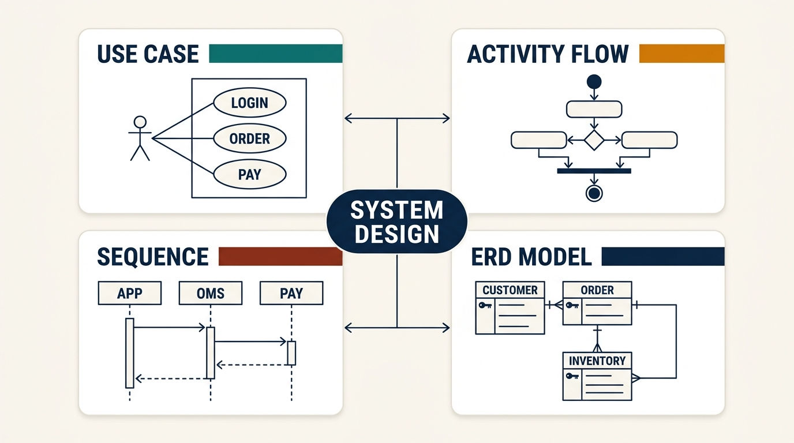

*Gambar 5.0 — Cetak Biru Analisis dan Desain Sistem Proyek OMNI: keterhubungan menyeluruh antara C4 System Context, UML Behavioral/Interaction/State, Model Data ERD (3NF + UU PDP), dan Arsitektur Kontainer.*

### 5.1 Dari Kebutuhan Bisnis (BRD/FRD) ke Desain Sistem (*System Design Specification* / SDS)

Dalam proyek teknologi berskala enterprise seperti **Proyek OMNI** (Rp 9,20 M, 14 Sprint *Agile* di bawah tata kelola *Hybrid Stage-Gate*), terdapat pembagian tanggung jawab yang tegas namun saling melengkapi antara **Business Analyst (BA)**, **System Analyst (SA)**, dan **Engineering Team**:

- **Business Analyst (Nadia Putri)** menjawab pertanyaan ***"Apa masalah bisnisnya dan kapabilitas apa yang dibutuhkan?"*** melalui *Business Requirements Document* (BRD), *Functional Requirements Document* (FRD), peta proses bisnis *To-Be* (BPMN), dan *User Stories* beserta *Acceptance Criteria*.
- **System Analyst (Dimas Prasetyo)** berperan sebagai **jembatan teknis-bisnis** yang menjawab pertanyaan ***"Bagaimana komponen sistem, alur data, kontrak antarmuka, status transaksi, dan basis data dirancang secara presisi untuk memenuhi kebutuhan fungsional dan non-fungsional?"*** Keluaran utamanya adalah **System Design Specification (SDS)** (sering disebut pula *System Design Document* / SDD atau *Technical Design Specification* / TDS).
- **Engineering Team (18 personel PT NDS pimpinan Bambang Hartono & tim IT internal SNR)** menjawab pertanyaan ***"Bagaimana kode sumber, kueri, pipeline CI/CD, dan infrastruktur dibangun secara bersih dan teruji?"*** berdasarkan kontrak desain di dalam SDS.
- **QA & Test Lead (Lukas Gunawan)** memanfaatkan SDS—khususnya *Exception Flows*, *State Transition Matrix*, dan *Non-Functional Constraints*—sebagai rujukan primer untuk merancang *System Integration Test* (SIT), *negative test cases*, dan skenario *load testing* **2.500 TPM**.

| Dimensi Perbandingan | BRD / FRD (Keluaran Modul 06 — Lead BA) | System Design Specification / SDS (Keluaran Modul 07 — Lead SA) |
|----------------------|-----------------------------------------|------------------------------------------------------------------|
| **Orientasi Utama** | Sudut pandang bisnis, pengguna, dan aturan kebijakan (*Problem Space*) | Sudut pandang komponen sistem, protokol interaksi, skema data, dan ketahanan (*Solution Space*) |
| **Tingkat Granularitas** | Aturan bisnis (*"Stok harus akurat dan pesanan BOPIS siap ≤ 2 jam"*) | Mekanisme teknis (*"Optimistic lock pada `store_inventory.version`, TTL reservasi 15 menit, sinkronisasi POS via webhook/queue ≤ 60 detik"*) |
| **Cakupan Skenario Gagal** | Umumnya fokus pada pengecualian bisnis (pembatalan pelanggan, retur) | Mencakup kegagalan teknis (*network timeout*, *duplicate webhook*, *race condition*, *dead-letter queue*, *failover* database) |
| **Artefak Visual Utama** | BPMN proses bisnis, *Customer Journey*, *Wireframe*, *Context Map* bisnis | C4 Context & Container, UML 2.5 (*Use Case, Activity, Sequence, State, Class, Component*), Logical & Physical ERD |
| **Forum Persetujuan** | Business Sponsor (Ratna Kusuma), VP Marketing (Dewi), Store Ops (Agus) | CTO / *Architecture Review Board* (Irwan Pratama), InfoSec/Legal (Rina Kartika), QA Lead (Lukas), Vendor Tech Lead (PT NDS) |

#### Memulai dari Peta Konteks: C4 Model Level 1 (*System Context Diagram*)
Sebelum menggambar diagram detail apa pun, seorang Senior SA **wajib menetapkan batas sistem (*System Boundary*)** terlebih dahulu. Tanpa batas sistem yang disepakati, tim rentan mendesain ulang fitur milik proyek tetangga—misalnya, mencoba merancang ulang modul akuntansi ERP (cakupan **PRJ-02 ERP-Refresh**) atau mengganti perangkat keras kasir toko (cakupan **PRJ-03 POS-Modern**). Kerangka **C4 Model** ciptaan Simon Brown menyediakan cara paling jernih untuk memetakan arsitektur pada empat tingkat zoom: **Level 1 Context**, **Level 2 Container**, **Level 3 Component**, dan **Level 4 Code**.

Berikut adalah **Diagram 1: C4 Level 1 System Context Diagram Proyek OMNI** yang memetakan aktor manusia, batas Platform OMNI, serta seluruh sistem eksternal yang berinteraksi dengannya dalam ekosistem **Program Nusantara 2028**.

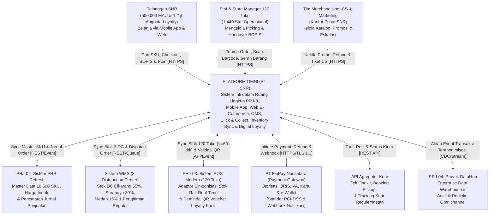

*Gambar 5.1 — Diagram 1: C4 Level 1 System Context Diagram Proyek OMNI dalam Ekosistem Program Nusantara 2028.*

Perhatikan betapa jernihnya keputusan arsitektural yang langsung terlihat dari Diagram 1: Platform OMNI **tidak menyimpan** data kartu kredit mentah (didelegasikan ke PT FinPay Nusantara sesuai PCI-DSS), **tidak menggantikan** POS fisik (berinteraksi lewat kontrak adaptor API), dan mengirim aliran data ke **PRJ-04 DataHub** secara satu arah (*event stream*) yang teranonimisasi agar sesuai mandat UU PDP.

---

### 5.2 UML 2.5 — Behavioral Modeling: *Use Case* & *Activity Diagram*

**Unified Modeling Language (UML 2.5)** yang distandarkan oleh *Object Management Group* (OMG) bukanlah sekadar koleksi kotak dan panah untuk mempercantik dokumen; UML adalah **bahasa spesifikasi formal** untuk memvalidasi logika sebelum menulis kode. Kelompok pertama yang dikuasai SA adalah *Behavioral Modeling* untuk menangkap **apa yang sistem lakukan bagi aktornya** (*Use Case*) dan **bagaimana alur kerja detailnya berjalan** (*Activity*).

#### 1. Use Case Diagram & Use Case Specification
Sebuah *Use Case Diagram* terdiri atas empat elemen inti:
1. **Actor (Aktor):** Peran eksternal (manusia maupun sistem lain) yang berinteraksi dengan sistem. Dibedakan menjadi **Primary Actor** (penginisiasi tujuan bisnis, diletakkan di sisi kiri, mis. Pelanggan, Staf Toko) dan **Secondary / Supporting Actor** (sistem eksternal yang dipanggil sistem untuk menuntaskan tujuan, diletakkan di sisi kanan, mis. PT FinPay Nusantara, POS-Modern).
2. **System Boundary (Batas Sistem):** Bingkai yang memisahkan kapabilitas di dalam sistem dari lingkungan luar.
3. **Use Case:** Unit fungsional bernilai nyata bagi aktor, selalu dinamai dengan **frasa kata kerja–objek** yang jelas (mis. *Checkout Pesanan Click & Collect*, bukan *Halaman Pembayaran*).
4. **Relasi Antar-Use Case (Titik Paling Sering Salah di Lapangan!):**
   - **`«include»` (Wajib / Mandatory Reuse):** Use case dasar **selalu** mengeksekusi use case target agar dapat selesai. Arah panah putus-putus menunjuk **dari Base ke Included** (`Base -.->|«include»| Included`). *Contoh:* `Checkout Click & Collect` **wajib** `«include»` `Reservasi Stok Real-Time` dan `Proses Pembayaran Digital`.
   - **`«extend»` (Opsional / Kondisional):** Use case tambahan memperluas perilaku use case dasar **hanya jika kondisi tertentu (*extension point*) terpenuhi**. Arah panah putus-putus menunjuk **dari Extending ke Base** (`Extending -.->|«extend»| Base` — berlawanan arah dengan `«include»`!). *Contoh:* `Tebus Poin / Voucher Loyalty` bersifat opsional sehingga `«extend»` ke `Checkout Click & Collect`.

Berikut adalah **Diagram 2: Use Case Overview Proyek OMNI** yang menggambarkan batas sistem, aktor primer/sekunder, serta penggunaan relasi `«include»` dan `«extend»` secara tepat.

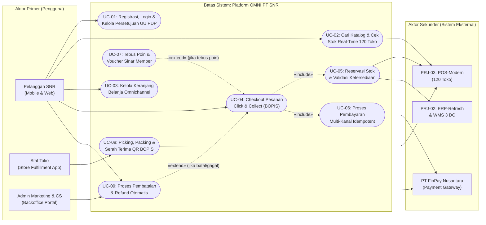

*Gambar 5.2 — Diagram 2: Use Case Overview Proyek OMNI dengan Pemisahan Aktor Primer, Batas Sistem, Aktor Sekunder, serta Relasi `«include»` dan `«extend»`.*

> **Peringatan Praktik Senior:** Diagram *Use Case* **tidak pernah cukup berdiri sendiri**. Nilai operasional sesungguhnya terletak pada **Use Case Specification** tertulis (Alistair Cockburn) yang memerinci *Precondition*, *Postcondition (Success & Minimal Guarantee)*, *Trigger*, *Main Success Scenario*, *Alternative Flows*, dan *Exception Flows*. Tanpa *Minimal Guarantee*, tim tidak pernah sepakat kondisi aman apa yang harus dijamin jika transaksi gagal di tengah jalan (misalnya: stok yang ditahan wajib dilepas kembali!). Contoh lengkap spesifikasi **UC-04** dibedah pada Sub-bab 6.2.

#### 2. Activity Diagram
Jika *Use Case* menjelaskan **tujuan dan kontrak**, maka **Activity Diagram** menggambarkan **aliran kendali (*control flow*) dan aliran objek (*object flow*)** lintas aktor atau komponen secara sekuensial maupun paralel. Elemen kunci yang membedakan *Activity Diagram* kelas senior dari *flowchart* biasa meliputi:
- **Swimlanes (Partitions):** Pembagian kolom/area tanggung jawab (Pelanggan, Sistem OMS & Inventory, Payment Gateway FinPay, Staf Toko) sehingga serah terima (*handoff*) dan potensi kemacetan SLA **≤ 2 jam** terlihat seketika.
- **Decision & Merge Node (`◇`):** Pencabangan bersyarat (*mutually exclusive*, memakai *guard* seperti `[Stok >= Qty]` vs `[Stok < Qty]`) dan penggabungannya kembali.
- **Fork & Join Node (Paralelisme):** Memecah satu aliran menjadi beberapa aktivitas yang berjalan **bersamaan** (*concurrent*), misalnya setelah pembayaran sukses: sistem mengirim notifikasi *push* ke pelanggan, menerbitkan tiket *picking* ke tablet toko, dan mencatat poin *pending* di Loyalty Engine secara paralel, lalu menyatukannya pada *Join* saat seluruh prasyarat siap.
- **Exception & Time Event:** Menangani batas waktu (*timer* 15 menit batas bayar atau batas *pickup* 48 jam) serta cabang pembatalan/refund secara eksplisit. Penerapan lengkapnya pada *Click & Collect* ditampilkan pada **Diagram 3** di Sub-bab 6.2.

---

### 5.3 UML 2.5 — Interaction & State Modeling: *Sequence* & *State Machine Diagram*

Dua diagram berikut adalah senjata utama Senior SA dalam mencegah *bug* paling mahal pada sistem terdistribusi: kegagalan integrasi antar-layanan (*distributed failure*) dan korupsi status transaksi (*illegal state transition*).

#### 1. Sequence Diagram
**Sequence Diagram** memvisualisasikan interaksi antar-objek atau antar-layanan secara berurutan menurut sumbu **waktu** (dari atas ke bawah). Komponen standarnya meliputi:
- **Lifeline:** Garis vertikal putus-putus yang mewakili peserta interaksi (mis. `Mobile App`, `API Gateway`, `OMS Service`, `Inventory Service`, `FinPay`, `Store App`).
- **Activation Bar (Focus of Control):** Persegi panjang pada *lifeline* yang menandakan komponen sedang aktif memproses permintaan.
- **Synchronous Message (`->>`) & Return (`-->>`):** Pengirim menunggu balasan sebelum melanjutkan (mis. validasi reservasi stok sebelum membuat tagihan bayar). Hindari rantai panggilan sinkron yang terlalu panjang agar latensi tidak menumpuk saat beban **2.500 TPM**.
- **Asynchronous Message (`-)`):** Pengirim mengirim pesan/event ke *message broker* lalu segera melanjutkan tanpa menunggu selesai (mis. mengirim *email/push notification* atau mengalirkan data ke **PRJ-04 DataHub**).
- **Combined Fragments:** Blok logika terstruktur yang wajib dipakai pada sistem nyata:
  - **`alt` / `else`:** Percabangan kondisional (*if–else*), krusial untuk memodelkan sukses vs gagal (*timeout*, saldo kurang, stok habis).
  - **`opt`:** Blok opsional (*if* tanpa *else*), mis. validasi kupon hanya jika pelanggan memasukkan kode promo.
  - **`loop`:** Pengulangan dengan kondisi batas (mis. *retry polling* status FinPay maksimal 3 kali dengan *exponential backoff*).
  - **`par`:** Eksekusi paralel antar-layanan.

#### 2. State Machine Diagram
Pada sistem ritel omnichannel, satu entitas pesanan (`OMNI_ORDER`) dapat dimodifikasi oleh banyak sumber bersamaan: pelanggan menekan tombol *Batal*, *webhook* PT FinPay mengirim status *Lunas*, *cron job* membatalkan reservasi yang kadaluarsa setelah 15 menit, atau staf toko menekan tombol *Siap Diambil*. Tanpa **Finite State Machine (FSM)** yang eksplisit, sistem sangat rentan terhadap dua bencana operasional:
1. ***Double-Deduction* (Pemotongan Stok Ganda):** Stok dipotong saat reservasi, lalu dipotong lagi saat *webhook* pembayaran datang dua kali (*duplicate webhook*), membuat akurasi stok anjlok kembali ke bawah 88,6%.
2. ***Orphan Reservation* (Reservasi Yatim):** Pelanggan menutup aplikasi sebelum membayar, tetapi status pesanan terhenti tanpa mekanisme transisi *timeout*, sehingga barang terkunci selamanya dan tidak bisa dibeli pelanggan lain.

Dalam UML 2.5, setiap transisi antar-status ditulis dalam format:
`Event [Guard Condition] / Action`
Contoh: `PaymentWebhookReceived [signature_valid AND amount_match] / markPaid(); commitReservedStock(); emitPickingEvent()`.

Dengan mendefinisikan **State Machine Diagram** (lihat **Diagram 5** di Sub-bab 6.4) beserta **State Transition Matrix**, SA memberikan aturan ketat kepada pengembang: setiap transisi di luar matriks **wajib ditolak** (`HTTP 409 Conflict`) dan dicatat dalam *audit log*.

---

### 5.4 UML 2.5 — Structural Modeling: *Class / Domain Model* & *Component Diagram*

Jika diagram perilaku menjelaskan dinamika waktu, maka **Structural Modeling** menetapkan tulang punggung struktur objek dan batasan modul perangkat lunak.

#### Class / Domain Model Diagram
Pada level System Analysis (berbeda dari *implementation class diagram* yang terlalu terikat bahasa pemrograman tertentu), SA menyusun **Domain Model Class Diagram** untuk menangkap konsep bisnis inti, atribut, perilaku (*methods*), aturan enkapsulasi, serta jenis relasi antar-objek:
- **Association (`-->`):** Hubungan umum antar-objek yang hidup mandiri (mis. `Customer` membuat `OmniOrder`).
- **Aggregation (`o--` — *Whole-Part* lemah):** Induk mengelompokkan anak, tetapi objek anak tetap eksis jika induk dihapus (mis. `Store` mengelola koleksi `StoreInventory`; produk SKU tetap ada meski satu toko tutup).
- **Composition (`*--` — *Whole-Part* kuat):** Siklus hidup anak bergantung mutlak pada induk (mis. `OmniOrder` terdiri atas `1..* OrderItem`; jika objek pesanan dibuang sebelum tersimpan, *item* di dalamnya tidak bermakna berdiri sendiri).
- **Generalization / Inheritance (`<|--`):** Pewarisan perilaku umum ke subtipe spesifik (mis. `Voucher` memiliki subtipe `PercentageVoucher` dan `FixedAmountVoucher`).
- **Dependency (`..>`):** Penggunaan sementara oleh sebuah metode (mis. `OmniOrder` menggunakan `PaymentTransaction` saat proses *settlement*).

Berikut adalah **Diagram 7: Class / Domain Model Diagram Modul OMS & Loyalty Proyek OMNI** yang dirancang Dimas Prasetyo untuk menyamakan kosakata domain (*Ubiquitous Language*) antara tim BA, SA, dan pengembang PT NDS.

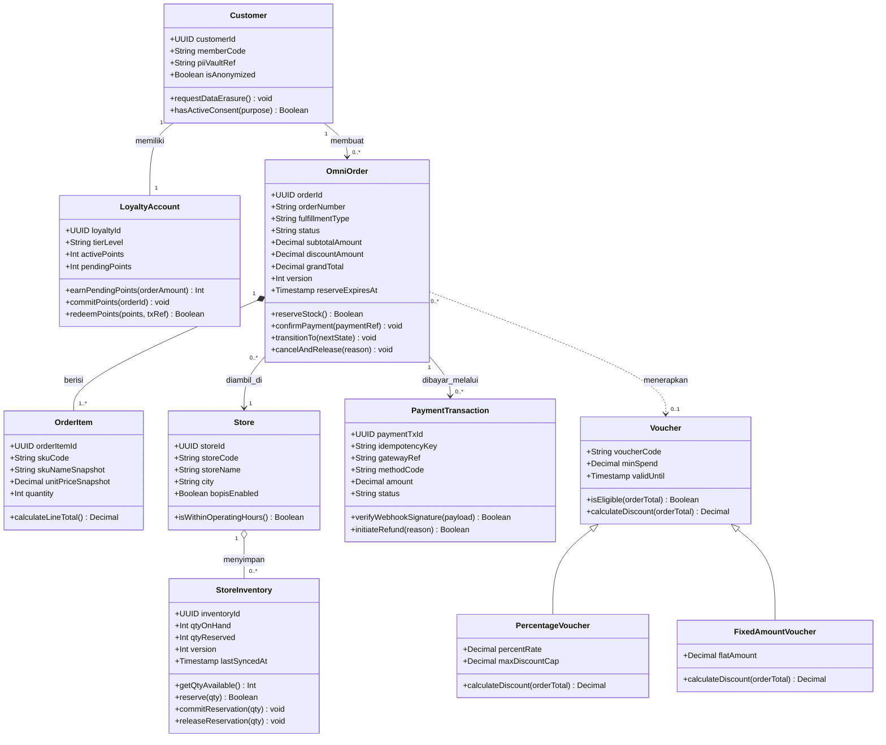

*Gambar 5.3 — Diagram 7: Class / Domain Model Diagram Modul OMS & Loyalty Proyek OMNI (Menerapkan Enkapsulasi, Komposisi, Agregasi, Pewarisan, dan Optimistic Lock Version).*

Perhatikan dua keputusan desain tingkat senior pada Diagram 7:
1. **`OrderItem` menyimpan `skuNameSnapshot` dan `unitPriceSnapshot`:** Jika harga sebuah kursi kerja berubah minggu depan di ERP, riwayat kuitansi pesanan hari ini **tidak boleh berubah**.
2. **`Customer` tidak menyimpan NIK, nomor ponsel, atau alamat secara langsung**, melainkan hanya menyimpan `piiVaultRef` (referensi ke brankas PII terenkripsi) demi kepatuhan **UU PDP**.

#### Component Diagram & Batas Modular
Di atas level kelas, **Component Diagram** mengelompokkan kelas-kelas yang berkohesi tinggi ke dalam unit layanan atau modul yang dapat dikembangkan, diuji, dan diterapkan (*deploy*) secara independen—dengan komunikasi hanya lewat **antarmuka eksplisit (*Provided & Required Interfaces*)**. Prinsip utamanya adalah ***High Cohesion*** (semua logika penghitungan poin dan tier berada di *Loyalty Service*, bukan tercecer di *Mobile App* dan *OMS*) dan ***Low Coupling*** (*OMS* tidak pernah mengakses tabel database milik *Loyalty Service* secara langsung, melainkan melalui API atau *domain event*). Penerapannya terintegrasi pada **Diagram 8 (Component & C4 Level 2 Container Architecture)** di Sub-bab 6.6.

---

### 5.5 Data Modeling, ERD, Normalisasi, Denormalisasi Terkendali & Kepatuhan UU PDP

Kode aplikasi dapat ditulis ulang dalam hitungan bulan, tetapi **skema basis data yang buruk akan menghantui perusahaan selama bertahun-tahun**. Bagi seorang Senior SA, pemodelan data berjalan melewati tiga tingkat abstraksi berurutan:

1. **Conceptual Data Model (CDM):** Mengidentifikasi entitas bisnis utama dan hubungan makro antar-entitas (tanpa kunci teknis maupun tipe data). Digunakan untuk menyamakan pemahaman bersama Sponsor (Ratna Kusuma) dan Lead BA (Nadia Putri).
2. **Logical Data Model (LDM):** Menentukan seluruh atribut, *Primary Key* (PK), *Foreign Key* (FK), *Unique Key* (UK), kardinalitas tepat (**Crow's Foot**: `1:1`, `1:N`, serta mengurai `M:N` melalui ***junction / associative table*** seperti `ORDER_ITEM` yang mengurai relasi `M:N` antara `OMNI_ORDER` dan `PRODUCT_SKU`), serta menerapkan normalisasi hingga **3NF**. Masih bersifat independen dari vendor DBMS.
3. **Physical Data Model (PDM):** Menerjemahkan LDM ke spesifikasi DBMS target (pada Proyek OMNI: **PostgreSQL 16** di Cloud Region Jakarta), mencakup tipe data eksak (`UUID`, `NUMERIC(14,2)`, `TIMESTAMPTZ`), *index* komposit (mis. `INDEX idx_store_inv_store_sku ON store_inventory(store_id, sku_id)`), partisi tabel bulanan (*table partitioning* untuk tabel `PAYMENT_TX` dan `AUDIT_LOG`), serta kebijakan enkripsi tingkat kolom/tabel.

#### Normalisasi Bertahap (UNF → 1NF → 2NF → 3NF)
Normalisasi adalah teknik matematis (E.F. Codd) untuk menghilangkan redundansi data dan tiga anomali perusak integritas: **Insertion Anomaly**, **Update Anomaly**, dan **Deletion Anomaly**.

| Bentuk Normal | Aturan Utama | Masalah yang Dihilangkan | Contoh Penerapan pada Proyek OMNI |
|---------------|--------------|--------------------------|-----------------------------------|
| **UNF (0NF)** | Data mentah dengan grup berulang (*repeating groups*) dalam satu sel | Tidak dapat diindeks atau dikueri secara relasional | Satu baris pesanan berisi `sku_list = "SKU-01(2), SKU-09(1)"` |
| **1NF** | Setiap kolom bersifat **atomik** (nilai tunggal), tanpa grup berulang, dan memiliki PK unik | Mengurai daftar barang & nomor telepon majemuk menjadi baris/tabel terpisah | Memecah `sku_list` ke tabel anak `ORDER_ITEM` (1 baris = 1 SKU per pesanan) |
| **2NF** | Memenuhi 1NF + tidak ada **Partial Dependency** (seluruh atribut non-kunci bergantung penuh pada keseluruhan *Composite PK*) | Menghilangkan pengulangan nama produk di setiap baris transaksi | Pada `ORDER_ITEM (order_id, sku_id)`, atribut master seperti `category_code` dan `weight_gram` dipindah ke `PRODUCT_SKU` |
| **3NF** | Memenuhi 2NF + tidak ada **Transitive Dependency** (atribut non-kunci tidak boleh bergantung pada atribut non-kunci lain) | Mencegah inkonsistensi ketika data master cabang/toko diperbarui | Pada `OMNI_ORDER`, kolom `store_city` dan `store_address` bergantung pada `store_id` (bukan langsung ke `order_id`), sehingga wajib dipindah ke tabel `STORE` |

*(Aturan pengingat klasik 3NF / BCNF: "Setiap atribut non-kunci harus bergantung pada kunci, keseluruhan kunci, dan tidak selain kunci — The key, the whole key, and nothing but the key.")*

#### Kapan Melakukan Denormalisasi Terkendali (*Controlled Denormalization*)?
Seorang analis junior sering mengira 3NF adalah hukum mati yang tidak boleh disentuh. Sebaliknya, seorang **Senior SA** memahami perbedaan mendasar antara beban kerja **OLTP Transaksional** (tulis-baca ketat: *checkout, reservasi stok, pembayaran*) dan beban kerja **Read-Heavy Catalog** (**2.500 TPM** pada **18.500 SKU** dan **500.000 MAU**).

Jika setiap kali pelanggan membuka daftar produk di aplikasi mobile, database harus melakukan `JOIN` melintasi 7 tabel 3NF (`PRODUCT_SKU`, `CATEGORY`, `BRAND`, `PRICE_LIST`, `PROMO_RULE`, `STORE_INVENTORY`, `PRODUCT_MEDIA`), maka CPU database utama akan jenuh sebelum mencapai 800 TPM. Solusi arsitektural yang benar adalah **Denormalisasi Terkendali**, yaitu:
1. **Mempertahankan 3NF ketat pada *System of Record* (tabel transaksional inti)** demi integritas mutlak (*ACID*).
2. **Menerapkan *Immutable Snapshot* pada transaksi historis:** Menyimpan `unit_price_snapshot` dan `sku_name_snapshot` di `ORDER_ITEM` agar bukti transaksi tak berubah saat harga ERP diperbarui.
3. **Membangun *Read Model / Materialized View / Redis Catalog Cache* terdenormalisasi** untuk halaman katalog & ketersediaan toko (diperbarui secara asinkron lewat *event* perubahan stok ≤ 60 detik atau *Read Replica*), sehingga bacaan 2.500 TPM dilayani dalam **< 80 ms** tanpa membebani database transaksi!

#### Desain Data Kepatuhan UU PDP (UU No. 27 Tahun 2022) & PCI-DSS
Pada Proyek OMNI, **Rina Kartika** (Head of Legal, Compliance & InfoSec) memiliki **hak veto *Go-Live*** terhadap risiko **R-05 (Ketidakpatuhan UU PDP & PCI-DSS)**. Karena itu, kepatuhan privasi tidak boleh ditempel di akhir, melainkan dirancang langsung di level skema data (*Privacy by Design*):

1. **Pemisahan Tabel PII Terenkripsi (*PII Vault / Logical Isolation*):** Data identitas langsung pelanggan (*Nama Lengkap, Email, Nomor Ponsel, Alamat Pengiriman, Tanggal Lahir*) dipisahkan ke skema/tabel `CUSTOMER_PII_VAULT` yang dienkripsi menggunakan **AES-256-GCM** dengan kunci yang dikelola *Key Management Service* (KMS — *Envelope Encryption*). Tabel transaksional (`OMNI_ORDER`, `LOYALTY_ACCOUNT`) hanya menyimpan `customer_id` (UUID pseudonim) sehingga *dump* analitik ke **PRJ-04 DataHub** otomatis bebas PII mentah.
2. **Tabel `CONSENT_LOG` Bersifat *Append-Only / Immutable*:** UU PDP mewajibkan Pengendali Data membuktikan persetujuan eksplisit (*explicit consent*) subjek data untuk setiap tujuan pemrosesan (transaksi inti vs pemasaran promosi vs profil loyalty). Setiap pemberian atau penarikan persetujuan dicatat sebagai baris baru dengan `consent_version`, `purpose_code`, `granted_flag`, `channel`, `ip_hash`, dan `recorded_at`—**tidak pernah ditimpa (`UPDATE`)**.
3. **Hak Penghapusan (*Right to Erasure*) Tanpa Merusak Pembukuan (*Crypto-Shredding / Anonymization*):** Jika pelanggan meminta penghapusan akun berdasarkan Pasal 8 UU PDP, melakukan `DELETE FROM customer` akan melanggar *Foreign Key* `OMNI_ORDER` dan melanggar kewajiban retensi catatan akuntansi/pajak 10 tahun. Polanya adalah **Soft Delete + Anonymization / Crypto-Shredding**: menghapus baris/kunci enkripsi di `CUSTOMER_PII_VAULT`, menandai `customer.is_anonymized = TRUE`, dan mengganti referensi tampilan menjadi `"ANON-USER"`, sementara angka penjualan di `OMNI_ORDER` dan `PAYMENT_TX` tetap utuh untuk audit CFO Budi Santoso.
4. **Zero Storage untuk Data Kartu (PCI-DSS):** Tabel `PAYMENT_TX` hanya menyimpan `gateway_ref`, `masked_pan` (mis. `4111-XXXX-XXXX-1234`), dan token transaksi dari PT FinPay Nusantara; **dilarang keras** menyimpan nomor kartu utuh (PAN) maupun kode CVV di database SNR.
5. **Immutable Audit Trail:** Setiap perubahan status pesanan, penyesuaian stok manual, dan akses data PII oleh staf CS wajib dicatat pada tabel `AUDIT_LOG` (*who, what, when, before_state, after_state, correlation_id*).

---

### 5.6 System Architecture Fundamentals & Non-Functional Design

Desain modul dan skema data yang rapi dapat tetap runtuh saat produksi apabila arsitektur sistem tidak dirancang untuk menghadapi kegagalan jaringan, lonjakan trafik, dan perubahan kontrak sistem *legacy*.

#### 1. Logical Architecture: Layered (N-Tier) vs. Hexagonal (*Ports & Adapters*)
- **Layered / N-Tier Architecture** (Presentation → Application/Service → Business Logic → Data Access) mudah dipahami dan cocok untuk modul administrasi sederhana. Namun, kelemahan klasiknya adalah ketergantungan searah ke bawah: perubahan skema database atau API pihak ketiga sering merembes ke logika bisnis.
- **Hexagonal Architecture (*Ports & Adapters* — Alistair Cockburn) / Clean Architecture (Robert C. Martin)** menempatkan **Domain Core** (*Order Lifecycle, Inventory Reservation Policy, Loyalty Point Rules*) di pusat tanpa ketergantungan pada *framework*, database, maupun vendor eksternal. Seluruh interaksi luar masuk dan keluar melalui **Ports** (*interface kontrak*) yang diimplementasikan oleh **Adapters**.

Mengapa Dimas Prasetyo memilih **Hexagonal Architecture** untuk layanan inti **OMS Proyek OMNI**? Ingat Risiko **R-01** (*00-studi-kasus-utama.md*): antarmuka API dari proyek paralel **PRJ-03 POS-Modern** mundur 3 minggu! Dengan memisahkan `InventorySyncPort` dari `PosModernAdapter`, tim PT NDS dapat membangun dan menguji seluruh logika OMS memakai `MockPosAdapter` tanpa terhenti, dan ketika kontrak POS-Modern final tiba atau berubah format payload, hanya adaptor tipis di sisi luar yang dimodifikasi—*Domain Core* tetap 100% steril!

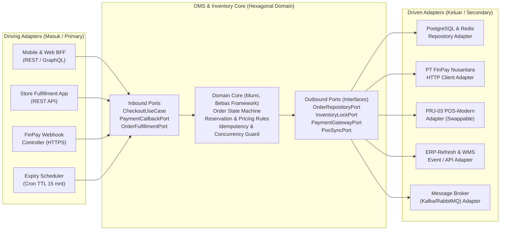

*Gambar 5.4 — Diagram 9: Arsitektur Hexagonal (Ports & Adapters) pada OMS Proyek OMNI untuk Mengisolasi Domain Core dari Ketidakpastian Kontrak POS-Modern & FinPay.*

#### 2. Physical Deployment Overview (Cloud Region Jakarta — Target Uptime ≥ 99,5%)
Untuk memenuhi syarat **CB-03** (Infrastruktur Cloud AWS/GCP Region Jakarta), **uptime ≥ 99,5%** (maksimal *downtime* terencana/tak terencana hanya ~3,65 jam per bulan), dan uji beban **2.500 TPM**, arsitektur fisik menerapkan:
- **Multi-Availability Zone (Multi-AZ) di Region Jakarta** (residensi data domestik sesuai ekspektasi tata kelola data ritel Indonesia) dengan *Web Application Firewall* (WAF) + *Content Delivery Network* (CDN) untuk gambar 18.500 SKU.
- **Auto-Scaling Container Cluster (Kubernetes/Managed ECS):** Layanan *stateless* (API Gateway, Catalog, OMS, Loyalty) menskalakan otomatis dari 4 pod normal ke 24+ pod saat lonjakan Harbolnas 12.12.
- **Database High Availability & Read Separation:** PostgreSQL Primary + Synchronous Standby (Multi-AZ *automatic failover* < 60 detik) untuk transaksi ACID, ditambah 2 *Read Replicas* + **Redis Cluster** untuk *caching* katalog dan *distributed lock / idempotency cache*.
- **Isolasi Jaringan:** Layanan aplikasi berada di *Private Subnet*, sedangkan PostgreSQL dan `CUSTOMER_PII_VAULT` ditempatkan di *Isolated Data Subnet* tanpa akses internet publik.

#### 3. Desain Non-Functional Kritis: *Idempotency* & *Concurrency Control*

**A. Idempotency pada Pembayaran & Webhook:**
Di jaringan seluler Indonesia, pelanggan sering mengalami *timeout* sesaat setelah menekan tombol "Bayar", lalu menekan tombol tersebut 2–3 kali, atau *Payment Gateway* (PT FinPay Nusantara) mengirim *webhook* sukses dua kali karena mekanisme *at-least-once delivery*. Sebuah operasi disebut **idempoten** apabila dieksekusi sekali maupun berkali-kali dengan parameter sama, hasil akhirnya tetap identik (pelanggan **hanya terdebit satu kali**).
- **Mekanisme:** Client/OMS menghasilkan `Idempotency-Key` unik (UUID v4 per percobaan pembayaran pesanan, disimpan dengan constraint `UNIQUE` di `PAYMENT_TX.idempotency_key` dan Redis TTL 24 jam). Jika permintaan dengan `Idempotency-Key` sama datang lagi, sistem **tidak memanggil ulang debit**, melainkan langsung mengembalikan respons transaksi pertama yang telah tersimpan.

**B. Concurrency Control pada Stok (*Optimistic Locking* vs *Pessimistic Locking*):**
Ketika stok sebuah SKU di Toko Pondok Indah tersisa **1 unit** dan dua pelanggan melakukan *checkout* secara bersamaan, pola naif *Read-Then-Update* (`SELECT qty` → cek di kode Java/Go → `UPDATE qty = qty - 1`) pasti menyebabkan ***race condition*** dan stok menjadi `-1` (*overselling*). Perbandingan tiga strategi teknis utama:

| Strategi Concurrency | Cara Kerja Teknis | Keunggulan | Risiko / Batasan | Rekomendasi Proyek OMNI |
|----------------------|-------------------|------------|------------------|-------------------------|
| **Pessimistic Locking** (`SELECT ... FOR UPDATE`) | Mengunci baris stok secara eksklusif sepanjang transaksi DB hingga `COMMIT` | Konsistensi kuat pada kontensi ekstrem | Menurunkan *throughput* drastis & rentan *deadlock* pada beban 2.500 TPM | Hanya untuk proses rekonsiliasi batch internal / SKU *flash sale* terbatas |
| **Optimistic Locking** (`version` column) | Membaca `version = v`, lalu mengeksekusi `UPDATE ... SET qty_reserved = qty_reserved + :q, version = v + 1 WHERE id = :id AND version = v AND (qty_on_hand - qty_reserved) >= :q` | **Throughput tinggi**, bebas *lock contention* panjang; jika `rows_affected = 0`, lakukan *retry* terbatas atau tolak dengan pesan sopan | Butuh mekanisme *retry* saat kontensi sangat tinggi pada satu SKU panas (*hot SKU*) | **Pola Utama Proyek OMNI** pada `STORE_INVENTORY` (didukung *Atomic Conditional Update*) |
| **Atomic Conditional Update** (tanpa baca awal) | Satu pernyataan atomik DB: `UPDATE store_inventory SET qty_reserved = qty_reserved + :q WHERE store_id = :s AND sku_id = :k AND (qty_on_hand - qty_reserved) >= :q` | Paling cepat, 1 *round-trip* DB, menjamin `qty_available >= 0` secara atomik di level engine DB | Tidak mendeteksi perubahan kolom lain jika ada pembaruan kompleks | **Sangat ideal** dikombinasikan dengan kolom `version` untuk audit jejak perubahan stok |

---

### 5.7 Kesalahan Umum di Lapangan (*Anti-Patterns*) dalam System Analysis & Design

Seorang Senior SA dinilai bukan hanya dari diagram indah yang dibuatnya, melainkan dari kemampuannya **mencegah 5 *anti-patterns* mematikan** berikut sejak tahap tinjauan desain:

| No | Anti-Pattern | Gejala di Lapangan | Dampak Nyata pada Proyek OMNI | Pencegahan oleh Senior SA |
|----|--------------|--------------------|-------------------------------|---------------------------|
| **1** | ***God Table* & *JSON Blob Dumping*** | Satu tabel `USERS_ALL` menampung profil, PII terenkripsi/mentah, 5 alamat, saldo poin, riwayat persetujuan UU PDP, dan JSON preferensi tak terstruktur | Audit UU PDP gagal (Rina veto *Go-Live*), kueri lambat, *Update Anomaly*, migrasi 1,2 juta anggota makin kacau | Pisahkan secara tegas: `CUSTOMER`, `CUSTOMER_PII_VAULT`, `LOYALTY_ACCOUNT`, `CONSENT_LOG` dengan tanggung jawab tunggal |
| **2** | ***Happy-Path-Only Sequence*** | *Sequence Diagram* hanya menggambar jalur sukses (200 OK) tanpa satu pun blok `alt` kegagalan *timeout*, stok habis, atau *webhook* ganda | Terjadi *orphan reservation*, saldo terpotong tapi status pesanan *Pending* selamanya, tiket keluhan CS membludak | Wajibkan setiap panggilan eksternal (FinPay, POS, WMS, Kurir) memiliki cabang `alt` kegagalan, *timeout*, dan *idempotency* |
| **3** | ***Check-Then-Act Race Condition* pada Stok** | Kode aplikasi mengecek `if (stock >= qty)` di memori lalu mengirim `UPDATE` tanpa syarat atomik maupun `version` | Pembatalan *stockout* gagal turun dari 11,4% ke < 1,5%; pelanggan marah saat tiba di toko barangnya habis | Terapkan *Atomic Conditional Update* + *Optimistic Locking* (`version`) + *TTL Reservation* 15 menit yang diuji lewat *concurrency load test* |
| **4** | ***Over-Normalization* pada Katalog & *Under-Normalization* pada Transaksi** | Kueri beranda katalog melakukan 8–10 `JOIN` langsung ke DB transaksional, sementara tabel pesanan tidak menyimpan *snapshot* harga | Aplikasi gagal uji beban **2.500 TPM** (latensi > 5 detik) dan laporan keuangan CFO berubah saat harga SKU diedit | Terapkan **3NF + Snapshot** di DB OLTP dan **Denormalisasi Terkendali** (Redis/Read Model) di jalur baca katalog |
| **5** | ***Big Design Up Front (BDUF)* Kaku vs *No Design Up Front (NDUF)*** | Membekukan SDS 400 halaman sebelum Sprint 1 (BDUF) sehingga usang saat API POS berubah, ATAU langsung *coding* tanpa ERD/State Diagram (NDUF) | BDUF melesetkan tenggat 26 Nov 2027; NDUF memicu *rework* mahal dan sengketa kontrak *Fixed Price* Rp 4,40 M dengan PT NDS | Terapkan ***Just-Enough Architecture Up Front*** (C4, ERD inti, State Machine, kontrak API utama di Fase 1) + penyempurnaan SDS *rolling-wave* per rilis Sprint |

---

## 6. Studi Kasus: Penerapan pada Proyek OMNI

Bagian ini menampilkan rangkaian artefak nyata **System Design Specification (SDS) v1.2 — Modul Omnichannel Commerce, Click & Collect & Digital Loyalty** yang disusun oleh **Dimas Prasetyo** (Lead SA / Solution Architect) bersama **Nadia Putri** (Lead BA), ditinjau secara formal pada *Design Review Gate* sebelum Sprint 7 (Release 2) & Sprint 12 (Release 3) oleh **Irwan Pratama** (CTO), **Lukas Gunawan** (QA Lead), **Rina Kartika** (Head of Legal & InfoSec), **Bambang Hartono** (Delivery Director PT NDS), dan **Fajar Nugroho** (Senior PM).

### 6.1 Matriks Ketertelusuran (*Requirements-to-Design Traceability*)

Untuk mencegah sengketa lingkup (*scope dispute*, Risiko **R-08**) pada kontrak *Fixed Price* Rp 4,40 M bersama PT NDS, Dimas menautkan setiap kebutuhan bisnis FRD/NFR dari Nadia Putri ke artefak desain sistem konkret:

| ID Kebutuhan (Modul 06) | Ringkasan Kebutuhan Bisnis / NFR | Artefak Desain Sistem (SDS Modul 07) | Verifikasi Target (QA — Lukas Gunawan) |
|-------------------------|----------------------------------|--------------------------------------|----------------------------------------|
| **FR-BOPIS-01** | Pesan daring & ambil di 120 toko dengan SLA persiapan ≤ 2 jam | Use Case `UC-04`, Activity Diagram (Diagram 3), State Machine (`PAID → PICKING → READY_FOR_PICKUP`) | UAT & Pilot 10 toko: ≥ 95% pesanan siap ≤ 2 jam |
| **FR-INV-02** | Sinkronisasi stok 120 toko & 3 DC ≤ 60 detik; *stockout* < 1,5% | `STORE_INVENTORY` (`version` optimistic lock), Hexagonal `PosSyncPort`, TTL Reservasi 15 mnt | *Concurrency test* 500 request paralel pada 1 SKU; 0 *negative stock* |
| **FR-PAY-03** | Pembayaran QRIS/VA/Kartu/e-Wallet aman PCI-DSS tanpa *double-charge* | Sequence Diagram Idempotent FinPay (Diagram 4), `PAYMENT_TX.idempotency_key` (`UK`) | *Chaos/retry test* 3× duplikat request & 2× duplikat webhook = 1 debit |
| **FR-LOY-04** | Integrasi 1,2 jt anggota loyalty (3 tier) & penebusan poin/voucher otomatis | Domain Class Model (Diagram 7), `LOYALTY_ACCOUNT`, `OmniOrder` + `Voucher` | Rekonsiliasi poin 100% cocok antara Mobile App & POS kasir |
| **NFR-PERF-01** | Tahan beban puncak **2.500 TPM** & uptime **≥ 99,5%** | C4 L2 Container Architecture (Diagram 8), Redis Catalog Cache, PostgreSQL Multi-AZ + Read Replica | *Load testing* JMeter/k6: 2.500 TPM selama 60 mnt, p95 < 400 ms, error < 0,1% |
| **NFR-COMP-02** | Kepatuhan penuh **UU PDP (UU No. 27/2022)** & 0 temuan PenTest Critical/High | ERD pemisahan `CUSTOMER_PII_VAULT` (AES-256), `CONSENT_LOG` (*append-only*), anonimisasi | Audit legal Rina Kartika & *Penetration Testing* independen |

---

### 6.2 Spesifikasi Use Case UC-04 & Activity Diagram *Click & Collect (BOPIS)*

#### Spesifikasi Use Case: UC-04 — Checkout Pesanan *Click & Collect* (BOPIS)

| Elemen Spesifikasi | Rincian Formal (Disusun oleh Dimas Prasetyo & Nadia Putri) |
|--------------------|------------------------------------------------------------|
| **ID & Nama Use Case** | **UC-04:** Checkout Pesanan *Click & Collect* (BOPIS) |
| **Aktor Primer** | Pelanggan SNR (via Aplikasi Mobile iOS/Android atau Web E-Commerce) |
| **Aktor Sekunder** | Sistem POS-Modern 120 Toko (via Inventory Sync Layer), PT FinPay Nusantara (Payment Gateway), Digital Loyalty Engine, Notification Service |
| **Deskripsi Singkat** | Pelanggan menyelesaikan pembelian barang di keranjang untuk diambil sendiri di salah satu dari 120 toko SNR, meliputi validasi & reservasi stok toko, penebusan poin/voucher opsional, dan pembayaran digital secara *idempotent*. |
| **Trigger** | Pelanggan memilih opsi pengiriman *"Ambil di Toko (Click & Collect)"*, memilih cabang toko (mis. Toko Pondok Indah), dan menekan tombol **"Bayar Sekarang"**. |
| **Preconditions** | 1) Pelanggan telah terautentikasi (JWT valid) dan memiliki `CONSENT_LOG` aktif untuk pemrosesan transaksi UU PDP.<br/>2) Keranjang berisi ≥ 1 SKU aktif dan toko tujuan berstatus `bopis_enabled = TRUE`. |
| **Postconditions (Success Guarantee)** | 1) Record `OMNI_ORDER` tersimpan berstatus `PAID` dengan *snapshot* harga & SKU pada `ORDER_ITEM`.<br/>2) Stok pada `STORE_INVENTORY` berpindah dari `qty_reserved` menjadi terkomit untuk *picking* toko.<br/>3) Record `PAYMENT_TX` berstatus `SETTLED` dengan referensi FinPay.<br/>4) Tiket *picking* muncul real-time di *Store Fulfillment App* (timer SLA ≤ 2 jam dimulai) dan kode QR pengambilan dikirim ke Pelanggan. |
| **Postconditions (Minimal Guarantee)** | Jika terjadi kegagalan di langkah mana pun, **tidak boleh** terjadi *negative stock*, *orphan reservation* (stok terkunci selamanya), atau *double-charge*. Setiap reservasi stok atau poin yang terlanjur ditahan wajib dilepas (*compensated rollback*). |
| **Non-Functional Constraints** | Waktu respons pembuatan *checkout* p95 ≤ 600 ms pada beban 2.500 TPM; masa tahan reservasi stok = **15 menit** (QRIS/e-Wallet) atau **60 menit** (VA); seluruh komunikasi eksternal wajib TLS 1.3 + HMAC signature. |

**Alur Utama (*Main Success Scenario*):**
1. Pelanggan menekan tombol *"Bayar Sekarang"* dengan membawa `cart_id`, `store_id`, `payment_method`, opsional `voucher_code / redeem_points`, dan `client_idempotency_key`.
2. API Gateway memvalidasi JWT, *rate limit*, dan meneruskan permintaan ke **OMS Service**.
3. **OMS Service** membuat objek `OMNI_ORDER` berstatus `DRAFT` dan memanggil **`«include»` UC-05 (Reservasi Stok Real-Time)** pada **Inventory Service** untuk menahan stok (`qty_reserved += qty`) secara atomik dengan `reserve_expires_at = NOW() + 15 menit`.
4. *(Opsional — `«extend»` UC-07)* Jika pelanggan menebus poin atau voucher, OMS memanggil **Loyalty Service** untuk memvalidasi kelayakan dan melakukan *hold* poin/voucher secara atomik.
5. OMS memperbarui status pesanan menjadi `RESERVED` dan memanggil **`«include»` UC-06 (Proses Pembayaran Digital)** ke **PT FinPay Nusantara** dengan mengirimkan `idempotency_key` dan nilai `grand_total`.
6. PT FinPay Nusantara merespons dengan *payment payload* (string QRIS / nomor Virtual Account / URL *redirect*) yang diteruskan OMS ke Mobile App Pelanggan.
7. Pelanggan menyelesaikan pembayaran; PT FinPay Nusantara mengirim *callback/webhook* terenkripsi (HMAC-SHA256) ke Payment Adapter OMS.
8. OMS memverifikasi tanda tangan *webhook*, kecocokan nominal, dan mengubah status pesanan dari `RESERVED` → `PAID` secara transaksional.
9. Secara paralel (**Fork**), OMS menerbitkan *domain event* `OrderPaidEvent`: a) *Store Fulfillment App* menampilkan notifikasi tiket *picking* baru dengan hitung mundur SLA **2 jam**; b) *Notification Service* mengirim konfirmasi & instruksi tunggu siap ambil ke Pelanggan; c) *Loyalty Service* mengonfirmasi pemakaian voucher/poin dan mencatat *pending earned points*.
10. Staf toko mengambil barang di rak, memindai barcode SKU via tablet/scanner (`PICKING` → `READY_FOR_PICKUP`), dan sistem mengirim QR Pickup ke Pelanggan.
11. Pelanggan datang ke konter *Click & Collect*, staf memindai QR Pickup, barang diserahkan, status menjadi `COMPLETED`, stok *on-hand* dikurangi permanen, poin loyalty dikreditkan (*committed*), dan event dikirim ke ERP & DataHub.

**Alur Alternatif (*Alternative Flows*):**
- **AF-1 (Langkah 4 — Penggunaan Poin & Voucher):** Jika diskon voucher mencakup sebagian nilai belanja, OMS menghitung ulang `grand_total = subtotal - discount_amount` sebelum memanggil FinPay.
- **AF-2 (Langkah 3 — Stok Toko Tujuan Habis, Toko Terdekat Tersedia):** Jika stok di Toko Pondok Indah tidak mencukupi, Inventory Service mengembalikan daftar 3 toko SNR terdekat dalam radius 10 km yang memiliki stok utuh agar pelanggan dapat mengganti lokasi ambil tanpa mengulang keranjang.

**Alur Pengecualian (*Exception Flows*):**
- **EF-1 (Langkah 3 — *Race Condition* / Stok Habis Mendadak):** *Atomic update* pada `STORE_INVENTORY` mengembalikan `0 rows affected`. OMS langsung membatalkan `DRAFT` dan mengembalikan `HTTP 409 Conflict` (*"Maaf, stok baru saja terjual habis di cabang ini"*).
- **EF-2 (Langkah 5/7 — Pembayaran Kadaluarsa > 15 Menit):** *Expiry Scheduler* menemukan `OMNI_ORDER` berstatus `RESERVED` dengan `NOW() > reserve_expires_at`, mengubah status ke `EXPIRED_CANCELLED`, melepas `qty_reserved` di Inventory Service, dan melepas *hold* poin/voucher di Loyalty Service.
- **EF-3 (Langkah 5 — *Timeout* PT FinPay Nusantara / Retry Pelanggan):** Jika respons FinPay melampaui 10 detik dan aplikasi melakukan *retry* dengan `client_idempotency_key` sama, OMS memverifikasi tabel `PAYMENT_TX` agar tidak menciptakan tagihan ganda (detail pada Diagram 4).
- **EF-4 (Langkah 10 — *Short Pick* / Barang Rusak di Rak Toko):** Saat staf toko melakukan *picking*, ditemukan 1 unit barang cacat fisik sehingga pesanan tak dapat dipenuhi penuh. Staf menandai `PICKING_EXCEPTION`; OMS memicu **`«extend»` UC-09 (Pembatalan & Refund Otomatis)** via FinPay, mengembalikan poin loyalty, dan mengirim notifikasi permohonan maaf + kompensasi voucher ke pelanggan.

#### Diagram 3: Activity Diagram End-to-End *Click & Collect (BOPIS)*

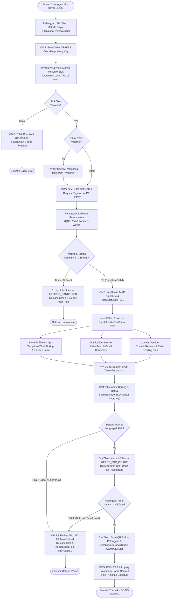

*Gambar 6.1 — Diagram 3: Activity Diagram End-to-End Click & Collect (BOPIS) Proyek OMNI dengan Cabang Paralel Fork/Join serta Jalur Pengecualian Stok, Timeout, dan Short Pick.*

---

### 6.3 Sequence Diagram: Checkout, Reservasi Stok, & Pembayaran *Idempotent* via FinPay

Untuk memastikan tidak pernah terjadi *double-charge* maupun *race condition* pada beban puncak **2.500 TPM**, Dimas Prasetyo menyusun **Diagram 4: Sequence Diagram Checkout & Pembayaran Idempotent**. Perhatikan penggunaan `Idempotency-Key`, penguncian atomik pada Inventory Service, blok `alt`/`else` untuk kegagalan stok dan pembayaran, serta pesan asinkron (`-)`) menuju *Store Fulfillment App* agar alur konfirmasi *webhook* tetap sangat cepat (< 150 ms).

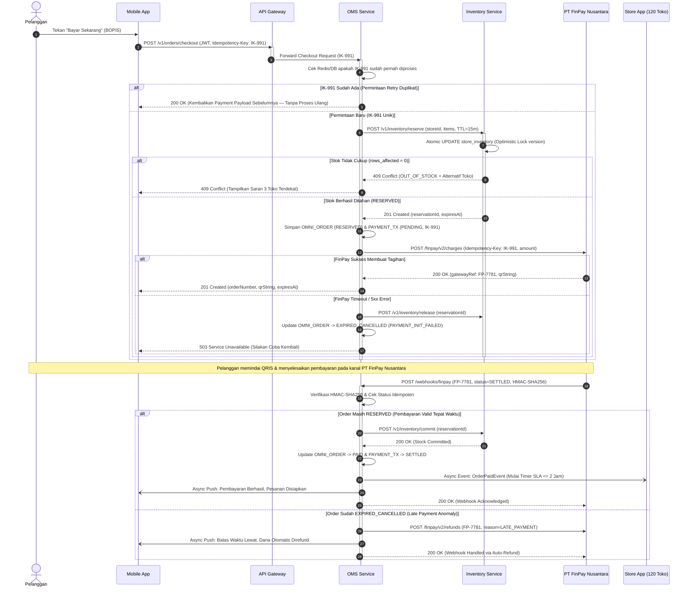

*Gambar 6.2 — Diagram 4: Sequence Diagram End-to-End Checkout, Reservasi Stok Atomik, dan Pembayaran Idempotent via PT FinPay Nusantara lengkap dengan Cabang Retry, Out-of-Stock, Late Payment Auto-Refund, dan Gateway Timeout.*

**Pelajaran Arsitektural dari Diagram 4:**
- **Blok `alt` Pertama (*Idempotency Guard*):** Jika sinyal seluler pelanggan terputus dan Mobile App mengirim ulang `POST /v1/orders/checkout` dengan `IK-991`, OMS sama sekali tidak menahan stok dua kali atau menagih FinPay dua kali—payload pembayaran pertama langsung dikembalikan.
- **Cabang *Late Payment Anomaly* pada Blok *Webhook*:** Jika pelanggan kebetulan membayar pada menit ke-15 lewat 20 detik tepat setelah *Expiry Job* melepas stok, sistem **tidak membiarkan dana mengambang** dan **tidak memotong stok toko yang mungkin sudah dibeli orang lain**, melainkan otomatis mengeksekusi `Auto-Refund` ke FinPay dan memberi tahu pelanggan secara transparan!

---

### 6.4 State Machine Diagram: Siklus Hidup Pesanan *Click & Collect*

Untuk menjamin konsistensi mutlak antara aplikasi mobile, *Store Fulfillment App*, *Expiry Scheduler*, dan *webhook* FinPay, Dimas menetapkan **Diagram 5: State Machine Diagram** beserta **Matriks Transisi Resmi**.

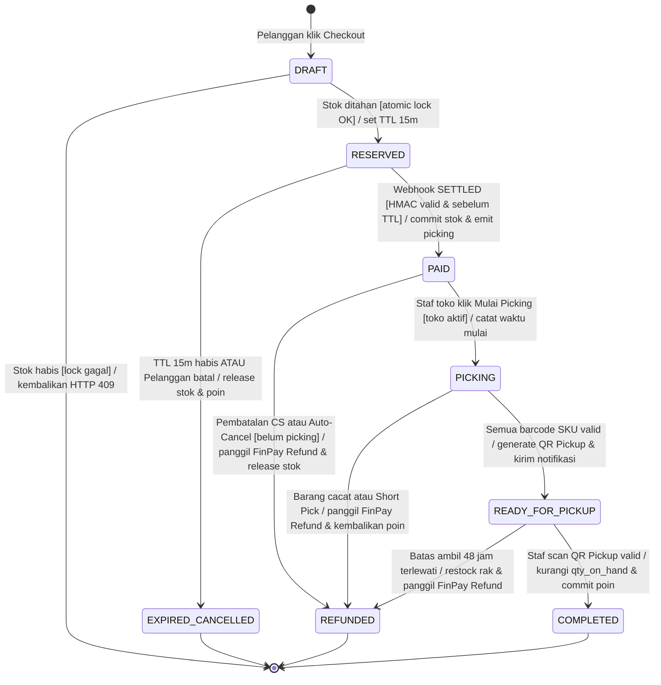

*Gambar 6.3 — Diagram 5: State Machine Diagram Siklus Hidup Pesanan Click & Collect (BOPIS) Proyek OMNI.*

#### Matriks Aturan Transisi & Invarian Stok (*Guard & Invariant Table*)

| Dari Status | Ke Status | Trigger Event | Kondisi Penjaga (*Guard*) | Aksi Wajib pada Stok & Loyalty |
|-------------|-----------|---------------|---------------------------|--------------------------------|
| `DRAFT` | `RESERVED` | `ReserveSuccess` | `(qty_on_hand - qty_reserved) >= req_qty` | `qty_reserved += req_qty`; `hold_points()` jika ada |
| `RESERVED` | `PAID` | `FinPaySettledWebhook` | `HMAC valid` AND `NOW() <= reserve_expires_at` | Status reservasi → `COMMITTED`; `emit(OrderPaidEvent)` |
| `RESERVED` | `EXPIRED_CANCELLED` | `TtlTimerExpired` / `UserCancel` | Status masih `RESERVED` (diuji dalam *DB transaction*) | `qty_reserved -= req_qty`; `release_points()` |
| `PAID` | `PICKING` | `StaffStartPicking` | `staff_store_id == order.store_id` | Catat `picking_started_at` untuk pantauan SLA ≤ 2 jam |
| `PICKING` | `READY_FOR_PICKUP` | `AllItemsScanned` | Jumlah barcode SKU tervalidasi == `SUM(order_item.qty)` | Hitung durasi SLA; terbitkan `pickup_qr_token` (TTL 48 jam) |
| `READY_FOR_PICKUP` | `COMPLETED` | `PickupQrScanned` | Token QR valid & belum terpakai (*one-time use*) | `qty_on_hand -= req_qty`; `qty_reserved -= req_qty`; `commit_earned_points()` |
| `PAID / PICKING / READY_FOR_PICKUP` | `REFUNDED` | `ShortPick` / `NoShow48h` / `CsCancel` | Belum `COMPLETED`; *idempotent refund* FinPay berhasil | `qty_reserved -= req_qty` (stok kembali tersedia); kembalikan poin tertebus |
| `COMPLETED / EXPIRED_CANCELLED / REFUNDED` | *(Status mana pun)* | *(Semua event)* | **TERMINAL STATE — Transisi Dilarang!** | Tolak dengan `HTTP 409 InvalidStateTransition`; catat *audit log* |

Perhatikan rumus invarian yang dijaga ketat sepanjang siklus hidup:
$$\text{qty\_available} = \text{qty\_on\_hand} - \text{qty\_reserved} \ge 0$$
Stok fisik (`qty_on_hand`) hanya berkurang permanen pada satu titik tunggal—yaitu saat transisi ke `COMPLETED` (serah terima barang)—sehingga **mustahil terjadi pemotongan ganda (*double-deduction*)**!

---

### 6.5 Pemodelan Data Enterprise: ERD 9 Entitas Inti, Kamus Data & Kepatuhan UU PDP

Berdasarkan hasil *data cleansing* 1,2 juta anggota *Sinar Member Card* (Risiko **R-02**), kebutuhan 18.500 SKU di 120 toko, dan syarat kepatuhan UU PDP dari **Rina Kartika**, Dimas Prasetyo merancang **Diagram 6: Logical Entity-Relationship Diagram (ERD) Inti Proyek OMNI** yang memenuhi bentuk normal **3NF**, menerapkan denormalisasi *snapshot* terkendali pada `ORDER_ITEM`, serta mengisolasi data PII ke `CUSTOMER_PII_VAULT` (direferensikan lewat `pii_vault_ref`).

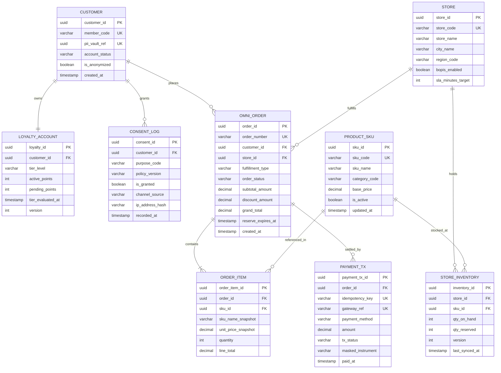

*Gambar 6.4 — Diagram 6: Entity-Relationship Diagram (ERD) Logical Data Model Inti Proyek OMNI (9 Entitas Utama, 3NF + Snapshot Terkendali + Isolasi PII UU PDP).*

#### Kamus Data & Keputusan Desain Skema (*Data Dictionary Highlights*)

| Entitas | Kunci & Indeks Kritis | Aturan Integritas, Performa (2.500 TPM) & Kepatuhan UU PDP |
|---------|-----------------------|------------------------------------------------------------|
| **`CUSTOMER`** | PK: `customer_id`; UK: `member_code`, `pii_vault_ref` | **Zero PII di tabel utama.** Data identitas (nama, email, HP, alamat) diisolasi pada tabel terpisah `CUSTOMER_PII_VAULT` (enkripsi AES-256-GCM via KMS). Anonimisasi UU PDP cukup menghapus kunci/rekaman vault dan menyetel `is_anonymized = TRUE`. |
| **`LOYALTY_ACCOUNT`** | PK: `loyalty_id`; FK & UK: `customer_id` (`1:1`) | Kolom `version` melindungi pemotongan poin dari *double-redemption* saat pelanggan menebus poin dari dua perangkat bersamaan. Memisahkan `active_points` dan `pending_points`. |
| **`CONSENT_LOG`** | PK: `consent_id`; FK: `customer_id`; IDX: `(customer_id, purpose_code, recorded_at DESC)` | Tabel bersifat ***append-only* (immutable)**—izin `UPDATE`/`DELETE` dicabut di level peran database aplikasi demi pembuktian audit hukum UU PDP. |
| **`STORE`** | PK: `store_id`; UK: `store_code` (120 cabang) | Menghilangkan *transitive dependency* dari `OMNI_ORDER`; menampung konfigurasi `bopis_enabled` (untuk *kill-switch* cepat jika toko mengalami kendala operasional) dan `sla_minutes_target = 120`. |
| **`PRODUCT_SKU`** | PK: `sku_id`; UK: `sku_code` (±18.500 SKU) | Sumber kebenaran disinkronkan dari **PRJ-02 ERP-Refresh**. Untuk melayani 2.500 TPM, data baca diproyeksikan secara terdenormalisasi ke **Redis Catalog Cache** & *Elasticsearch/OpenSearch*. |
| **`STORE_INVENTORY`** | PK: `inventory_id`; UK Komposit: `(store_id, sku_id)` | Constraint DB wajib: `CHECK (qty_on_hand >= 0 AND qty_reserved >= 0 AND qty_on_hand >= qty_reserved)`. Kolom `version` mendukung *Optimistic Locking*; `last_synced_at` memantau pelanggaran SLA sinkronisasi POS **≤ 60 detik**. |
| **`OMNI_ORDER`** | PK: `order_id`; UK: `order_number`; IDX: `(order_status, reserve_expires_at)` | Indeks parsial (`WHERE order_status = 'RESERVED'`) membuat *Expiry Job* menemukan pesanan kadaluarsa dalam < 5 ms tanpa memindai jutaan pesanan selesai. |
| **`ORDER_ITEM`** | PK: `order_item_id`; FK: `order_id`, `sku_id` | *Associative/junction table* pengurai relasi `M:N` antara `OMNI_ORDER` dan `PRODUCT_SKU`. Menerapkan **denormalisasi snapshot terkendali** (`sku_name_snapshot`, `unit_price_snapshot`) untuk kekekalan faktur historis. |
| **`PAYMENT_TX`** | PK: `payment_tx_id`; UK: `idempotency_key`, `gateway_ref` | Kardinalitas `1:N` terhadap `OMNI_ORDER` memungkinkan pencatatan percobaan bayar gagal lalu dicoba ulang dengan metode lain tanpa menimpa jejak audit. Mematuhi **PCI-DSS** (hanya menyimpan `masked_instrument`, nol PAN/CVV). |

---

### 6.6 Component & C4 Level 2 Container Architecture Proyek OMNI

Untuk menyatukan seluruh komponen aplikasi, layanan backend, lapisan data, *cache*, *message broker*, dan adaptor sistem eksternal ke dalam satu pandangan komprehensif bagi CTO **Irwan Pratama** dan tim DevOps PT NDS, Dimas merumuskan **Diagram 8: Component & C4 Level 2 Container Architecture Proyek OMNI**.

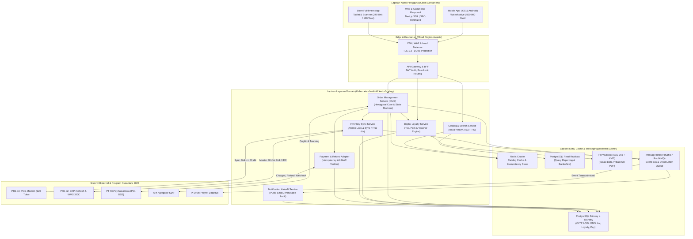

*Gambar 6.5 — Diagram 8: Component & C4 Level 2 Container Architecture Proyek OMNI di Cloud Region Jakarta.*

Arsitektur kontainer di atas langsung menjawab tiga target paling kritis Proyek OMNI sekaligus:
1. **Performa 2.500 TPM:** Lapisan `Catalog & Search Service` dilayani lewat **Redis Cluster** + **Read Replicas** sehingga lalu lintas pencarian 18.500 SKU tidak pernah mencekik `PostgreSQL Primary` yang melayani transaksi pembayaran dan penguncian stok.
2. **Ketahanan *Decoupled*:** Apabila sistem pengiriman notifikasi *push* atau **PRJ-04 DataHub** melambat, **Message Broker (Kafka/RabbitMQ)** menampung event secara asinkron beserta *Dead-Letter Queue* (DLQ) sehingga *checkout* pelanggan tetap mulus tanpa kegagalan berantai (*cascading failure*).
3. **Kepatuhan UU PDP & PCI-DSS:** Isolasi `PII Vault DB` dengan KMS serta pemisahan `Payment & Refund Adapter` memperkecil ruang lingkup audit keamanan (*audit scope*) secara drastis.

---

## 7. Latihan dan Pembahasan

### 7.1 Soal Latihan

Kerjakan empat latihan praktik berikut dengan berperan sebagai **Senior System Analyst** yang mendampingi **Dimas Prasetyo** pada Proyek OMNI sebelum *Gate 2 (Feature Freeze)*.

#### Latihan 1: Normalisasi Transaksi *Click & Collect* & Kupon Loyalty (UNF → 3NF)
Tim operasional toko menyerahkan cuplikan tabel spreadsheet lama pencatatan pesanan manual *Click & Collect* yang masih belum ternormalisasi (*Unnormalized Form* / UNF):

| Order_No | Tgl_Order | ID_Member | Nama_Member | Tier_Member | Kode_Toko | Nama_Toko | Kota_Toko | Daftar_SKU_Qty_Harga | Kupon_Dipakai |
|----------|-----------|-----------|-------------|-------------|-----------|-----------|-----------|----------------------|---------------|
| `ORD-101` | 12/03/27 | `MBR-882` | Raka Pratama | Gold | `STR-004` | SNR Pondok Indah | Jakarta Selatan | `SKU-088 (Lampu Meja, 1, Rp 450.000); SKU-210 (Bantal Sofa, 2, Rp 150.000)` | `HEMAT50 (Rp 50.000)` |
| `ORD-102` | 12/03/27 | `MBR-882` | Raka Pratama | Gold | `STR-019` | SNR Pakuwon | Surabaya | `SKU-088 (Lampu Meja, 1, Rp 450.000)` | `—` |

**Tugas Anda:**
1. Lakukan normalisasi bertahap dari **UNF → 1NF → 2NF → 3NF** dan sebutkan anomali apa yang hilang di setiap tahap.
2. Tentukan **PK** dan **FK** untuk setiap tabel hasil 3NF.
3. Identifikasi **dua atribut** yang secara sadar harus tetap didenormalisasi (*controlled denormalization*) pada tabel transaksi dan jelaskan alasannya.

#### Latihan 2: Merancang Penanganan *Race Condition* Stok Terakhir di Toko Pondok Indah
Pada promo akhir pekan, SKU `HL-LAMP-088` (*Lampu Meja Minimalis Nusantara*) di **Toko Pondok Indah** (`STR-JKT-004`) hanya tersisa **1 unit** (`qty_on_hand = 1`, `qty_reserved = 0`, `version = 14`). Pada pukul 10:00:01,245 WIB, **Pelanggan A** dan **Pelanggan B** menekan tombol *"Bayar Sekarang"* secara bersamaan untuk membeli 1 unit SKU tersebut.
1. Jelaskan mengapa pendekatan naif *Check-Then-Act* gagal pada skenario ini.
2. Tuliskan rancangan kueri SQL **Optimistic Locking + Atomic Conditional Update** pada `STORE_INVENTORY` lengkap dengan perilaku aplikasi bagi Pelanggan A dan Pelanggan B.
3. Rancang mekanisme pencegahan ***orphan reservation*** apabila pemenang stok menutup aplikasi sebelum membayar.

#### Latihan 3: Melengkapi *Exception Flow* Sequence Diagram — *Late Webhook* FinPay 10 Menit
Saat uji integrasi (SIT) bersama QA Lead **Lukas Gunawan**, disimulasikan gangguan jaringan sementara pada *gateway* **PT FinPay Nusantara** sehingga *webhook* `SETTLED` baru tiba **10 menit** setelah pelanggan membayar QRIS (melewati *timeout* layar *waiting* aplikasi sebesar 30 detik).
1. Gambarkan **Sequence Diagram** solusi penanganan *exception flow* tersebut yang mencakup: status `PAYMENT_PENDING`, mekanisme *idempotent polling* (`GET /finpay/v2/charges/{idempotency_key}`) oleh *background reconciliation worker* pada menit ke-2 dan ke-5, serta kedatangan *webhook* terlambat pada menit ke-10 (baik saat pesanan masih dalam batas TTL 15 menit maupun jika sudah melewati TTL 15 menit).
2. Jelaskan bagaimana desain tersebut mencegah ***double-charge*** sekaligus mencegah ***orphan payment*** (dana terdebit namun pesanan hilang).

#### Latihan 4: Audit Desain ERD & State Machine Cacat dari Junior Analyst Vendor
Menjelang *Design Review* bersama CTO **Irwan Pratama** dan **Rina Kartika**, seorang analis junior PT NDS menyerahkan rancangan draf berikut:
- **Skema ERD Draf:** Tabel `ORDERS (order_id PK, customer_name, customer_nik, customer_phone, store_id, store_name, store_city, sku_id_list, credit_card_pan, card_cvv, total_amount, status)` yang terhubung langsung `M:N` ke `PRODUCTS (sku_id PK, sku_name, stock_qty)`. Saat pelanggan meminta hapus akun UU PDP, sistem menjalankan `DELETE FROM ORDERS WHERE customer_phone = :phone`.
- **State Machine Draf:** `NEW → PAID → READY → COMPLETED`, dilengkapi panah `COMPLETED → NEW` (untuk retur), tanpa status `RESERVED`, tanpa batas *timeout*, dan tanpa jalur `REFUNDED`.

**Tugas Anda:** Temukan minimal **6 cacat desain kritis** (gabungan ERD, UU PDP/PCI-DSS, konkurensi, dan State Machine), jelaskan dampaknya pada Proyek OMNI, dan rumuskan perbaikan presisinya.

---

### 7.2 Pembahasan Latihan

#### Pembahasan Latihan 1: Normalisasi UNF → 1NF → 2NF → 3NF
1. **Tahap 1NF (Menghilangkan *Repeating Groups* & Menjadikan Kolom Atomik):**
   - Kolom `Daftar_SKU_Qty_Harga` dipecah menjadi baris tunggal per item pesanan, dan `Kupon_Dipakai` dipisah menjadi `coupon_code` dan `coupon_discount`.
   - Hasil sementara: `ORDER_FLAT (order_no PK, sku_code PK, tgl_order, id_member, nama_member, tier_member, kode_toko, nama_toko, kota_toko, sku_name, qty, unit_price, coupon_code, coupon_discount)`.
   - *Anomali hilang:* Data kini atomik dan dapat diindeks per SKU.
2. **Tahap 2NF (Menghilangkan *Partial Dependency* terhadap *Composite PK* `(order_no, sku_code)`):**
   - Atribut `tgl_order, id_member, nama_member, tier_member, kode_toko, nama_toko, kota_toko, coupon_code, coupon_discount` hanya bergantung pada `order_no` (bukan pada `sku_code`).
   - Atribut `sku_name` dan master harga bergantung pada `sku_code` saja.
   - Hasil 2NF menjadi 3 tabel: `ORDER_HEADER (order_no PK, ...)`, `PRODUCT_SKU (sku_code PK, sku_name, base_price)`, dan `ORDER_ITEM (order_no PK/FK, sku_code PK/FK, qty, unit_price_snapshot, sku_name_snapshot)`.
   - *Anomali hilang:* Mencegah duplikasi header pesanan dan profil toko di setiap baris barang (*Update Anomaly* berkurang).
3. **Tahap 3NF (Menghilangkan *Transitive Dependency* Antar-Atribut Non-Kunci):**
   - Di `ORDER_HEADER`, `nama_toko` & `kota_toko` bergantung pada `kode_toko`; `nama_member` & `tier_member` bergantung pada `id_member`; nilai aturan kupon bergantung pada `coupon_code`.
   - **Skema Final 3NF (6 Tabel Relasional):**
     - `CUSTOMER (customer_id PK, member_code UK, pii_vault_ref UK)` *(nama diisolasi di PII Vault UU PDP)*
     - `LOYALTY_ACCOUNT (loyalty_id PK, customer_id FK, tier_level, active_points)`
     - `STORE (store_id PK, store_code UK, store_name, city_name)`
     - `PRODUCT_SKU (sku_id PK, sku_code UK, sku_name, base_price)`
     - `VOUCHER (voucher_id PK, voucher_code UK, discount_amount)`
     - `OMNI_ORDER (order_id PK, order_number UK, customer_id FK, store_id FK, voucher_id FK, order_date, discount_applied, grand_total)`
     - `ORDER_ITEM (order_item_id PK, order_id FK, sku_id FK, sku_name_snapshot, unit_price_snapshot, quantity)`
4. **Denormalisasi Terkendali (*Snapshot*):** Dua atribut yang sengaja disimpan ulang di `ORDER_ITEM` adalah **`unit_price_snapshot`** dan **`sku_name_snapshot`** (serta `discount_applied` di `OMNI_ORDER`). Alasannya: perubahan harga atau nama produk di `PRODUCT_SKU` pada masa depan **tidak boleh mengubah nominal faktur historis** yang sudah dibayar pelanggan dan dibukukan ke ERP/pajak.

#### Pembahasan Latihan 2: Solusi *Race Condition* Toko Pondok Indah
1. **Mengapa *Check-Then-Act* Gagal:** Pelanggan A dan B sama-sama menjalankan `SELECT (qty_on_hand - qty_reserved)` pada t = 0 ms dan keduanya menerima nilai `1`. Di memori aplikasi, keduanya lolos syarat `>= 1`, lalu keduanya mengeksekusi `UPDATE qty_reserved = qty_reserved + 1`. Hasilnya `qty_reserved = 2` padahal `qty_on_hand = 1` (*overselling* terjadi!).
2. **SQL *Atomic Conditional Update + Optimistic Locking*:**
```sql
-- Dieksekusi di dalam satu DB Transaction untuk tiap checkout
UPDATE store_inventory
SET qty_reserved = qty_reserved + 1,
    version      = version + 1,
    updated_at   = NOW()
WHERE store_id = 'STR-JKT-004'
  AND sku_id   = 'HL-LAMP-088'
  AND version  = 14
  AND (qty_on_hand - qty_reserved) >= 1;
```
   - **Perilaku Eksekusi:** Engine PostgreSQL menerapkan *row-level write lock* internal secara instan saat mengeksekusi `UPDATE`. Permintaan **Pelanggan A** (tiba 0,3 ms lebih cepat) memenuhi syarat `version = 14` dan `(1 - 0) >= 1`, sehingga berhasil mengubah `qty_reserved = 1, version = 15` (`rows_affected = 1`) dan berlanjut ke pembuatan tagihan FinPay. Permintaan **Pelanggan B** mengevaluasi ulang baris yang kini bernilai `version = 15` dan `(1 - 1) = 0 < 1`, sehingga menghasilkan **`rows_affected = 0`**. OMS langsung merespons Pelanggan B dengan `HTTP 409 Conflict` (*"Stok Toko Pondok Indah baru saja habis"*) beserta daftar 3 toko SNR terdekat (mis. Kemang, Gandaria, Bintaro) yang masih memiliki stok `HL-LAMP-088`.
3. **Pencegahan *Orphan Reservation*:** Setiap reservasi menyertakan `reserve_expires_at = NOW() + INTERVAL '15 minutes'`. Sebuah *Expiry Scheduler* berjalan tiap 30 detik mencari pesanan berstatus `RESERVED` yang telah melewati batas waktu, lalu menjalankan transaksi atomik: mengubah status `OMNI_ORDER` menjadi `EXPIRED_CANCELLED` (`WHERE order_status = 'RESERVED'`) dan mengurangi `qty_reserved = qty_reserved - 1` agar stok segera kembali tersedia bagi pelanggan lain.

#### Pembahasan Latihan 3: Solusi *Exception Flow* — *Late Webhook* 10 Menit FinPay

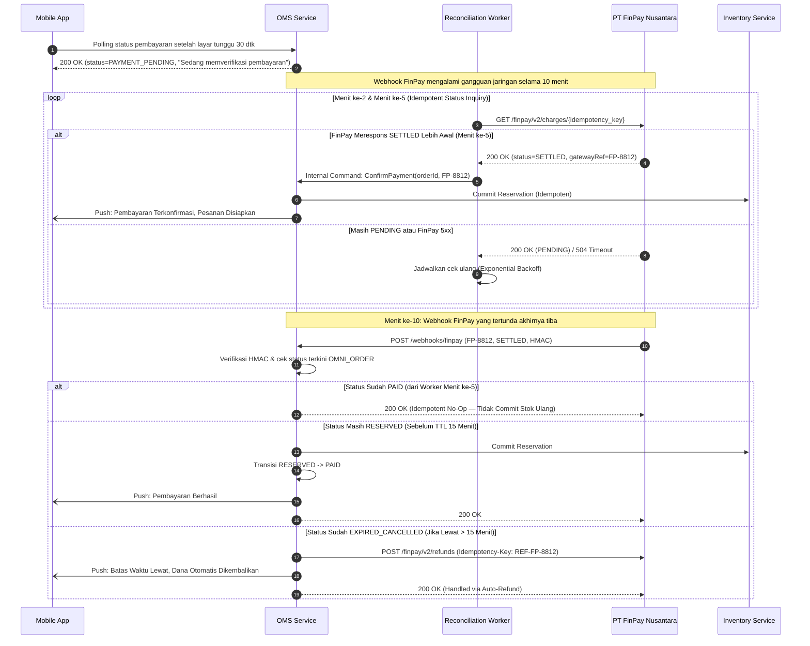

*Gambar 7.1 — Diagram 10: Sequence Diagram Solusi Latihan 3 — Rekonsiliasi Idempotent & Penanganan Late Webhook PT FinPay Nusantara.*

- **Pencegahan *Double-Charge*:** Layar tunggu 30 detik tidak pernah menampilkan tombol *"Bayar Ulang"* saat status masih `PAYMENT_PENDING`; aplikasi menampilkan status verifikasi sembari `Idempotency-Key` memblokir permintaan debit baru.
- **Pencegahan *Orphan Payment*:** *Reconciliation Worker* aktif menarik status dari FinPay (pola *Push Webhook + Pull Polling*), dan jika *webhook* tiba setelah transaksi kadaluarsa, sistem langsung memicu *Auto-Refund* secara *idempotent*.

#### Pembahasan Latihan 4: Hasil Audit 6 Cacat Desain Kritis

| No | Cacat Desain yang Ditemukan | Kategori Pelanggaran | Dampak pada Proyek OMNI | Perbaikan Wajib oleh Senior SA |
|----|-----------------------------|----------------------|-------------------------|--------------------------------|
| **1** | Menyimpan `credit_card_pan` dan `card_cvv` di tabel `ORDERS` | **Keamanan / PCI-DSS** | Pelanggaran hukum/PCI-DSS berat; Rina Kartika memveto *Go-Live* (R-05); risiko kebocoran kartu | **Hapus total!** Delegasikan ke PT FinPay Nusantara; simpan hanya `gateway_ref` & `masked_instrument` di `PAYMENT_TX` |
| **2** | Menyatukan `customer_name`, `customer_nik`, `customer_phone` di `ORDERS` + `DELETE` fisik | **UU PDP & *God Table*** | Gagal audit UU PDP; `DELETE` fisik merusak integritas pembukuan pajak & *audit trail* CFO | Pisahkan ke `CUSTOMER_PII_VAULT` terenkripsi KMS + tabel `CONSENT_LOG`; pakai *Soft Delete & Crypto-Shredding* |
| **3** | Kolom `sku_id_list` + relasi langsung `M:N` antara `ORDERS` dan `PRODUCTS` | **Pelanggaran 1NF & ERD** | Tidak bisa menghitung qty/retur per SKU; gagal kueri relasional | Urai `M:N` dengan *junction table* `ORDER_ITEM` + *snapshot* harga & nama SKU |
| **4** | `store_name` dan `store_city` disimpan di `ORDERS`; stok tunggal `stock_qty` di `PRODUCTS` | **Pelanggaran 3NF & Domain BOPIS** | *Transitive dependency*; tidak dapat membedakan stok antar-120 toko & 3 DC | Pisahkan `STORE` dan `STORE_INVENTORY (store_id, sku_id, qty_on_hand, qty_reserved, version)` |
| **5** | State Machine tanpa `RESERVED`, tanpa *timeout*, dan tanpa `REFUNDED` | **Integritas Transaksi** | Menciptakan *race condition*, *orphan reservation*, dan uang pelanggan menggantung saat *short pick* | Terapkan siklus penuh `DRAFT → RESERVED → PAID → PICKING → READY_FOR_PICKUP → COMPLETED / EXPIRED_CANCELLED / REFUNDED` |
| **6** | Transisi ilegal `COMPLETED → NEW` untuk retur barang | **Korupsi State & Keuangan** | Mengubah transaksi selesai kembali menjadi *draft* mengacaukan jurnal ERP, stok, & poin loyalty | Tetapkan `COMPLETED` sebagai **terminal state**; proses retur dimodelkan sebagai entitas terpisah (`RETURN_REQUEST`) |

---

## 8. Tugas Modul dan Rubrik Penilaian

### 8.1 Brief Tugas Mandiri (±6 Jam)

**Skenario:** Setelah keberhasilan persetujuan SDS modul *Click & Collect*, VP Marketing **Dewi Lestari** dan Lead BA **Nadia Putri** menyerahkan FRD modul ***Digital Loyalty Redemption*** (*Penebusan Poin & Voucher Sinar Member* yang berlaku seragam di Aplikasi Mobile maupun kasir **120 toko POS-Modern**). Saat ini kebocoran kupon manual dan penebusan ganda (*double-redemption*) menjadi salah satu sumber kerugian ritel SNR. **Fajar Nugroho** dan **Irwan Pratama** menugaskan Anda (sebagai Senior System Analyst) menyusun dokumen **System Design Document (SDD)** ringkas dan siap tinjau untuk fitur tersebut.

**Ketentuan Bisnis & NFR Wajib:**
- 1,2 juta anggota terbagi dalam 3 tier (*Silver, Gold, Platinum*); 1 poin = Rp 100; penebusan minimum 100 poin dan maksimal 50% nilai keranjang.
- Pelanggan dapat menghasilkan kode QR Voucher/Poin dinamis di Mobile App (berlaku **5 menit**, *one-time use*) untuk dipindai di kasir POS-Modern **ATAU** langsung dipakai saat *checkout* online.
- Harus kebal terhadap ***double-redemption*** (mis. pelanggan menebus poin yang sama di Mobile App dan di kasir toko secara bersamaan) dan mematuhi **UU PDP** (persetujuan program loyalty tercatat di `CONSENT_LOG`).

**Deliverable Wajib (5 Artefak Terpadu):**
1. **Use Case Specification (`UC-07: Digital Loyalty Redemption`)** lengkap (*Precondition, Success & Minimal Guarantee, Main Flow, Alternative Flow [Online vs Kasir POS], dan minimal 3 Exception Flows*).
2. **Activity Diagram (Mermaid `flowchart TD`)** alur penebusan poin & voucher termasuk cabang *rollback* jika transaksi pembayaran batal.
3. **Sequence Diagram (Mermaid `sequenceDiagram`)** interaksi lintas *Mobile App / POS-Modern ↔ API Gateway ↔ OMS ↔ Loyalty Service* lengkap dengan blok `alt` proteksi `Idempotency-Key` dan *optimistic locking* saldo poin.
4. **State Machine Diagram (Mermaid `stateDiagram-v2`)** siklus hidup Voucher & Hold Poin (`ISSUED → HELD → REDEEMED / RELEASED / EXPIRED`) beserta *guard conditions*.
5. **Logical ERD (Mermaid `erDiagram`) & Kamus Data Singkat** dalam bentuk **3NF** mencakup entitas `LOYALTY_ACCOUNT`, `POINT_LEDGER` (*append-only* pembukuan debit/kredit poin), `VOUCHER_CAMPAIGN`, `MEMBER_VOUCHER`, `REDEMPTION_TX`, serta keterhubungannya dengan `CUSTOMER` & `CONSENT_LOG` UU PDP.

### 8.2 Rubrik Penilaian Tugas Modul

| Kriteria Penilaian | Bobot | Skor 4: Sangat Baik (90–100) | Skor 3: Baik (75–89) | Skor 2: Cukup (60–74) | Skor 1: Perlu Perbaikan (< 60) |
|--------------------|------:|------------------------------|----------------------|-----------------------|--------------------------------|
| **1. Kelengkapan & Presisi *Use Case* & *Activity Diagram*** | **25%** | `UC-07` amat lengkap (*Minimal Guarantee*, AF Online vs POS, ≥ 3 EF konkret); *Activity Diagram* menampilkan *swimlane/fase*, *decision*, dan *rollback* secara tak ambigu | `UC-07` & *Activity Diagram* lengkap dan konsisten; beberapa detail *Minimal Guarantee* atau cabang batal kurang tajam | Hanya fokus pada alur sukses (*happy path*); pengecualian kasir POS vs online belum tergambar jelas | Tidak mengikuti struktur spesifikasi formal; alur kerja tidak logis atau tidak lengkap |
| **2. Ketangguhan *Sequence Diagram* & Anti-*Double-Redemption*** | **25%** | Interaksi sinkron/asinkron tepat; `Idempotency-Key`, *optimistic locking* (`version`), QR TTL 5 mnt, serta cabang gagal (`alt`) mencegah *double-redemption* 100% | *Sequence Diagram* rapi dan mencakup proteksi *retry/lock*; penanganan *timeout* POS atau *rollback* masih parsial | Menggambar alur interaksi dasar tanpa fragmen `alt` kegagalan atau mekanisme *idempotency* | Alur interaksi keliru antar-komponen dan rentan *race condition / double-redemption* |
| **3. Integritas *State Machine* Voucher & Hold Poin** | **20%** | Seluruh status, *trigger*, *guard*, *action*, dan *terminal states* lengkap; menjamin 0 *orphan point hold* dan melarang transisi ilegal dari `REDEEMED/EXPIRED` | Status utama dan *guard* benar; ada 1–2 jalur pengecualian (*expiry* atau pembatalan) yang kurang rinci | Status dasar ada tetapi tanpa *guard* atau lupa jalur pelepasan (*release*) saat batal | State diagram kacau, memiliki *dead-end state*, atau mengizinkan transisi ulang dari status final |
| **4. Kualitas ERD 3NF, *Point Ledger* & Kepatuhan UU PDP** | **20%** | ERD 3NF bersih (Crow's Foot, PK/FK/UK akurat), memakai `POINT_LEDGER` *append-only*, *optimistic lock*, dan patuh UU PDP (`CONSENT_LOG` & isolasi PII) | ERD 3NF tepat dengan kardinalitas benar; aspek ledger poin dan UU PDP sudah hadir meski kamus data ringkas | Masih ada pelanggaran 2NF/3NF atau lupa merancang ledger audit poin/kepatuhan UU PDP | ERD cacat relasional, tidak ternormalisasi, atau menyimpan PII mentah secara tidak aman |
| **5. Keterpaduan Antar-Artefak & Konsistensi Proyek OMNI** | **10%** | Nama entitas, status, dan layanan 100% sinkron antar-5 artefak serta konsisten dengan Proyek OMNI (120 toko, 3 tier, 1,2 jt anggota, POS-Modern) | Hampir seluruh artefak konsisten; hanya ada perbedaan minor penamaan atribut/status | Beberapa ketidaksinkronan mencolok antara Sequence, State, dan ERD | Artefak saling bertentangan dan tidak mengacu pada konteks Proyek OMNI |

---

## 9. Kuis dan Kunci Jawaban

### 9.1 Soal Kuis

Pilihlah **satu jawaban yang paling tepat** (A, B, C, atau D) untuk setiap skenario analisis dan desain sistem level senior berikut.

**1.** Pada *Use Case Diagram* Proyek OMNI, setiap transaksi pada `UC-04: Checkout Pesanan Click & Collect` wajib menjalankan `UC-05: Reservasi Stok Real-Time`, sedangkan `UC-07: Tebus Poin & Voucher Sinar Member` hanya dijalankan apabila pelanggan memilih memakai saldo poin/voucher. Bagaimana representasi relasi UML 2.5 yang benar?
- A. `UC-05` menunjuk `UC-04` dengan `«include»`, dan `UC-04` menunjuk `UC-07` dengan `«extend»`.
- B. `UC-04` menunjuk `UC-05` dengan `«extend»`, dan `UC-07` menunjuk `UC-04` dengan `«include»`.
- C. `UC-04` menunjuk `UC-05` dengan `«include»`, dan `UC-07` menunjuk `UC-04` dengan `«extend»`.
- D. Baik `UC-05` maupun `UC-07` dihubungkan dari `UC-04` menggunakan relasi generalisasi (*inheritance*).

**2.** Setelah *webhook* pembayaran `SETTLED` dari PT FinPay Nusantara terverifikasi pada alur *Click & Collect*, sistem OMNI harus menjalankan tiga tugas secara bersamaan tanpa saling menunggu urutan: menampilkan tiket *picking* di *Store Fulfillment App*, mengirim notifikasi *push/email* ke pelanggan, dan mencatat poin *pending* di Loyalty Engine. Notasi *Activity Diagram* manakah yang paling tepat untuk memodelkan perilaku tersebut?
- A. *Decision Node* diikuti *Merge Node* dengan tiga *guard condition* yang saling lepas.
- B. *Fork Node* untuk memecah tiga aliran paralel yang berjalan serempak, diikuti *Join Node* saat seluruh cabang perlu disinkronkan.
- C. Tiga panah keluar langsung dari aktivitas `Verifikasi Webhook` tanpa simpul kendali agar diagram lebih ringkas.
- D. *Loop Fragment* yang memanggil ketiga layanan secara bergiliran dalam satu *thread* sinkron.

**3.** Dalam merancang *Sequence Diagram* konfirmasi pembayaran untuk memenuhi uji beban **2.500 TPM**, Dimas Prasetyo memilih panggilan **asinkron (`-)`)** via *Message Broker* untuk mengirim notifikasi *email/push* dan aliran data ke **PRJ-04 DataHub**, bukan panggilan sinkron (`->>`) di dalam transaksi *webhook* FinPay. Apa alasan arsitektural paling tepat di balik keputusan tersebut?
- A. Mencegah lonjakan latensi atau gangguan layanan notifikasi/DataHub menggagalkan respons *webhook* pembayaran (*decoupling* & menjaga SLA *throughput* 2.500 TPM).
- B. Karena standar UML 2.5 melarang penggunaan pesan sinkron lebih dari tiga kali dalam satu *Sequence Diagram*.
- C. Agar PT FinPay Nusantara dapat membatalkan transaksi secara otomatis jika email pelanggan masuk ke folder spam.
- D. Karena panggilan asinkron tidak memerlukan verifikasi tanda tangan HMAC maupun pencatatan *audit log*.

**4.** Pada *State Machine Diagram* siklus hidup pesanan *Click & Collect*, dua insiden produksi pernah terjadi di sistem e-commerce lama: stok barang terkunci selamanya karena pelanggan gagal membayar tanpa batal otomatis (*orphan reservation*), serta stok fisik terpotong dua kali saat *webhook* duplikat datang (*double-deduction*). Kombinasi desain *State Machine* manakah yang secara definitif mencegah kedua insiden tersebut?
- A. Menghapus status `RESERVED` dan memotong `qty_on_hand` langsung saat pelanggan memasukkan barang ke keranjang belanja.
- B. Mengizinkan transisi bebas dari semua status kembali ke `DRAFT` agar staf CS dapat memperbaiki kesalahan secara manual.
- C. Membiarkan setiap *webhook* FinPay yang masuk langsung mengurangi `qty_on_hand` tanpa memeriksa status pesanan saat ini.
- D. Memisahkan transisi `RESERVED → EXPIRED_CANCELLED` dengan *TTL Expiry Scheduler* untuk melepas `qty_reserved`, menerapkan *guard* idempoten pada `RESERVED → PAID`, dan memotong `qty_on_hand` permanen hanya sekali saat `READY_FOR_PICKUP → COMPLETED`.

**5.** Saat mengaudit tabel `OMNI_ORDER`, Anda menemukan kolom-kolom berikut: `(order_id PK, customer_id FK, store_id FK, store_city, region_manager_name, grand_total)`. Diketahui `store_city` bergantung pada `store_id`, dan `region_manager_name` bergantung pada `store_city`. Bentuk normal manakah yang dilanggar oleh rancangan tabel tersebut dan bagaimana perbaikannya?
- A. Melanggar 1NF karena terdapat *repeating group*; solusinya gabungkan `store_city` dan `region_manager_name` ke dalam satu kolom teks.
- B. Melanggar 3NF karena terdapat *transitive dependency* antar-atribut non-kunci; solusinya pindahkan atribut lokasi toko ke tabel `STORE` dan data wilayah ke tabel `REGION`.
- C. Melanggar 2NF karena *Primary Key* `order_id` bersifat komposit; solusinya hapus `store_id` dari tabel `OMNI_ORDER`.
- D. Tidak melanggar bentuk normal mana pun karena semua kolom bersifat atomik dan bertipe `varchar`.

**6.** Seorang pengembang junior PT NDS mengusulkan untuk menghapus kolom `unit_price_snapshot` dan `sku_name_snapshot` dari tabel `ORDER_ITEM` dengan alasan melanggar 3NF dan cukup mengambilnya melalui `JOIN` ke tabel `PRODUCT_SKU`. Tanggapan paling tepat dari seorang Senior System Analyst adalah:
- A. Menyetujui penghapusan tersebut karena kepatuhan mutlak terhadap 3NF jauh lebih penting daripada akurasi faktur historis.
- B. Menyetujui penghapusan tersebut asalkan tabel `PRODUCT_SKU` dikunci permanen sehingga tim *Merchandising* tidak pernah boleh mengubah harga produk.
- C. Menolak usulan tersebut karena penyimpanan *snapshot* harga & nama produk saat transaksi adalah **denormalisasi terkendali** yang wajib dipertahankan agar nilai kuitansi historis dan pembukuan keuangan tetap kekal meski harga master ERP berubah.
- D. Mengganti seluruh database relasional PostgreSQL menjadi penyimpanan berkas CSV agar tidak perlu memikirkan aturan normalisasi.

**7.** Seorang pelanggan yang telah berbelanja 12 kali selama dua tahun di Platform OMNI mengajukan permintaan penghapusan data pribadi (*Right to Erasure*) berdasarkan **UU No. 27 Tahun 2022 (UU PDP)**. Sementara itu, hukum perpajakan dan audit keuangan CFO mewajibkan catatan transaksi penjualan disimpan minimal 10 tahun. Desain data manakah yang memenuhi kedua regulasi sekaligus?
- A. Menghapus/memusnahkan kunci enkripsi rekaman identitas di tabel `CUSTOMER_PII_VAULT` (*crypto-shredding / anonymization*) dan menandai `CUSTOMER.is_anonymized = TRUE`, sembari mempertahankan baris nominal transaksi di `OMNI_ORDER` dan `PAYMENT_TX` yang hanya merujuk UUID pseudonim.
- B. Menjalankan `DELETE CASCADE` pada tabel `CUSTOMER` sehingga seluruh riwayat `OMNI_ORDER` dan `PAYMENT_TX` ikut terhapus bersih dari database.
- C. Menolak permintaan pelanggan secara total dengan alasan data transaksi ritel dikecualikan dari seluruh pasal UU PDP.
- D. Menyimpan salinan nama, NIK, dan nomor ponsel pelanggan di tabel arsip Excel lokal milik staf CS lalu menghapus barisnya di database produksi.

**8.** Pada uji beban *flash sale* di Toko Pondok Indah (`STR-JKT-004`), tersisa 1 unit stok (`qty_on_hand = 1, qty_reserved = 0, version = 8`) dan 50 permintaan *checkout* datang bersamaan dalam 10 milidetik. Pendekatan pengendalian konkurensi manakah yang paling optimal untuk menjamin **0 *overselling*** sekaligus mempertahankan *throughput* tinggi menuju **2.500 TPM**?
- A. Membaca `qty_on_hand` lewat `SELECT` biasa di memori layanan Java/Go, memeriksa `if (qty >= 1)`, lalu menjalankan `UPDATE` terpisah tanpa kondisi `WHERE`.
- B. Mengunci seluruh tabel `STORE_INVENTORY` dengan `LOCK TABLE ... EXCLUSIVE MODE` selama 15 menit hingga pelanggan pertama selesai membayar di FinPay.
- C. Menghapus kolom `qty_reserved` dan melakukan sinkronisasi stok secara *batch* sekali setiap pukul 00.00 WIB seperti sistem lama.
- D. Menggunakan *Atomic Conditional Update* + *Optimistic Locking* (`UPDATE store_inventory SET qty_reserved = qty_reserved + :q, version = version + 1 WHERE store_id = :s AND sku_id = :k AND version = :v AND (qty_on_hand - qty_reserved) >= :q`), lalu menolak permintaan yang menerima `rows_affected = 0` dengan `HTTP 409 Conflict`.

**9.** Ketika pelanggan menekan tombol *"Bayar Sekarang"* di basement pusat perbelanjaan yang sinyalnya lemah, aplikasi mobile mengalami *read timeout* pada detik ke-10 sehingga secara otomatis mengirim ulang permintaan `POST /v1/orders/checkout` sebanyak 3 kali dalam 20 detik. Mekanisme desain sistem manakah yang memastikan pelanggan hanya dibuatkan satu tagihan dan terdebit satu kali di PT FinPay Nusantara?
- A. Menonaktifkan seluruh mekanisme *retry* di aplikasi mobile dan memaksa pelanggan mengetik ulang keranjang belanja setiap kali sinyal terputus.
- B. Mewajibkan header `Idempotency-Key` unik per upaya *checkout* yang dicek dan disimpan dengan constraint `UNIQUE` di `PAYMENT_TX` (serta diteruskan ke FinPay), sehingga permintaan ulang dengan kunci sama langsung mengembalikan payload transaksi pertama tanpa memproses debit baru.
- C. Mengandalkan tombol *"Bayar"* di antarmuka aplikasi agar berubah menjadi abu-abu (*disabled*) tanpa validasi apa pun di sisi server OMS.
- D. Membiarkan ketiga tagihan tercipta di FinPay lalu meminta tim CS melakukan *refund* manual setiap akhir bulan.

**10.** Tiga minggu sebelum integrasi Release 3, proyek paralel **PRJ-03 POS-Modern** mengubah format payload API sinkronisasi stok toko dari REST JSON sinkron menjadi pesan *event* berformat baru. Namun, tim PT NDS dapat menyelesaikan penyesuaian hanya dalam 2 hari tanpa mengubah satu baris pun kode logika bisnis *Order State Machine* maupun *Reservation Rules* di dalam OMS. Prinsip arsitektur manakah yang memungkinkan ketangguhan tersebut?
- A. *Big Design Up Front* (BDUF) yang membekukan seluruh skema database dan format JSON sejak hari pertama proyek.
- B. *Tightly Coupled Layered Architecture* di mana kelas domain OMS memanggil langsung pustaka HTTP milik vendor POS-Modern.
- C. **Hexagonal Architecture (*Ports & Adapters*)** yang mengisolasi *Domain Core* di balik kontrak antarmuka (`PosSyncPort`) sehingga perubahan format eksternal hanya berdampak pada lapisan *Driven Adapter* (`PosModernAdapter`).
- D. *God Table Pattern* yang membuang semua payload mentah POS-Modern ke satu kolom `TEXT` tanpa validasi kontrak.

---

### 9.2 Kunci Jawaban dan Pembahasan

| No | Kunci | Pembahasan Lengkap |
|----|-------|--------------------|
| **1** | **C** | **Benar:** Dalam UML 2.5, relasi wajib `«include»` mengarah **dari Base (`UC-04`) ke Included (`UC-05`)**, sedangkan relasi opsional/kondisional `«extend»` mengarah sebaliknya **dari Extending (`UC-07`) ke Base (`UC-04`)**.<br/>*Mengapa opsi lain salah:* Opsi A membalik arah panah keduanya; opsi B menukar makna wajib vs opsional; opsi D keliru memakai *inheritance* yang seharusnya untuk spesialisasi subtipe aktor/use case. |
| **2** | **B** | **Benar:** Dalam *Activity Diagram* UML 2.5, **Fork Node** memecah satu alur menjadi beberapa aktivitas yang dieksekusi secara paralel/konkuren, dan **Join Node** menyinkronkan kembali aliran tersebut setelah cabang-cabang paralel selesai.<br/>*Mengapa opsi lain salah:* Opsi A (*Decision/Merge*) bersifat saling lepas (hanya 1 cabang dijalankan); opsi C melanggar semantik formal UML dan ambigu; opsi D memaksa eksekusi sekuensial sehingga memperlambat waktu respons. |
| **3** | **A** | **Benar:** Pesan asinkron (`-)`) lewat *Message Broker* memisahkan (*decouple*) jalur kritis pembayaran dari layanan pendukung (notifikasi dan analitik DataHub), sehingga keterlambatan layanan hilir tidak menjatuhkan SLA respons *webhook* atau *throughput* **2.500 TPM**.<br/>*Mengapa opsi lain salah:* Opsi B mengada-ada (tidak ada batasan 3 pesan di UML); opsi C merusak transaksi sah hanya karena email; opsi D keliru karena validasi keamanan/HMAC tetap wajib dilakukan sebelum menerbitkan event asinkron. |
| **4** | **D** | **Benar:** Memisahkan status `RESERVED` berbatas waktu (*TTL Expiry Scheduler*), menjaga transisi `RESERVED → PAID` secara idempoten (duplikat *webhook* diabaikan saat status sudah `PAID`), dan mengurangi `qty_on_hand` hanya sekali pada transisi ke `COMPLETED` secara matematis menghilangkan *orphan reservation* maupun *double-deduction*.<br/>*Mengapa opsi lain salah:* Opsi A membuat stok toko habis dikunci oleh orang yang sekadar melihat keranjang; opsi B mengizinkan perusakan integritas transaksi; opsi C justru memicu *double-deduction* saat *webhook* datang dua kali. |
| **5** | **B** | **Benar:** Ketergantungan berantai antar-atribut non-kunci (`order_id → store_id → store_city → region_manager_name`) adalah definisi klasik ***Transitive Dependency*** yang melanggar **3NF**. Perbaikannya adalah memecah entitas `STORE` dan `REGION`.<br/>*Mengapa opsi lain salah:* Opsi A keliru karena tidak ada *repeating group* (1NF terpenuhi); opsi C keliru karena `order_id` adalah kunci tunggal (bukan komposit); opsi D mengabaikan syarat 3NF. |
| **6** | **C** | **Benar:** Menyimpan `unit_price_snapshot` dan `sku_name_snapshot` di `ORDER_ITEM` adalah bentuk **denormalisasi terkendali** yang esensial pada sistem transaksi ritel agar data faktur historis, rekonsiliasi FinPay, dan audit pajak tetap akurat meski harga master di ERP diubah esok hari.<br/>*Mengapa opsi lain salah:* Opsi A merusak akurasi finansial; opsi B melumpuhkan bisnis ritel yang rutin mengubah harga promo; opsi D menghancurkan integritas transaksional ACID. |
| **7** | **A** | **Benar:** Pola ***PII Vault Isolation + Crypto-Shredding / Anonymization*** memenuhi hak penghapusan data pribadi UU PDP (identitas pelanggan tak lagi dapat dikenali secara permanen) sekaligus menjaga keutuhan integritas referensial dan retensi catatan pembukuan keuangan 10 tahun.<br/>*Mengapa opsi lain salah:* Opsi B menghancurkan laporan keuangan dan memicu pelanggaran regulasi pajak/akuntansi; opsi C melanggar Pasal 8 UU PDP; opsi D justru menciptakan kebocoran data pribadi (*shadow PII*) yang sangat berbahaya. |
| **8** | **D** | **Benar:** *Atomic Conditional Update* dikombinasikan dengan *Optimistic Locking* (`version`) dieksekusi secara atomik oleh engine database dalam satu *round-trip* singkat tanpa menahan kunci tabel panjang, menjamin invarian `(qty_on_hand - qty_reserved) >= 0` pada beban 2.500 TPM.<br/>*Mengapa opsi lain salah:* Opsi A adalah *anti-pattern Check-Then-Act* yang pasti memicu *race condition*; opsi B melumpuhkan seluruh transaksi 120 toko selama 15 menit; opsi C mengembalikan *overselling* 11,4%. |
| **9** | **B** | **Benar:** **`Idempotency-Key`** yang dijaga constraint `UNIQUE` di sisi server OMS dan diteruskan ke PT FinPay Nusantara menjamin permintaan ulang akibat *network retry* bersifat idempoten—hanya mengeksekusi satu tagihan dan satu debit.<br/>*Mengapa opsi lain salah:* Opsi A merusak pengalaman pengguna (*cart abandonment* melonjak); opsi C rentan karena proteksi sisi klien (*UI disable*) tidak menangani *retry* lapisan jaringan atau dua perangkat; opsi D membebani operasional CS dan merusak kepercayaan pelanggan. |
| **10** | **C** | **Benar:** **Hexagonal Architecture (*Ports & Adapters*)** menempatkan logika bisnis inti di dalam *Domain Core* yang hanya mengenal abstraksi *Port* (`PosSyncPort`), sehingga perubahan protokol sistem eksternal seperti PRJ-03 POS-Modern terisolasi sepenuhnya pada satu *Adapter* tipis.<br/>*Mengapa opsi lain salah:* Opsi A gagal beradaptasi terhadap perubahan proyek paralel; opsi B justru menyebabkan perubahan POS-Modern merembet ke seluruh kode bisnis; opsi D merusak validasi dan kualitas data. |

---

## 10. Rangkuman, Glosarium, dan Referensi

### 10.1 Rangkuman

1. **Jembatan BRD/FRD ke SDS:** Senior System Analyst mengubah kebutuhan bisnis (*Problem Space*) menjadi **System Design Specification (SDS)** (*Solution Space*) yang dapat ditelusuri (*traceable*), terverifikasi oleh *Architecture Review Board*, dan menjadi rujukan langsung bagi pengembang dan QA Lead.
2. **UML 2.5 Secara Utuh & Saling Terhubung:** *C4 System Context* menetapkan batas sistem; *Use Case Diagram* (`«include»` wajib vs `«extend»` opsional) & *Use Case Specification* menetapkan kontrak perilaku beserta *Minimal Guarantee*; *Activity Diagram* memetakan alur lintas aktor dengan *Fork/Join* paralel; *Sequence Diagram* merinci interaksi sinkron/asinkron dan cabang gagal (`alt`/`opt`/`loop`); *State Machine Diagram* mengunci siklus hidup pesanan agar bebas *double-deduction* dan *orphan reservation*; serta *Class/Component Diagram* menetapkan struktur domain kohesif.
3. **Pemodelan Data 3NF & Denormalisasi Terkendali:** Model data bergerak dari *Conceptual → Logical → Physical ERD* dengan normalisasi **1NF → 2NF → 3NF** pada *System of Record* OLTP. **Denormalisasi terkendali** diterapkan secara sadar pada dua kasus: *immutable snapshot* harga/SKU di `ORDER_ITEM` dan *Read Model / Redis Cache* untuk melayani lonjakan baca katalog **2.500 TPM**.
4. **Privacy by Design (UU PDP & PCI-DSS):** Kepatuhan UU No. 27/2022 diwujudkan langsung di level skema melalui isolasi **`CUSTOMER_PII_VAULT`** terenkripsi AES-256/KMS, tabel **`CONSENT_LOG`** *append-only*, anonimisasi *crypto-shredding* (menjawab *Right to Erasure* tanpa merusak pembukuan pajak), serta *zero storage* untuk data kartu mentah (PCI-DSS).
5. **Arsitektur Tangguh & Desain Non-Fungsional:** **C4 Level 2 Container Architecture** di Cloud Region Jakarta Multi-AZ dan **Hexagonal Architecture (*Ports & Adapters*)** melindungi *Domain Core* OMS dari perubahan kontrak **POS-Modern** dan kegagalan layanan hilir. Ketahanan transaksi dikunci melalui **`Idempotency-Key`** pada pembayaran FinPay serta ***Atomic Conditional Update* + *Optimistic Locking* (`version`) + *TTL Reservation*** pada stok 120 toko.
6. **Pencegahan 5 *Anti-Patterns*:** Audit desain secara disiplin mencegah *God Table*, *Happy-Path-Only Sequence*, *Check-Then-Act Race Condition*, *Over-Normalization* jalur baca 2.500 TPM, serta ekstrem *BDUF* maupun *NDUF*.

### 10.2 Glosarium

| Istilah | Padanan & Penjelasan dalam Bahasa Indonesia |
|---------|---------------------------------------------|
| **Activity Diagram** | *Diagram aktivitas* — diagram perilaku UML 2.5 yang menggambarkan alur kerja sekuensial, percabangan bersyarat (*decision*), paralelisme (*fork/join*), dan pembagian tanggung jawab (*swimlanes*) |
| **Associative / Junction Table** | *Tabel penghubung* — tabel perantara dalam ERD yang mengurai relasi banyak-ke-banyak (`M:N`) menjadi dua relasi `1:N` (contoh: `ORDER_ITEM` antara `OMNI_ORDER` dan `PRODUCT_SKU`) |
| **Atomic Conditional Update** | *Pembaruan bersyarat atomik* — satu pernyataan `UPDATE` tunggal dengan kondisi validasi di klausa `WHERE` yang dieksekusi utuh oleh engine database untuk mencegah *race condition* |
| **C4 Model** | *Model C4* — kerangka visualisasi arsitektur perangkat lunak karya Simon Brown dalam 4 tingkat abstraksi: *Context, Container, Component,* dan *Code* |
| **Class / Domain Model** | *Model kelas / domain* — diagram struktural UML 2.5 yang memodelkan entitas bisnis, atribut, operasi, enkapsulasi, serta relasi asosiasi, agregasi, komposisi, dan pewarisan |
| **Controlled Denormalization** | *Denormalisasi terkendali* — penyimpanan data terduplikasi secara sadar dan terkelola (seperti *price snapshot* atau *Redis catalog cache*) demi performa baca tinggi atau kekekalan audit historis |
| **Crypto-Shredding** | *Pemusnahan kunci enkripsi* — teknik anonimisasi data pribadi untuk memenuhi *Right to Erasure* UU PDP dengan menghapus kunci dekripsi PII tanpa menghapus baris catatan transaksi keuangan |
| **Entity-Relationship Diagram (ERD)** | *Diagram keterhubungan entitas* — model visual struktur basis data relasional yang menggambarkan entitas, atribut, kunci (*PK/FK/UK*), dan kardinalitas relasi |
| **Exception Flow** | *Alur pengecualian* — skenario kegagalan teknis atau bisnis dalam *Use Case* / *Sequence Diagram* (mis. stok habis, *timeout gateway*, *short pick*) lengkap dengan tindakan pemulihannya |
| **Fork & Join Node** | *Simpul percabangan & penggabungan paralel* — notasi *Activity Diagram* untuk memodelkan beberapa proses yang dieksekusi bersamaan (*concurrent*) lalu disinkronkan kembali |
| **God Table** | *Tabel raksasa serba-ada* — *anti-pattern* desain database yang menumpuk berbagai entitas dan data PII tak terkait ke dalam satu tabel sehingga merusak normalisasi, performa, dan kepatuhan privasi |
| **Guard Condition** | *Kondisi penjaga* — ekspresi boolean dalam tanda kurung siku `[kondisi]` pada transisi *State Machine* atau cabang *Activity* yang wajib bernilai benar agar transisi boleh terjadi |
| **Hexagonal Architecture** | *Arsitektur heksagonal (Ports & Adapters)* — pola arsitektur yang mengisolasi logika bisnis inti (*Domain Core*) dari database dan sistem eksternal melalui kontrak antarmuka (*Ports*) dan adaptor (*Adapters*) |
| **Idempotency Key** | *Kunci idempotensi* — pengenal unik per operasi transaksi (khususnya pembayaran) yang memastikan pengulangan permintaan (*retry*) tidak menghasilkan efek ganda seperti *double-charge* |
| **Include vs Extend** | *Relasi wajib vs opsional Use Case* — `«include»` menunjukkan sub-proses yang selalu dieksekusi oleh *base use case*, sedangkan `«extend»` menambahkan perilaku secara kondisional/opsional |
| **Minimal Guarantee** | *Jaminan minimal* — kondisi aman paling dasar yang wajib dijaga sistem dalam *Use Case Specification* sekalipun transaksi berakhir gagal (mis. stok tertahan wajib dilepas) |
| **Normalization (1NF–3NF)** | *Normalisasi basis data* — proses sistematis memecah tabel untuk menghilangkan grup berulang (1NF), ketergantungan parsial (2NF), dan ketergantungan transitif (3NF) |
| **Optimistic Locking** | *Penguncian optimistik* — kontrol konkurensi berbasis nomor versi (`version`) yang mengizinkan bacaan paralel tanpa kunci panjang dan menolak pembaruan jika versi baris telah berubah |
| **Orphan Reservation** | *Reservasi yatim* — anomali stok yang tetap terkunci selamanya pada pesanan yang tak kunjung dibayar akibat ketiadaan mekanisme *TTL expiry* |
| **PII Vault** | *Brankas data pribadi* — tabel atau basis data terisolasi berenkripsi kuat (AES-256 + KMS) khusus menyimpan *Personally Identifiable Information* demi kepatuhan UU PDP |
| **Race Condition** | *Kondisi balapan* — cacat konkurensi saat dua transaksi mengakses dan mengubah data bersama (seperti 1 unit stok terakhir) secara serentak hingga menghasilkan keadaan korup (*overselling*) |
| **Sequence Diagram** | *Diagram urutan* — diagram interaksi UML 2.5 yang menampilkan pertukaran pesan sinkron/asinkron antar-komponen menurut urutan waktu beserta fragmen kendali (`alt`, `opt`, `loop`) |
| **State Machine Diagram** | *Diagram mesin status* — diagram UML 2.5 yang mendefinisikan seluruh status sah sebuah entitas, *trigger event*, *guard*, *action*, dan larangan transisi dari *terminal state* |
| **System Design Specification (SDS)** | *Spesifikasi desain sistem* — dokumen cetak biru teknis hasil terjemahan BRD/FRD yang mencakup arsitektur, UML, model data ERD, kontrak integrasi, dan rancangan NFR siap bangun |

### 10.3 Referensi

1. Fowler, M. (2004). *UML Distilled: A Brief Guide to the Standard Object Modeling Language* (3rd ed.). Boston, MA: Addison-Wesley Professional.
2. Object Management Group (OMG). (2017). *OMG Unified Modeling Language (OMG UML®) Version 2.5.1*. Needham, MA: OMG Standards.
3. Brown, S. (2024). *The C4 Model for Visualising Software Architecture*. Tersedia di: https://c4model.com
4. Kleppmann, M. (2017). *Designing Data-Intensive Applications: The Big Ideas Behind Reliable, Scalable, and Maintainable Systems* (DDIA). Sebastopol, CA: O'Reilly Media. *(Rujukan primer concurrency, locking, idempotency, & event streaming)*.
5. Elmasri, R., & Navathe, S. B. (2016). *Fundamentals of Database Systems* (7th ed.). Hoboken, NJ: Pearson Education. *(Rujukan primer ERD & Normalisasi 1NF–BCNF)*.
6. Date, C. J. (2019). *Database Design and Relational Theory: Normal Forms and All That Jazz* (2nd ed.). Sebastopol, CA: O'Reilly Media.
7. Cockburn, A. (2001). *Writing Effective Use Cases*. Boston, MA: Addison-Wesley Professional. *(Rujukan primer Use Case Specification & Hexagonal Architecture)*.
8. Evans, E. (2003). *Domain-Driven Design: Tackling Complexity in the Heart of Software*. Boston, MA: Addison-Wesley.
9. Martin, R. C. (2017). *Clean Architecture: A Craftsman's Guide to Software Structure and Design*. Boston, MA: Prentice Hall.
10. Undang-Undang Republik Indonesia Nomor 27 Tahun 2022 tentang Pelindungan Data Pribadi (UU PDP) & PCI Security Standards Council (2024), *Payment Card Industry Data Security Standard (PCI-DSS) v4.0*.

---

## 11. Lampiran: Template Siap Pakai

### 11.1 Template Use Case Specification

```markdown
#### USE CASE SPECIFICATION — [UC-XX: Nama Kata Kerja + Objek]
- **Versi & Tanggal:** v1.0 — [DD MMM YYYY] | **Penyusun (Lead SA):** [Nama] | **Mitra BA:** [Nama]
- **Referensi FRD / User Story:** [FR-XXX / US-XXX] | **Prioritas:** [Must / Should]

| Atribut | Deskripsi |
|---------|-----------|
| **Primary Actor** | [Peran penginisiasi tujuan bisnis] |
| **Secondary Actors** | [Sistem eksternal / layanan pendukung] |
| **Trigger** | [Peristiwa pemicu dimulainya Use Case] |
| **Preconditions** | [Syarat sistem/data/consent UU PDP yang wajib terpenuhi sebelum mulai] |
| **Postconditions (Success Guarantee)** | [Status final database, stok, pembayaran, dan event saat sukses] |
| **Postconditions (Minimal Guarantee)** | [Jaminan kondisi aman / compensated rollback bila terjadi kegagalan] |
| **Non-Functional Constraints** | [Target latensi p95, throughput TPM, TTL, keamanan, & kepatuhan] |

##### A. Main Success Scenario (Alur Utama)
1. [Aktor] melakukan ...
2. [Sistem] memvalidasi ... dan memanggil «include» [UC-YY] ...
3. [Sistem] menyimpan status ... dan menerbitkan event asinkron ...

##### B. Alternative Flows (Alur Alternatif / «extend»)
- **AF-1 (Langkah X — [Nama Kondisi]):** Jika [kondisi], sistem menjalankan ... lalu kembali ke Langkah [Y].

##### C. Exception Flows (Alur Pengecualian & Pemulihan)
- **EF-1 (Langkah X — [Jenis Kegagalan, mis. Timeout / Stok Habis / Duplikat]):** Jika [kegagalan], sistem menjalankan *rollback* ..., mengembalikan kode error `[HTTP 409/503]`, dan mencatat *audit log*.
```

---

### 11.2 Template Data Dictionary & ERD Design Checklist

```markdown
#### DATA DICTIONARY & ERD DESIGN CHECKLIST
- **Nama Sistem / Modul:** [Nama Modul] | **DBMS Target:** [mis. PostgreSQL 16] | **Versi:** v1.0

##### A. Kamus Atribut Entitas (Data Dictionary)
| Entitas | Nama Kolom | Tipe Data | Key / Constraint | Nullable | Klasifikasi Privasi (UU PDP) | Deskripsi & Aturan Bisnis |
|---------|------------|-----------|------------------|----------|------------------------------|---------------------------|
| `NAMA_TABEL` | `id` | `UUID` | `PK` | `NO` | Non-PII | Identitas unik *surrogate* |
| `NAMA_TABEL` | `version` | `INT` | `DEFAULT 1` | `NO` | Non-PII | Kolom *Optimistic Locking* |

##### B. ERD & Data Governance Quality Checklist
| No | Pemeriksaan Desain Data | Status | Catatan Verifikasi |
|----|-------------------------|:------:|--------------------|
| 1 | Seluruh tabel OLTP memenuhi **1NF, 2NF, dan 3NF** (relasi `M:N` diurai dengan *junction table*) | [ ] | |
| 2 | Setiap **denormalisasi terkendali** (*snapshot / read cache*) terdokumentasi alasan & mekanisme sinkronisasinya | [ ] | |
| 3 | Data **PII** terisolasi di *PII Vault* terenkripsi (AES-256/KMS); tabel transaksi hanya memakai UUID pseudonim | [ ] | |
| 4 | Tersedia tabel `CONSENT_LOG` (*append-only*) & mekanisme anonimisasi *Right to Erasure* UU PDP tanpa `DELETE` fiskal | [ ] | |
| 5 | **Zero PAN/CVV** kartu pembayaran tersimpan (patuh PCI-DSS); kolom `idempotency_key` ber-constraint `UNIQUE` | [ ] | |
| 6 | Indeks komposit/parsial & constraint `CHECK` (mis. `qty_on_hand >= qty_reserved >= 0`) telah didefinisikan | [ ] | |
```

---

### 11.3 Template System Design Review & NFR Readiness Checklist

```markdown
#### SYSTEM DESIGN REVIEW (ARB) & NFR READINESS CHECKLIST
- **Proyek / Rilis:** [Nama Proyek — Release X] | **Tanggal Review:** [DD MMM YYYY]
- **Reviewer:** CTO / Arsitek [___] | Legal & InfoSec [___] | QA Lead [___] | Vendor Tech Lead [___]

| Dimensi Review | Kriteria Kesiapan Desain (Go / No-Go sebelum Coding) | Status | Temuan & Aksi Perbaikan |
|----------------|------------------------------------------------------|:------:|-------------------------|
| **Traceability** | 100% FRD/NFR prioritas rilis tertaut ke Use Case, Diagram, dan Entitas ERD | [ ] | |
| **Batas Sistem (C4)** | C4 L1 Context & L2 Container disepakati; batas dengan sistem paralel/legacy bebas tumpang tindih | [ ] | |
| **Edge Cases & State** | Seluruh panggilan eksternal memiliki blok `alt` *timeout/retry*; State Machine memiliki *guard* & *terminal states* | [ ] | |
| **Concurrency** | Sumber daya berebut (stok/poin/kupon) dilindungi *Optimistic Locking / Atomic Update* & *TTL Expiry* | [ ] | |
| **Idempotency** | Endpoint pembayaran, *webhook*, dan *redemption* memakai `Idempotency-Key` & aman terhadap *duplicate delivery* | [ ] | |
| **Skalabilitas** | Jalur baca berat terpisah via *Cache/Read Replica*; lulus rancangan uji beban target (mis. 2.500 TPM) | [ ] | |
| **Keamanan & UU PDP** | Enkripsi in-transit (TLS 1.3), at-rest (AES-256/KMS), HMAC webhook, *PII Vault*, & *Audit Trail* terverifikasi | [ ] | |
| **Decoupling** | Domain Core terlindungi pola *Ports & Adapters*; integrasi non-kritis berjalan asinkron via *Message Broker* + DLQ | [ ] | |

- **Keputusan Forum ARB:** [ ] **APPROVED**  [ ] **APPROVED WITH MINOR REVISIONS**  [ ] **REVISE & RESUBMIT**
```
