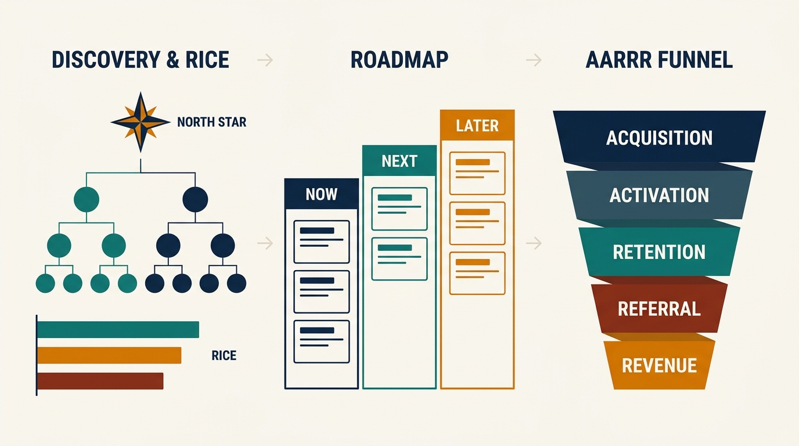
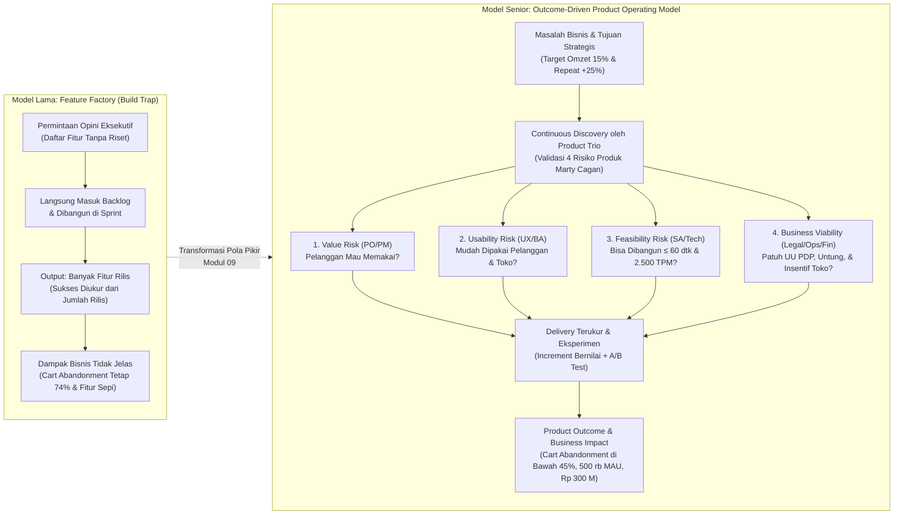
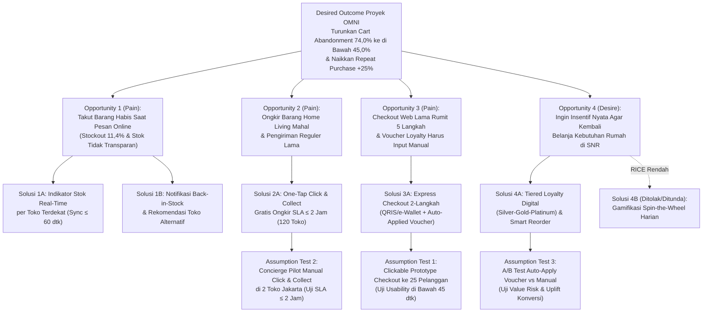
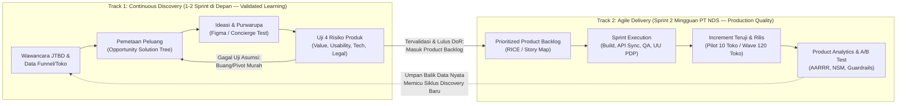
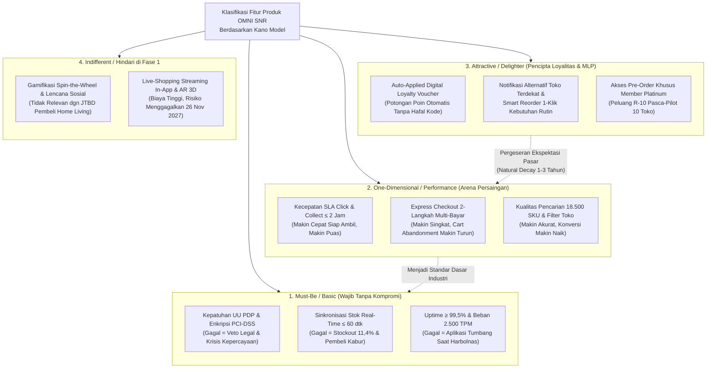
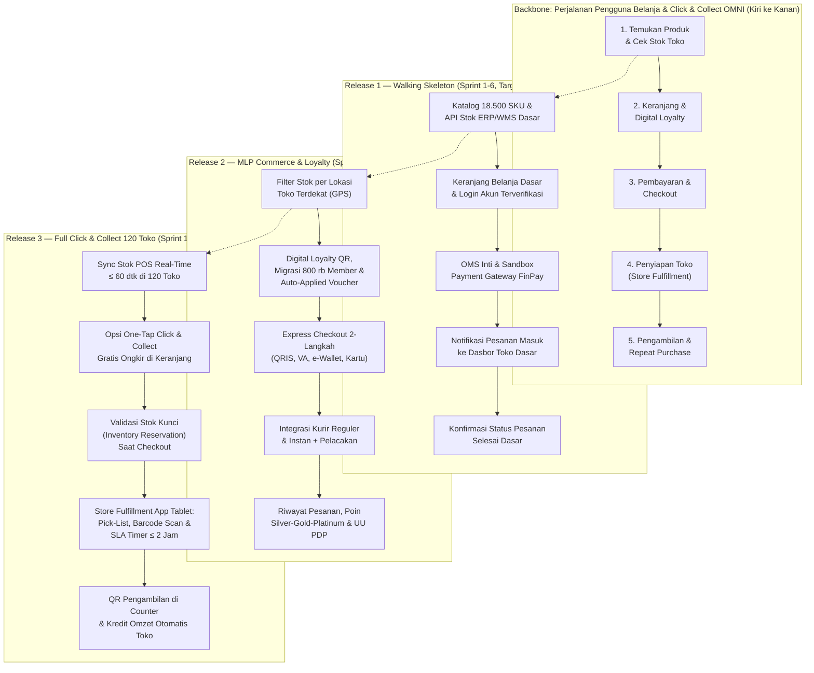
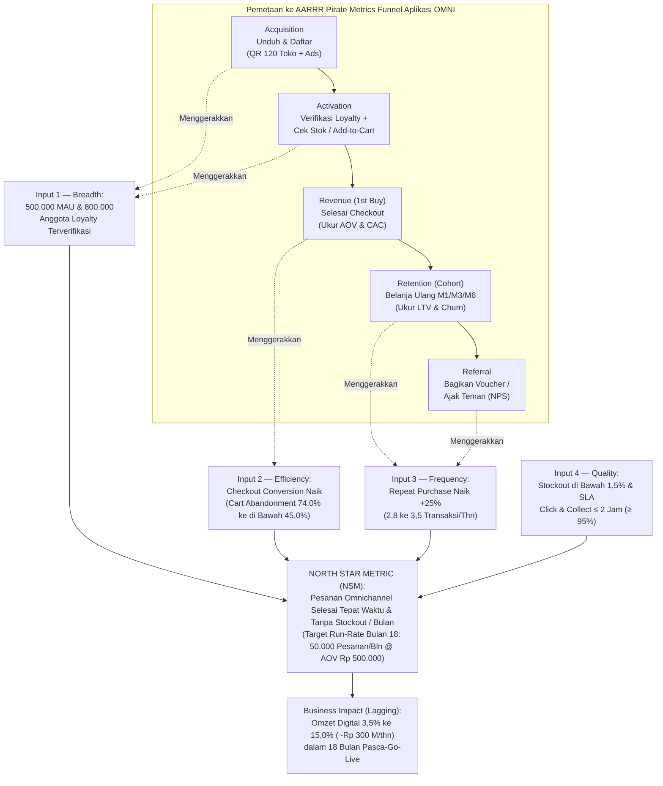

# Modul 09: Product Management & Product Ownership

## 1. Identitas Modul

| Atribut | Keterangan |
|---------|------------|
| **Kelompok Modul** | Jalur Alternatif — Business & System Analysis (Jilid II: *Business Analysis, System Design & Product Leadership*) |
| **Kode & Urutan** | Modul 09 dari 12 |
| **Level Kompetensi** | Senior (*Advanced Practitioner*) |
| **Durasi Pembelajaran** | **12 jam sesi** (4 sesi × 3 jam) + **±6 jam tugas mandiri** |
| **Prasyarat** | Telah menyelesaikan Modul 06 (*Advanced Business Analysis*), Modul 07 (*System Analysis & Design*), dan Modul 08 (*Solution Architecture & Integration*) — atau memiliki pengalaman praktis sebagai Product Owner, Product Manager, maupun Senior Business Analyst — serta memahami dokumen rujukan [00-studi-kasus-utama.md](00-studi-kasus-utama.md) |
| **Peran Sasaran** | Senior Product Manager, Lead Product Owner, Senior Business Analyst yang bertransisi ke peran produk, Senior Project Manager yang bermitra erat dengan tim produk, serta Digital Transformation Lead |
| **Keluaran Utama (*Key Deliverables*)** | (1) *Product Vision Board*, *Geoffrey Moore Positioning Statement*, & *Value Proposition Canvas* Proyek OMNI; (2) *Opportunity Solution Tree* (OST) & alur *Dual-Track Agile*; (3) *Outcome-Based Product Roadmap* (*Now – Next – Later* 2026–2028) & *User Story Map* (*Walking Skeleton*); (4) Matriks Prioritisasi **RICE** & Klasifikasi **Kano Model** untuk menangkis permintaan *HiPPO*; serta (5) *North Star Metric Tree*, Dasbor **AARRR & Unit Economics**, dan Kartu Eksperimen **A/B Testing** |

---

## 2. Gambaran Modul

Banyak proyek transformasi digital korporat berhasil diselesaikan "tepat waktu dan tepat anggaran", tetapi tetap berakhir sebagai **kegagalan bisnis yang sunyi**: aplikasi seluler terpasang di ratusan ribu gawai namun ditinggalkan pelanggan dalam 30 hari, fitur promosi hasil rapat eksekutif tidak pernah dipakai pembeli, dan investasi miliaran rupiah gagal menggerakkan pangsa pasar maupun pendapatan. Akar persoalannya hampir selalu sama — organisasi terjebak dalam **mentalitas *Feature Factory*** (*Build Trap*), yakni mengukur kesuksesan tim dari seberapa banyak fitur yang dikirimkan (*Output*), alih-alih apakah fitur tersebut benar-benar mengubah perilaku pengguna dan mendorong pertumbuhan bisnis (*Outcome*).

Di persimpangan antara strategi bisnis, pengalaman pengguna, dan rekayasa teknologi inilah disiplin **Product Management & Product Ownership** mengambil peran sentral. Modul 09 membawa Anda melampaui sekadar penulisan *User Stories* atau pengurutan tiket Jira menuju kepemimpinan produk strategis bertaraf senior. Anda akan mempelajari cara membedakan batas peran antara **Product Manager**, **Product Owner**, dan **Project Manager** dalam ekosistem *Hybrid* korporat; menerjemahkan visi menjadi **Continuous Product Discovery** yang berbasis bukti empiris; merancang **Outcome-Based Roadmap** (*Now – Next – Later*) yang tetap menghormati tenggat komersial; mengambil keputusan prioritas yang tajam menggunakan **RICE, ICE, MoSCoW, Kano Model, dan User Story Mapping**; serta mengukur dampak nyata melalui **North Star Metric, Funnel AARRR, Unit Economics (CAC, LTV, LTV:CAC), dan Eksperimen A/B Testing**.

Melalui kelanjutan studi kasus **PT Sinar Nusantara Retail Tbk (SNR) — Proyek OMNI**, Anda akan memosisikan diri bersama **Kevin Halim (*Product Owner*)**, **Dewi Lestari (*VP Marketing & CX*)**, dan **Fajar Nugroho (*Senior Project Manager*)** untuk memastikan platform *Omnichannel Commerce, Click & Collect, & Digital Loyalty* SNR bukan sekadar *live* sebelum Harbolnas **26 November 2027**, melainkan sungguh-sungguh mengerek kontribusi omzet digital dari **3,5% (~Rp 64,75 M) menjadi 15% (~Rp 300 M/tahun)** dalam 18 bulan pasca-*Go-Live*, menembus **500.000 MAU**, memverifikasi **800.000 anggota loyalty**, menaikkan *repeat purchase* **+25%**, dan memangkas *cart abandonment* dari **74,0%** secara terukur.

---

## 3. Capaian Pembelajaran

Setelah menyelesaikan Modul 09 beserta seluruh lokakarya, latihan, dan tugas mandirinya, Anda diharapkan mampu:

1. **Merumuskan batas akuntabilitas strategis dan taktis** antara *Product Manager*, *Product Owner*, dan *Project Manager*, serta menerapkan pola pikir **Outcome-Driven Product Mindset** dengan memitigasi **4 Risiko Produk Marty Cagan** (*Value, Usability, Feasibility, Business Viability*) sebelum kode ditulis.
2. **Menyusun artefak strategi produk yang terintegrasi** — meliputi *Product Vision Board*, *Geoffrey Moore Vision Statement*, dan *Value Proposition Canvas* (untuk pelanggan ritel usia 25–40 tahun maupun staf operasional 120 toko) — dan menjembatani visi produk tersebut ke dalam **OKR bisnis yang terukur**.
3. **Merancang siklus *Continuous Product Discovery*** menggunakan *Opportunity Solution Tree* (OST), riset pengguna berbasis *Jobs-to-be-Done* (JTBD), *Dual-Track Agile*, serta uji asumsi (*Assumption Testing*) untuk membedakan **MVP** dan **MLP** (*Minimum Lovable Product*).
4. **Membangun *Outcome-Based Product Roadmap*** (*Now – Next – Later* dan *Theme-Based Roadmap*) yang fleksibel terhadap pembelajaran pasar namun tetap selaras penuh dengan *Release Plan* korporat dan tenggat komersial kritis seperti **26 November 2027**.
5. **Melakukan prioritisasi *Product Backlog* secara objektif dan dapat dipertanggungjawabkan** menggunakan **RICE, ICE, *Value vs Effort 2×2 Matrix*, MoSCoW, Kano Model, dan *User Story Mapping* (*Walking Skeleton*)**, serta menolak permintaan ***HiPPO*** (*Highest Paid Person's Opinion*) secara diplomatis berbasis data.
6. **Merancang sistem *Product Analytics* dan eksperimen terkendali** — mencakup *North Star Metric Tree*, *AARRR Pirate Metrics Funnel*, analisis kohort retensi, perhitungan *Unit Economics* (*CAC, LTV, LTV:CAC, AOV, Churn Rate*), dan desain **A/B Testing** lengkap dengan *Guardrail Metrics* guna mencegah jebakan *Vanity Metrics*.

---

## 4. Rencana Sesi

Pembelajaran dilaksanakan dalam **4 sesi × 3 jam (total 12 jam / 720 menit)** dengan komposisi pedagogis **±30% konsep inti (215 menit)**, **±50% *workshop* kasus Proyek OMNI (360 menit)**, dan **±20% diskusi/refleksi senior (145 menit)**.

| Sesi | Fokus Topik | Konsep (±30%) | Workshop Kasus Proyek OMNI (±50%) | Diskusi & Refleksi (±20%) | Output Sesi |
|------|-------------|---------------|-----------------------------------|---------------------------|-------------|
| **Sesi 1** (3 jam / 180 mnt) | Peran PM vs PO vs Project Manager, *Outcome Mindset*, 4 Risiko Produk, Visi Produk, & VPC–OKR | **55 mnt:** *Feature Factory* vs *Outcome-Driven*, 4 Risiko Marty Cagan, *Product Vision Board* Pichler, *Geoffrey Moore Statement*, *Value Proposition Canvas*, & jembatan OKR | **90 mnt:** Menyusun *Product Vision Board* OMNI, memetakan *Jobs–Pains–Gains* pelanggan segmen usia 25–40 tahun & kasir 120 toko, serta merumuskan 3 *Outcome OKR* Proyek OMNI | **35 mnt:** Debat peran: batas keputusan Kevin Halim (PO), Dewi Lestari (VP Marketing), & Fajar Nugroho (Senior PM) dalam *Hybrid Governance* | *Product Vision Board*, VPC Pelanggan & Toko, serta Peta OKR OMNI |
| **Sesi 2** (3 jam / 180 mnt) | *Continuous Product Discovery*, *Opportunity Solution Tree*, JTBD, *Dual-Track Agile*, & MVP vs MLP | **55 mnt:** *Opportunity Solution Tree* (Teresa Torres), wawancara JTBD, orkestrasi *Dual-Track Agile*, *Assumption Testing* & purwarupa cepat, perbedaan MVP vs MLP | **90 mnt:** Membangun *Opportunity Solution Tree* untuk menurunkan *cart abandonment* 74,0% & menaikkan *repeat purchase* +25%, lalu merancang 3 eksperimen uji asumsi berbiaya rendah | **35 mnt:** Bedah kegagalan "Shipping Without Discovery" di industri ritel Indonesia & kiat menjaga tempo *Discovery* 1–2 Sprint di depan tim PT NDS | *Opportunity Solution Tree* OMNI & Peta *Dual-Track Agile* |
| **Sesi 3** (3 jam / 180 mnt) | *Outcome-Based Roadmap* (*Now–Next–Later*), Prioritisasi (**RICE, ICE, Kano**), *Story Mapping*, & Menolak *HiPPO* | **55 mnt:** Bahaya *Feature-Date Gantt*, *Now–Next–Later Roadmap*, rumus **RICE/ICE**, *Value vs Effort*, *Kano Model*, *User Story Mapping* (*Walking Skeleton*), & teknik diplomasi *HiPPO* | **90 mnt:** Menyusun *Now–Next–Later Roadmap* 2026–2028, menghitung skor **RICE** 6 fitur OMNI (termasuk usulan *Live-Shopping* & *Gamifikasi* Marketing), memetakan *Kano Model*, & *Story Map* *Click & Collect* | **35 mnt:** Simulasi *roleplay* Kevin Halim & Fajar Nugroho merespons permintaan *HiPPO* Dewi Lestari menjelang *Feature Freeze* secara elegan berbasis data | *Now–Next–Later Roadmap*, Matriks RICE, Peta Kano, & *Story Map* |
| **Sesi 4** (3 jam / 180 mnt) | *Product Analytics*, *North Star Metric*, **AARRR Funnel**, *Unit Economics*, **A/B Testing**, & *Anti-Patterns* | **50 mnt:** Arsitektur *North Star Metric Tree*, *AARRR Pirate Metrics*, *Cohort Retention*, *CAC/LTV/LTV:CAC/AOV*, desain **A/B Testing** & *Guardrail Metrics*, serta 5+ *Product Anti-Patterns* | **90 mnt:** Merancang *NSM Tree* & dasbor AARRR Tahun 1 OMNI, mendiagnosis kebocoran funnel Bulan ke-3 pasca-*Go-Live*, menghitung *LTV:CAC*, & menulis *Experiment Card* A/B Test *Checkout* | **40 mnt:** Refleksi lintas modul (Modul 06–09), *briefing* Tugas Modul (±6 jam), & evaluasi formatif 10 soal situasional | *NSM Tree*, Dasbor AARRR & *Unit Economics*, & *Experiment Card* A/B Test |
| **Total** | **4 Sesi Lengkap** | **215 mnt (29,9%)** | **360 mnt (50,0%)** | **145 mnt (20,1%)** | **720 menit (12 jam)** |

---

## 5. Materi



### 5.1 Product Manager vs Product Owner vs Project Manager & Outcome-Driven Mindset

Di banyak perusahaan besar Indonesia yang baru bertransformasi menuju produk digital, tiga jabatan — **Product Manager (PM)**, **Product Owner (PO)**, dan **Project Manager (PjM)** — sering kali tumpang tindih, disalahpahami, atau bahkan dibenturkan satu sama lain. Akibatnya fatal: tidak jelas siapa yang memegang tanggung jawab akhir atas pertumbuhan omzet produk, siapa yang berhak berkata "tidak" terhadap tambahan fitur tidak relevan, dan siapa yang bertanggung jawab menjaga jadwal lintas departemen.

Secara konseptual, perbedaan ketiganya dapat dipahami melalui **orientasi nilai, cakrawala waktu, dan pertanyaan inti** yang masing-masing peran jawab setiap hari:

| Dimensi Perbandingan | Product Manager (PM) | Product Owner (PO — Peran Scrum) | Senior Project Manager (PjM) |
|----------------------|----------------------|----------------------------------|------------------------------|
| **Pertanyaan Utama** | *"Produk apa yang tepat untuk dibangun agar menang di pasar dan menghasilkan nilai bisnis jangka panjang?"* (**Why & What — Strategis**) | *"Item backlog mana yang harus dikerjakan tim di Sprint ini agar nilai increment maksimal?"* (**What & Order — Taktis-Eksekusi**) | *"Bagaimana memastikan seluruh lingkup, anggaran, vendor, risiko, dan lintas unit selesai tepat waktu dan terintegrasi?"* (**How, When & Governance**) |
| **Cakrawala Waktu** | Jangka menengah–panjang (1–3 tahun *product lifecycle*, terus berlanjut pasca-*Go-Live*) | Jangka pendek–menengah (per Sprint 2 minggu hingga beberapa *Release* ke depan) | Terbatas pada siklus proyek (dari *Kick-off* hingga *Closure* / serah terima operasional) |
| **Fokus Utama** | Riset pasar, visi & strategi produk, segmentasi pelanggan, *business model*, *pricing/monetization*, *product-market fit*, & *outcome* bisnis (NSM, LTV:CAC) | Pengelolaan *Product Backlog*, penulisan & klarifikasi *User Stories*, *Backlog Refinement*, *Sprint Review*, & maksimalisasi nilai kerja *Scrum Team* | Pengendalian segitiga kendala (lingkup, jadwal, biaya BAC), kontrak vendor, manajemen risiko & isu lintas proyek, *Stage-Gate*, & *change management* organisasi |
| **Ukuran Keberhasilan Utama** | Pertumbuhan pendapatan digital, retensi pengguna, pangsa pasar, kepuasan pelanggan (NPS/CSAT), dan ketercapaian OKR produk | Kualitas & kejelasan *backlog*, nilai bisnis yang diterima tiap *Release*, kecepatan validasi pengguna, dan minimnya *rework* fitur | Ketepatan jadwal *milestone*, disiplin deviasi biaya (CPI/SPI), kepatuhan regulasi, kelancaran *rollout* operasional, dan pencapaian *business benefits* proyek |
| **Representasi di Proyek OMNI** | **Fungsi Strategis Produk** yang diemban kolaboratif oleh **Dewi Lestari** (VP Marketing & CX — sponsor komersial) bersama **Kevin Halim** (yang berevolusi menjadi *Product Manager* pasca-*Go-Live*) | **Kevin Halim** — *Product Owner* penuh waktu Proyek OMNI yang bekerja harian dengan *Scrum Master* (**Tania Wijaya**), *Lead BA* (**Nadia Putri**), *Lead SA* (**Dimas Prasetyo**), dan *Scrum Team* PT NDS | **Fajar Nugroho** — *Senior Project Manager* yang mengorkestrasi BAC Rp 9,20 M, kontrak PT NDS Rp 4,40 M, dependensi ERP/POS, kepatuhan UU PDP, & *wave rollout* 120 toko |

> **Catatan Kematangan Organisasi:** Menurut *Scrum Guide 2020*, *Product Owner* adalah sebuah **akuntabilitas di dalam tim Scrum**, bukan selalu jabatan struktural yang terpisah dari *Product Manager*. Di perusahaan teknologi modern (*product-led*), satu orang **Product Manager** sekaligus menjalankan peran *Product Owner* bagi *squad*-nya. Namun, pada transformasi korporat berskala besar seperti Proyek OMNI (yang melibatkan 120 toko fisik, 3 DC, 3 proyek paralel Program Nusantara 2028, dan vendor eksternal), kolaborasi erat **Triad Kepemimpinan** — *Senior PM* (Fajar), *Product Owner/PM* (Kevin), dan *Tech/Architecture Lead* (Dimas) bersama *UX/BA Lead* (Nadia) — justru menjadi kunci sukses.

#### Pergeseran Paradigma: Dari *Feature Factory* Menuju *Outcome-Driven Product Mindset*

Melissa Perri dalam *Escaping the Build Trap* dan Marty Cagan dalam *Inspired* menyoroti penyakit kronis perusahaan ritel dan perbankan tradisional saat membangun kanal digital: **Feature Factory** (*Pabrik Fitur*). Dalam model *Feature Factory*, eksekutif menumpuk daftar permintaan fitur ("bangun *live shopping*", "tambahkan *spin-the-wheel*", "buat *chatbot*"), tim IT diukur dari berapa cepat fitur selesai di-*deploy* (*Output*), dan tidak seorang pun memeriksa ulang 3 bulan kemudian apakah fitur tersebut benar-benar menaikkan penjualan atau justru memperlambat aplikasi.

Sebaliknya, **Outcome-Driven Product Operating Model** menempatkan **perubahan perilaku pelanggan yang terukur** (*Product Outcome*) sebagai jembatan antara kerja tim (*Output*) dan hasil keuangan perusahaan (*Business Impact*). Perbedaan tegas antara ketiga level tersebut pada Proyek OMNI:
- **Output (Keluaran Teknis):** Merilis fitur *One-Tap Click & Collect* dan *Auto-Applied Loyalty Voucher* pada Release 2–3. *(Penting, tetapi baru permulaan — belum membuktikan nilai!)*
- **Product Outcome (Perubahan Perilaku Pelanggan):** *Cart abandonment* turun dari **74,0%** menjadi **< 45,0%**; minimal **35%** pembeli daring memilih ambil di toko (*Click & Collect*) dengan SLA ≤ 2 jam; dan *repeat purchase* anggota loyalty naik **+25%**.
- **Business Impact (Dampak Finansial Korporat):** Kontribusi omzet kanal digital melonjak dari **3,5% (~Rp 64,75 M)** menjadi **15,0% (~Rp 300 M/tahun)** dalam 18 bulan pasca-*Go-Live*, serta membalikkan erosi pangsa pasar segmen usia 25–40 tahun.

#### Empat Risiko Produk Marty Cagan (*The Four Big Risks*)

Sebelum mengalokasikan ratusan juta rupiah biaya pengembangan tim PT NDS untuk membangun suatu fitur, tim produk senior (*Product Trio*: Product Owner/PM, UX/BA Designer, dan Lead Engineer/Solution Architect) wajib memvalidasi **empat risiko fundamental produk** secara paralel selama fase *Discovery*:

1. **Value Risk (*Risiko Nilai* — Pemilik utama: Product Manager / PO):** Apakah pelanggan benar-benar menginginkan fitur ini, mau menggunakannya, atau bersedia membayar/bertransaksi karenanya? *(Contoh OMNI: Apakah pembeli home living SNR usia 25–40 tahun sungguh tertarik bermain gim harian di aplikasi, atau mereka jauh lebih peduli pada kepastian stok rak toko terdekat agar tidak membuang waktu?)*
2. **Usability Risk (*Risiko Kegunaan* — Pemilik utama: Product Designer / Lead BA):** Apakah pelanggan (dan kasir/staf toko) dapat memahami cara menggunakannya dengan intuitif tanpa kebingungan dan tanpa pelatihan berjam-jam? *(Contoh OMNI: Apakah staf gudang toko dapat memindai barcode pesanan Click & Collect di tablet dalam ≤ 3 ketukan saat jam sibuk akhir pekan?)*
3. **Feasibility Risk (*Risiko Kelayakan Teknis* — Pemilik utama: Lead SA / Tech Lead):** Apakah tim rekayasa mampu membangunnya secara andal dalam batas waktu, arsitektur, dan biaya yang tersedia? *(Contoh OMNI: Apakah adaptor API dari proyek POS-Modern mampu menjaga jeda sinkronisasi stok ≤ 60 detik di 120 toko dan lulus beban puncak 2.500 TPM?)*
4. **Business Viability Risk (*Risiko Kelayakan Bisnis & Kepatuhan* — Pemilik utama: Product Manager bersama Legal, Finance, Ops):** Apakah solusi ini selaras dengan model bisnis, margin keuangan, regulasi hukum, dan insentif operasional perusahaan? *(Contoh OMNI: Apakah fitur Click & Collect mematuhi enkripsi PII UU PDP & PCI-DSS [Rina Kartika], menjaga margin [Budi Santoso], dan tidak memicu penolakan 120 Store Manager karena kredit omzet toko tergerus [Agus Setiawan]?)*



---

### 5.2 Product Vision, Strategy, Value Proposition & Penyelarasan OKR

Tanpa visi produk yang tajam, *Product Backlog* akan segera berubah menjadi "tempat pembuangan permintaan" (*wish-list graveyard*) dari setiap divisi. Visi produk (*Product Vision*) adalah gambaran masa depan yang menginspirasi tentang **perubahan positif apa yang ingin diciptakan bagi pelanggan dalam 2–5 tahun ke depan**, sedangkan strategi produk (*Product Strategy*) adalah pilihan sadar mengenai **segmen mana yang diprioritaskan, masalah inti mana yang dipecahkan, keunggulan pembeda apa yang dibangun, dan apa yang sengaja TIDAK dikerjakan**.

#### 1. Geoffrey Moore Product Vision Statement (Template Positioning Klasik)

Dirumuskan oleh Geoffrey Moore dalam *Crossing the Chasm*, kerangka ini memaksa tim produk meringkas posisi produk secara tajam dalam satu paragraf tanpa jargon kosong:

> **Untuk** *[target pelanggan spesifik]*, **yang memiliki kebutuhan/masalah** *[kebutuhan mendesak atau pain point]*, **[Nama Produk]** adalah *[kategori produk]* **yang memberikan** *[manfaat utama / alasan kuat untuk membeli]*. **Berbeda dengan** *[kompetitor utama atau alternatif saat ini]*, **produk kami menawarkan** *[keunggulan pembeda unik yang sulit ditiru]*.

Penerapan ringkas untuk **Platform OMNI PT SNR**:
- **Untuk** profesional muda dan keluarga urban Indonesia usia 25–40 tahun yang gemar menata hunian bergaya *modern living*, **yang membutuhkan** kepastian stok produk dan kemudahan berbelanja *home living* tanpa takut barang habis atau menunggu pengiriman lama, **OMNI by Sinar Nusantara** adalah **platform belanja omnichannel & loyalty terpadu** yang menghadirkan transparansi stok *real-time* 18.500 SKU, layanan *Click & Collect* ≤ 2 jam di 120 toko, dan poin keanggotaan otomatis lintas kanal. **Berbeda dengan** *marketplace* umum yang tidak memiliki ruang pamer fisik terkurasi maupun situs lama SNR yang terputus dari stok toko, **produk kami** memadukan kurasi ruang pamer fisik di 24 kota dengan kecepatan transaksi digital tanpa hambatan.

#### 2. Product Vision Board (Roman Pichler)

Roman Pichler mengembangkan **Product Vision Board** sebagai kanvas satu halaman yang menghubungkan **Visi** dengan empat pilar strategi praktis:
1. **Vision (*Visi*):** Tujuan utama (*purpose*) produk — mengapa produk ini layak eksis.
2. **Target Group (*Segmen Sasaran*):** Persona pengguna spesifik beserta karakteristik demografi dan perilaku belanjanya.
3. **Needs (*Kebutuhan Pelanggan*):** Masalah nyata (*pain points*) atau keinginan (*gains*) yang ingin diselesaikan — bukan daftar fitur!
4. **Product (*Kapabilitas Inti Produk*):** 3–5 kapabilitas kunci produk yang membedakannya di pasar (tetap ringkas di level kapabilitas, bukan daftar 100 fitur).
5. **Business Goals (*Tujuan Bisnis*):** Bagaimana produk menghasilkan nilai komersial bagi perusahaan (omzet, retensi, efisiensi, pangsa pasar).

*(Artefak lengkap Product Vision Board Proyek OMNI disajikan pada Bagian 6.1.)*

#### 3. Value Proposition Canvas (Alexander Osterwalder)

Pada produk ritel omnichannel seperti Proyek OMNI, terdapat **dua sisi pengguna kritis** yang sama-sama menentukan hidup-matinya adopsi: (a) **Pelanggan Eksternal** (segmen urban usia 25–40 tahun) dan (b) **Pengguna Internal Operasional** (1.440 kasir dan staf gudang di 120 toko). Jika *Value Proposition* hanya memanjakan pelanggan eksternal tetapi menyengsarakan staf toko, fitur *Click & Collect* akan disabotase di lapangan (Risiko **R-03**).

**Value Proposition Canvas (VPC)** memastikan kesesuaian (*Problem–Solution Fit*) antara **Customer Profile** (*Customer Jobs, Pains, Gains*) dengan **Value Map** (*Products & Services, Pain Relievers, Gain Creators*):

| Elemen Value Proposition Canvas | Segmen 1: Pelanggan Ritel SNR (Usia 25–40 Tahun) | Segmen 2: Staf & Store Manager 120 Toko SNR |
|---------------------------------|--------------------------------------------------|---------------------------------------------|
| **Customer Jobs** *(Tugas yang ingin diselesaikan)* | Menemukan perabot/dekorasi rumah yang serasi, memastikan barang tersedia sebelum berangkat ke mal, membayar cepat, dan menukar poin loyalty tanpa repot. | Melayani pembeli *walk-in*, menyiapkan pesanan daring *Click & Collect* tepat waktu (≤ 2 jam), menjaga akurasi stok rak, dan mencapai target omzet cabang. |
| **Customer Pains** *(Hambatan & frustrasi saat ini)* | (1) Pesanan web sering dibatalkan karena stok habis (**11,4%**); (2) *Checkout* situs lama lambat & memicu *cart abandonment* **74,0%**; (3) Kartu fisik *Sinar Member* tertinggal dan poin web–toko tidak sinkron; (4) Ongkos kirim barang besar mahal. | (1) Antrean kasir melambat hingga **45 detik/transaksi** akibat input voucher manual; (2) Staf harus mengecek rak manual untuk permintaan pelanggan; (3) Kekhawatiran pesanan daring menambah beban kerja sekaligus menggerus omzet KPI cabang. |
| **Customer Gains** *(Hasil ideal yang diharapkan)* | Belanja mulus kapan saja, kepastian barang siap diambil ≤ 2 jam tanpa ongkir, diskon/poin langsung terpotong otomatis, dan rekomendasi produk sesuai selera hunian. | Proses pemindaian pesanan cepat lewat tablet, pengurangan antrean kasir, pencatatan kredit penjualan *Click & Collect* otomatis ke target cabang toko (*shared credit*), dan visibilitas stok rapi. |
| **Pain Relievers** *(Pereda hambatan di OMNI)* | Sinkronisasi stok *near-real-time* (≤ 60 detik, akurasi ≥ 98,0%) untuk menekan *stockout* ke **< 1,5%**; *Express Checkout* 2-langkah; QR Loyalty digital otomatis tanpa kartu fisik. | *Store Fulfillment App* di 240 tablet/scanner dengan panduan lokasi rak (*pick-list* otomatis); pindai QR voucher instan (< 5 detik); skema insentif *shared-revenue* cabang bersama Agus Setiawan. |
| **Gain Creators** *(Pencipta nilai tambah di OMNI)* | Fitur *One-Tap Click & Collect* gratis ongkir di 120 toko; tingkatan keanggotaan *Silver–Gold–Platinum* terpadu dengan penawaran personal berbasis riwayat belanja. | Dasbor *SLA Timer* visual (peringatan dini 90 menit sebelum batas 2 jam) yang membantu Store Manager menjaga performa ≥ 95% tepat waktu dan meraih bonus KPI omnichannel. |

#### 4. Menjembatani Visi Produk ke OKR (*Objectives and Key Results*)

Strategi produk baru hidup ketika diterjemahkan ke dalam **OKR** yang berorientasi *Outcome*. Kesalahan paling sering dalam penulisan OKR di korporasi adalah menuliskan *to-do list* fitur sebagai *Key Result* (misalnya: *"KR1: Meluncurkan fitur Click & Collect di 120 toko"* — itu adalah **Output**, bukan *Key Result*!).

| Jenis Pernyataan | Contoh Buruk (*Output-Driven* — Hindari) | Contoh Senior (*Outcome-Driven* — Proyek OMNI) |
|------------------|------------------------------------------|------------------------------------------------|
| **Objective (Kualitatif & Inspiratif)** | Menyelesaikan pengembangan aplikasi OMNI tepat waktu sesuai kontrak PT NDS. | **Menjadikan OMNI kanal belanja *home living* omnichannel paling terpercaya dan bebas hambatan bagi pelanggan urban Indonesia.** |
| **Key Result 1 (Kuantitatif — Akuisisi/Adopsi)** | Merilis aplikasi iOS dan Android di App Store dan Play Store sebelum 26 Nov 2027. | Mencapai **500.000 MAU** dan **800.000 anggota loyalty digital terverifikasi** dalam 12 bulan pasca-*Go-Live*. |
| **Key Result 2 (Kuantitatif — Konversi/Keandalan)** | Mengintegrasikan API stok POS ke 120 toko. | Menurunkan *cart abandonment* dari **74,0% menjadi < 45,0%** dan pembatalan *stockout* dari **11,4% menjadi < 1,5%**. |
| **Key Result 3 (Kuantitatif — Retensi & Bisnis)** | Membangun 3 tingkatan loyalty (*Silver, Gold, Platinum*) dan fitur voucher. | Meningkatkan *repeat purchase* anggota loyalty sebesar **+25%** dan mendorong kontribusi omzet digital dari **3,5% menuju 15,0%** (~Rp 300 M/tahun dalam 18 bulan). |

---

### 5.3 Continuous Product Discovery & Dual-Track Agile

Membangun produk yang benar (*building the right thing*) jauh lebih sulit daripada membangun produk dengan benar (*building the thing right*). **Continuous Product Discovery** — dipopulerkan oleh Teresa Torres dalam *Continuous Discovery Habits* — adalah disiplin melakukan kontak mingguan secara rutin dengan pelanggan oleh *Product Trio* (PO/PM, Designer/BA, dan Tech Lead) untuk terus menemukan peluang bernilai tinggi dan menguji asumsi solusi sebelum tim *engineering* menulis kode produksi.

#### 1. User Research & Kerangka *Jobs-to-be-Done* (JTBD)

Pelanggan tidak membeli fitur; mereka **"menyewa" (*hire*) sebuah produk untuk menyelesaikan suatu pekerjaan (*job*) dalam hidup mereka** (Clayton Christensen). Jika Kevin Halim dan Nadia Putri hanya bertanya *"Fitur apa yang Anda inginkan di aplikasi SNR?"*, pelanggan sering menjawab secara dangkal ("kasih diskon besar", "buat warna aplikasinya bagus"). Sebaliknya, wawancara berbasis **Jobs-to-be-Done (JTBD)** menggali *cerita nyata kejadian terakhir* (*story-based interviewing*): *"Ceritakan terakhir kali Anda membeli perlengkapan rumah tangga di SNR atau kompetitor — apa yang terjadi tepat sebelum Anda memutuskan membuka web/datang ke toko, dan di titik mana Anda merasa paling frustrasi?"*

Format pernyataan JTBD (*Job Story*):
> **When** *[situasi pemicu spesifik]*, **I want to** *[motivasi/aksi]*, **so I can** *[hasil emosional/fungsional yang diharapkan]*.

- **Contoh JTBD Pelanggan SNR:** *"Saat saya sedang merencanakan renovasi ruang makan di akhir pekan dan melihat lampu gantung menarik di media sosial SNR, saya ingin langsung memastikan barang tersebut tersedia di mal terdekat dan menguncinya secara daring, sehingga saya tidak membuang waktu 2 jam di kemacetan Jakarta hanya untuk mendapati rak kosong."*
- **Contoh JTBD Staf Toko SNR:** *"Saat pesanan Click & Collect masuk di tengah ramainya pengunjung Sabtu sore, saya ingin langsung tahu nomor lorong/rak barang dan mencetak label ambil dengan sekali pindai, sehingga saya dapat menyiapkan barang di bawah 30 menit tanpa mengabaikan pembeli yang sedang antre di kasir."*

#### 2. Opportunity Solution Tree (OST — Teresa Torres)

**Opportunity Solution Tree (OST)** adalah peta visual untuk menata pemikiran *Product Discovery* agar tim **tidak melompat langsung dari target bisnis ke solusi fitur** (*solution jumping*), melainkan mengeksplorasi ruang masalah (*Opportunity Space*) terlebih dahulu secara terstruktur:
1. **Akar Pohon (*Desired Outcome*):** Satu atau dua metrik perubahan perilaku terukur yang diturunkan dari OKR.
2. **Cabang Peluang (*Opportunities*):** Kebutuhan, *pain points*, dan keinginan nyata pelanggan yang ditemukan dari wawancara JTBD, data analitik, dan observasi toko.
3. **Daun Solusi (*Solutions*):** Beragam alternatif ide solusi (bukan hanya satu ide pertama!) untuk menjawab peluang prioritas terpilih.
4. **Uji Asumsi (*Assumption Tests*):** Eksperimen cepat berbiaya rendah untuk menguji asumsi paling berisiko dari solusi (4 Risiko Marty Cagan) sebelum masuk *Delivery Backlog*.



#### 3. Dual-Track Agile: Menjalankan *Discovery* Paralel dengan *Delivery*

Dalam praktik Scrum korporat yang naif, tim pengembang langsung menerima *User Stories* yang belum pernah diuji ke pengguna nyata sehingga 30%–40% waktu Sprint habis untuk *rework*. **Dual-Track Agile** (dipopulerkan Marty Cagan dan Jeff Patton) membagi kerja menjadi **dua jalur kontinu yang berjalan paralel oleh tim lintas fungsi yang sama** (bukan dua departemen terpisah yang saling lempar dokumen!):
- **Track 1 — Continuous Discovery (1–2 Sprint di depan):** Berfokus pada **kecepatan belajar** (*validated learning*). *Product Trio* (Kevin Halim, Nadia Putri, Dimas Prasetyo) mewawancarai pelanggan & kasir, memperbarui OST, membuat *wireframe/prototype* Figma, dan melakukan uji asumsi cepat untuk menjawab *what to build*.
- **Track 2 — Agile Delivery (Sprint berjalan bersama PT NDS):** Berfokus pada **kecepatan eksekusi, kualitas, keamanan UU PDP, dan keandalan produksi**. Difasilitasi oleh **Tania Wijaya (*Scrum Master*)** untuk menjaga ritme Scrum dan melindungi *Sprint Goal*, hanya solusi yang sudah tervalidasi dari *Discovery Track* yang masuk menjadi item *Ready* (DoR) di *Product Backlog* untuk dibangun, diuji QA (**Lukas Gunawan**), dan dirilis ke produksi.



#### 4. Prototype, Assumption Testing, serta Perbedaan MVP vs MLP

Sebelum menulis 1 baris kode produksi, tim produk menguji asumsi terlemahnya menggunakan teknik bertingkat dari biaya termurah:
- **Fake Door / Painted Door Test:** Menampilkan tombol atau banner minat fitur (mis. *"Mau coba AR Preview di ruang tamu Anda?"*) untuk mengukur rasio klik organik (*Value Risk*) sebelum membangun mesin 3D mahal.
- **Clickable Prototype (Figma):** Menguji alur *Express Checkout* 2-langkah kepada 15–25 pelanggan target dalam 3 hari untuk mendeteksi kebingungan navigasi (*Usability Risk*).
- **Concierge / Wizard-of-Oz MVP:** Sebelum aplikasi tablet selesai, Kevin dan Agus Setiawan mensimulasikan alur *Click & Collect* secara manual menggunakan WhatsApp Business + lembar kerja stok di 2 toko Jakarta selama 1 minggu untuk menguji apakah staf toko benar-benar sanggup memenuhi **SLA ≤ 2 jam** di dunia nyata (*Business Viability & Operational Risk*).

Di sinilah penting membedakan **MVP (*Minimum Viable Product*)** dan **MLP (*Minimum Lovable Product*)**:
- **MVP (Eric Ries):** Versi paling ringkas dari produk yang memungkinkan tim mengumpulkan jumlah **pembelajaran tervalidasi maksimum dengan upaya minimum** — sering kali masih sederhana, fungsional dasar, ditujukan untuk *early adopters* atau tahap *Pilot* (contoh di OMNI: Release 1 & Pilot 10 Toko untuk memvalidasi sinkronisasi stok ≤ 60 detik dan SLA ≤ 2 jam).
- **MLP (*Minimum Lovable Product*):** Versi rilis awal ke pasar luas yang tidak hanya "bisa dipakai (*viable*)", tetapi cukup **mulus, cepat, estetis, dan menyenangkan (*lovable*)** sehingga pelanggan langsung jatuh hati, kembali berbelanja, dan merekomendasikannya. Pada pasar ritel Indonesia yang sudah terbiasa dengan pengalaman aplikasi *e-commerce* kelas dunia, peluncuran nasional OMNI **26 November 2027** tidak boleh terasa seperti prototipe setengah matang — ia harus memenuhi standar **MLP** (antarmuka bersih, *auto-apply* voucher mulus, pembayaran QRIS instan, dan 0 *stockout* memalukan).

---

### 5.4 Outcome-Based Product Roadmap: Now – Next – Later & Theme-Based Roadmap

Salah satu sumber konflik paling klasik antara *Product Management* dan eksekutif korporat adalah bentuk **Product Roadmap**. Secara tradisional, Direksi sering meminta *Feature-Date Gantt Roadmap* 18–24 bulan ke depan yang mengunci setiap nama fitur beserta tanggal rilis spesifik hingga ke akhir tahun depan.

#### Mengapa *Feature-Date Gantt Roadmap* Berisiko bagi Produk Digital?

1. **Ilusi Kepastian (*False Precision*):** Tidak ada yang dapat memprediksi secara akurat perilaku belanja 500.000 pengguna 15 bulan sebelum aplikasi meluncur. Mengunci daftar fitur tahun 2028 di tahun 2026 berarti memaksa tim mengabaikan pembelajaran pasar yang jauh lebih berharga.
2. **Mengubah Roadmap Menjadi Kontrak Fitur (*Build Trap*):** Begitu fitur "Gamifikasi" tertulis di bulan Oktober pada *Gantt Roadmap*, pemangku kepentingan akan menagih fitur tersebut meski data riset membuktikan pelanggan tidak membutuhkannya.
3. **Menghilangkan Ruang Iterasi Pasca-Rilis:** *Gantt Roadmap* jarang menyisakan kapasitas untuk memperbaiki metrik *funnel* pasca-rilis (misalnya eksperimen *checkout* atau optimasi performa *Click & Collect*), karena seluruh kalender sudah penuh oleh fitur baru berikutnya.

#### Solusi Senior: *Now – Next – Later Roadmap* & *Theme-Based Roadmap* yang Selaras dengan *Release Plan*

Alih-alih mengunci fitur pada tanggal jauh di masa depan, praktisi produk senior (Janna Bastow, Roman Pichler, Marty Cagan) menggunakan **Outcome-Based / Theme-Based Roadmap** berstruktur **Now – Next – Later**:
- **NOW (Cakrawala Dekat — Granularitas Tinggi, Kepastian Tinggi):** Tema masalah & *outcome* yang sedang aktif dikerjakan pada Sprint/Release berjalan. Solusinya sudah melewati *Discovery*, terukur ketat, dan **diselaraskan 100% dengan *Release Plan* Proyek OMNI serta tenggat mutlak Harbolnas 26 November 2027** (Release 1–3, Pilot 10 Toko, & Wave Rollout 120 Toko).
- **NEXT (Cakrawala Menengah — Granularitas Sedang, Sedang *Discovery*):** Tema peluang prioritas berikutnya (misalnya Q1–Q2 2028 pasca-*Go-Live*) yang sedang divalidasi melalui riset pengguna dan data awal produksi. Komitmennya berada pada **masalah/outcome yang akan dipecahkan**, bukan daftar fitur kaku.
- **LATER (Cakrawala Jauh — Granularitas Luas, Visi Strategis):** Inisiatif strategis jangka panjang (H2 2028 / Fase 2) seperti integrasi *marketplace* pihak ketiga (Shopee, Tokopedia, TikTok Shop) dan mesin rekomendasi AI kolaborasi Proyek DataHub, yang arahnya bergantung pada kinerja Tahun 1.

> **Kunci Penyelarasan Korporat (Jembatan PM & PO):** *Now – Next – Later Roadmap* **tidak menolak tenggat komersial!** Dalam konteks Proyek OMNI, tenggat **26 November 2027** adalah *hard business constraint* (musim Harbolnas 12.12 & Natal–Tahun Baru). Oleh karena itu, kolom **NOW** mengunci komitmen *milestone* Release 1–3 & *Go-Live* 120 toko bersama Fajar Nugroho (*Senior PM*) pada aspek **Must-Have Outcome** (stok akurat ≥ 98,0%, *Click & Collect* ≤ 2 jam, kepatuhan UU PDP), sementara rincian pengalaman antarmuka tetap fleksibel dioptimalkan lewat Sprint dan eksperimen!

```mermaid
flowchart LR
    subgraph NOW["NOW (2026 - Nov 2027): Fondasi Omnichannel & Go-Live Harbolnas"]
        direction TB
        N1["Tema 1: Kepastian Stok & Transaksi Tanpa Cacat<br/>Outcome: Stockout 11,4% ke di Bawah 1,5% · Sync ≤ 60 dtk<br/>(Release 1-2: OMS, ERP/WMS API, Express Checkout)"]
        N2["Tema 2: Click & Collect 120 Toko & Digital Loyalty<br/>Outcome: SLA ≤ 2 Jam (≥ 95%) & 800 rb Member<br/>(Release 2-3, Pilot 10 Toko, Wave Rollout 120 Toko)"]
        N3["Komitmen Keras: Gate 2 (23 Apr 2027)<br/>& Go-Live Nasional ≤ 26 Nov 2027 (UU PDP 100%)"]
    end

    subgraph NEXT["NEXT (Q1 - Q2 2028): Optimasi Konversi & Mesin Retensi"]
        direction TB
        NX1["Tema 3: Pangkas Cart Abandonment & Friction<br/>Outcome: Abandonment 74,0% ke di Bawah 45,0%<br/>(Kandidat: A/B Test Checkout, Time-Slot Picker BOPIS)"]
        NX2["Tema 4: Akselerasi Repeat Purchase +25%<br/>Outcome: 500 rb MAU & Frekuensi 2,8 ke 3,5x/thn<br/>(Kandidat: Smart Reorder 1-Klik, Program Referral)"]
        NX3["Status: Aktif di Continuous Discovery<br/>& Prioritisasi Kuartalan Berbasis RICE"]
    end

    subgraph LATER["LATER (H2 2028 - Fase 2): Ekspansi Ekosistem & Personalisasi AI"]
        direction TB
        L1["Tema 5: Integrasi Marketplace Eksternal<br/>Outcome: Omzet Digital ≥ 15% (~Rp 300 M/thn)<br/>(Kandidat: Omnichannel Hub Shopee, Tokopedia, TikTok Shop)"]
        L2["Tema 6: Hiper-Personalisasi Berbasis DataHub<br/>Outcome: Kenaikan AOV +15% & Churn Turun<br/>(Kandidat: Mesin Rekomendasi AI & Visual Search)"]
        L3["Status: Eksplorasi Strategis — Dievaluasi<br/>Setelah Evaluasi Unit Economics Tahun 1"]
    end

    NOW -->|"Evaluasi Data Produksi<br/>& Retensi Bulan 1-3"| NEXT
    NEXT -->|"Skala Bisnis & Integrasi<br/>Proyek DataHub (Jun 2028)"| LATER
```



---

### 5.5 Framework Prioritisasi Terukur & Manajemen Product Backlog Bernilai Tinggi

Setiap organisasi selalu memiliki **10 kali lebih banyak ide fitur** daripada kapasitas rekayasa (*engineering capacity*) yang tersedia. Tanpa kerangka prioritisasi kuantitatif yang transparan, urutan *Product Backlog* akan ditentukan oleh suara paling keras di ruang rapat (**HiPPO**). Berikut lima kerangka prioritisasi utama yang wajib dikuasai seorang Senior Product Manager / Product Owner beserta kapan masing-masing paling tepat digunakan:

#### 1. RICE Scoring (Intercom Framework)

**RICE** adalah metode prioritisasi kuantitatif terbaik untuk membandingkan fitur atau eksperimen pasca-validasi awal karena secara eksplisit memperhitungkan **skala jangkauan, kekuatan dampak, tingkat keyakinan bukti (*Confidence*), dan biaya upaya (*Effort*)**:

$$\text{RICE Score} = \frac{\text{Reach} \times \text{Impact} \times \text{Confidence}}{\text{Effort}}$$

- **Reach (Jangkauan):** Estimasi jumlah pelanggan/transaksi nyata yang terdampak dalam periode tetap (misalnya per kuartal / 3 bulan). Wajib berbasis data analitik atau survei, bukan tebakan liar.
- **Impact (Dampak):** Seberapa kuat fitur menggerakkan *Outcome* per individu yang dijangkau. Skala standar Intercom: `3` = *Massive*, `2` = *High*, `1` = *Medium*, `0,5` = *Low*, `0,25` = *Minimal*.
- **Confidence (Tingkat Keyakinan):** Persentase kekuatan bukti data untuk menekan bias optimisme (*wishful thinking*): `100%` (`1,0`) = *High* (ada data kuantitatif, uji purwarupa, atau pilot), `80%` (`0,8`) = *Medium* (ada riset kualitatif / data parsial), `50%` (`0,5`) = *Low* (murni asumsi atau opini eksekutif tanpa data!).
- **Effort (Upaya):** Total estimasi kapasitas lintas fungsi (*product, UX, backend, frontend, QA, integrasi*) dalam satuan ***person-months*** (PM). Semakin besar *Effort*, semakin kecil skor RICE.

> **Kekuatan Tersembunyi Faktor *Confidence*:** Faktor *Confidence* adalah "vaksin anti-*HiPPO*" paling elegan. Saat seorang eksekutif mengajukan ide spektakuler tanpa riset pengguna, PO tidak perlu berdebat secara emosional; cukup masukkan `Confidence = 50% (0,5)` dan tawarkan: *"Jika tim Marketing bersedia menjalankan uji asumsi selama 5 hari agar Confidence naik ke 80%–100%, kita akan menghitung ulang skor RICE-nya secara objektif."*

#### 2. ICE Scoring, Value vs Effort 2×2 Matrix, dan MoSCoW

| Framework | Rumus / Mekanisme | Kelebihan Utama | Kapan Paling Tepat Digunakan |
|-----------|-------------------|-----------------|------------------------------|
| **RICE** | $(\text{Reach} \times \text{Impact} \times \text{Confidence}) / \text{Effort}$ | Sangat objektif, memaksa validasi jangkauan nyata & kekuatan bukti data (*Confidence*). | Memprioritaskan *roadmap* kuartalan, daftar fitur kandidat *Release*, atau menangkis usulan *HiPPO*. |
| **ICE** *(Sean Ellis)* | $\text{Impact} \times \text{Confidence} \times \text{Ease}$ *(masing-masing skala 1–10)* | Sangat cepat dihitung dalam 10 menit tanpa harus mengumpulkan angka *Reach* rinci terlebih dahulu. | Memprioritaskan puluhan ide eksperimen *Growth* / A/B Test mingguan di fase awal *Discovery*. |
| **Value vs Effort 2×2 Matrix** | Plot sumbu Y = *Customer/Business Value*, sumbu X = *Effort* → 4 kuadran: **Quick Wins** (High V/Low E), **Big Bets / Strategic** (High V/High E), **Fill-Ins** (Low V/Low E), **Money Pits / Avoid** (Low V/High E). | Sangat visual dan mudah dipahami eksekutif non-teknis dalam lokakarya penyelarasan (*alignment workshop*). | Sesi penyelarasan cepat bersama *Steering Committee* untuk menyisihkan *Money Pits* (mis. *Live-Shopping*). |
| **MoSCoW** | Kategorisasi biner ke **Must-Have**, **Should-Have**, **Could-Have**, dan **Won't-Have (this release)**. | Sangat tegas untuk mengunci komitmen rilis dengan tenggat keras (*hard deadline*) dan kontrak vendor *Fixed Price*. | Mengunci batas minimum *Go-Live* 26 Nov 2027 dan mekanisme *Scope Swap* bersama PT NDS (selaras Modul 04). |

#### 3. Kano Model (Prof. Noriaki Kano)

Tidak semua fitur memengaruhi kepuasan pelanggan secara linear! **Kano Model** memetakan fitur pada dua sumbu — **Tingkat Implementasi/Fungsionalitas** (tidak ada → sempurna) vs **Kepuasan Pelanggan** (sangat kecewa → sangat puas) — ke dalam empat kategori operasional utama (ditambah kategori *Reverse* untuk fitur yang justru mengganggu jika ditambahkan):

1. **Must-Be / Basic (*Threshold Attributes*):** Fitur dasar yang dianggap sudah semestinya ada. Jika berfungsi sempurna, pelanggan hanya merasa "biasa saja" (tidak memuji); **tetapi jika gagal sedikit saja, pelanggan langsung marah dan pergi (*churn*)**. Contoh di OMNI: enkripsi transaksi UU PDP & PCI-DSS, sinkronisasi stok akurat tanpa *overselling*, *uptime* ≥ 99,5%, serta pembayaran QRIS/VA yang tidak gagal.
2. **One-Dimensional / Performance (*Linear Satisfiers*):** Semakin baik dan cepat kinerjanya, semakin tinggi kepuasan pelanggan secara proporsional — dan sebaliknya. Ini adalah arena persaingan langsung dengan kompetitor! Contoh di OMNI: kecepatan SLA *Click & Collect* (2 jam vs 30 menit), kecepatan muat halaman aplikasi, kelengkapan 18.500 SKU, serta kemudahan *Express Checkout* 2-langkah.
3. **Attractive / Delighters (*Excitement Attributes*):** Fitur kejutan positif yang tidak disangka pelanggan. Ketiadaannya tidak membuat pelanggan kecewa, **namun kehadirannya menciptakan pembeda emosional (*wow factor*) dan dorongan *word-of-mouth***. Contoh di OMNI: *Auto-Applied Digital Loyalty Voucher* otomatis tanpa perlu menyalin kode kupon, *Smart Reorder* 1-klik untuk kebutuhan rutin, atau rekomendasi padu padan dekorasi ruangan.
4. **Indifferent:** Fitur yang kehadiran maupun ketiadaannya tidak mengubah kepuasan mayoritas pelanggan — **harus dihindari karena hanya membuang anggaran dan memperlambat rilis**. Contoh di OMNI: *Gamifikasi Spin-the-Wheel* harian atau lencana profil sosial bagi pembeli perabot rumah tangga yang hanya ingin berbelanja cepat dan pasti.

> **Hukum Pergeseran Alami Kano (*Natural Decay Over Time*):** Fitur *Attractive (Delighter)* hari ini akan bergeser menjadi *One-Dimensional* dalam 1–2 tahun, lalu menjadi *Must-Be* dalam 3–5 tahun seiring naiknya ekspektasi pasar. Sepuluh tahun lalu, pelacakan pesanan *real-time* dan *Click & Collect* adalah *Delighter*; pada tahun 2027 di ritel modern Indonesia, keduanya sudah bergerak cepat menuju *One-Dimensional* dan *Must-Be*.



#### 4. User Story Mapping (*Walking Skeleton* — Jeff Patton), *Backlog Hygiene*, & Menolak *HiPPO*

*Product Backlog* berbentuk daftar vertikal datar (*flat backlog*) sering membuat tim kehilangan gambaran besar perjalanan pengguna (*big picture*). **User Story Mapping** yang diperkenalkan Jeff Patton menyusun kebutuhan dalam dua dimensi:
- **Sumbu Horizontal (*Backbone* — Kiri ke Kanan):** Urutan kronologis aktivitas utama perjalanan pengguna dari awal hingga akhir (*User Activities → User Tasks*), misalnya pada OMNI: *1. Cari Produk & Cek Stok Toko → 2. Keranjang & Loyalty → 3. Bayar & Checkout → 4. Penyiapan Toko (Click & Collect) → 5. Ambil Barang & Pasca-Belanja*.
- **Sumbu Vertikal (*Release Slices* — Atas ke Bawah):** Irisan rilis bertahap berdasarkan prioritas nilai. Baris paling atas membentuk **Walking Skeleton (Release 1)** — irisan tipis *end-to-end* yang sudah menyentuh seluruh alur perjalanan inti sehingga dapat diuji utuh dari hulu ke hilir, bukan membangun modul katalog 100% sempurna sementara modul pembayaran dan stok toko belum tersambung sama sekali!



##### Menjaga *Backlog Hygiene* & Menolak Permintaan *HiPPO* secara Elegan

*Product Backlog* yang sehat bukanlah arsip permanen segala ide. Prinsip **Backlog Hygiene** menuntut PO (Kevin Halim) melakukan pembersihan berkala: (1) batasi item siap eksekusi (*Ready*) hanya untuk 2–3 Sprint ke depan; (2) arsipkan atau tutup tiket usang berusia > 6 bulan yang tidak lagi selaras dengan OKR; (3) pastikan setiap item teratas terhubung ke satu *Opportunity* di OST atau satu risiko kepatuhan/arsitektur.

Saat menghadapi permintaan mendadak dari **HiPPO** (*Highest Paid Person's Opinion* — misalnya eksekutif mendesak penambahan *Live-Shopping* atau *AR Furniture Preview* di tengah Sprint), seorang Senior PO/PM **tidak pernah berkata "Tidak bisa, ini melanggar Scrum"** secara defensif, melainkan menerapkan **Protokol Diplomasi 4 Langkah Berbasis Bukti**:
1. **Validasi Niat Bisnisnya (*Acknowledge the Goal*):** Pisahkan *tujuan bisnis* eksekutif (mis. menaikkan *engagement* dan konversi Harbolnas) dari *solusi fitur* yang ia sebutkan (*Live-Shopping*).
2. **Tunjukkan Skor Objektif & *Trade-Off* Kapasitas (*Expose the Math*):** Perlihatkan perbandingan skor **RICE** dan batasan kapasitas Sprint/kontrak PT NDS (*Fixed Price* Rp 4,40 M) secara transparan — *"Untuk memasukkan fitur X (8 person-months), fitur Must-Have mana (Click & Collect atau Express Checkout) yang bersedia kita korbankan dan tunda melewati Harbolnas 26 November 2027?"*
3. **Tawarkan Uji Asumsi Murah (*De-Risk via Discovery*):** Alih-alih menolak mentah-mentah, usulkan *Fake Door Test* atau eksperimen murah 1 minggu untuk menaikkan skor *Confidence* dari 50% menjadi data nyata.
4. **Tempatkan di Kolom *Next/Later* yang Transparan:** Catat ide tersebut secara resmi pada kolom **Next** atau **Later** di *Outcome-Based Roadmap* dengan kriteria pemicu yang jelas (*"Akan diprioritaskan di Q2 2028 apabila konversi checkout inti sudah mencapai target dan hasil uji minat > 10%"*).

---

### 5.6 Product Analytics, North Star Metric, AARRR Funnel & Experimentation

"Apa yang tidak diukur tidak dapat dikelola; namun mengukur hal yang salah justru lebih berbahaya daripada tidak mengukur sama sekali." Setelah produk meluncur ke pasar, kompas seorang Senior Product Manager beralih ke **Product Analytics** dan **Experimentation**.

#### 1. North Star Metric (NSM) & Input Metrics Tree

**North Star Metric (NSM)** (dipopulerkan Sean Ellis dan Amplitude) adalah **satu metrik utama lintas organisasi** yang paling akurat merepresentasikan **momen ketika pelanggan menerima nilai inti produk sekaligus memprediksi pertumbuhan pendapatan jangka panjang secara berkelanjutan**. NSM yang baik memenuhi 3 syarat: (1) Mencerminkan *customer value*, (2) Mengukur *product engagement* inti, dan (3) Menjadi *leading indicator* (indikator pendahulu) terhadap *revenue* — **bukan** sekadar total pendapatan itu sendiri (karena pendapatan adalah *lagging indicator* yang tidak langsung menunjukkan *apa* yang harus diperbaiki tim produk).

Untuk Proyek OMNI PT SNR:
- **North Star Metric:** **Jumlah Pesanan Omnichannel Selesai Tepat Waktu & Tanpa *Stockout* per Bulan** (*Monthly Successful Omnichannel Orders / MSOO*).
- NSM tersebut dipecah ke dalam **4 *Input Metrics* (Tuas Penggerak)** yang dapat langsung dikendalikan tim produk, teknologi, pemasaran, dan operasional toko:
  1. **Breadth (Keluasan Jangkauan):** Jumlah pengguna aktif teraktivasi yang memeriksa produk/stok di aplikasi (*MAU* menuju **500.000** & **800.000** anggota loyalty terverifikasi).
  2. **Efficiency (Efisiensi Konversi):** *Checkout Conversion Rate* (memangkas *cart abandonment* dari **74,0%** → **< 45,0%**).
  3. **Depth / Frequency (Kedalaman & Pengulangan):** Frekuensi pembelian per pengguna aktif (mendorong *repeat purchase* naik **+25%**, dari 2,8 → 3,5 kali/tahun).
  4. **Quality / Fulfillment Reliability (Keandalan Janji Omnichannel):** Tingkat keberhasilan pemenuhan tanpa *stockout* (**> 98,5%**, yakni *stockout cancellation* **< 1,5%**) & ketepatan SLA *Click & Collect* ≤ 2 jam (**≥ 95%** di 120 toko).

#### 2. AARRR Pirate Metrics Funnel (Dave McClure)

Untuk melacak secara presisi di titik mana pelanggan "bocor" (*drop-off*), gunakan kerangka **AARRR (*Pirate Metrics*)**:

| Tahap AARRR | Pertanyaan Inti | Metrik Operasional Kunci di Aplikasi OMNI SNR |
|-------------|-----------------|----------------------------------------------|
| **1. Acquisition** *(Akuisisi)* | Bagaimana pelanggan menemukan & masuk ke aplikasi OMNI? | Jumlah unduhan & registrasi akun baru/bulan, biaya akuisisi per kanal (QR kasir 120 toko, iklan media sosial, migrasi *Sinar Member Card*), dan CPI/CPA registrasi. |
| **2. Activation** *(Aktivasi — "Aha! Moment")* | Apakah pengguna baru merasakan nilai inti produk pada kunjungan awal? | % pengguna baru yang melengkapi verifikasi OTP/Loyalty + mengecek stok toko terdekat atau menambah ≥ 1 SKU ke keranjang dalam 7 hari pertama. |
| **3. Retention** *(Retensi)* | Apakah pelanggan kembali menggunakan & berbelanja ulang? | **Cohort Retention Rate** (M1, M3, M6 — % kohort pembeli yang bertransaksi ulang), *repeat purchase rate* (+25%), rasio DAU/MAU, dan *Annual Churn Rate*. |
| **4. Referral** *(Rujukan)* | Apakah pelanggan cukup puas untuk mengajak orang lain? | % pembeli aktif yang membagikan tautan produk/kode *referral* yang berujung registrasi/pembelian baru (*Viral Coefficient / K-Factor*) & skor *Net Promoter Score* (NPS). |
| **5. Revenue** *(Pendapatan)* | Bagaimana aktivitas pengguna berubah menjadi arus kas sehat? | *Checkout Conversion Rate*, *Average Order Value* (AOV), GMV/Omzet Digital Bulanan (menuju 15% omzet / ~Rp 300 M/tahun), **CAC**, **LTV**, dan rasio **LTV : CAC**. |



#### 3. Cohort Retention Analysis & Unit Economics Produk

Melihat angka retensi secara agregat menipu karena pertumbuhan akuisisi baru dapat menyembunyikan pelanggan lama yang diam-diam kabur. **Cohort Retention Analysis** mengelompokkan pengguna berdasarkan periode pendaftaran atau transaksi pertamanya (misalnya Kohort Desember 2027, Kohort Januari 2028, Kohort Februari 2028) lalu melacak persentase mereka yang tetap bertransaksi pada Bulan ke-1 (M1), Bulan ke-3 (M3), dan Bulan ke-6 (M6). Jika kurva retensi kohort **mendatar (*flattening curve*)** di atas 25%–30% untuk ritel *home living*, produk telah menemukan *Product-Market Fit*; sebaliknya, jika kurva terus meluncur menuju 0%, perusahaan sedang mengisi "ember bocor" (*leaky bucket*).

Untuk memastikan pertumbuhan digital menguntungkan secara finansial (kritis bagi CFO **Budi Santoso**), Senior PM wajib menguasai rumus **Unit Economics Produk**:

1. **Customer Acquisition Cost (CAC):**
   $$\text{CAC} = \frac{\text{Total Biaya Pemasaran Digital, Promo Akuisisi, \& Insentif Akuisisi Periode } t}{\text{Jumlah Pelanggan Baru yang Menyelesaikan Transaksi Pertama pada Periode } t}$$
   *(Hati-hati: Jangan pernah menghitung CAC dengan pembagi "jumlah install aplikasi" — itu hanya CPI! CAC sejati menggunakan pembagi pelanggan bertransaksi/berbayar.)*
2. **Customer Lifetime Value (LTV — Berbasis *Gross Margin*):**
   $$\text{LTV} = \text{AOV} \times \text{Frekuensi Pembelian/Tahun} \times \text{Gross Margin (\%)} \times \text{Rata-rata Umur Pelanggan (Tahun)}$$
   di mana $\text{Rata-rata Umur Pelanggan (Lifespan)} = \frac{1}{\text{Annual Churn Rate}}$.
   *(Kesalahan fatal pemula adalah menghitung LTV memakai omzet kotor tanpa mengalikan Gross Margin %, sehingga LTV tampak 3× lebih tinggi dari nilai ekonomi sesungguhnya!)*
3. **Rasio LTV : CAC & *CAC Payback Period*:**
   - **Benchmark Sehat:** $\text{LTV} : \text{CAC} \ge \mathbf{3,0 : 1}$. Jika $< 1 : 1$, perusahaan rugi di setiap pelanggan baru; jika $> 5 : 1$ sementara pertumbuhan melambat, perusahaan mungkin kurang agresif berinvestasi akuisisi.
   - **CAC Payback Period:** $\frac{\text{CAC}}{\text{Kontribusi Gross Margin Bulanan per Pelanggan}}$ (semakin cepat balik modal — idealnya ≤ 6–12 bulan — semakin sehat arus kas perusahaan).

#### 4. A/B Testing & Experimentation Terkendali

Ketika tim produk memiliki hipotesis perbaikan (mis. mengubah *checkout* 5 langkah menjadi *Express Checkout* 2 langkah), keputusan **tidak boleh diambil berdasarkan perasaan atau uji sebelum-sesudah yang bias musiman** (misalnya membandingkan November vs Desember saat musim diskon). Standar emas validasi kausal adalah **A/B Testing (Randomized Controlled Experiment)**:

1. **Rumuskan Hipotesis Terstruktur:** *"Jika kami [mengubah variabel X], maka [metrik utama Y] pada [segmen Z] akan meningkat minimal [MDE %], karena [alasan perilaku pelanggan dari riset]."*
2. **Pembagian Acak (*Control* vs *Variant*):** Bagi lalu lintas pengguna secara acak (*randomized split*, mis. 50% **Control/A** melihat versi lama dan 50% **Variant/B** melihat desain baru) dalam periode waktu identik (minimal 1–2 siklus minggu penuh agar tidak bias efek hari kerja vs akhir pekan).
3. **Tetapkan *Primary Metric* & *Guardrail Metrics*:**
   - **Primary Metric (OEC — *Overall Evaluation Criterion*):** Satu metrik keberhasilan utama eksperimen (mis. *Checkout Completion Rate*).
   - **Guardrail Metrics (Metrik Pagar Pengaman):** Metrik kesehatan yang **tidak boleh memburuk** akibat eksperimen (mis. *Payment Failure Rate* ≤ 1,5%, *API Latency p95* ≤ 400 ms, *Refund/Complaint Rate*, *Stockout Rate* < 1,5%, dan *AOV*). Varian yang menaikkan konversi +5% tetapi melipatgandakan kegagalan pembayaran 4× **wajib ditahan/dibatalkan**!
4. **Statistical Significance & Statistical Power (Konseptual):**
   - **Statistical Significance (lazim 95%, yakni $p\text{-value} < 0,05$):** Meyakinkan bahwa perbedaan antara Variant dan Control memiliki peluang < 5% terjadi semata-mata karena kebetulan acak (*false positive* / galat Tipe I).
   - **Minimum Sample Size & Larangan *Peeking*:** Hitung ukuran sampel minimum sebelum eksperimen dimulai berdasarkan baseline konversi dan *Minimum Detectable Effect* (MDE). **Dilarang menghentikan tes di hari ke-2 hanya karena grafik tampak hijau** (*peeking problem*), karena lonjakan awal sering kali sekadar *novelty effect* atau fluktuasi sampel kecil.

---

### 5.7 Kesalahan Umum di Lapangan (*Anti-Patterns*)

Dalam praktiknya, transisi korporasi menuju manajemen produk modern sering digagalkan oleh lima *anti-pattern* klasik berikut. Mengenali gejala dan penawarnya membedakan praktisi senior dari pengelola tiket biasa:

| No | *Anti-Pattern* Produk | Gejala di Lapangan (Konteks Ritel / Proyek OMNI) | Dampak Bisnis Berbahaya | Solusi Korektif Senior PM / PO |
|----|------------------------|--------------------------------------------------|-------------------------|--------------------------------|
| **1** | **Feature Factory (*Build Trap*)** | Tim dipuji saat merilis 40 fitur dalam setahun, tetapi tidak ada satu pun evaluasi dampak setelah rilis; *roadmap* hanyalah daftar fitur pesanan divisi. | Biaya pengembangan & pemeliharaan kode membengkak, aplikasi terasa lambat/rumit, namun *cart abandonment* tetap 74,0% dan omzet stagnan. | Ganti KPI tim dari *jumlah fitur dirilis* menjadi *Outcome OKR* & NSM; terapkan tinjauan dampak 30–60 hari pasca-rilis setiap fitur utama. |
| **2** | **HiPPO-Driven Backlog** *(Highest Paid Person's Opinion)* | Ide fitur mendadak dari eksekutif (*Live-Shopping*, *AR 3D*, *Gamifikasi*) langsung melompat ke puncak Sprint tanpa riset pengguna maupun analisis *trade-off*. | Fitur *Must-Have* (*Click & Collect*, integrasi POS) tergeser, risiko meleset dari tenggat **26 Nov 2027**, dan tim produk kehilangan rasa kepemilikan. | Terapkan skor **RICE** transparan dengan penalti *Confidence = 50%* bagi ide tanpa data, ekspos *trade-off* kapasitas, dan tawarkan uji asumsi murah 5 hari. |
| **3** | **Vanity Metrics** *(Metrik Kosmetik)* | Laporan bulanan ke Direksi membanggakan "1 juta unduhan aplikasi" atau "5 juta *page views*", padahal 80% pengguna menghapus aplikasi setelah gagal *checkout*. | Menciptakan rasa aman palsu (*watermelon reporting*); anggaran pemasaran terus dibakar di saluran akuisisi ke dalam "ember bocor" (*leaky bucket*). | Selalu pasangkan angka akuisisi dengan **Actionable Metrics**: *Activation Rate*, *Checkout Conversion*, *M3 Cohort Retention*, NSM, dan **LTV:CAC**. |
| **4** | **Proxy Product Owner Tanpa Otoritas** | Kevin Halim disebut *Product Owner*, tetapi ia hanya bertugas mencatat rapat dan mengetik *User Story* — setiap keputusan prioritas kecil harus menunggu persetujuan rapat komite 2 minggu. | *Bottleneck* keputusan parah, *Sprint* tersendat, tim PT NDS menunggu klarifikasi berhari-hari, dan *Velocity* anjlok. | Tetapkan *Delegation & Governance Guardrails* tertulis bersama Sponsor (Ratna Kusuma) & Dewi Lestari: PO memegang otoritas mutlak urutan *backlog* dalam batas *Release* & OKR. |
| **5** | **Shipping Without Discovery** | Tim *engineering* PT NDS langsung mengodekan spesifikasi BRD 200 halaman tanpa pernah menguji purwarupa ke pelanggan usia 25–40 tahun maupun kasir 120 toko. | Saat Pilot 10 Toko berjalan, baru ketahuan alur tablet membingungkan staf gudang (SLA > 4 jam) dan form *checkout* terlalu panjang — biaya *rework* membengkak 5×–10× lipat. | Jalankan **Dual-Track Agile** dengan *Product Trio*: setiap fitur bernilai tinggi wajib melewati wawancara JTBD, *clickable prototype*, atau *concierge test* 1–2 Sprint sebelum dikodekan. |

---

## 6. Studi Kasus: Penerapan pada Proyek OMNI

Bagian ini menampilkan lima artefak produk utama yang disusun secara kolaboratif oleh **Kevin Halim (*Product Owner*)** bersama **Dewi Lestari (*VP Marketing & CX*)**, **Fajar Nugroho (*Senior Project Manager*)**, **Nadia Putri (*Lead BA*)**, **Dimas Prasetyo (*Lead SA*)**, dan **Agus Setiawan (*Head of Store Operations*)** untuk memastikan Proyek OMNI PT Sinar Nusantara Retail Tbk (SNR) menghasilkan dampak komersial nyata dan berkelanjutan.

### 6.1 Product Vision Board & Positioning Proyek OMNI

**Geoffrey Moore Positioning Statement:**
> **Untuk** pelanggan urban Indonesia usia 25–40 tahun dan 1,2 juta pemegang *Sinar Member Card* **yang frustrasi** oleh pembatalan stok daring (11,4%), proses *checkout* situs lama yang rumit (74,0% *abandonment*), serta poin keanggotaan yang terputus antara web dan toko fisik, **OMNI by Sinar Nusantara** adalah **platform ritel omnichannel & loyalty digital terpadu** yang menghadirkan transparansi stok *real-time* di 120 toko, layanan *Click & Collect* gratis ongkir ber-SLA ≤ 2 jam, dan manfaat poin otomatis lintas kanal. **Berbeda dengan** *marketplace* umum tanpa ruang pamer terkurasi maupun kompetitor yang lambat dalam integrasi gerai, **OMNI** menyatukan kurasi produk *home living* SNR di 24 kota dengan pengalaman belanja digital seketika.

**Product Vision Board (Roman Pichler) — Produk OMNI PT SNR:**

| Pilar Strategi | Rumusan Resmi Produk OMNI (Disepakati Q3 2026) |
|----------------|-----------------------------------------------|
| **VISION** *(Arah Jangka Panjang)* | Menjadi destinasi omnichannel *home living & lifestyle* paling terpercaya di Indonesia yang membuat setiap pelanggan dapat menemukan, memesan, dan menikmati produk hunian berkualitas tanpa batas antara kanal digital dan 120 toko fisik. |
| **TARGET GROUP** *(Segmen Sasaran)* | **(1) Primer — Pelanggan Urban (25–40 tahun):** Profesional muda & keluarga mapan di 24 kota besar yang mencari kenyamanan riset daring dan pengambilan cepat di mal.<br/>**(2) Sekunder — Basis *Sinar Member Card* Eksisting:** 1,2 juta anggota lama (target 800.000 terverifikasi).<br/>**(3) Pengguna Internal:** 1.440 kasir, staf gudang, & 120 Store Manager SNR. |
| **NEEDS** *(Masalah Inti yang Dipecahkan)* | (1) Kepastian ketersediaan barang sebelum transaksi atau berkunjung ke toko (*overselling* 11,4% → < 1,5%); (2) *Checkout* cepat ramah seluler (menekan *cart abandonment* 74,0%); (3) Alternatif belanja bebas ongkir untuk produk *home living* berukuran besar; (4) Poin & voucher loyalty otomatis tanpa antre 45 detik di kasir. |
| **PRODUCT** *(Kapabilitas Inti)* | (1) Aplikasi Mobile (iOS/Android) & Web Responsif dengan stok *near-real-time* (jeda ≤ 60 dtk, akurasi ≥ 98,0%); (2) *One-Tap Click & Collect* (BOPIS) + *Store Fulfillment App* tablet ber-SLA ≤ 2 jam; (3) *Digital Loyalty Engine* berbasis QR (*Silver–Gold–Platinum*) & *Auto-Applied Voucher*; (4) Kepatuhan 100% UU PDP & PCI-DSS, kapasitas 2.500 TPM. |
| **BUSINESS GOALS** *(Target Bisnis 2027–2029)* | (1) Kontribusi omzet digital naik dari **3,5% (~Rp 64,75 M)** → **15,0% (~Rp 300 M/tahun)** dalam 18 bulan pasca-*Go-Live*; (2) **500.000 MAU** di Tahun 1; (3) **800.000 anggota loyalty terverifikasi** & *repeat purchase* **+25%**; (4) Menghentikan erosi pangsa pasar segmen 25–40 tahun (sebelumnya −4%/tahun) dalam batas investasi BAC **Rp 9,20 M**. |

---

### 6.2 Now – Next – Later Outcome-Based Product Roadmap (2026–2028)

Untuk menyelaraskan fleksibilitas *Product Discovery* dengan tenggat mutlak Direksi (**Go-Live Nasional ≤ 26 November 2027** menjelang Harbolnas 12.12), Kevin Halim dan Fajar Nugroho memublikasikan *Outcome-Based Roadmap* berikut kepada *Steering Committee* (Hendra Wijaya, Ratna Kusuma, Budi Santoso, Irwan Pratama, Dewi Lestari):

| Horizon & Periode | Tema Strategis | Target *Product Outcome* Terukur | Ruang Lingkup / Inisiatif Prioritas | Status & Mekanisme Kendali |
|-------------------|----------------|----------------------------------|-------------------------------------|----------------------------|
| **NOW**<br/>*(Sep 2026 – Nov 2027)* | **1. Fondasi Omnichannel Tanpa *Stockout***<br/>**2. *Click & Collect* 120 Toko & Digital Loyalty** | • Akurasi stok 88,6% → **≥ 98,0%** (jeda ≤ 60 dtk)<br/>• *Stockout cancellation* 11,4% → **< 1,5%**<br/>• SLA *Click & Collect* **≤ 2 jam** (≥ 95% pesanan di 120 toko)<br/>• *Uptime* ≥ 99,5%, 2.500 TPM, 100% UU PDP | • **Release 1 (S1–S6, 20 Nov 2026):** Katalog 18.500 SKU, OMS inti, API ERP/WMS.<br/>• **Release 2 (S7–S11, 12 Feb 2027):** Mobile App/Web Beta, *Express Checkout* FinPay, *Digital Loyalty* & *Auto-Applied Voucher*.<br/>• **Release 3 (S12–S14, Gate 2: 23 Apr 2027):** *Click & Collect* + *Store Fulfillment App* + Adaptor POS.<br/>• **Pilot 10 Toko (Jul 2027) → Wave Rollout 120 Toko → Go-Live 26 Nov 2027.** | **Committed (*Hard Deadline*):** Terikat kontrak *Fixed Price* PT NDS Rp 4,40 M & *Stage-Gate* 1–4. Perubahan wajib via *Scope Swap* 1:1 SP atau CCB. |
| **NEXT**<br/>*(Q1 – Q2 2028 — Pasca-Go-Live)* | **3. Optimasi Konversi *Funnel***<br/>**4. Mesin *Repeat Purchase* & Retensi** | • Menekan *cart abandonment* menuju **< 45,0%**<br/>• Mencapai **500.000 MAU** & **800.000 member terverifikasi**<br/>• Menaikkan *repeat purchase* **+25%** (2,8 → 3,5×/thn) | • *Smart Reorder* 1-klik kebutuhan rumah tangga rutin.<br/>• *Time-Slot Picker* penjadwalan jam ambil *Click & Collect* untuk meratakan puncak akhir pekan.<br/>• Eksperimen A/B Test optimasi halaman *Checkout* & *Onboarding*.<br/>• Program *Referral* anggota digital & notifikasi *Back-in-Stock*. | **In Continuous Discovery:** Diprioritaskan ulang setiap kuartal berdasarkan data *funnel* AARRR nyata dan skor **RICE**. |
| **LATER**<br/>*(H2 2028 – 2029 — Fase 2)* | **5. Ekspansi Ekosistem *Marketplace***<br/>**6. Personalisasi AI Lintas Kanal** | • Mengamankan omzet digital **≥ 15% (~Rp 300 M/tahun)**<br/>• Meningkatkan AOV **+10%–15%**<br/>• Efisiensi akuisisi organik & penurunan *churn* | • Integrasi OMS langsung ke *marketplace* pihak ketiga (**Shopee, Tokopedia, TikTok Shop**) — *Fase 2 resmi*.<br/>• Mesin rekomendasi personalisasi AI berbasis *Enterprise Data Warehouse* (**Proyek DataHub**, selesai Jun 2028).<br/>• Eksplorasi *Visual Search* / *AR Room Preview* (hanya jika lolos *Fake Door Test*). | **Directional / Exploratory:** Tanpa janji tanggal fitur; dievaluasi berdasarkan *Unit Economics* & kesiapan Proyek DataHub. |

---

### 6.3 Tabel RICE Prioritization: Menilai 6 Fitur Kandidat (Menangkis *HiPPO* Berbasis Data)

Menjelang *Release 2–3* (akhir 2026), **Dewi Lestari (*VP Marketing & CX*)** mengajukan dua permintaan fitur ambisius agar aplikasi OMNI terlihat "semeriah *e-commerce* raksasa": **Gamifikasi *Spin-the-Wheel* Harian** dan ***Live-Shopping Streaming* In-App** (Risiko **R-04: *Scope Creep***). Alih-alih berdebat opini, **Kevin Halim** bersama **Fajar Nugroho**, **Nadia Putri**, dan **Dimas Prasetyo** menilai seluruh 6 fitur kandidat menggunakan formula standar **RICE** ($\text{RICE} = \frac{\text{Reach} \times \text{Impact} \times \text{Confidence}}{\text{Effort}}$), di mana *Reach* = estimasi pengguna terdampak/kuartal, *Impact* = skala Intercom (`3 / 2 / 1 / 0,5 / 0,25`), *Confidence* = kekuatan bukti (`100% = 1,0` / `80% = 0,8` / `50% = 0,5`), dan *Effort* = total *person-months* (PM):

| ID | Fitur Kandidat | Sumber | Reach (Pengguna/Kuartal) | Impact (0,25–3) | Confidence (Bukti Data) | Effort (PM) | Perhitungan Skor RICE | Skor RICE | Peringkat & Keputusan Produk |
|----|----------------|--------|--------------------------|-----------------|-------------------------|-------------|-----------------------|-----------|------------------------------|
| **F-02** | ***Auto-Applied Digital Loyalty Voucher*** & Tampilan Poin di Keranjang | Riset POS & Keluhan Kasir | 150.000 | 2 (*High*) | 100% (1,0) | 3 | $(150.000 \times 2 \times 1,0) / 3$ | **100.000** | **#1 — NOW (Release 2):** Langsung atasi antrean 45 dtk & dorong konversi anggota lama. |
| **F-03** | ***Express Checkout* 2-Langkah** (*One-Click* QRIS/e-Wallet + *Guest Checkout*) | Analitik Web Lama (74% *Abandon*) | 180.000 | 2 (*High*) | 80% (0,8) | 3 | $(180.000 \times 2 \times 0,8) / 3$ | **96.000** | **#2 — NOW (Release 2):** Pengungkit terbesar pemangkasan *cart abandonment* 74,0%. |
| **F-01** | ***One-Tap Click & Collect* (BOPIS)** + Pemilihan Stok Toko Terdekat Real-Time | Survei 1.200 Pelanggan & Mandat COO | 120.000 | 3 (*Massive*) | 100% (1,0) | 5 | $(120.000 \times 3 \times 1,0) / 5$ | **72.000** | **#3 — NOW (Release 3):** Pembeda strategis omnichannel 120 toko (SLA ≤ 2 jam). |
| **F-04** | **Notifikasi *Back-in-Stock*** & Alternatif Toko Terdekat Otomatis | Data *Stockout* 11,4% | 60.000 | 1 (*Medium*) | 80% (0,8) | 2 | $(60.000 \times 1 \times 0,8) / 2$ | **24.000** | **#4 — NEXT (Q1 2028):** Nilai bagus, masuk klaster optimasi pasca-*Go-Live* (*Could-Have*). |
| **F-05** | **Gamifikasi *Spin-the-Wheel* Harian** & Lencana Koleksi *(Usulan HiPPO)* | Opini Tim Marketing | 50.000 | 0,5 (*Low*) | 50% (0,5) | 4 | $(50.000 \times 0,5 \times 0,5) / 4$ | **3.125** | **#5 — DEFER / UJI ASUMSI:** Skor 32× lebih rendah dari F-02; uji minat via banner murah dulu. |
| **F-06** | ***Live-Shopping Streaming* In-App** *(Usulan HiPPO)* | Opini Tim Marketing | 30.000 | 1 (*Medium*) | 50% (0,5) | 8 | $(30.000 \times 1 \times 0,5) / 8$ | **1.875** | **#6 — LATER / REJECT FASE 1:** *Money Pit* (8 PM + infrastruktur video CDN); mengancam tenggat 26 Nov 2027! |

**Hasil Keputusan Eksekutif (Rapat *Steering Committee*):** Melihat selisih skor RICE yang sangat telak — tiga fitur inti (**F-02 = 100.000**, **F-03 = 96.000**, **F-01 = 72.000**) unggul **23× hingga 53× lipat** dibandingkan usulan *HiPPO* (**F-05 = 3.125** dan **F-06 = 1.875**) — **Dewi Lestari** dan **Ratna Kusuma** menyetujui pemfokusan penuh kapasitas Release 2–3 (total 11 PM untuk F-01, F-02, F-03) tanpa menggoyahkan kontrak PT NDS Rp 4,40 M. Sebagai jalan tengah kolaboratif, Marketing tetap dapat memanfaatkan kanal *live streaming* media sosial eksternal (Instagram/TikTok Live) dengan *deep-link* langsung menuju *Express Checkout* aplikasi OMNI (**biaya pengembangan Rp 0!**).

---

### 6.4 North Star Metric, Unit Economics, & Dashboard AARRR Target Tahun 1

Pasca-*Go-Live* **26 November 2027**, Kevin Halim memandu rapat *Product Performance Review* bulanan berbasis *North Star Metric* (**Pesanan Omnichannel Selesai Tepat Waktu & Tanpa *Stockout* per Bulan / MSOO**) dan *Unit Economics* yang diselaraskan bersama CFO **Budi Santoso**:

| Kategori / Tahap | Indikator Kinerja Utama (KPI) | Baseline 2026 (Web 2019) | Target Akhir Tahun 1 (Nov 2028) | Target *Run-Rate* Bulan ke-18 (Mei 2029) |
|------------------|-------------------------------|--------------------------|----------------------------------|------------------------------------------|
| **North Star Metric** | **Pesanan Omnichannel Selesai Tepat Waktu & Tanpa *Stockout* / Bulan (MSOO)** | ~10.800 pesanan/bln *(estimasi Rp 64,75 M/thn)* | **35.000 pesanan/bulan** *(run-rate Rp 17,5 M/bln; kumulatif Thn 1 ~Rp 180 M)* | **50.000 pesanan/bulan** *(run-rate Rp 25 M/bln = **Rp 300 M/tahun**, 15% omzet)* |
| **Acquisition** | Pengguna Aktif Bulanan (**MAU**) & Anggota Loyalty Terverifikasi | 0 MAU app; 1,2 jt kartu fisik (62% usang) | **500.000 MAU**; **800.000 anggota loyalty terverifikasi** | **650.000 MAU**; **1.000.000 anggota terverifikasi** |
| **Activation** | % Pengguna Baru Melengkapi OTP + Cek Stok / *Add-to-Cart* dalam 7 Hari | N/A (tidak terlacak) | **≥ 65,0%** | **≥ 70,0%** |
| **Conversion & Fulfillment** | *Cart/Checkout Abandonment*, *Stockout Cancellation*, & SLA *Click & Collect* | Abandonment **74,0%**; Stockout **11,4%**; BOPIS 0 toko | Abandonment **≤ 50,0%**; Stockout **< 1,5%**; SLA ≤ 2 jam (**≥ 95%**, 120 toko) | Abandonment **< 45,0%**; Stockout **< 1,0%**; SLA ≤ 2 jam (**≥ 97%**, 120 toko) |
| **Retention** | *Repeat Purchase* Anggota Loyalty & Retensi Kohort Bulan ke-3 (M3) | 2,8 transaksi/tahun (*repeat baseline*) | **Naik +25%** → **3,5 transaksi/tahun**; Retensi M3 **≥ 30,0%** | **3,8 transaksi/tahun**; Retensi M3 **≥ 35,0%** |
| **Referral** | % Pembeli Aktif Merujuk Pengguna Baru & Skor *NPS* | NPS tidak terukur | **≥ 15,0%** pembeli merujuk; **NPS ≥ +45** | **≥ 20,0%** pembeli merujuk; **NPS ≥ +55** |

**Verifikasi Model *Unit Economics* Pelanggan Digital OMNI (Target Tahun 1):**
- **Average Order Value (AOV):** **Rp 500.000** per transaksi (tipikal segmen *home living & lifestyle* menengah–atas SNR).
- **Gross Margin Rata-rata Ritel SNR:** **32,0%** → Kontribusi *Gross Margin* per transaksi = $\text{Rp } 500.000 \times 32,0\% = \mathbf{\text{Rp } 160.000}$.
- **Frekuensi Pembelian Tahunan:** Naik **+25%** dari baseline 2,8 kali/tahun menjadi $2,8 \times 1,25 = \mathbf{3,5\text{ kali/tahun}}$ → Kontribusi *Gross Margin* tahunan per pelanggan = $\text{Rp } 160.000 \times 3,5 = \mathbf{\text{Rp } 560.000\text{/tahun}}$ ($\text{Rp } 46.667\text{/bulan}$).
- **Rata-rata Umur Pelanggan (*Lifespan*):** **2,5 tahun** (*annual churn rate* = 40,0% → $1 / 0,40 = 2,5\text{ tahun}$).
- **Customer Lifetime Value (LTV):**
  $$\text{LTV} = \text{Rp } 500.000 \times 3,5 \times 32,0\% \times 2,5 = \mathbf{\text{Rp } 1.400.000}$$
- **Blended CAC (Akuisisi Berbayar + Migrasi Organik QR di 120 Toko):** Target **Rp 200.000** per pembeli pertama.
- **Rasio LTV : CAC:** $\frac{\text{Rp } 1.400.000}{\text{Rp } 200.000} = \mathbf{7,0 : 1}$ *(sangat sehat, jauh melampaui batas minimum industri 3,0 : 1 karena leverage organik 120 toko fisik SNR)*.
- **CAC Payback Period:** $\frac{\text{Rp } 200.000}{\text{Rp } 160.000/\text{transaksi}} = \mathbf{1,25\text{ transaksi}}$ atau $\frac{\text{Rp } 200.000}{\text{Rp } 46.667/\text{bulan}} \approx \mathbf{4,3\text{ bulan}}$.

---

### 6.5 Desain Eksperimen A/B Testing Alur Checkout (Menekan *Cart Abandonment* 74,0%)

Untuk memvalidasi secara ilmiah apakah desain **Express Checkout 2-Langkah** benar-benar menurunkan *cart abandonment* dari baseline **74,0%** (artinya *checkout completion rate* awal hanya **26,0%**), Kevin Halim, Nadia Putri, dan Dimas Prasetyo merancang eksperimen terkendali **EXP-OMNI-01** pada awal masa operasional (Januari 2028):

| Komponen Eksperimen | Rincian Desain Eksperimen **EXP-OMNI-01** |
|---------------------|-------------------------------------------|
| **Hipotesis Terstruktur** | *"Jika kami mengganti alur checkout 5-langkah konvensional (Control) menjadi **Express Checkout 2-Langkah** dengan auto-applied Digital Loyalty voucher, pilihan default One-Tap Click & Collect toko terdekat, serta pembayaran One-Click QRIS/e-Wallet (Variant), maka **Checkout Completion Rate** akan meningkat minimal **+15% relatif** (dari 26,0% menjadi ≥ 29,9%, atau abandonment turun dari 74,0% menjadi ≤ 70,1% pada iterasi pertama), karena pelanggan tidak lagi berhenti saat harus mengisi alamat panjang dan mencari kode kupon secara manual."* |
| **Control (Varian A — 50% Trafik)** | Alur *checkout* standar 5 layar: (1) Review keranjang → (2) Isi alamat/metode kirim manual → (3) Kolom input kode voucher manual → (4) Pilih metode pembayaran → (5) Konfirmasi & bayar. |
| **Treatment (Varian B — 50% Trafik)** | Alur *Express Checkout* 2 layar: (1) Ringkasan terpadu (*auto-selected* toko *Click & Collect* terdekat atau alamat tersimpan + voucher loyalty terbaik otomatis terpasang) → (2) Satu ketuk bayar via *One-Click* QRIS/e-Wallet FinPay. |
| **Primary Metric (OEC)** | **Checkout Completion Rate** = $\frac{\text{Jumlah Pesanan Sukses Terbayar}}{\text{Jumlah Sesi Memasuki Halaman Checkout}} \times 100\%$. |
| **Guardrail Metrics (Wajib Aman)** | (1) *Payment Failure Rate* FinPay **≤ 1,5%**; (2) *Checkout API Latency p95* **≤ 400 ms**; (3) *Stockout Cancellation Rate* **< 1,5%**; (4) Rasio tiket komplain / pembatalan salah alamat tidak naik **> 0,3%**; (5) *Average Order Value* (AOV) tidak turun **> 3,0%** (dari Rp 500.000). |
| **Ukuran Sampel & Durasi** | Minimal **10.000 sesi *checkout* per varian** (total 20.000 sesi) dijalankan selama **14 hari penuh** (mencakup 2 akhir pekan dan hari gajian) untuk mencapai ***Statistical Significance* 95% ($\alpha = 0,05$)** dan ***Statistical Power* 80%**. Dilarang menghentikan tes dini (*no peeking*). |
| **Kriteria Keputusan (*Go / Iterate / Kill*)** | • **ROLLOUT 100% (Ship):** *Checkout Completion Rate* Varian B unggul signifikan ($p < 0,05$, *uplift* ≥ +15% relatif) **DAN seluruh 5 *Guardrail Metrics* lulus**.<br/>• **ITERATE:** *Completion Rate* naik signifikan, tetapi ada 1 *Guardrail* melanggar (mis. salah pilih toko *Click & Collect* naik) → perbaiki UI konfirmasi toko lalu uji ulang.<br/>• **KILL / ROLLBACK:** Tidak ada kenaikan signifikan ($p \ge 0,05$) atau terjadi gangguan kestabilan pembayaran → kembali ke Control & bongkar ulang hipotesis di OST. |

---

## 7. Latihan dan Pembahasan

### 7.1 Soal Latihan

Kerjakan keempat latihan praktis berikut menggunakan konteks penuh Proyek OMNI PT Sinar Nusantara Retail Tbk (SNR) sebelum mencocokkan hasil Anda pada Bagian 7.2.

#### Latihan 1: Prioritisasi RICE Pasca-Go-Live & Alokasi Kapasitas 6 *Person-Months*

Memasuki **Q1 2028** (tepat setelah Go-Live Nasional 26 November 2027 dan puncak Harbolnas 12.12), tim produk OMNI memiliki kapasitas pengembangan efektif tepat **6,0 *person-months*** (PM) untuk siklus rilis kuartalan berikutnya. Kevin Halim mengumpulkan **5 fitur kandidat** berikut dari riset pengguna, operasional toko, dan tim pemasaran:

| ID | Fitur Kandidat Q1 2028 | Reach (Pengguna/Kuartal) | Impact (Skala 0,25–3) | Confidence (%) | Effort (PM) |
|----|------------------------|--------------------------|-----------------------|----------------|-------------|
| **K-01** | ***Smart Reorder* 1-Klik** untuk produk kebutuhan rumah tangga habis pakai | 80.000 | 2 (*High*) | 80% (0,8) | 2,0 |
| **K-02** | **Penjadwalan Jam Ambil *Click & Collect* (*Time-Slot Picker*)** agar antrean akhir pekan di 120 toko merata | 90.000 | 2 (*High*) | 100% (1,0) | 4,0 |
| **K-03** | **Program *Referral*** "Ajak Teman Dapat Voucher Rp 50.000" | 60.000 | 1 (*Medium*) | 80% (0,8) | 1,5 |
| **K-04** | **Pencarian Visual Kamera (*Visual Search*)** berbasis foto dekorasi ruangan | 40.000 | 1 (*Medium*) | 50% (0,5) | 5,0 |
| **K-05** | ***Wishlist* Kolaboratif** untuk daftar kado pernikahan (*Wedding Registry*) | 25.000 | 2 (*High*) | 50% (0,5) | 2,5 |

**Tugas Anda:**
1. Hitung **Skor RICE** untuk seluruh 5 fitur kandidat (tunjukkan langkah perhitungannya).
2. Urutkan dari peringkat tertinggi ke terendah, lalu tentukan **2 fitur teratas** yang harus dipilih sesuai batas kapasitas **6,0 *person-months***.
3. Verifikasi apakah kombinasi 2 fitur teratas tersebut juga mengalahkan total bobot nilai ($\sum \text{Reach} \times \text{Impact} \times \text{Confidence}$) dari alternatif kombinasi 3 fitur yang sama-sama berkapasitas 6,0 PM (`K-01 + K-03 + K-05`), dan jelaskan perlakuan strategis Anda terhadap `K-03` dan `K-04`.

---

#### Latihan 2: Diagnosis Kebocoran Funnel AARRR & Perhitungan *Unit Economics* Bulan ke-3 Pasca-Go-Live

Pada penutupan **Bulan ke-3 pasca-Go-Live (Februari 2028)**, tim Marketing melaporkan dengan bangga bahwa aplikasi OMNI berhasil mencatat **120.000 pengguna baru** hanya dalam sebulan. Namun, CFO **Budi Santoso** mempertanyakan mengapa realisasi pendapatan bulanan belum melesat secepat belanja iklan sebesar **Rp 1.800 jt (Rp 1,80 M)**. Anda menarik data **Funnel AARRR** dan transaksi Bulan ke-3 sebagai berikut:

- **Total Biaya Pemasaran Digital & Promosi Akuisisi Bulan ke-3:** **Rp 1.800 jt** (Rp 1,80 M)
- **Acquisition:** **120.000** pengguna baru mengunduh aplikasi dan mendaftar akun.
- **Activation:** **78.000** pengguna baru melengkapi verifikasi OTP/Loyalty dan mengecek stok toko / memasukkan produk ke keranjang *(benchmark sehat: 55%–70%)*.
- **Sub-tahap Checkout → Revenue (Pembelian Pertama Bulan ke-3):** Dari 78.000 pengguna teraktivasi, sebanyak **45.000** memasuki halaman *Checkout*, namun hanya **12.000** yang berhasil menyelesaikan pembayaran (*first-time transacting customers*). *(Benchmark sehat Activation → First Purchase: 35%–45%.)*
- **Retention (Kohort M3):** Dari **10.000** pembeli kohort Bulan ke-1 (Desember 2027), sebanyak **3.200** kembali melakukan transaksi ulang pada Bulan ke-3 *(benchmark ritel home living: 25%–35%)*.
- **Referral:** Dari 12.000 pembeli Bulan ke-3, sebanyak **1.440** membagikan kode *referral* yang menghasilkan registrasi baru *(target awal: 15%–20%)*.
- **Data Ekonomi Transaksi Bulan ke-3:** **AOV = Rp 480.000**, **Gross Margin = 30,0%**, proyeksi frekuensi belanja = **3,0 kali/tahun**, dan rata-rata umur pelanggan (*lifespan*) = **2,0 tahun**.

**Tugas Anda:**
1. Hitung seluruh **rasio konversi antar-tahap AARRR** (*Acquisition → Activation*, *Activation → First Purchase*, *Checkout Abandonment Rate*, *M3 Cohort Retention*, dan *Referral Rate*) lalu diagnosis **titik kebocoran terbesar (*biggest leak*)** yang harus menjadi prioritas #1 tim produk!
2. Hitung **CAC sejati**, **LTV (berbasis Gross Margin)**, dan rasio **LTV : CAC** pada Bulan ke-3. Jelaskan mengapa angka "120.000 unduhan baru" termasuk *Vanity Metric* jika berdiri sendiri.
3. Lakukan simulasi kuantitatif: jika eksperimen perbaikan *Discovery/UX* berhasil menurunkan *Checkout Abandonment Rate* dari kondisi Bulan ke-3 menjadi **50,0%** (dari 45.000 sesi *checkout* yang sama, tanpa menambah Rp 1 pun biaya iklan Rp 1,80 M), berapa lonjakan jumlah pembeli pertama, perubahan **CAC**, rasio **LTV : CAC baru**, dan tambahan omzet bulanan SNR?

---

#### Latihan 3: Klasifikasi Kano Model & Strategi Dinamika Ekspektasi Pasar

Kevin Halim perlu menjelaskan kepada jajaran manajer lintas divisi mengapa fitur keamanan dan sinkronisasi stok harus didahulukan dibanding fitur hiburan aplikasi. Klasifikasikan **6 fitur produk OMNI** berikut ke dalam 4 kategori **Kano Model** (*Must-Be / Basic*, *One-Dimensional / Performance*, *Attractive / Delighter*, atau *Indifferent*):

1. Enkripsi data pribadi sesuai UU PDP (UU No. 27 Tahun 2022) & proteksi transaksi kartu standar PCI-DSS.
2. Kecepatan penyiapan pesanan *Click & Collect* di 120 toko (perbandingan SLA 2 jam vs 45 menit).
3. *Auto-Applied Digital Loyalty Voucher* yang otomatis memilihkan kupon potongan terbesar di keranjang tanpa perlu menyalin kode.
4. Lencana kolektor profil publik & papan peringkat (*leaderboard*) "Pembeli Paling Rajin" di aplikasi OMNI.
5. Sinkronisasi stok *near-real-time* (≤ 60 detik) sehingga barang yang sudah dibayar pelanggan tidak dibatalkan sepihak karena *overselling*.
6. Layanan *Smart Reorder* 1-klik disertai pengingat cerdas siklus penggantian produk rumah tangga habis pakai (mis. pewangi ruangan, filter air, seprai musiman).

**Tugas Anda:**
1. Tentukan kategori **Kano Model** yang paling tepat untuk masing-masing dari 6 fitur di atas beserta justifikasi singkat berbasis reaksi pelanggan.
2. Jelaskan bagaimana fenomena ***Natural Decay*** pada Kano Model akan memengaruhi fitur nomor 3 dan nomor 6 dalam 2–3 tahun pasca-*Go-Live*, serta implikasinya terhadap strategi *Continuous Product Discovery* SNR.

---

#### Latihan 4: Diplomasi Data Menghadapi Permintaan *HiPPO* (*AR Furniture Preview*) Menjelang Harbolnas

Sekarang adalah **pertengahan Maret 2027** (Sprint 12 sedang berjalan; tinggal **6 minggu menuju Gate 2 / Feature Freeze 23 April 2027**, dan tenggat mutlak **Go-Live 26 November 2027** tidak boleh bergeser; ingat pula pada akhir Bulan ke-9 SPI proyek = 0,90 dan CPI = 0,94 akibat keterlambatan adaptor POS-Modern serta pembersihan data 1,2 juta *Sinar Member Card*).

Sepulang dari konferensi ritel internasional di Singapura, **Dewi Lestari (*VP Marketing & CX*)** mengirim pesan mendesak kepada **Kevin Halim (PO)** dan **Fajar Nugroho (Senior PM)** agar segera memasukkan fitur ***Augmented Reality (AR) Furniture Preview*** — di mana pelanggan dapat memproyeksikan model 3D furnitur SNR ke ruang tamu lewat kamera ponsel — ke dalam Release 3 sebelum *Feature Freeze* April 2027. Beliau berargumen: *"Kompetitor global punya AR; ini akan membuat peluncuran OMNI menjelang Harbolnas viral di media sosial!"* Berdasarkan estimasi cepat **Dimas Prasetyo (*Lead SA*)** dan **Bambang Hartono (*PT NDS*)**, pembangunan fitur AR 3D + pemodelan aset 3D minimal 500 SKU membutuhkan upaya **10 *person-months*** serta tambahan biaya kontrak ~**Rp 650 jt** di luar kontrak *Fixed Price* Rp 4,40 M.

**Tugas Anda:**
Susun **rencana respons profesional 4 langkah berbasis data** dari sudut pandang **Kevin Halim (PO)** bersama **Fajar Nugroho (Senior PM)** untuk merespons Dewi Lestari secara konstruktif dan elegan tanpa memicu konflik politik di *Steering Committee*, dengan mengintegrasikan: (1) evaluasi **4 Risiko Produk Marty Cagan**, (2) analisis **RICE / *Trade-Off* terhadap Gate 2 & 26 Nov 2027**, (3) proposal **uji asumsi murah (*Fake Door Test*)**, dan (4) penempatan di **Now – Next – Later Roadmap**.

---

### 7.2 Pembahasan Latihan

#### Pembahasan Latihan 1: Perhitungan RICE & Pemilihan Kombinasi Optimal (Kapasitas 6,0 PM)

**1. Perhitungan Skor RICE ($\text{RICE} = \frac{\text{Reach} \times \text{Impact} \times \text{Confidence}}{\text{Effort}}$):**
- **K-01 (*Smart Reorder* 1-Klik):**
  $$\text{RICE}_{\text{K-01}} = \frac{80.000 \times 2 \times 0,8}{2,0} = \frac{128.000}{2,0} = \mathbf{64.000}$$
- **K-02 (*Time-Slot Picker Click & Collect*):**
  $$\text{RICE}_{\text{K-02}} = \frac{90.000 \times 2 \times 1,0}{4,0} = \frac{180.000}{4,0} = \mathbf{45.000}$$
- **K-03 (Program *Referral* Voucher Rp 50.000):**
  $$\text{RICE}_{\text{K-03}} = \frac{60.000 \times 1 \times 0,8}{1,5} = \frac{48.000}{1,5} = \mathbf{32.000}$$
- **K-05 (*Wishlist* Kolaboratif / *Wedding Registry*):**
  $$\text{RICE}_{\text{K-05}} = \frac{25.000 \times 2 \times 0,5}{2,5} = \frac{25.000}{2,5} = \mathbf{10.000}$$
- **K-04 (Pencarian Visual Kamera / *Visual Search*):**
  $$\text{RICE}_{\text{K-04}} = \frac{40.000 \times 1 \times 0,5}{5,0} = \frac{20.000}{5,0} = \mathbf{4.000}$$

**2. Peringkat & Pilihan 2 Fitur Teratas (Batas Kapasitas 6,0 *Person-Months*):**

| Peringkat | ID | Nama Fitur | Skor RICE | Effort (PM) | Bobot Nilai ($R \times I \times C$) | Keputusan Q1 2028 |
|-----------|----|------------|-----------|-------------|-------------------------------------|-------------------|
| **#1** | **K-01** | *Smart Reorder* 1-Klik | **64.000** | **2,0 PM** | 128.000 | **DIPILIH (NOW Q1 2028)** — Langsung mendongkrak *repeat purchase* +25% |
| **#2** | **K-02** | *Time-Slot Picker Click & Collect* | **45.000** | **4,0 PM** | 180.000 | **DIPILIH (NOW Q1 2028)** — Melindungi SLA ≤ 2 jam di 120 toko saat akhir pekan |
| **#3** | **K-03** | Program *Referral* Voucher Rp 50.000 | 32.000 | 1,5 PM | 48.000 | **NEXT (Prioritas #1 Q2 2028)** — *Quick win* jika kapasitas ekstra terbuka |
| **#4** | **K-05** | *Wedding Registry* | 10.000 | 2,5 PM | 25.000 | **LATER / Discovery** — *Confidence* masih 50%, butuh validasi segmen *niche* |
| **#5** | **K-04** | *Visual Search* | 4.000 | 5,0 PM | 20.000 | **LATER / Fase 2 (DataHub)** — *Effort* terlalu besar (5 PM) & bukti masih lemah |

- Total *Effort* 2 fitur teratas (**K-01 + K-02**) = $2,0 + 4,0 = \mathbf{6,0\text{ PM}}$ — memanfaatkan 100% kapasitas kuartal secara presisi!

**3. Verifikasi Optimasi Total Bobot Nilai ($R \times I \times C$) & Strategi Lanjutan:**
- **Kombinasi Terpilih (`K-01 + K-02`):** Total Effort = 6,0 PM; Total Nilai Tertimbang = $128.000 + 180.000 = \mathbf{308.000}$ (rata-rata **51.333/PM**).
- **Alternatif 3 Fitur (`K-01 + K-03 + K-05`):** Total Effort = $2,0 + 1,5 + 2,5 = 6,0\text{ PM}$; Total Nilai Tertimbang = $128.000 + 48.000 + 25.000 = \mathbf{201.000}$ (rata-rata **33.500/PM**).
- **Kesimpulan:** Memilih **K-01 + K-02** bukan hanya unggul di peringkat RICE, tetapi menghasilkan **+53,2% total nilai tertimbang lebih tinggi** dibanding mencoba menjejalkan 3 fitur kecil yang terpecah fokusnya. Sementara itu, **K-03** (*Referral*, Effort hanya 1,5 PM, RICE 32.000) dipasang sebagai kandidat #1 **Q2 2028** (atau langsung dieksekusi jika `K-01`/`K-02` selesai lebih cepat), sedangkan **K-04** (*Visual Search*) ditunda hingga infrastruktur AI **Proyek DataHub** rampung Juni 2028 dan harus lolos uji *Fake Door* terlebih dahulu.

---

#### Pembahasan Latihan 2: Diagnosis Kebocoran Funnel AARRR & *Unit Economics* Bulan ke-3

**1. Perhitungan Rasio Konversi AARRR & Diagnosis Kebocoran Terbesar:**

| Tahap AARRR | Data Aktual Bulan ke-3 | Rumus & Perhitungan | Rasio Aktual | Benchmark Sehat | Status Diagnosis |
|-------------|------------------------|---------------------|--------------|-----------------|------------------|
| **Acquisition → Activation** | 78.000 / 120.000 | $\frac{78.000}{120.000} \times 100\%$ | **65,0%** | 55%–70% | **Sehat** — *Onboarding* & cek stok toko menarik minat pengguna |
| **Activation → First Purchase** | 12.000 / 78.000 | $\frac{12.000}{78.000} \times 100\%$ | **15,4%** *(15,38%)* | 35%–45% | **KEBOCORAN KRITIS #1 (*Drop-off* 84,6%!)** |
| *Sub-tahap: Checkout Abandonment* | (45.000 − 12.000) / 45.000 | $\frac{33.000}{45.000} \times 100\%$ | **73,3%** *(Completion 26,7%)* | < 45%–50% | **Akar Masalah Utama:** 33.000 pengguna batal tepat di pintu bayar! |
| **Retention (Kohort M3)** | 3.200 / 10.000 | $\frac{3.200}{10.000} \times 100\%$ | **32,0%** | 25%–35% | **Sehat** — Begitu berhasil beli, pelanggan puas dan kembali belanja |
| **Referral Rate** | 1.440 / 12.000 | $\frac{1.440}{12.000} \times 100\%$ | **12,0%** | 15%–20% | **Cukup / Peluang Next** — Akan terdongkrak setelah program insentif *referral* |

**Diagnosis Utama:** Kebocoran terbesar terjadi pada tahap **Activation → Revenue (khususnya halaman *Checkout*)**, dengan *Checkout Abandonment* **73,3%** (hampir identik dengan web usang 2019 sebesar 74,0%!). Artinya, produk sebenarnya disukai pengguna (*Activation* 65,0% dan *M3 Retention* 32,0% sudah sehat), sehingga **membakar lebih banyak biaya iklan akuisisi adalah kesalahan fatal** sebelum friksi di *Checkout* (mis. biaya ongkir barang besar muncul mendadak di akhir, *auto-apply* voucher gagal, atau alur pembayaran terlalu panjang) diperbaiki!

**2. Perhitungan *Unit Economics* Bulan ke-3 & Kritik *Vanity Metrics*:**
- **CAC Sejati (per Pembeli Pertama):**
  $$\text{CAC} = \frac{\text{Rp } 1.800.000.000}{12.000\text{ pembeli pertama}} = \mathbf{\text{Rp } 150.000}$$
  *(Catatan: Rp 1.800 jt / 120.000 unduhan = Rp 15.000 hanyalah CPI/biaya instalasi, bukan CAC sejati.)*
- **LTV (Berbasis *Gross Margin* 30,0%):**
  $$\text{LTV} = \text{AOV} \times \text{Gross Margin} \times \text{Frekuensi/Tahun} \times \text{Lifespan}$$
  $$\text{LTV} = \text{Rp } 480.000 \times 30,0\% \times 3,0 \times 2,0 = \text{Rp } 144.000 \times 6 = \mathbf{\text{Rp } 864.000}$$
- **Rasio LTV : CAC:**
  $$\frac{\text{LTV}}{\text{CAC}} = \frac{\text{Rp } 864.000}{\text{Rp } 150.000} = \mathbf{5,76 : 1}$$
- **Mengapa "120.000 Unduhan Baru" adalah *Vanity Metric*:** Angka 120.000 terdengar impresif di slide presentasi, tetapi 90,0% di antaranya (108.000 orang!) belum menyelesaikan satu pun transaksi berbayar. Tanpa dipasangkan dengan *Checkout Conversion* (26,7%) dan *CAC sejati* (Rp 150.000), angka unduhan menyembunyikan kebocoran omzet miliaran rupiah setiap bulan.

**3. Simulasi Dampak Perbaikan *Checkout Abandonment* (73,3% → 50,0%, Biaya Iklan Tetap Rp 1,80 M):**
- **Jumlah Pembeli Pertama Baru:** $45.000 \times (1 - 50,0\%) = \mathbf{22.500\text{ pembeli}}$ (naik **+10.500 pembeli** atau **+87,5%** tanpa Rp 1 pun tambahan belanja iklan!).
- **Konversi Activation → First Purchase Baru:** $\frac{22.500}{78.000} \times 100\% = \mathbf{28,8\%}$ *(28,85%, naik hampir 2× lipat dari 15,4%)*.
- **CAC Baru:** $\frac{\text{Rp } 1.800.000.000}{22.500} = \mathbf{\text{Rp } 80.000}$ (**turun 46,7%** dari Rp 150.000!).
- **Rasio LTV : CAC Baru:** $\frac{\text{Rp } 864.000}{\text{Rp } 80.000} = \mathbf{10,8 : 1}$!
- **Tambahan Omzet Bulanan Seketika:** $(22.500 - 12.000) \times \text{Rp } 480.000 = 10.500 \times \text{Rp } 480.000 = \mathbf{\text{Rp } 5,04\text{ M/bulan}}$ (setara **+Rp 60,48 M/tahun**!).

---

#### Pembahasan Latihan 3: Klasifikasi Kano Model & Implikasi *Natural Decay*

**1. Tabel Klasifikasi 6 Fitur OMNI pada Kano Model:**

| No | Fitur Produk OMNI | Kategori Kano Model | Justifikasi Reaksi Pelanggan & Implikasi Produk |
|----|-------------------|---------------------|-------------------------------------------------|
| **1** | Enkripsi UU PDP & proteksi PCI-DSS | **Must-Be (*Basic*)** | Pelanggan tidak akan memuji aplikasi hanya karena datanya aman; namun 1 insiden kebocoran data atau veto Legal (Rina Kartika) langsung menghancurkan kepercayaan dan menghentikan *Go-Live*. |
| **2** | Kecepatan SLA *Click & Collect* (2 jam vs 45 mnt) | **One-Dimensional (*Performance*)** | Hubungan kepuasan bersifat linear: semakin cepat barang siap diambil di 120 toko, semakin tinggi kepuasan dan rasio penggunaan ulang; sebaliknya, keterlambatan > 2 jam langsung menurunkan kepuasan. |
| **3** | *Auto-Applied Digital Loyalty Voucher* | **Attractive (*Delighter*)** | Pelanggan ritel konvensional terbiasa mengetik kode promo manual; potongan otomatis terbesar di keranjang menciptakan momen kejutan positif (*wow factor*) yang memangkas friksi *checkout*. |
| **4** | Lencana profil publik & *leaderboard* "Pembeli Paling Rajin" | **Indifferent** | Mayoritas pembeli *home living* usia 25–40 tahun mengutamakan kepastian stok, estetika produk, dan kecepatan belanja — pamer *leaderboard* tidak menambah nilai dan hanya menghabiskan kapasitas tim. |
| **5** | Sinkronisasi stok *near-real-time* (≤ 60 detik, bebas *overselling*) | **Must-Be (*Basic*)** | Pada era omnichannel modern, keakuratan stok adalah janji paling mendasar. Kegagalan (*stockout* 11,4%) memicu kekecewaan akut dan perpindahan pelanggan ke kompetitor. |
| **6** | *Smart Reorder* 1-klik + pengingat siklus habis pakai | **Attractive (*Delighter*)** | Tidak dituntut pelanggan saat awal peluncuran, tetapi menghemat waktu berharga pelanggan urban dan secara proaktif mendorong target *repeat purchase* +25%. |

**2. Dampak *Natural Decay* (2–3 Tahun Pasca-*Go-Live*) & Strategi *Continuous Discovery*:**
- Seiring kompetitor ritel meniru pengalaman omnichannel SNR dalam 2–3 tahun mendatang, fitur **#3 (*Auto-Applied Voucher*)** dan **#6 (*Smart Reorder* 1-Klik)** akan mengalami ***Natural Decay*** — bergeser dari *Attractive (Delighter)* menjadi *One-Dimensional*, dan akhirnya *Must-Be* (pelanggan akan kecewa jika suatu saat diminta menyalin kode kupon manual lagi).
- **Implikasinya:** Tim produk OMNI tidak boleh berhenti berinovasi setelah *Go-Live* 2027. Melalui **Continuous Product Discovery** yang dijalankan rutin tiap kuartal bersama *Product Trio*, SNR wajib terus menggali *Opportunities* baru dari data **Proyek DataHub** (misalnya personalisasi gaya ruang hunian berbasis AI atau integrasi layanan purnajual/instalasi) untuk menyuplai gelombang *Delighter* berikutnya agar keunggulan kompetitif tetap terjaga.

---

#### Pembahasan Latihan 4: Diplomasi Data Menanggapi Permintaan *HiPPO* (*AR Furniture Preview*)

Kevin Halim (PO) bersama Fajar Nugroho (Senior PM) merespons Dewi Lestari secara konstruktif dalam rapat singkat tatap muka (bukan perdebatan defensif lewat grup pesan) dengan **4 langkah strategis berbasis fakta**:

1. **Validasi Tujuan Strategis & Apresiasi Inisiatif (*Align on the Goal*):**
   - *"Bu Dewi, kami sangat sepakat dengan tujuan Ibu agar peluncuran OMNI menjelang Harbolnas menciptakan buzz kuat dan membantu pelanggan yakin terhadap kecocokan produk furnitur sebelum membeli."* — Memisahkan **tujuan komersial yang mulia** dari **solusi teknologi spesifik (AR 3D)**.
2. **Paparkan Analisis 4 Risiko Produk Marty Cagan & Realitas *Trade-Off* Proyek:**
   - **Value Risk (Tinggi):** Belum ada data riset pengguna SNR yang membuktikan pelanggan urban usia 25–40 tahun menunda pembelian karena tidak adanya AR 3D; data aktual justru menunjukkan 74,0% pelanggan berhenti di *checkout* dan 11,4% kecewa karena *stockout*! *(Confidence skor RICE baru **50%**.)*
   - **Feasibility & Schedule Risk (Kritis):** Upaya **10 *person-months*** + pembuatan 500 aset 3D tidak mungkin diselesaikan dalam sisa **6 minggu sebelum Gate 2 (23 April 2027)**. Di tengah kondisi **SPI = 0,90** dan keterlambatan adaptor **POS-Modern**, memaksakan AR akan menjebol jalur kritis dan mengancam tenggat mutlak **26 November 2027** yang ditekankan CEO Hendra Wijaya.
   - **Business Viability Risk (Tinggi):** Tambahan **Rp 650 jt** di luar kontrak PT NDS Rp 4,40 M akan menelan hampir seluruh *Contingency Reserve* (Rp 0,70 M) atau memaksa pengajuan *Management Reserve* ke CFO Budi Santoso di saat **CPI sudah 0,94**, tanpa jaminan ROI tervalidasi.
   - **Tunjukkan *Trade-Off* Eksplisit:** Skor RICE AR 3D sangat rendah (mis. Reach 30.000 × Impact 1 × Confidence 0,5 / Effort 10 PM = **1.500**, dibandingkan *Click & Collect* **72.000** — selisih **48× lipat!**). Tanyakan secara elegan: *"Jika kita memaksakan 10 PM untuk AR sekarang, apakah kita bersedia menunda Click & Collect di 120 toko melewati Harbolnas?"* (Jawabannya pasti tidak!)
3. **Tawarkan Uji Asumsi Murah Berbiaya Hampir Nol (*Fake Door / Discovery Test*):**
   - Usulkan eksperimen **tanpa kode 3D** pada Release 2 / Pilot 10 Toko: tampilkan fitur ringan **"Panduan Dimensi Ruang & Foto Inspirasi Pelanggan"** plus tombol *Fake Door* *"Ingin lihat produk ini di ruang tamu Anda lewat kamera AR? Daftar akses awal!"* selama 3 minggu. Dalam biaya < Rp 5 jt, tim mendapatkan data nyata berapa % pelanggan benar-benar mengklik — sekaligus menaikkan *Confidence* berbasis bukti!
4. **Tempatkan Resmi di Kolom *LATER* (H2 2028) pada *Now – Next – Later Roadmap*:**
   - Catat inisiatif *AR Furniture Preview* secara resmi di kolom **Later (Fase 2 — 2028)** dengan kriteria gerbang objektif (*trigger criteria*): *"Akan ditarik ke Discovery prioritas Q3 2028 apabila tingkat klik Fake Door Test > 12% pada kategori furnitur besar dan target Go-Live 120 toko serta retensi Tahun 1 tercapai."* Untuk kebutuhan viralitas Harbolnas 2027, tawarkan kolaborasi kampanye video pendek media sosial yang langsung mengarahkan *deep-link* ke *One-Tap Click & Collect* OMNI!

---

## 8. Tugas Modul dan Rubrik Penilaian

### Brief Tugas Mandiri (±6 Jam)

**Peran Anda:** **Kevin Halim** — *Lead Product Owner / Product Manager* Proyek OMNI PT Sinar Nusantara Retail Tbk (SNR), bekerja sama erat dengan **Fajar Nugroho** (*Senior PM*) dan **Dewi Lestari** (*VP Marketing & CX*).
**Konteks Waktu:** Transisi dari fase *Delivery* menuju kesiapan komersial & *Roadmap* Tahun 1 Pasca-Go-Live (2027–2028), mengacu 100% pada data [00-studi-kasus-utama.md](00-studi-kasus-utama.md).

Susun sebuah **"Dokumen Strategi Produk, Discovery, Prioritisasi, & Analitik Proyek OMNI (2027–2028)"** yang terdiri atas **5 komponen wajib**:

1. **Product Vision Board, Value Proposition Canvas, & OKR Strategis (Bobot 20%):**
   - Susun *Geoffrey Moore Vision Statement*, *Product Vision Board* (Roman Pichler), *Value Proposition Canvas* untuk **dua segmen** (pelanggan usia 25–40 tahun & staf operasional 120 toko), serta **1 Objective + 3–4 Key Results berorientasi *Outcome*** yang terhubung langsung dengan target bisnis Proyek OMNI (omzet 15% / ~Rp 300 M, 500.000 MAU, 800.000 anggota loyalty, *repeat purchase* +25%, SLA ≤ 2 jam).
2. **Opportunity Solution Tree (OST) & Desain *Dual-Track Agile* (Bobot 20%):**
   - Bangun diagram/struktur **Opportunity Solution Tree** untuk satu *Desired Outcome* kunci (menurunkan *cart abandonment* 74,0% → < 45,0% atau menaikkan *repeat purchase* +25%) mencakup minimal **3 *Opportunities*** berbasis riset JTBD, **6 ide solusi**, dan **3 *Assumption Tests*** yang memitigasi **4 Risiko Produk Marty Cagan**. Jelaskan pula ritme kerja *Dual-Track Agile* antara *Product Trio* SNR dan *Scrum Team* PT NDS.
3. ***Now – Next – Later Roadmap* (2026–2028) & *User Story Map* (*Walking Skeleton*) (Bobot 20%):**
   - Rancang *Outcome-Based Roadmap* (*Now – Next – Later*) yang menjaga komitmen mutlak **26 November 2027** sekaligus memetakan evolusi pasca-*Go-Live* dan Fase 2 2028 (integrasi *marketplace* & DataHub). Lengkapi dengan sketsa **User Story Map** (minimal 4 aktivitas *Backbone* × 3 irisan rilis).
4. **Matriks Prioritisasi RICE, Klasifikasi Kano Model, & Memo Diplomasi *HiPPO* (Bobot 20%):**
   - Evaluasi minimal **6 fitur kandidat** pasca-*Go-Live* menggunakan perhitungan **RICE** yang terverifikasi (termasuk minimal 1 usulan *HiPPO* dengan *Confidence* rendah), petakan fitur-fitur tersebut ke dalam **Kano Model**, dan tulis **Memo 1 Halaman** yang secara elegan menolak/menunda usulan *HiPPO* tanpa merusak hubungan eksekutif.
5. **North Star Metric Tree, Dasbor AARRR, *Unit Economics*, & *Experiment Card* A/B Testing (Bobot 20%):**
   - Definisikan **North Star Metric** beserta 4 *Input Metrics*, bangun tabel proyeksi **Funnel AARRR** Tahun 1 lengkap dengan perhitungan **CAC, LTV (berbasis Gross Margin), dan LTV:CAC**, serta susun **1 Kartu Eksperimen A/B Testing** lengkap (*Hypothesis, Control vs Variant, Primary Metric, minimal 4 Guardrail Metrics, Sample Size/Durasi, dan Go/No-Go Criteria*).

### Rubrik Penilaian Tugas Modul (Skala 4 Tingkat)

| Kriteria Penilaian | Bobot | Skor 4: Sangat Baik (90–100) | Skor 3: Baik (75–89) | Skor 2: Cukup (60–74) | Skor 1: Perlu Perbaikan (< 60) |
|--------------------|-------|------------------------------|----------------------|-----------------------|--------------------------------|
| **1. Product Vision, VPC & Outcome OKR** | **20%** | *Vision Board*, *Moore Statement*, & VPC (2 sisi: pelanggan + staf toko) sangat tajam dan 100% selaras angka Proyek OMNI; seluruh OKR murni berorientasi *Outcome* | Artefak strategi lengkap dan konsisten dengan kasus, namun sebagian *Key Result* masih condong ke *Output* atau VPC staf toko kurang mendalam | Visi dan VPC bersifat generik/kurang kontekstual terhadap ritel 120 toko SNR; OKR masih berupa daftar proyek/fitur | Tidak membedakan *Output* vs *Outcome*; angka target bertentangan dengan dokumen studi kasus utama |
| **2. Opportunity Solution Tree & Dual-Track Agile** | **20%** | OST logis mulai dari *Outcome → Opportunities (JTBD) → Multi-Solusi → Assumption Tests* mencakup 4 Risiko Marty Cagan; alur *Dual-Track* konkret bersama PT NDS | Struktur OST benar dan memuat uji asumsi relevan, namun eksplorasi *Opportunity* belum mendalam atau tautan ke 4 Risiko Produk kurang eksplisit | OST langsung melompat ke daftar solusi fitur (*solution jumping*) tanpa pemetaan *pain points* JTBD yang kuat | Tidak ada uji asumsi sebelum *coding*; mencampuradukkan *Discovery* sebagai fase *Waterfall* kaku di awal saja |
| **3. Now–Next–Later Roadmap & Story Mapping** | **20%** | *Roadmap Now–Next–Later* memadukan fleksibilitas *Outcome* dengan kepastian tenggat 26 Nov 2027 & Fase 2 2028; *Story Map* jelas menampilkan *Walking Skeleton* lintas alur | *Roadmap* dan *Story Map* tersusun rapi dan konsisten, namun batasan komitmen antar-horizon atau irisan rilis horizontal kurang tajam | *Roadmap* masih menyerupai *Feature-Date Gantt* kaku hingga 2028 atau *Story Map* hanyalah daftar *backlog* datar (*flat list*) | Jadwal *roadmap* melanggar *hard deadline* 26 Nov 2027 atau tidak selaras dengan lingkup Proyek OMNI |
| **4. Prioritisasi RICE, Kano Model & Diplomasi HiPPO** | **20%** | Seluruh hitungan **RICE** 100% akurat dengan justifikasi *Reach/Impact/Confidence/Effort* berbasis bukti; klasifikasi **Kano** tepat; memo *HiPPO* persuasif & taktis | Hitungan RICE benar dan klasifikasi Kano wajar; memo respons *HiPPO* cukup baik namun belum menyajikan alternatif *Assumption Test* murah | Terdapat kekeliruan kecil pada skala/hitungan RICE atau respons *HiPPO* masih bernada defensif ("melanggar aturan Scrum") | Rumus RICE salah; tidak ada kerangka objektif untuk memprioritaskan fitur atau menyerah sepenuhnya pada opini *HiPPO* |
| **5. NSM, AARRR, Unit Economics & A/B Test Card** | **20%** | *NSM Tree* tajam, funnel AARRR terukur bebas *vanity metrics*, hitungan **CAC/LTV (Gross Margin)/LTV:CAC** 100% akurat; *Experiment Card* memuat *Guardrail Metrics* & kriteria keputusan ketat | Komponen analitik dan A/B Test lengkap serta hitungan utama benar, namun *Guardrail Metrics* atau *statistical significance* masih kurang rinci | Salah menghitung LTV (mis. lupa mengalikan *Gross Margin*) atau desain A/B Test belum menetapkan *Guardrail Metrics* | Metrik didominasi *Vanity Metrics* (hanya jumlah unduhan/klik); rumus *Unit Economics* keliru mendasar |
| **TOTAL BOBOT** | **100%** | **Nilai Akhir** = $\sum (\text{Skor Kriteria} \times \text{Bobot})$ *(Ambang kelulusan modul ≥ 70)* | | | |

---

## 9. Kuis dan Kunci Jawaban

### 9.1 Soal Kuis

Pilihlah **satu jawaban paling tepat (A, B, C, atau D)** untuk setiap skenario berikut.

**1.** Sebelum memasukkan ide fitur *Auto-Applied Loyalty Voucher* ke dalam Sprint tim pengembang PT NDS, *Product Trio* Proyek OMNI melakukan validasi terhadap **4 Risiko Produk Marty Cagan**. Manakah pemetaan **Risiko → Pemilik Utama & Pertanyaan Validasi** yang paling akurat?
- A. *Value Risk* → QA Lead (apakah 0 *bug*?); *Usability Risk* → CFO (apakah margin aman?); *Feasibility Risk* → VP Marketing (apakah viral?); *Business Viability Risk* → Scrum Master (apakah *velocity* stabil?).
- B. *Value Risk* → Product Manager/PO (apakah pelanggan benar-benar mau memakainya?); *Usability Risk* → Product Designer/BA (apakah pelanggan & kasir mudah menggunakannya?); *Feasibility Risk* → Lead SA/Tech Lead (bisakah dibangun andal sesuai arsitektur & SLA?); *Business Viability Risk* → PM bersama Legal/Ops/Finance (apakah patuh UU PDP, untung, & selaras insentif toko?).
- C. Seluruh 4 Risiko Produk sepenuhnya menjadi tanggung jawab *Senior Project Manager* (Fajar Nugroho) pada fase *User Acceptance Testing* (UAT) tepat sebelum *Go-Live*.
- D. *Feasibility Risk* dan *Value Risk* cukup dievaluasi setelah aplikasi meluncur secara nasional pada 26 November 2027 agar tidak memperlambat kecepatan penulisan kode.

**2.** Dalam menyusun OKR produk OMNI untuk Tahun 1 pasca-*Go-Live*, Kevin Halim ingin memastikan tim tidak terjebak dalam pola pikir *Feature Factory*. Manakah pernyataan **Key Result** di bawah ini yang paling mencerminkan ***Outcome-Driven Product Mindset*** (bukan sekadar *Output*)?
- A. Meluncurkan 15 fitur promosi baru dan 4 pembaruan tampilan antarmuka aplikasi mobile pada Q1–Q4 2028.
- B. Menyelesaikan integrasi 12 endpoint API *Payment Gateway* FinPay dan menulis 120 *User Stories* sebelum Sprint 14 berakhir.
- C. Menurunkan tingkat *cart abandonment* dari 74,0% menjadi di bawah 45,0% serta meningkatkan *repeat purchase* anggota loyalty terverifikasi sebesar +25%.
- D. Mengadakan 24 sesi *Sprint Review* dan 4 rapat *Steering Committee* tepat waktu dengan kehadiran 100%.

**3.** Ketika menggunakan **Opportunity Solution Tree (OST)** karya Teresa Torres untuk mengatasi tingginya *cart abandonment* (74,0%) di Proyek OMNI, kesalahan apa yang secara khusus dicegah oleh struktur pohon tersebut?
- A. Melompat langsung dari target bisnis ke satu solusi fitur favorit (*solution jumping*) tanpa terlebih dahulu mengeksplorasi *pain points/opportunities* nyata pelanggan dan menguji asumsi solusi.
- B. Menggunakan wawancara pelanggan berbasis *Jobs-to-be-Done* (JTBD) untuk menggali cerita belanja aktual pelanggan di 120 toko.
- C. Melibatkan *Lead System Architect* (Dimas Prasetyo) dan *Lead BA* (Nadia Putri) secara bersamaan dalam proses *Continuous Discovery*.
- D. Menjalankan uji purwarupa (*prototype testing*) berbiaya rendah sebelum *User Story* masuk ke *Delivery Backlog*.

**4.** Bagaimana mekanisme kerja **Dual-Track Agile** yang benar dalam kolaborasi antara tim produk internal SNR (*Product Trio*) dan tim rekayasa vendor PT NDS?
- A. Tim internal menjalankan *Waterfall* selama 6 bulan penuh (*Track 1*), lalu setelah semua spesifikasi dibekukan, proyek diserahkan ke PT NDS untuk dikerjakan dalam Sprint (*Track 2*).
- B. *Track 1* hanya dilakukan setelah *Go-Live* nasional untuk mengumpulkan komplain pelanggan, sedangkan *Track 2* fokus membangun semua permintaan eksekutif.
- C. Tim *Discovery* dan tim *Delivery* dipisahkan ke dalam dua divisi berbeda yang tidak boleh saling berkomunikasi agar tim *developer* tidak terganggu.
- D. *Continuous Discovery* (*Track 1* — wawancara JTBD, OST, purwarupa, uji asumsi) berjalan paralel dan berkelanjutan 1–2 Sprint di depan *Agile Delivery* (*Track 2* — pembangunan, QA, UU PDP, rilis), dengan keterlibatan lintas fungsi *Product Trio* agar hanya ide tervalidasi yang masuk ke kode produksi.

**5.** Mengapa **Outcome-Based Roadmap (*Now – Next – Later*)** lebih disarankan bagi produk digital seperti OMNI dibandingkan *Feature-Date Gantt Roadmap* 24 bulan, sementara proyek tetap memiliki tenggat mutlak Harbolnas **26 November 2027**?
- A. Karena *Now – Next – Later Roadmap* memungkinkan tim produk mengabaikan tenggat 26 November 2027 dan menunda *Go-Live* sesuka hati hingga tahun 2028.
- B. Karena horizon **Now** tetap mengunci komitmen *milestone* kritis dan *Must-Have Outcome* menuju 26 November 2027 secara selaras dengan *Release Plan*, sementara horizon **Next** dan **Later** berfokus pada *tema masalah/outcome* yang fleksibel beradaptasi terhadap pembelajaran pasar tanpa terjebak janji fitur kaku jangka panjang.
- C. Karena *Now – Next – Later Roadmap* menghilangkan kebutuhan *Release Plan*, *Stage-Gate*, dan pengelolaan anggaran BAC Rp 9,20 M.
- D. Karena *Now – Next – Later Roadmap* secara otomatis melarang tim Marketing menyampaikan ide fitur baru sepanjang siklus hidup produk.

**6.** Tim produk OMNI mengevaluasi fitur **"Panduan Cek Stok Toko Terdekat + Reservasi 15 Menit"** menggunakan kerangka **RICE**. Estimasi datanya adalah: **Reach = 100.000** pengguna/kuartal, **Impact = 2 (*High*)**, **Confidence = 80% (0,80)**, dan **Effort = 4 *person-months***. Berapakah **Skor RICE** fitur tersebut (dengan *Confidence* dinyatakan dalam desimal)?
- A. **200.000**
- B. **64.000**
- C. **40.000**
- D. **50.000**

**7.** Berdasarkan **Kano Model**, fitur **sinkronisasi stok *near-real-time* (≤ 60 detik) untuk mencegah pembatalan *stockout*** dan **kepatuhan enkripsi UU PDP / PCI-DSS** termasuk dalam kategori mana, serta apa karakteristik dampaknya terhadap kepuasan pelanggan?
- A. **Must-Be (*Basic*)** — bila berjalan sempurna pelanggan menganggapnya wajar (kepuasan netral), tetapi bila gagal sedikit saja langsung memicu kemarahan, pembatalan, dan hilangnya kepercayaan.
- B. **Attractive (*Delighter*)** — jika fitur keamanan dan akurasi stok tidak ada, pelanggan tidak akan kecewa sama sekali.
- C. **Indifferent** — kehadiran maupun ketiadaan akurasi stok tidak memengaruhi keputusan pembelian pelanggan.
- D. **Reverse** — semakin akurat stok toko ditampilkan, semakin rendah kepuasan pelanggan berbelanja.

**8.** Dalam lokakarya perencanaan rilis bersama tim lintas fungsi, Kevin Halim menggunakan **User Story Mapping** (Jeff Patton) untuk merancang **Walking Skeleton** pada Release 1 Proyek OMNI. Prinsip utama *Walking Skeleton* yang tepat adalah:
- A. Menyelesaikan 100% fitur katalog lengkap beserta seluruh animasi dan gamifikasi pada Release 1 sebelum mulai menyentuh desain keranjang dan pembayaran di Release 3.
- B. Memasukkan seluruh permintaan *HiPPO* dari rapat Direksi ke baris paling atas agar mendapat dukungan anggaran penuh.
- C. Menghilangkan seluruh aktivitas pengujian keamanan dan arsitektur dari peta rilis karena hanya memperlambat *Velocity*.
- D. Memotong irisan tipis secara **horizontal lintas seluruh *Backbone* perjalanan pengguna** (dari cari produk → keranjang → pembayaran → notifikasi toko → status selesai) agar alur *end-to-end* dapat diuji dan divalidasi secara utuh sedini mungkin.

**9.** Pada evaluasi *Unit Economics* sebuah segmen pelanggan digital OMNI diperoleh data aktual berikut: **AOV = Rp 400.000**, **Gross Margin = 30,0%**, **frekuensi pembelian rata-rata = 3 kali/tahun**, **rata-rata umur pelanggan (*lifespan*) = 2,5 tahun**, dan **CAC sejati = Rp 225.000**. Berapakah nilai **LTV (berbasis *Gross Margin*)** dan rasio **LTV : CAC** segmen tersebut?
- A. LTV = **Rp 3.000.000** dan LTV : CAC = **13,3 : 1**
- B. LTV = **Rp 900.000** dan LTV : CAC = **4,0 : 1**
- C. LTV = **Rp 360.000** dan LTV : CAC = **1,6 : 1**
- D. LTV = **Rp 750.000** dan LTV : CAC = **3,3 : 1**

**10.** Tim produk OMNI menjalankan eksperimen **A/B Testing** pada desain baru *Express Checkout* (Variant B) terhadap desain lama (Control A) selama 14 hari dengan sampel cukup. Hasilnya: *Checkout Completion Rate* Variant B meningkat **+6,0% secara signifikan secara statistik ($p = 0,01 < 0,05$)**, **TETAPI** salah satu *Guardrail Metric* — yaitu ***Payment Failure Rate*** — melonjak dari **0,8% menjadi 4,5%** dan tiket keluhan pengembalian dana (*refund*) naik **3× lipat**. Keputusan apa yang wajib diambil oleh Senior Product Owner / PM?
- A. Langsung melakukan *rollout* Variant B ke 100% pengguna karena *Primary Metric* sudah mencapai *statistical significance* ($p < 0,05$).
- B. Menghapus metrik *Payment Failure Rate* dari dasbor eksperimen agar laporan keberhasilan ke *Steering Committee* tetap tampak positif.
- C. Memperpanjang durasi tes hingga 60 hari tanpa memperbaiki apa pun sambil membiarkan 50% pelanggan mengalami kegagalan pembayaran 4,5%.
- D. **Menahan *rollout* penuh (menghentikan/mengembalikan Variant B)** karena terjadi pelanggaran serius pada *Guardrail Metrics*; segera investigasi akar masalah integrasi FinPay bersama *Lead SA* (Dimas Prasetyo) & QA (Lukas Gunawan), perbaiki cacatnya, lalu jalankan ulang eksperimen.

---

### 9.2 Kunci Jawaban dan Pembahasan

| No | Kunci | Pembahasan Lengkap |
|----|-------|--------------------|
| **1** | **B** | **Benar:** Sesuai *4 Product Risks* Marty Cagan dalam *Inspired*, keempat risiko divalidasi kolaboratif oleh *Product Trio* dan fungsi bisnis terkait: *Value* (PO/PM), *Usability* (Designer/BA), *Feasibility* (Lead SA/Engineering), dan *Business Viability* (PM bersama Legal/InfoSec, Finance, dan Store Ops).<br/>*Mengapa opsi lain salah:* Opsi A mengacak pemilik dan definisi setiap risiko; opsi C menumpuk validasi di akhir proyek saat biaya perbaikan sudah sangat mahal (*Water-Scrum-Fall*); opsi D merupakan *anti-pattern* *Shipping Without Discovery*. |
| **2** | **C** | **Benar:** Penurunan *cart abandonment* (74,0% → < 45,0%) dan kenaikan *repeat purchase* (+25%) mengukur **perubahan perilaku pelanggan yang nyata dan terukur (*Product Outcome*)** yang langsung mendorong omzet digital 15%.<br/>*Mengapa opsi lain salah:* Opsi A (jumlah fitur dirilis), opsi B (jumlah API & *User Stories*), dan opsi D (jumlah rapat) semuanya adalah **Output / Aktivitas** — tim dapat mencapainya 100% meski pelanggan tetap meninggalkan aplikasi. |
| **3** | **A** | **Benar:** Inti kekuatan *Opportunity Solution Tree* (Teresa Torres) adalah memaksa tim memetakan ruang masalah (*Opportunities* dari riset pelanggan) di bawah *Desired Outcome* sebelum menimbang beragam alternatif solusi dan *Assumption Tests*, sehingga mencegah jebakan *solution jumping*.<br/>*Mengapa opsi lain salah:* Opsi B, C, dan D justru merupakan praktik terbaik yang sangat dianjurkan oleh metodologi *Continuous Product Discovery*, bukan kesalahan yang dicegah. |
| **4** | **D** | **Benar:** *Dual-Track Agile* adalah ritme kerja paralel dan berkesinambungan antara *Discovery Track* (belajar cepat 1–2 Sprint di depan untuk memvalidasi asumsi) dan *Delivery Track* (membangun kode produksi berkualitas & patuh UU PDP) oleh tim lintas fungsi yang terhubung erat.<br/>*Mengapa opsi lain salah:* Opsi A adalah *Water-Scrum-Fall* (spesifikasi kaku 6 bulan); opsi B membiarkan produk dirilis tanpa validasi awal; opsi C menciptakan silo komunikasi yang merusak kolaborasi *Product Trio*. |
| **5** | **B** | **Benar:** *Outcome-Based Roadmap* (*Now – Next – Later*) selaras penuh dengan tata kelola korporat: kolom **Now** mengunci komitmen rilis dekat & tenggat keras Harbolnas **26 November 2027**, sementara kolom **Next** dan **Later** menjaga ketangkasan strategi berbasis masalah/outcome agar tidak terjebak ilusi kepastian fitur 2 tahun ke depan.<br/>*Mengapa opsi lain salah:* Opsi A keliru karena *Now–Next–Later* tidak meniadakan *hard deadline* bisnis; opsi C salah karena *Release Plan* & pengendalian BAC tetap wajib di lingkungan *Hybrid*; opsi D salah karena masukan Marketing tetap diterima melalui mekanisme *Discovery* & skoring objektif. |
| **6** | **C** | **Benar:** Menggunakan rumus standar RICE: $\text{RICE} = \frac{\text{Reach} \times \text{Impact} \times \text{Confidence}}{\text{Effort}} = \frac{100.000 \times 2 \times 0,80}{4} = \frac{160.000}{4} = \mathbf{40.000}$.<br/>*Mengapa opsi lain salah:* Opsi A (200.000) lupa mengalikan *Confidence* dan lupa membagi *Effort*; opsi B (64.000) memakai pembagi atau pengali yang keliru; opsi D (50.000) lupa mengalikan faktor *Confidence* 0,80 ($\frac{100.000 \times 2}{4} = 50.000$). |
| **7** | **A** | **Benar:** Pada *Kano Model*, kepatuhan regulasi privasi (UU PDP), keamanan transaksi (PCI-DSS), dan akurasi stok tanpa *overselling* adalah atribut **Must-Be (*Basic*)** — ekspektasi minimum tak tertulis yang kegagalannya langsung memicu kemarahan pelanggan, pembatalan, dan veto legal.<br/>*Mengapa opsi lain salah:* Opsi B salah karena ketiadaan fitur keamanan/stok akurat jelas membuat pelanggan sangat kecewa; opsi C salah karena stok akurat sangat menentukan keputusan belanja; opsi D keliru karena keakuratan stok tidak menurunkan kepuasan. |
| **8** | **D** | **Benar:** *Walking Skeleton* dalam *User Story Mapping* (Jeff Patton) adalah irisan horizontal tertipis yang menembus seluruh tahapan *Backbone* perjalanan pengguna dari hulu ke hilir agar integrasi arsitektur dan pengalaman dasar pengguna dapat divalidasi utuh sejak Release 1.<br/>*Mengapa opsi lain salah:* Opsi A adalah pendekatan silo vertikal yang menunda risiko integrasi ke akhir proyek; opsi B adalah *anti-pattern* *HiPPO-Driven Backlog*; opsi C melanggar standar mutu & kepatuhan DoD. |
| **9** | **B** | **Benar:** Verifikasi langkah hitung *Unit Economics*: kontribusi *Gross Margin* per transaksi = $\text{Rp } 400.000 \times 30,0\% = \text{Rp } 120.000$; $\text{LTV} = \text{Rp } 120.000 \times 3\text{ kali/thn} \times 2,5\text{ thn} = \mathbf{\text{Rp } 900.000}$; rasio $\text{LTV} : \text{CAC} = \frac{\text{Rp } 900.000}{\text{Rp } 225.000} = \mathbf{4,0 : 1}$ (sehat, di atas ambang 3,0 : 1).<br/>*Mengapa opsi lain salah:* Opsi A (Rp 3.000.000) jatuh ke kesalahan klasik lupa mengalikan *Gross Margin* 30%; opsi C (Rp 360.000) lupa mengalikan *lifespan* 2,5 tahun; opsi D (Rp 750.000) salah hitung perkalian frekuensi/margin. |
| **10** | **D** | **Benar:** *Guardrail Metrics* berfungsi sebagai rem keselamatan mutlak dalam eksperimen. Kenaikan *payment failure rate* > 5× lipat (0,8% → 4,5%) dan lonjakan tiket *refund* 3× akan menghancurkan kepercayaan pelanggan serta membebani *Customer Service* dan keuangan — sehingga varian wajib ditahan, diperbaiki akar masalah teknisnya, lalu diuji ulang.<br/>*Mengapa opsi lain salah:* Opsi A mengabaikan kerusakan reputasi & operasional demi 1 angka konversi semu; opsi B merupakan manipulasi data (*vanity/watermelon reporting*); opsi C secara tidak etis terus merugikan separuh pelanggan selama 2 bulan. |

---

## 10. Rangkuman, Glosarium, dan Referensi

### 10.1 Rangkuman

1. **Keluar dari *Feature Factory* Menuju *Outcome-Driven Mindset*:** Keberhasilan produk digital tidak diukur dari banyaknya fitur yang dirilis (*Output*), melainkan dari perubahan perilaku pelanggan terukur (*Product Outcome*) yang menggerakkan *Business Impact*. Validasi **4 Risiko Produk Marty Cagan** (*Value, Usability, Feasibility, Business Viability*) bersama *Product Trio* sebelum *coding* mencegah pemborosan investasi miliaran rupiah.
2. **Keselarasan Strategi dari Visi hingga OKR:** Padukan *Geoffrey Moore Vision Statement*, *Product Vision Board* (Roman Pichler), dan *Value Proposition Canvas* dua sisi (pelanggan eksternal usia 25–40 tahun + staf operasional 120 toko SNR) lalu turunkan ke dalam **Outcome OKR** yang tajam dan terukur.
3. **Continuous Discovery & Dual-Track Agile:** Gunakan wawancara berbasis **Jobs-to-be-Done (JTBD)** untuk mengisi **Opportunity Solution Tree (OST)** sehingga tim tidak terjebak *solution jumping*. Jalankan *Discovery* 1–2 Sprint di depan *Delivery* (*Dual-Track Agile*) melalui purwarupa dan uji asumsi murah guna membangun **MLP (*Minimum Lovable Product*)** yang dicintai pasar.
4. **Roadmap Berbasis *Outcome* yang Disiplin terhadap Tenggat:** Struktur ***Now – Next – Later Roadmap*** menjaga ketangkasan strategi jangka menengah–panjang sambil tetap mengunci komitmen *Must-Have* dan tenggat komersial mutlak (seperti Harbolnas **26 November 2027**) pada kolom **Now** selaras dengan *Release Plan*.
5. **Prioritisasi Objektif & Diplomasi *HiPPO*:** Manfaatkan **RICE** (terutama faktor *Confidence* sebagai vaksin opini tak berdasar), **Kano Model** (menjaga *Must-Be*, unggul di *One-Dimensional*, memikat lewat *Attractive*, membuang *Indifferent*), dan **User Story Mapping (*Walking Skeleton*)** untuk menjaga *Backlog Hygiene* dan merespons permintaan *HiPPO* secara elegan berbasis data serta *trade-off*.
6. **Analitik Produk & Eksperimen Terkendali:** Satukan seluruh organisasi di bawah satu **North Star Metric** beserta *Input Metrics Tree*-nya; lacak titik bocor melalui **AARRR Funnel** dan *Cohort Retention*; jaga profitabilitas pertumbuhan dengan **CAC, LTV berbasis *Gross Margin*, dan rasio LTV:CAC ≥ 3:1**; serta validasi setiap perbaikan kunci lewat **A/B Testing** yang menghormati *Statistical Significance* dan *Guardrail Metrics*.

---

### 10.2 Glosarium

| Istilah (Bahasa Inggris) | Padanan / Penjelasan dalam Bahasa Indonesia |
|--------------------------|---------------------------------------------|
| **A/B Testing** | Eksperimen terkendali acak yang membandingkan dua versi produk (*Control* vs *Variant*) secara paralel untuk membuktikan hubungan sebab-akibat terhadap metrik target. |
| **AARRR (*Pirate Metrics*)** | Kerangka corong pertumbuhan produk 5 tahap (Dave McClure): *Acquisition, Activation, Retention, Referral, Revenue*. |
| **Actionable Metrics** | Metrik kinerja yang terhubung langsung ke keputusan produk spesifik dan hubungan sebab-akibat (mis. *Checkout Conversion*, *M3 Retention*), kebalikan dari *Vanity Metrics*. |
| **Assumption Testing** | Eksperimen cepat berbiaya rendah (mis. *prototype, Fake Door, Concierge*) untuk menguji asumsi paling berisiko sebelum menulis kode produksi. |
| **Average Order Value (AOV)** | Rata-rata nilai nominal transaksi per pesanan berhasil ($\text{Total Omzet} / \text{Jumlah Pesanan}$). |
| **Backlog Hygiene** | Disiplin rutin merapikan, memperbarui, dan memangkas item usang di *Product Backlog* agar tetap fokus pada *Outcome* dan siap dikerjakan 2–3 Sprint ke depan. |
| **Build Trap / Feature Factory** | Kondisi disfungsional organisasi yang mengukur keberhasilan dari volume fitur dirilis (*Output*) tanpa memeriksa apakah fitur tersebut menciptakan nilai pelanggan (*Outcome*). |
| **Churn Rate** | Persentase pelanggan aktif yang berhenti bertransaksi atau meninggalkan produk dalam periode waktu tertentu (bulanan atau tahunan). |
| **Cohort Retention Analysis** | Analisis perilaku retensi yang mengelompokkan pengguna berdasarkan periode pendaftaran/pembelian pertamanya untuk melacak apakah mereka tetap aktif dari bulan ke bulan. |
| **Continuous Product Discovery** | Praktik berkelanjutan (*Product Trio* berinteraksi rutin dengan pelanggan setiap minggu) untuk menemukan peluang dan menguji solusi secara kontinu paralel dengan *Delivery*. |
| **Customer Acquisition Cost (CAC)** | Total biaya pemasaran, promosi, dan penjualan untuk mendapatkan satu pelanggan baru yang benar-benar menyelesaikan transaksi pertama. |
| **Dual-Track Agile** | Pola kerja lintas fungsi yang menjalankan jalur *Discovery* (belajar & memvalidasi *what to build*) secara paralel 1–2 Sprint di depan jalur *Delivery* (membangun & merilis ke produksi). |
| **Fake Door Test** | Teknik uji asumsi murah dengan menampilkan tombol atau banner minat atas fitur yang belum dibangun guna mengukur minat organik pelanggan (*Value Risk*). |
| **Guardrail Metrics** | Metrik pengaman dalam A/B Testing (mis. *payment failure rate*, *latency*, *refund rate*, AOV) yang tidak boleh memburuk meski *Primary Metric* meningkat. |
| **HiPPO (*Highest Paid Person's Opinion*)** | Kecenderungan bias organisasi mengambil keputusan fitur semata-mata berdasarkan opini pemegang jabatan tertinggi tanpa dukungan riset pengguna maupun data. |
| **Jobs-to-be-Done (JTBD)** | Kerangka riset pelanggan yang berfokus pada "pekerjaan" fungsional dan emosional yang ingin diselesaikan pengguna saat memilih atau menggunakan suatu produk. |
| **Kano Model** | Model klasifikasi kepuasan pelanggan terhadap fitur ke dalam kategori *Must-Be (Basic)*, *One-Dimensional (Performance)*, *Attractive (Delighter)*, *Indifferent*, dan *Reverse*. |
| **Lifetime Value (LTV)** | Estimasi total kontribusi laba kotor (*Gross Margin*) yang dihasilkan satu pelanggan selama keseluruhan masa aktif hubungannya dengan perusahaan. |
| **Minimum Lovable Product (MLP)** | Versi awal produk untuk pasar luas yang tidak sekadar berfungsi minimal (*viable*), tetapi cukup mulus dan memikat hingga memicu retensi dan rekomendasi. |
| **North Star Metric (NSM)** | Satu metrik pemandu utama yang merepresentasikan nilai inti yang diterima pelanggan sekaligus menjadi indikator pendahulu pertumbuhan bisnis jangka panjang. |
| **Now – Next – Later Roadmap** | Format *Outcome-Based Product Roadmap* yang mengelompokkan tema prioritas ke tiga cakrawala ketidakpastian (komitmen dekat, eksplorasi menengah, visi jangka panjang). |
| **Opportunity Solution Tree (OST)** | Peta visual *Product Discovery* (Teresa Torres) yang menautkan *Desired Outcome → Opportunities (kebutuhan pelanggan) → Solutions → Assumption Tests*. |
| **Product Trio** | Kolaborasi inti lintas fungsi terdiri dari *Product Manager/PO*, *Product Designer/BA*, dan *Tech Lead/Solution Architect* yang bersama-sama memimpin *Product Discovery*. |
| **RICE Scoring** | Framework prioritisasi kuantitatif menggunakan rumus $(\text{Reach} \times \text{Impact} \times \text{Confidence}) / \text{Effort}$ (*person-months*). |
| **User Story Mapping (*Walking Skeleton*)** | Teknik visualisasi *backlog* dua dimensi (Jeff Patton) yang memetakan alur pengguna horizontal (*Backbone*) dan memotong rilis tipis *end-to-end* (*Walking Skeleton*) secara vertikal. |
| **Vanity Metrics** | Angka kosmetik yang terlihat besar di permukaan (mis. total unduhan kumulatif atau *page views*), tetapi tidak mencerminkan kesehatan bisnis maupun retensi pelanggan sejati. |

---

### 10.3 Referensi

1. Cagan, M. (2018). *Inspired: How to Create Tech Products Customers Love* (2nd ed.). Hoboken, NJ: John Wiley & Sons. *(Rujukan utama 4 Risiko Produk, Product Trio, & Continuous Discovery).*
2. Torres, T. (2021). *Continuous Discovery Habits: Discover Products that Create Customer Value and Business Value*. Portland, OR: Product Talk LLC. *(Rujukan utama Opportunity Solution Tree & Assumption Testing).*
3. Patton, J. (2014). *User Story Mapping: Discover the Whole Story, Build the Right Product*. Sebastopol, CA: O'Reilly Media. *(Rujukan utama Walking Skeleton & Dual-Track Agile).*
4. Pichler, R. (2016). *Strategize: Product Strategy and Product Roadmap Practices for the Digital Age*. Wendover: Pichler Consulting. *(Rujukan utama Product Vision Board & Outcome-Based Roadmap).*
5. Perri, M. (2018). *Escaping the Build Trap: How Effective Product Management Creates Real Value*. Sebastopol, CA: O'Reilly Media. *(Rujukan utama pergeseran Output vs Outcome & pencegahan Feature Factory).*
6. Osterwalder, A., Pigneur, Y., Bernarda, G., & Smith, A. (2014). *Value Proposition Design*. Hoboken, NJ: John Wiley & Sons.
7. Moore, G. A. (2014). *Crossing the Chasm* (3rd ed.). New York: HarperBusiness. *(Rujukan Positioning Vision Statement).*
8. Ellis, S., & Brown, M. (2017). *Hacking Growth: How Today's Fastest-Growing Companies Drive Breakout Success*. New York: Crown Business. *(Rujukan North Star Metric, ICE, & A/B Experimentation).*
9. McClure, D. (2007). *Startup Metrics for Pirates: AARRR!* 500 Startups Presentation Framework.
10. Kano, N., Seraku, N., Takahashi, F., & Tsuji, S. (1984). "Attractive Quality and Must-Be Quality." *Journal of the Japanese Society for Quality Control*, 14(2), 39–48.
11. Kohavi, R., Tang, D., & Xu, Y. (2020). *Trustworthy Online Controlled Experiments: A Practical Guide to A/B Testing*. Cambridge: Cambridge University Press. *(Rujukan Guardrail Metrics & Statistical Significance).*
12. Republik Indonesia. (2022). *Undang-Undang Nomor 27 Tahun 2022 tentang Pelindungan Data Pribadi (UU PDP)*.

---

## 11. Lampiran: Template Siap Pakai

Salin dan sesuaikan tiga template berikut untuk langsung digunakan pada Proyek OMNI maupun produk digital di organisasi Anda.

### 11.1 Template *Product Vision Board* & *Value Proposition Canvas*

```text
=== PRODUCT VISION BOARD & VALUE PROPOSITION CANVAS ===
Nama Produk      : [Nama Produk / Platform]
Product Owner/PM : [Nama PO/PM]
Sponsor Bisnis   : [Nama Sponsor]
Tanggal Revisi   : [DD MMM YYYY]

A. GEOFFREY MOORE POSITIONING STATEMENT
Untuk       : [Segmen pelanggan spesifik]
Yang butuh  : [Masalah mendesak / pain point utama]
[Nama Produk] adalah [kategori produk]
Yang memberi: [Manfaat utama terukur]
Berbeda dgn : [Kompetitor utama / solusi lama]
Produk kami : [Keunggulan pembeda unik yang sulit ditiru]

B. PRODUCT VISION BOARD (ROMAN PICHLER)
+-----------------------------------------------------------------------+
| VISION (Tujuan Jangka Panjang 2-5 Tahun):                             |
| [Tuliskan dampak perubahan positif bagi pelanggan]                    |
+-------------------+-------------------+---------------+---------------+
| TARGET GROUP      | NEEDS             | PRODUCT       | BUSINESS GOALS|
| - Persona Primer  | - Pain Point 1    | - Kapab. Inti1| - Target Omzet|
| - Persona Sekunder| - Pain Point 2    | - Kapab. Inti2| - Target MAU  |
| - Pengguna Intrnl | - Keinginan (Gain)| - Kapab. Inti3| - Retensi/ROI |
+-------------------+-------------------+---------------+---------------+

C. VALUE PROPOSITION CANVAS (DUA SISI — EKSTERNAL & OPERASIONAL)
| Dimensi VPC        | Segmen Pelanggan Eksternal | Pengguna Internal / Ops |
|--------------------|----------------------------|-------------------------|
| Customer Jobs      | [Tugas utama pelanggan]    | [Tugas harian staf]     |
| Pains (Hambatan)   | [Frustrasi saat ini + data]| [Bottleneck & risiko]   |
| Gains (Harapan)    | [Pengalaman ideal]         | [Kemudahan & insentif]  |
| Pain Relievers     | [Cara produk menghapus pain| [Alat/SOP penghapus pain|
| Gain Creators      | [Pencipta nilai tambah]    | [Pengungkit KPI ops]    |

D. PENYELARASAN KE OUTCOME OKR (BUKAN DAFTAR OUTPUT)
Objective    : [Pernyataan kualitatif aspiratif]
Key Result 1 : [Metrik perilaku pelanggan naik/turun dari X% ke Y% per tanggal Z]
Key Result 2 : [Metrik retensi / repeat purchase / SLA dari X ke Y per tanggal Z]
Key Result 3 : [Metrik dampak bisnis / omzet / LTV:CAC dari X ke Y per tanggal Z]
```

---

### 11.2 Template *RICE Prioritization Matrix* & *Now – Next – Later Roadmap*

```text
=== RICE PRIORITIZATION MATRIX & NOW-NEXT-LATER ROADMAP ===
Produk / Periode   : [Nama Produk] — [Kuartal / Tahun]
Kapasitas Tersedia : [___] Person-Months (PM)
Skala RICE Standar : Impact (3=Massive, 2=High, 1=Med, 0,5=Low, 0,25=Min)
                     Confidence (1,0=High/Data Kuat, 0,8=Med, 0,5=Low/Opini)

A. TABEL SKORING RICE & KANO MODEL
| ID | Nama Fitur / Inisiatif | Kategori Kano | Reach (/Qtr) | Impact | Conf. | Effort (PM) | Skor RICE | Keputusan (Now/Next/Later) |
|----|------------------------|---------------|--------------|--------|-------|-------------|-----------|----------------------------|
| 1  | [Fitur A]              | Must-Be / Perf|              |        |       |             |           | NOW (Masuk Release __)     |
| 2  | [Fitur B]              | Attractive    |              |        |       |             |           | NOW (Masuk Release __)     |
| 3  | [Usulan HiPPO X]       | Indifferent?  |              |        | 0,50  |             |           | DEFER / Fake Door Test     |

Catatan Trade-Off Kapasitas:
- Total Effort Fitur Terpilih (NOW) : [___] PM dari kapasitas [___] PM
- Alasan Penundaan Fitur Skor Rendah: [Jelaskan risiko 4-Cagan & uji asumsi murah]

B. OUTCOME-BASED ROADMAP (NOW - NEXT - LATER)
+-------------------------+-------------------------+-------------------------+
| NOW (Komitmen Dekat)    | NEXT (Dalam Discovery)  | LATER (Visi Strategis)  |
| Periode: [Bln-Bln Thn]  | Periode: [Q__ - Q__ Thn]| Periode: [H__ Thn / F2] |
+-------------------------+-------------------------+-------------------------+
| Tema 1: [Nama Tema]     | Tema 3: [Nama Tema]     | Tema 5: [Nama Tema]     |
| Outcome: [Metrik Target]| Outcome: [Metrik Target]| Outcome: [Metrik Target]|
| Lingkup Kunci:          | Kandidat Solusi:        | Eksplorasi Strategis:   |
| - [Inisiatif 1]         | - [Kandidat A]          | - [Inisiatif Jangka Pjg]|
| - [Inisiatif 2]         | - [Kandidat B]          |                         |
| Komitmen Keras:         | Trigger Masuk NOW:      | Syarat Evaluasi:        |
| [Hard Deadline / Gate]  | [Lulus Uji Asumsi &RICE]| [Evaluasi ROI Tahun 1]  |
+-------------------------+-------------------------+-------------------------+
```

---

### 11.3 Template *Experiment Card A/B Testing* & *AARRR KPI Tracker*

```text
=== EXPERIMENT CARD (A/B TESTING) & AARRR KPI TRACKER ===

A. KARTU EKSPERIMEN A/B TESTING
- ID & Judul Eksperimen : EXP-[___] — [Judul Singkat]
- Pemilik (Product Trio): PO: [___] | Designer/BA: [___] | Tech Lead: [___]
- Terhubung ke OST / OKR: [Opportunity #__ -> Target Metrik __]
- Tanggal & Durasi Tes  : [DD MMM] s.d. [DD MMM YYYY] (min. 14 hari / 2 pekan)

1. Hipotesis Terstruktur:
   "Jika kami [ubah variabel X], maka [Primary Metric Y] pada [segmen Z]
    akan meningkat minimal [+__% relatif / MDE], karena [bukti riset JTBD]."

2. Desain Varian & Pembagian Trafik:
   - Control (A - 50%) : [Deskripsi pengalaman eksisting / baseline __%]
   - Variant (B - 50%) : [Deskripsi perubahan spesifik yang diuji]
   - Target Sampel Min : [______] sesi per varian (Signifikansi 95%, Power 80%)

3. Metrik Evaluasi & Pagar Pengaman:
   - Primary Metric (OEC) : [Satu metrik keberhasilan utama + rumus]
   - Guardrail Metric 1   : [Mis. Payment Failure Rate <= 1,5%]
   - Guardrail Metric 2   : [Mis. API Latency p95 <= 400 ms]
   - Guardrail Metric 3   : [Mis. Stockout / Refund / Komplain <= batas]
   - Guardrail Metric 4   : [Mis. AOV tidak turun > 3,0%]

4. Keputusan Pasca-Tes (Centang Setelah Durasi Penuh — Dilarang Peeking):
   [ ] ROLLOUT 100% (Primary signifikan p < 0,05 & semua Guardrail lulus)
   [ ] ITERATE      (Primary positif, namun ada isu UX/Guardrail perlu perbaikan)
   [ ] KILL/ROLLBACK(Tidak signifikan / melanggar Guardrail kritis)
   Pembelajaran Utama: [Ringkas insight untuk memperbarui OST]

B. DASBOR BULANAN NORTH STAR METRIC, AARRR & UNIT ECONOMICS
Periode Laporan : [Bulan / Tahun]
North Star Metric (NSM) : [Nama NSM] -> Aktual: [____] | Target: [____] | Status: [G/A/R]

| Tahap AARRR / Ekonomi | Definisi Metrik | Baseline | Aktual Bln Ini | Target | Rasio Konversi / Status |
|-----------------------|-----------------|----------|----------------|--------|-------------------------|
| Acquisition           | Registrasi Baru |          |                |        | —                       |
| Activation            | % Aktivasi 7 Hr |          |                |        | Act / Acq = [___]%      |
| Revenue (Checkout)    | % Selesai Bayar |          |                |        | Abandonment = [___]%    |
| Retention (Cohort M3) | % Beli Ulang M3 |          |                |        | Retensi M3  = [___]%    |
| Referral              | % Ajak Teman    |          |                |        | Referral    = [___]%    |
| Unit Economics — CAC  | Biaya / Pembeli |          | Rp             | Rp     | Target <= Rp [___]      |
| Unit Economics — LTV  | AOVxGMxFreqxLife|          | Rp             | Rp     | Rasio LTV:CAC = [__] : 1|
| Kebocoran Terbesar #1 | [Tahap bocor]   | Aksi Discovery Bulan Depan: [Sebutkan eksperimen] |
```
