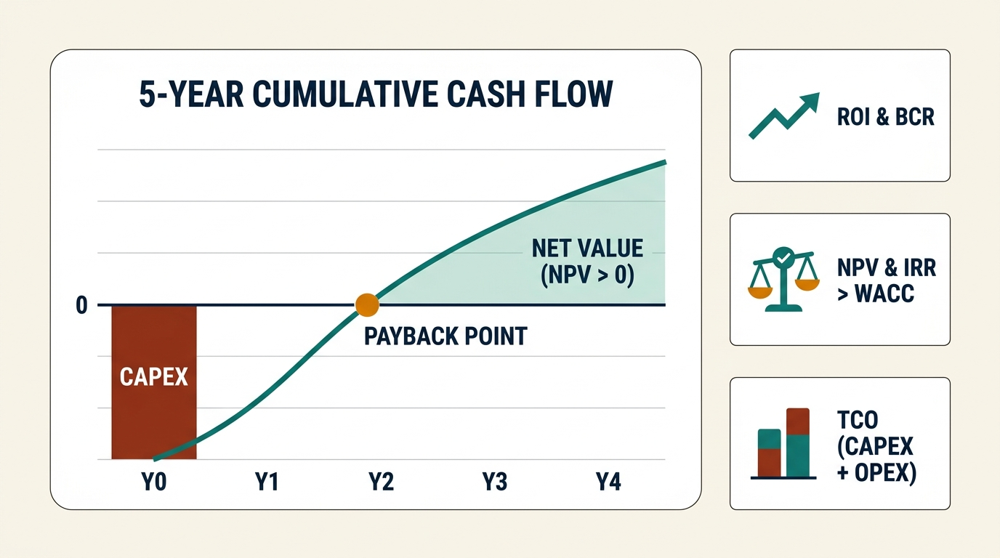
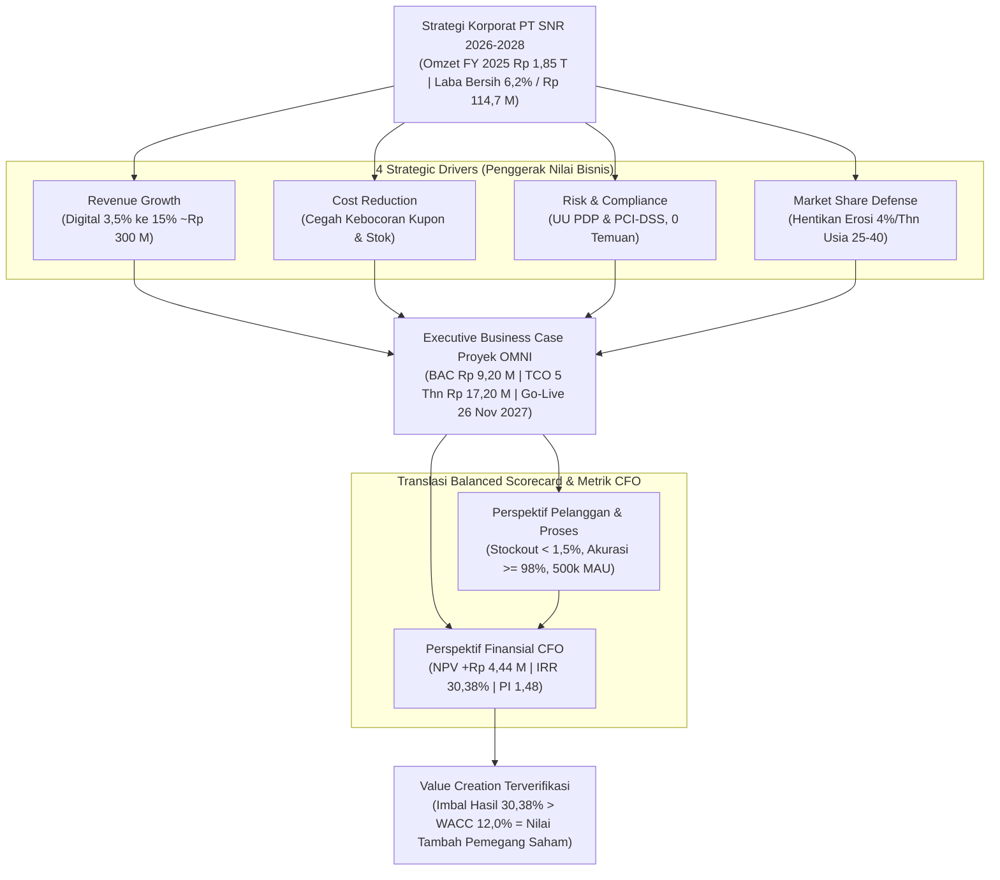
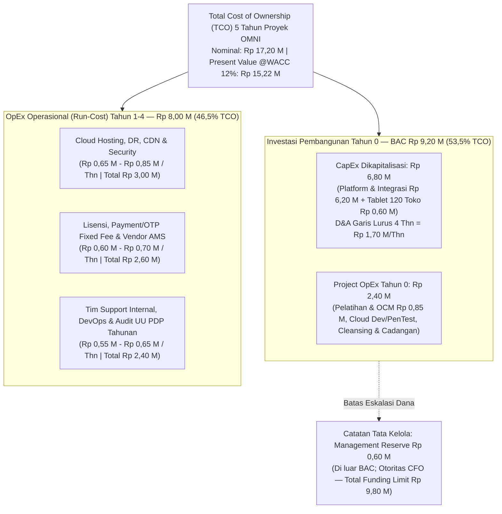
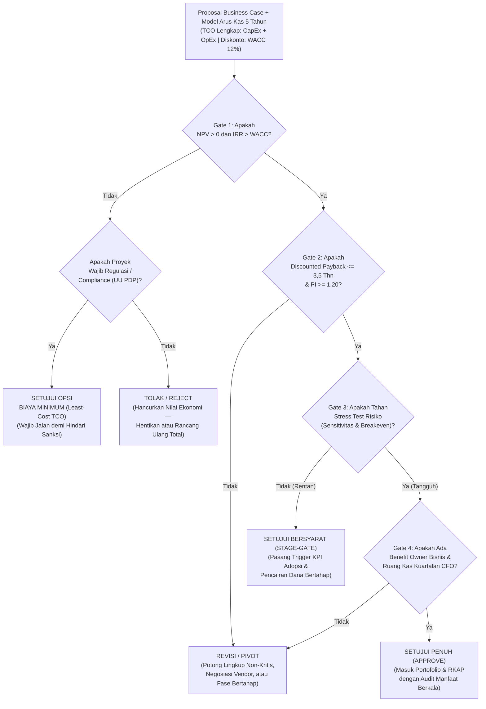
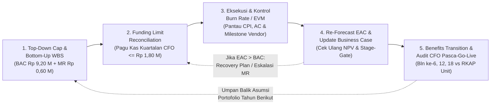
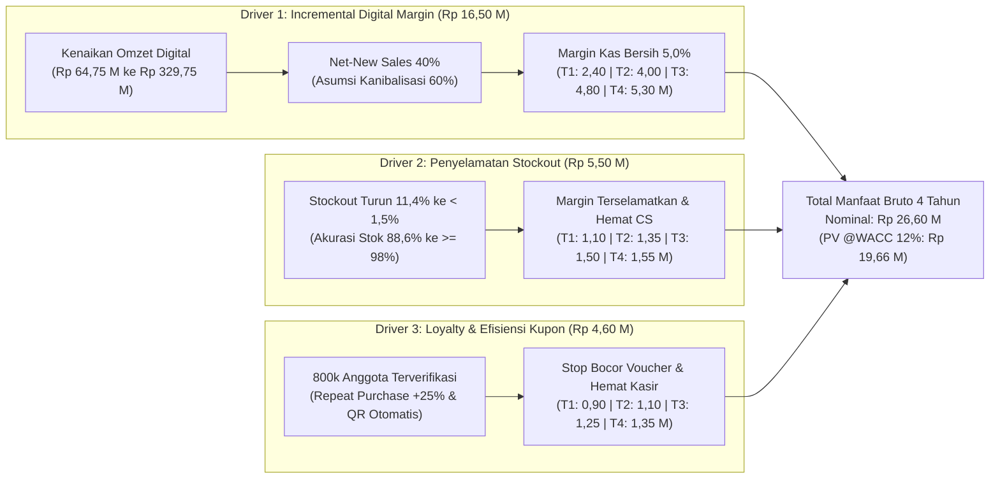
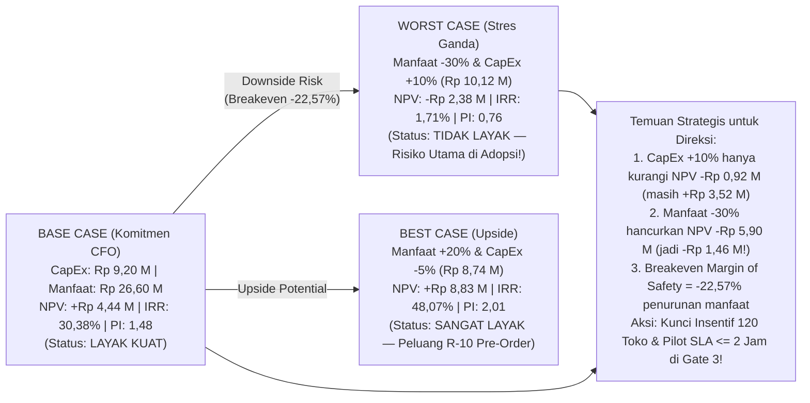

# Modul 10: Business Strategy & Financial Management

## 1. Identitas Modul

| Atribut | Keterangan |
|---------|------------|
| **Kelompok Jalur** | **Executive & Career Advancement** — Jilid III *(Wajib untuk SEMUA Jalur: Senior PM, Senior BA, dan SA / Solution Architect)* |
| **Level Kompetensi** | Senior / Executive *(setara ekspektasi Komite Investasi Direksi, CFO Review, & PMI Business Acumen)* |
| **Durasi Pembelajaran** | **12 jam sesi terstruktur** (4 sesi × 3 jam) + **±6 jam tugas mandiri** |
| **Prasyarat** | Telah menyelesaikan **Jalur Utama — Project Management (Modul 01–05)** *atau* **Jalur Alternatif — Business & System Analysis (Modul 06–09)** |
| **Peran Sasaran** | Senior Project Manager, Program Manager, Lead Business Analyst, System Analyst / Solution Architect, Product Manager, Delivery Director, serta praktisi senior yang menyusun proposal investasi ke C-Level |
| **Keluaran Utama** | 1) *Executive Business Case* 1-Halaman & Analisis Opsi Strategis, 2) Model Finansial 5 Tahun (*TCO, Arus Kas Bersih, NPV, IRR, Payback, Discounted Payback, ROI, PI/BCR*), 3) Analisis Sensitivitas & Skenario 3 Titik, dan 4) Rencana *Cash Flow & Funding Limit Reconciliation* pada studi kasus **Proyek OMNI** dan **Program Nusantara 2028** |

---

## 2. Gambaran Modul

Di ruang rapat Direksi (*Boardroom*), pertanyaan pertama yang diajukan seorang Direktur Utama (*Chief Executive Officer* / CEO) maupun Direktur Keuangan (*Chief Financial Officer* / CFO) jarang sekali berbunyi *"Framework Scrum apa yang dipakai tim Anda?"* atau *"Bagaimana desain arsitektur microservices-nya?"*. Pertanyaan pertama mereka selalu berakar pada penciptaan nilai ekonomi dan alokasi modal yang terbatas: **"Mengapa perusahaan harus menaruh Rp 9,20 M di proyek ini sekarang, berapa arus kas riil yang kembali setelah memperhitungkan biaya operasional jangka panjang dan biaya modal 12%, seberapa cepat modal balik, serta apa yang terjadi jika asumsi adopsi pasar meleset 30%?"**

Di sinilah letak celah kompetensi terbesar yang kerap menahan praktisi level menengah—baik *Project Manager*, *Business Analyst*, maupun *System Analyst / Solution Architect*—untuk menembus peran strategis tingkat senior dan eksekutif. Banyak profesional mampu mengeksekusi proyek secara teknis (*delivery excellence*), namun gagap saat harus menerjemahkan spesifikasi sistem menjadi bahasa neraca, laporan laba rugi, arus kas, *Total Cost of Ownership* (TCO), dan valuasi investasi. Akibatnya, proposal yang sebenarnya penting sering ditolak CFO karena argumennya normatif, atau sebaliknya, proyek yang tidak layak ekonomi tetap diloloskan karena kalkulasinya terjebak bias optimisme (*optimism bias*) dan melupakan biaya operasional (*run-cost*).

**Modul 10: Business Strategy & Financial Management** membuka Jilid III (*Executive & Career Advancement*) dan berlaku sebagai kompetensi wajib bagi seluruh jalur peran. Anda akan mempelajari cara menjembatani strategi korporat menjadi *Executive Business Case* yang tahan uji di hadapan CFO **Budi Santoso** dan CEO **Hendra Wijaya** di **PT Sinar Nusantara Retail Tbk (SNR)**. Mulai dari memetakan *Strategic Drivers* dan *Balanced Scorecard*, membedah perbedaan akuntansi **CapEx vs. OpEx** serta depresiasi/amortisasi, membangun model **Cost–Benefit Analysis (CBA)** 5 tahun yang memperhitungkan **Time Value of Money (NPV, IRR, Payback, Discounted Payback, ROI, Profitability Index)**, hingga mengendalikan arus kas kuartalan (*Funding Limit Reconciliation*) dan menguji ketahanan proposal melalui **Sensitivity & Scenario Analysis**.

---

## 3. Capaian Pembelajaran

Setelah menyelesaikan Modul 10, peserta mampu:

1. **Menghubungkan** inisiatif proyek dan desain solusi teknis secara eksplisit dengan strategi korporat, *Strategic Drivers* (*Revenue Growth, Cost Reduction, Risk Avoidance/Compliance, Market Share Defense*), dan empat perspektif *Balanced Scorecard*.
2. **Menyusun** *Executive Business Case* berstandar C-Level yang memuat *Burning Platform*, keselarasan strategis, analisis opsi komparatif (*Do Nothing vs. In-House vs. Hybrid Vendor vs. SaaS*), evaluasi finansial transparan, profil risiko, serta penunjukan *Benefit Owner*.
3. **Menerapkan** konsep dasar akuntansi proyek bagi praktisi senior—membedakan **CapEx** dan **OpEx** beserta dampak depresiasi/amortisasi terhadap laporan laba rugi, menyusun **Total Cost of Ownership (TCO)** multi-tahun, serta menghindari jebakan *Sunk Cost Fallacy* dan *Opportunity Cost* terabaikan.
4. **Menghitung dan menginterpretasikan** seluruh metrik evaluasi investasi utama secara akurat—meliputi **ROI**, **Nominal & Discounted BCR**, **Profitability Index (PI)**, **Payback Period**, **Discounted Payback Period**, **Net Present Value (NPV)** pada *WACC* tertentu, dan **Internal Rate of Return (IRR)**—untuk merumuskan rekomendasi *Approve, Revise, Hold*, atau *Reject*.
5. **Mengelola** penganggaran dan pengendalian kas tingkat eksekutif melalui penyelarasan *Top-Down* vs. *Bottom-Up Budgeting*, **Funding Limit Reconciliation** terhadap pagu kas kuartalan CFO, pemantauan *Burn Rate*, dan peramalan varians biaya.
6. **Melakukan** **Sensitivity & Scenario Analysis** (*Best Case, Base Case, Worst Case*, serta *one-way stress test* & *breakeven threshold*) dan mengaudit *anti-patterns* klasik dalam proposal investasi guna melindungi modal perusahaan.

---

## 4. Rencana Sesi

Pembelajaran tatap muka atau lokakarya daring dilaksanakan dalam **4 sesi × 3 jam = 12 jam** dengan komposisi pedagogis **±30% konsep (3,5 jam)**, **±50% workshop kasus Proyek OMNI & Program Nusantara 2028 (6,0 jam)**, dan **±20% diskusi/refleksi eksekutif (2,5 jam)**.

| Sesi | Durasi | Topik Utama | Konsep (±30%) | Workshop Kasus (±50%) | Diskusi & Refleksi (±20%) |
|------|--------|-------------|---------------|-----------------------|---------------------------|
| **Sesi 1** | 3 jam | **Strategi Bisnis, *Value Creation* & Anatomi *Executive Business Case*** | 55 menit: *Value Creation*; 4 *Strategic Drivers*; *Balanced Scorecard*; cara pandang CFO & Direksi; struktur *Executive Business Case* & *Options Analysis* | 90 menit: Membangun *Strategy-to-Value Map*, *Value Driver Tree*, dan matriks perbandingan 4 opsi (*Do Nothing, In-House, Hybrid NDS, Full SaaS*) Proyek OMNI | 35 menit: Debat simulasi Direksi SNR—mengapa opsi *Do Nothing* tidak bernilai Rp 0 dan siapa *Benefit Owner* sah? |
| **Sesi 2** | 3 jam | **Akuntansi Proyek untuk Senior PM/BA/SA: CapEx, OpEx, Depresiasi & TCO 5 Tahun** | 50 menit: CapEx vs. OpEx; depresiasi & amortisasi (PSAK 16 & 19 konseptual); *Iceberg TCO*; *Sunk Cost Fallacy*; *Opportunity Cost*; *Net Cash Flow* vs. laba akuntansi | 90 menit: Memetakan BAC Proyek OMNI Rp 9,20 M ke porsi CapEx vs. Project OpEx, menyusun jadwal D&A 4 tahun, dan menghitung TCO 5 Tahun (Rp 17,20 M) | 40 menit: Bedah kasus perbandingan *CapEx On-Premise vs. OpEx Managed Cloud*—mengapa TCO nominal lebih tinggi bisa memiliki PV TCO lebih hemat |
| **Sesi 3** | 3 jam | **Cost–Benefit Analysis (CBA), TVM & Metrik Evaluasi Investasi (NPV, IRR, Payback, PI/BCR)** | 55 menit: *Time Value of Money* (TVM) & *WACC*; rumus & aturan keputusan NPV, IRR, Payback, Discounted Payback, ROI, PI, dan Discounted BCR; konflik NPV vs. IRR | 90 menit: Membangun Model Finansial 5 Tahun Proyek OMNI (WACC 12%) dari nol—verifikasi faktor diskonto, PV kumulatif, NPV Rp 4,44 M, IRR 30,38%, dan PI 1,48 | 35 menit: Klinik audit angka—membongkar 5 *anti-patterns* (*Hockey-Stick*, *Double-Counting*, *Revenue-as-Benefit*, *No-OpEx*, *No-TVM*) |
| **Sesi 4** | 3 jam | **Executive Budgeting, *Funding Limit Reconciliation* & *Sensitivity Analysis*** | 50 menit: *Top-Down vs. Bottom-Up Budgeting*; *Funding Limit Reconciliation*; *Burn Rate* & *EAC Forecast*; *One-Way Sensitivity*, *Breakeven*, & 3 *Scenario Analysis* | 90 menit: Menyusun *Cash Flow Reconciliation* 6 kuartal terhadap pagu CFO Rp 1,80 M/kuartal dan *Stress Test* Proyek OMNI (Adopsi −30%, CapEx +10%, WACC 15%) | 40 menit: Simulasi *CFO Defense* bersama Budi Santoso, kuis evaluasi 10 soal, dan *briefing* tugas mandiri ±6 jam |
| **Total** | **12 jam** | **4 Sesi Terpadu** | **3,5 jam (29%)** | **6,0 jam (50%)** | **2,5 jam (21%)** |

---

## 5. Materi



### 5.1 Menghubungkan Proyek dengan Strategi Bisnis & *Value Creation*

Setiap proyek korporat—entah itu pembangunan aplikasi omnichannel oleh tim PM/BA/SA, migrasi infrastruktur *cloud*, atau renovasi gerai fisik—pada hakikatnya adalah **instrumen alokasi modal** (*capital allocation vehicle*). Perusahaan mengumpulkan modal dari pemegang saham (*equity*) dan kreditor (*debt*) yang masing-masing menuntut imbal hasil minimum sesuai profil risikonya. Oleh karena itu, **penciptaan nilai (*Value Creation*)** hanya terjadi apabila suatu proyek menghasilkan arus kas ekonomi dengan tingkat pengembalian **melampaui biaya modal perusahaan (*Cost of Capital*)** atau melindungi daya saing jangka panjang secara terukur.

Bagi praktisi senior (Senior PM, Senior BA, dan Solution Architect), memahami bagaimana Direksi dan CFO menilai proposal proyek berarti menguasai empat penggerak strategis (*Strategic Drivers*) berikut:

1. **Revenue Growth (Pertumbuhan Pendapatan & Margin Baru):** Menciptakan kanal penjualan baru, memperluas jangkauan segmen pelanggan, meningkatkan konversi, atau memperbesar nilai transaksi rata-rata (*Average Order Value* / AOV) dan frekuensi belanja ulang (*repeat purchase*). *Pada Proyek OMNI:* menaikkan kontribusi kanal digital SNR dari **3,5% (Rp 64,75 M)** menuju **15% (~Rp 300 M/tahun)** dalam 18 bulan pasca-*Go-Live*.
2. **Cost Reduction & Operational Efficiency (Efisiensi & Penekanan Biaya):** Menurunkan biaya satuan operasional, mengotomatisasi pekerjaan manual yang lambat, menghentikan kebocoran proses (*process leakage*), atau mengoptimalkan inventori. *Pada Proyek OMNI:* memangkas kebocoran voucher manual, mempercepat proses kasir hingga 45 detik/transaksi, dan meningkatkan akurasi stok lintas kanal dari **88,6% menjadi ≥ 98,0%**.
3. **Risk Avoidance & Regulatory Compliance (Penghindaran Risiko & Kepatuhan):** Menghindari denda regulasi, kebocoran data, kegagalan sistem kritis, atau kerugian reputasi. Proyek kepatuhan sering tidak menghasilkan tambahan omzet langsung, tetapi bernilai ekonomi tinggi melalui **biaya kerugian yang berhasil dicegah (*avoided loss*)**. *Pada Proyek OMNI:* kepatuhan penuh terhadap **UU No. 27 Tahun 2022 tentang Pelindungan Data Pribadi (UU PDP)** dan standar **PCI-DSS** untuk *payment gateway*.
4. **Market Share Defense & Strategic Positioning (Pertahanan Pangsa Pasar & Kapabilitas Masa Depan):** Menahan erosi pelanggan akibat pergerakan agresif kompetitor dan membangun fondasi platform (*platform option value*) bagi inovasi berikutnya. *Pada Proyek OMNI:* menghentikan penyusutan pangsa pasar SNR sebesar **4% per tahun** di segmen usia 25–40 tahun sekaligus menjadi sumber data bagi **Proyek DataHub** (PRJ-04).

#### Menyelaraskan Proyek dengan *Balanced Scorecard* (Kaplan & Norton)
Untuk mencegah perusahaan hanya mengejar laba jangka pendek sambil merusak kepuasan pelanggan atau kesehatan sistem, Robert Kaplan dan David Norton memperkenalkan kerangka **Balanced Scorecard (BSC)** yang menerjemahkan strategi korporat ke dalam empat perspektif kausal:

| Perspektif BSC | Pertanyaan Kunci Direksi | Penerapan pada PT SNR & Proyek OMNI |
|----------------|--------------------------|-------------------------------------|
| **1. Finansial (*Financial*)** | *Bagaimana kinerja kita terlihat di mata pemegang saham & CFO?* | Pertumbuhan omzet digital 3,5% → 15% (~Rp 300 M/thn), NPV positif pada WACC 12%, IRR > 12%, efisiensi rantai pasok Program Nusantara 2028 sebesar 8% |
| **2. Pelanggan (*Customer*)** | *Nilai apa yang dirasakan pelanggan sehingga mereka memilih kita?* | Pembatalan *stockout* turun 11,4% → < 1,5%; 500.000 MAU; 800.000 anggota loyalty terverifikasi; *repeat purchase* +25%; SLA *Click & Collect* ≤ 2 jam |
| **3. Proses Bisnis Internal (*Internal Process*)** | *Proses inti apa yang harus kita ungguli demi melayani pelanggan?* | Sinkronisasi stok *near-real-time* ≤ 60 detik lintas 120 toko & 3 DC; akurasi inventori ≥ 98,0%; *system uptime* ≥ 99,5% pada 2.500 TPM; kepatuhan UU PDP 100% |
| **4. Pembelajaran & Pertumbuhan (*Learning & Growth*)** | *Kapabilitas SDM, data, dan teknologi apa yang wajib dibangun?* | Pelatihan 120 Store Manager & 1.440 staf toko; pembersihan 1,2 juta data anggota; penguasaan arsitektur API/Cloud modern & praktik *Hybrid Agile* |



*Gambar 5.1 — Jembatan Strategi Korporat menuju Strategic Drivers, Executive Business Case, dan Penciptaan Nilai Finansial Proyek OMNI.*

#### Cara Pandang CFO & Direksi dalam Menilai Proposal Proyek
Ketika CFO **Budi Santoso** membaca proposal proyek dari seorang Senior PM, Lead BA, atau Solution Architect, ia menerapkan lima "filter skeptis" berikut:
1. **Filter Inkremental (*Incremental Cash Flow*):** *"Berapa arus kas tambahan bersih yang benar-benar muncul HANYA karena proyek ini berjalan—setelah dikurangi kanibalisasi kanal eksisting dan biaya variabel (COGS, pengiriman, komisi pembayaran, pajak)?"*
2. **Filter Biaya Siklus Hidup (*Full Lifecycle TCO*):** *"Jangan hanya tunjukkan biaya pembangunan Tahun 0. Berapa biaya cloud, lisensi, maintenance vendor, dan staf support untuk Tahun 1 hingga Tahun 4?"*
3. **Filter Risiko & Biaya Modal (*Risk-Adjusted Return*):** *"Apakah NPV tetap positif setelah didiskontokan pada WACC perusahaan (12%), dan apa titik impas (*breakeven*) jika asumsi paling optimis meleset?"*
4. **Filter Likuiditas & Kapasitas (*Affordability & Capital Rationing*):** *"Apakah arus kas keluar per kuartal selaras dengan ketersediaan kas perusahaan dan tidak memacetkan proyek prioritas lain dalam portofolio?"*
5. **Filter Akuntabilitas (*Benefits Ownership*):** *"Siapa pimpinan bisnis yang mau menandatangani target manfaat ini masuk ke KPI dan anggaran unit kerjanya tahun depan?"* Jika tidak ada eksekutif bisnis yang berani memasukkan angka manfaat ke dalam target Rencana Kerja & Anggaran Perusahaan (RKAP) unitnya, CFO akan langsung mencurigai bahwa manfaat tersebut hanyalah *"uang kertas di slide presentasi"* (*funny money*).

---

### 5.2 Menyusun *Executive Business Case* yang Meyakinkan C-Level

**Business Case** adalah dokumen keputusan ekonomi yang hidup (*living document*) untuk membenarkan secara objektif apakah suatu investasi proyek layak diinisiasi, dilanjutkan pada setiap *Stage-Gate*, atau dihentikan (*Kill*). Dokumen ini bukan dokumen pemasaran untuk "memaksakan persetujuan", melainkan analisis berimbang yang menyandingkan manfaat, biaya, opsi alternatif, dan risiko secara jujur.

Sebuah *Executive Business Case* berstandar C-Level wajib memuat **tujuh pilar inti**:

1. **Executive Summary & Rekomendasi Tegas (1 Halaman):** Ringkasan masalah, rekomendasi opsi terpilih, kebutuhan dana total (*BAC + Management Reserve* serta TCO 5 tahun), ringkasan metrik finansial utama (NPV, IRR, Payback, Discounted Payback, PI), serta keputusan spesifik (*The Ask*) yang dimintakan kepada Komite Investasi.
2. **Problem Statement & *Burning Platform*:** Penjelasan berbasis data faktual mengapa kondisi saat ini (*status quo*) tidak dapat dipertahankan—disertai **biaya ketidakbertindakan (*Cost of Inaction*)**. Di PT SNR, *burning platform*-nya jelas: erosi pangsa pasar segmen muda 4%/tahun, pembatalan *stockout* 11,4%, *cart abandonment* 74%, dan situs web 2019 tanpa aplikasi mobile.
3. **Strategic Alignment:** Keterkaitan eksplisit dengan visi korporat, *Strategic Drivers*, target *Balanced Scorecard*, dan sinergi dengan program induk (**Program Nusantara 2028** senilai Rp 18,50 M).
4. **Options Analysis (Minimal 3–4 Opsi Nyata):** Direksi membenci proposal "satu pilihan" (*take-it-or-leave-it*). Praktisi senior wajib membandingkan secara objektif setidaknya:
   - **Opsi 0 — *Do Nothing / Base Case*:** Tetap menggunakan sistem eksisting tanpa investasi besar; wajib menghitung kerugian peluang dan erosi pangsa pasar.
   - **Opsi 1 — *Build Full Custom In-House*:** Membangun seluruh sistem dengan merekrut tim internal; kendali penuh namun CapEx tinggi, *time-to-market* lambat, dan risiko gagal mengejar tenggat bisnis.
   - **Opsi 2 — *Hybrid Delivery (Internal Core + Strategic Vendor)*:** Memadukan arsitektur & produk inti internal dengan percepatan vendor spesialis (seperti kontrak *Fixed Price* PT NDS Rp 4,40 M pada Proyek OMNI).
   - **Opsi 3 — *Buy Full SaaS / Off-the-Shelf*:** Membeli platform jadi berbasis langganan; CapEx awal rendah dan cepat tayang, namun berisiko OpEx jangka panjang tinggi (*subscription + GMV revenue share*) serta terbatas dalam integrasi POS/ERP *legacy* yang kompleks.
5. **Financial Appraisal & TCO:** Proyeksi arus kas 5 tahun yang transparan—memisahkan asumsi pendorong manfaat (*Value Drivers*), memperhitungkan kanibalisasi, memasukkan seluruh OpEx tahunan, serta menyajikan NPV, IRR, Payback, Discounted Payback, ROI, dan PI/BCR pada WACC korporat.
6. **Risk, Sensitivity & Scenario Analysis:** Pengujian stres atas asumsi paling rentan (*Worst Case, Base Case, Best Case* dan ambang batas impas) lengkap dengan rencana mitigasi risiko komersial dan operasional.
7. **Governance, Delivery Plan & Benefits Realization Ownership:** Milestone *Stage-Gate*, syarat pencairan anggaran, serta penunjukan tegas **Benefit Owner** dari lini bisnis (COO **Ratna Kusuma**, VP Marketing **Dewi Lestari**, dan Head of Store Ops **Agus Setiawan**) berikut jadwal audit manfaat pasca-*Go-Live* (*Post-Implementation Review* bulan ke-6, ke-12, dan ke-18).

> **Catatan Penting Lintas Peran (PM, BA, SA):** Penyusunan *Business Case* yang kuat adalah kerja kolaboratif tiga serangkai senior: **Senior BA** memvalidasi *Value Drivers*, kanibalisasi, dan dampak proses bisnis bersama unit operasi; **SA / Solution Architect** memastikan kelayakan opsi teknis (*Build vs. Hybrid vs. Buy*) beserta estimasi akurat *cloud run-cost* dan biaya integrasi *legacy*; sedangkan **Senior PM** mengintegrasikan linimasa, estimasi anggaran BAC, cadangan risiko, profil arus kas, dan tata kelola *Stage-Gate* untuk dipresentasikan bersama Sponsor kepada CFO.

---

### 5.3 Dasar Akuntansi Proyek untuk Senior PM, BA & SA

Banyak diskusi antara tim proyek dan tim keuangan menemui jalan buntu karena perbedaan bahasa antara **aliran kas proyek (*cash flow*)** dan **pencatatan akuntansi keuangan (*accrual accounting*)**. Memahami lima konsep akuntansi manajerial berikut akan langsung menaikkan kredibilitas Anda di hadapan CFO.

#### 1. CapEx (*Capital Expenditure*) vs. OpEx (*Operational Expenditure*)
Pembedaan antara **CapEx** dan **OpEx** sangat krusial karena memengaruhi laporan laba rugi (*Profit & Loss* / P&L), EBITDA, pajak penghasilan badan, serta neraca perusahaan (*Balance Sheet*).

| Dimensi | CapEx (*Capital Expenditure* / Belanja Modal) | OpEx (*Operational Expenditure* / Beban Operasional) |
|---------|-----------------------------------------------|------------------------------------------------------|
| **Definisi** | Pengeluaran untuk memperoleh, membangun, atau meningkatkan aset berwujud (*tangible*) maupun tak berwujud (*intangible*) yang memberi manfaat ekonomi **lebih dari 1 tahun** | Pengeluaran rutin untuk menjalankan, memelihara, atau mendukung operasi harian yang manfaat ekonominya habis di **periode berjalan (≤ 1 tahun)** |
| **Perlakuan Akuntansi** | **Dikapitalisasi** di **Neraca** sebagai aset, lalu dibebankan bertahap ke Laba Rugi selama masa manfaatnya melalui **Depresiasi** (aset fisik) atau **Amortisasi** (aset tak berwujud) | **Langsung dibebankan penuh (100%)** sebagai biaya pada **Laporan Laba Rugi** pada tahun terjadinya pengeluaran |
| **Dampak ke Laba Bersih & EBITDA Tahun Berjalan** | **Tidak langsung menggerus EBITDA**; dampak ke Laba Bersih tersebar rata selama beberapa tahun (misal 4–5 tahun) | **Langsung mengurangi EBITDA dan Laba Bersih** secara penuh pada tahun berjalan (sekaligus memberikan *tax shield* / penghematan pajak lebih cepat) |
| **Contoh pada Proyek OMNI (PSAK 16 & PSAK 19 Konseptual)** | Pembangunan kode sumber aplikasi mobile, web, OMS, dan integrasi API pasca-kelayakan (aset tak berwujud); pembelian 240 unit tablet/scanner 120 toko (aset tetap) | Tahap riset awal (*preliminary discovery*); biaya **pelatihan 1.440 staf toko & *Change Management***; pembersihan/migrasi data lama; langganan *Cloud* (AWS/GCP), SaaS, *PenTest* tahunan, dan dukungan operasional (*AMS*) |

#### 2. Depresiasi & Amortisasi (Konseptual PSAK 16 & PSAK 19 / IAS 16 & IAS 38)
Berdasarkan prinsip **PSAK 16 (Aset Tetap)** dan **PSAK 19 (Aset Takberwujud)** yang mengadopsi IFRS (IAS 16 & IAS 38), tidak seluruh biaya proyek perangkat lunak boleh dikapitalisasi:
- **Tahap Riset / *Preliminary Project Stage*** (studi kelayakan, pemilihan vendor, *discovery* awal) → **WAJIB dicatat sebagai OpEx**.
- **Tahap Pengembangan / *Application Development Stage*** (desain rinci, pengkodean, integrasi API, pengujian kesiapan pakai setelah kelayakan teknis & komersial terbukti) → **Dapat dikapitalisasi sebagai CapEx (Aset Takberwujud)** dan diamortisasi garis lurus (*straight-line*) mulai saat sistem *Go-Live* selama masa manfaat ekonomis (umumnya 3–5 tahun untuk perangkat lunak ritel).
- **Tahap Pasca-Implementasi & Pelatihan** (pelatihan staf toko, *change management*, pemeliharaan rutin, *bug fixing* pasca-*Go-Live*, *data conversion/cleansing*) → **WAJIB dicatat sebagai OpEx** karena perusahaan tidak memiliki kendali hukum atas pengetahuan di kepala karyawan yang dilatih.

**Perbedaan Krusial untuk Model NPV:** Depresiasi dan amortisasi adalah **beban non-kas (*non-cash expense*)**. Artinya, pada laporan laba rugi akuntansi, amortisasi menurunkan laba bersih setiap tahun; tetapi dalam **perhitungan arus kas proyek (*Capital Budgeting / NPV*)**, seluruh arus kas keluar belanja investasi dicatat pada saat kas benar-benar dibayarkan (Tahun 0 = **−Rp 9,20 M**), sehingga depresiasi tidak dikurangkan lagi dua kali dari arus kas bersih (meski dalam model *after-tax* korporat yang sangat rinci, depresiasi menciptakan penghematan pajak kas sebesar $\text{Depresiasi} \times \text{Tarif Pajak}$). Dalam buku ini, agar jernih dan bebas kerancuan bagi praktisi PM/BA/SA, seluruh proyeksi arus kas bersih disajikan pada basis **Arus Kas Operasional Bersih Pasca-Pajak (*After-Tax Incremental Cash Flow*)**.

#### 3. Total Cost of Ownership (TCO) 5 Tahun — Mencegah Efek Gunung Es (*Iceberg Cost*)
**Total Cost of Ownership (TCO)** adalah seluruh biaya langsung maupun tidak langsung yang dikeluarkan perusahaan sepanjang siklus hidup suatu sistem—mulai dari inisiasi, pembangunan, integrasi, pelatihan, hingga pengoperasian, lisensi, keamanan, dukungan vendor, dan pembaruan selama umur ekonomisnya.

Kesalahan fatal paling umum pada proposal IT adalah menyamakan **BAC Proyek (Rp 9,20 M)** dengan total biaya kepemilikan. Pada **Proyek OMNI**, biaya operasional tahunan (*run-cost* Tahun 1–4) terdiri dari infrastruktur *cloud* produksi & *Disaster Recovery*, lisensi perangkat lunak & *Application Managed Service* (AMS), serta tim dukungan internal & audit keamanan tahunan sebesar **Rp 1,80 M – Rp 2,20 M per tahun** (total **Rp 8,00 M** selama 4 tahun). Akibatnya, **TCO 5 Tahun nominal Proyek OMNI mencapai Rp 17,20 M**—hampir **1,87 kali lipat** dari anggaran pembangunan awalnya!



*Gambar 5.2 — Struktur Total Cost of Ownership (TCO) 5 Tahun Proyek OMNI (CapEx Pembangunan Rp 9,20 M + OpEx Operasional Tahun 1–4 Rp 8,00 M).*

#### 4. *Sunk Cost Fallacy* & *Opportunity Cost*
Dua konsep ekonomi dasar ini menjadi kompas rasionalitas bagi eksekutif:
- **Sunk Cost (Biaya Hangus):** Biaya yang sudah telanjur dibayarkan di masa lalu dan **tidak dapat dikembalikan** apa pun keputusan yang diambil hari ini. Contoh: PT SNR telah membayar Rp 300 jt pada 2025 kepada konsultan riset pasar untuk mengkaji gagasan *Virtual Showroom*. Dalam keputusan investasi hari ini, Rp 300 jt tersebut **harus diabaikan** dari perhitungan kelayakan proyek ke depan. Terjebak melanjutkan proyek merugi hanya *"supaya uang yang sudah telanjur keluar tidak sia-sia"* disebut **Sunk Cost Fallacy**.
- **Opportunity Cost (Biaya Peluang):** Nilai dari **alternatif terbaik berikutnya yang harus dikorbankan** ketika modal atau talenta kunci dialokasikan ke suatu proyek. Ketika 3 *senior architect* IT SNR dikerahkan penuh ke Proyek OMNI, *opportunity cost*-nya adalah penundaan manfaat dari proyek lain yang bisa mereka kerjakan; demikian pula, *opportunity cost* dari menginvestasikan kas Rp 9,20 M di Proyek OMNI tercermin dalam *Weighted Average Cost of Capital* (**WACC = 12%**) yang dapat diperoleh modal tersebut pada investasi setara risiko lainnya.

---

### 5.4 *Cost–Benefit Analysis* (CBA) & Metrik Evaluasi Investasi Lengkap

**Cost–Benefit Analysis (CBA)** adalah metode sistematis untuk menimbang seluruh manfaat ekonomi yang dapat dikuantifikasi terhadap seluruh biaya siklus hidup (*CapEx + OpEx*) pada dasar waktu yang setara. Pondasi terpenting dalam CBA tingkat eksekutif adalah **Time Value of Money (TVM)**—prinsip bahwa **Rp 1 M yang diterima hari ini lebih bernilai daripada Rp 1 M yang baru diterima tiga tahun lagi**, karena uang hari ini dapat diinvestasikan untuk menghasilkan imbal hasil, terbebas dari erosi inflasi, dan memiliki kepastian lebih tinggi daripada janji kas di masa depan.

Untuk menyetarakan nilai uang lintas tahun ke hari ini (*Present Value* / PV), digunakan tingkat diskonto (*discount rate*) yang lazimnya ditetapkan sebesar **WACC (*Weighted Average Cost of Capital*)** perusahaan—yakni biaya rata-rata tertimbang dari utang (pasca-pajak) dan ekuitas pemegang saham. Di PT SNR, CFO **Budi Santoso** menetapkan **WACC korporat = 12,0% per tahun** sebagai *hurdle rate* (ambang batas imbal hasil minimum) proyek transformasi strategis.

Berikut rumus, makna manajerial, kelebihan, dan keterbatasan enam metrik evaluasi investasi wajib bagi Senior PM, BA, dan SA:

#### 1. *Present Value* (PV) & *Discount Factor* (DF)
$$DF_t = \frac{1}{(1 + r)^t}, \qquad PV_t = CF_t \times DF_t = \frac{CF_t}{(1 + r)^t}$$
di mana $CF_t$ adalah arus kas bersih (*Net Cash Flow* = Manfaat Bruto$_t$ − OpEx$_t$) pada tahun ke-$t$, dan $r$ adalah tingkat diskonto (*WACC*). Pada WACC $r = 12\%$, faktor diskonto adalah: $DF_0 = 1{,}0000$; $DF_1 = 0{,}8929$; $DF_2 = 0{,}7972$; $DF_3 = 0{,}7118$; dan $DF_4 = 0{,}6355$. Artinya, Rp 1,00 M yang baru masuk di Tahun ke-4 nilainya setara dengan hanya **Rp 635,5 jt** hari ini!

#### 2. *Net Present Value* (NPV — Metrik Emas / *Gold Standard* CFO)
$$\text{NPV} = \sum_{t=0}^{n} \frac{CF_t}{(1 + r)^t} = \left(\sum_{t=1}^{n} \frac{CF_t}{(1 + r)^t}\right) - I_0$$
di mana $I_0$ adalah investasi awal pada Tahun 0 (dalam notasi arus kas, $CF_0 = -I_0$).
- **Aturan Keputusan:** **NPV > 0** → **Layak (Diterima)**, karena proyek menciptakan kekayaan bersih di atas tuntutan WACC; **NPV = 0** → Impas secara ekonomi; **NPV < 0** → **Tolak**, karena proyek menghancurkan nilai perusahaan.
- **Keunggulan Utama:** Memperhitungkan TVM, seluruh arus kas sepanjang umur proyek, skala nilai absolut dalam rupiah, serta bersifat aditif (*value additivity*) antarproyek dalam portofolio.

#### 3. *Internal Rate of Return* (IRR)
**IRR** adalah tingkat diskonto spesifik ($r^*$) yang membuat **NPV tepat sama dengan nol**:
$$\sum_{t=0}^{n} \frac{CF_t}{(1 + \text{IRR})^t} = 0$$
- **Aturan Keputusan:** Untuk proyek dengan pola arus kas standar (keluar di awal, masuk di tahun berikutnya), terima jika **IRR > WACC** (*hurdle rate*). Selisih $\text{IRR} - \text{WACC}$ disebut *return spread* (bantalan pengaman terhadap kenaikan suku bunga atau risiko).
- **Peringatan Penting (Konflik NPV vs. IRR):** Untuk proyek yang saling meniadakan (*mutually exclusive*) dengan skala modal berbeda—misalnya Proyek A (investasi Rp 5,00 M, NPV +Rp 2,40 M, IRR 18%) vs. Proyek B (investasi Rp 2,00 M, NPV +Rp 1,20 M, IRR 24%)—**jangan terpedaya oleh persentase IRR yang lebih besar!** Selama tidak ada penjatahan modal ketat (*capital rationing*), **NPV tertinggi (Proyek A)** selalu menjadi penentu akhir karena pemegang saham membelanjakan rupiah kekayaan, bukan persentase. Selain itu, IRR mengasumsikan arus kas masuk diinvestasikan kembali pada tingkat IRR (sering terlalu optimistis), sedangkan NPV secara realistis mengasumsikan reinvestasi pada tingkat WACC.

#### 4. *Payback Period* & *Discounted Payback Period*
- **Payback Period (Nominal):** Lama waktu yang dibutuhkan hingga arus kas masuk bersih kumulatif menutup investasi awal ($I_0$):
  $$\text{Payback} = t_{\text{terakhir negatif}} + \frac{\left|\text{Arus Kas Kumulatif}_{t_{\text{terakhir negatif}}}\right|}{CF_{t_{\text{terakhir negatif}} + 1}}$$
- **Discounted Payback Period:** Lama waktu hingga **PV arus kas masuk kumulatif** (setelah didiskontokan dengan WACC) menutup investasi awal. Metrik ini selalu lebih panjang daripada *Payback Period* nominal, dan jauh lebih disukai CFO karena mengukur **titik impas ekonomi sejati** (risiko likuiditas & kecepatan pemulihan modal).
- **Keterbatasan:** Keduanya mengabaikan arus kas yang terjadi *setelah* titik balik modal tercapai, sehingga tidak boleh dipakai sendirian tanpa NPV.

#### 5. *Return on Investment* (ROI)
$$\text{ROI}_{\text{Investasi}} = \frac{\sum_{t=1}^{n} CF_t - I_0}{I_0} \times 100\%, \qquad \text{atau} \qquad \text{ROI}_{\text{TCO}} = \frac{\sum_{t=1}^{n} \text{Manfaat Bruto}_t - \text{TCO}}{\text{TCO}} \times 100\%$$
- **Peringatan Eksekutif:** ROI sederhana **tidak memperhitungkan Time Value of Money maupun durasi waktu** (ROI 100% dalam 2 tahun sangat berbeda dengan ROI 100% dalam 8 tahun!). Oleh karena itu, selalu nyatakan **horizon waktu** (misalnya *"ROI 4 Tahun = 102,17% terhadap CapEx atau 54,65% terhadap TCO"*) dan sandingkan wajib dengan NPV serta IRR.

#### 6. *Profitability Index* (PI) & *Discounted Benefit–Cost Ratio* (Discounted BCR)
Di praktik industri, terdapat dua formulasi rasio manfaat–biaya terdiskonto yang sama-sama penting dan wajib dibedakan secara eksplisit dalam proposal CFO:
- **Profitability Index (PI — Rasio Efisiensi Modal Awal):**
  $$\text{PI} = \frac{\sum_{t=1}^{n} PV(\text{Arus Kas Masuk Bersih}_t)}{I_0} = 1 + \frac{\text{NPV}}{I_0}$$
  *Aturan:* **PI > 1,00** setara dengan **NPV > 0**. PI sangat ampuh untuk merangking proyek ketika perusahaan menghadapi keterbatasan modal (*Capital Rationing*) karena mengukur berapa rupiah PV nilai masuk per Rp 1 investasi awal.
- **Discounted Benefit–Cost Ratio (Discounted BCR — Rasio Nilai Bruto terhadap PV TCO):**
  $$\text{Discounted BCR} = \frac{\sum_{t=1}^{n} PV(\text{Manfaat Bruto}_t)}{I_0 + \sum_{t=1}^{n} PV(\text{OpEx}_t)} = \frac{PV(\text{Manfaat Bruto})}{PV(\text{TCO})}$$
  *Aturan:* **Discounted BCR > 1,00** berarti setiap Rp 1 nilai kini total biaya siklus hidup (CapEx + OpEx) menghasilkan lebih dari Rp 1 nilai kini manfaat bruto.



*Gambar 5.3 — Alur Keputusan Investasi Komite Investasi & CFO berdasarkan NPV, IRR vs. WACC, Payback, Ketahanan Sensitivitas, dan Kesiapan Tata Kelola.*

---

### 5.5 Budgeting, *Cash Flow Reconciliation*, & Cost Control Tingkat Eksekutif

Persetujuan *Business Case* di atas kertas belum menjamin kelancaran eksekusi di lapangan. Di tahap penganggaran dan pengendalian biaya, Senior PM harus menjembatani dua pendekatan anggaran serta memastikan aliran kas keluar sesuai denyut likuiditas perusahaan:

#### 1. *Top-Down Budgeting* vs. *Bottom-Up Budgeting*
- **Top-Down Budgeting:** Pagu anggaran ditetapkan dari atas oleh Direksi/CFO berdasarkan strategi dan kapasitas modal (contoh: pagu Program Nusantara 2028 = **Rp 18,50 M**, dengan alokasi Proyek OMNI **Rp 9,20 M** + *Management Reserve* **Rp 0,60 M**). *Kelebihan:* selaras dengan kemampuan finansial korporasi dan cepat ditetapkan. *Risiko:* dapat terlalu sempit terhadap realitas teknis lapangan.
- **Bottom-Up Budgeting:** Estimasi biaya dibangun dari paket kerja terbawah (*Work Breakdown Structure* / WBS, kontrak vendor, *sizing* infrastruktur *cloud*, jadwal *rollout* 120 toko) lalu dijumlahkan ke atas. *Kelebihan:* sangat akurat dan menumbuhkan rasa kepemilikan tim. *Risiko:* rentan *padding* (penggelembungan cadangan tersembunyi di setiap unit) dan bisa melampaui pagu Direksi.
- **Praktik Terbaik Eksekutif (*Reconciled / Meet-in-the-Middle*):** Gunakan *Top-Down* sebagai batas strategis (*guardrail*), lalu validasi dengan *Bottom-Up* terperinci. Jika *Bottom-Up* lebih tinggi dari pagu, jangan pernah memotong angka secara arbitrer tanpa mengubah lingkup! Lakukan *value engineering*, *phasing* fitur ke Fase 2 (seperti menunda integrasi *marketplace* eksternal di Proyek OMNI ke 2028), atau negosiasi struktur termin vendor.

#### 2. *Funding Limit Reconciliation* (Rekonsiliasi Batas Pendanaan Kuartalan)
Sebuah proyek bisa saja sepenuhnya berada **di dalam total BAC Rp 9,20 M**, tetapi tetap memicu penolakan dari CFO apabila profil penarikan kas (*cash disbursement*) menumpuk terlalu ekstrem pada satu kuartal—misalnya Rp 2,25 M di Q1 2027 saat kas perusahaan sedang terserap pengadaan stok musiman Lebaran. **Funding Limit Reconciliation** adalah proses menyelaraskan jadwal belanja proyek dengan batasan pencairan kas periodik (*periodic funding caps*) CFO melalui penjadwalan ulang aktivitas non-kritis (memanfaatkan *float*), negosiasi *payment milestone* vendor berbasis penerimaan *deliverable*, dan pengadaan perangkat bertahap (*wave procurement* untuk 240 tablet 120 toko) tanpa mengorbankan jalur kritis **26 November 2027**.

#### 3. *Burn Rate*, *Variance* & *Forecast Tracking* (Menghubungkan EVM ke CFO)
Pada tahap eksekusi, CFO memantau proyek melalui tiga lensa dinamis:
- **Monthly / Quarterly Burn Rate:** Laju konsumsi kas aktual per bulan dibandingkan rencana (*Planned Value* / PV). Lonjakan *burn rate* tanpa diiringi kenaikan *Earned Value* (EV) adalah sinyal dini pembengkakan biaya.
- **Cost Variance (CV) & Cost Performance Index (CPI):** Sebagaimana tercatat pada *Snapshot* Bulan ke-9 Proyek OMNI (28 Februari 2027), EV = Rp 4,32 M vs. AC = Rp 4,60 M menghasilkan CV = **−Rp 0,28 M** dan CPI = **0,94**.
- **Forecasting (EAC & VAC) serta Pencairan Reserve:** Dengan tren CPI 0,94, *Estimate at Completion* (EAC) melompat ke **Rp 9,80 M** (defisit **Rp 0,60 M** terhadap BAC Rp 9,20 M). Senior PM **tidak boleh** memperlakukan *Management Reserve* Rp 0,60 M sebagai "dompet otomatis". Sebelum meminta pencairan MR ke CFO Budi Santoso, PM wajib terlebih dahulu membuktikan optimasi biaya internal (*recovery plan*), mengaudit penggunaan *Contingency Reserve* Rp 0,70 M, dan memperbarui dampak EAC terbaru terhadap **NPV dan IRR** proyek agar CFO tahu apakah *Business Case* masih layak!



*Gambar 5.4 — Siklus Executive Budgeting, Cash Flow & Funding Limit Reconciliation, Pengendalian EAC, serta Benefits Realization Tracking bersama CFO Budi Santoso.*

---

### 5.6 *Sensitivity Analysis* & *Scenario Analysis*

Sebuah model finansial dengan satu angka tunggal (misalnya *"NPV = Rp 4,44 M"*) sebenarnya menyembunyikan risiko paling berbahaya: **ilusi presisi** (*illusion of precision*). Setiap angka di Tahun 1 hingga Tahun 4 adalah estimasi masa depan yang mengandung ketidakpastian. Untuk menaklukkan sesi tanya-jawab di hadapan CFO dan Komite Investasi, praktisi senior wajib melengkapi *Business Case* dengan dua teknik analisis ketahanan (*stress testing*):

1. **One-Way Sensitivity Analysis & Breakeven Threshold:** Mengubah **satu variabel kunci pada satu waktu** (*ceteris paribus*)—misalnya penurunan adopsi digital (−30%), kenaikan CapEx (+10%), kenaikan OpEx (+15%), atau kenaikan WACC (12% → 15%)—untuk mengetahui **variabel mana yang paling mematikan terhadap NPV** (sering divisualisasikan sebagai *Tornado Chart*). Dari sini kita menghitung **Breakeven Margin of Safety**: berapa persen maksimal manfaat boleh meleset sebelum NPV jatuh tepat ke nol?
2. **Multi-Variable Scenario Analysis (3 Skenario Terpadu):** Mengubah beberapa variabel yang saling berkorelasi secara serentak untuk membentuk tiga narasi bisnis yang koheren:
   - **Best Case (Skenario Optimis Terukur):** Adopsi aplikasi dan *Click & Collect* melampaui target (+20% manfaat bruto), *rollout* 120 toko mulus, dan efisiensi negosiasi menekan CapEx (−5%).
   - **Base Case (Skenario Realistis / Komitmen Utama):** Asumsi konservatif yang disepakati lintas fungsi dan menjadi dasar kontrak kinerja RKAP.
   - **Worst Case (Skenario Stres / Downside):** Resistensi staf toko dan persaingan memukul adopsi digital (−30% manfaat bruto) *sekaligus* kompleksitas migrasi data/API mendongkrak CapEx (+10%).

Dengan memperlihatkan ketiga skenario ini secara terbuka, Anda mengubah posisi Anda di mata CFO dari *"penjual proposal yang naif"* menjadi *"mitra strategis yang sadar risiko dan telah menyiapkan mekanisme mitigasi sejak hari pertama"*.

---

### 5.7 Kesalahan Umum di Lapangan (*Anti-Patterns*)

Riset global Bent Flyvbjerg (*How Big Things Get Done*, 2023) atas lebih dari 16.000 proyek besar menunjukkan bahwa kurang dari 10% proyek besar selesai tepat waktu, tepat anggaran, *sekaligus* mencapai manfaat yang dijanjikan. Akar utamanya sering berawal dari enam *anti-patterns* penyusunan *Business Case* berikut:

| No | *Anti-Pattern* (Kesalahan Klasik) | Gejala di Proposal | Dampak Finansial & Penawar Eksekutif |
|----|-----------------------------------|--------------------|--------------------------------------|
| **1** | ***Optimism Bias* & *Hockey-Stick Forecast*** | Tahun 1 langsung melonjak drastis tanpa masa *ramp-up*, lalu Tahun 3–4 meroket tajam tanpa kapasitas operasional pendukung | Proyeksi NPV menggelembung artifisial. **Penawar:** Gunakan *Reference Class Forecasting* (data historis proyek sejenis), terapkan *ramp-up* bertahap, dan verifikasi asumsi bersama unit operasional |
| **2** | **Mengabaikan OpEx / *Run-Cost* (*Iceberg Cost*)** | Hanya memasukkan CapEx pembangunan Rp 9,20 M dan lupa mencantumkan *cloud*, lisensi, vendor AMS, serta staf *support* Tahun 1–4 | Menggelembungkan NPV jutaan hingga miliaran rupiah dan membuat CFO terkejut pada RKAP tahun depan. **Penawar:** Wajib sajikan TCO penuh 5 tahun (CapEx + seluruh OpEx) |
| **3** | ***Revenue-as-Benefit* & Mengabaikan Kanibalisasi** | Mengklaim tambahan omzet digital Rp 200 M sebagai "manfaat Rp 200 M", padahal ada COGS ~65%, biaya kirim/PG, pajak, dan 50–60% pelanggan hanya berpindah dari toko fisik | Kesalahan paling memalukan di hadapan CFO. **Penawar:** Hitung hanya **Incremental Net Operating Cash Margin** atas **penjualan baru bersih (*Net-New Sales*)** setelah faktor kanibalisasi |
| **4** | ***Double-Counting Benefits*** | Dua proyek dalam satu program (misalnya Proyek OMNI dan Proyek DataHub, atau OMNI dan ERP-Refresh) sama-sama mengklaim 100% kenaikan omzet digital yang sama dalam *Business Case*-nya | Nilai portofolio terhitung ganda secara palsu. **Penawar:** Kelola *Benefits Register* terpusat di EPMO (Antonius Wibowo) dengan aturan alokasi atribusi manfaat yang saling eksklusif (*MECE*) |
| **5** | ***Sunk Cost Fallacy*** | Memasukkan biaya riset masa lalu ke dalam keputusan *go/no-go* atau memaksa melanjutkan proyek ber-NPV negatif karena *"sudah terlanjur habis Rp 3 M"* | Membakar modal tambahan pada investasi yang sudah rusak (*throwing good money after bad*). **Penawar:** Evaluasi *Stage-Gate* wajib murni **forward-looking** (sisa biaya ke depan vs. sisa manfaat ke depan) |
| **6** | **Menghitung ROI Tanpa *Time Value of Money* (TVM)** | Membanggakan *"ROI 102%"* atau *"Payback 2,4 tahun"* tanpa mendiskontokan arus kas pada WACC | Bisa meloloskan proyek ber-ROI nominal positif yang ternyata ber-**NPV negatif** (contoh: *Worst Case* Proyek OMNI punya ROI nominal +4,94% tetapi NPV −Rp 2,38 M!). **Penawar:** Selalu jadikan **NPV dan IRR vs. WACC** sebagai jangkar keputusan utama |

---

## 6. Studi Kasus: Penerapan pada Proyek OMNI

Menjelang gerbang persetujuan final pendanaan **Gate 1 (31 Juli 2026)**, Senior PM **Fajar Nugroho** bersama Lead BA **Nadia Putri**, Lead SA **Dimas Prasetyo**, dan Project Sponsor **Ratna Kusuma (COO)** harus mempresentasikan **Model Finansial 5 Tahun Proyek OMNI** di hadapan **CFO Budi Santoso** dan **CEO Hendra Wijaya**.

Data dasar korporat PT SNR yang terkunci (*single source of truth*):
- **Omzet FY 2025:** Rp 1,85 triliun (Rp 1.850 M) | **Margin Laba Bersih:** 6,2% (Rp 114,7 M)
- **Kanal Digital Baseline:** 3,5% (~Rp 64,75 M/tahun) | **Target Kanal Digital:** 15% (~Rp 300 M/tahun dalam 18 bulan pasca-*Go-Live* 26 November 2027)
- **Investasi Pembangunan Tahun 0 (BAC):** **Rp 9,20 M** (termasuk *Contingency Reserve* Rp 0,70 M; di luar *Management Reserve* Rp 0,60 M yang tetap dipegang CFO)
- **Horizon Model Finansial:** **5 Tahun** — Tahun 0 (Fase Pembangunan 18 bulan: Jun 2026 – Nov 2027) dan Tahun 1 s.d. Tahun 4 (Operasi Penuh: FY 2028 – FY 2031)
- **Tingkat Diskonto (*Hurdle Rate*):** **WACC Korporat SNR = 12,0% per tahun**

---

### 6.1 Pohon Penggerak Nilai (*Value Driver Tree*) & Asumsi Konservatif CFO

Agar tidak terjebak *anti-pattern Revenue-as-Benefit*, tim menyusun **Value Driver Tree** yang hanya menghitung **arus kas manfaat bersih pasca-COGS, biaya variabel, pajak, dan faktor kanibalisasi**. CFO Budi Santoso menyetujui tiga pendorong manfaat terukur berikut:

1. **Driver 1 — Margin Kas Bersih Omzet Digital Inkremental (*Incremental Digital Margin*):**
   - **Asumsi Kanibalisasi Konservatif:** Sebesar **60%** tambahan omzet digital diasumsikan berasal dari pelanggan toko fisik yang berpindah kanal (*cannibalization*), sehingga hanya **40% yang dihitung sebagai penjualan baru bersih (*Net-New Sales*)**.
   - **Margin Kas Operasional Bersih Inkremental:** Ditetapkan konservatif sebesar **5,0%** (di bawah margin laba bersih korporat 6,2% setelah memperhitungkan biaya *payment gateway*, pengiriman, promosi awal, dan pajak efektif)—setara **2,0% dari kenaikan omzet digital bruto**.
   - Proyeksi omzet digital tahunan: **T1 (2028):** Rp 184,75 M (+Rp 120 M vs. baseline → Net-New Rp 48 M × 5% = **Rp 2,40 M**); **T2 (2029):** Rp 264,75 M (+Rp 200 M; menembus *run-rate* Rp 300 M tepat di pertengahan 2029 / bulan ke-18 pasca-*Go-Live* → Net-New Rp 80 M × 5% = **Rp 4,00 M**); **T3 (2030):** Rp 304,75 M (+Rp 240 M → Net-New Rp 96 M × 5% = **Rp 4,80 M**); **T4 (2031):** Rp 329,75 M (+Rp 265 M → Net-New Rp 106 M × 5% = **Rp 5,30 M**).
2. **Driver 2 — Penyelamatan Margin dari Penurunan Pembatalan *Stockout* (11,4% → < 1,5%):**
   - Sinkronisasi inventori *near-real-time* (≤ 60 detik) menyelamatkan hampir 10 poin persentase pesanan daring yang sebelumnya gagal akibat *overselling*, sekaligus memangkas biaya *refund* & penanganan keluhan *Customer Service*. Kontribusi kas bersih: **T1: Rp 1,10 M | T2: Rp 1,35 M | T3: Rp 1,50 M | T4: Rp 1,55 M**.
3. **Driver 3 — Penghentian Kebocoran Kupon & Kenaikan *Repeat Purchase* Loyalty (+25%):**
   - Migrasi menuju 800.000 anggota loyalty digital terverifikasi menutup kebocoran kupon manual kasir, menghemat waktu antrean 45 detik/transaksi di 120 toko, dan menekan *Customer Acquisition Cost* (CAC). Kontribusi kas bersih: **T1: Rp 0,90 M | T2: Rp 1,10 M | T3: Rp 1,25 M | T4: Rp 1,35 M**.



*Gambar 6.1 — Pohon Penggerak Nilai (Value Driver Tree) Manfaat Finansial Proyek OMNI Tahun 1–4 (Total Manfaat Bruto Rp 26,60 M).*

---

### 6.2 Pemetaan CapEx vs. OpEx, Jadwal Depresiasi/Amortisasi, dan TCO 5 Tahun

Sebelum menghitung arus kas bersih, Fajar dan Budi Santoso memetakan struktur BAC **Rp 9,20 M** (Tahun 0) sesuai kaidah **PSAK 19 & PSAK 16** agar tim Keuangan dapat memproyeksikan dampaknya ke Neraca dan Laporan Laba Rugi:

| Kode Biaya | Komponen Anggaran Proyek OMNI | Total BAC (Rp M) | CapEx Dikapitalisasi (Rp M) | Project OpEx Thn 0 (Rp M) | Dasar Perlakuan Akuntansi (Konseptual PSAK) |
|------------|-------------------------------|-----------------:|----------------------------:|--------------------------:|---------------------------------------------|
| **CB-01** | Pengembangan Platform Inti (Kontrak PT NDS & Lisensi) | 4,40 | 4,10 | 0,30 | Rp 4,10 M pembangunan perangkat lunak → Aset Takberwujud; Rp 0,30 M *discovery* awal → OpEx |
| **CB-02** | Integrasi Sistem *Legacy* (ERP, WMS, POS, API, PG) | 1,65 | 1,50 | 0,15 | Rp 1,50 M pengembangan API/adaptor → Aset Takberwujud; Rp 0,15 M *data cleansing* → OpEx |
| **CB-03** | Cloud Dev/Staging, Keamanan (PenTest/UU PDP) & 240 Tablet | 1,15 | 0,60 | 0,55 | Rp 0,60 M perangkat tablet/scanner 120 toko → Aset Tetap; Rp 0,55 M cloud dev & PenTest → OpEx |
| **CB-04** | Tim Internal Khusus, *Change Management*, & Pelatihan 120 Toko | 0,85 | 0,00 | 0,85 | PSAK 19 melarang kapitalisasi biaya pelatihan & *change management* → 100% OpEx |
| **CB-05** | QA, SIT, UAT, *Load Testing*, & Pilot 10 Toko | 0,45 | 0,20 | 0,25 | Rp 0,20 M uji kesiapan aset → Aset Takberwujud; Rp 0,25 M operasional pilot → OpEx |
| **CB-06** | *Contingency Reserve* (~7,6% BAC) | 0,70 | 0,40 | 0,30 | Estimasi pemakaian proporsional untuk mitigasi risiko teknis & operasional |
| **TOTAL** | **Total Investasi Pembangunan (Tahun 0 = BAC)** | **9,20** | **6,80** | **2,40** | **D&A Garis Lurus 4 Tahun (T1–T4): Rp 6,80 M / 4 = Rp 1,70 M/tahun** *(Amortisasi Software Rp 1,55 M + Depresiasi Tablet Rp 0,15 M)* |

Sementara itu, **OpEx Operasional (*Run-Cost*) Tahun 1–4** diproyeksikan naik bertahap mengikuti pertumbuhan trafik menuju 500.000+ MAU:
- **T1 (2028):** Rp 1,80 M *(Cloud/DR Rp 0,65 M + Lisensi/AMS Rp 0,60 M + Support Internal & Audit UU PDP Rp 0,55 M)*
- **T2 (2029):** Rp 1,95 M *(Cloud/DR Rp 0,72 M + Lisensi/AMS Rp 0,64 M + Support & Audit Rp 0,59 M)*
- **T3 (2030):** Rp 2,05 M *(Cloud/DR Rp 0,78 M + Lisensi/AMS Rp 0,66 M + Support & Audit Rp 0,61 M)*
- **T4 (2031):** Rp 2,20 M *(Cloud/DR Rp 0,85 M + Lisensi/AMS Rp 0,70 M + Support & Audit Rp 0,65 M)*
- **Total OpEx Operasional 4 Tahun** = **Rp 8,00 M** → **Total TCO 5 Tahun (Nominal)** = Rp 9,20 M + Rp 8,00 M = **Rp 17,20 M** (PV TCO @12% = **Rp 15,22 M**).

---

### 6.3 Model Finansial 5 Tahun Lengkap Proyek OMNI (Base Case @ WACC 12,0%)

Seluruh perhitungan pada tabel berikut telah diverifikasi pada tingkat presisi penuh (empat desimal) dan dibulatkan konsisten dua desimal pada penyajian ringkasan:

| Komponen Arus Kas (Rp M) | Tahun 0 *(2026–2027)* | Tahun 1 *(2028)* | Tahun 2 *(2029)* | Tahun 3 *(2030)* | Tahun 4 *(2031)* | Total 5 Tahun |
|--------------------------|----------------------:|-----------------:|-----------------:|-----------------:|-----------------:|--------------:|
| Driver 1: Margin Digital Inkremental | 0,00 | 2,40 | 4,00 | 4,80 | 5,30 | **16,50** |
| Driver 2: Penyelamatan *Stockout* | 0,00 | 1,10 | 1,35 | 1,50 | 1,55 | **5,50** |
| Driver 3: Loyalty & Efisiensi Kupon | 0,00 | 0,90 | 1,10 | 1,25 | 1,35 | **4,60** |
| **Total Manfaat Bruto (*Gross Benefits*)** | **0,00** | **4,40** | **6,45** | **7,55** | **8,20** | **26,60** |
| Investasi Pembangunan (*Outflow* Tahun 0) | −9,20 | 0,00 | 0,00 | 0,00 | 0,00 | **−9,20** |
| OpEx Operasional (*Run-Cost* Tahunan) | 0,00 | −1,80 | −1,95 | −2,05 | −2,20 | **−8,00** |
| **Arus Kas Bersih (*Net Cash Flow* / $CF_t$)** | **−9,20** | **+2,60** | **+4,50** | **+5,50** | **+6,00** | **+9,40** |
| **Arus Kas Kumulatif (Nominal)** | **−9,20** | **−6,60** | **−2,10** | **+3,40** | **+9,40** | — |
| Faktor Diskonto $DF_t = \frac{1}{(1{,}12)^t}$ | 1,0000 | 0,8929 | 0,7972 | 0,7118 | 0,6355 | — |
| **PV Arus Kas Bersih ($PV_t = CF_t \times DF_t$)** | **−9,2000** | **+2,3214** | **+3,5874** | **+3,9148** | **+3,8131** | **+4,4367** |
| **PV Arus Kas Kumulatif** | **−9,2000** | **−6,8786** | **−3,2912** | **+0,6236** | **+4,4367** | — |

#### Verifikasi Langkah Hitung Setiap Metrik Utama (*Base Case*, WACC = 12,0%):

1. **PV Total Arus Kas Masuk Bersih (Tahun 1–4):**
   $$PV_{\text{inflows}} = 2{,}3214 + 3{,}5874 + 3{,}9148 + 3{,}8131 = \mathbf{Rp\ 13{,}6367\ M\ (\approx Rp\ 13{,}64\ M)}$$
2. **Net Present Value (NPV @ WACC 12,0%):**
   $$\text{NPV} = 13{,}6367 - 9{,}2000 = \mathbf{+Rp\ 4{,}4367\ M\ (\approx +Rp\ 4{,}44\ M)}$$
   *Interpretasi CFO:* Setelah membayar kembali seluruh biaya investasi, seluruh *run-cost* 4 tahun, dan tuntutan biaya modal 12% per tahun, Proyek OMNI masih menciptakan **nilai tambah kekayaan bersih sebesar Rp 4,44 M dalam nilai uang hari ini**.
3. **Internal Rate of Return (IRR):**
   Dengan mencari $r^*$ sehingga $-9{,}20 + \frac{2{,}60}{(1+r^*)^1} + \frac{4{,}50}{(1+r^*)^2} + \frac{5{,}50}{(1+r^*)^3} + \frac{6{,}00}{(1+r^*)^4} = 0$, diperoleh:
   $$\text{IRR} = \mathbf{30{,}38\%} \gg \text{WACC}\ (12{,}00\%) \quad (\text{Spread} = \mathbf{+18{,}38\ poin\ persentase})$$
4. **Payback Period (Nominal):**
   Pada akhir Tahun 2, kumulatif masih negatif **−Rp 2,10 M** dan tertutup pada Tahun 3 ($CF_3 = \text{Rp } 5{,}50\text{ M}$):
   $$\text{Payback} = 2 + \frac{2{,}10}{5{,}50} = 2 + 0{,}3818 = \mathbf{2{,}38\ tahun}\ (\approx 2\ \text{tahun}\ 4{,}6\ \text{bulan})$$
5. **Discounted Payback Period (@ WACC 12,0%):**
   Pada akhir Tahun 2, PV kumulatif masih negatif **−Rp 3,2912 M** dan tertutup pada Tahun 3 ($PV_3 = \text{Rp } 3{,}9148\text{ M}$):
   $$\text{Discounted Payback} = 2 + \frac{3{,}2912}{3{,}9148} = 2 + 0{,}8407 = \mathbf{2{,}84\ tahun}\ (\approx 2\ \text{tahun}\ 10{,}1\ \text{bulan})$$
6. **Return on Investment (ROI 4 Tahun Operasi):**
   - Terhadap Investasi Awal (BAC Rp 9,20 M): $\text{ROI}_{\text{CapEx}} = \frac{18{,}60 - 9{,}20}{9{,}20} \times 100\% = \frac{9{,}40}{9{,}20} \times 100\% = \mathbf{102{,}17\%}$
   - Terhadap TCO 5 Tahun (Rp 17,20 M): $\text{ROI}_{\text{TCO}} = \frac{26{,}60 - 17{,}20}{17{,}20} \times 100\% = \frac{9{,}40}{17{,}20} \times 100\% = \mathbf{54{,}65\%}$
7. **Profitability Index (PI) & Discounted Benefit–Cost Ratio (Discounted BCR):**
   - $\text{PI} = \frac{PV_{\text{inflows}}}{I_0} = \frac{13{,}6367}{9{,}2000} = \mathbf{1{,}482\ (\approx 1{,}48)}$ *(setiap Rp 1 modal awal menghasilkan Rp 1,48 PV arus kas masuk bersih)*
   - $PV(\text{Manfaat Bruto}) = \frac{4{,}40}{1{,}12} + \frac{6{,}45}{1{,}12^2} + \frac{7{,}55}{1{,}12^3} + \frac{8{,}20}{1{,}12^4} = \mathbf{Rp\ 19{,}6557\ M}$
   - $PV(\text{TCO}) = 9{,}2000 + \left(\frac{1{,}80}{1{,}12} + \frac{1{,}95}{1{,}12^2} + \frac{2{,}05}{1{,}12^3} + \frac{2{,}20}{1{,}12^4}\right) = 9{,}2000 + 6{,}0190 = \mathbf{Rp\ 15{,}2190\ M}$
   - $\text{Discounted BCR} = \frac{19{,}6557}{15{,}2190} = \mathbf{1{,}292\ (\approx 1{,}29)}$ *(Nominal BCR = 26,60 / 17,20 = **1,55**)*

---

### 6.4 Analisis Perbandingan 4 Opsi Strategis (*Options Analysis*)

Untuk menjawab pertanyaan kritis CEO **Hendra Wijaya** dan CTO **Irwan Pratama** — *"Mengapa kita tidak pakai SaaS penuh yang biaya awalnya setengahnya, atau bangun penuh in-house saja?"* — tim menyajikan komparasi empat opsi pada WACC 12%:

| Kriteria Evaluasi | Opsi 0: *Do Nothing* (Status Quo) | Opsi 1: *Build Full Custom In-House* | **Opsi 2: *Hybrid Vendor* PT NDS *(Terpilih)*** | Opsi 3: *Buy Full SaaS Off-the-Shelf* |
|-------------------|-----------------------------------|--------------------------------------|--------------------------------------------------|---------------------------------------|
| **Investasi Tahun 0** | Rp 0,00 M | Rp 11,80 M *(rekrutmen 18 engineer + infrastruktur)* | **Rp 9,20 M** *(Kontrak Fixed Price PT NDS Rp 4,40 M)* | Rp 4,80 M *(konfigurasi & integrasi terbatas)* |
| **OpEx 4 Tahun (T1–T4)** | *(Erosi margin: −Rp 11,10 M)* | Rp 10,50 M *(gaji tim besar & maintenance)* | **Rp 8,00 M** *(Cloud + AMS terukur)* | Rp 15,40 M *(lisensi SaaS + GMV fee 1,2%/thn)* |
| **Total TCO 5 Tahun** | Erosi −Rp 11,10 M | Rp 22,30 M *(PV TCO Rp 19,71 M)* | **Rp 17,20 M *(PV TCO Rp 15,22 M)*** | Rp 20,20 M *(PV TCO Rp 16,32 M)* |
| **Kesiapan 26 Nov 2027** | Tidak relevan | **Gagal** *(mundur 6 bln; lewat Harbolnas)* | **Tepat Waktu** *(18 bln Hybrid Delivery)* | Cepat tayang, tapi *Click & Collect* 120 toko parsial |
| **NPV (@ WACC 12%)** | **−Rp 8,14 M** *(kerugian peluang)* | **−Rp 1,84 M** | **+Rp 4,44 M** | **−Rp 0,28 M** |
| **IRR** | N/A | 5,81% *(< 12%)* | **30,38%** *(> 12%)* | 9,60% *(< 12%)* |
| **Payback / Disc. Payback** | Tidak pernah pulih | 3,59 thn / > 4 thn | **2,38 thn / 2,84 thn** | 3,30 thn / > 4 thn |
| **Profitability Index (PI)** | N/A | 0,84 | **1,48** | 0,94 |
| **Keputusan Komite** | **TOLAK** *(erosi pangsa pasar)* | **TOLAK** *(mahal & telat)* | **TERPILIH (OPTIMAL)** | **TOLAK** *(jebakan OpEx tinggi & fitur sempit)* |

**Pelajaran Eksekutif dari Opsi 3 (SaaS):** Di permukaan, Opsi 3 terlihat paling murah karena CapEx Tahun 0 hanya Rp 4,80 M (hemat Rp 4,40 M dibanding Opsi 2!). Namun, analisis TCO dan NPV 5 tahun membongkar realitas sebaliknya: kombinasi biaya langganan tahunan + *revenue share* GMV membuat OpEx melonjak ke Rp 15,40 M sementara ketidakmampuan kustomisasi mendalam pada POS 120 toko membatasi manfaat bruto, sehingga NPV jatuh ke **−Rp 0,28 M** (IRR 9,60% < WACC 12%).

---

### 6.5 *Sensitivity & Scenario Analysis* + *Quarterly Funding Limit Reconciliation*

CFO **Budi Santoso** lalu mengajukan pertanyaan penentu: *"Fajar, bagaimana bila adopsi digital meleset 30% akibat resistensi toko, atau biaya pembangunan membengkak 10% (mirip risiko EAC Rp 9,80 M)?"* Berikut hasil simulasi penuh yang dipresentasikan tim:

| Skenario / Uji Stres | Perubahan Asumsi | CapEx T0 (Rp M) | Total Manfaat Bruto (Rp M) | NPV @12% (Rp M) | IRR | Payback | Disc. Payback | PI | Status Kelayakan |
|----------------------|------------------|----------------:|---------------------------:|----------------:|----:|--------:|--------------:|---:|------------------|
| **Best Case** | Manfaat Bruto **+20%**, CapEx **−5%** | 8,74 | 31,92 | **+8,83** | **48,07%** | 1,91 thn | 2,20 thn | 2,01 | Sangat Layak |
| **Base Case (Komitmen)** | Asumsi Konservatif CFO (WACC 12%) | **9,20** | **26,60** | **+4,44** | **30,38%** | **2,38 thn** | **2,84 thn** | **1,48** | **Layak & Kuat** |
| *Stress 1-Arah A* | **CapEx Naik +10%** saja *(Rp 10,12 M)* | 10,12 | 26,60 | **+3,52** | **25,55%** | 2,55 thn | 3,08 thn | 1,35 | **Masih Layak** *(ΔNPV −0,92 M)* |
| *Stress 1-Arah B* | **WACC Naik ke 15,0%** saja | 9,20 | 26,60 | **+3,51** | **30,38%** | 2,38 thn | 2,98 thn | 1,38 | **Masih Layak** *(ΔNPV −0,93 M)* |
| *Titik Impas (Breakeven)* | Manfaat Bruto turun **−22,57%** | 9,20 | 20,60 | **0,00** | **12,00%** | 3,18 thn | 4,00 thn | 1,00 | *Ambang Batas Impas* |
| *Stress 1-Arah C* | **Manfaat Bruto Turun −30%** saja | 9,20 | 18,62 | **−1,46** | **5,21%** | 3,60 thn | > 4 thn | 0,84 | **TIDAK LAYAK** *(ΔNPV −5,90 M!)* |
| **Worst Case** | Manfaat Bruto **−30%** & CapEx **+10%** | 10,12 | 18,62 | **−2,38** | **1,71%** | 3,86 thn | > 4 thn | 0,76 | **TIDAK LAYAK** |



*Gambar 6.2 — Perbandingan Scenario & Sensitivity Analysis Proyek OMNI (Worst Case vs. Base Case vs. Best Case) dan Wawasan Mitigasi Risiko Strategis.*

**Temuan Kunci Bagi Direksi:** Uji sensitivitas membuktikan secara matematis bahwa **risiko terbesar Proyek OMNI bukan pada potensi pembengkakan CapEx +10% (seperti tekanan EAC Rp 9,80 M di Bulan ke-9, yang masih menyisakan NPV positif +Rp 3,52 M)**, melainkan pada **kegagalan adopsi bisnis dan resistensi 120 toko (R-03)**. Penurunan manfaat 30% menghancurkan NPV sebesar **Rp 5,90 M** dan langsung menenggelamkan proyek ke zona rugi (**−Rp 1,46 M**). Oleh karena itu, CFO dan COO menyepakati syarat ketat: anggaran *Change Management* Rp 0,85 M **haram dipotong**, dan pencairan dana *Wave Rollout* 120 toko dikunci pada **Gate 3 (Pilot 10 Toko mencapai SLA ≤ 2 jam & adopsi aktif)**.

#### *Quarterly Funding Limit Reconciliation* (Pagu Kas CFO ≤ Rp 1,80 M / Kuartal)
Pada rapat akhir, CFO Budi Santoso memberlakukan batas penarikan kas maksimum **Rp 1,80 M per kuartal** sepanjang 6 kuartal pembangunan (Q3 2026 – Q4 2027) agar arus kas operasional 120 toko tidak terganggu:

| Kuartal | Rencana Awal *Bottom-Up* (Rp M) | Pagu Kas CFO (Rp M) | Rencana Terrekonsiliasi (Rp M) | Penyesuaian Komersial & Jadwal (Tanpa Menggeser 26 Nov 2027) |
|---------|--------------------------------:|--------------------:|-------------------------------:|--------------------------------------------------------------|
| **Q3 2026** | 1,10 | ≤ 1,80 | **1,10** | Termin DP kontrak PT NDS (15%) & setup cloud Dev/Staging |
| **Q4 2026** | 1,60 | ≤ 1,80 | **1,65** | Percepat pengadaan lisensi API & *payment sandbox* (+0,05 M) |
| **Q1 2027** | **2,25** *(melebihi pagu +0,45!)* | ≤ 1,80 | **1,80** | Negosiasi ulang termin Release 2 PT NDS berbasis UAT parsial & tunda pembelian 160 tablet luar Jawa ke Q3 |
| **Q2 2027** | **2,05** *(melebihi pagu +0,25!)* | ≤ 1,80 | **1,80** | Geser pembelian gelombang akhir tablet (80 unit) & sebagian biaya *rollout* toko non-kritis ke Q3 |
| **Q3 2027** | 1,35 | ≤ 1,80 | **1,75** | Pembayaran pengiriman tablet Gelombang 2–3 & pelatihan regional 120 toko (+0,40 M) |
| **Q4 2027** | 0,85 | ≤ 1,80 | **1,10** | Termin *Go-Live* & retensi garansi (*retention fee* 5%) PT NDS pasca-stabilisasi 26 Nov 2027 (+0,25 M) |
| **TOTAL** | **9,20** | — | **9,20** | **100% Sesuai BAC Rp 9,20 M & Mematuhi Pagu Kas Kuartalan CFO** |

---

## 7. Latihan dan Pembahasan

### 7.1 Soal Latihan

Kerjakan keempat soal praktik eksekutif berikut secara mandiri sebelum membuka Bagian 7.2. Gunakan pembulatan 4 angka desimal pada faktor diskonto dan 2 angka desimal pada hasil akhir.

#### Latihan 1 — Evaluasi Investasi Lengkap: Proyek DataHub (PRJ-04)
Pada **Program Nusantara 2028**, Lead BA **Nadia Putri** dan PM DataHub mengusulkan **Proyek DataHub (PRJ-04)** dengan investasi pembangunan awal ($I_0$) sebesar **Rp 2,00 M** pada Tahun 0. Berdasarkan kajian tim analitik, profil Manfaat Bruto dan OpEx tahunan selama 4 tahun operasi (T1–T4) adalah sebagai berikut:

| Tahun | Investasi Awal (Rp M) | Manfaat Bruto (Rp M) | OpEx Tahunan (Rp M) |
|-------|----------------------:|---------------------:|--------------------:|
| **T0** | −2,00 | 0,00 | 0,00 |
| **T1** | 0,00 | 0,90 | 0,30 |
| **T2** | 0,00 | 1,25 | 0,35 |
| **T3** | 0,00 | 1,45 | 0,40 |
| **T4** | 0,00 | 1,60 | 0,45 |

Karena profil risiko Proyek DataHub lebih rendah dan memanfaatkan data transaksi OMNI yang sudah tersedia, CFO menetapkan tingkat diskonto khusus **WACC = 10,0% per tahun**.
**Pertanyaan:**
1. Hitung **Arus Kas Bersih ($CF_t$)** setiap tahun, **Total TCO 5 Tahun (Nominal & PV)**, dan **PV Arus Kas Bersih** tiap tahun.
2. Hitung **NPV (@10%)**, **Payback Period**, **Discounted Payback Period**, **Profitability Index (PI)**, **Discounted BCR**, dan **ROI 4 Tahun (vs. Investasi Awal)**.
3. Berikan rekomendasi eksekutif (*Approve / Reject*) kepada CFO Budi Santoso beserta justifikasinya.

---

#### Latihan 2 — Perbandingan TCO 4 Tahun: *CapEx On-Premise* vs. *OpEx Managed Cloud*
Solution Architect **Dimas Prasetyo** mengevaluasi dua opsi infrastruktur pendukung analitik & integrasi untuk periode operasional **4 tahun (T0 s.d. T4)** dengan **WACC = 12,0%**:
- **Opsi A (*CapEx On-Premise*):** Belanja awal server, *storage*, lisensi *perpetual*, dan instalasi di Tahun 0 sebesar **Rp 2,60 M**, diikuti OpEx operasional tahunan (listrik *data center*, *colocation*, kontrak pemeliharaan perangkat keras, dan admin) sebesar **T1: Rp 0,45 M | T2: Rp 0,48 M | T3: Rp 0,52 M | T4: Rp 0,55 M**.
- **Opsi B (*OpEx Managed Cloud* Region Jakarta):** Biaya arsitektur & migrasi awal Tahun 0 hanya **Rp 0,40 M**, diikuti OpEx langganan *cloud autoscaling* & *managed service* sebesar **T1: Rp 0,95 M | T2: Rp 1,05 M | T3: Rp 1,15 M | T4: Rp 1,25 M**.

**Pertanyaan:**
1. Hitung **Total TCO Nominal** kedua opsi. Opsi mana yang tampak lebih murah secara nominal?
2. Hitung **Present Value (PV) TCO @ WACC 12,0%** kedua opsi. Opsi mana yang sesungguhnya lebih hemat secara nilai ekonomi hari ini, dan berapa selisihnya?
3. Selain angka PV TCO, sebutkan 2 pertimbangan strategis (risiko teknis & fleksibilitas kas) yang memperkuat rekomendasi Anda kepada CTO **Irwan Pratama** dan CFO **Budi Santoso**.

---

#### Latihan 3 — *Sensitivity Test* Proyek DataHub (Penurunan Manfaat Tahunan −25%)
CFO Budi Santoso skeptis terhadap kesiapan literasi data di 120 toko dan meminta **Sensitivity Test** atas Proyek DataHub (Latihan 1) dengan skenario: **Manfaat Bruto Tahunan (T1–T4) turun serentak sebesar 25%**, sementara **Investasi Awal (Rp 2,00 M)** dan **OpEx Tahunan (Rp 0,30 M; 0,35 M; 0,40 M; 0,45 M)** bersifat tetap (*fixed commitment*). WACC tetap **10,0%**.
**Pertanyaan:**
1. Hitung ulang **Manfaat Bruto**, **Arus Kas Bersih ($CF_t$)**, dan **PV Arus Kas Bersih** pada setiap tahun.
2. Hitung **NPV baru (@10%)**, **Payback Period**, **Discounted Payback Period**, **PI**, dan **Discounted BCR**, serta tentukan batas maksimal persen penurunan manfaat (*Breakeven Drop*) sebelum NPV menyentuh Rp 0.
3. Apa rekomendasi pengendalian risiko yang harus Anda tawarkan kepada CFO agar Proyek DataHub tetap dapat disetujui secara bertanggung jawab?

---

#### Latihan 4 — Audit *Business Case* Fiktif (*AI Virtual Showroom*)
Tim Marketing mengajukan draf *Business Case* inisiatif baru di luar Program Nusantara 2028 bernama **AI Virtual Showroom** dengan ringkasan sebagai berikut:
> *"Biaya pembangunan aplikasi 3D adalah Rp 3,00 M. Kami sudah membayar konsultan riset pasar Rp 0,30 M pada 2025, jadi proyek ini wajib disetujui agar uang Rp 0,30 M tidak terbuang sia-sia. Proyek diproyeksikan menghasilkan 'manfaat' sebesar Rp 1,50 M (T1), Rp 2,50 M (T2), Rp 3,50 M (T3), dan Rp 4,50 M (T4)—total Rp 12,00 M—berasal dari estimasi omzet tambahan 3D dan klaim 100% kenaikan repeat purchase anggota loyalty. Jadi ROI mencapai 300% dan balik modal hanya 1,60 tahun! Biaya operasional server 3D AI dan produksi aset 3D tahunan belum dimasukkan karena akan masuk anggaran rutin IT."*

Hasil audit independen tim PMO & Keuangan (WACC 12%) mengungkap: (a) setelah memisahkan margin kas inkremental yang realistis dan menghapus tumpang-tindih klaim loyalty milik Proyek OMNI, **Manfaat Bruto realistis** hanyalah **T1: Rp 0,75 M | T2: Rp 1,05 M | T3: Rp 1,25 M | T4: Rp 1,35 M**; (b) **OpEx *cloud GPU rendering*, lisensi AI & pemeliharaan katalog 3D** adalah **T1: Rp 0,65 M | T2: Rp 0,70 M | T3: Rp 0,75 M | T4: Rp 0,80 M**.
**Pertanyaan:**
1. Identifikasi **minimal 4 kesalahan klasik (*anti-patterns*)** di dalam draf *Business Case* tersebut beserta alasannya.
2. Hitung **Arus Kas Bersih**, **NPV (@12%)**, **ROI 4 Tahun**, dan **PI** pasca-audit (ingat perlakuan yang benar atas biaya riset Rp 0,30 M tahun 2025!).
3. Rumuskan keputusan tegas Komite Investasi.

---

### 7.2 Pembahasan Latihan

#### Pembahasan Latihan 1 — Proyek DataHub (WACC = 10,0%)

**1. Tabel Arus Kas Bersih, TCO, dan PV Arus Kas:**

| Tahun | Manfaat Bruto (Rp M) | OpEx (Rp M) | Net Cash Flow $CF_t$ (Rp M) | Kumulatif Nominal (Rp M) | $DF_t = \frac{1}{(1{,}10)^t}$ | PV $CF_t$ (Rp M) | PV Kumulatif (Rp M) |
|-------|---------------------:|------------:|----------------------------:|-------------------------:|------------------------------:|-----------------:|--------------------:|
| **T0** | 0,00 | 0,00 | −2,00 | −2,00 | 1,0000 | −2,0000 | −2,0000 |
| **T1** | 0,90 | 0,30 | +0,60 | −1,40 | 0,9091 | +0,5455 | −1,4545 |
| **T2** | 1,25 | 0,35 | +0,90 | −0,50 | 0,8264 | +0,7438 | −0,7107 |
| **T3** | 1,45 | 0,40 | +1,05 | +0,55 | 0,7513 | +0,7889 | +0,0781 |
| **T4** | 1,60 | 0,45 | +1,15 | +1,70 | 0,6830 | +0,7855 | +0,8636 |
| **Total** | **5,20** | **1,50** | **+1,70** | — | — | **+0,8636** | — |

- **Total TCO 5 Tahun (Nominal):** Rp 2,00 M + Rp 1,50 M = **Rp 3,50 M**.
- **PV OpEx (@10%):** $0{,}30(0{,}9091) + 0{,}35(0{,}8264) + 0{,}40(0{,}7513) + 0{,}45(0{,}6830) = 0{,}2727 + 0{,}2893 + 0{,}3005 + 0{,}3074 = \mathbf{Rp\ 1{,}1699\ M}$.
- **PV TCO (@10%):** Rp 2,0000 M + Rp 1,1699 M = **Rp 3,1699 M (≈ Rp 3,17 M)**.
- **PV Manfaat Bruto (@10%):** $0{,}90(0{,}9091) + 1{,}25(0{,}8264) + 1{,}45(0{,}7513) + 1{,}60(0{,}6830) = \mathbf{Rp\ 4{,}0335\ M}$.

**2. Kalkulasi Metrik Evaluasi Investasi:**
- **PV Arus Kas Masuk Bersih (T1–T4):** $0{,}5455 + 0{,}7438 + 0{,}7889 + 0{,}7855 = \mathbf{Rp\ 2{,}8636\ M}$
- **NPV (@10%):** $2{,}8636 - 2{,}0000 = \mathbf{+Rp\ 0{,}8636\ M\ (\approx +Rp\ 0{,}86\ M)}$
- **IRR (referensi verifikasi):** **26,62%** *(jauh di atas WACC 10,0%)*
- **Payback Period (Nominal):** $2 + \frac{0{,}50}{1{,}05} = 2 + 0{,}4762 = \mathbf{2{,}48\ tahun}$ *(≈ 2 tahun 5,7 bulan)*
- **Discounted Payback Period (@10%):** $2 + \frac{0{,}7107}{0{,}7889} = 2 + 0{,}9009 = \mathbf{2{,}90\ tahun}$ *(≈ 2 tahun 10,8 bulan)*
- **Profitability Index (PI):** $\frac{2{,}8636}{2{,}0000} = \mathbf{1{,}432\ (\approx 1{,}43)}$
- **Discounted BCR:** $\frac{4{,}0335}{3{,}1699} = \mathbf{1{,}272\ (\approx 1{,}27)}$ *(Nominal BCR = 5,20 / 3,50 = **1,49**)*
- **ROI 4 Tahun (vs. Investasi Awal Rp 2,00 M):** $\frac{3{,}70 - 2{,}00}{2{,}00} \times 100\% = \mathbf{85{,}00\%}$ *(atau 48,57% terhadap TCO Rp 3,50 M)*

**3. Rekomendasi Eksekutif:** **SETUJUI (APPROVE).** Proyek DataHub menciptakan nilai bersih **+Rp 0,86 M** pada WACC 10% (IRR 26,62%, PI 1,43, Discounted Payback 2,90 tahun < 3 tahun) sekaligus membuka kapabilitas analitik strategis lanjutan bagi Program Nusantara 2028.

---

#### Pembahasan Latihan 2 — Perbandingan TCO 4 Tahun: *On-Premise* vs. *Managed Cloud* (WACC = 12,0%)

| Tahun | $DF_t$ (@12%) | Opsi A: On-Prem (Rp M) | PV Opsi A (Rp M) | Opsi B: Cloud (Rp M) | PV Opsi B (Rp M) |
|-------|--------------:|-----------------------:|-----------------:|---------------------:|-----------------:|
| **T0** | 1,0000 | 2,60 | 2,6000 | 0,40 | 0,4000 |
| **T1** | 0,8929 | 0,45 | 0,4018 | 0,95 | 0,8482 |
| **T2** | 0,7972 | 0,48 | 0,3827 | 1,05 | 0,8371 |
| **T3** | 0,7118 | 0,52 | 0,3701 | 1,15 | 0,8185 |
| **T4** | 0,6355 | 0,55 | 0,3495 | 1,25 | 0,7944 |
| **TOTAL** | — | **4,60** | **4,1041** | **4,80** | **3,6982** |

1. **Perbandingan TCO Nominal:** Opsi A (*On-Premise*) = **Rp 4,60 M**, sedangkan Opsi B (*Managed Cloud*) = **Rp 4,80 M**. Secara nominal (tanpa TVM), **Opsi A tampak lebih murah Rp 0,20 M**.
2. **Perbandingan PV TCO (@ WACC 12,0%):** Setelah memperhitungkan *Time Value of Money*, PV TCO Opsi A = **Rp 4,10 M** (`Rp 4,1041 M`) dan PV TCO Opsi B = **Rp 3,70 M** (`Rp 3,6982 M`). Artinya, **Opsi B (*Managed Cloud*) justru lebih hemat Rp 0,41 M (`Rp 0,4059 M`) secara nilai kini!** Penyebabnya: Opsi A mengunci Rp 2,60 M kas di Tahun 0 (faktor diskonto 1,0000), sedangkan Opsi B menunda sebagian besar pengeluaran ke Tahun 1–4 yang bernilai kini lebih rendah sekaligus membebaskan Rp 2,20 M likuiditas di Tahun 0 untuk produktivitas bisnis lain (12% WACC).
3. **Pertimbangan Strategis Tambahan:** (a) **Elastisitas Beban Puncak:** Ritel omnichannel mengalami lonjakan trafik ekstrem saat Harbolnas 12.12 hingga 2.500 TPM—*Managed Cloud* mampu melakukan *autoscaling* tanpa investasi server berlebih yang menganggur 11 bulan sisanya; (b) **Risiko Keusangan & Pajak (*Tax Shield*):** OpEx *cloud* langsung mengurangi penghasilan kena pajak tiap tahun dan bebas risiko keusangan perangkat keras di Tahun ke-4. **Rekomendasi:** Pilih **Opsi B (*OpEx Managed Cloud*)** dengan syarat pemasangan *FinOps cost guardrail* (batas anggaran bulanan & *auto-shutdown* lingkungan non-produksi).

---

#### Pembahasan Latihan 3 — *Sensitivity Test* Proyek DataHub (Manfaat Bruto Turun −25%, WACC = 10,0%)

**1. Tabel Arus Kas Bersih & PV Pasca-Stres (Manfaat Bruto × 0,75; OpEx Tetap):**

| Tahun | Manfaat Bruto −25% (Rp M) | OpEx Tetap (Rp M) | Net CF Baru (Rp M) | Kumulatif Nom. (Rp M) | $DF_t$ (@10%) | PV Baru (Rp M) | PV Kumulatif (Rp M) |
|-------|--------------------------:|------------------:|-------------------:|----------------------:|--------------:|---------------:|--------------------:|
| **T0** | 0,000 | 0,00 | −2,000 | −2,000 | 1,0000 | −2,0000 | −2,0000 |
| **T1** | 0,675 | 0,30 | +0,375 | −1,625 | 0,9091 | +0,3409 | −1,6591 |
| **T2** | 0,9375 | 0,35 | +0,5875 | −1,0375 | 0,8264 | +0,4855 | −1,1736 |
| **T3** | 1,0875 | 0,40 | +0,6875 | −0,3500 | 0,7513 | +0,5165 | −0,6570 |
| **T4** | 1,200 | 0,45 | +0,750 | +0,4000 | 0,6830 | +0,5123 | −0,1448 |
| **Total** | **3,900** | **1,50** | **+0,400** | — | — | **−0,1448** | — |

**2. Metrik Pasca-Stres & Titik Impas:**
- **NPV Baru (@10%):** $1{,}8552 - 2{,}0000 = \mathbf{-Rp\ 0{,}1448\ M\ (\approx -Rp\ 0{,}14\ M)}$ → **Berbalik NEGATIF!**
- **IRR Baru:** **6,94%** *(jatuh di bawah WACC 10,0%)*
- **Payback Period:** $3 + \frac{0{,}350}{0{,}750} = \mathbf{3{,}47\ tahun}$ | **Discounted Payback Period:** **> 4 tahun** *(tidak tercapai dalam horizon proyek)*
- **PI Baru:** $\frac{1{,}8552}{2{,}0000} = \mathbf{0{,}93}$ (`0,928`) | **Discounted BCR Baru:** $\frac{3{,}0251}{3{,}1699} = \mathbf{0{,}95}$ (`0,954`)
- **Breakeven Margin of Safety (Penurunan Maksimal Manfaat Bruto):**
  $$\text{Breakeven Drop} = \frac{\text{NPV}_{\text{base}}}{PV(\text{Manfaat Bruto}_{\text{base}})} = \frac{0{,}8636}{4{,}0335} = \mathbf{21{,}41\%}$$
  Artinya, begitu manfaat bruto meleset lebih dari **21,41%**, Proyek DataHub mulai menghancurkan nilai perusahaan—walaupun *ROI nominal*-nya masih tampak positif **+20,00%** (+Rp 0,40 M / Rp 2,00 M)!

**3. Rekomendasi Pengendalian Risiko kepada CFO:** Jangan menolak DataHub mentah-mentah, tetapi berlakukan **persetujuan bersyarat berbasis Stage-Gate**: (a) cairkan dana bertahap (MVP analitik fase 1 terlebih dahulu senilai Rp 0,80 M untuk membuktikan adopsi *dashboard* di 20 toko percontohan); (b) gunakan arsitektur *serverless/pay-per-query* agar OpEx bersifat **variabel** (ikut turun jika utilisasi rendah, bukan *fixed commitment* Rp 1,50 M); dan (c) ikat komitmen *Benefit Owner* (VP Marketing & Head of Supply Chain) dalam RKAP 2028 sebelum pencairan fase 2.

---

#### Pembahasan Latihan 4 — Audit *Business Case* Fiktif (*AI Virtual Showroom*)

**1. Empat (bahkan Lima) Kesalahan Klasik (*Anti-Patterns*) yang Terdeteksi:**
1. ***Sunk Cost Fallacy*:** Memaksa persetujuan proyek karena sudah membayar riset pasar Rp 0,30 M pada 2025. Biaya masa lalu tersebut adalah *sunk cost* yang tidak dapat dipulihkan apa pun keputusan hari ini dan **wajib dikeluarkan** dari perhitungan kelayakan.
2. **Mengabaikan OpEx / *Run-Cost* (*Iceberg Cost*):** Tidak mencantumkan biaya *cloud GPU rendering*, lisensi AI, dan produksi aset 3D sebesar Rp 2,90 M selama 4 tahun dengan dalih *"masuk anggaran rutin IT"*. Dalam *enterprise valuation*, uang tetap keluar dari kas SNR terlepas dari pos anggaran departemennya!
3. ***Revenue-as-Benefit* & *Optimism Bias*:** Memasukkan angka omzet bruto sebagai "manfaat" tanpa mengurangi COGS, biaya variabel, pajak, dan faktor kanibalisasi.
4. ***Double-Counting Benefits*:** Mengklaim 100% kenaikan *repeat purchase* anggota loyalty yang sejatinya sudah dihitung dalam *Business Case* **Proyek OMNI** (Driver 3).
5. **Mengabaikan *Time Value of Money* (TVM):** Hanya menyajikan ROI nominal 300% dan *Payback* 1,60 tahun tanpa mendiskontokan arus kas pada WACC 12%.

**2. Kalkulasi Ulang Pasca-Audit CFO (Investasi T0 = Rp 3,00 M — Rp 0,30 M *sunk cost* DIABAIKAN; WACC = 12,0%):**

| Tahun | Manfaat Realistis (Rp M) | OpEx AI/3D (Rp M) | Net CF (Rp M) | $DF_t$ (@12%) | PV Arus Kas (Rp M) |
|-------|-------------------------:|------------------:|--------------:|--------------:|-------------------:|
| **T0** | 0,00 | 0,00 | −3,00 | 1,0000 | −3,0000 |
| **T1** | 0,75 | 0,65 | +0,10 | 0,8929 | +0,0893 |
| **T2** | 1,05 | 0,70 | +0,35 | 0,7972 | +0,2790 |
| **T3** | 1,25 | 0,75 | +0,50 | 0,7118 | +0,3559 |
| **T4** | 1,35 | 0,80 | +0,55 | 0,6355 | +0,3495 |
| **Total** | **4,40** | **2,90** | **−1,50** | — | **−1,9263** |

- **PV Arus Kas Masuk Bersih (T1–T4):** **Rp 1,0737 M** (≈ Rp 1,07 M)
- **NPV (@ WACC 12%):** $1{,}0737 - 3{,}0000 = \mathbf{-Rp\ 1{,}9263\ M\ (\approx -Rp\ 1{,}93\ M)}$ *(IRR = −20,07%!)*
- **ROI 4 Tahun (vs. Investasi Rp 3,00 M):** $\frac{1{,}50 - 3{,}00}{3{,}00} \times 100\% = \mathbf{-50{,}00\%}$
- **Profitability Index (PI):** $\frac{1{,}0737}{3{,}0000} = \mathbf{0{,}36}$ (`0,358`)

**3. Keputusan Tegas Komite Investasi:** **TOLAK (REJECT / KILL).** Investasi Rp 3,00 M justru menghancurkan nilai perusahaan sebesar Rp 1,93 M (setiap Rp 1 yang ditanam hanya kembali Rp 0,36 secara nilai kini). Kerugian riset Rp 0,30 M tahun 2025 diterima sebagai biaya belajar masa lalu, dan modal Rp 3,00 M dialihkan untuk melindungi eksekusi **Proyek OMNI** dan **Program Nusantara 2028**.

---

## 8. Tugas Modul dan Rubrik Penilaian

### 8.1 Brief Tugas Mandiri (±6 Jam)

**Peran Anda:** Anda bertugas sebagai konsultan strategi & finansial senior yang mendampingi **Fajar Nugroho** (Senior PM), **Nadia Putri** (Lead BA), dan **Dimas Prasetyo** (Solution Architect) untuk menyiapkan **Paket Persetujuan Investasi Tahap Lanjutan** bagi CFO **Budi Santoso** dan Direksi **PT Sinar Nusantara Retail Tbk (SNR)**.

**Skenario Tugas:**
Setelah Proyek OMNI sukses *Go-Live* pada 26 November 2027, Direksi SNR mempertimbangkan **Fase 2 Omnichannel — Integrasi Marketplace Eksternal & Live-Commerce (Proyek OMNI-MP)** untuk tahun 2028 dengan estimasi investasi awal **Rp 3,60 M** (menggunakan WACC korporat **12,0%**, horizon model **5 tahun: T0–T4**, serta pagu kas kuartalan maksimum CFO **Rp 1,20 M/kuartal** selama 4 kuartal pembangunan). Anda diminta menyusun satu paket dokumen lengkap (maksimal 8 halaman + 1 lembar kerja spreadsheet/tabel terverifikasi) yang mencakup **4 keluaran wajib**:

1. **Executive Business Case 1-Halaman & Peta Strategi:**
   - Hubungkan proyek dengan 4 *Strategic Drivers* dan 4 perspektif *Balanced Scorecard* PT SNR.
   - Pastikan **tidak ada *double-counting*** dengan target omzet digital 15% milik Proyek OMNI Fase 1, dan tetapkan *Benefit Owner* bisnis yang sah beserta mekanisme audit RKAP.
   - Susun **Options Analysis** minimal 3 opsi (*Do Nothing*, *Integrasi Middleware Omnichannel Hybrid*, dan *Pengelolaan Manual/Agensi Pihak Ketiga*).
2. **Struktur CapEx vs. OpEx, Depresiasi/Amortisasi & TCO 5 Tahun:**
   - Pecah anggaran pembangunan Rp 3,60 M ke komponen CapEx (dikapitalisasi beserta jadwal D&A 4 tahun) dan Project OpEx (pelatihan, OCM, *cleansing*) sesuai prinsip PSAK 19/16.
   - Susun rincian realistis OpEx tahunan Tahun 1–4 (cloud/API *gateway*, biaya komisi/integrator *marketplace*, staf operasional) hingga diperoleh **Total TCO 5 Tahun (Nominal & PV)**.
3. **Model Cost–Benefit Analysis (CBA) 5 Tahun & Sensitivity Analysis:**
   - Bangun *Value Driver Tree* (wajib mencantumkan asumsi kanibalisasi & margin kas bersih inkremental!).
   - Hitung lengkap dan transparan: Arus Kas Bersih ($CF_t$), faktor diskonto $1/(1{,}12)^t$, PV Arus Kas, **NPV**, **IRR**, **Payback Period**, **Discounted Payback Period**, **ROI**, **PI**, dan **Discounted BCR**.
   - Lakukan **3-Scenario Analysis (*Best, Base, Worst*)**, *one-way stress test* (Manfaat −25% dan CapEx +15%), serta hitung **Breakeven Margin of Safety**.
4. **Rencana *Funding Limit Reconciliation* & Rekomendasi Keputusan C-Level:**
   - Rekonsiliasi arus kas pembangunan 4 kuartal agar tidak melebihi pagu CFO Rp 1,20 M/kuartal.
   - Susun rekomendasi akhir (*Approve / Approve with Stage-Gate Conditions / Reject*) bergaya memo eksekutif.

---

### 8.2 Rubrik Penilaian Tugas (Total Bobot 100%)

| Kriteria Penilaian | Bobot | Skor 4: Sangat Baik (90–100) | Skor 3: Baik (75–89) | Skor 2: Cukup (60–74) | Skor 1: Perlu Perbaikan (< 60) |
|--------------------|------:|------------------------------|----------------------|-----------------------|--------------------------------|
| **1. Ketajaman Strategi, *Options Analysis* & Tata Kelola Manfaat** | **25%** | Penyelarasan *Strategic Drivers* & BSC sangat tajam; 3+ opsi komparatif objektif (termasuk *Cost of Inaction* pada *Do Nothing*); bebas *double-counting* dengan OMNI Fase 1; *Benefit Owner* bisnis & jadwal audit RKAP jelas | Keselarasan strategi & 3 opsi lengkap dan logis; *Benefit Owner* tepat; masih ada sedikit rincian *Cost of Inaction* atau batas atribusi manfaat yang bisa diperkuat | Analisis opsi cenderung bias ke satu pilihan tanpa angka pembanding memadai; masih ada potensi tumpang-tindih manfaat dengan Proyek OMNI | Tidak ada analisis opsi komparatif; gagal menghubungkan ke strategi SNR; menunjuk PM/IT sebagai *Benefit Owner* |
| **2. Akurasi Akuntansi Proyek (CapEx/OpEx, D&A) & TCO 5 Tahun** | **20%** | Klasifikasi CapEx vs. Project OpEx akurat sesuai prinsip PSAK 19/16 (pelatihan/OCM = OpEx); jadwal D&A tepat; TCO 5 tahun mencakup seluruh *run-cost* realistis (Nominal & PV) | Klasifikasi CapEx/OpEx dan TCO 5 tahun umumnya tepat; hanya terdapat ketidaktepatan minor pada salah satu item kapitalisasi atau rincian OpEx | TCO sudah memasukkan sebagian OpEx tetapi belum komprehensif (mis. melupakan *support*/audit keamanan) atau salah mengkapitalisasi biaya pelatihan | Hanya menghitung biaya pembangunan Tahun 0 (*Iceberg Cost*) dan mengabaikan OpEx 4 tahun maupun klasifikasi CapEx/OpEx |
| **3. Ketepatan Matematis Model CBA (NPV, IRR, Payback, PI/BCR)** | **30%** | 100% angka arus kas bersih, faktor diskonto 12%, PV kumulatif, NPV, IRR, Payback, Discounted Payback, ROI, PI, dan Discounted BCR akurat; memakai *Incremental Net Margin* pasca-kanibalisasi | Seluruh metrik utama dihitung benar dengan metode tepat; hanya ada perbedaan pembulatan minor yang tidak mengubah kesimpulan keputusan | Terdapat kesalahan rumus pada 1–2 metrik (mis. keliru menghitung *Discounted Payback* atau mencampur BCR vs. PI), tetapi struktur arus kas dasar benar | Kesalahan fatal beruntun (menggunakan omzet bruto sebagai manfaat, salah mendiskontokan, atau mengabaikan TVM) |
| **4. Kedalaman *Sensitivity Analysis* & *Funding Limit Reconciliation*** | **20%** | 3 skenario + *one-way stress test* + *breakeven threshold* terhitung akurat dengan wawasan mitigasi operasional yang tajam; rencana kas 4 kuartal patuh pagu ≤ Rp 1,20 M/kuartal tanpa merusak jalur kritis | Analisis 3 skenario dan rekonsiliasi kuartalan benar dan realistis; namun batas *breakeven* atau implikasi mitigasinya kurang mendalam | Hanya menyajikan variasi angka sederhana tanpa menghitung *breakeven* atau rekonsiliasi kas kuartal masih melampaui pagu CFO | Tidak melakukan uji sensitivitas dan tidak menyelaraskan jadwal belanja dengan pagu kas CFO |
| **5. Kualitas Komunikasi Eksekutif & Konsistensi Studi Kasus** | **5%** | Ringkas, tajam, siap dibaca Direksi/CFO dalam < 5 menit; 100% konsisten dengan tokoh, data keuangan, dan konteks PT SNR | Struktur profesional dan mudah dibaca; hampir seluruh angka dan konteks PT SNR konsisten | Terlalu panjang/teknis untuk audiens C-Level atau terdapat beberapa inkonsistensi kecil terhadap studi kasus utama | Tidak terstruktur, tidak profesional, dan menyimpang jauh dari data studi kasus PT SNR |

---

## 9. Kuis dan Kunci Jawaban

### 9.1 Soal Kuis

Pilihlah **satu jawaban yang paling tepat** (A, B, C, atau D) untuk setiap pertanyaan situasional dan hitungan level senior berikut.

**1.** Dalam rapat Komite Investasi PT SNR, seorang manajer mengusulkan fitur baru dengan argumen: *"Fitur ini akan mendorong tambahan omzet Rp 50 M per tahun, sementara biaya pembangunannya hanya Rp 5 M, sehingga manfaat bersih kita Rp 45 M di tahun pertama!"* Mengapa CFO Budi Santoso langsung menolak argumen tersebut?
- A. Karena biaya pembangunan Rp 5 M seharusnya dibagi rata ke dalam depresiasi 10 tahun sebelum dihitung.
- B. Karena proposal tersebut terjebak *anti-pattern* **Revenue-as-Benefit** dan mengabaikan **COGS, biaya variabel operasional, pajak, faktor kanibalisasi kanal eksisting, serta OpEx tahunan**.
- C. Karena menurut standar akuntansi, tambahan omzet dari kanal digital tidak boleh dimasukkan ke dalam *Business Case*.
- D. Karena proyek dengan investasi di bawah Rp 10 M tidak memerlukan evaluasi finansial formal dari CFO.

**2.** Berdasarkan prinsip akuntansi proyek (konseptual PSAK 19 / IAS 38) pada Proyek OMNI senilai BAC Rp 9,20 M, komponen pengeluaran manakah yang **WAJIB dicatat sebagai OpEx** (langsung dibebankan ke Laporan Laba Rugi tahun berjalan) dan **tidak boleh dikapitalisasi sebagai CapEx**?
- A. Pengembangan kode sumber aplikasi mobile dan *Order Management System* (OMS) pada tahap pembangunan pasca-kelayakan.
- B. Pembelian 240 unit perangkat tablet dan *scanner* *Click & Collect* untuk operasional 120 toko.
- C. Biaya pelatihan 120 Store Manager & 1.440 staf toko, program *Change Management*, serta biaya *preliminary discovery* awal.
- D. Pembangunan adaptor API integrasi permanen antara OMS dan sistem ERP pusat setelah desain teknis disetujui.

**3.** PT SNR harus memilih **satu saja** di antara dua proyek saling meniadakan (*mutually exclusive*) tanpa kendala keterbatasan modal (*no capital rationing*) pada WACC 12%:
- **Proyek Alfa:** Investasi Awal Rp 5,00 M, **NPV = +Rp 2,40 M**, **IRR = 18,0%**, PI = 1,48.
- **Proyek Beta:** Investasi Awal Rp 2,00 M, **NPV = +Rp 1,20 M**, **IRR = 24,0%**, PI = 1,60.

Manakah keputusan yang paling tepat menurut prinsip *Corporate Finance* untuk memaksimalkan kekayaan pemegang saham?
- A. Pilih **Proyek Beta** karena persentase IRR-nya (24,0%) lebih tinggi daripada Proyek Alfa (18,0%).
- B. Pilih **Proyek Beta** karena *Profitability Index*-nya (1,60) lebih tinggi daripada Proyek Alfa (1,48).
- C. Pilih **Proyek Alfa** karena pada pilihan *mutually exclusive* tanpa *capital rationing*, **NPV absolut tertinggi (+Rp 2,40 M)** menciptakan tambahan kekayaan bersih terbesar bagi perusahaan.
- D. Tolak keduanya karena selisih IRR kedua proyek hanya 6 poin persentase.

**4.** Sebuah inisiatif otomasi gudang DC Cikarang memerlukan investasi awal Tahun 0 sebesar **Rp 4,00 M** dengan WACC **10,0%**. Arus kas masuk bersih (*Net Cash Flow*) yang diproyeksikan adalah **T1 = Rp 1,50 M**, **T2 = Rp 1,80 M**, dan **T3 = Rp 2,20 M** (dengan faktor diskonto $DF_1 = 0{,}9091$, $DF_2 = 0{,}8264$, $DF_3 = 0{,}7513$). Berapakah **NPV** proyek tersebut dan apa keputusannya?
- A. **NPV = +Rp 1,50 M**; Setujui karena total arus kas masuk Rp 5,50 M melebihi Rp 4,00 M.
- B. **NPV = +Rp 0,50 M** (`+Rp 0,5041 M`); **Setujui** karena PV arus kas masuk Rp 4,50 M melampaui investasi awal Rp 4,00 M pada WACC 10%.
- C. **NPV = −Rp 0,50 M**; Tolak karena arus kas Tahun 1 terlalu kecil untuk menutup setengah investasi.
- D. **NPV = +Rp 0,95 M**; Setujui dengan syarat WACC diturunkan ke 8%.

**5.** Sebuah proyek sistem analitik membutuhkan investasi awal **Rp 3,00 M** dengan arus kas bersih **T1 = Rp 1,20 M**, **T2 = Rp 1,20 M**, dan **T3 = Rp 1,50 M** pada **WACC = 10,0%** ($DF_1 = 0{,}9091$; $DF_2 = 0{,}8264$; $DF_3 = 0{,}7513$). Berapakah **Payback Period (Nominal)** dan **Discounted Payback Period** proyek tersebut?
- A. Payback = **2,40 tahun**; Discounted Payback = **2,81 tahun**.
- B. Payback = **2,50 tahun**; Discounted Payback = **2,50 tahun**.
- C. Payback = **2,00 tahun**; Discounted Payback = **2,40 tahun**.
- D. Payback = **2,81 tahun**; Discounted Payback = **2,40 tahun**.

**6.** Pada pertengahan tahun ke-2, sebuah proyek eksperimen *robotic store assistant* di perusahaan lain telah menghabiskan dana **Rp 4,50 M** dari anggaran awal Rp 5,00 M. Audit teknis menunjukkan proyek masih butuh tambahan **Rp 3,00 M** lagi agar selesai, sementara PV manfaat ekonomi ke depan yang realistis tinggal **Rp 1,80 M**. Sponsor proyek bersikeras: *"Kita sudah membuang Rp 4,50 M, sayang sekali kalau dihentikan sekarang!"* Analisis manakah yang paling tepat?
- A. Lanjutkan proyek karena Rp 4,50 M + Rp 3,00 M masih bisa diamortisasi selama 10 tahun.
- B. **Hentikan proyek (*Kill*)** karena Rp 4,50 M adalah ***sunk cost*** yang tidak relevan; secara *forward-looking*, mengeluarkan tambahan Rp 3,00 M demi PV manfaat Rp 1,80 M menghasilkan **NPV inkremental −Rp 1,20 M** (memperparah kerugian).
- C. Tunda (*Hold*) selama 3 tahun sampai nilai manfaatnya naik sendiri melampaui Rp 7,50 M.
- D. Lanjutkan proyek tetapi pindahkan biaya Rp 3,00 M tersebut ke pos OpEx agar tidak terlihat di laporan CapEx Direksi.

**7.** Sebuah proyek transformasi rantai pasok memiliki investasi awal Tahun 0 sebesar **Rp 5,00 M** dan menghasilkan total **PV Arus Kas Masuk Bersih** (Tahun 1–4 pada WACC 12%) sebesar **Rp 6,25 M**. Manakah pernyataan yang **BENAR** mengenai **Profitability Index (PI)** dan **NPV** proyek tersebut?
- A. **PI = 0,80** dan **NPV = −Rp 1,25 M**; proyek tidak layak dijalankan.
- B. **PI = 1,25** dan **NPV = +Rp 6,25 M**; proyek layak dijalankan.
- C. **PI = 1,25** dan **NPV = +Rp 1,25 M**; setiap Rp 1 modal awal menghasilkan Rp 1,25 nilai kini arus kas masuk bersih, sehingga proyek **layak**.
- D. **PI = 1,25**, tetapi NPV tidak dapat ditentukan tanpa mengetahui tingkat IRR terlebih dahulu.

**8.** Untuk subsistem *Loyalty Engine*, tim teknis membandingkan dua proposal vendor untuk masa pakai **4 tahun** pada **WACC = 12,0%** (jumlah faktor diskonto anuitas 4 tahun $\sum_{t=1}^{4} \frac{1}{(1{,}12)^t} = 3{,}0373$):
- **Vendor X:** CapEx Tahun 0 = **Rp 2,00 M** + OpEx tetap **Rp 0,90 M/tahun** selama 4 tahun.
- **Vendor Y:** CapEx Tahun 0 = **Rp 3,20 M** + OpEx tetap **Rp 0,40 M/tahun** selama 4 tahun.

Dengan asumsi kualitas dan manfaat bisnis keduanya identik, opsi manakah yang lebih unggul berdasarkan **TCO Nominal** dan **PV TCO (@12%)**?
- A. **Vendor X** lebih unggul karena CapEx Tahun 0-nya lebih rendah Rp 1,20 M daripada Vendor Y.
- B. **Vendor Y** lebih unggul baik secara TCO Nominal (**Rp 4,80 M** vs. Rp 5,60 M) maupun secara **PV TCO (@12%) sebesar Rp 4,41 M** (lebih hemat **Rp 0,32 M** dibanding PV TCO Vendor X sebesar Rp 4,73 M).
- C. Keduanya identik secara PV TCO karena selisih CapEx dan OpEx saling meniadakan pada WACC 12%.
- D. **Vendor X** lebih unggul secara PV TCO karena seluruh OpEx tahunannya didiskontokan menjadi lebih kecil daripada selisih CapEx.

**9.** Pada analisis sensitivitas Proyek OMNI (Base Case NPV = +Rp 4,44 M, WACC = 12%), ditemukan bahwa kenaikan CapEx +10% menurunkan NPV menjadi **+Rp 3,52 M**, sedangkan penurunan manfaat bruto −30% menjatuhkan NPV menjadi **−Rp 1,46 M** (*breakeven* di −22,57%). Apa implikasi manajerial paling tepat dari temuan ini bagi Senior PM dan Sponsor?
- A. Tim proyek boleh mengabaikan pengendalian biaya CapEx sepenuhnya karena proyek tahan terhadap kenaikan biaya.
- B. Risiko keuangan terbesar terletak pada **adopsi bisnis dan realisasi manfaat operasional**; oleh sebab itu, anggaran *Change Management*, pelatihan 120 toko, dan penyelarasan insentif Store Manager harus diproteksi ketat dan dijadikan syarat *Stage-Gate*.
- C. Proyek OMNI wajib dibatalkan sejak awal karena *Worst Case*-nya menghasilkan NPV negatif.
- D. Solusi terbaiknya adalah menaikkan asumsi omzet digital di *spreadsheet* agar NPV *Worst Case* kembali positif.

**10.** Rencana belanja *Bottom-Up* Proyek OMNI sesuai total BAC Rp 9,20 M menunjukkan puncak pengeluaran **Rp 2,25 M** pada Q1 2027 dan **Rp 2,05 M** pada Q2 2027, padahal CFO Budi Santoso menetapkan batas pencairan kas kuartalan maksimum **Rp 1,80 M/kuartal** tanpa boleh memundurkan tenggat Go-Live **26 November 2027**. Teknik pengelolaan keuangan proyek apakah yang wajib diterapkan Senior PM?
- A. ***Funding Limit Reconciliation***—menyelaraskan jadwal pengadaan non-kritis (*wave procurement* tablet) dan menegosiasikan struktur termin *milestone* vendor agar profil kas kuartalan ≤ Rp 1,80 M tanpa mengganggu jalur kritis.
- B. ***Sunk Cost Reallocation***—memindahkan tagihan vendor Q1 2027 ke pembukuan tahun 2026 sebelum pekerjaan dilakukan.
- C. ***Scope Stripping***—menghapus modul keamanan UU PDP dan *Penetration Testing* untuk menghemat Rp 0,70 M di Q1–Q2 2027.
- D. ***Management Reserve Drawdown***—langsung mencairkan *Management Reserve* Rp 0,60 M di Q1 2027 untuk menutupi selisih pagu kas kuartalan.

---

### 9.2 Kunci Jawaban dan Pembahasan

| No | Kunci | Pembahasan Lengkap |
|----|-------|--------------------|
| **1** | **B** | **Benar:** Mengklaim kenaikan omzet bruto Rp 50 M sebagai "manfaat" adalah *anti-pattern* **Revenue-as-Benefit**. Dalam *Business Case* standar CFO, manfaat finansial hanya boleh menghitung **arus kas kontribusi bersih inkremental** setelah dikurangi COGS, biaya logistik/pembayaran, pajak, faktor **kanibalisasi** dari toko fisik, serta **OpEx** operasional tahunan.<br/>*Mengapa opsi lain salah:* Opsi A salah karena depresiasi tidak menghilangkan kesalahan klaim omzet bruto; Opsi C keliru karena omzet digital justru menjadi pendorong utama (*Value Driver*) asalkan dikonversi ke margin kas bersih; Opsi D salah karena setiap pengeluaran modal signifikan tetap tunduk pada disiplin valuasi CFO. |
| **2** | **C** | **Benar:** Berdasarkan prinsip **PSAK 19 / IAS 38**, biaya **pelatihan karyawan**, *Change Management*, dan tahap riset/penemuan awal (*preliminary discovery*) **wajib dibebankan sebagai OpEx** karena perusahaan tidak memiliki kendali hukum atas pengetahuan karyawan yang dilatih dan kelayakan aset belum final pada tahap riset.<br/>*Mengapa opsi lain salah:* Opsi A dan D merupakan biaya tahap pengembangan (*application development*) aset takberwujud yang memenuhi syarat kapitalisasi (CapEx); Opsi B adalah pengadaan aset tetap berwujud (perangkat keras tablet/scanner) yang dikapitalisasi sebagai CapEx sesuai PSAK 16. |
| **3** | **C** | **Benar:** Ketika dihadapkan pada proyek saling meniadakan (*mutually exclusive*) tanpa pembatasan modal (*no capital rationing*), **NPV tertinggi (Proyek Alfa = +Rp 2,40 M)** adalah kriteria emas (*gold standard*) karena langsung mengukur tambahan kekayaan bersih absolut bagi pemegang saham—Rp 1,20 M lebih tinggi daripada Proyek Beta.<br/>*Mengapa opsi lain salah:* Opsi A dan B terjebak pada skala persentase/rasio (IRR dan PI cenderung memihak proyek berskala kecil); PI baru menjadi pemeringkat utama apabila perusahaan menghadapi **Capital Rationing** ketat (pagu modal terbatas). Opsi D salah karena kedua proyek memiliki IRR jauh di atas WACC 12%. |
| **4** | **B** | **Benar:** Hitungan PV arus kas masuk @ WACC 10%: $PV_1 = 1{,}50 \times 0{,}9091 = 1{,}3636$; $PV_2 = 1{,}80 \times 0{,}8264 = 1{,}4876$; $PV_3 = 2{,}20 \times 0{,}7513 = 1{,}6529$. Total $PV_{\text{inflows}} = 4{,}5041\text{ M}$. Maka $\text{NPV} = 4{,}5041 - 4{,}0000 = \mathbf{+Rp\ 0{,}5041\ M\ (\approx +Rp\ 0{,}50\ M)}$. Karena NPV > 0, proyek layak disetujui.<br/>*Mengapa opsi lain salah:* Opsi A mengabaikan *Time Value of Money* ($5{,}50 - 4{,}00 = 1{,}50$); Opsi C dan D keliru dalam perhitungan diskonto maupun interpretasi kelayakan. |
| **5** | **A** | **Benar:** **Payback Nominal:** Kumulatif T2 = $1{,}20 + 1{,}20 = 2{,}40\text{ M}$ (sisa Rp 0,60 M), sehingga $\text{Payback} = 2 + \frac{0{,}60}{1{,}50} = \mathbf{2{,}40\ tahun}$. **Discounted Payback (@10%):** $PV_1 = 1{,}0909$, $PV_2 = 0{,}9917$ (kumulatif = $2{,}0826$, sisa Rp 0,9174 M), $PV_3 = 1{,}1270$, sehingga $\text{Discounted Payback} = 2 + \frac{0{,}9174}{1{,}1270} = \mathbf{2{,}81\ tahun}$.<br/>*Mengapa opsi lain salah:* Opsi B salah karena pada WACC > 0%, *Discounted Payback* selalu lebih panjang daripada *Payback Nominal*; Opsi C keliru menghitung sisa modal di Tahun 2; Opsi D membalik kedua nilai tersebut. |
| **6** | **B** | **Benar:** Uang **Rp 4,50 M** yang telah dibelanjakan adalah ***sunk cost*** (biaya hangus) dan tidak boleh memengaruhi keputusan ke depan. Secara *forward-looking*, menyuntikkan kas baru Rp 3,00 M untuk hanya meraih PV manfaat Rp 1,80 M menghasilkan **NPV inkremental −Rp 1,20 M**. Keputusan **Kill** menyelamatkan Rp 1,20 M nilai ekonomi tambahan dari kehancuran.<br/>*Mengapa opsi lain salah:* Opsi A dan D merupakan manipulasi akuntansi/rasionalisasi *Sunk Cost Fallacy*; Opsi C (*Hold* tanpa rencana pemulihan) membiarkan biaya peluang dan risiko teknologi terus memburuk. |
| **7** | **C** | **Benar:** $\text{PI} = \frac{PV_{\text{inflows}}}{I_0} = \frac{6{,}25}{5{,}00} = \mathbf{1{,}25}$ dan $\text{NPV} = PV_{\text{inflows}} - I_0 = 6{,}25 - 5{,}00 = \mathbf{+Rp\ 1{,}25\ M}$. Karena $\text{PI} > 1{,}00$ dan $\text{NPV} > 0$, proyek layak dijalankan.<br/>*Mengapa opsi lain salah:* Opsi A membalik pembilang dan penyebut PI ($5{,}00 / 6{,}25$); Opsi B menyamakan NPV dengan $PV_{\text{inflows}}$ tanpa mengurangi investasi awal Rp 5,00 M; Opsi D keliru karena NPV langsung diperoleh dari selisih $PV_{\text{inflows}} - I_0$ tanpa memerlukan IRR. |
| **8** | **B** | **Benar:** **TCO Nominal:** Vendor X = $2{,}00 + 4(0{,}90) = \mathbf{Rp\ 5{,}60\ M}$; Vendor Y = $3{,}20 + 4(0{,}40) = \mathbf{Rp\ 4{,}80\ M}$. **PV TCO (@12%):** Vendor X = $2{,}00 + 0{,}90(3{,}0373) = \mathbf{Rp\ 4{,}7336\ M\ (\approx Rp\ 4{,}73\ M)}$; Vendor Y = $3{,}20 + 0{,}40(3{,}0373) = \mathbf{Rp\ 4{,}4149\ M\ (\approx Rp\ 4{,}41\ M)}$. Vendor Y lebih hemat **Rp 0,32 M** secara nilai kini!<br/>*Mengapa opsi lain salah:* Opsi A terjebak melihat CapEx awal saja (*Iceberg Cost*); Opsi C dan D salah menghitung kontribusi PV OpEx terhadap total PV TCO. |
| **9** | **B** | **Benar:** Analisis sensitivitas membuktikan bahwa ΔNPV akibat melesetnya manfaat (−Rp 5,90 M) jauh lebih destruktif daripada kenaikan CapEx +10% (−Rp 0,92 M). Tindakan manajerial yang tepat adalah **memfokuskan mitigasi pada pendorong risiko terbesar**—melindungi anggaran *Change Management*, pelatihan 120 toko, dan insentif operasional di gerbang *Stage-Gate*.<br/>*Mengapa opsi lain salah:* Opsi A berbahaya karena disiplin CapEx tetap wajib dijaga; Opsi C keliru karena adanya skenario *Worst Case* negatif tidak otomatis membatalkan proyek ber-Base Case kuat selama risikonya dapat dimitigasi; Opsi D adalah manipulasi data tidak etis (*Optimism Bias*). |
| **10** | **A** | **Benar:** **Funding Limit Reconciliation** menyelaraskan profil arus kas keluar proyek dengan batas pendanaan periodik CFO (≤ Rp 1,80 M/kuartal) melalui penjadwalan ulang pengadaan ber-*float* (*wave procurement*) dan negosiasi *payment milestone* vendor tanpa merusak jalur kritis 26 November 2027.<br/>*Mengapa opsi lain salah:* Opsi B melanggar prinsip *cut-off* akuntansi; Opsi C melanggar regulasi wajib UU PDP (*veto* Rina Kartika); Opsi D salah fungsi karena *Management Reserve* diperuntukkan bagi risiko tak terduga (*unknown-unknowns*), bukan untuk menambal ketidaksinkronan jadwal kas kuartalan. |

---

## 10. Rangkuman, Glosarium, dan Referensi

### 10.1 Rangkuman

1. **Strategi Bisnis & *Value Creation*:** Proyek adalah wahana alokasi modal korporasi. Nilai ekonomi tercipta hanya ketika arus kas bersih proyek melampaui biaya modal (*WACC*) atau secara terukur melindungi pangsa pasar dan kepatuhan regulasi melalui empat *Strategic Drivers* (*Revenue Growth, Cost Reduction, Risk/Compliance, Market Share Defense*) serta empat perspektif *Balanced Scorecard*.
2. ***Executive Business Case*:** Proposal berstandar C-Level wajib memaparkan *Burning Platform* (beserta *Cost of Inaction*), keselarasan strategis, perbandingan minimal 3–4 opsi objektif (*Do Nothing, In-House, Hybrid Vendor, Full SaaS*), model arus kas 5 tahun yang konservatif (memperhitungkan margin bersih & kanibalisasi), uji sensitivitas, dan penunjukan *Benefit Owner* dari lini bisnis.
3. **Akuntansi Proyek & TCO 5 Tahun:** Praktisi senior wajib membedakan **CapEx** (dikapitalisasi di neraca lalu didepresiasi/diamortisasi bertahap sesuai PSAK 16/19) dan **OpEx** (langsung dibebankan ke laba rugi, termasuk pelatihan, *Change Management*, *cloud*, dan AMS). Keputusan investasi wajib menggunakan **TCO siklus hidup penuh** (Proyek OMNI: BAC Rp 9,20 M + OpEx 4 tahun Rp 8,00 M = **Rp 17,20 M**) serta kebal dari ***Sunk Cost Fallacy***.
4. **Metrik Evaluasi Investasi Berbasis TVM:** **NPV** adalah *gold standard* keputusan investasi (terima jika NPV > 0), didampingi **IRR** (harus > WACC), **Discounted Payback Period** (kecepatan pemulihan modal riil), **Profitability Index / Discounted BCR** (> 1,00; kunci pemeringkatan pada *Capital Rationing*), dan **ROI** (selalu sebutkan horizon waktu & basis biaya). Pada konflik proyek *mutually exclusive* tanpa *capital rationing*, NPV tertinggi selalu menang atas IRR.
5. ***Executive Budgeting*, *Funding Reconciliation* & *Sensitivity*:** Padukan *Top-Down* dan *Bottom-Up Budgeting*, selaraskan penarikan kas kuartalan dengan pagu likuiditas CFO (*Funding Limit Reconciliation*), kendalikan *burn rate* serta EAC, dan buktikan ketahanan proposal lewat **Sensitivity & 3-Scenario Analysis**. Pada Proyek OMNI, uji stres mengungkap bahwa risiko adopsi bisnis (−30% manfaat → NPV −Rp 1,46 M) jauh lebih menentukan daripada risiko CapEx +10% (NPV masih +Rp 3,52 M).

### 10.2 Glosarium

| Istilah Inggris | Padanan & Penjelasan dalam Bahasa Indonesia |
|-----------------|---------------------------------------------|
| **Amortization** | *Amortisasi* — alokasi beban akuntansi secara bertahap atas aset takberwujud (*intangible asset*, mis. perangkat lunak yang dikapitalisasi) sepanjang masa manfaat ekonomisnya |
| **Balanced Scorecard (BSC)** | *Kartu Skor Berimbang* — kerangka penerjemahan strategi korporat ke dalam metrik terukur pada 4 perspektif: Finansial, Pelanggan, Proses Internal, dan Pembelajaran & Pertumbuhan |
| **Benefit–Cost Ratio (BCR)** | *Rasio Manfaat–Biaya* — perbandingan nilai kini total manfaat bruto terhadap nilai kini total biaya siklus hidup (*PV Gross Benefits / PV TCO*); layak jika > 1,00 |
| **Breakeven Threshold** | *Ambang batas impas* — batas persentase perubahan maksimal pada suatu asumsi kunci (mis. penurunan manfaat bruto) sebelum NPV proyek jatuh tepat ke nol |
| **Burn Rate** | *Laju konsumsi kas* — kecepatan pengeluaran kas aktual proyek per bulan atau per kuartal dibandingkan rencana anggaran (*Planned Value*) |
| **Business Case** | *Kasus Bisnis / Proposal Kelayakan Investasi* — dokumen hidup berbasis bukti ekonomi untuk menjustifikasi inisiasi, kelanjutan (*Stage-Gate*), atau penghentian investasi proyek |
| **Cannibalization** | *Kanibalisasi kanal* — berpindahnya penjualan dari kanal atau produk perusahaan yang sudah ada (mis. toko fisik) ke kanal baru (aplikasi digital), sehingga bukan 100% penjualan baru bersih |
| **Capital Expenditure (CapEx)** | *Belanja Modal* — pengeluaran untuk memperoleh atau membangun aset berwujud/takberwujud bermasa manfaat > 1 tahun yang dikapitalisasi di neraca dan disusutkan bertahap |
| **Cost–Benefit Analysis (CBA)** | *Analisis Biaya–Manfaat* — metode terstruktur membandingkan seluruh manfaat ekonomi terkuantifikasi terhadap seluruh biaya siklus hidup pada dasar nilai waktu uang yang setara |
| **Depreciation** | *Depresiasi / Penyusutan* — pembebanan biaya perolehan aset tetap berwujud (mis. server, tablet toko) secara sistematis ke laporan laba rugi selama umur manfaatnya |
| **Discount Factor (DF)** | *Faktor Diskonto* — angka pengali $1/(1+r)^t$ untuk mengonversi nilai arus kas masa depan pada tahun ke-$t$ menjadi nilai kini (*Present Value*) hari ini |
| **Discounted Payback Period** | *Periode Balik Modal Terdiskonto* — lama waktu hingga nilai kini (*Present Value*) arus kas masuk kumulatif menutupi seluruh investasi awal pada tingkat WACC |
| **Double-Counting Benefits** | *Penghitungan manfaat ganda* — kesalahan fatal ketika dua proyek berbeda sama-sama mengklaim manfaat finansial yang identik dalam proposal kelayakan masing-masing |
| **Funding Limit Reconciliation** | *Rekonsiliasi Batas Pendanaan* — penyesuaian jadwal pengeluaran proyek terhadap batasan pencairan kas periodik (bulanan/kuartalan) yang ditetapkan CFO |
| **Hurdle Rate** | *Tingkat pengembalian minimum* — ambang batas imbal hasil (umumnya setara WACC atau lebih tinggi untuk proyek berisiko) yang wajib dilampaui IRR agar proyek layak didanai |
| **Incremental Cash Flow** | *Arus Kas Inkremental* — selisih arus kas riil bersih yang muncul semata-mata akibat pelaksanaan proyek dibandingkan skenario *Do Nothing* (setelah pajak & kanibalisasi) |
| **Internal Rate of Return (IRR)** | *Tingkat Pengembalian Internal* — tingkat diskonto persentase tahunan yang membuat NPV arus kas proyek tepat sama dengan nol |
| **Net Present Value (NPV)** | *Nilai Kini Bersih* — selisih antara total nilai kini arus kas masuk masa depan (didiskontokan pada WACC) dan investasi awal; kriteria emas penciptaan nilai korporat |
| **Operational Expenditure (OpEx)** | *Beban Operasional* — pengeluaran rutin operasional (cloud, lisensi, maintenance, pelatihan, *support*) yang langsung dibebankan 100% ke laporan laba rugi tahun berjalan |
| **Opportunity Cost** | *Biaya Peluang* — nilai manfaat dari alternatif penggunaan modal atau sumber daya terbaik berikutnya yang harus dikorbankan ketika memilih suatu investasi |
| **Payback Period** | *Periode Balik Modal* — jumlah tahun yang diperlukan agar arus kas masuk bersih nominal kumulatif menutup investasi awal proyek |
| **Profitability Index (PI)** | *Indeks Profitabilitas* — rasio nilai kini arus kas masuk bersih terhadap investasi awal ($PV_{\text{inflows}} / I_0$); berguna untuk pemeringkatan di bawah *Capital Rationing* |
| **Return on Investment (ROI)** | *Imbal Hasil Investasi* — rasio persentase keuntungan bersih terhadap biaya investasi atau TCO; harus selalu dilengkapi horizon waktu dan disandingkan dengan NPV |
| **Sensitivity Analysis** | *Analisis Sensitivitas* — teknik *stress testing* dengan mengubah satu atau beberapa asumsi kunci untuk mengukur seberapa rentan NPV dan IRR terhadap ketidakpastian |
| **Sunk Cost Fallacy** | *Sesat Pikir Biaya Hangus* — bias mempertahankan proyek merugi semata-mata karena sejumlah uang atau usaha telah terlanjur dikeluarkan di masa lalu dan tak dapat dikembalikan |
| **Time Value of Money (TVM)** | *Nilai Waktu Uang* — prinsip keuangan bahwa uang saat ini lebih berharga daripada jumlah nominal yang sama di masa depan karena potensi imbal hasil, risiko, dan inflasi |
| **Total Cost of Ownership (TCO)** | *Total Biaya Kepemilikan* — akumulasi seluruh biaya siklus hidup suatu solusi sejak pembangunan/akuisi (CapEx) hingga seluruh biaya operasi & pemeliharaan tahunan (OpEx) |
| **Weighted Average Cost of Capital (WACC)** | *Biaya Modal Rata-Rata Tertimbang* — biaya modal gabungan perusahaan dari porsi utang (pasca-pajak) dan ekuitas pemegang saham yang dijadikan tingkat diskonto evaluasi investasi |

### 10.3 Referensi

1. Brealey, R. A., Myers, S. C., Allen, F., & Edmans, A. (2023). *Principles of Corporate Finance* (14th ed.). New York, NY: McGraw-Hill Education. *(Rujukan primer NPV, IRR, WACC, Capital Budgeting, dan Incremental Cash Flow)*.
2. Berman, K., Knight, J., & Case, J. (2013). *Financial Intelligence: A Manager's Guide to Knowing What the Numbers Really Mean* (Revised ed.). Boston, MA: Harvard Business Review Press.
3. Harvard Business Review. (2017). *HBR Guide to Finance Basics for Managers*. Boston, MA: Harvard Business Review Press.
4. Project Management Institute (PMI). (2019). *Benefits Realization Management: A Practice Guide*. Newtown Square, PA: PMI.
5. Project Management Institute (PMI). (2021). *A Guide to the Project Management Body of Knowledge (PMBOK® Guide)* (7th ed.). Newtown Square, PA: PMI.
6. Flyvbjerg, B., & Gardner, D. (2023). *How Big Things Get Done: The Surprising Factors That Determine the Fate of Every Project, from Home Renovations to Space Exploration and Everything In Between*. New York, NY: Crown Currency. *(Rujukan empiris Optimism Bias & Reference Class Forecasting)*.
7. Kaplan, R. S., & Norton, D. P. (1996). *The Balanced Scorecard: Translating Strategy into Action*. Boston, MA: Harvard Business School Press.
8. Damodaran, A. (2014). *Applied Corporate Finance* (4th ed.). Hoboken, NJ: John Wiley & Sons.
9. Ikatan Akuntan Indonesia (IAI). *PSAK 16 (Aset Tetap)* dan *PSAK 19 (Aset Takberwujud)* — adopsi IAS 16 & IAS 38 *(rujukan konseptual kapitalisasi CapEx vs. OpEx perangkat lunak dan pelatihan)*.

---

## 11. Lampiran: Template Siap Pakai

### 11.1 Template *Executive Business Case* 1-Halaman (C-Level Brief)

```markdown
#### EXECUTIVE BUSINESS CASE — [NAMA PROYEK / INISIATIF]
- **Sponsor Eksekutif:** [Nama & Jabatan] | **Benefit Owner (Bisnis):** [Nama & Jabatan Unit Bisnis]
- **Penyusun (PM / BA / SA):** [Nama] | **Tanggal & Versi:** [DD MMM YYYY — v1.0]
- **Keputusan yang Diminta (The Ask):** [ ] Approve Penuh  [ ] Approve Bersyarat (Stage-Gate)  | **Total Dana:** Rp [X,XX] M (+ MR Rp [X,XX] M)

##### 1. Masalah Bisnis (Burning Platform) & Biaya Ketidakbertindakan
- **Fakta Baseline:** [Data kuantitatif kinerja saat ini]
- **Cost of Inaction (Opsi 0 — Do Nothing):** [Estimasi erosi omzet/margin atau risiko denda regulasi per tahun]

##### 2. Keselarasan Strategis & Balanced Scorecard
- **Strategic Driver Utama:** [ ] Revenue Growth  [ ] Cost Reduction  [ ] Risk/Compliance  [ ] Market Share Defense
- **Target BSC Terukur:** Finansial: [...] | Pelanggan: [...] | Proses Internal: [...] | Kapabilitas/SDM: [...]
- **Verifikasi Anti-Double-Counting PMO:** [Konfirmasi tidak tumpang-tindih dengan manfaat proyek lain di Program]

##### 3. Perbandingan Opsi Strategis (WACC = [XX,X]%)
| Opsi | Investasi T0 | TCO 5 Thn | NPV | IRR | Disc. Payback | PI | Keputusan & Alasan |
|------|-------------:|----------:|----:|----:|--------------:|---:|--------------------|
| Opsi 0: Do Nothing | Rp 0 | [Erosi] | [-Rp X M] | N/A | N/A | N/A | Tolak — [...] |
| Opsi 1: Build In-House | Rp [X] M | Rp [X] M | [Rp X M] | [X]% | [X] thn | [X] | Tolak — [...] |
| **Opsi 2: Hybrid (Terpilih)** | **Rp [X] M** | **Rp [X] M** | **+Rp [X] M** | **[X]%** | **[X] thn** | **[X]** | **TERPILIH — Optimal nilai & jadwal** |
| Opsi 3: Buy Full SaaS | Rp [X] M | Rp [X] M | [Rp X M] | [X]% | [X] thn | [X] | Tolak — [...] |

##### 4. Ringkasan Sensitivitas, Risiko Kritis & Tata Kelola Stage-Gate
- **Best Case:** NPV +Rp [X] M (IRR [X]%) | **Base Case:** NPV +Rp [X] M (IRR [X]%) | **Worst Case:** NPV [±Rp X] M (IRR [X]%)
- **Breakeven Margin of Safety:** Manfaat bruto maksimal turun [XX,X]% sebelum NPV = 0.
- **Top 3 Risiko & Syarat Stage-Gate:** 1) [...] 2) [...] 3) [...]
- **Jadwal Audit Manfaat CFO Pasca-Go-Live:** Bulan ke-6, ke-12, dan ke-18 (terikat RKAP unit [Benefit Owner]).
```

---

### 11.2 Template Model Finansial 5 Tahun (CBA / NPV / IRR / Payback)

```markdown
#### MODEL FINANSIAL 5 TAHUN (COST-BENEFIT ANALYSIS) — [NAMA PROYEK]
- **WACC / Tingkat Diskonto:** [12,0%] | **Horizon:** Tahun 0 (Pembangunan) + Tahun 1–4 (Operasi)
- **Asumsi Kunci Manfaat:** Rasio Kanibalisasi = [XX]% | Net-New Sales = [XX]% | Margin Kas Bersih Inkremental = [X,X]%

| Baris | Komponen Arus Kas (Rp M) | T0 | T1 | T2 | T3 | T4 | Total |
|-------|--------------------------|---:|---:|---:|---:|---:|------:|
| A1 | Driver Manfaat 1: [Incremental Margin] | 0,00 | | | | | =SUM |
| A2 | Driver Manfaat 2: [Cost / Loss Avoidance] | 0,00 | | | | | =SUM |
| A3 | Driver Manfaat 3: [Efisiensi / Retensi] | 0,00 | | | | | =SUM |
| **A** | **Total Manfaat Bruto (A1+A2+A3)** | **0,00** | | | | | **=SUM** |
| B1 | Investasi Pembangunan Awal (BAC T0) | -[X,XX] | 0,00 | 0,00 | 0,00 | 0,00 | -[X,XX] |
| B2 | OpEx Operasional Tahunan (Run-Cost) | 0,00 | -[ ] | -[ ] | -[ ] | -[ ] | =SUM |
| **C** | **Arus Kas Bersih / Net CF (A + B1 + B2)** | **-[X,XX]** | | | | | **=SUM** |
| D | Arus Kas Kumulatif (Nominal) | -[X,XX] | | | | | — |
| E | Faktor Diskonto DF = 1 / (1 + WACC)^t | 1,0000 | | | | | — |
| **F** | **PV Arus Kas Bersih (C × E)** | **-[X,XX]** | | | | | **=NPV** |
| G | PV Arus Kas Kumulatif | -[X,XX] | | | | | — |

##### Ringkasan Output Metrik Evaluasi Investasi
- **Total TCO 5 Tahun (Nominal):** Rp [X,XX] M | **PV TCO (@WACC):** Rp [X,XX] M
- **PV Arus Kas Masuk Bersih (T1–T4):** Rp [X,XX] M | **Net Present Value (NPV):** Rp [±X,XX] M
- **Internal Rate of Return (IRR):** [XX,XX]% *(Spread vs. WACC = [±XX,XX]%)*
- **Payback Period (Nominal):** [X,XX] tahun | **Discounted Payback Period:** [X,XX] tahun
- **ROI 4 Tahun (vs. Investasi T0):** [XX,XX]% | **ROI 4 Tahun (vs. TCO):** [XX,XX]%
- **Profitability Index (PI = PV Inflows / I0):** [X,XX] | **Discounted BCR (PV Gross / PV TCO):** [X,XX]
```

---

### 11.3 Template Lembar CapEx–OpEx TCO, *Sensitivity* & *Quarterly Cash Reconciliation*

```markdown
#### LEMBAR AKUNTANSI PROYEK, SENSITIVITAS & REKONSILIASI KAS — [NAMA PROYEK]

##### A. Pemetaan CapEx vs. OpEx (Tahun 0) & Jadwal Depresiasi/Amortisasi (PSAK 16/19)
| Kode WBS | Komponen Biaya Pembangunan | Total (Rp M) | CapEx (Rp M) | Project OpEx (Rp M) | Masa Manfaat & D&A/Thn |
|----------|----------------------------|-------------:|-------------:|--------------------:|------------------------|
| CB-01 | [Pengembangan Software Inti] | | | | [4 thn → Rp X,XX M/thn] |
| CB-02 | [Perangkat Keras / Infrastruktur] | | | | [4 thn → Rp X,XX M/thn] |
| CB-03 | [Pelatihan, OCM & Discovery] | | 0,00 | [100% OpEx] | Tidak dikapitalisasi |
| **TOTAL** | **Total BAC Tahun 0** | **Rp [X,XX] M** | **Rp [X,XX] M** | **Rp [X,XX] M** | **Total D&A: Rp [X,XX] M/thn** |

##### B. Matriks Uji Sensitivitas & Skenario (WACC = [XX,X]%)
| Skenario / Variabel Uji | CapEx T0 | Total Manfaat Bruto | NPV (Rp M) | IRR (%) | Disc. Payback | PI | ΔNPV vs. Base | Status |
|-------------------------|---------:|--------------------:|-----------:|--------:|--------------:|---:|--------------:|--------|
| Best Case (+20% Manfaat, −5% CapEx) | | | | | | | | |
| **Base Case (Komitmen)** | | | | | | | **0,00** | |
| Stress 1: CapEx +10% saja | | | | | | | | |
| Stress 2: WACC +300 bps | | | | | | | | |
| Stress 3: Manfaat −30% saja | | | | | | | | |
| Worst Case (−30% Manfaat, +10% CapEx) | | | | | | | | |
- **Breakeven Margin of Safety (NPV = 0):** Manfaat bruto boleh turun maksimal **[XX,XX]%**.

##### C. Quarterly Funding Limit Reconciliation (Pagu Kas CFO ≤ Rp [X,XX] M / Kuartal)
| Kuartal | Rencana Bottom-Up (Rp M) | Pagu Kas CFO (Rp M) | Rencana Terrekonsiliasi (Rp M) | Deviasi vs. Pagu | Penyesuaian Jadwal / Termin Vendor |
|---------|-------------------------:|--------------------:|-------------------------------:|-----------------:|------------------------------------|
| Q1 | | ≤ [X,XX] | | [≤ 0,00] | [Detail penyesuaian non-kritis] |
| Q2 | | ≤ [X,XX] | | [≤ 0,00] | [Detail termin milestone] |
| Q3 | | ≤ [X,XX] | | [≤ 0,00] | [Detail wave procurement] |
| Q4 | | ≤ [X,XX] | | [≤ 0,00] | [Retensi Go-Live] |
| **TOTAL** | **Rp [X,XX] M** | — | **Rp [X,XX] M** | **0,00** | **Tenggat Go-Live Terjaga: [Tanggal]** |
```
