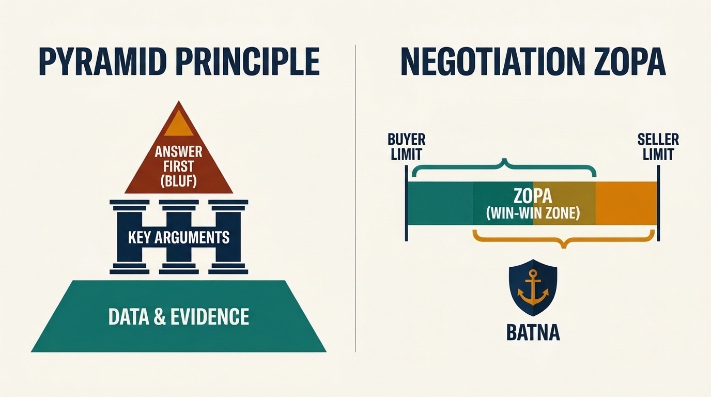
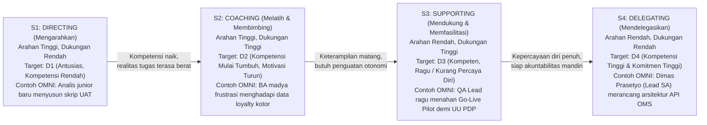
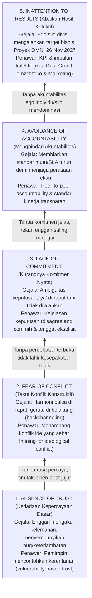
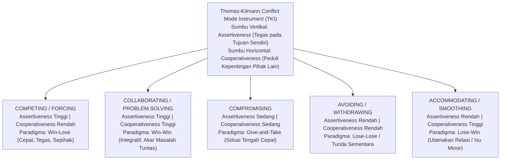
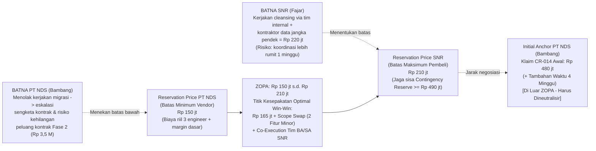
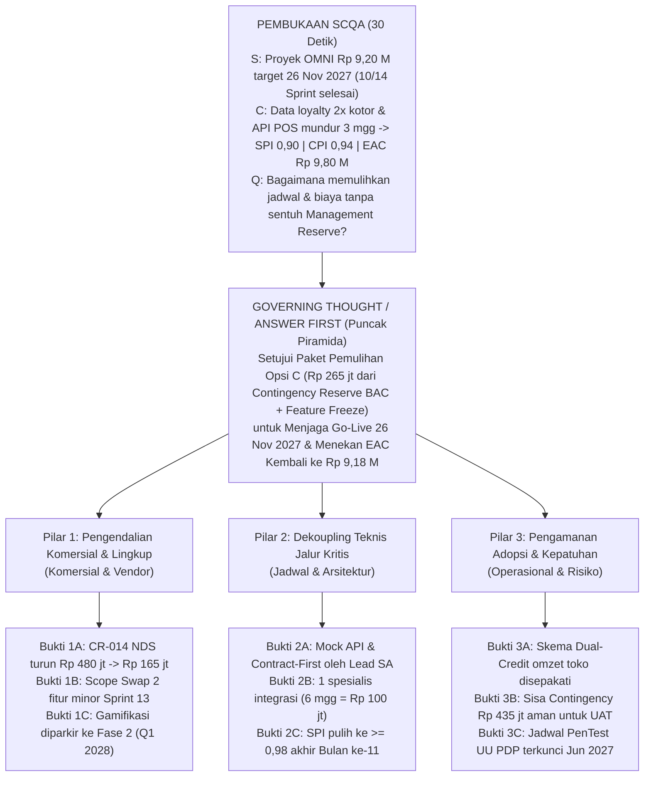
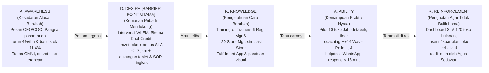

# Modul 11: Leadership, Negotiation & Executive Communication

## 1. Identitas Modul

| Atribut | Keterangan |
|---------|------------|
| **Kelompok Jalur** | Executive & Career Advancement *(Semua Jalur: Project Management, Business Analysis, System Analysis, & Product Management — Jilid III)* |
| **Level Kompetensi** | Senior / Executive *(setara standar kepemimpinan Senior PM, Lead BA/SA, Program Manager, hingga Delivery Director)* |
| **Durasi Pembelajaran** | **12 jam sesi terstruktur** (4 sesi × 3 jam) + **±6 jam tugas mandiri** |
| **Prasyarat** | Telah menyelesaikan **Jalur Utama (Modul 01–05)** atau **Jalur Alternatif BA/SA/Product (Modul 06–09)**, serta memahami konteks **Studi Kasus Utama Proyek OMNI** |
| **Peran Sasaran** | Senior Project Manager, Lead Business Analyst, Lead System/Solution Architect, Product Owner, Scrum Master, Program Manager, dan calon pemimpin divisi teknologi/transformasi |
| **Keluaran Utama** | 1) *1-Page Executive Memo* berformat **BLUF & SCQA**, 2) *Negotiation Preparation Sheet* berbasis **Interests–BATNA–ZOPA** untuk sengketa kontrak vendor & konflik lintas divisi, 3) Cetak biru **6-Slide Steering Committee Decision Deck** berbasis *Minto Pyramid Principle*, serta 4) Rencana adopsi perubahan **ADKAR** untuk jaringan operasional |

---

## 2. Gambaran Modul

Pada sepuluh modul sebelumnya, Anda telah mempertajam kecakapan teknis dan manajerial inti—mulai dari pengendalian jalur kritis, analisis *Earned Value Management* (EVM), penyusunan *Business Requirements Document* (BRD), pemodelan arsitektur sistem, tata kelola *Agile/Hybrid*, hingga valuasi finansial proyek. Namun, data industri maupun pengalaman lapangan membuktikan satu kenyataan pahit: **mayoritas proyek transformasi bernilai miliaran rupiah tidak gagal karena timnya tidak mampu menulis kode atau menghitung jadwal, melainkan karena pemimpinnya gagal memengaruhi pemangku kepentingan, kalah di meja negosiasi, gagal meredam konflik lintas direktorat, atau kehilangan kepercayaan Direksi di ruang *Steering Committee*.**

Lihat kembali dinamika nyata di **PT Sinar Nusantara Retail Tbk (SNR)** pada **Proyek OMNI** senilai **Rp 9,20 M**. **Fajar Nugroho** (Senior Project Manager), **Nadia Putri** (Lead BA), dan **Dimas Prasetyo** (Lead SA) tidak memiliki kewenangan struktural untuk memerintah **Dewi Lestari** (VP Marketing & CX) agar berhenti menyisipkan fitur gamifikasi di tengah sprint, tidak bisa memaksa **Agus Setiawan** (Head of Store Operations) agar 120 *Store Manager*-nya patuh pada SLA *Click & Collect* ≤ 2 jam, dan tidak punya kuasa sepihak memotong tagihan *Change Request* **Rp 480 jt** dari **Bambang Hartono** (Delivery Director PT NDS). Lebih berat lagi, pada akhir **Bulan ke-9 (28 Februari 2027)** ketika kinerja proyek merosot ke **SPI 0,90** dan **CPI 0,94**, Fajar harus berdiri di hadapan **Hendra Wijaya** (CEO), **Ratna Kusuma** (COO), dan **Budi Santoso** (CFO) untuk menyampaikan kabar buruk secara jujur sekaligus mengamankan keputusan strategis agar tenggat mutlak **26 November 2027** tidak jebol.

Modul 11 membekali para praktisi senior di seluruh jalur (PM, BA, SA, maupun Product) dengan empat pilar kecakapan eksekutif yang membedakan seorang *kontributor teknis andal* dari seorang *pemimpin strategis yang dipercaya C-Level*: (1) **Kepemimpinan Tanpa Otoritas Struktural & Pembentukan Tim Berkinerja Tinggi** (*Situational Leadership, Servant Leadership, EQ, Tuckman, Psychological Safety,* dan *5 Dysfunctions of a Team*); (2) **Manajemen Konflik & Negosiasi Berprinsip** (*Thomas–Kilmann TKI, Crucial Conversations,* serta metode *Harvard Principled Negotiation* berbasis *Interests, BATNA, WATNA,* dan *ZOPA*); (3) **Komunikasi Eksekutif Berorientasi Keputusan** (*Minto Pyramid Principle, SCQA, BLUF, Options Matrix,* dan seni menjawab interupsi tajam C-Level); serta (4) **Manajemen Perubahan Organisasi (*Organizational Change Management* / OCM)** melalui kerangka **ADKAR** dan **8 Langkah Kotter** guna memastikan sistem baru benar-benar diadopsi oleh **120 Store Manager** dan **1.440 staf toko SNR**.

---

## 3. Capaian Pembelajaran

Setelah menyelesaikan Modul 11, peserta mampu:

1. **Menerapkan** strategi kepemimpinan tanpa otoritas struktural (*Leading Without Formal Authority*) dengan memadukan *Expert Power*, *Referent Power*, *Situational Leadership* (Hersey–Blanchard), *Servant Leadership*, dan kecerdasan emosional (*Emotional Intelligence* / EQ) sesuai tingkat kesiapan individu dan tim.
2. **Mendiagnosis dan membangun** tim lintas fungsi berkinerja tinggi dengan menavigasi tahap perkembangan *Tuckman Ladder*, menumbuhkan *Psychological Safety* (Amy Edmondson), serta menuntaskan akar masalah dalam *5 Dysfunctions of a Team* (Patrick Lencioni).
3. **Memilih dan mengeksekusi** gaya resolusi konflik yang proporsional berdasarkan *Thomas–Kilmann Conflict Mode Instrument* (TKI) serta memimpin percakapan berisiko tinggi menggunakan disiplin *Crucial Conversations* yang memisahkan fakta objektif dari asumsi dan emosi.
4. **Merancang dan memimpin** negosiasi komersial vendor maupun negosiasi sumber daya/lingkup internal secara profesional menggunakan kerangka *Harvard Principled Negotiation* (*Interests vs Positions*, **BATNA**, **WATNA**, *Reservation Price*, **ZOPA**, *Anchoring*, dan *Objective Criteria*).
5. **Menyusun dan mempresentasikan** komunikasi eksekutif tingkat C-Level—berupa *1-Page Executive Memo* (BLUF/SCQA) dan *Steering Committee Decision Deck* 5–7 slide (*Minto Pyramid Principle* & *Options Matrix*)—serta menangani pertanyaan kritis (*Tough Executive Q&A*) dan penyampaian kabar buruk tanpa bersikap defensif.
6. **Merumuskan** rencana *Organizational Change Management* (OCM) dasar menggunakan model **ADKAR** dan **8 Langkah Kotter** untuk mengatasi resistensi unit operasional dan memastikan adopsi kapabilitas bisnis pasca-*Go-Live*.

---

## 4. Rencana Sesi

Pembelajaran tatap muka atau lokakarya daring dilaksanakan dalam **4 sesi × 3 jam = 12 jam** dengan komposisi pedagogis **±30% konsep (3,5 jam)**, **±50% workshop role-play & kasus Proyek OMNI (6,0 jam)**, dan **±20% diskusi/refleksi eksekutif (2,5 jam)**.

| Sesi | Durasi | Topik Utama | Konsep (±30%) | Workshop Role-Play & Kasus OMNI (±50%) | Diskusi & Refleksi (±20%) |
|------|--------|-------------|---------------|----------------------------------------|---------------------------|
| **Sesi 1** | 3 jam | **Leading Without Authority, EQ & High-Performing Teams** | 55 menit: 5 sumber kekuasaan; *Situational Leadership* (Hersey–Blanchard); *Servant* vs *Transformational*; EQ (Goleman); *Tuckman*, *Psychological Safety*, & *5 Dysfunctions* (Lencioni) | 90 menit: Diagnosa kesehatan Tim Inti Proyek OMNI (PO, SM, BA, SA, QA, Vendor NDS) di Bulan ke-6 & perancangan intervensi kepemimpinan situasional untuk 4 skenario anggota tim | 35 menit: Refleksi *Anti-Pattern Micromanagement* & *Artificial Harmony* di tim lintas fungsi peserta |
| **Sesi 2** | 3 jam | **Strategic Conflict Management & Harvard Principled Negotiation** | 55 menit: 5 gaya konflik *Thomas–Kilmann* (TKI); disiplin *Crucial Conversations*; 4 prinsip Fisher & Ury; anatomi **BATNA, WATNA, Reservation Price, ZOPA, Anchoring & Framing** | 90 menit: *Role-Play* 2 babak — (a) Negosiasi CR-014 PT NDS (Rp 480 jt) Fajar vs Bambang Hartono; (b) Mediasi konflik *Click & Collect* & gamifikasi Dewi Lestari vs Agus Setiawan | 35 menit: Bedah taktik menghadapi *hard bargainer*, jebakan *anchoring*, dan menjaga relasi jangka panjang pasca-negosiasi |
| **Sesi 3** | 3 jam | **Executive Communication: Pyramid Principle, SCQA, BLUF & SteerCo Q&A** | 50 menit: *Minto Pyramid Principle* (*Answer First* & MECE); kerangka **SCQA** & **BLUF**; arsitektur *Decision-Oriented SteerCo Deck* 5–7 slide & *Options Matrix*; protokol *Bad News Delivery* | 90 menit: Menulis ulang email status bertele-tele menjadi *Memo BLUF* 5 baris + simulasi *Hot-Seat SteerCo Bulan ke-9* (SPI 0,90 / CPI 0,94) menghadapi interupsi tajam CEO, CFO, & VP Marketing | 40 menit: Umpan balik terstruktur atas bahasa tubuh, ketenangan suara, dan ketegasan rekomendasi di hadapan eksekutif |
| **Sesi 4** | 3 jam | **Organizational Change Management (ADKAR & Kotter) & Capstone Simulasi** | 50 menit: Sisi teknis vs sisi manusia transformasi; model **Prosci ADKAR** & identifikasi *Barrier Point*; **8 Langkah Kotter**; *Anti-Patterns* OCM | 90 menit: Menyusun Peta Intervensi ADKAR untuk 120 Store Manager & 1.440 staf toko SNR (fokus 25 toko luar Jawa yang resisten) + integrasi ke jadwal *Pilot 10 Toko* & *Wave Rollout* | 40 menit: Kuis evaluasi formatif, sintesis karir Senior PM/BA/SA menuju level eksekutif, dan *briefing* tugas mandiri ±6 jam |
| **Total** | **12 jam** | **4 Sesi Terpadu** | **3,5 jam (29%)** | **6,0 jam (50%)** | **2,5 jam (21%)** |

---

## 5. Materi



### 5.1 Kepemimpinan Tanpa Otoritas Struktural (*Leading Without Formal Authority*)

Salah satu paradoks terbesar dalam profesi Senior Project Manager, Lead Business Analyst, Lead System Architect, maupun Product Owner adalah **tingginya akuntabilitas hasil di tengah minimnya otoritas hierarkis formal**. Di struktur organisasi matriks PT SNR, **Fajar Nugroho** tidak menandatangani penilaian kinerja tahunan (*KPI appraisal*) **Dimas Prasetyo** (yang melapor secara fungsional kepada CTO Irwan Pratama), tidak berwenang menjatuhkan sanksi kepada 120 Store Manager di bawah **Agus Setiawan**, dan tidak bisa memerintahkan **Bambang Hartono** (PT NDS) di luar batasan kontrak Rp 4,40 M.

Mengacu pada taksonomi klasik **French dan Raven** tentang sumber kekuasaan (*Bases of Power*), seorang pemimpin organisasi memiliki lima sumber pengaruh:

1. ***Legitimate Power* (Kekuasaan Jabatan):** Bersumber dari posisi resmi di bagan organisasi (misalnya CEO Hendra Wijaya atau COO Ratna Kusuma).
2. ***Reward Power* (Kekuasaan Imbalan):** Kemampuan memberikan bonus, promosi, atau penugasan menarik.
3. ***Coercive Power* (Kekuasaan Paksaan):** Kemampuan memberi teguran keras, penalti, atau pemberhentian.
4. ***Expert Power* (Kekuasaan Keahlian):** Pengaruh yang lahir dari penguasaan mendalam atas domain teknis, metodologi bisnis, pemahaman arsitektur, dan ketajaman membaca risiko yang terbukti membantu orang lain berhasil.
5. ***Referent Power* (Kekuasaan Keteladanan & Relasi):** Pengaruh yang tumbuh dari integritas, keadilan, konsistensi ucapan dengan tindakan, empati, dan kepercayaan personal yang membuat orang lain *ingin* mengikuti Anda secara sukarela.

> **Prinsip Emas Kepemimpinan Matriks:** Pemimpin struktural mengandalkan *Legitimate, Reward,* dan *Coercive Power*—yang efektivitasnya langsung runtuh begitu wewenang dicabut atau ketika menghadapi mitra sejajar lintas direktorat. Sebaliknya, Senior PM, BA, dan SA membangun daya gerak permanen melalui **Expert Power**, **Referent Power**, serta **Influence Through Reciprocity** (*Cohen–Bradford Influence Without Authority*: membantu pemangku kepentingan menyelesaikan prioritas mereka terlebih dahulu sebelum meminta komitmen mereka).

#### Mata Uang Pengaruh (*Currencies of Influence*) Lintas Peran Senior (PM, BA, SA)
Menurut **Allan Cohen dan David Bradford**, pemimpin tanpa otoritas formal menggerakkan kolega lintas divisi dengan memahami *"mata uang"* apa yang paling dihargai lawan bicara (*Inspiration, Task-Related, Position, Relationship,* atau *Personal Currencies*) dan menukarkannya secara etis:

| Peran Senior | Sumber *Expert & Referent Power* Utama | Contoh Pertukaran Nilai (*Influence Currency*) di Proyek OMNI |
|--------------|----------------------------------------|---------------------------------------------------------------|
| **Senior PM** *(Fajar Nugroho)* | Penguasaan manajemen risiko, kejelasan jadwal jalur kritis, integritas pelaporan tanpa drama, dan kemampuan membuka blokir lintas direktorat | Membantu **Agus Setiawan** mendesain *Dynamic Slot Cap* untuk melindungi staf tokonya terlebih dahulu → memperoleh dukungan penuh Agus saat sosialisasi 120 Store Manager |
| **Lead BA** *(Nadia Putri)* | Ketajaman penerjemahan bahasa bisnis ke spesifikasi akurat, empati terhadap rasa sakit pengguna, dan objektivitas analisis dampak | Mempermudah pekerjaan harian **Dewi Lestari** dengan menyusun peta fitur *3-Tier Loyalty* yang siap pakai untuk kampanye Harbolnas → Dewi percaya saat Nadia memprioritaskan ulang *backlog* |
| **Lead SA** *(Dimas Prasetyo)* | Otoritas arsitektur, pembuktian berbasis data/prototipe (*PoC*), dan kejujuran atas *trade-off* teknis | Menyiapkan kontrak *OpenAPI v3* dan *Mock Server* lebih awal bagi tim developer PT NDS & POS-Modern → memperoleh rasa hormat dan kepatuhan teknis tanpa perlu perintah struktural CTO |

#### Gaya Kepemimpinan Situasional (*Situational Leadership* — Hersey & Blanchard)
Kesalahan umum pemimpin pemula adalah menerapkan satu gaya kepemimpinan yang sama untuk semua anggota tim dan segala kondisi. **Paul Hersey dan Ken Blanchard** menegaskan bahwa gaya kepemimpinan paling efektif bergantung pada tingkat kesiapan (*Readiness / Development Level*) anggota tim yang merupakan kombinasi **Kompetensi Teknis (*Competence*)** dan **Komitmen/Motivasi (*Commitment*)**. Terdapat empat kuadran gaya kepemimpinan yang bergerak dinamis sesuai tugas spesifik:



*Gambar 5.1 — Spektrum Gaya Kepemimpinan Situasional (Hersey–Blanchard) dan Penerapannya pada Tim Proyek OMNI.*

Memahami spektrum ini mencegah dua kegagalan fatal: (a) **Over-leading / Micromanaging** ketika Fajar memakai gaya *Directing (S1)* kepada pakar senior seperti **Dimas Prasetyo** (D4) yang justru membunuh inisiatif dan memicu *turnover*; serta (b) **Under-leading / Abdicating** ketika Fajar memakai gaya *Delegating (S4)* kepada staf baru (D1) tanpa panduan, yang berujung pada kegagalan mutu dan hilangnya rasa percaya diri.

#### Perbandingan Model Kepemimpinan Modern
Selain *Situational Leadership*, praktisi senior perlu memahami kapan memadukan **Servant Leadership**, **Transformational Leadership**, dan **Transactional Leadership**:

| Dimensi | Servant Leadership (Robert Greenleaf) | Transformational Leadership (Burns & Bass) | Transactional Leadership |
|---------|---------------------------------------|--------------------------------------------|--------------------------|
| **Fokus Utama** | Melayani pertumbuhan tim dan menghilangkan hambatan kerja (*impediments*) agar tim mencapai performa puncak | Menginspirasi visi bersama, mengubah pola pikir, dan mendorong inovasi melampaui rutinitas | Kejelasan target, kepatuhan aturan, kontrak kinerja, serta pertukaran imbalan/koreksi (*reward & corrective action*) |
| **Sumber Pengaruh** | Empati, kerendahan hati, *listening*, dan keberpihakan pada keberhasilan tim | Karisma moral, narasi tujuan (*burning platform*), dan tantangan intelektual | Struktur, SLA terukur, milestone kontrak, dan kejelasan wewenang |
| **Kapan Paling Tepat di Proyek OMNI** | Ritme kerja harian **Tania Wijaya** (Scrum Master) dan **Fajar Nugroho** membuka blokir API & melindungi fokus tim Agile di 14 Sprint | Mobilisasi perubahan budaya omnichannel oleh **Ratna Kusuma** (COO) dan Fajar bagi 120 Store Manager SNR | Pengelolaan kontrak *Fixed Price* Rp 4,40 M dengan **PT NDS**, audit kepatuhan **UU PDP** (Rina Kartika), dan disiplin *Stage-Gate* |
| **Risiko Jika Berlebihan** | Terlalu permisif; enggan mengambil keputusan tegas saat krisis jadwal atau kinerja buruk | "Terlalu visioner" tanpa disiplin eksekusi harian, anggaran, dan dokumentasi | Kaku, birokratis, mematikan kreativitas, dan hanya bekerja ketika diawasi |

#### Kecerdasan Emosional (*Emotional Intelligence* / EQ — Daniel Goleman)
Penelitian **Daniel Goleman** terhadap ratusan pemimpin eksekutif membuktikan bahwa pada level senior, **EQ menyumbang hingga dua kali lipat lebih besar terhadap keberhasilan kepemimpinan dibandingkan IQ dan keterampilan teknis semata**. Lima komponen EQ yang wajib dilatih dalam proyek bertekanan tinggi adalah:

1. ***Self-Awareness* (Kesadaran Diri):** Mengenali pemicu emosi diri (*emotional triggers*) secara *real-time*—misalnya menyadari detak jantung meningkat ketika CFO Budi Santoso memotong presentasi atau ketika Dewi Lestari melontarkan komentar tajam soal keterlambatan fitur.
2. ***Self-Regulation* (Pengendalian Diri):** Menciptakan jeda 3–5 detik antara stimulus dan respons agar tidak bereaksi defensif, sarkastis, atau menyalahkan vendor di forum terbuka.
3. ***Internal Motivation* (Motivasi Intrinsik):** Menjaga ketangguhan (*resilience*) dan fokus pada tujuan jangka panjang (kesuksesan omnichannel SNR) di tengah tekanan krisis Bulan ke-9 (SPI 0,90).
4. ***Empathy* (Empati Kognitif & Emosional):** Mampu melihat dunia dari kacamata pihak lain—memahami bahwa penolakan **Agus Setiawan** bukanlah sabotase, melainkan ketakutan rasional bahwa 120 kepala tokonya akan kehilangan bonus penjualan jika KPI tidak diperbaiki.
5. ***Social Skills* (Keterampilan Sosial & Pengaruh):** Kemampuan membangun aliansi (*coalition building*), meredakan ketegangan ruang rapat, dan menggerakkan pihak-pihak yang berseberangan menuju keputusan konkret.

---

### 5.2 Membangun Tim Berkinerja Tinggi (*High-Performing Teams*)

Sekelompok profesional cerdas tidak otomatis menjadi tim berkinerja tinggi. Di Proyek OMNI, Fajar mengoordinasikan tim *hybrid* lintas organisasi: tim internal SNR (Kevin Halim, Tania Wijaya, Nadia Putri, Dimas Prasetyo, Lukas Gunawan), perwakilan bisnis (Store Ops, Supply Chain, Legal), serta 18 personel eksternal vendor PT NDS. Untuk mengubah kumpulan individu ini menjadi satu unit berkinerja tinggi, pemimpin wajib menguasai tiga kerangka komplementer berikut.

#### 1. Tahap Perkembangan Tim (*Tuckman Ladder*)
**Bruce Tuckman** memetakan lima tahap evolusi tim yang tidak selalu berjalan linear (tim dapat mundur ke *Storming* setiap kali anggota kunci berganti atau terjadi krisis jadwal):

| Tahap Tuckman | Dinamika & Gejala di Lapangan | Peran Kritis Pemimpin (PM / BA / SA / SM) |
|---------------|-------------------------------|-------------------------------------------|
| **1. Forming** *(Pembentukan)* | Anggota sopan, berhati-hati, belum saling mengenal batas peran; ketergantungan tinggi pada pemimpin | Berikan kejelasan visi proyek, peran RACI, *Team Working Agreement*, dan *Directing (S1)* untuk membangun rasa aman awal |
| **2. Storming** *(Gejolak)* | Gesekan metode kerja, perbedaan standar arsitektur (misalnya SA internal Dimas vs Tech Lead PT NDS), konflik prioritas, dan turunnya moral sementara | **Jangan ditekan atau dihindari!** Terapkan *Coaching (S2)*, normalkan perbedaan teknis yang sehat, fasilitasi resolusi konflik secara transparan, dan tegaskan tujuan bersama |
| **3. Norming** *(Penyelarasan)* | Norma kerja disepakati (*Definition of Done*, alur review PR, ritme *Daily Stand-up*); kepercayaan mulai tumbuh; kolaborasi lintas fungsi berjalan mulus | Beralih ke *Supporting (S3)*, delegasikan keputusan teknis harian, rayakan kemenangan awal (*quick wins* Release 1) |
| **4. Performing** *(Berkinerja Tinggi)* | Tim otonom, saling menjaga akuntabilitas, *velocity* stabil, konflik diselesaikan dewasa secara langsung antartim | Terapkan *Delegating (S4)*, lindungi tim dari gangguan eksternal (*scope creep*), dan fokus pada orkestrasi eksekutif |
| **5. Adjourning** *(Pembubaran / Transisi)* | Menjelang penutupan proyek (*Gate 4: 26 Nov 2027*), muncul kecemasan pasca-proyek (*roll-off anxiety*) dan penurunan fokus dokumentasi | Laksanakan *knowledge transfer* terstruktur ke IT Operations, apresiasi kontribusi tiap anggota, dan selenggarakan *Retrospective / Lessons Learned* bermakna |

#### 2. *Psychological Safety* (Keamanan Psikologis — Amy Edmondson)
Profesor Harvard **Amy Edmondson** mendefinisikan **Psychological Safety** sebagai *keyakinan bersama dalam tim bahwa lingkungan kerja aman untuk mengambil risiko interpersonal*—berani mengakui kesalahan lebih awal, menyampaikan kabar buruk (*red flags*), bertanya hal mendasar, atau menantang asumsi atasan tanpa takut dipermalukan, dicap bodoh, atau dihukum.

Satu kesalahpahaman terbesar tentang *Psychological Safety* adalah menganggapnya sama dengan *"bersikap serba ramah dan tidak boleh saling mengkritik"*. Sebaliknya, Edmondson memetakan interaksi **Psychological Safety** dengan **Performance Standards (Standar Akuntabilitas)** ke dalam empat zona:

| Zona Organisasi | Psychological Safety | Standar Kinerja & Akuntabilitas | Gejala Nyata & Dampak pada Proyek OMNI |
|-----------------|----------------------|----------------------------------|----------------------------------------|
| **Zona Apatis** *(Apathy Zone)* | Rendah | Rendah | Tim pasif, sekadar datang rapat, tidak peduli apakah tenggat 26 Nov 2027 tercapai atau tidak |
| **Zona Nyaman** *(Comfort Zone)* | Tinggi | Rendah | Suasana santai dan akrab, namun *Definition of Done* dilonggarkan, bug dibiarkan menumpuk, dan *velocity* melorot tanpa evaluasi tegas |
| **Zona Kecemasan** *(Anxiety Zone)* | Rendah | Tinggi | Tim ketakutan menyampaikan masalah nyata karena takut dimarahi → **tempat lahirnya *Watermelon Project*** (melapor hijau di luar padahal data loyalty macet 3 minggu di dalam) |
| **Zona Pembelajaran & Kinerja Tinggi** *(Learning & High-Performance Zone)* | **Tinggi** | **Tinggi** | Standar mutu (99,5% *uptime*, 2.500 TPM, 100% UU PDP) dijaga sangat ketat, namun setiap anggota merasa aman mengangkat *red flags* sejak dini, berdebat tajam soal arsitektur, dan bereksperimen cepat |

**Lima Ritual Praktis Membangun *Psychological Safety* di Tim Proyek *Hybrid*:**
1. **Bingkai Pekerjaan sebagai Masalah Pembelajaran, Bukan Sekadar Eksekusi:** Akui ketidakpastian secara eksplisit sejak *Kick-off* ("Migrasi 1,2 juta data kartu fisik lama punya banyak hal tak terduga; semakin cepat kita menemukan cacatnya, semakin besar peluang kita menang").
2. **Pemimpin Mengakui Kesalahan Lebih Dulu (*Model Fallibility*):** Ketika Fajar secara terbuka mengakui kekeliruan estimasi awal di *Sprint Retrospective*, seluruh tim (termasuk vendor PT NDS) ikut berani melaporkan risiko lebih awal.
3. **Rayakan *"Good Catches"* (Penemuan Risiko Dini):** Beri apresiasi terbuka kepada **Lukas Gunawan (QA)** atau **Nadia Putri (BA)** ketika mereka menemukan cacat spesifikasi lebih awal—jangan pernah menghukum pembawa berita buruk (*shoot the messenger*).
4. **Pisahkan Kritik atas Ide dari Serangan terhadap Orang:** Tegaskan aturan ruang diskusi: *"Serang asumsi dan arsitekturnya sekeras mungkin, lindungi manusianya sepenuhnya."*
5. **Tanyakan Pertanyaan Terbuka Berorientasi Risiko:** Ganti pertanyaan tertutup *"Apakah semua aman?"* (yang memaksa jawaban basa-basi *"Aman, Pak"*) dengan *"Bagian mana dari Sprint 12 yang paling berisiko gagal dan belum kita antisipasi?"*

#### 3. Mengatasi *5 Dysfunctions of a Team* (Patrick Lencioni)
Dalam bukunya *The Five Dysfunctions of a Team*, **Patrick Lencioni** menunjukkan bahwa kegagalan mencapai hasil bisnis jarang berdiri sendiri—ia selalu berakar dari piramida lima disfungsi yang saling mengunci dari dasar hingga puncak:



*Gambar 5.2 — Piramida 5 Dysfunctions of a Team (Patrick Lencioni): Dari Fondasi Kepercayaan Menuju Hasil Kolektif.*

**Penerapan Diagnosa di Proyek OMNI:** Ketika di Bulan ke-7 terjadi gejala *backchanneling* (tim internal SNR mengeluhkan kualitas kode PT NDS di grup obrolan pribadi tanpa mengangkatnya di *Sprint Retrospective*), Fajar tidak langsung memarahi vendor. Ia mendiagnosis akar piramida Lencioni di **Lapisan 1 (*Absence of Trust*)** dan **Lapisan 2 (*Fear of Conflict*)**, lalu membuka *Retrospective* dengan terlebih dahulu mengakui kesalahannya sendiri dalam memperjelas kriteria penerimaan (*Acceptance Criteria*) awal. Keteladanan *vulnerability-based trust* tersebut segera menurunkan sikap defensif PT NDS dan membuka diskusi teknis jujur tentang standar *code review* dan *Definition of Done*.

---

### 5.3 Manajemen Konflik Strategis & *Crucial Conversations*

Konflik dalam proyek strategis bukanlah tanda kegagalan kepemimpinan—ia adalah **konsekuensi alami dari keterbatasan sumber daya, perbedaan KPI antar-direktorat, dan tingginya taruhan bisnis**. Yang menentukan keberhasilan seorang pemimpin senior adalah kemampuannya memilih respons konflik secara sadar, bukan secara impulsif.

#### Matriks 5 Gaya Resolusi Konflik: *Thomas–Kilmann Conflict Mode Instrument (TKI)*
**Kenneth Thomas dan Ralph Kilmann** memetakan lima mode penanganan konflik sepanjang dua sumbu independen: **Assertiveness** (*ketegasan memperjuangkan kepentingan/tujuan sendiri*) dan **Cooperativeness** (*kesediaan bekerja sama memenuhi kepentingan pihak lain*).



*Gambar 5.3 — Peta 5 Gaya Resolusi Konflik Thomas–Kilmann (TKI) Berdasarkan Dimensi Assertiveness dan Cooperativeness.*

Tidak ada satu gaya konflik yang selalu benar di semua situasi. Seorang eksekutif memilih gaya secara situasional berdasarkan tabel keputusan berikut:

| Gaya TKI | Kapan TEPAT Digunakan | Kapan BERBAHAYA / Merusak | Contoh Nyata di Proyek OMNI |
|----------|------------------------|---------------------------|-----------------------------|
| **1. Competing / Forcing** *(Tegas / Memaksa)* | Kondisi darurat keselamatan, kepatuhan hukum/regulasi tak bisa ditawar, atau keputusan cepat tak populer demi melindungi kelangsungan proyek | Dipakai rutin untuk isu teknis/kolaboratif → memicu dendam, kepatuhan semu, dan *sabotase pasif* | **Rina Kartika (Legal/InfoSec)** menggunakan hak veto menolak *Go-Live* Pilot sebelum celah enkripsi data **UU PDP** ditutup tuntas |
| **2. Collaborating / Problem Solving** *(Kolaboratif)* | Isu berisiko tinggi di mana kepentingan kedua pihak terlalu vital untuk dikompromikan dan relasi jangka panjang krusial | Dipakai pada isu sepele di bawah tekanan waktu ketat → memboroskan energi dan memperlambat keputusan (*analysis paralysis*) | **Fajar** memediasi **Dewi (Marketing)** & **Agus (Store Ops)** merancang skema *Dual-Credit Revenue Attribution* untuk *Click & Collect* |
| **3. Compromising** *(Kompromi)* | Kedua pihak berkekuatan seimbang, tenggat waktu mendesak, dan solusi sementara yang "cukup baik" lebih bernilai daripada kebuntuan (*deadlock*) | Dipakai pada persoalan prinsipil/arsitektur inti → menghasilkan "solusi setengah matang" yang mengecewakan semua pihak | Pembagian sementara 1 *senior architect* 60% untuk OMNI dan 40% untuk ERP-Refresh selama 2 minggu puncak *cutover* |
| **4. Avoiding / Withdrawing** *(Menghindar / Menunda)* | Isu sangat sepele, emosi kedua pihak sedang terlalu panas sehingga butuh waktu pendinginan (*cooling-off*), atau ada pihak lain yang lebih tepat menyelesaikannya | Dipakai terus-menerus pada konflik strategis → masalah membusuk diam-diam hingga meledak menjelang *Go-Live* | Menunda 24 jam diskusi panas antara Tech Lead PT NDS dan QA Lead pasca-insiden uji beban agar keduanya hadir membawa log data dingin keesokan harinya |
| **5. Accommodating / Smoothing** *(Mengakomodasi)* | Ketika Anda sadar argumen Anda keliru, isu jauh lebih penting bagi pihak lain dibanding bagi Anda, atau untuk membangun "tabungan niat baik" (*social capital*) | Dipakai berlebihan demi menghindari ketidaknyamanan → melahirkan *scope creep* tak terkendali dan hilangnya wibawa PM | Menyetujui permintaan minor **Siti Rahmawati** memindahkan jam sinkronisasi laporan rekonsiliasi harian WMS dari pukul 06.00 ke 05.30 WIB karena berdampak nol pada jadwal |

#### Teknik *Crucial Conversations* (Memisahkan Fakta dari Asumsi & Emosi)
Merujuk kerangka **Kerry Patterson dkk. (*Crucial Conversations*)**, percakapan menjadi *krusial* ketika tiga unsur hadir bersamaan: **(1) Opini berseberangan, (2) Taruhan tinggi (*high stakes*), dan (3) Emosi memuncak**. Ketika rasa aman percakapan terganggu, manusia secara naluriah jatuh ke dua respons destruktif: **Silence** (diam, menarik diri, atau sarkasme pasif) atau **Violence** (menyerang, memotong, melabeli, atau memaksakan kehendak).

Kunci teknis paling ampuh untuk menjaga percakapan tetap rasional adalah **memutus *Path to Action* dengan memisahkan Fakta Objektif (*What I Saw/Heard*) dari Cerita/Asumsi (*Story I'm Telling Myself*)**, lalu menyampaikan pesan dengan rumus **STATE**:

- **S — *Share Your Facts*:** Mulai dari data yang tak terbantahkan, bukan kesimpulan atau tuduhan. *(Salah: "Pak Agus sengaja menyabotase Click & Collect!" | Benar: "Dari 120 toko, 25 Store Manager luar Jawa belum mendaftar jadwal pelatihan yang tenggatnya Jumat lalu, dan tiga cabang menyampaikan kekhawatiran soal beban kerja kasir.")*
- **T — *Tell Your Story*:** Ungkapkan dampak dan kekhawatiran Anda secara tentatif tanpa menghakimi niat lawan bicara. *("Saya mulai khawatir jika hambatan operasional ini belum kita pecahkan bulan ini, target SLA ≤ 2 jam pada Pilot dan Go-Live November akan berisiko.")*
- **A — *Ask for Others' Paths*:** Undang perspektif lawan bicara secara tulus. *("Dari sudut pandang operasional lapangan Bapak, kendala paling berat apa yang dihadapi para kepala toko saat ini?")*
- **T — *Talk Tentatively*:** Gunakan bahasa hipotesis, bukan absolut ("Menurut pengamatan saya...", "Tampaknya..."), sehingga lawan bicara tidak merasa dipojokkan.
- **E — *Encourage Testing*:** Beri ruang aman bagi pihak lain untuk mengoreksi persepsi Anda agar kebenaran bersama (*Pool of Shared Meaning*) terbangun utuh.

#### Perbandingan Cepat: Respons Destruktif (*Silence / Violence*) vs. Rumus *STATE*

| Situasi Kritis di Lapangan | Respons *Violence / Silence* (Merusak Keamanan) | Respons *Crucial Conversations* (Rumus STATE) |
|----------------------------|-------------------------------------------------|-----------------------------------------------|
| Vendor terlambat menyerahkan modul 2 sprint berturut-turut | *(Violence)*: *"Tim PT NDS selalu mencari alasan dan tidak profesional!"* | *"Dua sprint terakhir serah terima modul OMS mundur 4 hari dari kesepakatan DoD. Saya khawatir pola ini menggeser jadwal SIT April. Hambatan apa di sisi tim Bapak yang belum kita selesaikan?"* |
| Lead BA mendapati *stakeholder* terus mengubah syarat bisnis | *(Silence)*: Mengangguk diam di rapat lalu mengeluh ke PM bahwa Marketing tidak konsisten | *"Minggu ini ada 3 perubahan alur promo di luar BRD yang disetujui. Saya ingin memastikan fitur promo Ibu sukses, sekaligus menjaga tim developer tidak kewalahan. Mana satu perubahan paling berdampak yang perlu kita tukar prioritasnya?"* |
| Lead SA melihat celah performa di rancangan integrasi rekan | *(Violence)*: *"Desain query ini amatir, pasti jebol di 2.500 TPM!"* | *"Hasil uji simulasi pada query ini menunjukkan latensi melonjak di atas 4 detik saat 1.200 TPM. Saya khawatir ini menghambat kelulusan Gate 3. Bagaimana jika kita uji opsi indexing & caching bersama sore ini?"* |

---

### 5.4 Negosiasi Berprinsip (*Principled Negotiation* — Harvard PON / Fisher & Ury)

Di meja negosiasi korporasi—baik saat menghadapi klaim *Change Request* vendor **PT NDS** maupun saat menegosiasikan alokasi insinyur lintas divisi—banyak profesional terjebak dalam **Positional Bargaining** (*tawar-menawar berbasis posisi*). Pada pola tradisional ini, tiap pihak mengunci satu angka atau tuntutan ekstrem (*"Saya minta Rp 480 jt!"* vs *"Saya tidak mau bayar serupiah pun!"*), lalu beradu urat leher hingga berakhir pada kebuntuan (*deadlock*), kompromi dangkal yang merugikan, atau rusaknya kemitraan.

**Roger Fisher dan William Ury** dari *Harvard Program on Negotiation* (*Getting to Yes*) memperkenalkan metode **Principled Negotiation** (*Interest-Based Bargaining*) yang bertumpu pada **4 Prinsip Fundamental**:

1. ***Separate the People from the Problem* (Pisahkan Orang dari Masalahnya):** Bersikaplah **lembut dan penuh hormat kepada manusia (*soft on people*)**, namun **tegas dan berprinsip terhadap substansi masalah (*hard on the problem*)**. Jangan pernah menyerang integritas personal Bambang Hartono atau menuduh Dewi Lestari egois; posisikan diri Anda *duduk di sisi meja yang sama* menghadapi masalah bersama ("Mari kita lihat bersama bagaimana membersihkan 1,2 juta data loyalty ini tanpa menjebol anggaran maupun margin operasional NDS").
2. ***Focus on Interests, Not Positions* (Fokus pada Kepentingan, Bukan Posisi):** *Position* adalah **apa yang diminta seseorang** (*"Saya minta CR Rp 480 jt"* atau *"Saya minta fitur gamifikasi rilis November"*). *Interest* adalah **mengapa mereka memintanya**—kebutuhan, ketakutan, KPI, atau tekanan di balik layar. Di balik posisi Bambang (Rp 480 jt), *interest*-nya adalah melindungi margin kotor tim NDS dan mencegah *burnout* 18 engineer dari pekerjaan tak terprediksi. Di balik posisi Dewi (gamifikasi), *interest*-nya adalah memastikan target akuisisi **500.000 MAU** dan *repeat purchase* +25% tercapai di tahun pertama. Begitu *interest* tersingkap, terbuka puluhan cara kreatif untuk memenuhinya.
3. ***Invent Options for Mutual Gain* (Ciptakan Opsi yang Saling Menguntungkan / *Expand the Pie*):** Sebelum memutuskan angka tunggal, perluas nilai yang dinegosiasikan dengan mencari hal-hal yang **murah bagi satu pihak tetapi bernilai tinggi bagi pihak lain**. Contoh klasik di Proyek OMNI: ***Scope Swap*** (menukar fitur bernilai bisnis rendah di Sprint 13 dengan skrip migrasi data), **pembagian kerja (*co-execution*)**, penjadwalan termin pembayaran yang mempercepat *cash flow* vendor, atau surat referensi proyek strategis pasca-*Go-Live*.
4. ***Insist on Objective Criteria* (Berpegang pada Kriteria Objektif):** Akhiri adu kekuatan ego dengan merujuk tolok ukur independen yang disepakati kedua pihak: **klausul kontrak & SOW resmi**, **tarif *man-day* terlampir (*Rate Card*)**, **data hasil *data profiling* aktual**, **standar pasar**, atau **dampak objektif terhadap ROI dan Jalur Kritis 26 Nov 2027**.

#### Anatomi Strategis: BATNA, WATNA, *Reservation Price*, dan ZOPA
Persiapan adalah 80% dari kemenangan negosiasi. Sebelum melangkah masuk ruang rapat, negosiator senior wajib memetakan empat parameter kuantitatif berikut:

- **BATNA (*Best Alternative to a Negotiated Agreement*):** Langkah terbaik yang akan Anda eksekusi secara mandiri **apabila negosiasi gagal mencapai kesepakatan**. BATNA adalah sumber kekuatan sejati Anda—semakin kuat BATNA Anda, semakin tenang Anda di meja perundingan dan semakin kecil kemungkinan Anda terpaksa menerima kesepakatan buruk.
- **WATNA (*Worst Alternative to a Negotiated Agreement*):** Skenario terburuk jika negosiasi buntu total (misalnya sengketa arbitrase kontrak yang menunda *Go-Live* melewati Harbolnas 12.12). Mengetahui WATNA menjaga negosiator tetap realistis dan menghindari gertakan kosong (*bluffing*).
- ***Reservation Price* (*Walk-Away Point* / Titik Batas Mundur):** Batas paling ekstrem yang masih dapat Anda terima sebelum lebih baik memilih BATNA. Bagi pembeli (SNR), ini adalah harga maksimum; bagi penjual/vendor (PT NDS), ini adalah harga minimum.
- **ZOPA (*Zone of Possible Agreement* / Zona Kesepakatan yang Mungkin):** Rentang tumpang tindih antara *Reservation Price* penjual dan *Reservation Price* pembeli. Jika batas maksimum pembeli ≥ batas minimum penjual, maka ZOPA eksis (*positive bargaining zone*) dan kesepakatan menguntungkan dapat dicapai. Jika sebaliknya (*negative ZOPA*), negosiator harus memperluas pie lewat variabel non-harga (*scope swap, termin, co-execution*) atau beralih ke BATNA.



*Gambar 5.4 — Anatomi ZOPA, Reservation Price, BATNA, dan Anchoring pada Negosiasi Change Request CR-014 PT NDS (Rp 480 jt vs Anggaran Contingency SNR).*

#### *Anchoring* dan *Framing* dalam Negosiasi Eksekutif
- ***Anchoring* (Penjangkaran):** Angka pertama yang dilempar ke meja perundingan secara psikologis menarik perhatian seluruh diskusi ke sekitar angka tersebut. Saat Bambang melempar *anchor* agresif **Rp 480 jt**, kesalahan fatal pemula adalah langsung menawar setengahnya ("Bagaimana kalau Rp 240 jt?")—karena Anda baru saja memvalidasi jangkar lawan! Cara profesional melumpuhkan *anchor* agresif adalah **Reframe & Re-anchor dengan Kriteria Objektif**: abaikan angka Rp 480 jt, bedah rincian *effort* berdasarkan *Rate Card* kontrak, lalu jatuhkan jangkar baru berbasis data objektif ("Berdasarkan *profiling* 62% data duplikat dan *Rate Card* Lampiran C sebesar Rp 6,5 jt/*man-day*, komponen di luar SOW hanyalah 22 *man-days* atau sekitar Rp 143 jt—mari kita mulai perhitungan dari ruang lingkup riil tersebut").
- ***Framing* (Pembingkaian Nilai):** Menggeser sudut pandang lawan bicara dari **biaya jangka pendek (*cost frame*)** menuju **perlindungan risiko & peluang jangka panjang (*value/gain frame*)**. Kepada PT NDS, Fajar membingkai kesepakatan Rp 165 jt bukan sebagai "pemotongan margin Rp 315 jt", melainkan sebagai *"pembuktian reputasi mitra strategis yang membuka akses prioritas pada Fase 2 Marketplace Integration tahun 2028 senilai Rp 3,50 M."* Kepada CFO Budi Santoso, Fajar membingkai pencairan Rp 165 jt dari *Contingency Reserve* sebagai *"investasi proteksi untuk mengamankan potensi omzet puncak Harbolnas 12.12 senilai ±Rp 45 M tanpa menyentuh sepeser pun Management Reserve."*

#### Menangkal Taktik *Hard Bargainer* di Meja Negosiasi Korporasi
Dalam praktiknya, tidak semua lawan bicara langsung mau bermain *Principled Negotiation*. Negosiator senior wajib mengenali empat taktik manipulatif klasik dan cara melumpuhkannya tanpa kehilangan ketenangan:

| Taktik Lawan (*Hardball Tactic*) | Contoh di Lapangan | Cara Melumpuhkan Secara Elegan (*Principled Counter*) |
|----------------------------------|--------------------|-------------------------------------------------------|
| ***Extreme Anchoring*** *(Jangkar Ekstrem)* | Mengajukan CR Rp 480 jt untuk pekerjaan bernilai riil Rp 165 jt | Jangan pernah menawar "potong setengah"! Abaikan angkanya, ajukan pertanyaan terbuka (*"Bagaimana rincian man-days di Rate Card yang menghasilkan angka itu?"*), lalu jatuhkan *re-anchor* berbasis kriteria objektif |
| ***Artificial Deadline / Take-It-or-Leave-It*** | *"Kalau tidak disetujui sore ini, tim saya tarik ke klien lain!"* | Uji validitasnya dengan tenang (*"Saya paham jadwal tim Bapak padat, namun keputusan di atas Rp 100 jt wajib melalui persetujuan tertulis CFO sesuai tata kelola kita; mari pastikan opsi terbaik agar persetujuan cepat turun"*), sambil tetap bersandar pada BATNA Anda |
| ***Good Cop – Bad Cop*** | Account Manager bersikap ramah sementara Direktur Komersialnya mengancam penalti/henti kerja | Namai dinamika tersebut secara profesional (*"Saya menghargai pendekatan konstruktif Anda, mari kita pastikan siapa pun yang duduk di meja ini berpegang pada klausul SOW dan angka aktual yang sama"*) |
| ***Nibbling* (Menggerogoti di Akhir)** | Setelah kontrak/kesepakatan disetujui, tiba-tiba menyelipkan *"Oh ya, biaya dukungan uji beban akhir pekan belum termasuk ya, tambah Rp 35 jt"* | Kembalikan ke paket menyeluruh (*"Setiap item baru di luar paket yang baru saja kita kunci akan memicu peninjauan ulang nilai kesepakatan sebelumnya secara keseluruhan—apakah Bapak ingin kita buka ulang angka Rp 165 jt?"*) |

---

### 5.5 Executive Communication, *Minto Pyramid Principle*, SCQA & BLUF

Salah satu kejutan terbesar saat seorang spesialis teknis (analis, arsitek, atau PM teknis) mulai mempresentasikan laporannya kepada Direksi adalah **perbedaan total struktur berpikir (*mental model*)**:

- **Pola Pikir Teknis (*Bottom-Up / Inductive*):** Dimulai dari latar belakang kronologis → metodologi analisis → rincian 15 temuan teknis → kendala di lapangan → baru di menit terakhir menyampaikan kesimpulan atau rekomendasi (*"Oleh karena itu, kami butuh dana tambahan..."*). Di ruang rapat Direksi, eksekutif sudah kehilangan kesabaran dan memotong Anda di menit ke-3 dengan pertanyaan tajam: ***"Jadi intinya apa? Apa yang Anda minta dari saya hari ini?"***
- **Pola Pikir Eksekutif (*Top-Down / Deductive*):** Dimulai langsung dari **Kesimpulan Utama & Rekomendasi Keputusan (*Answer First*)**, baru kemudian menopangnya dengan 2–3 argumen terstruktur yang saling meniadakan dan menyeluruh (**MECE** — *Mutually Exclusive, Collectively Exhaustive*), sementara data teknis rinci disimpan di *Appendix* untuk dibuka hanya jika ditanya.

#### *Minto Pyramid Principle* & Kerangka SCQA
Dikembangkan oleh **Barbara Minto** di McKinsey & Company, **Pyramid Principle** menetapkan bahwa setiap komunikasi eksekutif harus disusun layaknya piramida yang dimulai dengan pembukaan naratif **SCQA** (*Situation, Complication, Question, Answer*) untuk menyamakan konteks dalam 30–60 detik, lalu langsung mendarat pada satu **Governing Thought (Pesan Inti / Jawaban Utama)** di puncak piramida:

- **S — *Situation* (Situasi Netral yang Disepakati):** Fakta latar belakang yang sudah diketahui dan disetujui audiens (*"Proyek OMNI Rp 9,20 M berjalan menuju tenggat mutlak 26 Nov 2027 dan telah menyelesaikan 10 dari 14 Sprint."*).
- **C — *Complication* (Komplikasi / Gangguan Kritis):** Fakta baru yang mengganggu kestabilan dan memicu urgensi tindakan (*"Pada akhir Bulan ke-9, data loyalty 2× lebih kotor dari asumsi awal dan API POS-Modern mundur 3 minggu, menekan SPI ke 0,90, CPI ke 0,94, serta mendorong proyeksi EAC ke Rp 9,80 M."*).
- **Q — *Question* (Pertanyaan Implisit Direksi):** Pertanyaan yang otomatis muncul di benak CEO/CFO (*"Bagaimana cara memulihkan jadwal agar tetap Go-Live 26 Nov 2027 tanpa menjebol anggaran BAC Rp 9,20 M?"*).
- **A — *Answer / Governing Thought* (Jawaban Utama — Puncak Piramida):** Rekomendasi tegas dan terukur di awal (*"Jalankan Paket Pemulihan Terarah [Opsi C]: sahkan kompromi CR PT NDS Rp 165 jt + Scope Swap, alokasikan Rp 100 jt Contingency Reserve untuk akselerasi API/Middleware, dan kunci Feature Freeze 23 Apr 2027 — menjaga Go-Live 26 Nov 2027 dengan proyeksi EAC Rp 9,18 M dan Rp 0 pencairan Management Reserve."*).



*Gambar 5.5 — Arsitektur Minto Pyramid Principle dan Kerangka SCQA untuk Presentasi Krisis Bulan ke-9 Proyek OMNI ke Steering Committee.*

#### BLUF (*Bottom Line Up Front*) untuk Memo & Email Eksekutif
Untuk komunikasi tertulis (email eskalasi, *WhatsApp* eksekutif, atau *1-Page Executive Memo*), gunakan prinsip **BLUF**: **dua kalimat pertama wajib memuat kesimpulan inti, dampak bisnis, dan tindakan/keputusan spesifik yang dibutuhkan lengkap dengan tenggatnya.** Jika seorang CEO hanya sempat membaca 5 detik pertama di layar ponselnya di antara dua rapat, ia harus tetap menangkap seluruh esensi pesan Anda.

Struktur baku **1-Page Executive Memo (BLUF)**:
1. **Header & Action Tag:** `[KEPUTUSAN DIBUTUHKAN - Tenggat: DD MMM YYYY]` atau `[ESKALASI RISIKO - STATUS AMBER/RED]` atau `[UNTUK INFORMASI]`.
2. **BLUF (Maksimal 3–4 baris):** Keputusan/berita utama + angka dampak finansial/jadwal + *exact ask*.
3. **Konteks Singkat (SCQ — 3–4 butir):** Fakta pemicu, akar masalah, dan mengapa tidak bisa ditunda.
4. **Matriks Opsi & Rekomendasi (Tabel 3 Opsi):** Bandingkan secara ringkas Opsi A, B, dan C (Biaya, Jadwal, Risiko, Dampak Bisnis) dengan penanda tegas **REKOMENDASI**.
5. **Langkah Berikutnya (*Next Steps*):** Siapa melakukan apa dan kapan begitu persetujuan diberikan.

#### Arsitektur *Decision-Oriented Steering Committee Deck* (5–7 Slide)
Rapat *Steering Committee* (SteerCo) bulanan berdurasi 45–60 menit bukanlah forum melaporkan daftar 40 tugas yang sudah dikerjakan tim (*Activity Dump*). Ia adalah **forum pengambilan keputusan strategis tingkat Direksi**. Ciri khas dek eksekutif kelas dunia:
- **Panjang Ideal 5–7 Slide Inti** (+ *Appendix* secukupnya di belakang untuk cadangan data detail).
- ***Action Titles* (Judul Slide = Kesimpulan):** Hindari judul pasif seperti *"Status Anggaran Bulan ke-9"* atau *"Update Risiko"*. Ganti dengan judul berorientasi pesan: ***"Defisit EVM Bulan ke-9 (SPI 0,90 / CPI 0,94) Dapat Dipulihkan Tanpa Menyentuh Management Reserve Melalui Opsi C."*** Jika Direksi hanya membaca judul Slide 1 hingga Slide 6 secara berurutan, mereka sudah memahami keseluruhan jalan cerita (*horizontal flow / storyboard*).
- **Format *Options Matrix* (3 Opsi + 1 Rekomendasi Tegas):** Jangan pernah datang kepada C-Level hanya membawa masalah tanpa solusi (*whining*), dan jangan pula hanya membawa satu pilihan yang membuat Direksi merasa "didikte" (*rubber-stamping*). Hadirkan **tiga opsi yang adil**—biasanya: (1) *Do Nothing / Baseline Trajectory*, (2) *High-Cost / High-Scope Alternative*, dan (3) *Balanced Recommended Path*—lalu nyatakan dengan tegas mana pilihan yang Anda rekomendasikan beserta alasannya.

##### Transformasi Judul Slide: *Generic Topic Title* vs. *Executive Action Title*

| Slide | Judul Pasif / Generik *(Hindari!)* | Judul *Action Title* Kelas Eksekutif *(Gunakan!)* |
|-------|-------------------------------------|---------------------------------------------------|
| Slide 1 | *Update Status Proyek OMNI Bulan ke-9* | *Paket Opsi C Menjaga Go-Live 26 Nov 2027 & Menekan EAC ke Rp 9,18 M Tanpa Sentuh Management Reserve* |
| Slide 2 | *Laporan Earned Value Management (EVM)* | *Deviasi SPI 0,90 & CPI 0,94 Terkonsentrasi pada Dua Hambatan Kritis yang Kini Terisolasi* |
| Slide 3 | *Negosiasi Vendor PT NDS* | *Negosiasi Berprinsip Memangkas Klaim CR PT NDS 65% (Rp 480 jt → Rp 165 jt) dengan 0 Hari Delay* |
| Slide 4 | *Opsi Tindak Lanjut* | *Opsi C Memberikan Keseimbangan Risiko–Biaya Optimal Dibanding Menunda Go-Live atau Full Crashing* |
| Slide 5 | *Rencana Pelatihan 120 Toko* | *Skema Dual-Credit Membongkar Resistensi Store Ops dan Menaikkan Skor Desire ADKAR ke 72%* |

#### Checklist *Pre-Wiring* (H-2 Sebelum Rapat Steering Committee)
Untuk memastikan rapat SteerCo 45 menit berjalan mulus tanpa "ranjau politik" di ruang rapat, lakukan *pre-wiring* sistematis 48 jam sebelumnya:
1. **Sponsor Alignment (10 menit dengan Ratna Kusuma COO):** Pastikan Sponsor 100% menyetujui Opsi C dan siap memberi dukungan suara di forum.
2. **Financial Sanity Check (10 menit dengan Budi Santoso CFO / tim Finance):** Verifikasi rumus EAC, sisa *Contingency Reserve*, dan pastikan tidak ada perbedaan definisi akuntansi *Dual-Credit*.
3. **Stakeholder Soft-Landing (10 menit dengan Dewi Lestari & Irwan Pratama):** Beri tahu lebih awal jika ada fitur yang diusulkan bergeser ke Fase 2 (gamifikasi) atau kebutuhan komitmen API (POS-Modern) agar tidak terjadi ledakan emosional di depan CEO.
4. **Distribusi *Pre-Read* H-1:** Kirim dek 6 slide 24 jam sebelum rapat agar Direksi yang bertipe analitis dapat membaca lebih dulu sehingga waktu rapat maksimal dipakai untuk diskusi keputusan.

#### Seni Menyampaikan *Bad News* & Menghadapi *Tough Executive Q&A*
Ketika proyek berada di zona *Amber* atau *Red*, integritas dan ketenangan pemimpin diuji habis-habisan. Terapkan **4 Aturan Emas *Bad News Delivery***:
1. ***No Surprises in the Room* (Sosialisasi Pra-Rapat / *Pre-Wiring*):** Jangan pernah membuat Sponsor (Ratna Kusuma) atau CFO (Budi Santoso) terkejut pertama kali mendengar berita buruk di depan CEO! Lakukan *pre-briefing* 1-on-1 selama 10 menit dua hari sebelum SteerCo untuk menyelaraskan angka dan meredam resistensi awal.
2. ***Own the Facts Without Defensiveness*:** Sampaikan angka pahit secara lugas di 60 detik pertama tanpa menyalahkan pihak lain (*no finger-pointing* ke vendor atau divisi lain). Bedakan antara *alasan teknis* (*root cause*) dan *dalih* (*excuse*).
3. ***Pivot Rapidly to Containment & Options*:** Habiskan maksimal 20% waktu pada *apa yang terjadi* dan 80% waktu pada *rencana pemulihan (Path-to-Green)* dan *keputusan yang dibutuhkan*.
4. **Protokol 4 Langkah *Tough Q&A* (A–P–O–L):**
   - **A (*Acknowledge & Validate*):** Akui ketajaman kekhawatiran eksekutif tanpa defensif (*"Kekhawatiran Pak Budi soal tren EAC Rp 9,80 M sangat tepat..."*).
   - **P (*Pivot to Verified Facts*):** Jawab pertanyaan inti langsung di kalimat pertama (*Answer First*) dengan data objektif (*"Ya, tanpa intervensi kita defisit Rp 600 jt; namun proyeksi itu belum memasukkan hasil negosiasi ulang PT NDS..."*). Jika Anda **tidak tahu jawabannya**, jangan pernah mengarang (*never bluff C-Level*)! Katakan dengan mantap: *"Saya tidak ingin menebak angka persisnya saat ini, Pak. Saya akan memverifikasi bersama Dimas dan mengirimkan rinciannya tertulis sebelum pukul 17.00 hari ini."*
   - **O (*Offer Trade-Offs*):** Jika eksekutif menekan menambah lingkup tanpa menambah biaya/waktu, kembalikan ke hukum *Triple Constraint* secara elegan (*"Kita bisa memasukkan gamifikasi sebelum November, Bu Dewi, namun konsekuensinya kita harus memilih salah satu: menukar modul Voucher Otomatis ke Fase 2 atau menambah biaya vendor Rp 380 jt. Mana prioritas bisnis yang Ibu dan SteerCo pilih?"*).
   - **L (*Lock the Decision*):** Tutup diskusi dengan merangkum keputusan secara eksplisit (*"Jadi kita sepakat menyetujui Opsi C dengan batas Contingency Rp 265 jt dan Feature Freeze 23 April? Saya catat dalam Decision Log."*).

```mermaid
sequenceDiagram
    actor PM as Fajar Nugroho (Senior PM)
    actor CEO as Hendra Wijaya (CEO / Ketua)
    actor CFO as Budi Santoso (CFO)
    actor COO as Ratna Kusuma (COO / Sponsor)
    actor MKT as Dewi Lestari (VP Marketing)

    Note over PM,MKT: Rapat SteerCo Bulan ke-9 (28 Feb 2027) - Krisis SPI 0,90 & CPI 0,94
    PM->>CEO: Slide 1 (BLUF/SCQA) - Lapor jujur SPI 0,90 & CPI 0,94; ajukan Opsi C agar tetap Go-Live 26 Nov 2027 tanpa sentuh Management Reserve
    CFO-->>PM: [Interupsi Tajam] EAC kita sudah Rp 9,80 M! Apa jaminan tidak jebol ke Management Reserve Rp 600 jt?
    PM->>CFO: [Acknowledge + Fact] Benar jika tanpa koreksi. CR NDS sudah ditekan Rp 480 jt -> Rp 165 jt + Scope Swap; total pakai Rp 265 jt dari Contingency BAC (sisa Rp 435 jt)
    MKT-->>PM: [Keberatan] Mengapa gamifikasi ditunda? Itu kunci target 500.000 MAU!
    PM->>MKT: [Validate + Trade-Off] Validasi target 500.000 MAU; sajikan trade-off objektif - tambah Rp 380 jt / tunda 4 mgg vs parkir ke Fase 2 (Q1 2028) & amankan Harbolnas 12.12
    COO->>CEO: [Alignment Pre-Wired] Mendukung Opsi C; fokus utama Nov 2027 adalah stabilitas Click & Collect 120 toko & akurasi stok >= 98%
    CEO->>PM: [Keputusan Tegas] Setujui Opsi C + Lock Feature Freeze 23 Apr 2027; minta laporan pemulihan SPI tiap 2 minggu
    PM-->>CEO: [Lock Decision] Konfirmasi 3 butir Decision Log, PIC, & tenggat tindak lanjut
```

*Gambar 5.6 — Alur Komunikasi Bad News dan Protokol Decision-Oriented Executive Q&A pada Rapat Steering Committee Proyek OMNI.*

---

### 5.6 Organizational Change Management (OCM) Dasar: Model ADKAR & 8 Langkah Kotter

Di banyak proyek transformasi teknologi, manajemen menghabiskan 90% anggaran pada **sisi teknis** (*aplikasi, integrasi API, cloud, perangkat keras*) dan kurang dari 5% pada **sisi manusia (*people side of change*)**. Padahal, realisasi manfaat bisnis (*Benefits Realization*) adalah fungsi perkalian:

$$\text{Nilai Bisnis Nyata} = \text{Kualitas Solusi Teknis} \times \text{Tingkat Adopsi Pengguna}$$

Apabila kualitas aplikasi OMNI bernilai 95%, tetapi tingkat adopsi oleh **120 Store Manager** dan **1.440 staf toko SNR** hanya 30% karena mereka merasa dirugikan oleh beban *Click & Collect*, maka nilai bisnis yang terwujud hanyalah sebagian kecil dari janji *Business Case*. Untuk mencegah kegagalan adopsi, praktisi senior memadukan dua kerangka OCM paling teruji: **Prosci ADKAR** (fokus perubahan tingkat **individu**) dan **8 Langkah Kotter** (fokus mobilisasi perubahan tingkat **organisasi**).

#### 1. Model Prosci ADKAR (Jeff Hiatt)
ADKAR menegaskan bahwa **organisasi tidak berubah—individu di dalamnya yang berubah satu per satu** melalui lima tahapan berurutan. Setiap individu tidak dapat melompat ke tahap berikutnya sebelum tahap sebelumnya tuntas; tahap pertama yang skornya rendah (≤ 3 dari skala 5) disebut ***Barrier Point*** (titik sumbatan utama yang wajib dibongkar terlebih dahulu).



*Gambar 5.7 — Peta Adopsi Perubahan Model Prosci ADKAR untuk 120 Store Manager dan 1.440 Staf Toko PT SNR.*

**Pelajaran Kritis tentang *Barrier Point*:** Kesalahan paling sering dalam proyek IT adalah langsung melompat ke **Knowledge (K)**—mengirim surat undangan pelatihan aplikasi—padahal 120 Store Manager masih macet di **Desire (D)** karena takut omzet cabang mereka dirampok kanal online! Memaksa orang mengikuti pelatihan saat *Desire*-nya nol hanya menghasilkan kehadiran pasif tanpa perubahan perilaku. Solusinya adalah menjawab pertanyaan personal setiap karyawan—***WIIFM ("What's In It For Me?")***—melalui penyesuaian KPI (*Dual-Credit*) dan insentif terlebih dahulu, baru kemudian pelatihan akan diserap dengan antusias.

#### 2. 8 Langkah Perubahan Organisasi (*8-Step Process for Leading Change* — John Kotter)
Jika ADKAR memandu transformasi individu, **John Kotter** memberikan peta jalan orkestrasi perubahan skala perusahaan yang terintegrasi rapi ke linimasa *Hybrid* Proyek OMNI:

| Langkah Kotter | Makna Strategis | Penerapan Konkret di Proyek OMNI SNR |
|----------------|-----------------|--------------------------------------|
| **1. Create a Sense of Urgency** | Membangun *burning platform* berbasis data agar organisasi keluar dari zona nyaman | CEO Hendra Wijaya memaparkan erosi pangsa pasar segmen muda −4%/tahun dan *stockout* 11,4% pada *Town Hall* 120 Store Manager |
| **2. Build a Guiding Coalition** | Membentuk koalisi lintas pimpinan yang kredibel, bukan hanya tim IT | Membentuk *Change Coalition* terdiri dari Ratna (COO), Agus (Store Ops), Dewi (Marketing), 6 Regional Manager, dan 10 *Store Manager* paling disegani |
| **3. Form a Strategic Vision & Initiatives** | Merumuskan visi masa depan yang sederhana, menggugah, dan mudah diulang | *"Satu SNR, Satu Stok, Dua Jam Siap Ambil"* — menegaskan toko fisik bukan digantikan online, melainkan diperkuat sebagai *hub* omnichannel |
| **4. Enlist a Volunteer Army** | Merekrut agen perubahan (*Change Champions*) dari garis depan | Menunjuk 24 *Store Champion* (2 per wilayah/klaster) yang dilibatkan sejak desain UI *Store Fulfillment App* bersama Nadia Putri (BA) |
| **5. Enable Action by Removing Barriers** | Menghapus hambatan struktural, sistem, atau kebijakan KPI lama | Mengubah kebijakan atribusi omzet menjadi *Dual-Credit*, menyediakan 240 tablet/scanner khusus, dan menambah *bandwidth* Wi-Fi toko luar Jawa |
| **6. Generate Short-Term Wins** | Merancang kemenangan awal yang kasat mata dalam 3–6 bulan untuk membungkam skeptisisme | Menjadikan **Pilot 10 Toko Jabodetabek (Jun–Jul 2027)** sebagai etalase bukti: rata-rata SLA 78 menit, omzet toko pilot naik +9%, dan testimoni video dari kepala toko sendiri |
| **7. Sustain Acceleration** | Memanfaatkan momentum kemenangan awal untuk menggulirkan skala penuh tanpa lengah | Menjalankan *Wave Rollout* bertahap (Gelombang 1: 30 toko → Gelombang 2: 40 toko → Gelombang 3: 40 toko) dengan perbaikan SOP cepat antargelombang |
| **8. Institute Change** | Menanamkan cara kerja baru ke dalam budaya, SOP permanen, *onboarding* staf baru, dan promosi | Memasukkan metrik SLA *Click & Collect* dan akurasi stok ≥ 98% ke dalam evaluasi kinerja tahunan resmi Store Ops dan program penghargaan *Store of the Quarter* |

---

### 5.7 Kesalahan Umum di Lapangan (*Anti-Patterns*)

Mengenali pola kegagalan klasik berikut akan menyelamatkan reputasi dan proyek Anda jauh sebelum krisis membesar:

| No | *Anti-Pattern* (Kesalahan Umum) | Gejala Nyata di Lapangan | Dampak Destruktif | Solusi Korektif Eksekutif |
|----|----------------------------------|--------------------------|-------------------|---------------------------|
| **1** | ***Data Dump ke C-Level* (*Activity Dump / Death by 45 Slides*)** | Membawa 40 slide berisi *burndown chart* harian, log Jira, dan daftar 80 *task* teknis ke rapat Steering Committee tanpa satu pun kesimpulan atau permintaan keputusan | Direksi bingung, kehilangan fokus dalam 5 menit, memotong presentasi, dan menganggap PM/BA/SA tidak berpikir strategis | Terapkan **Minto Pyramid Principle (Answer First)**, batasi 5–7 slide inti dengan *Action Titles*, dan fokus pada *Options Matrix* & *Decision Log* |
| **2** | ***Burying the Lede* & Menyembunyikan Berita Buruk (*Watermelon Syndrome*)** | Menulis laporan panjang yang menyisipkan keterlambatan jalur kritis di paragraf terakhir halaman ke-4, atau memaksa status tetap **GREEN** karena takut dimarahi CEO | Hilangnya kepercayaan Direksi secara permanen; waktu pemulihan terbuang hingga krisis tak tertolong saat mendekati *Go-Live* | Terapkan **BLUF** & aturan *No Surprises*: laporkan status AMBER/RED sejak sinyal dini (*SPI < 0,95*) lengkap dengan akar masalah & opsi *Path-to-Green* |
| **3** | ***Positional Bargaining* Emosional & Perang Ego** | Berdebat kusir soal angka klaim vendor atau fitur divisi di depan umum dengan nada defensif, melabeli lawan bicara ("vendor serakah", "Marketing tidak realistis") | Meja negosiasi membeku (*deadlock*), relasi kemitraan rusak, dan pihak yang kalah secara formal akan melakukan sabotase pasif saat eksekusi | Gunakan **Principled Negotiation** (pisahkan orang dari masalah, gali *interests*, siapkan BATNA/ZOPA) dan rumus **STATE** (*Crucial Conversations*) |
| **4** | ***Micromanagement* pada Tim Senior** | Senior PM/Lead mendikte detail implementasi harian kepada arsitek atau analis senior (D4), meminta laporan per jam, dan mengambil alih semua diskusi teknis | Tim terbaik merasa tidak dipercaya, kreativitas mati, pemimpin menjadi *bottleneck* tunggal, dan terjadi *turnover* talenta kunci (Risiko R-07) | Terapkan **Situational Leadership (Hersey–Blanchard)**: geser ke *Supporting (S3)* / *Delegating (S4)* bagi tim matang (D3/D4); kendalikan pada hasil (*outcome*) & *guardrails*, bukan cara tiap klik |
| **5** | ***Pseudo-Consensus* & *Artificial Harmony*** | Rapat tampak damai tanpa bantahan, semua mengangguk sopan, namun begitu rapat bubar, tiap divisi tetap menjalankan agenda sendiri-sendiri | Keputusan tidak dieksekusi (*Lack of Commitment* — Lencioni); konflik meledak jauh lebih mahal di tahap UAT atau *Rollout* | Bangun **Psychological Safety**, pancing perbedaan pendapat sehat secara eksplisit (*"Apa potensi kegagalan terbesar dari rencana ini?"*), lalu kunci prinsip ***Disagree and Commit*** |
| **6** | ***ADKAR Jumping* (OCM = Sekadar Email & Training H-7)** | Menganggap manajemen perubahan cukup dengan mengirim PDF SOP dan menggelar Zoom pelatihan 2 jam seminggu sebelum *Go-Live* tanpa menyentuh KPI atau keresahan pengguna | Staf toko mengabaikan aplikasi baru, kembali ke cara manual lama, dan manfaat bisnis proyek bocor (*benefit leakage*) | Lakukan audit **Barrier Point ADKAR** sejak Bulan ke-6; tuntaskan *Awareness* & *Desire* (KPI/insentif WIIFM) sebelum meluncurkan *Knowledge* & *Ability* |

---

## 6. Studi Kasus: Penerapan pada Proyek OMNI

Bagian ini menyajikan **tiga artefak dan naskah eksekutif nyata** dari perjalanan **Fajar Nugroho** memimpin **Proyek OMNI** pada periode krusial Bulan ke-8 hingga Bulan ke-9 (Januari–Februari 2027).

### 6.1 Skenario 1: Naskah Negosiasi Berprinsip (BATNA/ZOPA) atas Klaim *Change Request* Vendor PT NDS (Rp 480 jt)

#### Konteks Kasus
Pada awal Februari 2027 (pertengahan Sprint 10), hasil *data profiling* atas 1,2 juta catatan kartu fisik *Sinar Member Card* menunjukkan tingkat duplikasi, nomor telepon tidak valid, dan transaksi silang antar-toko **2 kali lebih kotor** dari asumsi awal di *Statement of Work* (SOW). **Bambang Hartono** (Delivery Director PT NDS) mengirimkan surat resmi **CR-014** menagih tambahan biaya **Rp 480 jt** di luar kontrak *Fixed Price* Rp 4,40 M beserta perpanjangan jadwal **4 minggu**—yang akan langsung menunda Gate 2 dan mengancam tenggat mutlak 26 November 2027.

#### A. *Negotiation Preparation Sheet* Fajar Nugroho (Pra-Pertemuan)

| Elemen Persiapan | Analisis Pihak SNR (Fajar Nugroho + Rina Kartika Legal + Dimas SA) | Estimasi Pihak PT NDS (Bambang Hartono) |
|------------------|--------------------------------------------------------------------|-----------------------------------------|
| **Posisi Awal (*Position*)** | "Migrasi data sudah masuk kontrak Fixed Price Rp 4,40 M; tidak ada penambahan jadwal 4 minggu." | "Klaim CR-014 senilai **Rp 480 jt** dan tambahan jadwal **4 minggu**." |
| **Kepentingan Nyata (*Interests*)** | 1) Menjaga tenggat mutlak 26 Nov 2027 (0 hari delay jalur kritis); 2) Menjaga biaya di dalam Contingency Reserve Rp 700 jt tanpa sentuh Management Reserve; 3) Memastikan data 800.000 anggota bersih & patuh UU PDP; 4) Menjaga motivasi 18 engineer NDS hingga November. | 1) Melindungi margin proyek agar tidak rugi akibat *effort* pembersihan data tak terduga; 2) Mencegah *burnout* tim data engineer yang sedang mengejar Sprint 10–11; 3) Menjaga reputasi baik dengan Direksi SNR demi memenangkan tender **Fase 2 Marketplace Integration 2028 (±Rp 3,50 M)**. |
| **BATNA** | Membatasi tanggung jawab NDS hanya pada skrip ETL standar sesuai SOW, sementara pembersihan anomali dikerjakan oleh tim internal BA/IT + 2 kontraktor *data cleansing* pihak ketiga selama 4 minggu (biaya total **Rp 220 jt**, risiko koordinasi tambahan 1 minggu). | Menolak pengerjaan data anomali di luar asumsi SOW Pasal 4.2 dan mengeskalasi ke mekanisme sengketa kontrak (risiko hubungan buruk dengan CEO/CTO SNR dan gugur dari daftar pendek tender Fase 2). |
| **WATNA** | Sengketa kontraktual berkepanjangan menghentikan laju Sprint 11–12 sehingga *Go-Live* mundur ke Januari 2028 (kehilangan puncak Harbolnas 12.12). | Kontrak diakhiri untuk sebagian termin, penalti keterlambatan diterapkan, dan reputasi PT NDS tercoreng di industri ritel nasional. |
| ***Reservation Price*** | **Maksimal Rp 210 jt** (agar sisa Contingency Reserve minimal Rp 490 jt untuk UAT, PenTest, & Rollout) + **0 hari perpanjangan jadwal**. | **Minimal Rp 150 jt** (menutup biaya langsung 3 engineer × 15 hari kerja sesuai biaya riil internal + margin minimum). |
| **ZOPA & Variabel *Mutual Gain*** | **ZOPA: Rp 150 jt – Rp 210 jt.** Variabel perluasan nilai (*Expand the Pie*): **1) *Scope Swap*** 2 fitur bernilai rendah di Sprint 13 (*Custom Animated Wishlist* & *Social Share Referral Widget*, estimasi Rp 95 jt) digeser ke Fase 2; **2) *Co-Execution*** aturan bisnis deduplikasi dikerjakan Nadia Putri (BA) & tim operasional SNR; **3) Pencairan termin M4 lebih cepat** (14 hari kerja, bukan 30 hari) jika migrasi lulus UAT tepat waktu. | Sama: sangat tertarik pada pembebasan kapasitas Sprint 13 lewat *Scope Swap* dan percepatan arus kas termin. |
| **Kriteria Objektif** | SOW Lampiran B (asumsi awal 30% data kotor vs aktual 62%), *Rate Card* kontrak Lampiran C (**Rp 6,5 jt/*man-day***), dan *log* volume data aktual hasil audit bersama Dimas Prasetyo. | Sama: *Rate Card* Lampiran C dan hasil *data profiling* faktual. |

#### B. Transkrip Naskah Negosiasi Berprinsip (Ruang Rapat SNR, 10 Februari 2027)

> **Babak 1 — *Separate People from the Problem & Defuse the Anchor***
> - **Bambang Hartono (PT NDS):** *"Pak Fajar, terus terang kami sudah sangat kooperatif sejak Juni. Tapi data 1,2 juta member SNR ternyata 62% berantakan, dua kali lipat dari asumsi 30% di SOW. Tim saya sampai lembur tiap malam. Jadi angka Rp 480 jt dan tambahan 4 minggu di CR-014 itu sudah paling realistis."*
> - **Fajar Nugroho (Senior PM):** *"Pak Bambang, saya sangat menghargai kerja keras 18 anggota tim Bapak selama 10 Sprint ini, dan saya juga mengakui fakta lapangan bahwa kualitas data historis kami memang 2 kali lebih kotor dari asumsi Lampiran B. Kita berada di perahu yang sama untuk menyukseskan Proyek OMNI. Sebelum kita bicara angka, bolehkah kita bedah bersama rincian pekerjaan aktual yang benar-benar berada di luar SOW, supaya solusi yang kita ambil adil bagi margin PT NDS sekaligus dapat dipertanggungjawabkan ke CFO kami?"*

> **Babak 2 — *Uncover Interests & Apply Objective Criteria***
> - **Bambang Hartono:** *"Masalah utamanya ada dua, Pak. Pertama, tim saya harus membuat aturan pencocokan manual ratusan ribu nomor HP ganda—itu memakan 55 man-days ekstra. Kedua, jadwal Sprint 11–12 sudah penuh; kalau dipaksakan tanpa tambah waktu 4 minggu, kualitas kode modul Click & Collect pasti hancur dan kami yang kena penalti."*
> - **Fajar Nugroho:** *"Terima kasih keterbukaannya, Pak. Jadi ada dua kepentingan kunci Bapak: menutup biaya effort ekstra dan melindungi kapasitas serta kualitas tim di Sprint 11–13. Mari kita lihat hasil profiling Dimas dan tim Bapak kemarin. Dari 55 man-days yang diestimasi, ternyata **28 man-days** adalah penentuan aturan bisnis manual (siapa pemilik sah nomor duplikat), sementara pembangunan skrip ETL otomatis tambahan hanya **27 man-days**. Berdasarkan Rate Card Lampiran C sebesar Rp 6,5 jt/man-day, 27 man-days bernilai **Rp 175,5 jt**—jauh berbeda dari Rp 480 jt yang juga memasukkan buffer risiko 4 minggu."*

> **Babak 3 — *Invent Options for Mutual Gain (Co-Execution + Scope Swap)***
> - **Fajar Nugroho:** *"Bagaimana jika kita pecah masalahnya menjadi tiga solusi terpadu yang saling menguntungkan? **Pertama (Co-Execution):** Pekerjaan aturan bisnis manual dan validasi 150.000 data prioritas diambil alih penuh oleh Nadia Putri (Lead BA) dan 4 staf data internal Marketing—menghemat 28 man-days tim Bapak. **Kedua (Scope Swap):** Saya sudah berkoordinasi dengan PO Kevin Halim dan Sponsor Bu Ratna. Dua fitur low-priority di Sprint 13—Custom Animated Wishlist dan Social Share Referral Widget (senilai ~14 man-days)—kita tukar keluar ke Fase 2 tahun 2028, sehingga 2 engineer Bapak langsung bebas untuk menyelesaikan skrip migrasi secara paralel tanpa menambah 1 hari pun pada jadwal 26 November! **Ketiga:** Untuk sisa tambahan effort bersih dan uji regresi migrasi di luar pertukaran tersebut, SNR menyetujui kompensasi tetap sebesar **Rp 165 jt**, plus percepatan proses verifikasi pembayaran termin M4 menjadi 14 hari kerja jika lulus UAT bersih."*

> **Babak 4 — *Objective Closing & Lock Agreement***
> - **Bambang Hartono (berhitung cepat, ekspresi jauh lebih lega):** *"Kalau 28 man-days aturan bisnis ditangani tim internal SNR dan 2 fitur Sprint 13 resmi di-swap keluar lewat berita acara CCB, beban puncak tim saya langsung turun drastis. Angka Rp 165 jt sedikit di bawah perhitungan saya di Rp 180 jt, tetapi percepatan pembayaran termin M4 sangat membantu cash flow kuartal kami. Satu syarat saja, Pak: kriteria kelulusan data cleansing kita kunci tertulis di 98% valid untuk 800.000 anggota aktif, sedangkan sisanya yang tidak punya kontak valid kita arsipkan agar tidak jadi perdebatan tak berujung."*
> - **Fajar Nugroho:** *"Sepakat 100%, Pak Bambang! Kriteria 800.000 anggota terverifikasi memang selaras penuh dengan target bisnis Proyek OMNI. Sore ini Rina Kartika (Legal) dan Nadia akan menyiapkan draf adendum CR-014 senilai **Rp 165 jt + Scope Swap 2 fitur + SLA data 800.000 anggota** agar bisa langsung kita bawa untuk pengesahan resmi di SteerCo."*

**Hasil Negosiasi:** SNR menghemat **Rp 315 jt** dari klaim awal (Rp 480 jt → Rp 165 jt, tepat di dalam ZOPA Rp 150–210 jt), **0 hari keterlambatan jalur kritis**, PT NDS tetap menjaga margin positif & *cash flow* sehat, dan relasi kemitraan justru menguat.

---

### 6.2 Skenario 2: Mediasi Konflik Lintas Divisi — Dewi Lestari (VP Marketing) vs. Agus Setiawan (Head of Store Ops)

#### Konteks Konflik
Menjelang persiapan Sprint 12 (*Click & Collect*), ketegangan terbuka meledak dalam rapat koordinasi lintas divisi. **Dewi Lestari** (VP Marketing & CX) menuntut agar (1) seluruh transaksi *Click & Collect* yang dipesan lewat aplikasi dibukukan 100% sebagai pencapaian KPI omzet kanal digital Marketing, dan (2) fitur gamifikasi *Spin-the-Wheel* segera dimasukkan ke Sprint 12 demi menggenjot *MAU*. Mendengar hal itu, **Agus Setiawan** (Head of Store Operations) langsung menolak menandatangani SOP *Click & Collect* SLA ≤ 2 jam di 120 toko: *"Kalau barang diambil dari rak toko kami, disiapkan staf kami dalam 2 jam, tapi omzetnya diklaim Marketing semua, untuk apa 120 Store Manager saya bekerja keras jadi kurir gratisan?"*

#### Strategi Mediasi Fajar Nugroho (TKI *Collaborating* + *Crucial Conversations* + *Interests Alignment*)

1. **Pendinginan & *Pre-Meeting* 1-on-1 (*Avoiding* Sementara → *Empathy*):** Fajar tidak memaksakan keputusan di ruang rapat yang memanas. Ia menunda topik selama 24 jam, lalu menemui Agus dan Dewi secara terpisah untuk menggali *Interests* sejati di balik posisi keras mereka:
   - *Interest* **Agus Setiawan:** Melindungi pencapaian bonus tahunan 120 Store Manager (yang 70% bobotnya berbasis omzet toko) dan memastikan staf kasir/gudang tidak kewalahan pada jam sibuk akhir pekan.
   - *Interest* **Dewi Lestari:** Mencapai target direksi **15% kontribusi kanal digital** dan **500.000 MAU** di tahun pertama pasca-*Go-Live*, serta memiliki daya tarik promosi kuat saat peluncuran Harbolnas 12.12.
2. **Sesi Mediasi Bersama Dipimpin Fajar dengan Dukungan Sponsor (Ratna Kusuma COO) & Konfirmasi Akuntansi (Budi Santoso CFO):**
   - **Pembuka *STATE* Bebas Tuduhan:** Fajar menampilkan fakta bersama di papan tulis: *"Target korporasi kita sama—menghentikan erosi pangsa pasar muda −4%/tahun dan menekan pembatalan stockout dari 11,4% ke < 1,5%. Jika aplikasi hebat tapi toko menolak menyiapkan barang dalam 2 jam, pelanggan batal belanja dan baik Marketing maupun Store Ops sama-sama rugi."*
   - **Solusi Integratif 1 — Skema *Dual-Credit Revenue Attribution*:** Bersama CFO Budi Santoso, disepakati bahwa pada laporan keuangan resmi korporasi transaksi hanya dicatat **1 kali** (anti *double counting*), namun untuk **evaluasi KPI internal**:
     - **Store Operations (Agus & 120 Store Manager)** menerima **100% kredit omzet** untuk setiap pesanan *Click & Collect* yang diambil di tokonya, **ditambah** tunjangan insentif operasional untuk toko yang menjaga SLA ≤ 2 jam pada ≥ 95% pesanan (didanai dari penghematan subsidi ongkos kirim!).
     - **Marketing (Dewi)** menerima **100% kredit akuisisi kanal digital** (pencapaian target 15% kontribusi kanal digital & 500.000 MAU) atas transaksi yang berasal dari aplikasi/web OMNI.
     - *Dampak Psikologis:* Seketika, setiap pesanan *Click & Collect* bukan lagi "ancaman kanibalisasi" bagi 120 Store Manager, melainkan **tambahan lalu lintas pembeli baru (*footfall*) ke toko** yang berpeluang membeli barang tambahan (*cross-selling*) saat mengambil paket!
   - **Solusi Integratif 2 — Resolusi *Scope Creep* Gamifikasi (Berbasis Kriteria Objektif):** Fajar dan PO **Kevin Halim** tidak sekadar menolak Dewi dengan kata "tidak". Mereka menunjukkan *Cost of Delay* & dampak kapasitas Sprint 12–14: memasukkan gamifikasi sekarang akan menunda uji beban 2.500 TPM dan *Go-Live* melewati Harbolnas 12.12. Sebagai *mutual gain*, disepakati:
     - **Rilis Nov 2027 (MVP Harbolnas):** Memaksimalkan *3-Tier Loyalty (Silver/Gold/Platinum)* + *Auto-Voucher* yang sudah ada dalam SOW untuk mendorong *MAU* tanpa menambah kode baru.
     - **Fase 2 Fast-Follow (Q1 2028):** Fitur gamifikasi *Spin-the-Wheel* resmi dikunci di urutan #1 *Product Backlog* Fase 2 dan Nadia Putri mulai merancang spesifikasinya di Bulan ke-14.
   - **Solusi Integratif 3 — Proteksi Beban Kerja Toko:** Agus mendapat jaminan fitur *Dynamic Slot Cap* di *Store Fulfillment App* (membatasi kuota pesanan *Click & Collect* per jam di tiap toko saat antrean fisik puncak) dan keterlibatan langsung dalam mengevaluasi hasil **Pilot 10 Toko Jabodetabek** sebelum persetujuan *Gate 3*.

#### Cuplikan Dialog Mediasi Kunci (Ruang Rapat COO, 22 Januari 2027)

> - **Fajar Nugroho (Membuka *Mutual Purpose*):** *"Bu Dewi dan Pak Agus, saya tahu kita sama-sama ingin menghentikan penurunan pangsa pasar muda 4% per tahun dan memotong pembatalan stok 11,4%. Jika kita melihat angka tadi, akar kekhawatiran kita bukan soal setuju atau tidak dengan Click & Collect, melainkan bagaimana memastikan KPI omzet 120 toko Pak Agus terlindungi sekaligus target 15% omzet digital Bu Dewi tercapai."*
> - **Agus Setiawan:** *"Betul, Pak Fajar. Kalau 120 kepala toko saya melihat barang di rak berkurang tapi omzetnya lari ke laporan Marketing, mereka tidak akan pernah memprioritaskan SLA 2 jam."*
> - **Ratna Kusuma (COO — Sponsor):** *"Saya sudah berdiskusi dengan Pak Budi (CFO) kemarin. Untuk laporan keuangan korporasi tentu hanya dicatat sekali, tetapi di papan KPI internal kita berlakukan **Dual-Credit**: 100% nilai transaksi Click & Collect masuk ke pencapaian target toko pemenuh **dan** masuk ke metrik kontribusi kanal digital Marketing. Ditambah lagi, penghematan ongkos kirim kita alokasikan sebagian sebagai insentif SLA bagi staf toko."*
> - **Dewi Lestari:** *"Kalau kredit kanal digital dan 500.000 MAU saya tetap utuh dan toko jadi bersemangat melayani pelanggan aplikasi dalam 2 jam, saya sangat mendukung skema Dual-Credit ini! Tapi soal gamifikasi Spin-the-Wheel, bagaimana nasib akuisisi awal kita saat Harbolnas?"*
> - **Fajar Nugroho (Menutup dengan *Objective Criteria*):** *"Bu Dewi, Kevin (PO) dan Dimas sudah memetakan kapasitas Sprint 12–14: memasukkan gamifikasi sekarang berisiko menunda uji beban 2.500 TPM selama 4 minggu. Namun kita sudah memiliki 3-Tier Loyalty dan Auto-Voucher siap rilis November untuk mendorong konversi awal, lalu kita kunci gamifikasi sebagai prioritas #1 di Fase 2 (Q1 2028) untuk gelombang kampanye retensi pasca-Harbolnas. Dengan begitu, sistem stabil saat puncak 12.12 dan tim Ibu punya amunisi kampanye kuat di kuartal berikutnya."*

**Hasil Mediasi:** Agus Setiawan menandatangani SOP *Click & Collect* dan bersedia menjadi pembicara pendukung utama pada *Town Hall* 120 Store Manager; Dewi Lestari menyetujui *Feature Freeze* 23 April 2027 dengan kepastian jalur cepat Fase 2.

---

### 6.3 Skenario 3: Cetak Biru 6-Slide Executive Steering Committee Deck (Bulan ke-9) & Simulasi Q&A C-Level

**Forum:** Rapat *Executive Steering Committee* Bulanan — **28 Februari 2027 (Akhir Bulan ke-9, pasca Sprint 10)**  
**Audiens:** Hendra Wijaya (CEO — Ketua), Ratna Kusuma (COO — Sponsor), Budi Santoso (CFO), Irwan Pratama (CTO), Dewi Lestari (VP Marketing), Antonius Wibowo (Head of PMO)  
**Presenter:** Fajar Nugroho (Senior PM) — Durasi alokasi: **20 menit presentasi + 25 menit Q&A & Keputusan**

#### Cetak Biru 6 Slide (*Minto Pyramid Principle + Action Titles + Options Matrix*)

| Slide | *Action Title* (Judul Berisi Kesimpulan Inti) | Konten Visual & Poin Padat di Slide |
|-------|-----------------------------------------------|-------------------------------------|
| **Slide 1: Executive Summary (BLUF & SCQA)** | **Paket Pemulihan Opsi C Menjaga Go-Live 26 Nov 2027 dan Menekan EAC Kembali ke Rp 9,18 M Tanpa Menyentuh Management Reserve** | • **Status Saat Ini:** **AMBER-RED** (SPI 0,90 \| CPI 0,94 \| EAC tren Rp 9,80 M vs BAC Rp 9,20 M).<br/>• **SCQA 3 Baris:** 10/14 Sprint tuntas, namun data loyalty 2× lebih kotor & API POS-Modern mundur 3 minggu memicu risiko defisit Rp 0,60 M.<br/>• **Keputusan Diminta Hari Ini (*Ask*):** 1) Sahkan kompromi CR-014 NDS Rp 165 jt + *Scope Swap*; 2) Sahkan Rp 100 jt *Contingency* untuk akselerasi integrasi; 3) Kunci *Feature Freeze* 23 Apr 2027. |
| **Slide 2: Kinerja EVM & Akar Masalah Objektif** | **Deviasi Jadwal (−Rp 0,48 M) dan Biaya (−Rp 0,28 M) Terkonsentrasi pada Dua Hambatan Kritis yang Kini Terisolasi** | • **Kartu Metrik EVM:** BAC Rp 9,20 M \| PV Rp 4,80 M \| EV Rp 4,32 M \| AC Rp 4,60 M \| SPI **0,90** \| CPI **0,94** \| TCPI **1,06**.<br/>• **Akar Masalah #1 (Data Loyalty — R-02):** 62% dari 1,2 jt data kartu fisik duplikat/usang (2× asumsi SOW) → memicu klaim CR-014 awal Rp 480 jt.<br/>• **Akar Masalah #2 (Dependensi PRJ-03 — R-01):** API sinkronisasi stok dari POS-Modern mundur 3 minggu → berisiko menahan Sprint 12 *Click & Collect*. |
| **Slide 3: Mitigasi yang Sudah Dijalankan (*Containment*)** | **Negosiasi Berprinsip Memangkas Klaim Vendor 65% (Rp 480 jt → Rp 165 jt) dan Dekoupling API Menyelamatkan Ritme Sprint 12** | • **Komersial PT NDS:** Kesepakatan prinsip Rp 165 jt + *Scope Swap* 2 fitur minor Sprint 13 + *Co-Execution* tim BA SNR (hemat **Rp 315 jt**, 0 hari delay).<br/>• **Teknis (Lead SA Dimas):** Menerapkan *Contract-First Mock API* sehingga tim OMNI tetap membangun & menguji modul *Click & Collect* paralel tanpa menunggu rilis penuh POS-Modern.<br/>• **Keamanan & Kepatuhan:** Rina Kartika telah memverifikasi arsitektur *Consent Management* UU PDP tahap desain (0 temuan kritis). |
| **Slide 4: Matriks Opsi Strategis (*Options Matrix*)** | **Opsi C Memberikan Keseimbangan Optimal: Menjaga Tenggat Harbolnas 12.12 dengan Rp 0 Pencairan Management Reserve** | Tabel perbandingan 3 opsi (lihat tabel detail di bawah) dengan penanda hijau mencolok pada **Opsi C — REKOMENDASI PM & SPONSOR**. |
| **Slide 5: Kesiapan Adopsi 120 Toko (ADKAR) & Mitigasi Risiko Puncak** | **Kesepakatan *Dual-Credit* Store Ops–Marketing Membongkar Hambatan Utama Adopsi 120 Toko Menjelang Pilot Juni 2027** | • **Resolusi Konflik Internal:** Skema *Dual-Credit* (tanpa *double counting* akuntansi) disepakati Agus & Dewi; SOP SLA ≤ 2 jam & *Dynamic Slot Cap* siap uji di Pilot 10 toko.<br/>• **Status ADKAR 120 Toko:** *Awareness* 85%, *Desire* naik dari 35% → 72% (fokus intervensi kuartal depan: 25 Store Manager luar Jawa).<br/>• **Cadangan Risiko Tersisa:** Setelah pencairan Rp 265 jt (Opsi C), sisa *Contingency Reserve* **Rp 435 jt** + *Management Reserve* utuh **Rp 600 jt**. |
| **Slide 6: Keputusan Hari Ini (*Decision Log*) & Rencana 30 Hari** | **Tiga Persetujuan SteerCo Hari Ini Memulihkan SPI ke ≥ 0,98 dalam 60 Hari dan Mengunci Kesiapan Gate 2** | • **Keputusan 1 (CFO/COO):** Sahkan pencairan total **Rp 265 jt dari CB-06 Contingency Reserve** (Rp 165 jt CR-014 NDS + Rp 100 jt spesialis integrasi 6 minggu).<br/>• **Keputusan 2 (Ketua SteerCo):** Tetapkan ***Hard Feature Freeze* 23 Apr 2027** (gamifikasi resmi masuk Fase 2 Q1 2028).<br/>• **Keputusan 3 (CTO/PMO):** Kunci SLA serah terima API POS-Modern tahap produksi paling lambat 24 Mar 2027.<br/>• **Milestone 30 Hari:** Penutupan migrasi 800.000 data bersih (20 Mar) → Uji integrasi POS-OMNI (31 Mar). |

##### Rincian Tabel *Options Matrix* (Isi Inti Slide 4)

| Dimensi Evaluasi | Opsi A: *Status Quo / Absorb Delay* | Opsi B: *Full Crashing + Cairkan MR* | **Opsi C (REKOMENDASI): *Targeted Recovery & Scope Trade-Off*** |
|------------------|-------------------------------------|--------------------------------------|------------------------------------------------------------------|
| **Tindakan Utama** | Tidak ada intervensi biaya/lingkup; terima mundurnya jadwal migrasi & POS-Modern | Bayar penuh CR Rp 480 jt + rekrut 4 konsultan eksternal penuh + tetap masukkan gamifikasi | Sahkan kompromi CR NDS **Rp 165 jt** + *Scope Swap* 2 fitur minor + Rp 100 jt spesialis integrasi + parkir gamifikasi ke Fase 2 |
| **Proyeksi Go-Live** | **Akhir Jan 2028** *(meleset 8 minggu)* | 26 Nov 2027 *(risiko mutu tinggi akibat Brooks's Law)* | **26 Nov 2027** *(tepat waktu sebelum Harbolnas 12.12)* |
| **Proyeksi Biaya (EAC)** | **Rp 9,80 M** *(+Rp 0,60 M di atas BAC)* | **Rp 9,75 M** *(habiskan Contingency + pakai Rp 550 jt MR)* | **Rp 9,18 M** *(≤ BAC Rp 9,20 M; **Rp 0** sentuh Management Reserve)* |
| **Dampak Bisnis & Risiko** | **KRITIS:** Kehilangan momentum puncak Harbolnas 12.12 & Nataru (potensi omzet hilang ~Rp 45 M) | **TINGGI:** Beban kas membengkak & risiko *defect* tinggi saat uji beban 2.500 TPM | **TERKENDALI:** 100% kapabilitas inti (App, Web, Click & Collect 120 toko, Loyalty) *live* tepat waktu; sisa *Contingency* Rp 435 jt aman |

#### Simulasi 4 Pertanyaan Tajam C-Level & Jawaban Elegan Fajar Nugroho

1. **Hendra Wijaya (CEO):** *"Fajar, SPI kita sekarang 0,90. Di RUPS tahun depan saya sudah menjanjikan ke pemegang saham bahwa OMNI live penuh sebelum Harbolnas. Berani jamin 100% Opsi C tidak meleset dari 26 November 2027?"*
   - **Jawaban Elegan (Jujur, Berbasis Data, Tanpa Janji Kosong):** *"Pak Hendra, menjaga tenggat 26 November 2027 adalah prioritas nomor satu dalam Opsi C. Secara realistis, dalam proyek transformasi tidak ada kepastian mutlak 100%, namun Opsi C meningkatkan tingkat keyakinan kita dari di bawah 50% menjadi **> 85%** karena tiga bantalan pengaman: pertama, jalur kritis migrasi data sudah dipisahkan paralel lewat Scope Swap; kedua, Mock API memutus ketergantungan sementara ke POS-Modern; dan ketiga, jadwal kita masih memiliki 4 minggu buffer Hypercare di November. Satu-satunya prasyarat agar target ini terkunci adalah disiplin kita semua mematuhi Feature Freeze 23 April dan ketepatan rilis API POS-Modern 24 Maret."*

2. **Budi Santoso (CFO):** *"Hitung-hitungan TCPI Anda 1,06—artinya efisiensi sisa proyek harus naik di atas 1,00. Mengapa saya harus percaya EAC bisa turun dari Rp 9,80 M ke Rp 9,18 M tanpa nanti Bulan ke-13 Anda datang lagi mengetuk pintu Management Reserve Rp 600 jt saya?"*
   - **Jawaban Elegan (*Acknowledge* + Bukti Numerik):** *"Pertanyaan Bapak sangat tajam dan tepat sasaran. Proyeksi EAC Rp 9,80 M mengasumsikan pembengkakan biaya migrasi data bersifat berulang setiap bulan. Faktanya, deviasi Rp 0,28 M kemarin adalah anomali satu kali (*one-time variance*) pada pembersihan data historis yang kini dikunci nilainya secara tetap (*fixed cap*) pada Rp 165 jt lewat adendum kontrak PT NDS. Sisa 47,8% biaya pengembangan tetap terlindungi oleh kontrak Fixed Price Rp 4,40 M. Setelah pencairan Rp 265 jt hari ini, kita masih memegang **Rp 435 jt Contingency Reserve** di dalam BAC—lebih dari cukup menutup variansi UAT dan Rollout tanpa menyentuh Management Reserve Rp 600 jt."*

3. **Dewi Lestari (VP Marketing):** *"Saya paham jadwal ketat, tapi kalau gamifikasi ditunda ke Q1 2028, bagaimana tim saya mengejar 500.000 MAU di bulan peluncuran Harbolnas? Kompetitor sudah punya fitur itu!"*
   - **Jawaban Elegan (*Validate* + *Trade-Off* Objektif):** *"Target 500.000 MAU Ibu Dewi sangat krusial bagi ROI proyek ini. Data survei pelanggan SNR menunjukkan pendorong #1 adopsi awal adalah **kepastian stok real-time (menghentikan pembatalan 11,4%)**, **voucher otomatis tanpa antre**, dan **Click & Collect 2 jam gratis ongkir**—ketiganya 100% hadir di rilis November. Jika kita memaksakan gamifikasi masuk sekarang, estimasi PT NDS menunjukkan risiko tambahan biaya Rp 380 jt atau mundurnya uji beban 2.500 TPM selama 4 minggu. Apabila sistem tumbang saat puncak Harbolnas, dampak reputasinya jauh lebih merusak bagi MAU daripada ketiadaan gamifikasi. Dengan mengunci gamifikasi sebagai prioritas #1 Fase 2 (Februari 2028), kita justru mendapat gelombang kampanye retensi kedua pasca-Harbolnas."*

4. **Irwan Pratama (CTO):** *"Penggunaan Mock API cerdas untuk jangka pendek, tapi bagaimana jaminan bahwa saat integrasi nyata dengan POS-Modern nanti tidak meledak defect-nya atau menimbulkan technical debt berkepanjangan?"*
   - **Jawaban Elegan (*Technical Credibility* + *Guardrail*):** *"Kekhawatiran Pak Irwan sangat beralasan. Dimas Prasetyo sudah menyusun kontrak skema OpenAPI v3 bersama arsitek PRJ-03 POS-Modern dan menguncinya dengan **Automated Contract Testing** setiap akhir minggu. Selain itu, anggaran Rp 100 jt pada Opsi C khusus dipakai untuk mendatangkan 1 spesialis integrasi POS/Middleware selama 6 minggu guna mendampingi Dimas dan QA Lukas Gunawan melakukan uji integrasi bertahap sejak 24 Maret—sebulan lebih awal sebelum SIT penuh dimulai."*

---

## 7. Latihan dan Pembahasan

### 7.1 Soal Latihan

Kerjakan empat skenario praktik berikut secara mandiri sebelum mencocokkannya dengan bagian pembahasan.

#### Latihan 1 — Transformasi Komunikasi Eksekutif (BLUF & SCQA)
Anda adalah **Fajar Nugroho**. Seorang analis proyek junior mengirimkan draf email 15 baris berikut untuk diteruskan kepada **Ratna Kusuma (COO)** dan **Budi Santoso (CFO)**:

> *Subject: Update Proyek OMNI Minggu Ini*  
> *Selamat sore Bu Ratna dan Pak Budi, semoga sehat selalu. Minggu ini tim Sprint 10 sudah bekerja keras menyelesaikan 34 story points dari target 38 story points, termasuk perbaikan 14 bug pada halaman keranjang belanja iOS dan konfigurasi server staging AWS Jakarta bersama tim DevOps PT NDS. Selain itu, Nadia dan tim BA sudah rapat tiga kali dengan tim Marketing mengenai skema loyalty. Namun saat proses migrasi data dijalankan, kami menemukan ternyata dari 1,2 juta kartu fisik lama ada 62% data yang duplikat dan nomor HP-nya tidak aktif. Hal ini membuat tim vendor PT NDS sempat mengajukan tagihan tambahan Rp 480 jt dan minta mundur 4 minggu, padahal di sisi lain tim proyek POS-Modern kemarin juga baru memberi tahu bahwa API mereka mundur 3 minggu karena masalah sertifikasi perangkat. Setelah kami bernegosiasi intensif dengan Pak Bambang selama dua hari, akhirnya vendor sepakat menurunkan biaya jadi Rp 165 jt dengan menukar dua fitur minor di Sprint 13 supaya tidak mundur jadwalnya. Terkait hal tersebut, karena nilainya melebihi batas wewenang PM sebesar Rp 100 jt, kami bermohon arahan dan persetujuan Ibu dan Bapak agar dana tersebut bisa dicairkan dari Contingency Reserve sebelum hari Jumat 19 Februari 2027 agar adendum bisa ditandatangani dan Sprint 11 tidak terhambat. Terima kasih atas perhatiannya.*

**Tugas Anda:**
1. Identifikasi **3 kelemahan komunikasi eksekutif utama** pada draf email 15 baris di atas.
2. Tulis ulang seluruh pesan tersebut menjadi **Memo/Email Eksekutif berformat BLUF & SCQA maksimal 5 baris inti** (dilengkapi *Subject* bertag aksi) yang siap dibaca COO dan CFO dalam 20 detik.

#### Latihan 2 — Persiapan Negosiasi Sumber Daya Internal (*Interests, BATNA, Reservation Price & ZOPA*)
Pada Maret–April 2027 (8 minggu kritis menjelang *Feature Freeze* & SIT), Proyek OMNI membutuhkan alokasi penuh **2 *senior architect* IT** dari direktorat **Irwan Pratama (CTO)** untuk menuntaskan arsitektur sinkronisasi OMS–POS dan keamanan UU PDP. Namun, kedua arsitek tersebut saat ini dialokasikan 50% ke proyek paralel **PRJ-02 ERP-Refresh** dan 30% untuk pemeliharaan operasional *legacy* (sehingga hanya tersisa 20% untuk OMNI). CTO Irwan keberatan melepas penuh karena takut operasional harian terganggu dan proyek ERP-Refresh meleset.

**Tugas Anda:** Susun tabel **Negotiation Preparation Sheet** untuk Fajar Nugroho (dengan koordinasi Program Director Antonius Wibowo) yang memuat secara lengkap: **Positions, Interests (OMNI vs CTO), BATNA, WATNA, Reservation Price (kedua pihak), ZOPA (dalam % alokasi jam/minggu), serta minimal 2 opsi *Mutual Gain* + *Objective Criteria*.**

#### Latihan 3 — Pemilihan Gaya Konflik *Thomas–Kilmann (TKI)* & Pembuka *Crucial Conversations*
Tentukan **gaya konflik TKI paling tepat** (*Competing, Collaborating, Compromising, Avoiding,* atau *Accommodating*), **alasan strategisnya**, serta **satu kalimat pembuka berbasis fakta (rumus STATE — bebas tuduhan)** untuk 4 insiden nyata Proyek OMNI berikut:
- **Insiden A:** 10 hari menjelang *Pilot 10 Toko*, **Rina Kartika (Legal/InfoSec)** menemukan celah penyimpanan data KTP/nomor telepon pelanggan tanpa enkripsi memadai yang melanggar **UU PDP**, sementara seorang manajer bisnis mendesak *"Pilot jalan saja dulu, enkripsi menyusul saat Go-Live"*.
- **Insiden B:** Selama 3 hari berturut-turut, **Dimas Prasetyo (Lead SA)** dan Tech Lead PT NDS berdebat panas soal arsitektur *retry mechanism* pada *API Middleware* karena kedua standar memengaruhi keandalan uji beban 2.500 TPM dan biaya cloud jangka panjang.
- **Insiden C:** Pada malam H-2 penutupan Sprint 10, seorang staf pemasaran junior mengirim pesan meminta perubahan kecil gradasi warna latar tombol *"Bagikan"* dari biru tua ke biru laut yang berdampak nol pada fungsionalitas tetapi mengganggu fokus QA yang sedang merampungkan uji regresi pembayaran.
- **Insiden D:** Pada minggu terakhir sebelum *Wave 1 Rollout* (30 toko Jawa), **Agus Setiawan** dan tim QA/Trainer saling tarik-menarik jadwal pelatihan kasir selama 1 minggu padat promosi gajian; keduanya sama-sama memiliki keterbatasan jadwal yang ketat dan keputusan harus turun sore ini.

#### Latihan 4 — Rancangan Intervensi OCM Berbasis ADKAR (25 Store Manager Luar Jawa)
Hasil survei kesiapan Bulan ke-10 menunjukkan bahwa dari 120 Store Manager SNR, **25 Store Manager di luar Jawa** (Sumatra, Kalimantan, dan Sulawesi) menolak mendaftar pelatihan *Click & Collect*. Hasil wawancara singkat menemukan tiga keluhan utama: (1) *"Click & Collect cuma cocok buat pelanggan Jakarta/Surabaya, di kota kami orang lebih suka langsung datang"*; (2) *"Internet toko kami sering putus-putus, nanti kami malah kena penalti SLA 2 jam"*; dan (3) *"Staf gudang kami lebih sedikit dari toko Jawa, beban kerja pasti meledak."*

**Tugas Anda:**
1. Tentukan di tahap ADKAR manakah **Barrier Point** utama 25 Store Manager tersebut berada, dan jelaskan mengapa langsung mewajibkan pelatihan (*Knowledge*) akan gagal.
2. Susun tabel **Rencana Intervensi 5 Tahap ADKAR** lengkap (Tujuan Tahap, Intervensi Konkret & PIC, serta Indikator Keberhasilan Terukur) khusus untuk menuntaskan resistensi 25 Store Manager luar Jawa tersebut.

---

### 7.2 Pembahasan Latihan

#### Pembahasan Latihan 1 — Transformasi Email ke Memo Eksekutif BLUF/SCQA
**1. Tiga Kelemahan Utama Draf Awal:**
- ***Burying the Lede*:** Permintaan persetujuan pencairan dana **Rp 165 jt** beserta tenggat mendesak **Jumat 19 Februari 2027** justru disembunyikan di dua kalimat terakhir (baris ke-13–15).
- ***Activity Dump / Bottom-Up Noise*:** Pembukaan dipenuhi detail operasional tidak relevan bagi COO/CFO (*34 vs 38 story points, 14 bug keranjang iOS, konfigurasi staging AWS, 3 kali rapat BA*).
- **Tidak Ada Konteks Dampak Bisnis & Anggaran yang Tegas:** Tidak menjelaskan secara eksplisit apakah pencairan ini masih berada di dalam BAC Rp 9,20 M (tidak menyentuh *Management Reserve*) dan berapa besar penghematan yang berhasil diamankan (Rp 315 jt).

**2. Contoh Memo/Email Eksekutif BLUF & SCQA (5 Baris Inti Siap Kirim):**

> **Subject:** `[KEPUTUSAN DIBUTUHKAN - Tenggat: 19 Feb 2027] Persetujuan CR-014 PT NDS Rp 165 jt (Contingency BAC) — Hemat Rp 315 jt & 0 Hari Delay`
>
> 1. **[BLUF / Answer]:** Mohon persetujuan pencairan **Rp 165 jt** dari **CB-06 Contingency Reserve** (masih di dalam BAC Rp 9,20 M; **Rp 0** menyentuh Management Reserve) untuk adendum CR-014 PT NDS paling lambat **Jumat, 19 Feb 2027 pukul 15.00 WIB** agar Sprint 11 dan tenggat **26 Nov 2027** tidak terhambat.
> 2. **[Situation & Complication]:** Hasil *profiling* menemukan 62% dari 1,2 juta data kartu loyalty lama duplikat/usang (2× asumsi SOW), yang memicu klaim awal PT NDS sebesar Rp 480 jt + tambahan jadwal 4 minggu (di tengah mundurnya API POS-Modern 3 minggu).
> 3. **[Negosiasi & Nilai Diperoleh]:** Melalui *Scope Swap* 2 fitur minor Sprint 13 dan pembagian kerja validasi data bersama tim BA internal, klaim berhasil ditekan **65% (hemat Rp 315 jt)** menjadi *fixed cap* **Rp 165 jt** dengan **0 hari keterlambatan jalur kritis**.
> 4. **[Dampak Cadangan]:** Sisa *Contingency Reserve* setelah pencairan tetap kuat di **Rp 535 jt**; rincian adendum yang telah direview Rina Kartika (Legal) terlampir pada halaman 2.
> 5. **[Next Step]:** Balas **"SETUJU"** pada email ini (atau konfirmasi untuk diskusi cepat 5 menit besok pagi pukul 09.00 WIB) guna menerbitkan otorisasi PO sebelum akhir pekan.

---

#### Pembahasan Latihan 2 — *Negotiation Preparation Sheet* (Alokasi 2 *Senior Architect* dengan CTO Irwan Pratama)

| Elemen Persiapan | Pihak Proyek OMNI (Fajar Nugroho + Antonius Wibowo PMO) | Pihak Direktorat IT (CTO Irwan Pratama) |
|------------------|---------------------------------------------------------|-----------------------------------------|
| **Posisi Awal** | "Kami butuh 2 *senior architect* dialokasikan **100%** (80 jam/minggu) selama 8 minggu penuh." | "Maksimal **20%** (16 jam/minggu total) karena keduanya terikat ERP-Refresh & operasional produksi." |
| **Kepentingan Nyata (*Interests*)** | Mengamankan desain integrasi OMS–POS & kepatuhan UU PDP sebelum *Feature Freeze* 23 Apr 2027 agar *flagship* RUPS CEO (26 Nov 2027, *Float* = 0) tidak meleset. | Menjaga stabilitas sistem produksi (0 *downtime* operasional), menjaga jadwal PRJ-02 ERP-Refresh (*Float* = 3 minggu), dan mencegah *burnout* / *turnover* arsitek seniornya. |
| **BATNA** | Mengajukan persetujuan CFO/SteerCo untuk menyewa 1 *external principal solution architect* selama 8 minggu dari *Contingency Reserve* (biaya ±Rp 160 jt; waktu *onboarding* 1,5 minggu) untuk mendampingi Dimas Prasetyo. | Mengeskalasi konflik prioritas ke CEO/SteerCo agar Direksi memilih sendiri proyek mana yang boleh diperlambat (berisiko memicu sorotan kurang baik terhadap manajemen kapasitas IT). |
| **WATNA** | Kekurangan arsitek membuat desain integrasi cacat → gagal uji beban 2.500 TPM & PenTest UU PDP → *Go-Live* gagal. | Memaksa 2 arsitek lembur 65 jam/minggu → satu arsitek mengundurkan diri (Risiko R-07 meledak di seluruh Program Nusantara 2028). |
| ***Reservation Price*** | Minimal **60% kapasitas gabungan** (~48 jam/minggu, setara 1 arsitek dedikasi 80% + 1 arsitek 40% *review*) selama 6 minggu puncak. | Maksimal melepas **75% kapasitas gabungan** (~60 jam/minggu) selama 6–8 minggu **dengan syarat** beban operasional rutin 30% diambil alih pihak lain sementara. |
| **ZOPA** | **48 jam/minggu (60%) hingga 60 jam/minggu (75%)** gabungan selama 6–8 minggu *(ZOPA positif eksis!)* | Sama: rentang 60%–75% dapat dinegosiasikan jika beban *BAU* dan *float* ERP-Refresh terlindungi. |
| **Opsi *Mutual Gain* & Kriteria Objektif** | **Opsi 1 (*Backfill BAU*):** Proyek OMNI mendanai 1 *mid-level cloud/ops engineer* sementara (Rp 45 jt dari *Contingency*) untuk mengambil alih 30% pekerjaan operasional rutin tim Irwan selama 8 minggu.<br/>**Opsi 2 (*Float Utilization*):** Antonius (PMO) memanfaatkan *Total Float* 3 minggu milik PRJ-02 ERP-Refresh untuk menunda tugas non-kritis ERP sehingga 1 arsitek dapat fokus **80% di OMNI** dan 1 arsitek **50% (review arsitektur & keamanan)** = **65% gabungan (52 jam/minggu)**.<br/>**Kriteria Objektif:** *Program Critical Path* (OMNI *Float* 0 mgg vs ERP-Refresh *Float* 3 mgg) dan matriks kapasitas jam kerja riil PMO (maks. 40 jam/minggu/orang, tanpa lembur kronis). |

---

#### Pembahasan Latihan 3 — Pilihan Gaya Konflik TKI & Pembuka *Crucial Conversations*

| Insiden | Gaya TKI Tepat | Alasan Strategis | Kalimat Pembuka Rumus STATE (Fakta + Tentatif) |
|---------|----------------|------------------|-----------------------------------------------|
| **Insiden A** *(Celah Enkripsi UU PDP H-10 Pilot)* | **Competing / Forcing** | Kepatuhan hukum (**UU PDP**) & perlindungan data pribadi adalah *non-negotiable red line* dengan sanksi pidana/denda korporasi dan reputasi. Tidak boleh dikompromikan demi kecepatan. | *"Dari hasil audit keamanan kemarin, data KTP dan nomor telepon pelanggan di lingkungan Pilot belum terenkripsi penuh sesuai standar UU PDP. Saya khawatir meluncurkan Pilot sebelum celah ini ditutup akan menempatkan SNR pada pelanggaran hukum. Karena kepatuhan regulasi bersifat mutlak, kita harus menunda bukaan Pilot 4 hari khusus untuk menutup enkripsi ini—bagaimana kita mengatur ulang jadwal komunikasi ke 10 toko agar dampaknya minimal?"* |
| **Insiden B** *(Perdebatan Arsitektur Retry API Dimas vs NDS)* | **Collaborating / Problem Solving** | Isu berisiko tinggi (berdampak langsung pada SLA **2.500 TPM** & biaya *cloud* jangka panjang) dan memerlukan komitmen tulus dari kedua tim teknis untuk membangun dan memeliharanya. | *"Saya mencatat sudah 3 hari kita memiliki dua opsi berbeda untuk pola retry API Middleware, dan keduanya menyangkut target uji beban 2.500 TPM serta biaya cloud. Tampaknya kita punya kekhawatiran teknis yang sama-sama valid. Mari kita luangkan 45 menit memetakan kriteria objektif—latensi, biaya bulanan, dan kemudahan pemulihan—untuk merancang pola terbaik bersama."* |
| **Insiden C** *(Permintaan Ubah Warna Tombol H-2 Sprint 10)* | **Avoiding** *(Menunda ke Backlog Sprint Berikutnya)* atau **Competing Halus** | Isu bernilai bisnis sangat rendah/kosmetik, sementara mengganggu fokus QA di H-2 penutupan Sprint berisiko merusak stabilitas *Payment Gateway* (isu kritis). | *"Terima kasih masukannya soal warna tombol 'Bagikan'. Saat ini tim QA sedang berada di 48 jam terakhir pengujian regresi Payment Gateway untuk Release 2. Agar stabilitas pembayaran tidak terganggu, saya mencatat permintaan ini ke PO Kevin untuk masuk antrean perbaikan UI ringan pada Sprint berikutnya—apakah ada dampak kampanye mendesak jika ini disesuaikan di Sprint 11?"* |
| **Insiden D** *(Tarik-Menarik Jadwal Training Kasir Minggu Promosi)* | **Compromising** | Kedua pihak memiliki batasan operasional nyata yang sama-sama kuat, tenggat keputusan sore ini, dan solusi tengah (*split shift / batching*) segera membuka kebuntuan tanpa merusak tujuan inti. | *"Data kalender menunjukkan minggu depan adalah puncak promosi gajian di 30 toko Jawa, sementara jendela sertifikasi kasir sebelum Wave 1 hanya tersisa 5 hari. Agar omzet toko tetap terjaga sekaligus kesiapan Wave 1 terpenuhi, bagaimana jika kita bagi pelatihan menjadi 2 gelombang pendek di jam sepi (09.00–11.00 WIB, 50% kasir per sesi) dan materi praktiknya diringkas menjadi modul 90 menit di tempat?"* |

---

#### Pembahasan Latihan 4 — Intervensi OCM Berbasis ADKAR (25 Store Manager Luar Jawa)

**1. Identifikasi *Barrier Point*:**
*Barrier Point* utama berada pada tahap **Desire (D)**—yang turut diperkuat oleh celah kecil di **Awareness (A)** terkait relevansi pasar lokal. Para Store Manager luar Jawa tidak kekurangan kecerdasan untuk belajar tablet; mereka **menolak secara emosional dan rasional** karena merasa perubahan ini tidak relevan bagi kota mereka, infrastrukturnya belum siap (internet sering putus), dan berisiko memperburuk penilaian kinerja mereka (kena penalti SLA 2 jam dengan jumlah staf terbatas). Memaksa mereka langsung masuk pelatihan (**Knowledge**) hanya akan memicu boikot pasif atau tingkat kehadiran kosong.

**2. Tabel Rencana Intervensi 5 Tahap ADKAR (Khusus 25 Toko Luar Jawa):**

| Tahap ADKAR | Tujuan Perubahan | Intervensi Konkret & PIC | Indikator Keberhasilan Terukur |
|-------------|------------------|--------------------------|--------------------------------|
| **A — Awareness** | Meyakinkan bahwa pergeseran belanja digital juga terjadi cepat di kota lapis kedua (Sumatra, Kalimantan, Sulawesi) | **PIC: Ratna Kusuma (COO) & Dewi Lestari (Marketing).** Sajikan data aktual *Google Trends* & transaksi e-commerce SNR dari 25 kota tersebut (menunjukkan ribuan calon pembeli mengecek katalog dari HP sebelum datang ke toko) dalam sesi *Regional Dialogue* terpisah khusus luar Jawa. | ≥ 90% dari 25 Store Manager memahami urgensi bisnis lokal (*pulse survey* skor ≥ 4/5). |
| **D — Desire** *(Membongkar Barrier Point)* | Menghilangkan rasa takut penalti SLA & menjawab *WIIFM* secara konkret | **PIC: Agus Setiawan (Store Ops), Irwan (CTO), & Fajar (PM).** 1) Tegaskan **Dual-Credit omzet 100%** masuk KPI cabang; 2) Aktifkan **Backup 4G/LTE Dual-SIM** di 240 tablet toko + mode *offline-queue* agar internet putus tidak merusak SLA; 3) Terapkan ***Dynamic Slot Cap*** sesuai rasio staf tiap toko & tunjuk 3 Store Manager senior dari Medan, Balikpapan, dan Makassar sebagai *Change Champions* sejak uji coba. | 100% (25/25) Store Manager menandatangani komitmen partisipasi pelatihan & menunjuk 1 *store champion* internal. |
| **K — Knowledge** | Membekali cara operasional *Store Fulfillment App* & penanganan skenario gangguan jaringan | **PIC: Nadia Putri (BA) & Tim Trainer Store Ops.** Gelar *Training-of-Trainers* tatap muka di 3 *hub* regional (Medan, Balikpapan, Makassar) menggunakan skenario nyata toko berstaf ramping + poster visual 1 halaman (*Quick Reference Card*) di ruang gudang toko. | 100% Store Manager & ≥ 95% staf toko lulus simulasi praktik pemrosesan pesanan dengan nilai ≥ 85. |
| **A — Ability** | Memastikan keterampilan benar-benar bekerja saat transaksi nyata hari pertama | **PIC: Agus Setiawan & Tim Hypercare OMNI.** Terapkan *Dry-Run* pesanan internal (5 transaksi simulasi/toko) seminggu sebelum *Wave 2/3*, siagakan *Regional Floor Coach* 7 hari pertama, serta kanal *WhatsApp Helpdesk* khusus respons < 15 menit. | Selama 14 hari pertama *Go-Live*, ≥ 92% pesanan di 25 toko luar Jawa memenuhi SLA ≤ 2 jam dan tingkat kesalahan stok < 2%. |
| **R — Reinforcement** | Mencegah kembalinya kebiasaan manual & menjaga konsistensi jangka panjang | **PIC: Agus Setiawan & Ratna Kusuma (COO).** Terbitkan papan peringkat SLA *Click & Collect* regional (dengan kategori terpisah *Toko Luar Jawa* agar adil), berikan bonus kuartalan bagi 5 toko luar Jawa terbaik, dan lakukan audit operasional rutin di Bulan ke-3 & ke-6 pasca-*Go-Live*. | Akurasi stok ≥ 98% dan kepatuhan SLA ≥ 95% bertahan stabil pada audit Bulan ke-3 dan ke-6 pasca-*Go-Live*. |

---

## 8. Tugas Modul dan Rubrik Penilaian

### Brief Tugas Mandiri (±6 Jam)

Berperanlah sebagai **Fajar Nugroho (Senior PM)**—atau **Lead BA/SA** yang mendukung langsung pelaporan eksekutif—pada **Proyek OMNI PT Sinar Nusantara Retail Tbk (SNR)** di akhir **Bulan ke-10 (31 Maret 2027)**. Pada titik ini, migrasi data 800.000 anggota loyalty telah selesai sesuai kesepakatan CR-014 (Rp 165 jt), namun muncul krisis baru: **pengiriman 240 unit tablet/scanner toko untuk wilayah luar Jawa (Risiko R-09) terancam tertunda 5 minggu** karena masalah kepabeanan pemasok perangkat keras, sementara **Dewi Lestari** kembali mendesak penambahan modul *Live-Shopping* ringan sebelum Harbolnas.

Susunlah **Paket Komunikasi & Negosiasi Eksekutif Terpadu** (dalam satu dokumen profesional berformat PDF/Markdown) yang terdiri dari **3 artefak siap presentasi**:

1. **Artefak 1 — *1-Page Executive Memo* (Format BLUF & SCQA):** Maksimal 1 halaman A4 ditujukan kepada **Ratna Kusuma (COO)** dan **Budi Santoso (CFO)** berisi laporan jujur risiko keterlambatan 240 tablet luar Jawa, dampak terhadap jadwal *Wave Rollout*, dan permintaan keputusan atas 3 opsi mitigasi (termasuk opsi pengadaan parsial lokal atau *Bring-Your-Own-Managed-Device* sementara) tanpa melanggar sisa *Contingency Reserve* Rp 435 jt.
2. **Artefak 2 — *Negotiation Preparation Sheet* (Interests – BATNA – ZOPA):** Rencana persiapan negosiasi komersial dengan pemasok perangkat keras (atau negosiasi ulang *scope/trade-off* dengan Dewi Lestari terkait permintaan *Live-Shopping*) lengkap dengan pemetaan *Positions vs Interests*, BATNA, WATNA, *Reservation Price*, ZOPA, *Objective Criteria*, serta naskah dialog 3 babak untuk menetralisir *anchor* lawan bicara.
3. **Artefak 3 — Cetak Biru *6-Slide Steering Committee Decision Deck*:** Kerangka 6 slide berbasis **Minto Pyramid Principle** lengkap dengan ***Action Titles*** di setiap slide, satu ***Options Matrix* (3 Opsi + 1 Rekomendasi Tegas)**, ringkasan progres **ADKAR** 120 toko, *Decision Log*, serta antisipasi **3 pertanyaan tajam C-Level** beserta skrip jawaban berbasis protokol A–P–O–L.

### Rubrik Penilaian (Total Bobot 100%)

| Kriteria Penilaian | Bobot | Sangat Baik (90–100) | Baik (75–89) | Cukup (60–74) | Perlu Perbaikan (< 60) |
|--------------------|------:|----------------------|--------------|---------------|------------------------|
| **1. Ketajaman *1-Page Executive Memo* (BLUF & SCQA)** | **25%** | Kesimpulan, dampak finansial/jadwal, dan *exact ask* tersaji tajam di 3 baris pertama (BLUF); alur SCQA runtut & MECE; muat bersih dalam 1 halaman tanpa *activity dump*; 100% siap kirim ke COO/CFO | Format BLUF & SCQA benar dan jelas; *ask* spesifik serta relevan; panjang masih sedikit meluber atau ada beberapa kalimat teknis kurang padat | Struktur BLUF masih kurang menonjol (*burying the lede* sebagian); dampak biaya/jadwal kurang kuantitatif; terlalu banyak detail operasional harian | Menulis dengan gaya kronologis *bottom-up*; tidak ada kesimpulan/permintaan keputusan di awal; tidak terstruktur |
| **2. Kedalaman *Negotiation Preparation Sheet* (BATNA/ZOPA)** | **30%** | Pemetaan *Positions vs Interests* kedua pihak sangat tajam dan empatik; BATNA, WATNA, *Reservation Price*, dan ZOPA terhitung matematis & konsisten; opsi *Mutual Gain* kreatif; naskah dialog memisahkan orang dari masalah & melumpuhkan *anchor* secara elegan | Seluruh komponen BATNA–ZOPA terisi benar dan masuk akal; opsi *mutual gain* memadai; naskah dialog menerapkan *principled negotiation* meski *objective criteria* kurang tajam | Masih mencampuradukkan *Positions* dan *Interests*; BATNA lemah atau tidak realistis; dialog cenderung kembali ke *positional bargaining* tawar-menawar angka biasa | Tidak menyusun BATNA/ZOPA dengan benar; bersifat emosional/agresif (*win-lose*) atau menyerah sepihak tanpa kriteria objektif |
| **3. Kualitas *6-Slide SteerCo Decision Deck* & Simulasi Q&A** | **30%** | Keenam slide membentuk alur *Minto Pyramid* sempurna dengan *Action Titles* berorientasi pesan; *Options Matrix* membandingkan 3 opsi secara adil dengan rekomendasi tegas; jawaban 3 Q&A C-Level tenang, jujur, tidak defensif, dan mengunci keputusan | 6 slide lengkap dengan *Options Matrix* dan rekomendasi yang jelas; sebagian besar judul sudah berbentuk *Action Title*; jawaban Q&A logis dan profesional | Judul slide masih generik (*"Status Jadwal"*); hanya menampilkan 1–2 opsi tanpa perbandingan risiko/biaya seimbang; jawaban Q&A masih agak defensif atau normatif | Dek berupa *activity dump* (daftar tugas); tidak ada *Options Matrix* maupun *Decision Log*; jawaban Q&A menyalahkan pihak lain atau mengarang data |
| **4. Integrasi OCM (ADKAR) & Konsistensi Studi Kasus OMNI** | **15%** | Intervensi ADKAR mengidentifikasi *Barrier Point* nyata 120 toko/luar Jawa secara konkret; 100% konsisten dengan nama tokoh, anggaran Rp 9,20 M, sisa *Contingency* Rp 435 jt, dan tenggat 26 Nov 2027 | Intervensi ADKAR relevan dan realistis; hampir seluruh angka, tokoh, dan tenggat Proyek OMNI konsisten | Penanganan OCM masih sebatas "mengadakan pelatihan & sosialisasi email"; terdapat beberapa ketidakkonsistenan angka/tokoh studi kasus | Mengabaikan aspek OCM/ADKAR atau banyak menyimpang dari fakta baseline *Studi Kasus Utama* |

---

## 9. Kuis dan Kunci Jawaban

### 9.1 Soal Kuis

Pilihlah **satu jawaban yang paling tepat** (A, B, C, atau D) untuk setiap skenario kepemimpinan, negosiasi, dan komunikasi eksekutif berikut.

**1.** Pada Bulan ke-5 Proyek OMNI, **Dimas Prasetyo** (Lead Solution Architect berpengalaman 12 tahun yang memiliki kompetensi teknis dan komitmen kerja sangat tinggi) sedang merancang arsitektur *API Middleware* antara ERP dan OMS. Namun, PM yang menggantikan sementara memintanya mengirim laporan progres detail setiap 2 jam sekali dan mendikte pemilihan struktur tabel basis datanya secara langsung. Berdasarkan model *Situational Leadership* (Hersey–Blanchard), kesalahan kepemimpinan apakah yang terjadi dan gaya apakah yang seharusnya diterapkan?
- A. Terjadi *Under-leading*; PM seharusnya menerapkan gaya *Directing (S1)* secara lebih ketat agar Dimas patuh pada standar PMO.
- B. Terjadi *Over-leading / Micromanagement*; untuk individu pada tingkat kesiapan D4 (kompetensi tinggi, komitmen tinggi), PM seharusnya menerapkan gaya *Delegating (S4)* dengan menetapkan target hasil dan batasan arsitektur (*guardrails*) yang jelas.
- C. Terjadi *Servant Leadership* berlebihan; PM seharusnya memindahkan Dimas ke gaya *Coaching (S2)* dengan pengawasan harian.
- D. Tidak terjadi kesalahan karena *Controlling* ketat setiap 2 jam wajib diterapkan pada seluruh anggota tim proyek bernilai di atas Rp 5 M.

**2.** Dalam rapat koordinasi mingguan Proyek OMNI, seluruh anggota tim internal dan vendor PT NDS selalu mengangguk setuju dengan cepat tanpa ada satu pun perdebatan atau sanggahan, sehingga rapat selalu selesai 20 menit lebih awal. Namun, dua hari kemudian, muncul berbagai keluhan tajam di grup obrolan pribadi dan beberapa kesepakatan rapat tidak dieksekusi di lapangan. Merujuk model *5 Dysfunctions of a Team* (Patrick Lencioni) dan *Psychological Safety* (Amy Edmondson), akar masalah utama kondisi ini adalah:
- A. Tim telah mencapai tahap *Performing* pada *Tuckman Ladder* sehingga tidak lagi memerlukan perdebatan panjang.
- B. Terlalu tingginya *Psychological Safety* yang membuat tim terlalu bersemangat mengejar efisiensi waktu rapat.
- C. Adanya ***Absence of Trust* dan *Fear of Conflict* (*Artificial Harmony*)** di mana anggota tim tidak merasa aman menyuarakan ketidaksetujuan secara terbuka, sehingga memicu *Lack of Commitment* pasca-rapat.
- D. Kegagalan *Transactional Leadership* karena PM belum memberikan sanksi finansial kepada peserta yang tidak berbicara di rapat.

**3.** Dua minggu sebelum *Pilot 10 Toko*, hasil uji keamanan independen menemukan celah injeksi data pada modul pendaftaran kartu loyalty digital yang melanggar **UU No. 27 Tahun 2022 tentang Pelindungan Data Pribadi (UU PDP)**. Seorang manajer pemasaran mendesak agar Pilot tetap diluncurkan sesuai jadwal dan celah tersebut ditambal sebulan kemudian. Berdasarkan *Thomas–Kilmann Conflict Mode Instrument* (TKI), gaya resolusi konflik manakah yang paling tepat diambil oleh **Rina Kartika** (Head of Legal & InfoSec) dan **Fajar Nugroho**?
- A. *Accommodating* — mengalah demi menjaga keharmonisan relasi dengan divisi pemasaran dan mencegah eskalasi ke Direksi.
- B. *Avoiding* — menunda pembahasan temuan keamanan sampai Pilot 10 Toko selesai dijalankan agar moral tim tidak turun.
- C. *Compromising* — membiarkan separuh data pelanggan tidak terenkripsi asalkan fitur pendaftaran tetap berjalan tepat waktu.
- D. *Competing / Forcing* — bersikap tegas dan tidak menawar standar kepatuhan hukum UU PDP serta menunda bukaan Pilot hingga celah kritis ditutup tuntas.

**4.** Saat menghadapi keterlambatan rilis API dari proyek paralel POS-Modern selama 3 minggu, seorang Senior PM ingin berbicara secara langsung dengan PM POS-Modern tanpa memicu sikap defensif atau saling menyalahkan. Berdasarkan disiplin *Crucial Conversations* (memisahkan fakta dari cerita/asumsi dengan rumus **STATE**), manakah kalimat pembuka yang paling tepat?
- A. *"Pak, tim Anda jelas kurang kompeten dan tidak memprioritaskan Proyek OMNI sampai jadwal kita semua terancam hancur!"*
- B. *"Saya dengar dari tim developer katanya proyek Bapak sedang kacau balau—benarkah kalian sengaja menunda API kami?"*
- C. *"Berdasarkan jadwal integrasi yang kita sepakati, rilis API POS-Modern bergeser 3 minggu dari target awal, dan saya khawatir ini dapat menunda kesiapan Sprint 12 Proyek OMNI. Dari sudut pandang Bapak, hambatan teknis terbesar apa yang sedang dihadapi tim saat ini?"*
- D. *"Tidak apa-apa Pak, santai saja kalau API-nya belum siap, nanti saya cari alasan sendiri saja di depan CEO."*

**5.** Dalam negosiasi *Change Request* CR-014 dengan vendor PT NDS, **Bambang Hartono** menuntut pembayaran tambahan **Rp 480 jt** di luar kontrak *Fixed Price* Rp 4,40 M. Hasil analisis persiapan **Fajar Nugroho** menunjukkan bahwa alternatif terbaik SNR jika negosiasi gagal (menyewa kontraktor data independen + tim internal) berbiaya Rp 220 jt, batas maksimum pencairan *Contingency Reserve* yang bisa disetujui SNR adalah **Rp 210 jt**, sedangkan batas minimum biaya riil dan margin dasar PT NDS diperkirakan sebesar **Rp 150 jt**. Manakah pernyataan yang paling tepat mengenai anatomi negosiasi tersebut?
- A. **ZOPA** berada pada rentang **Rp 150 jt hingga Rp 210 jt**, nilai **Rp 220 jt** merupakan **BATNA** SNR, dan angka **Rp 480 jt** adalah *Initial Anchor* agresif vendor di luar ZOPA yang harus dinetralisir menggunakan *Objective Criteria*.
- B. **ZOPA** berada pada rentang **Rp 210 jt hingga Rp 480 jt**, sehingga titik tengah yang paling adil bagi SNR adalah membayar Rp 345 jt.
- C. Tidak terdapat ZOPA sama sekali karena klaim awal vendor (Rp 480 jt) jauh melebihi *Reservation Price* SNR (Rp 210 jt), sehingga SNR wajib langsung memutus kontrak PT NDS.
- D. Nilai **Rp 150 jt** adalah BATNA milik SNR, sedangkan **Rp 480 jt** merupakan *Reservation Price* milik PT NDS.

**6.** Di meja perundingan internal Proyek OMNI, **Dewi Lestari** (VP Marketing) bersikeras meminta fitur gamifikasi *Spin-the-Wheel* masuk sebelum *Go-Live* 26 November 2027 (*Position*). Jika Fajar menerapkan prinsip ***Focus on Interests, Not Positions*** dan ***Invent Options for Mutual Gain*** dari *Harvard Principled Negotiation* (Fisher & Ury), langkah manakah yang paling tepat?
- A. Menolak mentah-mentah di depan rapat Steering Committee dengan mengutip dokumen *Project Charter* bahwa gamifikasi adalah *out-of-scope*.
- B. Diam-diam menyetujui permintaan Dewi dan memaksa tim developer bekerja lembur di akhir pekan tanpa memberi tahu CFO.
- C. Menggali kepentingan sejati Dewi (mengejar target **500.000 MAU** & *repeat purchase* +25%), lalu merancang opsi saling menguntungkan: memaksimalkan *3-Tier Loyalty & Auto-Voucher* di rilis Harbolnas untuk menjaga stabilitas sistem 2.500 TPM dan mengunci gamifikasi sebagai prioritas #1 Fase 2 (Q1 2028) untuk gelombang retensi kedua.
- D. Meminta CEO memotong target KPI 500.000 MAU milik Dewi agar ia berhenti mengajukan permintaan fitur baru.

**7.** Anda sedang menyusun memo eskalasi satu halaman kepada **Hendra Wijaya (CEO)** dan **Budi Santoso (CFO)** mengenai kinerja krisis Bulan ke-9 Proyek OMNI (**SPI 0,90** dan **CPI 0,94**). Manakah paragraf pembuka yang paling mematuhi prinsip **BLUF (*Bottom Line Up Front*)** dan ***Minto Pyramid Principle***?
- A. *"Puji syukur kita telah memasuki Bulan ke-9 Proyek OMNI dengan berbagai dinamika menarik di 10 Sprint terakhir. Pada paragraf berikut akan kami uraikan secara kronologis riwayat pembersihan data 1,2 juta kartu loyalty sejak bulan November lalu..."*
- B. *"Rekomendasi: Sahkan Paket Pemulihan Opsi C senilai Rp 265 jt dari Contingency Reserve (Rp 0 menyentuh Management Reserve) dan kunci Feature Freeze 23 Apr 2027 guna memulihkan deviasi Bulan ke-9 (SPI 0,90; CPI 0,94) sekaligus menjaga Go-Live tepat waktu 26 Nov 2027 dengan proyeksi EAC Rp 9,18 M."*
- C. *"Terlampir 38 halaman laporan teknis lengkap yang berisi grafik burndown Sprint 1–10, daftar 64 tiket Jira terbuka, dan notulensi rapat harian bersama PT NDS untuk dapat ditelaah Direksi sebelum rapat besok."*
- D. *"Status proyek secara keseluruhan masih dalam kondisi terkendali dan tim sangat optimis seluruh tantangan data loyalty serta integrasi POS-Modern akan terselesaikan sendiri dalam beberapa minggu ke depan."*

**8.** Manakah pasangan **Judul Slide (*Action Title*)** dan struktur isi yang paling mencerminkan **Decision-Oriented Steering Committee Deck** kelas eksekutif?
- A. Judul: *"Update Keuangan & Jadwal Bulan ke-9"* — Isi: Salinan lengkap 120 baris tabel WBS dan seluruh transaksi pengeluaran harian proyek.
- B. Judul: *"Permasalahan Vendor PT NDS dan Keterlambatan POS-Modern"* — Isi: Daftar panjang kesalahan pihak vendor dan proyek lain tanpa menyajikan usulan solusi dari PM.
- C. Judul: *"Opsi C Menjaga Tenggat 26 Nov 2027 dan Menekan EAC ke Rp 9,18 M Tanpa Menyentuh Management Reserve"* — Isi: *Options Matrix* yang membandingkan 3 opsi (A, B, C) secara objektif pada dimensi jadwal, biaya, risiko, dan dampak bisnis, disertai 1 rekomendasi tegas dan *Decision Log*.
- D. Judul: *"Pencapaian Aktivitas Tim Agile Sprint 10"* — Isi: Hanya menampilkan 1 opsi tunggal yang disukai PM tanpa menampilkan alternatif atau risiko *trade-off* agar Direksi langsung menandatangani.

**9.** Di tengah presentasi rapat *Steering Committee*, **Budi Santoso (CFO)** tiba-tiba memotong presentasi Anda dan menanyakan detail angka spesifik: *"Berapa persisnya biaya tambahan lisensi server cloud per bulan jika trafik puncak Harbolnas melampaui 3.500 TPM (40% di atas spesifikasi uji beban 2.500 TPM)?"* Anda tidak membawa angka simulasi skenario 3.500 TPM tersebut di kepala maupun di lampiran. Bagaimana respons *Tough Executive Q&A* yang paling menjaga kredibilitas Anda di mata Direksi?
- A. Menebak angka cepat secara percaya diri (*"Kira-kira Rp 35 jt per bulan, Pak"*) agar tidak terlihat kurang siap di hadapan CEO.
- B. Mengalihkan pembicaraan dengan menyatakan bahwa skenario 3.500 TPM tidak mungkin terjadi sehingga pertanyaan CFO tidak relevan.
- C. Menyalahkan **Dimas Prasetyo (Lead SA)** di ruang rapat karena lupa memasukkan hitungan skenario 3.500 TPM ke dalam lampiran dek.
- D. Mengakui secara tenang tanpa defensif bahwa simulasi saat ini baru menghitung batas baseline 2.500 TPM, tidak mengarang angka, lalu berkomitmen memverifikasi kalkulasi *auto-scaling cloud* 3.500 TPM bersama Lead SA dan mengirimkannya tertulis sebelum pukul 17.00 hari yang sama.

**10.** Dua bulan sebelum *Wave Rollout* 120 toko SNR, tim proyek menemukan bahwa mayoritas **Store Manager** sangat memahami bahwa perusahaan membutuhkan transformasi omnichannel (skor *Awareness* = 4,4/5), tetapi tetap menolak mengoperasikan *Click & Collect* karena khawatir omzet toko fisik mereka diklaim divisi Marketing dan staf kasir kewalahan (skor *Desire* = 2,1/5). Tim pelatihan mengusulkan untuk memperpanjang durasi pelatihan aplikasi dari 1 hari menjadi 3 hari penuh. Berdasarkan model **Prosci ADKAR**, evaluasi paling tepat atas usulan tersebut adalah:
- A. Usulan tersebut sangat tepat karena pelatihan lebih panjang otomatis meningkatkan semangat kerja dan kepatuhan seluruh Store Manager.
- B. Usulan tersebut keliru karena ***Barrier Point*** berada pada tahap **Desire**, bukan **Knowledge**; memperpanjang pelatihan teknis tidak akan mengubah penolakan sebelum akar kekhawatiran personal (*WIIFM*) dituntaskan terlebih dahulu melalui skema *Dual-Credit* KPI, insentif SLA, dan proteksi beban kerja (*Dynamic Slot Cap*).
- C. Usulan tersebut kurang cepat; perusahaan sebaiknya langsung masuk ke tahap **Reinforcement** dengan memotong bonus Store Manager yang tidak mencapai SLA 2 jam.
- D. Model ADKAR tidak berlaku untuk karyawan toko ritel dan hanya digunakan untuk insinyur perangkat lunak di kantor pusat.

---

### 9.2 Kunci Jawaban dan Pembahasan

| No | Kunci | Pembahasan Lengkap |
|----|-------|--------------------|
| **1** | **B** | **Benar:** Menurut *Situational Leadership* (Hersey–Blanchard), anggota tim dengan kompetensi tinggi dan komitmen tinggi berada pada tingkat kesiapan **D4**, yang membutuhkan gaya **Delegating (S4)**—pemberian otonomi penuh di dalam batasan hasil dan *guardrails*. Memantau detail per 2 jam adalah *anti-pattern Over-leading / Micromanagement* yang merusak motivasi pakar senior.<br/>*Mengapa opsi lain salah:* Opsi A (*Directing S1*) dan C (*Coaching S2*) hanya tepat bagi individu pemula (D1/D2); opsi D keliru karena gaya kepemimpinan harus adaptif pada kesiapan individu, bukan diseragamkan berdasarkan nilai proyek. |
| **2** | **C** | **Benar:** Rapat yang tampak damai tanpa bantahan namun diikuti keluhan di belakang (*backchanneling*) dan kegagalan eksekusi adalah gejala klasik ***Artificial Harmony*** yang berakar dari **Lapisan 1 (*Absence of Trust*)** dan **Lapisan 2 (*Fear of Conflict*)** pada piramida Lencioni, sehingga memicu **Lapisan 3 (*Lack of Commitment*)**. Hal ini juga menandakan rendahnya *Psychological Safety* (Amy Edmondson).<br/>*Mengapa opsi lain salah:* Opsi A keliru karena tim *Performing* justru berani berdebat konstruktif dan berkomitmen penuh; opsi B terbalik (justru *Psychological Safety* rendah); opsi D menggunakan paksaan (*coercive*) justru makin mematikan rasa aman psikologis. |
| **3** | **D** | **Benar:** Dalam *Thomas–Kilmann Conflict Mode Instrument* (TKI), gaya **Competing / Forcing** (*Assertiveness* tinggi, *Cooperativeness* rendah) adalah pilihan tepat dan wajib untuk isu kepatuhan hukum/regulasi tak bisa ditawar (**UU PDP**) atau keselamatan yang risikonya fatal bagi korporasi.<br/>*Mengapa opsi lain salah:* Opsi A (*Accommodating*), B (*Avoiding*), dan C (*Compromising*) semuanya membiarkan pelanggaran hukum UU PDP lolos ke produksi—tindakan yang berisiko memicu sanksi hukum, kebocoran data pribadi, dan krisis reputasi serius bagi PT SNR. |
| **4** | **C** | **Benar:** Kalimat C mematuhi rumus **STATE** dalam *Crucial Conversations*: membuka dengan **Fakta Objektif** (*pergeseran 3 minggu dari jadwal kesepakatan*), menyampaikan **dampak secara tentatif** tanpa menghakimi niat lawan bicara (*"saya khawatir..."*), dan **mengundang perspektif pihak lain** (*Ask for Others' Paths*) sehingga memicu kolaborasi pemecahan masalah.<br/>*Mengapa opsi lain salah:* Opsi A dan B mencampuradukkan emosi, gosip, dan tuduhan personal (*Violence*) yang langsung memicu sikap defensif; opsi D adalah bentuk *Silence / Avoiding* yang menyembunyikan risiko kritis dari Direksi. |
| **5** | **A** | **Benar:** **ZOPA** (*Zone of Possible Agreement*) adalah irisan antara batas minimum penjual (**Rp 150 jt**) dan batas maksimum pembeli (**Rp 210 jt**). Nilai **Rp 220 jt** adalah biaya alternatif terbaik jika negosiasi gagal (**BATNA** SNR), sedangkan **Rp 480 jt** adalah *Initial Anchor* agresif vendor yang berada jauh di luar ZOPA dan harus dinetralisir menggunakan *Objective Criteria* (*Rate Card* & SOW).<br/>*Mengapa opsi lain salah:* Opsi B salah mendefinisikan ZOPA (membayar di atas *Reservation Price* Rp 210 jt merugikan SNR dibanding memilih BATNA); opsi C keliru karena ZOPA ditentukan oleh *Reservation Price* (Rp 150 jt ≤ Rp 210 jt → ZOPA eksis), bukan oleh *anchor* awal; opsi D menukar konsep BATNA dan *Reservation Price* antar-pihak. |
| **6** | **C** | **Benar:** Negosiasi berprinsip (Fisher & Ury) menembus posisi permukaan (*"minta gamifikasi sekarang"*) untuk menemukan **Interests** sejati (*mengejar 500.000 MAU & repeat purchase*), lalu menciptakan opsi **Mutual Gain** yang memenuhi kepentingan kedua pihak: melindungi stabilitas peluncuran Harbolnas 2.500 TPM dengan fitur *loyalty/voucher* eksisting sambil menjamin gamifikasi sebagai prioritas #1 Fase 2.<br/>*Mengapa opsi lain salah:* Opsi A adalah *positional rejection* yang merusak hubungan lintas divisi; opsi B memicu *scope creep* tak terkendali dan *burnout* tim; opsi D memicu konflik politik tanpa menyelesaikan kebutuhan bisnis perusahaan. |
| **7** | **B** | **Benar:** Paragraf B langsung menyajikan **Answer First / BLUF** di kalimat pertama: rekomendasi keputusan tegas (Opsi C), angka biaya (Rp 265 jt dari *Contingency*, Rp 0 *Management Reserve*), tenggat tindakan (*Feature Freeze* 23 Apr 2027), fakta krisis (SPI 0,90; CPI 0,94), dan hasil akhir bisnis (Go-Live 26 Nov 2027; EAC Rp 9,18 M).<br/>*Mengapa opsi lain salah:* Opsi A adalah gaya kronologis *bottom-up* (*burying the lede*); opsi C adalah *Data/Activity Dump*; opsi D adalah *Watermelon / Good News Bias* yang menyesatkan Direksi. |
| **8** | **C** | **Benar:** Dek *Steering Committee* berorientasi keputusan menggunakan ***Action Title*** yang sudah memuat kesimpulan utama, menyajikan ***Options Matrix*** (3 opsi seimbang pada jadwal, biaya, risiko, dan bisnis), menyatakan satu rekomendasi tegas, dan menutup dengan *Decision Log*.<br/>*Mengapa opsi lain salah:* Opsi A memakai judul generik dan berisi *Data Dump*; opsi B menyalahkan pihak lain tanpa solusi (*whining*); opsi D menghilangkan *Options Matrix* sehingga Direksi tidak melihat *trade-off* strategis (*rubber-stamping*). |
| **9** | **D** | **Benar:** Salah satu aturan emas *Tough Executive Q&A* adalah **jangan pernah mengarang angka (*never bluff C-Level*)** dan jangan defensif. Mengakui batas data yang tersedia saat itu dengan tenang, menjaga akurasi fakta, dan mengunci komitmen tindak lanjut tertulis bertenggat jelas (pukul 17.00 hari yang sama) justru meningkatkan kredibilitas integritas Anda di mata CFO dan CEO.<br/>*Mengapa opsi lain salah:* Opsi A sangat berbahaya karena tebakan keliru akan menghancurkan kepercayaan jangka panjang saat diverifikasi; opsi B bersikap arogan dan meremehkan risiko CFO; opsi C merusak kepemimpinan tim (*throwing team under the bus*). |
| **10** | **B** | **Benar:** Dalam model **Prosci ADKAR**, perubahan individu bersifat sekuensial dan terhambat pada tahap pertama yang berskor rendah (**Barrier Point**). Dengan *Awareness* 4,4/5 tetapi *Desire* 2,1/5, sumbatan utama ada pada **Desire** (ketakutan rugi KPI & beban kerja). Menambah durasi pelatihan (*Knowledge*) sebelum membongkar *Desire* (*WIIFM* lewat *Dual-Credit* & *Dynamic Slot Cap*) akan sia-sia.<br/>*Mengapa opsi lain salah:* Opsi A terjebak *anti-pattern ADKAR Jumping*; opsi C melompat langsung ke hukuman (*Reinforcement*) yang memicu resistensi masif; opsi D keliru karena ADKAR dirancang khusus untuk adopsi perubahan manusia di seluruh lini organisasi, terutama staf operasional lapangan. |

---

## 10. Rangkuman, Glosarium, dan Referensi

### 10.1 Rangkuman

1. **Kepemimpinan Tanpa Otoritas & EQ:** Praktisi senior PM, BA, dan SA memimpin lintas direktorat bukan lewat paksaan jabatan, melainkan melalui ***Expert Power***, ***Referent Power***, kredibilitas, dan **EQ (Daniel Goleman)**. Gaya kepemimpinan wajib diadaptasi terhadap tingkat kesiapan anggota tim menggunakan **Situational Leadership (Hersey–Blanchard: S1–S4)** serta dipadukan secara proporsional dengan *Servant, Transformational,* dan *Transactional Leadership*.
2. **Tim Berkinerja Tinggi:** Tim melewati evolusi **Tuckman (*Forming–Storming–Norming–Performing–Adjourning*)**. Agar tim berada di *Learning & High-Performance Zone*, pemimpin wajib menggabungkan standar akuntabilitas tinggi dengan **Psychological Safety (Amy Edmondson)** serta membongkar **5 Dysfunctions of a Team (Lencioni)** mulai dari fondasi *Vulnerability-Based Trust* hingga fokus pada hasil kolektif.
3. **Resolusi Konflik & *Crucial Conversations*:** Lima gaya **Thomas–Kilmann (TKI)** dipakai secara situasional (*Competing* untuk regulasi/krisis, *Collaborating* untuk isu strategis berelasi jangka panjang, *Compromising* untuk tenggat sempit berkekuatan setara, *Avoiding* untuk isu minor/pendinginan emosi, dan *Accommodating* untuk membangun modal sosial). Saat percakapan memanas, terapkan rumus **STATE** dengan memisahkan fakta objektif dari asumsi/cerita emosional.
4. **Negosiasi Berprinsip (Harvard PON):** Tinggalkan *positional bargaining* emosional dan terapkan empat pilar **Fisher & Ury** (*Separate People from Problem, Focus on Interests, Invent Options for Mutual Gain, Objective Criteria*). Persiapkan setiap perundingan komersial maupun internal dengan pemetaan kuantitatif **BATNA, WATNA, Reservation Price, dan ZOPA**, serta netralisir *anchor* agresif melalui *reframing* berbasis kriteria objektif.
5. **Komunikasi Eksekutif C-Level:** Gunakan pendekatan *Top-Down* berbasis **Minto Pyramid Principle (*Answer First* & MECE)**, kerangka **SCQA**, dan format **BLUF** untuk memo satu halaman. Rancang **Steering Committee Deck 5–7 slide** dengan *Action Titles* dan *Options Matrix* (3 opsi + 1 rekomendasi tegas). Sampaikan *bad news* tanpa kejutan (*pre-wiring*), tanpa defensif, dan kelola interupsi Q&A eksekutif dengan protokol **A–P–O–L**.
6. **Manajemen Perubahan Organisasi (OCM):** Teknologi tidak menghasilkan nilai bisnis tanpa adopsi pengguna. Padukan **Prosci ADKAR** (identifikasi *Barrier Point* individu, khususnya menuntaskan *Desire / WIIFM* sebelum *Knowledge*) dengan **8 Langkah Kotter** (mulai dari *Burning Platform* hingga *Short-Term Wins* pada Pilot 10 Toko dan pelembagaan KPI baru di 120 toko SNR).

### 10.2 Glosarium

| Istilah Inggris | Padanan & Penjelasan dalam Bahasa Indonesia |
|-----------------|---------------------------------------------|
| **Action Title** | *Judul berorientasi pesan* — judul slide presentasi eksekutif berupa satu kalimat lengkap yang langsung merangkum kesimpulan utama slide tersebut, bukan sekadar label topik |
| **ADKAR Model** | *Model ADKAR (Prosci)* — kerangka manajemen perubahan tingkat individu yang mencakup lima tahap berurutan: *Awareness, Desire, Knowledge, Ability,* dan *Reinforcement* |
| **Anchoring** | *Penjangkaran* — bias psikologis dalam negosiasi di mana angka atau tuntutan pertama yang diajukan cenderung menjadi titik rujukan seluruh proses tawar-menawar berikutnya |
| **Artificial Harmony** | *Harmoni palsu* — suasana rapat yang tampak sopan dan bebas perdebatan akibat ketakutan menyuarakan konflik sehat, namun diikuti keluhan di belakang dan lemahnya eksekusi |
| **Barrier Point** | *Titik sumbatan perubahan* — tahapan pertama dalam model ADKAR yang memiliki skor rendah (≤ 3/5) dan menjadi penghambat utama kemajuan adopsi individu |
| **BATNA** | *Best Alternative to a Negotiated Agreement* — alternatif tindakan terbaik yang dapat diambil secara mandiri apabila negosiasi gagal mencapai kesepakatan |
| **BLUF** | *Bottom Line Up Front* — teknik penulisan eksekutif yang menempatkan kesimpulan inti, dampak bisnis, dan permintaan keputusan di 2–3 kalimat paling awal dokumen/email |
| **Burning Platform** | *Landasan urgensi perubahan* — narasi krisis atau ancaman bisnis nyata berbasis data yang membuat status quo terasa lebih berisiko daripada berubah |
| **Crucial Conversation** | *Percakapan krusial* — diskusi berisiko tinggi yang ditandai oleh tiga unsur bersamaan: opini berbeda, taruhan besar (*high stakes*), dan emosi yang memuncak |
| **Emotional Intelligence (EQ)** | *Kecerdasan emosional* — kemampuan mengenali, memahami, dan mengelola emosi diri sendiri serta membaca dan memengaruhi emosi orang lain secara konstruktif |
| **Expert Power** | *Kekuasaan keahlian* — daya pengaruh yang bersumber dari kedalaman pengetahuan, keterampilan teknis/bisnis, dan rekam jejak pemecahan masalah yang diakui orang lain |
| **Framing** | *Pembingkaian* — cara menyajikan fakta, angka, atau opsi dari sudut pandang tertentu (misalnya bingkai proteksi nilai vs bingkai biaya) guna memengaruhi persepsi pengambilan keputusan |
| **Leading Without Authority** | *Kepemimpinan tanpa otoritas struktural* — kemampuan menggerakkan orang dan unit lintas fungsi menuju tujuan bersama tanpa hubungan atasan-bawahan formal |
| **MECE** | *Mutually Exclusive, Collectively Exhaustive* — prinsip pengelompokan argumen secara rapi: tidak tumpang tindih antarkelompok namun mencakup keseluruhan persoalan secara utuh |
| **Minto Pyramid Principle** | *Prinsip Piramida Minto* — metodologi komunikasi terstruktur *top-down* yang dimulai dari jawaban/kesimpulan utama, ditopang kelompok argumen logis dan bukti pendukung |
| **Objective Criteria** | *Kriteria objektif* — standar independen dan sah (kontrak, *rate card*, tolok ukur pasar, regulasi) yang dipakai untuk menyelesaikan perbedaan negosiasi secara adil tanpa adu ego |
| **Options Matrix** | *Matriks opsi keputusan* — tabel perbandingan 3 alternatif strategis pada dimensi biaya, jadwal, risiko, dan dampak bisnis yang disertai 1 rekomendasi tegas untuk eksekutif |
| **Principled Negotiation** | *Negosiasi berprinsip* — pendekatan negosiasi *Harvard* berbasis kepentingan (*interest-based*) yang memisahkan orang dari masalah demi mencapai kesepakatan *win-win* berkelanjutan |
| **Psychological Safety** | *Keamanan psikologis* — keyakinan bersama dalam tim bahwa anggota aman mengemukakan ide, mengakui kesalahan, dan melaporkan risiko dini tanpa takut dipermalukan atau dihukum |
| **Referent Power** | *Kekuasaan keteladanan* — daya pengaruh yang lahir dari kepercayaan personal, integritas, empati, dan rasa hormat tim terhadap karakter seorang pemimpin |
| **Reservation Price** | *Harga / titik batas mundur (Walk-Away Point)* — batas konsesi paling ekstrem yang masih dapat diterima negosiator sebelum memilih menghentikan negosiasi dan beralih ke BATNA |
| **SCQA** | *Situation, Complication, Question, Answer* — kerangka pembukaan narasi eksekutif untuk membangun konteks bersama dan mengantar audiens langsung ke jawaban utama |
| **Thomas–Kilmann (TKI)** | *Instrumen Mode Konflik Thomas–Kilmann* — kerangka lima gaya resolusi konflik (*Competing, Collaborating, Compromising, Avoiding, Accommodating*) berbasis *assertiveness* & *cooperativeness* |
| **ZOPA** | *Zone of Possible Agreement* — rentang tumpang tindih antara batas minimum penjual dan batas maksimum pembeli di mana kesepakatan yang saling menguntungkan dapat tercapai |

### 10.3 Referensi

1. Fisher, R., Ury, W., & Patton, B. (2011). *Getting to Yes: Negotiating Agreement Without Giving In* (3rd ed.). New York: Penguin Books. *(Rujukan primer Harvard Principled Negotiation, BATNA, Interests & Objective Criteria)*.
2. Minto, B. (2009). *The Pyramid Principle: Logic in Writing and Thinking* (3rd ed.). Harlow: Financial Times Prentice Hall. *(Rujukan primer Top-Down Communication, SCQA & MECE)*.
3. Lencioni, P. (2002). *The Five Dysfunctions of a Team: A Leadership Fable*. San Francisco: Jossey-Bass.
4. Edmondson, A. C. (2018). *The Fearless Organization: Creating Psychological Safety in the Workplace for Learning, Innovation, and Growth*. Hoboken, NJ: Wiley.
5. Patterson, K., Grenny, J., McMillan, R., & Switzler, A. (2021). *Crucial Conversations: Tools for Talking When Stakes Are High* (3rd ed.). New York: McGraw-Hill.
6. Hiatt, J. M. (2006). *ADKAR: A Model for Change in Business, Government and Our Community*. Loveland, CO: Prosci Learning Center Publications.
7. Kotter, J. P. (2012). *Leading Change* (With a New Preface by the Author). Boston: Harvard Business Review Press.
8. Goleman, D. (2004). *What Makes a Leader?* Harvard Business Review Classic. Boston: HBR Press.
9. Hersey, P., Blanchard, K. H., & Johnson, D. E. (2012). *Management of Organizational Behavior: Leading Human Resources* (10th ed.). Boston: Pearson.
10. Thomas, K. W., & Kilmann, R. H. (2008). *Thomas–Kilmann Conflict Mode Instrument (TKI) Profile and Interpretive Report*. Mountain View, CA: CPP, Inc.
11. Project Management Institute (PMI). (2021). *A Guide to the Project Management Body of Knowledge (PMBOK® Guide)* (7th ed.) — *Team & Stakeholder Performance Domains*. Newtown Square, PA: PMI.
12. Malhotra, D., & Bazerman, M. H. (2007). *Negotiation Genius: How to Overcome Obstacles and Achieve Brilliant Results at the Bargaining Table and Beyond*. New York: Bantam Books.

---

## 11. Lampiran: Template Siap Pakai

### 11.1 Template *1-Page Executive Memo* (BLUF & SCQA)

```markdown
#### EXECUTIVE DECISION MEMO — [NAMA PROYEK / PROGRAM]
- **Tag Aksi:** [KEPUTUSAN DIBUTUHKAN / ESKALASI RISIKO / UNTUK INFORMASI]
- **Kepada:** [Nama & Jabatan Eksekutif / Sponsor / CFO] | **Tembusan:** [Head of PMO / Stakeholders]
- **Dari:** [Nama & Jabatan Anda] | **Tanggal:** [DD MMM YYYY] | **Tenggat Keputusan:** [DD MMM YYYY, HH:MM WIB]

---

##### 1. BLUF — Ringkasan Inti & Keputusan yang Diminta *(Maksimal 3–4 baris)*
> **[REKOMENDASI / KEPUTUSAN]:** Mohon persetujuan untuk [tindakan spesifik] senilai **Rp [X,XX] jt/M** (sumber dana: [Contingency BAC / Management Reserve]) paling lambat **[Tenggat]** guna [melindungi target jadwal/biaya/manfaat bisnis spesifik].

##### 2. Konteks & Akar Masalah (SCQ)
- **Situasi (*Situation*):** [1 kalimat fakta baseline yang sudah disepakati audiens]
- **Komplikasi (*Complication*):** [1–2 kalimat fakta pemicu berbasis data/EVM/risiko & dampak jika dibiarkan]
- **Pertanyaan Keputusan (*Question*):** [1 kalimat pertanyaan strategis yang harus dijawab hari ini]

##### 3. Perbandingan Opsi & Rekomendasi (*Options Matrix*)
| Dimensi | Opsi A: [Status Quo / Tunda] | Opsi B: [Alternatif Biaya/Lingkup Tinggi] | **Opsi C [REKOMENDASI]: [Solusi Optimal]** |
|---------|------------------------------|-------------------------------------------|--------------------------------------------|
| **Aksi Utama** | [Ringkas] | [Ringkas] | **[Ringkas]** |
| **Dampak Jadwal** | [Tanggal / Deviasi] | [Tanggal / Deviasi] | **[Tanggal / Deviasi]** |
| **Dampak Biaya** | Rp [X] jt (EAC Rp [Y] M) | Rp [X] jt (EAC Rp [Y] M) | **Rp [X] jt (EAC Rp [Y] M)** |
| **Risiko & Bisnis** | [Risiko utama] | [Risiko utama] | **[Keseimbangan nilai & risiko]** |

##### 4. Tindak Lanjut & Persetujuan (*Next Steps*)
1. **[T+1 Hari]:** [Aksi segera setelah disetujui] — PIC: [Nama]
2. **[T+7 Hari]:** [Milestone verifikasi pemulihan] — PIC: [Nama]

- **Keputusan Eksekutif:** [ ] Disetujui Opsi C   [ ] Disetujui Opsi [A/B]   [ ] Perlu Diskusi 10 Menit
- **Paraf / Konfirmasi:** _______________________ *(Tanggal: ___/___/202_)*
```

---

### 11.2 Template *Negotiation Preparation Sheet* (Interests – BATNA – ZOPA)

```markdown
#### NEGOTIATION PREPARATION SHEET (HARVARD PRINCIPLED NEGOTIATION)
- **Topik & Referensi Kontrak/Isu:** [Mis. CR-014 Vendor / Alokasi Sumber Daya Lintas Proyek]
- **Tanggal & Lokasi Negosiasi:** [DD MMM YYYY] | **Tim Negosiator Kita:** [Ketua, Legal, Teknis]
- **Pihak Lawan Bicara:** [Nama, Jabatan, & Kewenangan Memutuskan]

| Parameter Strategis | Pihak Kita (Internal / Pembeli) | Estimasi Pihak Lawan (Vendor / Divisi Lain) |
|---------------------|---------------------------------|---------------------------------------------|
| **1. Posisi Pembuka (*Position*)** | [Apa yang awalnya kita nyatakan] | [Apa tuntutan angka/syarat awal mereka] |
| **2. Kepentingan Sejati (*Interests*)** | [Mengapa penting? KPI, jadwal, anggaran, kualitas] | [Tekanan margin, kapasitas, reputasi, proyek masa depan] |
| **3. BATNA (*Best Alternative*)** | [Alternatif terbaik jika negosiasi buntu + biayanya] | [Alternatif terbaik mereka jika negosiasi buntu] |
| **4. WATNA (*Worst Alternative*)** | [Skenario terburuk jika terjadi deadlock/sengketa] | [Skenario terburuk mereka jika gagal sepakat] |
| **5. *Reservation Price* (Batas Mundur)** | **Batas Maksimum/Minimum:** [Rp / % / Hari] | **Estimasi Batas Mereka:** [Rp / % / Hari] |
| **6. ZOPA (*Zone of Possible Agreement*)** | **Rentang ZOPA:** [Batas Bawah] s.d. [Batas Atas] *(Positif / Negatif?)* | **Target Aspirasi Kita (*Opening Re-Anchor*):** [Angka] |

##### 7. Kriteria Objektif (*Objective Criteria*) & Pengungkit *Mutual Gain* (*Expand the Pie*)
- **Kriteria Objektif yang Dipakai:** 1) [Klausul Kontrak / SOW]; 2) [Rate Card / Data Aktual]; 3) [Standar Pasar / Jalur Kritis].
- **Variabel *Trade-Off* (Murah bagi Kita, Bernilai Tinggi bagi Mereka):** 1) [*Scope Swap* fitur prioritas rendah]; 2) [Percepatan verifikasi termin pembayaran]; 3) [*Co-Execution* tugas non-teknis]; 4) [Surat referensi / peluang Fase 2].
- **Taktik Menetralisir *Anchor* Agresif Lawan:** [Skrip singkat mengalihkan dari angka ekstrem lawan ke bedah data objektif]
- **Syarat Penguncian Kesepakatan (*Walk-Out Agreement Checklist*):** [Nilai final, kriteria penerimaan/SLA tertulis, batas jadwal, tanggal tanda tangan adendum]
```

---

### 11.3 Template *6-Slide Steering Committee Decision Deck Blueprint*

```markdown
#### BLUEPRINT 6-SLIDE EXECUTIVE STEERING COMMITTEE DECK
> **Aturan Emas:** Maksimal 6 slide inti (data teknis detail masuk Appendix). Setiap judul slide WAJIB berupa *Action Title* (1 kalimat kesimpulan utama, bukan label topik).

- **SLIDE 1 — Executive Summary (BLUF & SCQA)**
  - *Action Title:* "[Kesimpulan Utama & Rekomendasi Keputusan dalam 1 Kalimat Tegas]"
  - *Konten:* Status RAG keseluruhan (Anti-Watermelon), narasi SCQA 3 baris, dan kotak mencolok **"Keputusan yang Diminta Hari Ini (3 Butir)"**.

- **SLIDE 2 — Kinerja Baseline (EVM / Milestone) & Akar Masalah**
  - *Action Title:* "[Ringkasan Kondisi Jadwal/Biaya & 2 Akar Masalah Utama yang Terisolasi]"
  - *Konten:* Kartu metrik ringkas (BAC, EV, AC, SPI, CPI, EAC, Sisa Contingency/MR) + 2–3 akar masalah objektif berbasis fakta (tanpa menyalahkan pihak lain).

- **SLIDE 3 — Aksi Mitigasi & Pengendalian yang Sudah Dijalankan (*Containment*)**
  - *Action Title:* "[Dampak Terukur dari Tindakan Korektif yang Sudah Dieksekusi Tim]"
  - *Konten:* Hasil negosiasi vendor/komersial, langkah dekoupling teknis, dan verifikasi risiko kepatuhan/keamanan yang telah diamankan sebelum meminta dana/keputusan Direksi.

- **SLIDE 4 — Matriks Opsi Strategis (*Options Matrix*) & Rekomendasi**
  - *Action Title:* "[Mengapa Opsi C Memberikan Keseimbangan Terbaik antara Tenggat, Anggaran, dan Nilai Bisnis]"
  - *Konten:* Tabel 3 Opsi (Opsi A Status Quo | Opsi B Biaya/Lingkup Tinggi | **Opsi C Rekomendasi**) mencakup Aksi, Jadwal, EAC/MR, Dampak Bisnis, dan Risiko.

- **SLIDE 5 — Kesiapan Bisnis, Adopsi Perubahan (ADKAR) & Risiko Puncak**
  - *Action Title:* "[Status Kesiapan Unit Operasional & Rencana Pembongkaran Hambatan Adopsi Utama]"
  - *Konten:* Progres skor ADKAR per segmen pengguna, resolusi konflik lintas divisi, dan Top 3 Risiko Tersisa (beserta PIC & pemicu eskalasi).

- **SLIDE 6 — Decision Log & Peta Aksi 30 Hari ke Depan**
  - *Action Title:* "[Tiga Keputusan Hari Ini Mengunci Pemulihan Kinerja ke Zona Hijau pada DD MMM YYYY]"
  - *Konten:* Tabel Keputusan Formal (ID, Deskripsi Keputusan, Pemilik Otoritas, Status Setuju/Revisi) + 3–4 milestone pemulihan 30 hari berikutnya.

- **APPENDIX (Cadangan Q&A — Tidak Dipresentasikan Kecuali Ditanya):**
  - A1: Rincian EVM per Komponen Biaya | A2: Detail Adendum Kontrak / *Negotiation Summary* | A3: Jadwal Kritis & *Dependency Matrix* | A4: Daftar Antisipasi 4 Pertanyaan Tajam C-Level (Protokol A–P–O–L).
```
