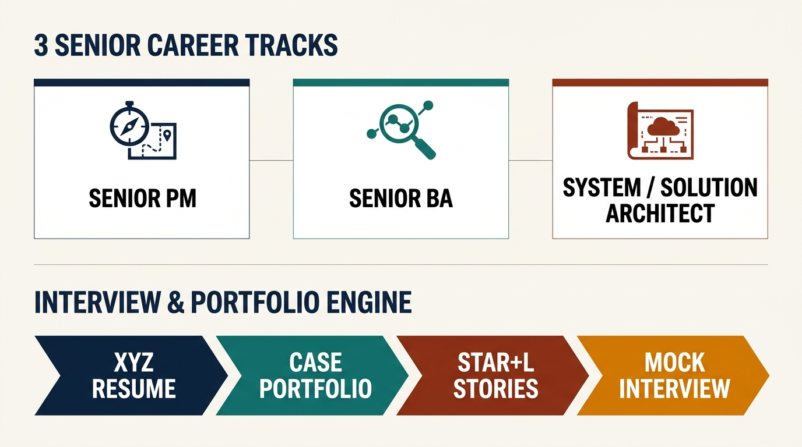
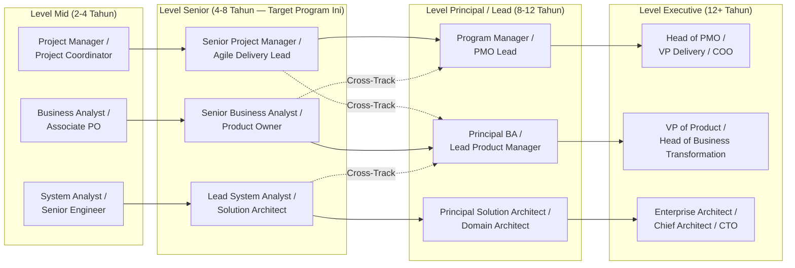
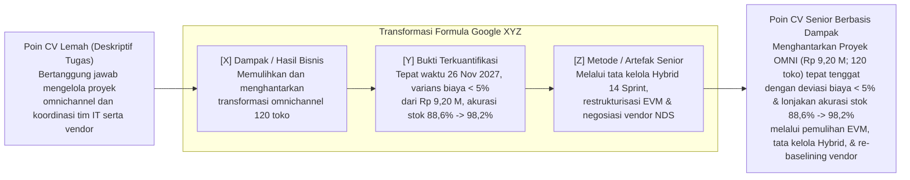
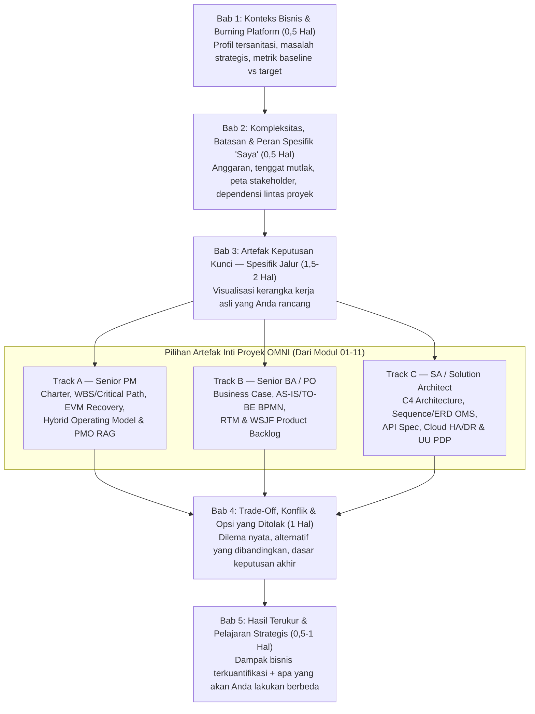
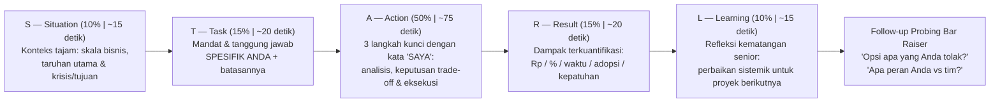
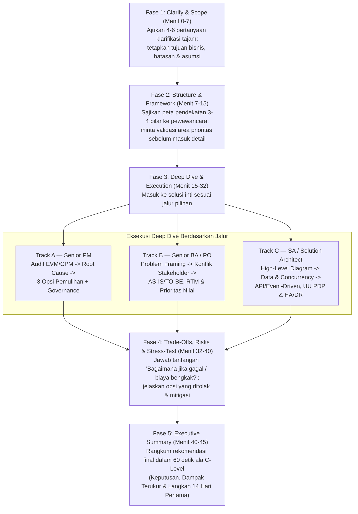
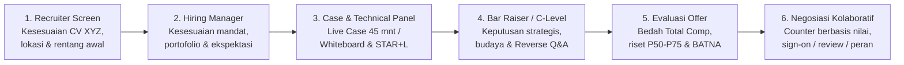

# Modul 12: Career Positioning & Interview Simulation

## 1. Identitas Modul

| Atribut | Keterangan |
|---------|------------|
| **Kelompok Jalur** | Executive & Career Advancement — **Capstone Akhir** (Semua Jalur: Senior PM, Senior BA, dan System Analyst / Solution Architect) |
| **Level Kompetensi** | Senior / Executive (setara *Hiring Bar* Senior PM/PgMP, Senior BA/CBAP, dan Lead System Analyst / Solution Architect) |
| **Durasi Pembelajaran** | **12 jam sesi terstruktur** (4 sesi × 3 jam) + **±6 jam tugas Capstone akhir** |
| **Prasyarat** | Telah lulus **Jalur Utama PM (Modul 01–05)** *atau* **Jalur Alternatif BA/SA (Modul 06–09)**, serta telah menyelesaikan **Modul 10** (*Business Strategy & Financial Management*) dan **Modul 11** (*Leadership, Negotiation & Executive Communication*) |
| **Peran Sasaran** | Senior Project Manager, Program Manager, PMO Lead, Senior Business Analyst, Lead Product Owner, System Analyst, Solution Architect, serta praktisi berpengalaman (±3–8 tahun) yang membidik promosi atau transisi ke peran *Senior / Lead / Principal* |
| **Keluaran Utama** | 1) CV Berbasis Dampak (*Impact-Driven XYZ Resume*) 1–2 halaman & Profil LinkedIn teroptimasi; 2) *Capstone Case Study Portfolio* 3–5 halaman berbasis **Proyek OMNI** (atau proyek nyata tersanitasi NDA); 3) *STAR+L Story Bank* (8 skenario kepemimpinan inti); 4) Hasil Simulasi *Mock Interview* (*Behavioral* + *Live Case / System Design*) sesuai jalur; 5) Strategi Negosiasi *Total Compensation* & Rencana 30–60–90 Hari Pertama |
| **Ketentuan Kelulusan Capstone** | Sesuai ketentuan program di `README.md`, kelulusan jalur mensyaratkan peserta lulus seluruh modul wajib di jalurnya (**≥ 70**) **serta lulus Capstone Modul 12 (Portofolio + *Mock Interview*) dengan nilai minimal ≥ 75** |

---

## 2. Gambaran Modul

Di pasar kerja teknologi dan transformasi bisnis tingkat senior, terdapat sebuah paradoks yang sangat sering dijumpai oleh para *Hiring Manager* dan *Executive Bar Raiser*: **banyak praktisi yang sebenarnya tangguh di lapangan justru gugur sebelum mencapai ruang wawancara—atau tumbang pada wawancara panel terakhir—bukan karena kurang kompeten, melainkan karena gagal mengomunikasikan nilai bisnisnya secara presisi**. Bayangkan seorang praktisi yang telah memimpin inisiatif sebesar **Proyek OMNI** di PT Sinar Nusantara Retail Tbk (SNR) — anggaran **Rp 9,20 M**, 120 toko fisik, 3 *Distribution Center* (DC), tenggat mutlak **26 November 2027**, memulihkan krisis **SPI 0,90 / CPI 0,94** di Bulan ke-9, mengawal kepatuhan **UU PDP** dan **FinPay PCI-DSS**, serta mendorong lonjakan kontribusi omzet digital dari **3,5% menjadi 15%** — namun di dalam CV-nya ia hanya menulis: *"Bertanggung jawab mengelola rapat proyek omnichannel, membuat laporan mingguan, dan berkoordinasi dengan vendor."* Bagi perekrut senior, kalimat semacam itu tidak membuktikan dampak apa pun; ia terdengar seperti pelaksana tugas (*task coordinator*), bukan pemilik hasil bisnis (*business outcome owner*).

Sebaliknya, kandidat yang memahami **arsitektur *hiring rubric* level senior** menyadari bahwa wawancara bukan sekadar sesi tanya jawab memori teknis. Panel rekrutmen—yang lazimnya terdiri dari *Recruiter*, *Hiring Manager*, rekan lintas fungsi (*Product/Engineering/Business*), *Hiring Bar Raiser*, hingga VP/C-Level—sebenarnya sedang mengukur empat sinyal utama: apakah Anda mampu **menavigasi ambiguitas**, mengambil **keputusan *trade-off* berbasis data finansial dan risiko**, memengaruhi pemangku kepentingan tanpa bergantung pada otoritas struktural semata, serta **menghantarkan dampak bisnis terukur** secara berulang.

**Modul 12** merupakan puncak integrasi (**Capstone**) dari seluruh perjalanan 12 modul buku ajar ini. Alih-alih membiarkan artefak yang telah Anda pelajari di Modul 01–11 mengendap sebagai teori, modul ini mengubah seluruh penguasaan Anda pada **Proyek OMNI** dan **Program Nusantara 2028 (Rp 18,50 M)** menjadi persenjataan karier nyata bagi ketiga jalur profesi: **Senior Project Manager / Program Manager (Track A)**, **Senior Business Analyst / Product Owner (Track B)**, dan **System Analyst / Solution Architect (Track C)**. Anda akan membedah *career positioning* dan nilai strategis sertifikasi industri, merombak CV menjadi format **Google XYZ** yang ramah ATS, menyusun **Capstone Case Study Portfolio** yang patuh kerahasiaan NDA, melatih *Story Bank* **STAR+L** yang tahan uji *probing*, menjalani simulasi *Live Case & Whiteboard System Design Interview* 45 menit, hingga merancang strategi negosiasi **Total Compensation** dan **Rencana 30–60–90 Hari Pertama** agar Anda langsung bersinar sejak pekan pertama menduduki peran senior baru.

---

## 3. Capaian Pembelajaran

Setelah menyelesaikan Modul 12, peserta mampu:

1. **Merumuskan** strategi *career positioning* untuk peran **Senior PM**, **Senior BA**, atau **System Analyst / Solution Architect** berdasarkan *hiring rubric* level senior, serta menilai secara objektif kapan sertifikasi industri (PMP, PMI-ACP, PgMP, CBAP, PMI-PBA, TOGAF, AWS/GCP Solutions Architect, PSPO/PSM) memberikan daya ungkit nyata versus kapan portofolio dampak tetap menentukan.
2. **Menyusun** CV 1–2 halaman yang *ATS-friendly* dan berbasis dampak bisnis menggunakan formula **Google XYZ** dan **CAR/PAR**, serta mengoptimalkan profil LinkedIn dan jejak *personal branding* profesional.
3. **Mengemas** artefak nyata lintas disiplin (dari Modul 01–11 berbasis Proyek OMNI atau proyek aktual peserta) menjadi **Capstone Case Study Portfolio** 3–5 halaman yang meyakinkan *Hiring Manager* dan eksekutif C-Level sambil memenuhi protokol sanitasi kerahasiaan **NDA & UU PDP**.
4. **Menyampaikan** jawaban wawancara perilaku (*behavioral interview*) yang terstruktur, terkuantifikasi, dan akuntabel ("Saya", bukan "Kami") dalam durasi 2–3 menit menggunakan kerangka **STAR+L** dan *Story Bank* 8 skenario kepemimpinan inti.
5. **Menyelesaikan** simulasi wawancara studi kasus dan teknis 45 menit (*Mock Interview*) secara sistematis pada salah satu dari tiga jalur: *Delivery Crisis* (Senior PM), *Ambiguous Executive Request* (Senior BA/PO), atau *High-Concurrency System Design* (SA/Solution Architect).
6. **Mengevaluasi** struktur penawaran kerja (*Total Compensation*), menegosiasikan kompensasi berbasis data pasar dan **BATNA**, mengajukan pertanyaan strategis balik ke pewawancara eksekutif, serta menyusun **Rencana 30–60–90 Hari Pertama** di peran baru.

---

## 4. Rencana Sesi

Pembelajaran tatap muka atau lokakarya daring dilaksanakan dalam **4 sesi × 3 jam = 12 jam** dengan komposisi **±30% konsep (3,5 jam)**, **±50% workshop CV, portofolio, dan *mock interview* berbasis Proyek OMNI (6,0 jam)**, serta **±20% umpan balik *Bar Raiser* dan refleksi (2,5 jam)**.

| Sesi | Durasi | Topik Utama | Konsep (±30%) | Workshop Kasus & Simulasi (±50%) | Umpan Balik & Refleksi (±20%) |
|------|--------|-------------|---------------|----------------------------------|-------------------------------|
| **Sesi 1** | 3 jam | **Career Positioning, Hiring Rubric, Sertifikasi & CV Berbasis Dampak (XYZ)** | 55 menit: Peta jenjang Mid → Executive; *hiring rubric* 3 jalur; ROI sertifikasi; mekanisme ATS; formula **Google XYZ** & **CAR/PAR** | 90 menit: Bedah & rombak 6 poin CV lemah menjadi poin XYZ berbasis data Proyek OMNI; audit 10 detik profil LinkedIn & *headline positioning* | 35 menit: *Peer-review* CV dengan kacamata *Hiring Manager*; identifikasi 3 *red flags* utama pada CV peserta |
| **Sesi 2** | 3 jam | **Capstone Case Study Portfolio (3–5 Halaman) & Sanitasi NDA** | 50 menit: Anatomi portofolio 5 bab; pemilihan artefak kunci dari Modul 01–11 per jalur (PM/BA/SA); protokol sanitasi kerahasiaan NDA & UU PDP | 90 menit: Menyusun *Executive One-Pager* & kerangka 5 bab *Capstone Portfolio* Proyek OMNI sesuai jalur pilihan peserta | 40 menit: *Gallery critique* — simulasi presentasi portofolio 5 menit ke panel *VP/Director* & verifikasi kepatuhan NDA |
| **Sesi 3** | 3 jam | **Behavioral Interview (STAR+L) & Story Bank 8 Skenario Inti** | 55 menit: Psikologi *Bar Raiser*; struktur **STAR+L** & anggaran waktu 2–3 menit; teknik menghadapi *onion-peeling probing*; *anti-patterns* wawancara | 90 menit: Menyusun *Story Bank* 8 cerita inti berbasis peristiwa Proyek OMNI (krisis Bulan ke-9, resistensi toko, *scope creep*) & *role-play* berpasangan berbatas waktu | 35 menit: Kalibrasi skor *Bar Raiser* (*Strong Hire* vs *Lean No Hire*); bedah jebakan jawaban "Kami" vs "Saya" |
| **Sesi 4** | 3 jam | **Live Case / System Design Mock Interview (3 Jalur), Negosiasi Offer & Rencana 90 Hari** | 50 menit: Pohon keputusan wawancara studi kasus 45 menit (Track A/B/C); bedah *Total Compensation*, BATNA & ZOPA; pertanyaan balik C-Level; *First 90 Days Plan* | 90 menit: Simulasi *Mock Interview* langsung 3 jalur (Track A Krisis Delivery, Track B Permintaan Ambigu VP, Track C *Whiteboard* Reservasi Stok 2.500 TPM) + *role-play* negosiasi *offer* | 40 menit: *Debriefing* panel, kuis pemantapan akhir, pengenalan rubrik kelulusan Capstone ≥ 75, dan penutupan program 12 modul |
| **Total** | **12 jam** | **4 Sesi Capstone Terpadu** | **3,5 jam (29%)** | **6,0 jam (50%)** | **2,5 jam (21%)** |

---

## 5. Materi



*Gambar 5.0 — Peta Terpadu Career Positioning (Senior PM, Senior BA, Solution Architect), Transformasi CV XYZ, Capstone Portfolio, Kerangka Wawancara STAR+L & Live Case 45 Menit, hingga Rencana 90 Hari Pertama.*

---

### 5.1 Arsitektur Karier, *Hiring Rubric* Level Senior & Strategi Sertifikasi

Salah satu kekeliruan paling mendasar dalam perencanaan karier adalah menganggap level **Senior** semata-mata ditentukan oleh **lamanya tahun bekerja** (*years of experience*). Kenyataannya, di perusahaan teknologi, konsultansi, perbankan, maupun korporasi ritel modern, perbedaan antara praktisi dengan 6 tahun pengalaman yang "mengulang tahun pertama sebanyak enam kali" dengan praktisi 5 tahun yang benar-benar beroperasi di level Senior sangatlah tajam. Perekrut senior menilai **cakupan dampak (*scope of impact*), derajat ambiguitas yang sanggup ditangani, serta kemampuan menggerakkan sistem dan manusia di luar kendali langsung**.

Secara struktural, setelah mencapai level **Senior**, karier praktisi manajemen proyek, analisis bisnis, dan arsitektur sistem bercabang ke dua lintasan utama yang sama bergengsinya: **Jalur Kontributor Individual Lanjutan (*Principal / Staff / Enterprise Architect Track*)** bagi mereka yang ingin memperdalam keahlian domain, arsitektur, dan pengaruh teknis-strategis tanpa harus memimpin departemen besar; serta **Jalur Kepemimpinan Struktural (*Management / Executive Track*)** menuju *Lead / Head of PMO / Program Director / VP Product / Chief Architect / CTO*.



*Gambar 5.1 — Peta Jalur Karier & Kompetensi Lintas Level dari Mid hingga Executive untuk Tiga Jalur Profesi (PM, BA/PO, dan SA/Solution Architect).*

#### Memahami *Hiring Rubric*: Ekspektasi Level Mid vs. Level Senior

Saat sebuah panel wawancara mengevaluasi kandidat, mereka tidak menggunakan "perasaan cocok", melainkan **Hiring Rubric** (matriks penilaian berbasis bukti perilaku dan kasus). Tabel berikut membedakan standar penilaian antara kandidat **Mid-Level** dan **Senior-Level** di ketiga jalur.

| Dimensi Evaluasi | Ekspektasi Level Mid (*Task Executor*) | Ekspektasi Level Senior (*Business Outcome Owner & Ambiguity Navigator*) |
|------------------|----------------------------------------|--------------------------------------------------------------------------|
| **Cara Menghadapi Ambiguitas** | Membutuhkan *brief*, ruang lingkup, dan arsitektur yang sudah jelas sebelum mulai bekerja | Mampu menerjemahkan permintaan eksekutif yang masih kabur menjadi *charter*, *problem statement*, *roadmap*, atau cetak biru solusi yang terukur |
| **Ukuran Keberhasilan** | *Output* selesai sesuai daftar tugas (dokumen terkumpul, *ticket* tertutup, rapat terlaksana) | *Outcome* dan dampak bisnis tercapai (ROI positif, akurasi stok naik dari 88,6% → ≥ 98,0%, *stockout* turun ke < 1,5%, kepatuhan UU PDP tuntas) |
| **Pengelolaan Risiko & Krisis** | Melaporkan masalah setelah keterlambatan terjadi dan menunggu arahan atasan | Mendeteksi sinyal dini (*leading indicators*, SPI/CPI, *bottleneck*), menyusun 2–3 opsi *trade-off* terkuantifikasi, dan membawa rekomendasi siap putus ke *Steering Committee* |
| **Pengaruh Lintas Fungsi** | Berkoordinasi di dalam satu tim atau divisi | Memengaruhi pemangku kepentingan senior yang berkonflik (mis. Marketing vs Store Ops vs CFO vs Vendor) tanpa mengandalkan otoritas struktural |
| **Penguasaan Finansial & Komersial** | Tidak terlibat dalam anggaran, kontrak, atau *Business Case* | Memahami NPV/IRR/Payback, *Earned Value* (EVM), *Cost of Delay*, struktur kontrak vendor (*Fixed Price* vs *T&M*), dan implikasi biaya arsitektur (*FinOps*) |
| **Dampak ke Tim (*Force Multiplier*)** | Fokus pada produktivitas pribadi | Meningkatkan kapabilitas tim melalui mentoring, standar artefak (RTM, ADR, *Governance*), dan eliminasi hambatan sistemik |

#### Peta Sertifikasi Industri: Kapan Membantu vs. Kapan Tidak Cukup?

Sertifikasi profesional yang kredibel berfungsi seperti **"paspor verifikasi bahasa bersama"** — ia membantu CV Anda melewati saringan awal perekrut/ATS, meyakinkan klien di sektor korporasi/BUMN/perbankan/konsultansi, serta memaksa Anda mempelajari kerangka kerja secara sistematis. Namun, **sertifikasi tidak pernah menggantikan portofolio dampak nyata**. Banyak kandidat bergelar PMP atau AWS Certified gugur di wawancara teknis karena hanya menghafal jawaban ujian tanpa pernah mengambil keputusan *trade-off* sungguhan di lapangan.

| Sertifikasi | Badan Penerbit | Jalur Utama | Nilai Tambah Tertinggi (*High ROI*) | Keterbatasan (*Kapan Tidak Cukup*) |
|-------------|----------------|-------------|-------------------------------------|------------------------------------|
| **PMP** (*Project Management Professional*) | PMI | Senior PM | Standar emas global lintas industri (korporasi, perbankan, telko, energi, IT); saringan kuat di ATS untuk peran *Senior PM / Delivery Lead* | Tidak membuktikan kemampuan menangani konflik politik eksekutif, negosiasi vendor nyata, atau krisis *hybrid delivery* |
| **PMI-ACP / PSM II / PSPO II** | PMI / Scrum.org | Senior PM & Senior BA/PO | Membuktikan penguasaan empiris *Agile/Scrum/Lean* di organisasi produk digital dan *hybrid delivery* | Sering dianggap teoritis jika kandidat tidak bisa menunjukkan metrik *velocity*, *release trade-off*, atau *product KPI* nyata |
| **PgMP** (*Program Management Professional*) | PMI | Program Manager / PMO Lead | Sangat bergengsi dan langka; membedakan pemimpin program multi-proyek (seperti Program Nusantara 2028) dari PM biasa | Membutuhkan rekam jejak nyata mengelola dependensi lintas proyek dan *benefits realization* skala besar |
| **CBAP / PMI-PBA** | IIBA / PMI | Senior BA | Pengakuan kuat di perusahaan besar, konsultansi, dan keuangan atas kedalaman elisitasi, *enterprise analysis*, dan tata kelola kebutuhan | Kurang berbobot di *tech startup* berbasis *Product Management* jika tidak diimbangi portofolio penemuan produk (*product discovery*) & metrik konversi |
| **TOGAF (Enterprise Architecture)** | The Open Group | Lead SA / Enterprise Architect | Sangat bernilai di korporasi besar, BUMN, perbankan, dan pemerintahan untuk menyelaraskan arsitektur bisnis, data, aplikasi, dan teknologi | Terlalu konseptual bagi peran *hands-on Solution Architect* bila tidak disertai kemampuan *system design* modern (API, *event-driven*, *cloud*) |
| **AWS / GCP Solutions Architect (Associate / Professional)** | Amazon Web Services / Google Cloud | SA / Solution Architect | Bukti konkret kompetensi arsitektur *cloud*, keandalan (*HA/DR*), keamanan, dan efisiensi biaya (*FinOps*) yang langsung diuji dalam *whiteboard interview* | Sekadar lulus ujian tanpa pengalaman mendesain sistem beban tinggi (*concurrency, locking, observability*) akan cepat terbongkar saat sesi *deep dive* |

> **Aturan Emas Strategi Sertifikasi:** Ambil **maksimal 1–2 sertifikasi paling relevan** dengan target industri Anda, bukan mengoleksi puluhan lencana generik. Jadikan sertifikasi sebagai **penguat kredibilitas** di samping **portofolio proyek terukur**—bukan penggantinya.

---

### 5.2 CV Berbasis Dampak (*Impact-Driven Resume*), ATS, LinkedIn & *Personal Branding*

Berbagai studi pelacakan mata perekrut menunjukkan bahwa *Recruiter* dan *Hiring Manager* rata-rata hanya menghabiskan **6 hingga 10 detik pada pemindaian pertama** (*initial F-pattern scan*) untuk memutuskan apakah sebuah CV layak dibaca mendalam atau langsung disingkirkan. Lebih dari itu, sebagian besar perusahaan menengah hingga multinasional menggunakan **Applicant Tracking System (ATS)** — perangkat lunak penyaring dan pengindeks CV berdasarkan kesesuaian kata kunci (*keyword matching*), struktur teks yang dapat dibaca mesin (*parseable text*), dan relevansi pengalaman.

#### Formula Google XYZ & Variasi CAR/PAR

Laszlo Bock, mantan *Senior Vice President of People Operations* di Google, memopulerkan formula penulisan pencapaian CV paling efektif di industri global yang dikenal sebagai **Formula Google XYZ**:

> **"Accomplished [X] as measured by [Y], by doing [Z]."**
> *(Mencapai dampak bisnis **[X]**, yang terukur oleh metrik **[Y]**, melalui tindakan/metode spesifik **[Z]**.)*

Untuk peran yang menuntut konteks masalah terlebih dahulu (terutama pada *Executive Summary* atau ringkasan proyek utama), Anda juga dapat menggunakan variasi **CAR** (*Challenge → Action → Result*) atau **PAR** (*Problem → Action → Result*). Namun, untuk setiap butir poin pengalaman (*bullet points*), **Formula XYZ** jauh lebih tajam karena langsung meletakkan **hasil dan angka di setengah baris pertama**, tepat di area yang pertama kali dibaca mata pewawancara.



*Gambar 5.2 — Alur Transformasi Poin CV Deskriptif Tugas menjadi Poin Berbasis Dampak Menggunakan Formula Google XYZ.*

#### Anatomi CV Senior 1–2 Halaman yang *ATS-Friendly*

| Bagian CV | Rekomendasi Standar Senior | Kesalahan yang Harus Dihindari |
|-----------|----------------------------|--------------------------------|
| **Header & Kontak** | Nama lengkap, target peran spesifik (mis. *Senior Project Manager \| Hybrid Delivery & Retail Transformation*), kota, email profesional, tautan LinkedIn & Portofolio | Memasang foto tidak relevan (kecuali diminta di wilayah tertentu), alamat rumah lengkap, status pernikahan, atau ikon grafis yang gagal dibaca ATS |
| **Executive Profile (3–4 baris)** | Ringkasan nilai jual unik: total pengalaman, skala anggaran/sistem terbesar, domain keahlian, dan 1–2 pencapaian angka puncak | Klise generik tanpa bukti: *"Pekerja keras, komunikatif, mampu bekerja dalam tim dan di bawah tekanan"* |
| **Core Competencies / Skills** | 12–18 kata kunci terkelompok rapi sesuai *job description* (mis. *Delivery & Governance*, *Analysis & Architecture*, *Tools & Compliance*) | Memakai batang progres visual (mis. *"Agile 4/5 bintang"*) yang tidak bermakna objektif dan rusak di mesin ATS |
| **Professional Experience** | Urutan kronologis terbalik; 1 baris konteks peran/skala (anggaran, jumlah tim/toko/pengguna), diikuti **4–6 butir XYZ** per peran terkini (2–3 butir untuk peran lama > 5 tahun) | Menyalinkan deskripsi pekerjaan (*job description*) 12 poin penuh kata *"Bertanggung jawab atas..."* atau *"Membantu..."* |
| **Education & Certifications** | Gelar terakhir, sertifikasi aktif dengan nomor/tahun (mis. *PMP® — Active*, *AWS Certified Solutions Architect*), dan penghargaan relevan | Mencantumkan riwayat SD/SMP/SMA atau sertifikat webinar 1 jam yang menenggelamkan sertifikasi utama |
| **Format Teknis ATS** | 1 kolom bersih (hindari *multi-column text box* kompleks), font standar (*Calibri, Inter, Georgia, Arial* 10–11 pt), margin 1,5–2 cm, simpan sebagai **PDF berbasis teks** (bukan gambar hasil pindai), panjang **maksimal 2 halaman** | Desain kanvas warna-warni penuh tabel bersarang, *header/footer* penting yang tidak terbaca *parser*, atau panjang 5 halaman |

> **Tips Estimasi Metrik Secara Jujur (*Bounded & Proxy Metrics*):** Bagaimana jika Anda tidak lagi memegang data laporan keuangan eksak dari proyek 2 tahun lalu? **Jangan pernah mengarang angka palsu** karena kebohongan mudah terbongkar saat sesi *probing* atau *reference check*. Gunakan tiga teknik etis: 1) **Skala & Volume Nyata** (jumlah toko, pengguna, SKU, anggota tim, durasi sprint), 2) **Rentang Konservatif** (mis. *"memangkas waktu proses rekonsiliasi sekitar 35%–40%"*), atau 3) **Metrik Proksi Terverifikasi** (jumlah *defect* UAT yang turun, SLA tiket yang membaik dari 48 jam ke 4 jam, kepatuhan 0 temuan *Critical* pada *PenTest*).

#### Optimasi Profil LinkedIn & *Personal Branding* Profesional

Di level senior, banyak peluang strategis (40%–60% posisi *Senior/Lead/Head*) tidak pernah dibuka di portal lowongan publik (*hidden job market*), melainkan dicari langsung oleh *Executive Recruiter* dan *Hiring Manager* melalui pencarian kata kunci di LinkedIn serta jejaring rujukan (*referral*).

1. **Headline Berbasis Nilai (220 karakter):** Jangan hanya menulis *"Senior PM at PT ABC"*. Gunakan formula: `[Peran Target] | [Domain & Skala Dampak] | [Keahlian Kunci / Sertifikasi]`. Contoh: *Senior Project & Program Manager (PMP®) | Leading Rp 9B–18B Omnichannel & Hybrid Transformations | Stakeholder Alignment, EVM & PMO Governance*.
2. **Bagian *About* yang Narasi-Bukti:** Paragraf 1 memuat masalah bisnis apa yang paling sering Anda pecahkan; Paragraf 2 menyajikan 3–4 pencapaian angka terkuat (format XYZ singkat); Paragraf 3 mencantumkan daftar keahlian kunci untuk *SEO Recruiter* serta ajakan kontak (*call-to-action*).
3. **Bagian *Featured* (Etalase Portofolio):** Sematkan tautan ke **Capstone Case Study Portfolio (tersanitasi NDA)**, artikel teknis/manajemen yang Anda tulis, atau rekaman sesi berbagi (*tech/PM talk*).
4. ***Personal Branding* yang Berbobot:** Bagikan 1–2 tulisan reflektif per bulan yang membedah pelajaran nyata (misalnya cara memulihkan *Watermelon Project*, pola *idempotency* pada integrasi *payment gateway*, atau cara menyelaraskan KPI toko fisik dan kanal digital) tanpa menyombongkan diri (*humble-brag*) dan tanpa membocorkan rahasia perusahaan.

---

### 5.3 Menyusun *Capstone Case Study Portfolio* (3–5 Halaman) & Sanitasi NDA

Pada level junior atau menengah, CV yang rapi sering kali sudah cukup mengantar kandidat ke tahap wawancara. Namun, pada level **Senior PM, Senior BA, dan Solution Architect**, persaingan semakin ketat karena hampir semua pelamar mengklaim *"pernah memimpin transformasi digital"*. Sebuah **Capstone Case Study Portfolio** setebal **3 hingga 5 halaman** (atau *deck* ringkas 8–10 *slide* + *Executive One-Pager* 1 halaman) adalah pembeda paling mematikan: ia memberikan **bukti visual cara Anda berpikir, menyusun struktur artefak, dan mengambil keputusan di bawah tekanan** sebelum wawancara dimulai.



*Gambar 5.3 — Anatomi Capstone Case Study Portfolio 5 Bab (3–5 Halaman) Berbasis Proyek OMNI dengan Spesialisasi Artefak untuk Jalur PM, BA, dan SA.*

#### Prinsip Emas Memilih & Menyajikan Studi Kasus
- **Kualitas Mengalahkan Kuantitas:** Cukup sajikan **2 hingga 3 studi kasus mendalam** (1 studi kasus unggulan lengkap seperti Proyek OMNI + 1–2 studi kasus ringkas 1 halaman) daripada 10 ringkasan dangkal.
- **Tonjolkan *Trade-Off*, Bukan Sekadar "Cerita Sukses Sempurna":** *Hiring Manager* berpengalaman justru curiga pada portofolio yang terlihat mulus tanpa hambatan. Bagian paling menarik bagi pewawancara adalah **Bab 4**: ketika Anda memperlihatkan dua opsi sulit yang sama-sama punya risiko, alasan objektif Anda memilih satu opsi (misalnya menerapkan *Mock API / Contract-First* saat POS-Modern terlambat 3 minggu daripada menunda seluruh *Go-Live*), dan bagaimana Anda memitigasi efek sampingnya.
- **Lampirkan Visual Asli yang Dibuat Ulang:** Gunakan diagram arsitektur, alur proses, tabel EVM, atau matriks prioritisasi yang bersih dan terbaca—bukan tangkapan layar buram beresolusi rendah.

#### Protokol Sanitasi Kerahasiaan (*NDA & UU PDP Compliance*)

Membagikan dokumen internal perusahaan lama secara mentah di dalam portofolio bukan hanya melanggar perjanjian kerahasiaan (*Non-Disclosure Agreement* / NDA) dan **UU No. 27 Tahun 2022 (UU PDP)**, melainkan juga menjadi **tanda bahaya integritas (*instant rejection*)** di mata calon perusahaan baru: *"Jika ia membocorkan rahasia perusahaan lamanya kepada kami hari ini, besok ia akan membocorkan rahasia kami kepada pesaing."*

| Kategori Informasi | DILARANG Keras Ditampilkan | Cara Sanitasi yang Aman & Profesional |
|--------------------|----------------------------|---------------------------------------|
| **Identitas Klien / Perusahaan & Tokoh** | Nama klien rahasia, nama asli eksekutif/vendor yang sedang bersengketa, kode proyek internal sensitif | Gunakan anonimisasi deskriptif: *"Perusahaan Ritel Nasional (120+ gerai, omzet > Rp 1,5 T)"* atau label *"Klien Ritel A / Vendor Implementasi X"* |
| **Data Finansial & Kontrak Rahasia** | Harga satuan kontrak vendor, margin rahasia per SKU, detail penalti legal, tangkapan layar *invoice* atau *ERP* | Gunakan **persentase perubahan** (*"deviasi biaya terjaga < 5%"*, *"omzet digital tumbuh 4,3×"*), atau **skala ordo** (*"anggaran skala Rp 8–10 M"*) |
| **Data Pribadi & Keamanan (UU PDP)** | Nama pelanggan, email, nomor HP, NIK, *token API*, alamat IP produksi, rincian celah *PenTest* yang belum ditutup | Gunakan data sintetis (*dummy data*), redaksi seluruh kredensial, dan tampilkan pola arsitektur keamanan secara konseptual |
| **Kode Sumber & Dokumen Asli Internal** | Salinan utuh BRD/FRD/ERD berlogo perusahaan lama atau repositori kode produksi | Gambar ulang (*re-create*) diagram struktur, sampel tabel tergeneralisasi, dan kerangka keputusan dalam format portofolio pribadi |

> **Peringatan Penting untuk Peserta Program Ini:** Jika Anda memakai **Proyek OMNI (PT Sinar Nusantara Retail)** sebagai *Capstone Portfolio*, cantumkan keterangan transparan di sampul: *"Capstone Simulation Case Study — Program Senior PM, BA & Solution Architecture"*, lalu sandingkan dengan 1 studi kasus dari pengalaman kerja asli Anda yang telah melalui *NDA Sanitization Checklist* pada Lampiran 11.2.

---

### 5.4 Menguasai Wawancara Perilaku (*Behavioral Interview*) dengan Kerangka **STAR+L** & *Story Bank*

Dalam wawancara perilaku (*behavioral interview*), pewawancara berpegang pada prinsip psikologi rekrutmen: **perilaku masa lalu yang terverifikasi pada situasi kompleks adalah prediktor terbaik bagi perilaku masa depan**. Pertanyaan umumnya diawali dengan *"Ceritakan saat Anda..."* (*Tell me about a time when...*). Di perusahaan berstandar tinggi (Amazon, Google, bank digital, dan konsultan global), peran **Bar Raiser**—pewawancara independen dari luar tim perekrut yang memiliki hak veto—bertugas mengupas jawaban Anda lapis demi lapis (*onion-peeling probing*) untuk memastikan cerita tersebut benar-benar berasal dari **tindakan pribadi Anda**, bukan kontribusi kolektif tim.

#### Struktur **STAR+L** & Pengelolaan Waktu 2–3 Menit

Banyak kandidat senior gagal bukan karena tidak punya cerita hebat, melainkan karena **terlalu lama bercerita tentang latar belakang (2 menit habis hanya di *Situation*)** sehingga bagian *Action* dan *Result* terburu-buru atau dipotong pewawancara. Solusinya adalah disiplin anggaran waktu **2 hingga 2,5 menit** (maksimal 3 menit) dengan proporsi **10%–15%–50%–15%–10%**:



*Gambar 5.4 — Alur Kerangka Jawaban Wawancara Perilaku STAR+L dengan Alokasi Waktu Ideal 2–2,5 Menit dan Antisipasi Probing Bar Raiser.*

- **Situation (10% — 2 sampai 3 kalimat):** Langsung masuk ke inti ketegangan. *"Pada Bulan ke-9 Proyek OMNI (Rp 9,20 M, 120 toko), kinerja kami turun ke SPI 0,90 dan CPI 0,94 akibat data loyalty 2× lebih kotor dan API POS-Modern mundur 3 minggu, sementara tenggat Go-Live 26 November 2027 tidak dapat ditawar."*
- **Task (15% — 2 kalimat):** Jelaskan peran spesifik dan dilemanya. *"Sebagai Senior PM, mandat saya adalah memulihkan jalur kritis sebelum Gate 3 tanpa melebihi pagu pendanaan Rp 9,80 M dan tanpa mengorbankan kepatuhan UU PDP."*
- **Action (50% — jantung jawaban, WAJIB subjek "Saya"):** Pecah menjadi 3 langkah strategis yang menunjukkan **penalaran Anda**: *"Pertama, saya melakukan audit jalur kritis dan... Kedua, saya menegosiasikan... Ketiga, saya mempresentasikan 3 opsi trade-off ke Steering Committee..."*
- **Result (15% — angka + validasi eksternal):** Tunjukkan dampak keras (*hard metrics*) dan dampak sosial (*soft impact*): *"Hasilnya, kami menutup keterlambatan 3 minggu, menjaga deviasi biaya akhir di bawah 4%, mencapai Go-Live tepat 26 November 2027, dan akurasi stok meningkat dari 88,6% ke 98,2%."*
- **Learning (10% — pembeda level Senior):** Tunjukkan pembelajaran sistemik yang Anda lembagakan setelahnya: *"Pelajaran terbesar bagi saya adalah tidak pernah mengasumsikan kualitas data legacy tanpa Data Profiling Sprint di Bulan ke-1; sejak itu, saya mewajibkan gerbang verifikasi data lebih awal pada setiap charter proyek baru."*

#### *Story Bank*: 8 Cerita Inti Level Senior (Dipetakan ke Proyek OMNI)

Anda tidak perlu menghafal 100 jawaban wawancara. Cukup siapkan **Story Bank berisi 8 cerita inti** yang dapat diputar ulang secara fleksibel (*multi-purpose stories*) untuk menjawab lebih dari 90% pertanyaan *behavioral* level senior:

| No | Tema Inti *Story Bank* | Sinyal Kompetensi yang Diuji *Bar Raiser* | Contoh Sumber Cerita dari Proyek OMNI |
|----|------------------------|-------------------------------------------|---------------------------------------|
| **1** | ***Stakeholder Conflict*** (Konflik Pemangku Kepentingan) | Empati, negosiasi berbasis kepentingan (*interest-based*), pengaruh tanpa otoritas | Menengahi konflik Head of Store Ops (Agus Setiawan — takut beban kasir & kanibalisasi omzet) vs VP Marketing (Dewi Lestari — menuntut SLA ambil 30 menit) hingga sepakat pada SLA ≤ 2 jam & skema atribusi omzet toko |
| **2** | ***Major Failure / Setback*** (Kegagalan & Akuntabilitas) | Kerendahan hati intelektual, tidak menyalahkan orang lain, ketangguhan & perbaikan sistemik | Asumsi awal migrasi 1,2 juta data *Sinar Member Card* meleset (62% duplikat/usang) sehingga memicu keterlambatan di Bulan ke-9 — pengakuan celah *early validation* dan pemulihannya |
| **3** | ***Navigating Ambiguity*** (Menavigasi Ambiguitas Tinggi) | *Problem framing*, pengambilan keputusan dengan data 70% lengkap, kemampuan menyusun struktur dari nol | Menerjemahkan arahan umum Direksi tentang "transformasi omnichannel" menjadi *Business Case*, arsitektur OMS, 14 *Sprint Backlog*, dan KPI terukur (kontribusi digital 3,5% → 15%) |
| **4** | ***Executive Pushback / Saying "No"*** (Menolak Permintaan Eksekutif) | Keberanian berbasis data, perlindungan *baseline* & nilai bisnis, komunikasi eksekutif | Menolak permintaan mendadak VP Marketing menambah fitur *live-shopping* & gamifikasi kompleks di tengah sprint melalui analisis dampak biaya/jadwal CCB dan memindahkannya ke Fase 2 |
| **5** | ***Scope or Schedule Crisis*** (Krisis Jadwal/Anggaran di Jalur Kritis) | *Triage* di bawah tekanan, penguasaan EVM/CPM, *crashing/fast-tracking/descoping* | Memulihkan status proyek di Bulan ke-9 (SPI 0,90, CPI 0,94, proyeksi EAC Rp 9,80 M) agar tetap *Go-Live* 26 Nov 2027 melalui *Contract-First Mock API*, *staged rollout* 3 gelombang, dan kontrol *Contingency Reserve* |
| **6** | ***Cross-Team / Cross-Project Dependency*** (Ketergantungan Lintas Tim) | Berpikir sistemik, manajemen dependensi, diplomasi lintas PM/divisi | Mengatasi keterlambatan rilis API 3 minggu dari proyek paralel **POS-Modern** dan perebutan 3 *senior architect* bersama **ERP-Refresh** & **DataHub** dalam Program Nusantara 2028 |
| **7** | ***Vendor Dispute / Commercial Negotiation*** (Sengketa Vendor/Komersial) | Ketajaman kontraktual, pengelolaan konflik komersial, perlindungan kepentingan perusahaan | Menyelesaikan sengketa interpretasi lingkup pada kontrak *Fixed Price* Rp 4,40 M dengan PT NDS (Bambang Hartono) secara adil berbasis *Scope Baseline*, RTM, dan mekanisme *Change Control* |
| **8** | ***Architectural or Product Trade-Off*** (Keputusan *Trade-Off* Solusi) | Kedalaman teknis/produk, pertimbangan biaya-risiko-skalabilitas, keputusan jangka panjang | Memilih arsitektur *near-real-time Event-Driven Sync* (jeda ≤ 60 detik + *Inventory Reservation Lock*) ketimbang sinkronisasi *real-time synchronous* ke POS *legacy* demi menahan 2.500 TPM dan menghindari *single point of failure* |

---

### 5.5 Simulasi Wawancara Studi Kasus & Teknis untuk 3 Jalur (*Mock Interview Playbook*)

Jika wawancara perilaku menguji *masa lalu* Anda, maka **Live Case Interview / Whiteboard System Design Interview (45 menit)** menguji **cara kerja otak Anda secara langsung (*real-time problem solving*)** saat dihadapkan pada masalah baru yang sengaja dibuat tidak lengkap. Kesalahan fatal 70% kandidat adalah langsung berlari ke solusi di menit ke-2. Kandidat *Strong Hire* justru mengendalikan alur percakapan secara tenang melalui **5 Fase Terstruktur 45 Menit**:



*Gambar 5.5 — Pohon Keputusan Live Case & System Design Interview 45 Menit Lintas 3 Jalur (PM, BA/PO, dan SA/Solution Architect).*

#### Playbook Track A — Senior Project Manager / Program Manager
- **Skenario Khas (*Delivery Crisis*):** *"Anda baru mengambil alih proyek transformasi ritel senilai Rp 10 M pada bulan ke-9. Jadwal mundur 4 minggu di jalur kritis, CPI berada di 0,88, vendor utama mengancam menagih biaya tambahan karena perubahan lingkup, namun Sponsor menegaskan tanggal Go-Live tidak boleh bergeser satu hari pun. Apa langkah Anda dalam 2 minggu pertama?"*
- **Peta Jawaban *Strong Hire*:**
  1. **Clarify (0–7 mnt):** Tanyakan apakah *deadline* bersifat regulasi/musiman (seperti Harbolnas) atau preferensi internal; mana fitur *must-have* vs *nice-to-have*; apakah *Contingency/Management Reserve* masih tersedia; serta jenis kontrak vendor (*Fixed Price* vs *T&M*).
  2. **Structure (7–15 mnt):** Bagi pendekatan menjadi 4 pilar: (1) *Diagnostic Triage* (Fakta Jalur Kritis & Akar CPI 0,88), (2) *Recovery Options* (Opsi lingkup/jadwal/biaya), (3) *Commercial & Vendor Alignment*, dan (4) *Executive Decision & Cadence*.
  3. **Deep Dive (15–32 mnt):** Bedah apakah deviasi disebabkan *scope creep* tak terkendali, produktivitas rendah, atau ketergantungan eksternal. Susun **3 paket opsi terkuantifikasi** untuk *Steering Committee*: Opsi 1 (*Fixed Date & Fixed Budget* → potong fitur *non-critical* lewat *MoSCoW/MVP* dan tunda ke Fase 2); Opsi 2 (*Fixed Date & Fixed Scope* → *crashing / fast-tracking* + cairkan *Reserve* dengan analisis risiko mutu); Opsi 3 (*Fixed Scope & Fixed Budget* → geser jadwal secara bertahap lewat *wave rollout*). Tunjukkan disiplin *Change Control Board* (CCB) saat bernegosiasi ulang dengan vendor.
  4. **Trade-Off & Summary (32–45 mnt):** Tegaskan bahwa **mutu keamanan & kepatuhan (UU PDP / PCI-DSS) tidak pernah boleh dikorbankan** demi jadwal. Tutup dengan rekomendasi tegas (umumnya kombinasi *MVP Phased Release* + *targeted crashing* di jalur kritis + ritme pelaporan mingguan anti-*Watermelon*).

#### Playbook Track B — Senior Business Analyst / Product Owner
- **Skenario Khas (*Ambiguous Executive Request*):** *"VP Marketing mendatangi Anda hari Senin pagi dan meminta tim segera membangun 'fitur omnichannel dan promo personalisasi cepat' sebelum kuartal depan karena kompetitor baru meluncurkannya. Tidak ada data riset, belum ada persetujuan operasional toko, dan tim engineering sedang penuh. Bagaimana Anda menanganinya?"*
- **Peta Jawaban *Strong Hire*:**
  1. **Clarify (0–7 mnt):** Jangan langsung menulis *User Story*! Gali *business objective* di balik permintaan ("Masalah apa yang ingin dipecahkan? Apakah konversi, retensi, atau pangsa pasar segmen muda yang turun 4%/tahun?"), definisi "sukses" dalam angka, target segmen pelanggan, serta batasan regulasi/operasional.
  2. **Structure (7–15 mnt):** Gunakan 4 langkah BA/PO senior: (1) *Problem Framing & Evidence Gathering*, (2) *Multi-Stakeholder Elicitation* (menggali suara yang belum diajak bicara: Store Ops, Supply Chain, Legal, IT), (3) *AS-IS vs TO-BE Process & Requirements Traceability (RTM)*, serta (4) *Value Prioritization & MVP Slicing*.
  3. **Deep Dive (15–32 mnt):** Jelaskan bagaimana Anda mengadakan *discovery workshop* lintas unit untuk memetakan kesenjangan *AS-IS* (mis. sinkronisasi stok *batch* pukul 00.00 WIB yang memicu *stockout* 11,4% dan antrean kupon manual 45 detik) menuju *TO-BE*. Pisahkan **Business Requirements → Stakeholder Requirements → Functional & Non-Functional Requirements (NFR)** dalam RTM. Gunakan **WSJF (*Cost of Delay / Job Size*)** atau **Impact vs. Effort** bersama Product Owner dan CTO untuk membuktikan bahwa memperbaiki akurasi stok dan *Click & Collect* MVP memberi nilai jauh lebih tinggi daripada langsung membangun promo personalisasi AI yang berat.
  4. **Trade-Off & Summary (32–45 mnt):** Jelaskan cara menjaga hubungan baik dengan VP Marketing (bukan sekadar menolak, melainkan menawarkan *phased roadmap*: Rilis 1 stabilisasi stok & voucher QR otomatis, Rilis 2 promo tersegmentasi berbasis data riil) beserta *acceptance criteria* terukur (*Given–When–Then*).

#### Playbook Track C — System Analyst / Solution Architect
- **Skenario Khas (*Live Whiteboard System Design*):** *"Rancang layanan reservasi stok Click & Collect untuk jaringan 120 toko dan 3 DC yang harus menangani beban puncak 2.500 transaksi per menit (TPM) saat Harbolnas 12.12 tanpa terjadi overselling, sinkronisasi stok ≤ 60 detik, patuh UU PDP & PCI-DSS, dengan ketersediaan ≥ 99,5%."*
- **Peta Jawaban *Strong Hire*:**
  1. **Clarify & Back-of-the-Envelope Estimation (0–7 mnt):** Klarifikasi sifat trafik: 2.500 TPM ≈ **42 transaksi *checkout*/detik** rata-rata puncak, namun *burst* saat detik pembukaan promo bisa mencapai **5×–10× (~250–400 RPS tulis)**, sedangkan trafik baca katalog/cek stok (*read-to-write ratio* ~20:1) bisa mencapai **5.000–8.000 RPS**. Pastikan batas konsistensi (*strong consistency* saat reservasi/pembayaran, *eventual consistency* ≤ 60 detik untuk tampilan katalog umum).
  2. **High-Level Architecture & Storage Decisions (7–15 mnt):** Pisahkan *Read Path* dan *Write Path* (pola **CQRS ringan**):
     - **SQL (PostgreSQL / Cloud SQL dengan partisi per `store_id`)** sebagai *System of Record* transaksi pesanan & tabel inventori karena membutuhkan garansi **ACID** untuk mencegah *overselling*.
     - **Redis Cluster (In-Memory Cache + Atomic Lua Script / Distributed Lock)** untuk melayani lonjakan baca stok per toko dan menahan reservasi sementara (*Soft Hold* dengan **TTL 15 menit** saat menunggu pembayaran FinPay).
     - **Event Streaming (Kafka / Pub-Sub) + Transactional Outbox Pattern** untuk sinkronisasi asinkron (*Event-Driven*) antara OMS, ERP pusat, WMS 3 DC, dan adaptor POS 120 toko — jauh lebih tangguh daripada pemanggilan *synchronous REST* berantai yang rapuh saat jaringan toko terganggu.
  3. **Deep Dive: Anti-Overselling, Resilience & Security (15–32 mnt):**
     - **Mekanisme Bebas *Overselling*:** Gunakan pembaruan atomik kondisional di basis data: `UPDATE store_inventory SET available_qty = available_qty - :qty, reserved_qty = reserved_qty + :qty WHERE store_id = :sid AND sku_id = :sku AND available_qty >= :qty` (atau *Optimistic Locking* berbasis kolom `version` untuk menghindari *deadlock* berat pada SKU populer), dikombinasikan dengan **`Idempotency-Key`** pada setiap permintaan API *checkout* dan *webhook* FinPay.
     - **Ketahanan (*Resilience*):** Terapkan ***Circuit Breaker*** dan *Dead Letter Queue* (DLQ) untuk memutus rambatan kegagalan bila API POS *legacy* atau *Payment Gateway* melambat; terapkan *safety stock buffer* (mis. menahan 2 unit terakhir di toko dari kanal daring jika jeda sinkronisasi toko melewati 60 detik).
     - **UU PDP & PCI-DSS:** Isolasi data pembayaran melalui **tokenisasi FinPay** (sistem OMNI tidak pernah menyimpan nomor kartu/CVV sehingga lingkup audit PCI-DSS menjadi minimal/SAQ-A); enkripsi PII pelanggan (*AES-256 at-rest, TLS 1.3 in-transit*), *Consent Ledger* tak terubah (*append-only*), *RBAC*, dan *masking* pada *log*.
     - **HA & DR:** Deployment *Multi-AZ* di Region Jakarta dengan *auto-scaling stateless microservices*, replika baca (*read replicas*), serta target **RPO ≤ 5 menit** dan **RTO ≤ 30 menit**.
  4. **Trade-Off & Summary (32–45 mnt):** Jelaskan mengapa Anda menolak *Two-Phase Commit (2PC)* lintas POS toko (terlalu lambat dan menciptakan *single point of failure* saat koneksi gerai terputus) lalu memilih pola **Saga + Kompensasi + Buffer Stok Toko**.

---

### 5.6 Evaluasi Penawaran, Negosiasi Kompensasi, Pertanyaan Balik C-Level & Rencana 90 Hari Pertama

Mendapatkan ucapan *"Selamat, kami ingin memberikan penawaran kepada Anda"* bukanlah garis finis, melainkan awal dari dua fase krusial yang menentukan kepuasan dan lintasan karier Anda selama 2–3 tahun ke depan: **negosiasi paket kompensasi total** dan **eksekusi 90 hari pertama**.



*Gambar 5.6 — Alur Proses Rekrutmen Level Senior dan Tahapan Strategi Evaluasi serta Negosiasi Total Compensation.*

#### Membedah *Total Compensation* (Bukan Hanya Gaji Pokok)

Kandidat berpengalaman selalu menghitung nilai tawaran secara **tahunan menyeluruh (*Annualized Total Compensation*)** dan membandingkannya pada lembar kerja yang sama:

| Komponen Kompensasi | Aspek yang Wajib Diverifikasi | Ruang Negosiasi Jika *Base Salary* Mentok (*Band Cap*) |
|---------------------|-------------------------------|--------------------------------------------------------|
| **1. Kompensasi Tunai Tetap (*Fixed Cash*)** | Gaji pokok bulanan × 12 + THR wajib (1×) + tunjangan tetap (transportasi/komunikasi/jabatan); status pajak (*Gross* vs *Nett*) | Negosiasikan penempatan di kuartil atas *grade* (P75) atau kenaikan ke *level/grade* lebih tinggi jika cakupan peran sebenarnya setara *Lead/Principal* |
| **2. Bonus Variabel & *Sign-On Bonus*** | Target bonus tahunan (mis. 1–3× gaji atau 10%–25%), basis pencapaian (kinerja perusahaan vs individu), serta *pro-rata* tahun pertama | **Sign-On Bonus** satu kali bayar untuk menutup selisih bonus tahunan yang hangus di perusahaan lama (*forfeited bonus*) |
| **3. Ekuitas / Insentif Jangka Panjang** | ESOP/RSU, jadwal *vesting* (lazimnya 4 tahun dengan *1-year cliff*), valuasi terkini, dan likuiditas (perusahaan terbuka vs tertutup) | Minta penambahan porsi ekuitas apabila perusahaan memiliki ruang kas bulanan terbatas |
| **4. Manfaat & Pengembangan Karier** | Asuransi kesehatan keluarga (*rawat inap/jalan*), anggaran sertifikasi/pelatihan tahunan (mis. perpanjangan PMP/AWS), perangkat kerja | Negosiasikan anggaran sertifikasi profesional, *early performance review* di Bulan ke-6 dengan kriteria tertulis, atau skema kerja *hybrid* |

#### Prinsip Negosiasi Kompensasi Berbasis Data & BATNA

1. **Tunda Menyebut Angka Sebelum Nilai Terbukti:** Pada tahap *Recruiter Screen*, jika ditanya ekspektasi gaji terlalu dini, hindari menyebut satu angka sempit. Berikan respons elegan: *"Prioritas utama saya saat ini adalah memastikan kecocokan ruang lingkup dan dampak peran ini. Berdasarkan riset pasar untuk peran Senior PM/SA di cakupan ini, apakah Anda dapat membagikan rentang anggaran yang disiapkan perusahaan untuk posisi ini?"* Jika tetap harus memberi angka, berikan **rentang berbasis riset pasar (P60–P80)** dengan catatan *"tergantung total paket kompensasi dan cakupan mandat"*.
2. **Bangun BATNA (*Best Alternative to a Negotiated Agreement*):** Daya tawar terkuat dalam negosiasi bukanlah retorika, melainkan **opsi alternatif nyata**—baik tawaran paralel dari perusahaan lain maupun posisi Anda saat ini yang tetap sehat. Tanpa BATNA yang jelas, Anda rentan menerima penawaran di bawah nilai pasar karena rasa takut kehilangan.
3. **Pahami ZOPA (*Zone of Possible Agreement*) & Gaya Kolaboratif:** Ingat bahwa *Hiring Manager* sudah menginvestasikan puluhan jam wawancara dan ingin Anda bergabung. Gunakan nada **"kita memecahkan masalah bersama"**—bukan ultimatum antagonistik. Tunjukkan antusiasme tulus terlebih dahulu, sajikan 2–3 bukti nilai spesifik yang Anda bawa (mis. pengalaman *hybrid delivery* skala Rp 9 M atau arsitektur beban tinggi 2.500 TPM), lalu ajukan permintaan penyesuaian dengan angka spesifik (mis. *"Rp 490 jt–Rp 500 jt/tahun"*, bukan sekadar *"lebih tinggi"*).
4. **Minta Waktu 24–48 Jam & Konfirmasi Tertulis:** Jangan pernah menerima atau menolak penawaran secara instan di telepon. Ucapkan terima kasih, minta ringkasan tertulis (*written offer*), evaluasi seluruh komponen secara tenang, lalu lakukan *counter-offer* sekali secara utuh (*bundled ask*) daripada menawar sepotong demi sepotong berkali-kali.

#### 6 Pertanyaan Cerdas Balik (*Reverse Interview Questions*) ke Pewawancara C-Level / Hiring Manager

Lima hingga sepuluh menit terakhir wawancara adalah momen ketika kandidat senior **membalikkan meja evaluasi** untuk menilai apakah perusahaan tersebut sehat bagi kariernya sekaligus membuktikan kedalaman berpikir strategisnya:

1. *"Jika saya bergabung dan kita duduk kembali 6 bulan dari sekarang lalu Anda berkata 'merekrut dia adalah keputusan terbaik tahun ini', pencapaian konkret apa yang sudah berhasil saya hantarkan?"* *(Mengungkap ekspektasi tersembunyi & KPI nyata.)*
2. *"Apa hambatan terbesar—baik teknis, proses, maupun keselarasan antar-divisi—yang saat ini menghambat tim atau program ini mencapai target tahunannya?"* *(Menguji transparansi organisasi & kompleksitas riil.)*
3. *"Bagaimana keputusan sulit mengenai konflik prioritas antar-departemen atau permintaan perubahan lingkup mendadak biasanya diselesaikan di sini?"* *(Mengukur maturitas tata kelola & sponsor.)*
4. *"Bagaimana budaya perusahaan saat sebuah proyek atau sistem menghadapi kabar buruk atau keterlambatan dini—apakah tim didorong untuk eskalasi cepat atau cenderung menjaga tampilan hijau?"* *(Mendeteksi risiko budaya Watermelon Project.)*
5. *(Khusus Track BA/SA): "Seberapa besar ruang pengaruh BA/Architect dalam membentuk solusi sejak tahap discovery, dibandingkan sekadar menerima spesifikasi yang sudah dikunci sebelumnya?"*
6. *"Bagaimana struktur dukungan eksekutif dan jalur pertumbuhan peran ini dalam 18–24 bulan ke depan seiring skala bisnis bertumbuh?"*

#### Cetak Biru Rencana 30–60–90 Hari Pertama (*First 90 Days Plan*)

Merujuk riset klasik Michael Watkins dalam *The First 90 Days*, keberhasilan atau kegagalan seorang pemimpin senior di organisasi baru sangat ditentukan pada **tiga bulan pertama**—periode ketika Anda harus mencapai *break-even point* (titik ketika nilai yang Anda kontribusikan melampaui nilai yang Anda konsumsi dari organisasi). Langkah pertamanya adalah mendiagnosis konteks situasi menggunakan model **STARS** (*Start-up, Turnaround, Accelerated Growth, Realignment,* atau *Sustaining Success*), karena gaya eksekusi pada proyek krisis (*Turnaround*) jelas berbeda dari sistem yang sudah mapan (*Sustaining Success*).

```mermaid
flowchart LR
    subgraph H1["Hari 1-30: Listen, Diagnose & Align"]
        D1["Audit 1-on-1 dengan 10-15<br/>Stakeholder Kunci & Tim Inti"]
        D2["Tinjau Baseline: Charter/EVM,<br/>Backlog/RTM atau Arsitektur & Insiden"]
        D3["Klasifikasi Situasi STARS &<br/>Sepakati Ekspektasi 90 Hari dgn Atasan"]
    end

    subgraph H2["Hari 31-60: Deliver Quick Wins & Build Systems"]
        Q1["Eksekusi 1-2 Quick Wins<br/>(Dampak Cepat, Risiko Politik Rendah)"]
        Q2["Perbaiki Ritme Tata Kelola:<br/>RAID Log / Ritual Sprint / ADR"]
        Q3["Tutup Celah Dependensi &<br/>Bangun Koalisi Lintas Fungsi"]
    end

    subgraph H3["Hari 61-90: Scale Impact & Strategic Ownership"]
        O1["Kepemilikan Penuh Target<br/>Kuartalan & Metrik Bisnis"]
        O2["Sajikan Roadmap 6-12 Bulan<br/>& Rekomendasi Strategis ke Eksekutif"]
        O3["Tinjauan Kinerja 90 Hari &<br/>Pengembangan Kapabilitas Tim"]
    end

    D1 --> D2 --> D3 --> Q1 --> Q2 --> Q3 --> O1 --> O2 --> O3
```



*Gambar 5.7 — Peta Rencana 30–60–90 Hari Pertama di Peran Senior Baru dari Fase Diagnosis hingga Kepemilikan Dampak Strategis.*

> **Aturan Emas Hari 1–30:** **Jangan pernah mengkritik warisan pendahulu atau merombak proses besar di minggu kedua** sebelum Anda memahami *mengapa* sistem lama dibangun demikian (*Chesterton's Fence*). Bangun kepercayaan melalui rasa ingin tahu yang tulus, lalu biarkan 1–2 *quick wins* di Hari 31–60 berbicara atas nama kredibilitas Anda.

---

### 5.7 Kesalahan Umum di Lapangan (*Anti-Patterns*) saat Melamar & Wawancara Senior

Berikut adalah **lima *anti-pattern* paling fatal** yang secara konsisten menyebabkan kandidat berpengalaman gagal di tahap *screening* maupun panel *Bar Raiser*, beserta cara mengatasinya:

| No | *Anti-Pattern* | Gejala Khas di Lapangan | Mengapa Fatal di Mata *Hiring Bar Raiser* | Solusi Praktis Standar Senior |
|----|----------------|-------------------------|-------------------------------------------|-------------------------------|
| **1** | **CV Berisi *Job Description* Tanpa Angka** (*Task Laundry List*) | 80% poin CV diawali *"Bertanggung jawab atas..."*, *"Membantu koordinasi..."*, tanpa skala anggaran, pengguna, atau hasil | Gagal melewati filter 10 detik dan ATS; tidak bisa membedakan kandidat dari koordinator junior yang sekadar hadir di rapat | Ubah setiap butir pencapaian menjadi formula **Google XYZ** yang menonjolkan hasil, metrik kuantitatif, dan metode spesifik |
| **2** | **Menjawab "Kami" Bukan "Saya"** (*The Royal "We" Trap*) | Di sepanjang cerita STAR, kandidat terus berkata *"Kami merancang...", "Tim kami memutuskan...", "Kami akhirnya menyelesaikan..."* | *Bar Raiser* tidak dapat memverifikasi apakah kandidat adalah arsitek keputusan utama atau sekadar penumpang di proyek tim yang hebat | Akui peran tim secara singkat di *Situation/Result*, lalu gunakan subjek **"Saya"** secara tegas pada seluruh bagian *Action* |
| **3** | **Langsung Lompat ke Solusi di *Case Interview*** (*Premature Solutioning*) | Baru 30 detik mendengar soal kasus, kandidat langsung menggambar *microservices* atau menyarankan potong fitur tanpa bertanya apa pun | Membuktikan pola pikir reaktif yang berbahaya di dunia nyata: menyelesaikan masalah yang salah dengan biaya mahal | Wajib luangkan **5–7 menit pertama** untuk bertanya klarifikasi tujuan bisnis, batasan, skala, dan *stakeholder* sebelum menyusun struktur |
| **4** | **Menjelekkan Perusahaan, Atasan, atau Tim Lama** (*Blame Shifting*) | Saat ditanya alasan pindah atau cerita kegagalan, kandidat menyalahkan *"atasan tidak visioner"*, *"tim IT lamban"*, atau *"manajemen toksik"* | Memicu alarm merah kecerdasan emosional dan akuntabilitas (*low ownership*); pewawancara khawatir budaya timnya akan dirusak | Gunakan bingkai netral-konstruktif: fokus pada aspirasi pertumbuhan ke depan (*pull factors*), dan pada cerita kegagalan akui porsi tanggung jawab Anda + pembelajarannya |
| **5** | **Tidak Menyiapkan Pertanyaan Strategis ke Pewawancara** (*Passive Candidate Syndrome*) | Saat diberi kesempatan bertanya di akhir sesi, kandidat menjawab *"Sudah cukup jelas, tidak ada pertanyaan"* atau hanya bertanya soal jam pulang/cuti | Menandakan kurangnya rasa ingin tahu strategis, persiapan minim, dan pola pikir transaksional alih-alih mitra kepemimpinan | Siapkan 4–6 *Reverse Interview Questions* yang menyoroti definisi sukses 6 bulan, hambatan strategis, dan tata kelola pengambilan keputusan |

---

## 6. Studi Kasus: Penerapan Capstone Proyek OMNI untuk 3 Jalur Karier

Bagian ini memperlihatkan secara konkret bagaimana seluruh konteks **Proyek OMNI** (anggaran baseline **Rp 9,20 M**, *Management Reserve* **Rp 0,60 M**, 120 toko fisik, 3 DC, tenggat **26 November 2027**, pemulihan krisis Bulan ke-9 **SPI 0,90 / CPI 0,94**, bagian dari **Program Nusantara 2028 Rp 18,50 M**, target omzet digital **3,5% → 15%**, akurasi stok **88,6% → ≥ 98,0%**, *stockout* **11,4% → < 1,5%**, **500.000 MAU**, SLA *Click & Collect* **≤ 2 jam**, **2.500 TPM**, **UU PDP**, dan **FinPay PCI-DSS**) diolah menjadi tiga artefak karier siap adaptasi: **Transformasi CV *Before vs. After***, **Portofolio Capstone 1-Halaman**, serta **Transkrip Simulasi *Mock Interview* lengkap dengan Evaluasi *Bar Raiser***.

---

### 6.1 Transformasi CV (*Before vs. After*) — 3 Profil Kandidat Proyek OMNI

#### Profil A — Fajar Nugroho (Target: Senior Project Manager / Program Manager)

| Kondisi *Before* (Lemah — Deskriptif Tugas) | Kondisi *After* (Kuat — Formula Google XYZ Berbasis Dampak) |
|---------------------------------------------|-------------------------------------------------------------|
| Bertanggung jawab memimpin Proyek OMNI dari inisiasi sampai *Go-Live* sesuai jadwal dan anggaran perusahaan. | **Menghantarkan transformasi omnichannel *flagship* (Proyek OMNI, Rp 9,20 M; 120 toko & 3 DC) tepat tenggat 26 Nov 2027** dengan deviasi biaya akhir **< 4%** dan kontribusi omzet digital tumbuh menuju target **15%** (dari 3,5%), melalui penerapan tata kelola *Hybrid* (Stage-Gate + 14 Sprint Scrum). |
| Memantau progres bulanan proyek dan membuat laporan status jika terjadi keterlambatan jadwal atau pembengkakan biaya. | **Memulihkan keterlambatan jadwal 3 minggu dan proyeksi defisit Rp 0,60 M di Bulan ke-9 (SPI 0,90; CPI 0,94)** kembali ke jalur hijau sebelum *Gate 3*, dengan mengoordinasikan *Contract-First Mock API* terhadap proyek paralel POS-Modern, *staged wave rollout* (10→30→40→40 toko), dan kontrol ketat *Contingency Reserve* Rp 0,70 M. |
| Mengelola hubungan dengan vendor IT dan melakukan koordinasi dengan tim operasional toko saat peluncuran sistem baru. | **Menekan eskalasi biaya *Change Request* vendor *Fixed Price* (Rp 4,40 M) sebesar 65% dan mencapai 100% adopsi *Click & Collect* di 120 toko (SLA ≤ 2 jam pada ≥ 95% pesanan)** melalui penegakan *Change Control Board* berbasis RTM serta program *training-of-trainers* bagi 1.440 staf toko. |
| Terlibat dalam rapat koordinasi Program Nusantara 2028 bersama PMO dan pimpinan proyek lainnya. | **Menyelaraskan 4 proyek saling bergantung dalam Program Nusantara 2028 (Rp 18,50 M)** dan mengeliminasi konflik alokasi 3 *senior architect* bersama Enterprise PMO, dengan membangun *Cross-Project Dependency Matrix* dan *Anti-Watermelon Executive RAG Dashboard*. |

#### Profil B — Nadia Putri (Target: Senior Business Analyst / Lead Product Owner)

| Kondisi *Before* (Lemah — Deskriptif Tugas) | Kondisi *After* (Kuat — Formula Google XYZ Berbasis Dampak) |
|---------------------------------------------|-------------------------------------------------------------|
| Mengumpulkan kebutuhan dari pengguna bisnis dan menulis dokumen BRD, FRD, serta *User Stories* untuk tim developer. | **Menerjemahkan visi transformasi omnichannel Direksi menjadi 100% spesifikasi terverifikasi (*BRD, FRD, 180+ User Stories* & RTM) dengan tingkat *rework* UAT < 3%**, melalui fasilitasi *discovery workshop* lintas 8 divisi dan validasi *acceptance criteria Given–When–Then* sebelum tiap sprint. |
| Membantu memperbaiki proses bisnis *Click & Collect* dan program loyalty pelanggan di toko dan aplikasi web. | **Menurunkan pembatalan pesanan *stockout* dari 11,4% menjadi < 1,5% dan memangkas waktu antrean penebusan kupon kasir sebesar 45 detik/transaksi**, dengan merancang ulang proses *AS-IS ke TO-BE* (BPMN) untuk *Store Fulfillment* SLA ≤ 2 jam serta mesin loyalty QR terpadu. |
| Membantu membersihkan data pelanggan lama agar bisa dipindahkan ke aplikasi loyalty baru. | **Meningkatkan kelayakan migrasi basis pelanggan dari 38% data bersih menjadi 800.000+ anggota loyalty digital terverifikasi** (mendukung target *repeat purchase* +25%), dengan merumuskan aturan *data cleansing*, deduplikasi, dan alur *re-consent* patuh **UU PDP** atas 1,2 juta catatan lama. |
| Mengatur urutan backlog fitur bersama tim Marketing dan IT selama pengembangan aplikasi mobile. | **Melindungi linimasa rilis 14 Sprint dari *scope creep* senilai ±Rp 1,10 M tanpa menurunkan skor kepuasan pemangku kepentingan**, melalui penerapan kerangka prioritisasi **WSJF** dan *Value-vs-Effort Roadmap* yang menggeser fitur non-kritis (gamifikasi/*live-shopping*) ke Fase 2. |

#### Profil C — Dimas Prasetyo (Target: System Analyst / Solution Architect)

| Kondisi *Before* (Lemah — Deskriptif Tugas) | Kondisi *After* (Kuat — Formula Google XYZ Berbasis Dampak) |
|---------------------------------------------|-------------------------------------------------------------|
| Merancang arsitektur sistem, basis data, dan API integrasi antara aplikasi mobile, ERP, WMS, dan POS toko. | **Merancang arsitektur *OMS & Event-Driven Inventory Sync Layer* yang meningkatkan akurasi stok lintas kanal dari 88,6% ke ≥ 98,0% (jeda sinkronisasi ≤ 60 detik)** di 120 toko dan 3 DC, menggantikan sinkronisasi *batch* tengah malam dengan pola *Transactional Outbox* dan API *middleware* terdekoupel. |
| Memastikan sistem bisa berjalan lancar saat traffic tinggi dan tidak terjadi masalah stok ganda. | **Meluluskan uji beban puncak 2.500 TPM (16× kapasitas lama 150 TPM) dengan nol insiden *overselling* dan ketersediaan ≥ 99,5%**, melalui kombinasi penyimpanan *ACID* PostgreSQL berpartisi, *atomic soft-hold* Redis (TTL 15 mnt), *Idempotency-Key*, dan pola *Circuit Breaker* pada adaptor POS *legacy*. |
| Menangani integrasi pembayaran *payment gateway* serta memastikan keamanan aplikasi sesuai aturan hukum. | **Mencapai kepatuhan 100% UU PDP dan kelulusan audit *Penetration Testing* dengan 0 temuan *Critical/High*** sekaligus menjaga latensi *checkout* p95 < 500 ms, melalui tokenisasi **FinPay PCI-DSS (SAQ-A)**, enkripsi PII *AES-256/TLS 1.3*, dan *immutable consent ledger*. |
| Membuat dokumentasi teknis seperti ERD, *sequence diagram*, dan konfigurasi server *cloud* di AWS/GCP. | **Memangkas waktu *onboarding* 18 insinyur vendor PT NDS sebesar 40% dan menekan estimasi biaya infrastruktur *cloud* sebesar 18%**, melalui standarisasi cetak biru **C4 Model**, *OpenAPI Contract-First*, *Architecture Decision Records* (ADR), serta rancangan *Multi-AZ Auto-Scaling* Region Jakarta. |

---

### 6.2 Cetak Biru Portofolio Capstone 1-Halaman (*Executive One-Pager* — Tersanitasi NDA)

> **Catatan Sanitasi:** Contoh di bawah ini adalah versi *Executive One-Pager* (halaman pembuka dari portofolio lengkap 4 halaman) yang dirancang agar *Hiring Manager* dan *VP* menangkap bobot keputusan Anda dalam 90 detik membaca.

| Dimensi Ringkasan | Profil Capstone Proyek OMNI (Tersanitasi NDA) |
|-------------------|-----------------------------------------------|
| **Judul Studi Kasus** | **Transformasi Omnichannel, *Click & Collect*, & *Digital Loyalty* Nasional (120 Toko & 3 DC)** |
| **Status & Sumber** | *Simulasi Capstone Program Senior PM/BA/SA — Berbasis Proyek OMNI (PT Sinar Nusantara Retail Tbk)* |
| **Skala & Mandat** | Anggaran baseline **Rp 9,20 M** (*MR* Rp 0,60 M) dalam **Program Nusantara 2028 (Rp 18,50 M)**; tenggat **26 Nov 2027** |

- **Konteks & *Burning Platform*:** Jaringan ritel modern nasional (120 toko, 3 DC, omzet Rp 1,85 T/tahun) menghadapi erosi pangsa pasar segmen usia 25–40 tahun sebesar **4%/tahun** akibat kontribusi kanal digital stagnan di **3,5%** (~Rp 64,75 M), akurasi stok lintas kanal hanya **88,6%** (sinkronisasi POS *batch* pukul 00.00 WIB), tingkat pembatalan *stockout* **11,4%**, dan 62% dari 1,2 juta data kartu loyalty fisik usang/duplikat.
- **Mandat, Skala & Batasan:** Menghantarkan platform *Mobile App, Web E-Commerce, OMS/Inventory Sync, Click & Collect (120 toko)*, dan *Digital Loyalty* dalam waktu **18 bulan** (tenggat mutlak **26 Nov 2027** sebelum Harbolnas 12.12), anggaran baseline **Rp 9,20 M** (*MR* Rp 0,60 M), terintegrasi dengan 3 proyek paralel dalam **Program Nusantara 2028 (Rp 18,50 M)**, serta wajib 100% patuh **UU PDP** & **PCI-DSS**.
- **Artefak Kunci yang Dihasilkan (Pilih Sesuai Jalur Kandidat):**
  - *Jalur Senior PM:* Project Charter & Scope Baseline; WBS 4-Level & Jalur Kritis 78 minggu; Analisis Pemulihan EVM Bulan ke-9 (SPI 0,90 → pulih); *Hybrid Operating Model* (Stage-Gate + 14 Sprint); *Cross-Project Dependency Matrix*.
  - *Jalur Senior BA/PO:* *Business Case* & *Benefits Register*; Peta Proses *AS-IS/TO-BE* (BPMN *Click & Collect* ≤ 2 jam); *Requirements Traceability Matrix* (RTM) & *Data Cleansing Rules* UU PDP; Prioritisasi Backlog berbasis **WSJF**.
  - *Jalur SA/Solution Architect:* Diagram C4 & *Sequence* Reservasi Stok Bebas *Overselling* 2.500 TPM; ERD *OMS & Loyalty*; Spesifikasi *Contract-First OpenAPI & Event Schema*; *Architecture Decision Records* (SQL+Redis+Kafka, Tokenisasi FinPay, *Multi-AZ* Jakarta).
- **3 Keputusan *Trade-Off* Kritis yang Diambil:**
  1. **Dekoupling Dependensi POS-Modern (Bulan ke-9):** Saat rilis API POS-Modern mundur 3 minggu, tim menolak menunda *Go-Live* maupun menunggu pasif; kami menerapkan *Contract-First Mock API* + *fallback safety stock buffer* 2 unit untuk toko yang tertinggal sinkronisasi.
  2. **Menahan *Scope Creep* Tanpa Konflik Destruktif:** Permintaan mendadak fitur gamifikasi/*live-shopping* dari Marketing dievaluasi objektif lewat CCB & WSJF lalu dialihkan ke Fase 2 (2028), menyelamatkan jadwal kritis dan mencegah eskalasi *Change Request* vendor *Fixed Price*.
  3. **Mengatasi Resistensi 120 Toko Fisik:** Menolak skema SLA ambil 30 menit yang memicu penolakan Store Ops; menyepakati kompromi realistis **SLA ≤ 2 jam**, aplikasi tablet *Store Fulfillment* sederhana, serta skema atribusi omzet *Click & Collect* agar target cabang toko tetap dihitung.
- **Dampak Terukur & Pembelajaran Strategis:** Go-Live nasional tepat **26 Nov 2027** (deviasi biaya < 5%); akurasi stok melonjak **88,6% → ≥ 98,0%**; pembatalan *stockout* turun **11,4% → < 1,5%**; lulus uji beban **2.500 TPM** (*uptime* ≥ 99,5%) & **0 temuan Critical/High** *PenTest*/UU PDP; lintasan adopsi menuju **500.000 MAU**, **800.000 anggota terverifikasi**, dan kontribusi digital **15%** (~Rp 300 M/tahun). *Pelajaran utama:* validasi kualitas data *legacy* dan penyelarasan insentif operasional toko harus dikunci sejak Fase Inisiasi, bukan menjelang UAT.

---

### 6.3 Transkrip Lengkap Simulasi *Mock Interview* (Q&A + Evaluasi *Bar Raiser*) — 3 Jalur

#### Track A — Senior Project Manager / Program Manager

**Q-PM-1 (*Behavioral STAR+L — Delivery Crisis*):** *"Ceritakan saat proyek beranggaran besar yang Anda pimpin mengalami keterlambatan jadwal dan pembengkakan biaya bersamaan, sementara CEO menolak pergeseran tanggal peluncuran. Apa tindakan spesifik Anda?"*

> **Jawaban Kandidat (Standar *Strong Hire* — ~2 menit 20 detik):**
> "**[S]** Pada Bulan ke-9 Proyek OMNI — transformasi omnichannel Rp 9,20 M untuk 120 toko dengan tenggat mutlak 26 November 2027 sebelum Harbolnas — indikator kinerja kami merosot ke **SPI 0,90 dan CPI 0,94**, dengan *Schedule Variance* −Rp 0,48 M, *Cost Variance* −Rp 0,28 M, dan proyeksi *EAC* menyentuh Rp 9,80 M. Akar masalahnya ganda: migrasi 1,2 juta data loyalty ternyata 2× lebih kotor dari asumsi awal, dan rilis API dari proyek paralel POS-Modern mundur 3 minggu. **[T]** Sebagai Senior PM, mandat saya adalah memulihkan jalur kritis agar *Gate 3* (Pilot 10 toko) tidak meleset, menjaga pengeluaran dalam pagu pendanaan, dan mempertahankan kualitas keamanan UU PDP — sementara CEO Hendra Wijaya menegaskan tanggal 26 November tidak dapat ditawar. **[A]** Saya mengambil tiga langkah konkret. *Pertama*, saya melakukan *triage* jalur kritis dalam 48 jam dan bekerja bersama Lead SA untuk memutus ketergantungan sekuensial terhadap POS-Modern menggunakan *Contract-First Mock API*, sehingga pengujian SIT OMS tetap berjalan paralel. *Kedua*, untuk data loyalty yang 62% duplikat, saya menegosiasikan pendekatan *tiered migration* dengan Product Owner dan Legal: kami memigrasikan 450 ribu anggota aktif 12 bulan terakhir terlebih dahulu untuk *Go-Live* sembari menjalankan mekanisme *self-service re-consent* bertahap bagi anggota pasif — memangkas beban pembersihan manual hingga 55%. *Ketiga*, saya membawa *Executive Decision Memo* berisi tiga opsi *trade-off* terkuantifikasi kepada Sponsor (COO) dan CFO, merekomendasikan pencairan terukur Rp 0,35 M dari *Contingency Reserve* untuk *targeted crashing* tim *data engineering* sekaligus membekukan seluruh fitur non-MVP melalui CCB. **[R]** Hasilnya, kami memangkas defisit jadwal 3 minggu sebelum *Pilot* 10 toko, menaikkan efisiensi sisa proyek (*TCPI* terpenuhi), *Go-Live* nasional tepat 26 November 2027 dengan deviasi biaya akhir di bawah 4%, dan kepatuhan UU PDP lulus tanpa temuan *Critical/High*. **[L]** Pelajaran permanen bagi saya adalah tidak pernah mengandalkan asumsi pemilik data soal kebersihan basis data *legacy*; sejak insiden itu, saya selalu mewajibkan *Data Profiling Spike* di Bulan ke-1 sebelum mengunci *Schedule Baseline*."

- **Evaluasi *Bar Raiser* (Skor: 4/4 — *Strong Hire*):**
  - **Kekuatan:** Menggunakan angka EVM persis (SPI 0,90, CPI 0,94, EAC Rp 9,80 M) bukan sekadar "agak telat"; subjek **"Saya"** dominan pada *Action*; memperlihatkan kombinasi kecakapan teknis (*Mock API*, *tiered migration*), komersial (*Contingency Reserve*), dan komunikasi eksekutif (3 opsi *trade-off*); refleksi *Learning* bersifat sistemik.
  - **Potensi *Follow-up Probing*:** *"Apakah ada penolakan dari VP Marketing terhadap tiered migration data loyalty, dan bagaimana Anda meyakinkannya?"* (Kandidat siap menjawab dengan data risiko penundaan Harbolnas vs peluang aktivasi ulang via *re-consent* QR di aplikasi.)

**Q-PM-2 (*Live Case — Vendor Dispute & Scope Creep*):** *"Di Sprint 11, vendor PT NDS (kontrak Fixed Price Rp 4,40 M) mengirim klaim Change Request Rp 850 jt karena merasa penyesuaian alur Click & Collect di luar lingkup. Di minggu yang sama, VP Marketing meminta tambahan fitur gamifikasi flash sale untuk peluncuran. Bagaimana Anda menangani keduanya sekaligus?"*

> **Jawaban Kandidat (Standar *Strong Hire*):**
> "Saya akan mengklarifikasi dua hal terlebih dahulu: pertama, apakah tuntutan PT NDS mengacu pada perubahan setelah *Scope Baseline* M2 disahkan atau sekadar detail teknis yang sudah tercakup di kontrak; kedua, apakah fitur gamifikasi memiliki *business case* mendesak untuk hari pertama peluncuran. Secara terstruktur, saya memisahkan jalur komersial vendor dari jalur prioritisasi bisnis agar keduanya tidak saling memicu kekacauan. Untuk **PT NDS**, saya memimpin *joint baseline audit* bersama Lead BA dan Legal dalam 3 hari menggunakan **RTM** dan *Scope Statement* kontrak Rp 4,40 M: bagian yang memang merupakan kewajiban *Click & Collect* inti (mis. integrasi *Store Fulfillment* dasar) saya tolak klaim CR-nya dengan bukti pasal kontrak, sedangkan bagian yang murni perubahan baru (jika ada, mis. penyesuaian adaptor akibat perubahan spesifikasi POS-Modern) saya hargai secara transparan menggunakan *rate card* kontrak atau *scope swap* dengan fitur prioritas rendah sehingga nilai CR turun drastis dan hubungan kemitraan tetap sehat. Untuk **VP Marketing**, saya tidak langsung berkata 'tidak' secara defensif; saya membawa permintaan gamifikasi ke **CCB** dengan estimasi transparan: tambahan 4 minggu di jalur kritis (mengancam target 26 Nov 2027) dan tambahan biaya CR vendor ~Rp 600 jt, dibandingkan alternatif memasukkannya ke *backlog* Fase 2 Kuartal I 2028 setelah stabilisasi Harbolnas. Dengan menampilkan dampak finansial dan risiko RUPS kepada Sponsor dan VP Marketing secara berdampingan, keputusan menunda gamifikasi menjadi kesepakatan bisnis bersama—bukan penolakan sepihak dari PM."

- **Evaluasi *Bar Raiser* (Skor: 4/4 — *Strong Hire*):** Tidak emosional terhadap vendor maupun eksekutif; menggunakan artefak tata kelola nyata (RTM, *rate card*, *scope swap*, CCB); menjaga hubungan jangka panjang tanpa menyerahkan *baseline* anggaran.

---

#### Track B — Senior Business Analyst / Product Owner

**Q-BA-1 (*Live Case — Ambiguous Executive Request*):** *"VP Marketing mengirim pesan: 'Kompetitor baru rilis fitur omnichannel dan promo pintar. Saya mau kita bangun fitur serupa secepatnya sebelum akhir kuartal.' Tidak ada dokumen dan belum ada data. Apa langkah Anda?"*

> **Jawaban Kandidat (Standar *Strong Hire*):**
> "Saya tidak akan langsung membuat daftar fitur atau *User Story*, karena 'fitur omnichannel dan promo pintar' adalah **solusi prematur**, bukan definisi masalah. Saya membagi pendekatan menjadi empat tahap dalam 10 hari kerja. *Pertama, Problem Framing (Hari 1–2):* Saya menjadwalkan sesi 45 menit dengan VP Marketing untuk menggali tujuan bisnis terukur—apakah targetnya menghentikan erosi segmen usia 25–40 tahun (-4%/tahun), menaikkan konversi web (yang saat ini *cart abandonment*-nya 74%), atau mendorong *repeat purchase*? Saya juga menarik data historis transaksi, pembatalan, dan keluhan pelanggan untuk menguji hipotesis tersebut. *Kedua, Multi-Stakeholder Elicitation (Hari 3–5):* Karena omnichannel menyentuh toko fisik dan gudang, saya mewawancarai Head of Store Ops, Supply Chain, Legal (UU PDP terkait personalisasi data), dan Lead SA untuk memetakan *AS-IS* dan *constraint* nyata—misalnya fakta bahwa sinkronisasi stok saat ini masih *batch* tengah malam sehingga *stockout* mencapai 11,4%. Jika kita meluncurkan promo besar-besaran sebelum stok akurat, kita justru akan melipatgandakan pembatalan pesanan dan merusak merek. *Ketiga, Solution Framing & Prioritization (Hari 6–8):* Saya menyusun opsi *MVP Slicing* menggunakan matriks **WSJF** dan *Impact vs. Effort* bersama Product Owner dan Engineering: Rilis 1 menyelesaikan fondasi bernilai tertinggi (*near-real-time stock visibility*, *Click & Collect*, dan voucher QR otomatis), sedangkan *promo personalisasi berbasis AI* ditempatkan di Fase 2 bersama Proyek DataHub. *Keempat, Alignment & Traceability (Hari 9–10):* Saya mempresentasikan temuan data kepada VP Marketing dan Sponsor untuk menyepakati *Success Metrics* dan mengunci *Requirements Traceability Matrix* sebelum masuk *Sprint Planning*."

- **Evaluasi *Bar Raiser* (Skor: 4/4 — *Strong Hire*):** Lolos ujian *Premature Solutioning*; berani menantang asumsi eksekutif secara berbasis data (menunjukkan bahaya promo di atas stok tak akurat 88,6%); menghubungkan kebutuhan fungsional, NFR, dan kepatuhan UU PDP secara holistik.

**Q-BA-2 (*Behavioral STAR+L — Conflicting Stakeholders*):** *"Ceritakan pengalaman Anda memfasilitasi dua pemangku kepentingan senior yang kebutuhannya saling bertabrakan secara langsung."*

> **Jawaban Kandidat (Standar *Strong Hire* — ~2 menit 15 detik):**
> "**[S]** Pada fase desain *Click & Collect* Proyek OMNI untuk 120 toko, terjadi kebuntuan tajam antara VP Marketing (Dewi Lestari) yang menuntut **SLA persiapan barang ≤ 30 menit** demi menyamai janji instan kompetitor, melawan Head of Store Ops (Agus Setiawan) yang menolak keras karena khawatir beban 2.600 staf toko melonjak saat jam ramai akhir pekan sekaligus menggerus target penjualan cabang fisiknya. **[T]** Sebagai Lead BA, saya harus menemukan desain proses *TO-BE* dan spesifikasi kebutuhan yang menjaga daya tarik pelanggan tanpa membuat operasional 120 toko kolaps. **[A]** *Pertama*, saya tidak memediasi lewat debat opini di ruang rapat; saya turun langsung mengamati (*observation & time-motion study*) proses pengambilan barang di 3 toko dengan volume tinggi, sedang, dan rendah—menemukan bahwa pencarian SKU manual di gudang belakang memakan rata-rata 18 menit di hari biasa dan hingga 55 menit saat akhir pekan. *Kedua*, saya memisahkan **posisi** dari **kepentingan**: kepentingan Marketing sebenarnya adalah *kepastian waktu* bagi pelanggan agar tidak kecewa, sedangkan kepentingan Store Ops adalah *beban kerja terprediksi* dan *pengakuan omzet toko*. *Ketiga*, saya memfasilitasi lokakarya desain *AS-IS/TO-BE* bersama keduanya dan mengusulkan tiga solusi terintegrasi: menetapkan **SLA realistis ≤ 2 jam** (tercapai ≥ 95% pesanan) dengan notifikasi status otomatis saat barang siap, menyederhanakan alur *Store Fulfillment App* berbasis pemindaian lokasi rak/SKU, serta memasukkan aturan bisnis **atribusi omzet *Click & Collect* 100% ke KPI cabang toko penyedia** yang saya verifikasi bersama CFO. **[R]** Kedua pihak menandatangani BRD dalam 5 hari kerja; pada Pilot 10 toko, rata-rata waktu siap ambil tercapai **68 menit** (jauh di bawah SLA 2 jam) dengan tingkat kelulusan 97% dan skor penerimaan Store Manager 4,5/5. **[L]** Saya belajar bahwa konflik kebutuhan bisnis hampir selalu berakar pada ketidakselarasan insentif dan ketiadaan data lapangan—membawa bukti observasi langsung jauh lebih ampuh daripada merujuk asumsi di atas kertas."

- **Evaluasi *Bar Raiser* (Skor: 4/4 — *Strong Hire*):** Menunjukkan penguasaan teknik elisitasi nyata (*observation / time-motion study*), memisahkan *position vs. interest*, berpikir melampaui fitur software hingga ke aturan insentif/atribusi KPI, dan dibuktikan oleh hasil Pilot 10 toko.

---

#### Track C — System Analyst / Solution Architect

**Q-SA-1 (*Live Whiteboard System Design*):** *"Rancang layanan reservasi stok Click & Collect untuk 120 toko dan 3 DC pada beban puncak 2.500 TPM tanpa overselling, padahal jaringan internet di beberapa toko luar Jawa kadang terputus 2–5 menit."*

> **Jawaban Kandidat (Standar *Strong Hire*):**
> "Mari saya konfirmasi dulu asumsi skala dan konsistensinya: 2.500 TPM setara ~42 transaksi *checkout*/detik rata-rata puncak, jadi saya merancang kapasitas *burst* hingga **400 RPS tulis** dan **8.000 RPS baca** katalog/stok, dengan konsistensi kuat (*strong consistency*) pada jalur reservasi pembayaran dan *eventual consistency* ≤ 60 detik untuk tampilan penelusuran katalog.
>
> **Arsitektur Inti:** Saya memisahkan *Read Path* dari *Write Path*. Untuk *Read Path* (cek ketersediaan di toko terdekat), aplikasi mobile membaca dari **Redis Cluster** yang menyimpan proyeksi stok per `(store_id, sku_id)` sehingga latensi baca < 20 ms dan tidak membebani basis data transaksi. Untuk *Write Path* (saat pelanggan klik *Checkout*), permintaan menuju **Inventory Reservation Service** yang menulis ke **PostgreSQL** (dipartisi berdasarkan `store_id` atau rentang wilayah) sebagai *System of Record* ACID.
>
> **Anti-*Overselling*:** Alih-alih mengunci tabel secara kasar yang menyebabkan *contention*, saya menggunakan pembaruan atomik kondisional (`available_qty = available_qty - qty`, `reserved_qty = reserved_qty + qty` dengan klausa `WHERE available_qty >= qty`) dikombinasikan dengan **`Idempotency-Key`** per pesanan agar *retry* dari jaringan seluler tidak memotong stok dua kali. Reservasi berstatus `SOFT_HOLD` berlaku **TTL 15 menit**; jika *webhook* sukses dari FinPay datang, status berubah ke `CONFIRMED` dan memicu pesan ke **Kafka** (melalui *Transactional Outbox Pattern*) menuju *Store Fulfillment App* dan ERP/POS. Jika pembayaran kedaluwarsa, *scheduled sweeper* + *Redis expiry event* mengembalikan `reserved_qty` ke `available_qty`.
>
> **Ketahanan Koneksi Toko Putus-Nyambung:** Karena POS toko di luar Jawa bisa terputus 2–5 menit, saya **tidak menggunakan *synchronous 2PC*** dari *checkout* langsung ke POS toko—itu akan menjatuhkan konversi nasional. Sebagai gantinya, sinkronisasi POS → OMS berjalan *asynchronous event-driven* melalui adaptor lokal yang memiliki *local buffer queue* dan ***Circuit Breaker***. Untuk melindungi dari *overselling* akibat pembeli fisik (*walk-in*) saat toko *offline*, saya menerapkan ***Dynamic Safety Stock Buffer***: jika `last_heartbeat` POS suatu toko melewati ambang 60 detik, OMS otomatis menyembunyikan 2–3 unit stok terakhir (atau menonaktifkan sementara opsi *Click & Collect* SKU stok kritis di toko tersebut saja) hingga sinkronisasi pulih. Saat *burst* Harbolnas, layanan *stateless* melakukan *auto-scaling* lintas **Multi-AZ Region Jakarta** dengan target *uptime* ≥ 99,5%."

- **Evaluasi *Bar Raiser* (Skor: 4/4 — *Strong Hire*):** Langsung melakukan estimasi kapasitas (*back-of-the-envelope*), memilih SQL + Redis + Kafka dengan alasan *trade-off* yang matang (bukan ikut-ikutan tren), menjawab celah dunia nyata (*walk-in buyer* saat POS *offline*) melalui *Dynamic Safety Stock Buffer*, dan menangani *idempotency* serta *Transactional Outbox*.

**Q-SA-2 (*Architecture Trade-Off — UU PDP & FinPay PCI-DSS*):** *"Bagaimana Anda memastikan migrasi 1,2 juta data anggota lama dan integrasi FinPay patuh 100% UU PDP serta PCI-DSS tanpa memperlambat checkout?"*

> **Jawaban Kandidat (Standar *Strong Hire*):**
> "Saya menggunakan prinsip **Privacy & Security by Design dengan minimisasi lingkup audit**. Pertama, untuk **PCI-DSS**, saya memastikan aplikasi OMNI tidak pernah menyentuh, memproses, atau menyimpan nomor kartu kredit/CVV (*PAN*); seluruh masukan pembayaran kartu dialihkan melalui **Hosted Payment Fields / SDK Tokenisasi FinPay** sehingga server OMNI hanya menerima *payment token* dan status transaksi terverifikasi tanda tangan kriptografis (*HMAC signature*). Ini memangkas lingkup kepatuhan ke **SAQ-A** sekaligus menjaga latensi p95 *checkout* tetap < 500 ms. Kedua, untuk **UU PDP**, saya memisahkan penyimpanan data identitas pribadi (*PII Vault* terenkripsi *AES-256* dengan manajemen kunci KMS terotasi) dari basis data transaksi/analitik yang hanya menyimpan `customer_uuid` ter-pseudonimisasi. Setiap pendaftaran maupun migrasi 1,2 juta anggota lama dicatat dalam ***Immutable Consent Ledger*** (mencatat *timestamp*, versi kebijakan privasi, saluran, dan tujuan pemrosesan), mendukung hak subjek data (*hak akses, koreksi, dan penghapusan/anonimisasi* tanpa merusak integritas pembukuan pajak transaksi). Ketiga, saya menerapkan *PII log-masking* otomatis di *API Gateway*, *Secret Manager*, serta gerbang *SAST/DAST* di *CI/CD* sebelum *Penetration Testing* independen di *Gate 3*."

- **Evaluasi *Bar Raiser* (Skor: 4/4 — *Strong Hire*):** Memahami keterkaitan hukum (UU PDP vs kewajiban retensi pajak transaksi diselesaikan via *pseudonymization/PII Vault*), cerdas mengurangi beban audit PCI-DSS lewat tokenisasi SAQ-A, dan mengintegrasikan keamanan ke jalur *CI/CD* bukan tempelan akhir.

---

## 7. Latihan dan Pembahasan

### 7.1 Soal Latihan

Kerjakan seluruh 4 latihan berikut secara mandiri (alokasi ±90 menit) sebelum membuka bagian **7.2 Pembahasan Latihan**.

1. **Latihan 1 — Rekonstruksi CV ke Formula Google XYZ:**
   Ubahlah 4 poin CV lemah berikut menjadi poin pencapaian senior berformat **Google XYZ** (*Accomplished [X] as measured by [Y], by doing [Z]*) dengan memanfaatkan fakta Proyek OMNI atau proyek setara:
   - *(a) Jalur PM:* "Membantu mengelola risiko proyek dan berkomunikasi dengan para direktur setiap bulan."
   - *(b) Jalur BA:* "Membuat dokumentasi kebutuhan sistem untuk integrasi pembayaran dan pelatihan karyawan toko."
   - *(c) Jalur SA:* "Mengatur server cloud dan memperbaiki performa aplikasi agar tidak sering down."
   - *(d) Jalur PO/Hybrid:* "Menjalankan rapat Scrum setiap dua minggu bersama tim developer vendor."

2. **Latihan 2 — Skrip Wawancara Perilaku STAR+L (Durasi 2–2,5 Menit):**
   Pewawancara *Bar Raiser* bertanya: *"Ceritakan kegagalan atau kesalahan perkiraan terbesar Anda dalam sebuah proyek strategis — apa porsi tanggung jawab Anda, bagaimana Anda memulihkannya, dan apa yang berubah pada cara kerja Anda setelahnya?"*
   Susunlah skrip jawaban lengkap **STAR+L** sepanjang **280–340 kata** (setara ±2–2,5 menit bicara) menggunakan skenario keterlambatan migrasi data loyalty & krisis Bulan ke-9 Proyek OMNI (SPI 0,90; CPI 0,94). Pastikan porsi **Action** mencapai ~50% dan menggunakan kata **"Saya"**.

3. **Latihan 3 — Kerangka *Live Case / Whiteboard Interview* 45 Menit:**
   Pilih **salah satu jalur** di bawah ini dan susun rencana jawaban terstruktur per fase waktu (Menit 0–7, 7–15, 15–32, 32–40, 40–45) yang memuat minimal **5 pertanyaan klarifikasi**, **struktur solusi 3–4 pilar**, dan **2 keputusan *trade-off* beserta alasan penolakan opsi lain**:
   - *Opsi A (Senior PM):* Proyek mundur 4 minggu, CPI 0,88, sponsor melarang tunda *Go-Live*.
   - *Opsi B (Senior BA/PO):* VP meminta fitur omnichannel & promo cepat tanpa data dan tanpa melibatkan Store Ops.
   - *Opsi C (SA/Solution Architect):* Desain sistem reservasi stok *Click & Collect* 120 toko untuk 2.500 TPM bebas *overselling* dan patuh UU PDP.

4. **Latihan 4 — Negosiasi *Offer* 15% di Bawah Target Pasar:**
   Anda baru lulus seluruh tahapan wawancara untuk posisi **Senior PM / Senior BA / Solution Architect** dengan penilaian *Strong Hire*. Perusahaan mengirimkan penawaran tertulis sebesar **Rp 425 jt/tahun** (gaji pokok Rp 30 jt/bulan × 13 termasuk THR = Rp 390 jt + estimasi bonus Rp 35 jt). Namun, riset pasar P75 untuk skala mandat tersebut adalah **Rp 500 jt/tahun** (penawaran saat ini 15% di bawah target), dan Anda memiliki tawaran alternatif aktif (*BATNA*) senilai **Rp 470 jt/tahun** di perusahaan lain, meski Anda lebih menyukai misi dan tim perusahaan pertama. Susunlah **draf email *counter-offer*** yang profesional, kolaboratif, berbasis data nilai, dan menyiapkan alternatif kompensasi jika *base salary* terkunci di batas *grade*.

---

### 7.2 Pembahasan Latihan

#### Pembahasan Latihan 1 — Rekonstruksi CV Formula Google XYZ

- **(a) Jalur PM (XYZ):** *"Menghindarkan potensi keterlambatan Go-Live dan pembengkakan biaya Rp 0,60 M pada Proyek OMNI (Rp 9,20 M) melalui penerapan Risk Register berbasis EMV, mitigasi dini risiko kritis R-01/R-02, dan pelaporan bulanan Anti-Watermelon RAG kepada Executive Steering Committee."*
  - *Bedah Pewawancara:* Angka finansial yang diselamatkan [X/Y] langsung terlihat di awal; metode konkret (EMV, RAG, Steering Committee) [Z] membuktikan kedalaman tata kelola senior.
- **(b) Jalur BA (XYZ):** *"Mencapai 100% kesiapan operasional 120 toko (1.440 staf terlatih) dan kelulusan UAT integrasi FinPay PCI-DSS pada percobaan pertama dengan tingkat defect kritis 0%, melalui penyusunan RTM end-to-end, SOP omnichannel, dan modul training-of-trainers."*
  - *Bedah Pewawancara:* Mengubah aktivitas pasif ("membuat dokumentasi") menjadi bukti kelulusan UAT dan adopsi 1.440 pengguna.
- **(c) Jalur SA (XYZ):** *"Meningkatkan ketersediaan sistem dari ~96% menjadi ≥ 99,5% dan kapasitas puncak sebesar 16× (150 TPM → 2.500 TPM) melalui perancangan ulang arsitektur Multi-AZ Region Jakarta, caching Redis, Circuit Breaker, dan uji beban terotomatisasi."*
  - *Bedah Pewawancara:* Jelas membedakan *baseline* vs target (*before → after*), menunjukkan arsitektur konkret bukan sekadar "memperbaiki server".
- **(d) Jalur PO/Hybrid (XYZ):** *"Meningkatkan prediktabilitas delivery 18 insinyur vendor PT NDS dari 72% ke 94% komitmen sprint terselesaikan selama 14 Sprint, dengan menata ulang Product Backlog berbasis INVEST/WSJF, menyelaraskan Definition of Done, dan memfasilitasi Sprint Review berbasis metrik nilai."*
  - *Bedah Pewawancara:* Membuktikan bahwa ritme Scrum benar-benar menggerakkan kinerja vendor, bukan sekadar rapat seremonial.

#### Pembahasan Latihan 2 — Contoh Skrip STAR+L Standar *Strong Hire* (~315 Kata)

> "**[Situation — 15 dtk]** Pada awal Proyek OMNI senilai Rp 9,20 M untuk 120 toko di PT SNR, saya menyetujui *Schedule Baseline* migrasi 1,2 juta data *Sinar Member Card* hanya berdasarkan estimasi awal tim operasional bahwa sekitar 30% data perlu dibersihkan. Kenyataannya, saat eksekusi Bulan ke-7 hingga ke-9, kami menemukan 62% data duplikat dan usang—dua kali lebih buruk dari asumsi—yang turut menyeret proyek ke **SPI 0,90 dan CPI 0,94** menjelang tenggat mutlak 26 November 2027.
>
> **[Task — 20 dtk]** Sebagai Senior PM, kesalahan utama saya adalah mengunci *baseline* tanpa verifikasi sampel data riil di Fase Inisiasi. Mandat saya saat itu adalah memulihkan keterlambatan 3 minggu tanpa melampaui pagu pendanaan Rp 9,80 M dan tanpa melanggar aturan persetujuan data UU PDP.
>
> **[Action — 75 dtk]** Pertama, saya langsung mengakui celah validasi tersebut secara transparan kepada Sponsor (COO) dan CFO dalam rapat *Steering Committee* tanpa menyalahkan tim data atau vendor. Kedua, saya memetakan ulang cakupan migrasi bersama Lead BA dan Legal, lalu mengusulkan strategi *tiered migration*: kami memprioritaskan pembersihan otomatis 450 ribu anggota aktif transaksi 12 bulan terakhir agar siap sebelum *Pilot* 10 toko, sementara sisanya dimigrasikan bertahap melalui alur *self-service re-consent* di aplikasi mobile. Ketiga, saya merealokasikan Rp 0,25 M dari *Contingency Reserve* untuk menambah dua *data engineer* selama 6 minggu guna mempercepat skrip deduplikasi dan mengaudit kualitas data mingguan melalui metrik *leading indicator*.
>
> **[Result — 20 dtk]** Strategi ini memangkas beban pembersihan manual 55%, menutup seluruh defisit jadwal 3 minggu sebelum *Gate 3*, membawa proyek *Go-Live* tepat 26 November 2027 dengan deviasi biaya akhir < 4%, dan menghasilkan 800 ribu anggota terverifikasi yang 100% patuh UU PDP.
>
> **[Learning — 15 dtk]** Pengalaman itu mengubah standar kerja saya: kini saya selalu mewajibkan *Technical & Data Profiling Spike* pada 2 minggu pertama proyek dan memasukkan klausul uji kualitas data sebagai kriteria wajib sebelum *Gate 1 Sign-Off*."

- *Mengapa Bar Raiser Memberi Skor 4/4:* Kandidat mengakui kesalahan nyata (bukan *humble-brag* palsu seperti *"saya terlalu perfeksionis"*), menguasai angka, bertanggung jawab penuh ("Saya"), mengambil keputusan *trade-off* terukur, dan melembagakan perbaikan proses jangka panjang.

#### Pembahasan Latihan 3 — Contoh Kunci Jawaban (Opsi A: Track Senior PM — *Delivery Crisis* 45 Menit)

| Fase & Waktu | Isi Kunci Standar *Strong Hire* |
|--------------|----------------------------------|
| **1. Clarify (0–7 mnt)** | 5 pertanyaan tajam: (1) Apa pemicu *hard deadline*—regulasi/musim puncak atau target internal? (2) Mana fitur *non-negotiable* (*MVP*) vs dapat digeser ke Rilis 1.1? (3) Berapa sisa *Contingency & Management Reserve* serta ambang deviasi biaya yang ditoleransi CFO? (4) Apakah keterlambatan 4 minggu terpusat di 1 jalur kritis (mis. vendor/dependensi) atau merata? (5) Apa jenis kontrak vendor (*Fixed Price / T&M*) dan apakah ada standar kepatuhan yang tidak boleh dikompromikan? |
| **2. Structure (7–15 mnt)** | 4 pilar: **Pilar 1** *48-Hour Rapid Triage* (Audit CPM, EVM, *Burn Rate* & Akar CPI 0,88); **Pilar 2** *3 Quantified Recovery Options* (*Scope/Schedule/Cost Trade-Off*); **Pilar 3** *Vendor & Team Stabilization*; **Pilar 4** *War-Room Governance & Anti-Watermelon Cadence*. |
| **3. Deep Dive (15–32 mnt)** | Hitung implikasi cepat: jika CPI 0,88 berlanjut pada proyek Rp 10 M, proyeksi EAC ≈ Rp 11,36 M (defisit Rp 1,36 M). Susun matriks 3 opsi ke Sponsor: **Opsi 1 (Rekomendasi Utama — *Protect Date & Quality*):** potong 20% fitur *Could-Have* via MoSCoW ke Rilis 1.1 + *Fast-Tracking* pengujian SIT paralel (*Mock API*) + *targeted crashing* hanya pada tugas ber-*float* 0; **Opsi 2 (*Protect Scope & Date*):** tambah anggaran Rp 1,2 M untuk tambahan regu vendor *(risiko Brooks's Law & mutu)*; **Opsi 3 (*Protect Scope & Budget*):** geser *Go-Live* 4 minggu *(melanggar mandat komersial)*. |
| **4. Trade-Off & Risks (32–40 mnt)** | **Trade-Off 1:** Memilih *phased MVP descoping* daripada lembur massal 60 jam/minggu karena lembur kronis memicu *defect* produksi yang justru memperlambat UAT. **Trade-Off 2:** Menolak memotong *PenTest*/UAT keamanan meski menghemat 2 minggu, karena risiko pelanggaran UU PDP/insiden produksi jauh lebih mahal daripada menunda fitur kosmetik. |
| **5. Executive Summary (40–45 mnt)** | Ringkasan 60 detik: *"Saya merekomendasikan Opsi 1 (MVP Phased Release + Targeted Crashing Jalur Kritis) untuk menjaga tenggat Go-Live, menahan EAC maksimal +5%, dan melindungi mutu keamanan. Dalam 14 hari pertama, saya akan membekukan perubahan non-kritis melalui CCB, menyepakati ulang milestone vendor, dan mengaktifkan pelaporan mingguan Path-to-Green."* |

*(Catatan: Peserta yang memilih Opsi B atau Opsi C dinilai dengan disiplin 5 fase yang identik sebagaimana telah dicontohkan secara lengkap pada Sub-bab 5.5 dan Transkrip 6.3.)*

#### Pembahasan Latihan 4 — Skrip Email *Counter-Offer* Kolaboratif

```text
Subjek: Diskusi Penawaran Posisi [Senior PM / Senior BA / Solution Architect] — [Nama Anda]

Yth. [Nama Recruiter / Hiring Manager],

Terima kasih banyak atas penawaran resmi untuk posisi [Nama Posisi] di [Nama Perusahaan] serta diskusi mendalam yang sangat inspiratif bersama seluruh panel wawancara. Saya semakin antusias terhadap visi [sebutkan inisiatif spesifik perusahaan, mis. transformasi omnichannel 2027] dan sangat berharap dapat bergabung serta berkontribusi langsung sejak hari pertama.

Setelah mempelajari rincian paket kompensasi sebesar Rp 425 jt/tahun (gaji pokok Rp 30 jt/bulan × 13 + estimasi bonus Rp 35 jt), saya ingin mendiskusikan penyesuaian paket agar selaras dengan cakupan mandat senior peran ini serta tolok ukur pasar terkini.

Berdasarkan riset kompensasi pasar untuk peran dengan tanggung jawab [sebutkan 2 nilai spesifik: mis. memimpin transformasi hybrid skala Rp 9–18 M / merancang arsitektur beban puncak 2.500 TPM & kepatuhan UU PDP], kisaran kompetitif berada di Rp 485 jt–Rp 510 jt/tahun. Sebagai informasi terbuka, saya juga sedang memegang penawaran paralel di kisaran Rp 470 jt/tahun, namun [Nama Perusahaan] tetap menjadi pilihan utama saya karena kecocokan tim dan dampak strategis perannya.

Apabila kita dapat menyepakati total kompensasi di kisaran Rp 490 jt–Rp 500 jt/tahun (misalnya melalui penyesuaian gaji pokok ke Rp 35 jt/bulan), saya siap menandatangani penawaran dalam minggu ini. Namun, jika terdapat batasan struktur band pada gaji pokok, saya sangat terbuka mendiskusikan skema alternatif yang setara — seperti penambahan Sign-On Bonus untuk menjembatani tahun pertama, penyesuaian struktur bonus/ekuitas, atau tinjauan kompensasi tertulis di Bulan ke-6 berbasis pencapaian target 90–180 hari.

Apakah Bapak/Ibu berkenan menjadwalkan panggilan singkat 15 menit besok pukul [jam] untuk membahas opsi terbaik bagi kedua belah pihak?

Terima kasih atas kerja samanya.
Salam hangat,
[Nama Lengkap]
```

- *Mengapa Skrip Ini Efektif:* (1) Mengawali dengan antusiasme tulus dan komitmen (*anchor* positif); (2) Menggunakan data pasar dan *BATNA* Rp 470 jt secara elegan tanpa nada mengancam; (3) Mengaitkan angka dengan **nilai dampak bisnis yang dibawa**, bukan kebutuhan pribadi ("cicilan naik"); (4) Memberi **jalan keluar kreatif** (*Sign-On Bonus / 6-month review*) jika HR terbentur *salary band*; dan (5) Menawarkan komitmen jelas (*"siap menandatangani dalam minggu ini"*).

---

## 8. Tugas Modul (Capstone Akhir) dan Rubrik Penilaian

### 8.1 Brief Tugas Capstone Akhir (±6 Jam)

Sebagai syarat kelulusan akhir seluruh program pembelajaran ini, setiap peserta wajib menyusun **Paket Karier Eksekutif & Simulasi Wawancara Senior** sesuai **satu jalur utama pilihan Anda** (*Track A: Senior PM/Program Manager*, *Track B: Senior BA/Product Owner*, atau *Track C: System Analyst/Solution Architect*).

**Daftar 4 Deliverable Wajib:**
1. **CV Berbasis Dampak (1–2 Halaman, PDF Teks *ATS-Friendly*) + Draf Profil LinkedIn (*Headline* & *About*):** Minimal 8 butir pencapaian pengalaman ditulis menggunakan formula **Google XYZ** (menggunakan pengalaman nyata Anda dan/atau integrasi artefak proyek simulasi dengan pelabelan transparan).
2. **Capstone Case Study Portfolio (3–5 Halaman + *Executive One-Pager* 1 Halaman):** Merangkum studi kasus **Proyek OMNI** (mengintegrasikan minimal 3 artefak inti dari Modul 01–11 sesuai jalur Anda) **atau** 1 proyek nyata dari karier Anda yang dilengkapi bukti lulus ***NDA Sanitization Checklist*** (Lampiran 11.2). Wajib memuat Bab 4 (*Trade-Off & Opsi yang Ditolak*) dan Bab 5 (*Hasil Terukur & Pembelajaran*).
3. **STAR+L Story Bank (Minimal 6 dari 8 Skenario Inti):** Meliputi wajib skenario *Conflict*, *Failure/Setback*, *Ambiguity*, *Executive Pushback*, *Crisis/Dependency*, dan *Trade-Off*. Masing-masing disertai estimasi durasi 2–2,5 menit, metrik hasil, dan antisipasi 2 pertanyaan *probing*.
4. **Simulasi *Mock Interview* (45 Menit) + Rencana 30–60–90 Hari Pertama & Strategi Negosiasi:** Lakukan sesi *mock interview* berpasangan dengan mentor/rekan senior (15 menit *Behavioral STAR+L* + 25 menit *Live Case / Whiteboard* sesuai Track A/B/C + 5 menit *Reverse Q&A*), serahkan **Scorecard Evaluasi Pewawancara** (Lampiran 11.3), **Rencana 30–60–90 Hari Pertama** (1 halaman), serta skrip **Strategi Negosiasi *Total Compensation*** (0,5 halaman).

### 8.2 Rubrik Penilaian Capstone Akhir (Ambang Lulus Wajib: **≥ 75**)

> **Ketentuan Kelulusan Capstone (`README.md`):** Berbeda dengan modul reguler yang memiliki batas lulus ≥ 70, **Capstone Modul 12 mewajibkan skor minimal ≥ 75 (Kategori "Baik" — Skor 3)** agar peserta dinyatakan lulus jalur dan siap menghadapi wawancara tingkat senior di industri.

| Kriteria Penilaian | Bobot | Skor 4: Sangat Baik (90–100) | Skor 3: Baik (75–89) *(Ambang Lulus)* | Skor 2: Cukup (60–74) *(Belum Lulus)* | Skor 1: Perlu Perbaikan (< 60) |
|--------------------|------:|------------------------------|---------------------------------------|---------------------------------------|--------------------------------|
| **1. CV Impact-Driven (XYZ), ATS & LinkedIn** | **20%** | 100% poin pengalaman memakai formula XYZ tajam berangka kredibel; tata letak 1–2 halaman bersih *ATS-friendly*; LinkedIn tajam dan selaras *career positioning* jalur | ≥ 80% poin memakai XYZ berangka; struktur rapi 1–2 halaman; profil LinkedIn relevan dengan sedikit ruang penajaman kata kunci | Masih didominasi deskripsi tugas (*job description*); angka metrik minim atau terlalu umum; format berisiko gagal *parsing* ATS | Daftar tugas tanpa hasil/metrik; > 3 halaman tidak terstruktur; tidak ada keselarasan posisi karier |
| **2. Capstone Case Study Portfolio & Kepatuhan NDA** | **25%** | 3–5 halaman + *One-Pager* tajam; artefak Modul 01–11 sangat kuat & visual jelas; membedah *trade-off* dan opsi yang ditolak secara mendalam; 100% patuh *NDA Checklist* | Lengkap 5 bab dengan artefak kunci sesuai jalur dan angka konsisten; analisis *trade-off* cukup baik; patuh sanitasi NDA | Deskriptif kronologis tanpa analisis *trade-off* nyata; artefak visual kurang terhubung dengan dampak bisnis; sanitasi NDA kurang ketat | Dangkal (< 2 halaman atau sekadar salin tempel), tanpa artefak inti, atau melanggar kerahasiaan data/NDA |
| **3. STAR+L Story Bank & Performa *Behavioral* Mock Interview** | **25%** | ≥ 6 cerita lintas tema siap pakai; proporsi *Action* ~50% tegas subjek **"Saya"**; durasi disiplin 2–2,5 mnt; hasil terkuantifikasi + *Learning* sistemik; tahan uji *probing* | 6 cerita lengkap mengikuti STAR+L; mayoritas memakai subjek "Saya" dengan metrik hasil memadai; mampu menjawab *probing* dengan cukup tenang | Cerita terlalu bertele-tele di *Situation* (> 4 menit); sering tergelincir memakai "Kami"; bagian *Learning* masih normatif/klise | Tidak mengikuti struktur STAR+L; menyalahkan pihak lain (*blame shifting*); tidak mampu menjelaskan kontribusi pribadi |
| **4. Performa *Live Case / System Design* (Track A/B/C)** | **20%** | Menguasai alur 5 fase 45 menit; mengajukan pertanyaan klarifikasi tajam sebelum struktur; solusi teknis/bisnis mendalam & realistis; *trade-off* & ringkasan eksekutif setara *Strong Hire* | Mengikuti struktur klarifikasi → solusi → *trade-off* dengan baik; keputusan utama logis dan relevan dengan kompleksitas jalur yang dipilih | Langsung melompat ke solusi dengan klarifikasi minim; analisis *trade-off*, risiko, atau kepatuhan (UU PDP/mutu) kurang mendalam | Solusi tidak terstruktur, salah memahami masalah inti, atau gagal menghasilkan rekomendasi yang dapat dieksekusi |
| **5. Strategi Negosiasi, *Reverse Q&A* & Rencana 30–60–90 Hari** | **10%** | Analisis *Total Comp* & BATNA matang dengan skrip kolaboratif; 5+ *Reverse Questions* berkelas C-Level; Rencana 30–60–90 Hari berbasis diagnosis STARS & *quick wins* realistis | Memahami komponen *Total Comp* & skrip negosiasi wajar; *Reverse Questions* relevan; Rencana 30–60–90 Hari terstruktur jelas | Hanya berfokus pada gaji pokok tanpa alternatif paket; pertanyaan balik masih generik; Rencana 90 hari terlalu agresif (merombak di minggu pertama) | Tidak ada strategi negosiasi berbasis data, tidak menyiapkan pertanyaan balik, atau rencana 90 hari tidak realistis |
| **TOTAL** | **100%** | **≥ 90 (Sangat Siap — *Strong Hire*)** | **75–89 (Lulus Capstone — *Hire*)** | **60–74 (Remedial Portofolio / Mock)** | **< 60 (Wajib Ulang Penuh)** |

---

## 9. Kuis dan Kunci Jawaban

### 9.1 Soal Kuis

Pilih satu jawaban yang **paling tepat** sesuai standar *hiring rubric* dan praktik terbaik wawancara level senior.

**1.** Seorang kandidat melamar posisi Senior Project Manager dengan pengalaman 7 tahun. Saat ditanya pencapaian terbesarnya, ia menjelaskan dengan bangga bahwa ia selalu menuntaskan seluruh rapat status mingguan tepat waktu, memperbarui *Gantt chart* setiap hari Jumat, dan meneruskan eskalasi masalah langsung ke direkturnya tanpa pernah absen. Mengapa *Hiring Bar Raiser* kemungkinan besar menilai kandidat ini masih di level **Mid**, bukan **Senior**?
- A. Karena 7 tahun pengalaman belum memenuhi syarat minimum 10 tahun untuk menjadi Senior Project Manager.
- B. Karena seluruh bukti yang dipaparkan masih mencerminkan *task execution* dan pelaporan pasif, bukan kepemilikan dampak bisnis (*business outcome*), navigasi ambiguitas, maupun rekomendasi keputusan *trade-off*.
- C. Karena seorang Senior PM seharusnya tidak lagi menggunakan *Gantt chart* dan wajib beralih sepenuhnya ke metode *Agile Scrum* murni.
- D. Karena kandidat tersebut tidak menyebutkan kepemilikan sertifikasi PgMP dan TOGAF secara bersamaan.

**2.** Seorang Business Analyst berpengalaman 4 tahun ingin melamar peran Senior BA di perusahaan ritel modern. Ia bimbang apakah harus menghabiskan 6 bulan ke depan mengambil empat sertifikasi sekaligus (CBAP, PMP, TOGAF, dan AWS) tanpa memperbarui CV maupun menyusun studi kasus proyek, atau mengambil 1 sertifikasi paling relevan sembari menyusun 2 *Capstone Case Study* terukur. Pendekatan mana yang paling strategis?
- A. Mengambil keempat sertifikasi sekaligus terlebih dahulu karena mesin ATS otomatis meloloskan kandidat dengan jumlah gelar sertifikasi terbanyak ke tahap *offer*.
- B. Menolak seluruh sertifikasi karena perusahaan modern tidak pernah memedulikan kredensial profesional apa pun.
- C. Memilih **1 sertifikasi paling relevan** (mis. CBAP atau PMI-PBA) sebagai sinyal kredibilitas terfokus, sekaligus membangun **portofolio studi kasus berbasis dampak bisnis nyata** karena sertifikasi tidak pernah menggantikan bukti keputusan di lapangan.
- D. Fokus mengambil sertifikasi AWS Solutions Architect saja agar otomatis dianggap memenuhi syarat peran Senior BA.

**3.** Manakah penulisan poin pengalaman CV berikut yang paling tepat menerapkan **Formula Google XYZ** dan paling ramah terhadap penilaian *Hiring Manager* maupun ATS?
- A. *"Menghantarkan Proyek OMNI (Rp 9,20 M; 120 toko) tepat tenggat dengan deviasi biaya < 4% dan lonjakan akurasi stok dari 88,6% ke 98,2%, melalui pemulihan EVM Bulan ke-9, tata kelola Hybrid 14 Sprint, dan restrukturisasi dependensi POS."*
- B. *"Sangat ahli dalam Agile, Scrum, Waterfall, EVM, Risk Management, Jira, Confluence, SQL, dan komunikasi eksekutif (tingkat kemahiran 5/5 bintang)."*
- C. *"Bertanggung jawab penuh atas proyek transformasi digital perusahaan ritel bersama tim lintas divisi dan vendor IT selama 18 bulan dengan hasil memuaskan."*
- D. *"Membantu Project Sponsor dan seluruh tim mengimplementasikan aplikasi mobile serta fitur Click & Collect di berbagai cabang toko sehingga pelanggan menjadi lebih senang."*

**4.** Anda sedang menyusun **Capstone Case Study Portfolio** 4 halaman menggunakan proyek transformasi omnichannel dari perusahaan lama yang terikat perjanjian kerahasiaan (**NDA**). Manakah tindakan yang paling tepat dan etis untuk menunjukkan kredibilitas tanpa melanggar NDA maupun UU PDP?
- A. Melampirkan tangkapan layar asli *dashboard* produksi yang menampilkan nama klien, nilai kontrak vendor persis per item, serta 20 sampel nama dan nomor telepon pelanggan sebagai bukti proyek benar-benar nyata.
- B. Mengirimkan berkas BRD dan ERD asli berlogo perusahaan lama secara diam-diam melalui pesan pribadi WhatsApp kepada *Hiring Manager* dengan permintaan agar tidak disebarluaskan.
- C. Menghapus seluruh angka metrik dan diagram dari portofolio sehingga hanya berisi narasi umum satu paragraf agar tidak mungkin melanggar NDA.
- D. Melakukan anonimisasi identitas perusahaan/klien, menggunakan persentase perubahan atau skala ordo anggaran, menggambar ulang diagram arsitektur/proses secara konseptual, serta memakai data sintetis tanpa sedikit pun PII maupun kredensial internal.

**5.** Dalam sesi wawancara perilaku (*behavioral interview*), pewawancara menanyakan bagaimana Anda menyelamatkan proyek yang terlambat. Anda menghabiskan 2 menit penuh menjelaskan sejarah perusahaan dan kondisi proyek, lalu pada bagian solusi Anda terus berkata *"Kami sepakat memotong ruang lingkup, tim kami lembur, dan akhirnya kami berhasil meluncurkan aplikasi."* Apa dua kelemahan paling kritis dari jawaban tersebut menurut standar **STAR+L**?
- A. Jawaban terlalu singkat (seharusnya minimal 7 menit) dan tidak menyebutkan merek perangkat lunak manajemen proyek yang dipakai.
- B. Alokasi waktu terserap berlebihan di bagian *Situation* serta penggunaan subjek **"Kami"** pada *Action* sehingga kontribusi, keputusan *trade-off* pribadi **"Saya"**, hasil terkuantifikasi, dan *Learning* gagal terverifikasi oleh pewawancara.
- C. Kandidat seharusnya tidak mengakui bahwa proyek pernah terlambat karena hal itu akan langsung menggugurkan penilaian.
- D. Kandidat lupa menanyakan besaran gaji pokok sebelum mulai menjawab pertanyaan *behavioral*.

**6.** *(Track A — Senior PM Live Case)* Pada menit ke-1 *Live Case Interview*, pewawancara memberi skenario: *"Proyek Anda mundur 4 minggu di jalur kritis, CPI berada di 0,88, namun Sponsor meminta tanggal Go-Live tidak boleh mundur."* Langkah pembuka apa yang mencerminkan pola pikir kandidat ***Strong Hire***?
- A. Langsung menyarankan agar seluruh tim pengembang bekerja lembur akhir pekan selama 2 bulan dan menghapus fase *Penetration Testing* untuk menghemat 3 minggu.
- B. Langsung menyatakan bahwa proyek mustahil diselamatkan sehingga Sponsor wajib membatalkan (*Kill*) proyek hari itu juga.
- C. Meluangkan **5–7 menit pertama untuk mengajukan pertanyaan klarifikasi** (sifat *hard deadline*, batas *MVP* vs *nice-to-have*, sisa *Contingency/MR*, akar CPI 0,88, jenis kontrak vendor), lalu menyusun **3 opsi *trade-off* terkuantifikasi** bagi Sponsor tanpa mengorbankan mutu kepatuhan kritis.
- D. Menyampaikan kepada pewawancara bahwa sebagai PM tugas Anda hanyalah mengeksekusi permintaan Sponsor apa pun risikonya, jadi Anda akan langsung menyetujui target tanpa mengubah lingkup maupun anggaran.

**7.** *(Track B — Senior BA/PO Live Case)* Dalam simulasi wawancara, VP Marketing meminta Anda langsung menulis *User Stories* untuk "fitur omnichannel dan promo personalisasi AI" agar bisa masuk sprint minggu depan, tanpa data pendukung dan tanpa melibatkan Store Operations. Respons manakah yang paling tepat bagi seorang Senior BA/PO?
- A. Segera menulis 30 *User Stories* malam ini juga sesuai instruksi VP Marketing karena permintaan eksekutif berpangkat tinggi tidak boleh dipertanyakan.
- B. Menolak mentah-mentah di depan rapat bahwa ide VP Marketing tidak masuk akal dan menyuruhnya kembali setelah punya dokumen BRD lengkap.
- C. Menyerahkan sepenuhnya permintaan tersebut kepada tim *Developer* untuk langsung membuat prototipe tanpa perlu analisis proses bisnis.
- D. Melakukan ***Problem Framing* terlebih dahulu** untuk menggali target bisnis terukur di balik permintaan, memvalidasi kondisi *AS-IS* dengan data dan pemangku kepentingan kunci (Store Ops, Legal, IT), lalu menyusun **opsi *MVP Slicing* berbasis nilai (WSJF)** agar fondasi bernilai tertinggi (mis. akurasi stok & *Click & Collect*) didahulukan secara bertahap.

**8.** *(Track C — SA/Solution Architect Whiteboard Interview)* Anda diminta merancang layanan reservasi stok *Click & Collect* untuk 120 toko dan 3 DC pada beban puncak **2.500 TPM** bebas *overselling*, sementara koneksi internet di sebagian toko luar Jawa sering terputus 2–5 menit. Keputusan arsitektur manakah yang menunjukkan *trade-off* paling matang?
- A. Memisahkan *Read Path* (Redis Cache) dan *Write Path* (PostgreSQL ACID berpartisi dengan pembaruan stok atomik kondisional, *Soft Hold* TTL 15 menit, dan `Idempotency-Key`), menyinkronkan ERP/POS secara *Event-Driven* (Kafka + *Outbox* + *Circuit Breaker*), serta menerapkan *Dynamic Safety Stock Buffer* saat *heartbeat* POS toko terputus > 60 detik.
- B. Menggunakan pemanggilan *synchronous Two-Phase Commit (2PC)* langsung dari layanan *checkout* ke setiap mesin POS di 120 toko agar seluruh transaksi selalu terkunci secara global.
- C. Menyimpan seluruh catatan pesanan dan nomor kartu kredit pelanggan secara polos (*plain text*) di satu basis data NoSQL *eventually consistent* tanpa mekanisme penguncian agar latensi serendah mungkin.
- D. Mematikan seluruh fitur *Click & Collect* nasional selama periode Harbolnas 12.12 agar server tidak pernah menerima lebih dari 150 TPM.

**9.** Anda lolos wawancara dengan hasil *Strong Hire* dan menerima penawaran **Rp 425 jt/tahun** (15% di bawah riset pasar P75 sebesar Rp 500 jt/tahun). Anda memiliki *BATNA* tawaran lain Rp 470 jt/tahun, namun lebih menyukai perusahaan pertama. Bagaimana pendekatan negosiasi yang paling tepat?
- A. Segera menerima Rp 425 jt/tahun di telepon saat itu juga karena takut perusahaan menarik kembali tawaran jika Anda bernegosiasi.
- B. Mengirim email bernada ultimatum bahwa Anda hanya mau bergabung jika gaji pokok dinaikkan 30% hari ini juga, tanpa menjelaskan dasar riset maupun nilai yang Anda bawa.
- C. Meminta waktu 24–48 jam untuk meninjau penawaran tertulis, lalu mengajukan *counter-offer* kolaboratif berbasis **nilai dampak dan riset pasar** (dengan merujuk secara elegan adanya opsi pembanding), serta membuka alternatif kreatif (*Sign-On Bonus*, bonus/ekuitas, atau tinjauan kompensasi tertulis Bulan ke-6) apabila *base salary* terkunci di batas *band*.
- D. Mengarang cerita bahwa Anda memiliki tawaran fiktif Rp 650 jt/tahun dari kompetitor terbesar agar HR panik dan menaikkan tawaran setinggi mungkin.

**10.** Anda baru saja mulai bekerja pada Hari ke-5 di peran baru sebagai Senior PM / Lead BA / Solution Architect. Anda melihat beberapa rapat dan alur dokumentasi di tim lama tampak kurang efisien. Merujuk prinsip **Rencana 30–60–90 Hari Pertama**, tindakan manakah yang paling tepat pada **Hari 1–30**?
- A. Langsung membatalkan seluruh prosedur lama di minggu kedua dan mengirim memo kepada direksi bahwa tim sebelumnya bekerja dengan standar amatir agar Anda segera terlihat tegas.
- B. Fokus pada fase ***Listen, Diagnose & Align***: melakukan wawancara 1-on-1 dengan pemangku kepentingan kunci dan tim inti, mengaudit *baseline* serta akar masalah (*STARS diagnosis*), menyepakati ekspektasi 90 hari bersama atasan, dan memetakan 1–2 *quick wins* berisiko politik rendah untuk dieksekusi pada Hari 31–60.
- C. Tidak melakukan interaksi apa pun selama 30 hari penuh kecuali membaca dokumen lama sendirian tanpa bertanya kepada atasan maupun rekan lintas fungsi.
- D. Langsung meminta penambahan 10 personel baru dan anggaran *software* baru pada minggu pertama sebelum memahami *baseline* kinerja maupun kendala anggaran perusahaan.

---

### 9.2 Kunci Jawaban dan Pembahasan

| No | Kunci | Pembahasan Lengkap |
|----|-------|--------------------|
| **1** | **B** | **Benar:** *Hiring rubric* level Senior menilai kemampuan menavigasi ambiguitas, mengambil keputusan *trade-off* berbasis data, dan menghantarkan *business outcome* — bukan sekadar menjalankan rutinitas administratif (*task execution*) dan meneruskan masalah ke atasan.<br/>*Mengapa opsi lain salah:* Opsi A keliru karena level Senior ditentukan cakupan dampak, bukan sekadar hitungan 10 tahun; Opsi C keliru karena proyek kompleks justru sering memakai *Hybrid* (termasuk jadwal induk/CPM); Opsi D keliru karena ketiadaan PgMP/TOGAF bukan alasan utama seseorang dinilai level Mid. |
| **2** | **C** | **Benar:** Sertifikasi yang terfokus (1–2 paling relevan dengan jalur dan industri) efektif sebagai sinyal kredibilitas awal dan filter ATS, tetapi **portofolio dampak nyata** tetap menjadi penentu utama di tahap wawancara panel.<br/>*Mengapa opsi lain salah:* Opsi A keliru karena menimbun 4 sertifikasi lintas domain tanpa bukti portofolio justru menghabiskan waktu dan tetap gagal saat wawancara kasus; Opsi B terlalu ekstrem karena sertifikasi relevan tetap membantu di korporasi besar; Opsi D salah fokus domain (AWS Architect tidak menggantikan kompetensi inti Senior BA). |
| **3** | **A** | **Benar:** Opsi A memenuhi seluruh elemen **Google XYZ**: dampak bisnis & ketepatan *delivery* **[X]**, metrik terkuantifikasi jelas (Rp 9,20 M, 120 toko, deviasi < 4%, akurasi stok 88,6% → 98,2%) **[Y]**, dan metode spesifik tingkat senior (pemulihan EVM, Hybrid 14 Sprint, dependensi POS) **[Z]**.<br/>*Mengapa opsi lain salah:* Opsi C dan D adalah *job description* deskriptif tanpa metrik (*Task Laundry List*); Opsi B hanya daftar kata kunci dengan klaim subjektif ("5/5 bintang") tanpa bukti pencapaian. |
| **4** | **D** | **Benar:** Anonimisasi entitas, penggunaan persentase/skala ordo, penggambaran ulang diagram konseptual, dan penggunaan data sintetis bebas PII memenuhi standar profesionalisme **NDA dan UU PDP** sekaligus tetap membuktikan kedalaman pola pikir Anda.<br/>*Mengapa opsi lain salah:* Opsi A dan B merupakan pelanggaran berat NDA & UU PDP yang menjadi *instant rejection* integritas di mata perekrut; Opsi C membuat portofolio kehilangan seluruh bukti analitis dan nilai jualnya. |
| **5** | **B** | **Benar:** Dalam kerangka **STAR+L** (2–2,5 menit), porsi *Situation* idealnya hanya ~10% (~15 detik), sedangkan **~50% harus berfokus pada *Action* dengan subjek "Saya"** diikuti *Result* terkuantifikasi dan *Learning* sistemik. Terlalu lama di latar belakang dan terus memakai "Kami" membuat *Bar Raiser* tidak bisa menilai kontribusi kandidat.<br/>*Mengapa opsi lain salah:* Opsi A salah (7 menit terlalu panjang dan kehilangan fokus pewawancara); Opsi C keliru karena kerentanan yang terkelola dan pemulihan krisis justru dicari; Opsi D sama sekali tidak relevan dan tidak etis di tengah pertanyaan *behavioral*. |
| **6** | **C** | **Benar:** Kandidat *Strong Hire* pada *Live Case Interview* selalu memulai dengan **fase *Clarify & Scope* (5–7 menit)** untuk memvalidasi batasan nyata, lalu merumuskan opsi *trade-off* terkuantifikasi (*scope/schedule/cost*) bagi Sponsor tanpa mengorbankan kepatuhan dan keamanan.<br/>*Mengapa opsi lain salah:* Opsi A adalah *premature solutioning* sekaligus berbahaya (menghapus *PenTest* melanggar UU PDP/keamanan); Opsi B reaktif tanpa analisis pemulihan; Opsi D mencerminkan sikap *order-taker* tanpa kepemimpinan risiko. |
| **7** | **D** | **Benar:** Senior BA/PO berperan sebagai mitra strategis yang menggali akar masalah (*Problem Framing*), melibatkan seluruh pemangku kepentingan terdampak (termasuk Store Ops dan Legal), serta menggunakan kerangka prioritisasi objektif (WSJF) untuk mengurutkan *MVP* bernilai tertinggi.<br/>*Mengapa opsi lain salah:* Opsi A terjebak *premature solutioning* yang berisiko memicu kegagalan adopsi di 120 toko; Opsi B antagonistik dan merusak relasi eksekutif; Opsi C melepaskan tanggung jawab inti analisis bisnis dan berujung *rework* mahal. |
| **8** | **A** | **Benar:** Memisahkan *Read* (Redis) dan *Write* (PostgreSQL ACID dengan *atomic update*, *Soft Hold* TTL, dan `Idempotency-Key`) menjamin nol *overselling* pada 2.500 TPM, sementara sinkronisasi *Event-Driven* + *Circuit Breaker* + *Dynamic Safety Stock Buffer* secara cerdas mengatasi jaringan POS toko yang putus-nyambung.<br/>*Mengapa opsi lain salah:* Opsi B (*synchronous 2PC* ke 120 POS) akan runtuh begitu koneksi toko terganggu dan gagal memenuhi target latensi/ketersediaan; Opsi C melanggar PCI-DSS/UU PDP sekaligus memicu *overselling* massal; Opsi D gagal memenuhi mandat bisnis utama saat puncak omzet Harbolnas. |
| **9** | **C** | **Benar:** Negosiasi senior bersifat tenang, berbasis data pasar dan nilai kontribusi, memanfaatkan BATNA secara jujur dan sopan, serta membuka ruang solusi kreatif (*Total Compensation*: *Sign-On Bonus*, ekuitas, atau tinjauan Bulan ke-6) jika batas *band* gaji pokok ketat.<br/>*Mengapa opsi lain salah:* Opsi A meninggalkan nilai kompensasi besar di meja tanpa verifikasi; Opsi B bergaya ultimatum tanpa landasan nilai yang berisiko merusak kesan awal; Opsi D adalah kebohongan (*bluffing*) yang dapat menghancurkan kepercayaan atau memicu pembatalan *offer* jika diminta verifikasi. |
| **10** | **B** | **Benar:** Pada Hari 1–30, prioritas utama pemimpin senior adalah ***Listen, Diagnose & Align*** — memahami konteks organisasi (*STARS*), membangun kepercayaan lintas pemangku kepentingan, dan menyiapkan 1–2 *quick wins* terukur untuk Hari 31–60.<br/>*Mengapa opsi lain salah:* Opsi A memicu resistensi politik parah dan melanggar prinsip tidak merendahkan pendahulu; Opsi C gagal membangun relasi dan keselarasan ekspektasi atasan; Opsi D menuntut sumber daya sebelum membuktikan pemahaman masalah maupun nilai kontribusi. |

---

## 10. Rangkuman, Glosarium, dan Referensi

### 10.1 Rangkuman dan Penutup Seri Program 12 Modul

#### Rangkuman Inti Modul 12
1. **Career Positioning & Sertifikasi:** Kenaikan ke level **Senior PM, Senior BA, atau SA/Solution Architect** menuntut pergeseran identitas dari *task executor* menjadi *business outcome owner* dan *ambiguity navigator*. Pilih 1–2 sertifikasi paling relevan dengan jalur dan industri (PMP/PgMP, CBAP/PMI-PBA, TOGAF/AWS-GCP SA, PSPO/PSM), namun selalu jadikan **bukti dampak bisnis** sebagai tulang punggung utama.
2. **CV Impact-Driven & LinkedIn:** Gunakan formula **Google XYZ** (*Accomplished [X] as measured by [Y], by doing [Z]*) pada format 1–2 halaman yang bersih dan *ATS-friendly*, ditopang profil LinkedIn yang memosisikan spesialisasi domain dan etalase portofolio Anda.
3. **Capstone Case Study Portfolio:** Kemas artefak nyata dari Modul 01–11 (Proyek OMNI maupun proyek aktual Anda) dalam **5 bab (3–5 halaman + *Executive One-Pager*)** dengan sorotan utama pada **keputusan *trade-off* dan hasil terukur**, serta 100% patuh protokol sanitasi **NDA dan UU PDP**.
4. **Behavioral Interview (STAR+L):** Latih **Story Bank 8 tema inti** dengan durasi disiplin **2–2,5 menit**, alokasi ~50% pada bagian *Action* memakai subjek **"Saya"**, angka dampak pada *Result*, dan refleksi perbaikan sistemik pada *Learning*.
5. **Live Case & System Design 45 Menit:** Kendalikan wawancara studi kasus lintas tiga jalur (PM: *Delivery Crisis*, BA: *Ambiguous Request*, SA: *2.500 TPM Anti-Overselling & UU PDP*) melalui 5 fase berurutan: *Clarify → Structure → Deep Dive → Trade-Off → Executive Summary* — hindari jebakan *premature solutioning*.
6. **Negosiasi *Total Compensation* & 90 Hari Pertama:** Nilai penawaran secara menyeluruh (tunai tetap, bonus/*sign-on*, ekuitas, manfaat), bernegosiasi secara kolaboratif berbasis riset pasar dan **BATNA**, ajukan *Reverse Interview Questions* strategis ke C-Level, lalu kunci kesuksesan di peran baru melalui **Rencana 30–60–90 Hari** (*Diagnose → Quick Wins → Scale Ownership*).

#### Penutup Seri Program 12 Modul: Dari Penguasaan Teknis Menuju Kepemimpinan Strategis

Dengan menuntaskan **Modul 12**, Anda telah menyelesaikan perjalanan menyeluruh **Buku Ajar & Panduan Praktik: Senior Project Management, Business & System Analysis** lintas tiga jilid — mulai dari fondasi eksekusi proyek, penjadwalan jalur kritis, risiko, *Hybrid Agile*, serta tata kelola Program & PMO (**Jilid I: Modul 01–05**); kedalaman analisis kebutuhan bisnis, pemodelan sistem, arsitektur integrasi *cloud*, dan manajemen produk (**Jilid II: Modul 06–09**); hingga ketajaman finansial *Business Case*, komunikasi eksekutif C-Level, dan strategi pemosisian karier (**Jilid III: Modul 10–12**).

Sepanjang perjalanan bersama **PT Sinar Nusantara Retail Tbk — Proyek OMNI (Rp 9,20 M)** dan **Program Nusantara 2028 (Rp 18,50 M)**, satu benang merah terbukti tak terbantahkan: **kerangka kerja, diagram, rumus, dan sertifikasi hanyalah alat; yang benar-benar membedakan seorang praktisi senior adalah kejernihan berpikir di tengah ambiguitas, keberanian menjaga integritas data, empati menyatukan manusia yang berbeda kepentingan, serta tanggung jawab penuh atas nilai bisnis yang dihasilkan.** Gunakan seluruh artefak, *Story Bank*, dan template dalam buku ini bukan sebagai dokumen yang disimpan di rak, melainkan sebagai instrumen hidup untuk menaklukkan tantangan karier dan kepemimpinan Anda berikutnya.

---

### 10.2 Glosarium

| Istilah | Padanan & Penjelasan dalam Bahasa Indonesia |
|---------|---------------------------------------------|
| **Ambiguity Navigator** | *Penavigasi ambiguitas* — kemampuan praktisi senior menerjemahkan arahan bisnis yang masih kabur menjadi lingkup, struktur keputusan, dan rencana eksekusi terukur |
| **Applicant Tracking System (ATS)** | *Sistem pelacakan pelamar* — perangkat lunak rekrutmen yang memindai, mengindeks, dan menyaring CV berdasarkan struktur teks dan kesesuaian kata kunci peran |
| **Back-of-the-Envelope Estimation** | *Estimasi skala cepat* — perhitungan kapasitas awal (RPS, penyimpanan, *bandwidth*, biaya) pada 5 menit pertama *System Design Interview* untuk mengunci asumsi arsitektur |
| **Bar Raiser** | *Penjaga standar rekrutmen* — pewawancara independen dari luar tim perekrut yang mengevaluasi objektivitas kecakapan, kepemimpinan, dan standar jangka panjang kandidat |
| **BATNA** | *Best Alternative to a Negotiated Agreement* — alternatif terbaik yang dimiliki kandidat (mis. tawaran paralel atau posisi sekarang) jika negosiasi kompensasi tidak mencapai kesepakatan |
| **Behavioral Interview** | *Wawancara perilaku* — teknik wawancara yang menggali pengalaman nyata masa lalu kandidat untuk memprediksi kinerjanya di masa depan |
| **CAR / PAR Framework** | *Challenge/Problem–Action–Result* — kerangka ringkas penyampaian pencapaian dalam CV atau ringkasan profil yang menonjolkan masalah, tindakan, dan dampak |
| **Career Positioning** | *Pemosisian karier* — strategi merumuskan proposisi nilai unik, narasi keahlian, dan bukti dampak agar selaras dengan ekspektasi peran target |
| **Circuit Breaker Pattern** | *Pola pemutus sirkuit* — mekanisme ketahanan arsitektur perangkat lunak yang menghentikan sementara panggilan ke layanan eksternal bermasalah untuk mencegah kegagalan berantai |
| **Force Multiplier** | *Pengganda kekuatan tim* — pemimpin senior yang tidak hanya produktif secara pribadi, tetapi juga melipatgandakan efektivitas rekan, proses, dan organisasi di sekitarnya |
| **Google XYZ Formula** | *Formula XYZ Google* — format penulisan butir CV berbasis dampak: *"Accomplished [X] as measured by [Y], by doing [Z]"* |
| **Hiring Rubric** | *Rubrik penilaian rekrutmen* — matriks standar terstruktur yang digunakan panel wawancara untuk menilai kandidat secara objektif lintas kompetensi dan level |
| **Idempotency Key** | *Kunci idempotensi* — pengenal unik pada permintaan API untuk memastikan pengiriman ulang (*retry*) transaksi tidak menghasilkan pemotongan stok atau pembayaran ganda |
| **Non-Disclosure Agreement (NDA)** | *Perjanjian kerahasiaan* — kontrak hukum yang melarang pengungkapan informasi rahasia bisnis, teknis, finansial, maupun data pelanggan perusahaan/klien ke pihak luar |
| **Onion-Peeling Probing** | *Pendalaman berlapis* — teknik pertanyaan lanjutan pewawancara untuk menguji detail teknis, kontribusi pribadi, dan konsistensi jawaban kandidat |
| **Premature Solutioning** | *Melompat prematur ke solusi* — *anti-pattern* langsung menawarkan fitur atau arsitektur dalam studi kasus sebelum mengklarifikasi akar masalah dan batasan |
| **Reverse Interview** | *Wawancara balik* — sesi ketika kandidat mengajukan pertanyaan strategis kepada pewawancara/C-Level untuk mengevaluasi kecocokan mandat, budaya, dan kesehatan organisasi |
| **Sign-On Bonus** | *Bonus bergabung* — kompensasi tunai satu kali di awal masa kerja untuk menutup selisih kompensasi tahun pertama atau bonus yang hangus dari perusahaan lama |
| **STAR+L Framework** | *Situation, Task, Action, Result, Learning* — kerangka terstruktur penyampaian cerita *behavioral interview* dalam 2–3 menit yang menonjolkan kontribusi "Saya" dan refleksi |
| **STARS Model** | *Start-up, Turnaround, Accelerated Growth, Realignment, Sustaining Success* — tipologi 5 situasi bisnis dari Michael Watkins untuk menyesuaikan strategi 90 hari pertama |
| **Story Bank** | *Bank cerita wawancara* — kumpulan terstruktur 6–8 pengalaman kerja utama kandidat yang dipetakan ke tema kompetensi senior agar siap digunakan secara adaptif |
| **Total Compensation** | *Kompensasi total* — nilai ekonomi menyeluruh dari penawaran kerja mencakup gaji pokok, THR/tunjangan, bonus variabel, *sign-on*, ekuitas (ESOP/RSU), dan manfaat lainnya |
| **ZOPA** | *Zone of Possible Agreement* — rentang tumpang tindih antara nilai minimum yang bersedia diterima kandidat dan anggaran maksimum yang bersedia dibayarkan perusahaan |

---

### 10.3 Referensi

1. Watkins, M. D. (2013). *The First 90 Days: Proven Strategies for Getting Up to Speed Faster and Smarter* (Updated & Expanded ed.). Boston, MA: Harvard Business Review Press.
2. Bock, L. (2015). *Work Rules!: Insights from Inside Google That Will Transform How You Live and Lead*. New York, NY: Twelve / Hachette Book Group. *(Rujukan primer Formula Google XYZ & wawancara terstruktur).*
3. Xu, A. (2020–2022). *System Design Interview — An Insider's Guide* (Vol. 1 & Vol. 2). ByteByteGo. *(Rujukan standar persiapan Whiteboard System Design & estimasi skala).*
4. McDowell, G. L., & Bavaro, J. (2021). *Cracking the PM Interview: How to Land a Product Manager Job in Technology* (2nd ed.). Palo Alto, CA: CareerCup.
5. McDowell, G. L. (2015). *Cracking the Coding Interview* (6th ed.). Palo Alto, CA: CareerCup. *(Rujukan metodologi STAR, resume berdampak & kalibrasi panel teknologi).*
6. Fisher, R., Ury, W., & Patton, B. (2011). *Getting to Yes: Negotiating Agreement Without Giving In* (3rd ed.). New York, NY: Penguin Books. *(Rujukan prinsip BATNA, ZOPA & negosiasi berbasis kepentingan).*
7. Voss, C., & Raz, T. (2016). *Never Split the Difference: Negotiating As If Your Life Depended On It*. New York, NY: HarperBusiness.
8. Project Management Institute (PMI). (2017–2024). *Project Manager Competency Development (PMCD) Framework* (3rd ed.) & *PMI Talent Triangle®*. Newtown Square, PA: PMI.
9. International Institute of Business Analysis (IIBA). (2015–2024). *A Guide to the Business Analysis Body of Knowledge (BABOK® Guide v3)* & *Business Analysis Competency Model v4*. Toronto: IIBA.
10. The Open Group. (2022). *The TOGAF® Standard, 10th Edition — Architecture Capability & Skills Framework*. Reading, UK: The Open Group.
11. Amazon Web Services (AWS) & Google Cloud. (2024). *AWS Well-Architected Framework* & *Google Cloud Architecture Framework*. Tersedia di: https://aws.amazon.com/architecture/well-architected/
12. Undang-Undang Republik Indonesia Nomor 27 Tahun 2022 tentang Pelindungan Data Pribadi (UU PDP) *(rujukan kepatuhan privasi data dalam desain solusi & sanitasi portofolio)*.

---

## 11. Lampiran: Template Siap Pakai

### 11.1 Template CV *Impact-Driven* Formula XYZ (Jalur Senior PM / Senior BA / SA-Solution Architect)

```markdown
#### [NAMA LENGKAP ANDA]
**[Target Peran: Senior Project Manager / Senior Business Analyst / Solution Architect]**
[Kota, Indonesia] | [Email Profesional] | [No. Telepon] | linkedin.com/in/[username] | [Tautan Portofolio]

##### RINGKASAN EKSEKUTIF (3-4 BARIS)
[Peran Target] berpengalaman [X]+ tahun dalam memimpin [skala proyek/program, mis. transformasi omnichannel & hybrid delivery senilai Rp X–Y M / analisis bisnis & produk lintas 100+ unit / arsitektur sistem beban tinggi > X.000 TPM]. Terbukti menghantarkan [1-2 hasil bisnis puncak dengan angka konkret]. Menguasai [3-4 kompetensi inti sesuai jalur & sertifikasi utama].

##### KOMPETENSI INTI (DISESUAIKAN KATA KUNCI ATS)
- **[Kelompok 1 — mis. Delivery & Governance / Business Analysis / Architecture]:** [Kata kunci 1], [Kata kunci 2], [Kata kunci 3], [Kata kunci 4]
- **[Kelompok 2 — mis. Agile & Hybrid / Product & Data / Cloud & Integration]:** [Kata kunci 1], [Kata kunci 2], [Kata kunci 3], [Kata kunci 4]
- **[Kelompok 3 — Tools, Standards & Compliance]:** [Jira/Confluence, SQL/BPMN/C4, EVM, AWS/GCP, UU PDP, PCI-DSS]

##### PENGALAMAN PROFESIONAL
###### [Jabatan Terkini] — [Nama Perusahaan] | [Kota] ([Bulan Tahun] – Sekarang)
*Konteks Skala:* [1 baris: anggaran proyek/program Rp X M, jumlah tim/toko/pengguna, atau kompleksitas sistem utama.]
- **[Hasil/X]:** [Kata kerja aksi kuat + hasil utama], **terukur oleh [Y: Rp / % / waktu / SLA / adopsi]**, melalui **[Z: metode/artefak/keputusan spesifik]**.
- **[Krisis/Pemulihan]:** Memulihkan [masalah terukur, mis. SPI/CPI atau defect/downtime] menjadi [hasil akhir], dengan merancang dan mengeksekusi [langkah konkret].
- **[Lintas Fungsi/Komersial]:** Mengoptimalkan [biaya/vendor/adopsi stakeholder] sebesar [angka % atau Rp], melalui [kerangka tata kelola/negosiasi/prioritisasi].
- **[Skala/Kepatuhan]:** Mencapai [kepatuhan regulasi / keandalan sistem / target bisnis] tanpa [insiden kritis], dengan mengimplementasikan [kontrol/arsitektur/proses].

###### [Jabatan Sebelumnya] — [Nama Perusahaan] | [Kota] ([Bulan Tahun] – [Bulan Tahun])
*Konteks Skala:* [1 baris konteks skala.]
- [Poin Formula XYZ 1]
- [Poin Formula XYZ 2]
- [Poin Formula XYZ 3]

##### SERTIFIKASI & PENDIDIKAN
- **[Nama Sertifikasi Aktif, mis. PMP® / CBAP® / AWS Certified Solutions Architect]** — [Lembaga] ([Tahun – Status Aktif])
- **[Gelar & Jurusan]** — [Nama Universitas] ([Tahun Lulus])
```

---

### 11.2 Template *Capstone Case Study Portfolio* (3–5 Halaman) & *NDA Sanitization Checklist*

```markdown
#### CAPSTONE CASE STUDY PORTFOLIO: [JUDUL PROYEK BERBASIS DAMPAK]
- **Peran Saya:** [Senior PM / Senior BA / Solution Architect] | **Periode:** [Bulan/Thn – Bulan/Thn]
- **Sifat Dokumen:** [Proyek Nyata Tersanitasi NDA / Simulasi Capstone Proyek OMNI]

##### 1. Konteks Bisnis & Burning Platform (0,5 Halaman)
- **Profil Organisasi (Tersanitasi):** [Industri, skala operasi/cabang/pengguna, tanpa membuka identitas rahasia]
- **Masalah Bisnis & Baseline:** [3-4 metrik baseline yang memicu urgensi investasi]
- **Target Strategis:** [KPI bisnis, operasional, teknis, dan kepatuhan yang ditargetkan]

##### 2. Kompleksitas, Batasan & Mandat Spesifik "Saya" (0,5 Halaman)
- **Batasan Utama:** [Anggaran ordo/skala, tenggat mutlak, jumlah stakeholder/vendor, regulasi UU PDP/PCI-DSS]
- **Tanggung Jawab Pribadi Saya:** [Bedakan jelas apa yang Anda pimpin vs peran tim lain]

##### 3. Artefak Keputusan Kunci — Spesifik Jalur (1,5-2 Halaman)
- *Pilih & sisipkan 2-3 visual asli yang digambar ulang:*
  - [Track PM]: Charter/Baseline, Jalur Kritis/EVM Recovery, Hybrid Model, Dependency Matrix
  - [Track BA]: Business Case, Diagram AS-IS/TO-BE, Cuplikan RTM, Prioritisasi WSJF
  - [Track SA]: Diagram C4/Sequence, Skema Concurrency/Data, ADR, Arsitektur HA/DR & Keamanan

##### 4. Trade-Off, Konflik & Opsi yang Ditolak (1 Halaman)
| Dilema / Konflik Nyata | Opsi A (Ditolak) & Risikonya | Opsi B (Dipilih) & Alasannya | Mitigasi Efek Samping |
|------------------------|------------------------------|------------------------------|-----------------------|
| [Dilema 1] | [...] | [...] | [...] |
| [Dilema 2] | [...] | [...] | [...] |

##### 5. Hasil Terukur & Pelajaran Strategis (0,5-1 Halaman)
- **Dampak Kuantitatif (Baseline → Aktual):** [Tabel ringkas 4-5 metrik utama]
- **Apa yang Akan Saya Lakukan Berbeda (*Executive Reflection*):** [2 pelajaran sistemik nyata]

---
##### NDA & UU PDP SANITIZATION CHECKLIST (WAJIB CENTANG SEBELUM DIBAGIKAN)
- [ ] Nama klien rahasia, tokoh nyata, dan kode proyek sensitif telah dianonimkan.
- [ ] Angka finansial/margin rahasia dikonversi ke persentase perubahan atau skala ordo aman.
- [ ] Tidak ada tangkapan layar data pribadi/PII (nama, email, HP, NIK), token API, IP server, atau celah keamanan aktif.
- [ ] Tidak ada dokumen asli berlogo perusahaan lama atau salinan kode sumber internal (seluruh diagram digambar ulang).
- [ ] Status studi kasus (proyek aktual tersanitasi vs simulasi capstone) dinyatakan secara jujur dan transparan.
```

---

### 11.3 Template *STAR+L Story Bank* (8 Skenario) & *Mock Interview Bar Raiser Scorecard*

```markdown
#### A. STAR+L STORY BANK MATRIX (TARGET DURASI: 2-2,5 MENIT PER CERITA)
| No | Tema Kompetensi | Judul Cerita (Proyek) | S (15 dtk) & T (20 dtk) | A — 3 Langkah "SAYA" (75 dtk) | R — Angka Hasil (20 dtk) | L — Refleksi Sistemik (15 dtk) | Antisipasi Probing |
|----|-----------------|-----------------------|-------------------------|-------------------------------|--------------------------|--------------------------------|--------------------|
| 1 | Stakeholder Conflict | [...] | [...] | 1) ... 2) ... 3) ... | [...] | [...] | [...] |
| 2 | Major Failure / Setback | [...] | [...] | 1) ... 2) ... 3) ... | [...] | [...] | [...] |
| 3 | Navigating Ambiguity | [...] | [...] | 1) ... 2) ... 3) ... | [...] | [...] | [...] |
| 4 | Executive Pushback | [...] | [...] | 1) ... 2) ... 3) ... | [...] | [...] | [...] |
| 5 | Scope / Schedule Crisis | [...] | [...] | 1) ... 2) ... 3) ... | [...] | [...] | [...] |
| 6 | Cross-Team Dependency | [...] | [...] | 1) ... 2) ... 3) ... | [...] | [...] | [...] |
| 7 | Vendor / Commercial Dispute | [...] | [...] | 1) ... 2) ... 3) ... | [...] | [...] | [...] |
| 8 | Architecture / Product Trade-Off | [...] | [...] | 1) ... 2) ... 3) ... | [...] | [...] | [...] |

#### B. MOCK INTERVIEW BAR RAISER SCORECARD (SESI 45 MENIT)
- **Nama Kandidat:** [Nama] | **Jalur:** [ ] Senior PM  [ ] Senior BA/PO  [ ] SA / Solution Architect
- **Pewawancara / Mentor:** [Nama] | **Tanggal:** [DD MMM YYYY]
- **Skala Skor:** **4** = *Strong Hire* | **3** = *Hire* | **2** = *Lean No Hire* | **1** = *No Hire*

| Dimensi Evaluasi | Skor (1-4) | Bukti Spesifik / Kutipan Jawaban Kandidat | Area Perbaikan Konkret |
|------------------|-----------:|-------------------------------------------|------------------------|
| 1. Struktur STAR+L, Durasi (2-3 mnt) & Subjek "Saya" | [ ] | | |
| 2. Kedalaman Metrik Bisnis, Finansial & Akuntabilitas | [ ] | | |
| 3. Live Case: Kualitas Pertanyaan Klarifikasi (Menit 0-7) | [ ] | | |
| 4. Live Case: Struktur Solusi & Kedalaman Jalur (PM/BA/SA) | [ ] | | |
| 5. Ketajaman Analisis Trade-Off, Risiko & Kepatuhan | [ ] | | |
| 6. Executive Presence, Komunikasi Ringkas & Reverse Q&A | [ ] | | |

- **Rekomendasi Akhir Panel:** [ ] **STRONG HIRE**  [ ] **HIRE**  [ ] **LEAN NO HIRE**  [ ] **NO HIRE**
- **2 Aksi Latihan Prioritas Sebelum Wawancara Nyata:**
  1. [Tindakan perbaikan 1 + target tanggal latihan ulang]
  2. [Tindakan perbaikan 2 + target tanggal latihan ulang]
```
